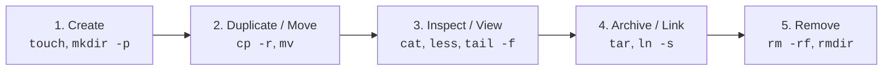
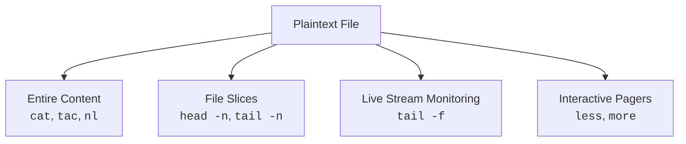
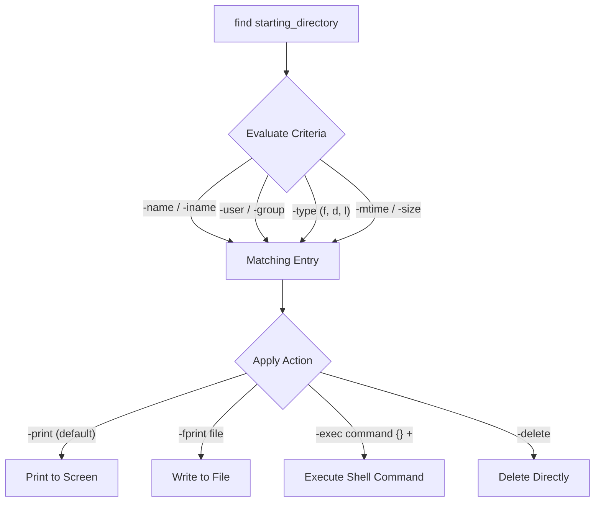
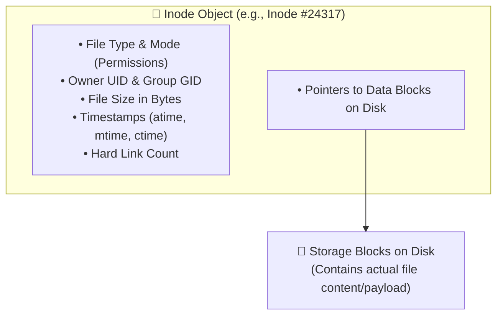
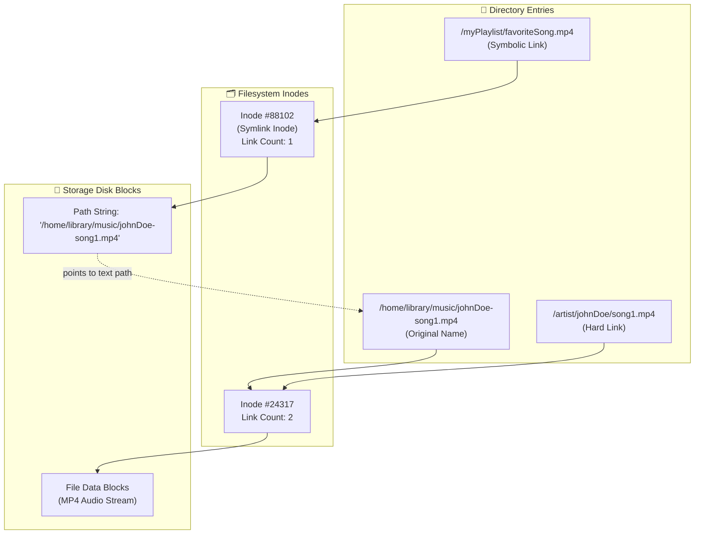
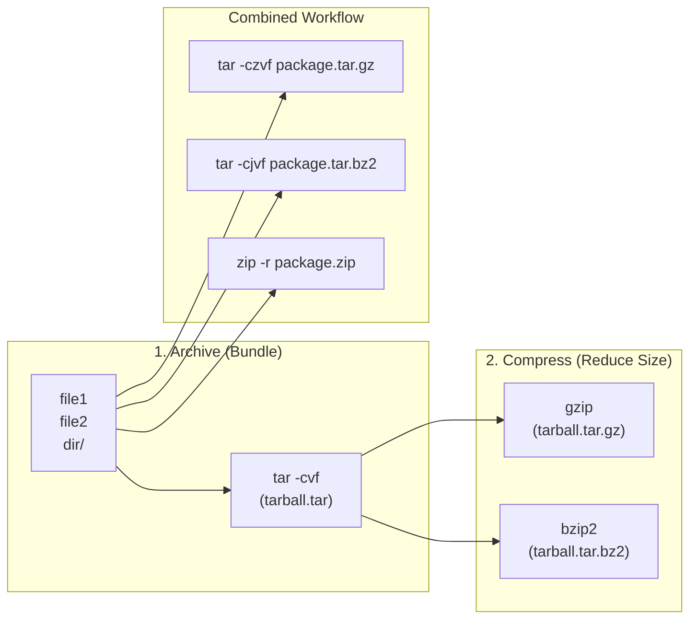

# 📁 Module 02: Working with Files – Study Guide

> **Course**: AWS re/Start Linux Fundamentals  
> **Module**: M02 – Working with Files  
> **Source Document**: `T06-0006-RSLX_EN-US_SG_M02_WORKWITHFILES.pdf`  
> **Target Audience**: AWS re/Start Learners / Linux System Administrators / Cloud Practitioners  

---

## 🎯 Module Overview

In Unix-like operating systems such as Linux, **"everything is a file"**—from user documents and system scripts to hardware peripheral interfaces, kernel state parameters, and running network sockets. Because file management represents the primary mechanism through which systems administrators configure workloads, inspect runtime states, and automate tasks, developing a deep, nuanced mastery of Linux file operations is a prerequisite for administering cloud servers and containerized environments.

This study guide examines the core toolsets and system mechanics required to manipulate, inspect, search, verify, link, archive, and compress files on Linux systems. It covers basic filesystem manipulations (`touch`, `mkdir`, `cp`, `mv`, `rm`), stream viewing and pagination utilities (`cat`, `tac`, `nl`, `head`, `tail`, `less`), program execution tracking (`hash`), data integrity verification (`cksum`), powerful filesystem and content search engines (`find`, `grep`), file comparison (`diff`), filesystem storage mechanics (inodes, hard links, and symbolic links), and multi-file packaging and compression suites (`tar`, `gzip`, `bzip2`, `zip`).

---

### 📌 Learning Objectives

- [ ] **Perform Core File & Directory Operations**: Create empty files and directory hierarchies (`touch`, `mkdir -p`), duplicate files and trees (`cp`, `cp -r`), relocate and rename objects (`mv`), and safely remove entries (`rm`, `rm -rf`, `rmdir`).
- [ ] **Inspect File Contents & Monitor Streams**: View plaintext data using stream utilities (`cat`, `tac`, `nl`), extract file boundaries (`head`, `tail`), monitor live logs in real time (`tail -f`), and navigate large documents using pagers (`less`, `more`).
- [ ] **Track Execution History & Ensure File Integrity**: Inspect and manage the shell's executable location cache (`hash`), and calculate Cyclic Redundancy Checks (`cksum`) to guarantee data integrity across file transfers.
- [ ] **Locate Files & Search Content**: Execute complex filesystem searches based on criteria such as name, ownership, modification timestamp, and size (`find`), run automated actions on matching items (`-exec`, `-delete`, `-fprint`), and scan file contents using regular expressions (`grep`).
- [ ] **Compare File Differences**: Perform line-by-line file comparisons using `diff` to audit configuration changes and generate patch streams.
- [ ] **Understand Inode Architecture & File Links**: Differentiate between hard links (`ln`) and symbolic/soft links (`ln -s`), explain inode allocation mechanics, and predict link behaviors when target files are moved or deleted.
- [ ] **Master Archiving & Compression Utilities**: Bundle files into archive packages (`tar`), compress data using various algorithms (`gzip`, `bzip2`), manipulate cross-platform archives (`zip`, `unzip`), and select appropriate archive flags (`-c`, `-x`, `-t`, `-z`, `-j`, `-v`, `-f`).

---

## 🛠️ 1. Essential File and Directory Operations

Managing files and directories from the command line is foundational to Linux system administration. These core utilities allow administrators to construct directories, create files, duplicate resources, rename paths, and prune unwanted files.



### Creating Files and Directories

#### 1. Creating Empty Files: `touch`
The `touch` command serves two main purposes: creating empty files and updating timestamps on existing files.

```bash
# Create one or more empty files
touch app.log config.yaml server.env

# Update modification time (mtime) and access time (atime) to current system time
touch existing_file.txt

# Explicitly set timestamp (YYYYMMDDhhmm.ss)
touch -t 202610121200.00 audit.log
```

#### 2. Creating Directories: `mkdir`
The `mkdir` (make directory) command creates directory objects in the filesystem.

```bash
# Create a single directory
mkdir project

# Create nested parent directories automatically (-p / --parents)
mkdir -p /opt/myapp/data/logs/archive

# Set permissions during creation (-m / --mode)
mkdir -m 750 secure_vault
```

> [!TIP]
> Always use `mkdir -p` when constructing multi-level directory paths in shell automation scripts. If parent directories already exist, `mkdir -p` will silently proceed without returning a nonzero exit error.

---

### Copying Files and Directories: `cp`

The `cp` command copies files and directory trees from source locations to target paths.

```bash
# Copy a single file
cp source.txt destination.txt

# Copy a file into another directory
cp application.conf /etc/myapp/

# Copy multiple files into a destination directory
cp file1.txt file2.txt file3.txt /backup/

# Recursively copy an entire directory structure (-r or -R)
cp -r /var/www/html /backup/html_backup

# Preserve all file attributes (permissions, ownership, timestamps, symlinks) (-a / --archive)
cp -a /etc/nginx /backup/nginx_conf_backup

# Interactive mode (prompt before overwriting) (-i)
cp -i database.db /var/data/
```

| `cp` Option | Long Flag | Description |
| :--- | :--- | :--- |
| `-r`, `-R` | `--recursive` | Recursively copies directories and subdirectories. |
| `-a` | `--archive` | Preserves structure, attributes, symbolic links, file ownership, permissions, and timestamps. (Equivalent to `-dR --preserve=all`). |
| `-i` | `--interactive` | Prompts before overwriting an existing destination file. |
| `-u` | `--update` | Copies only if the source file is newer than the destination or destination is missing. |
| `-v` | `--verbose` | Displays the name of each file as it is copied. |

---

### Moving and Renaming: `mv`

The `mv` (move) command relocates files and directories within the filesystem hierarchy, and is also used to rename files. Moving a file within the same filesystem does not duplicate data blocks; it simply updates the directory pointer to the file's inode.

```bash
# Rename a file within the current directory
mv old_name.txt new_name.txt

# Move a file to another directory
mv report.pdf /home/student01/documents/

# Move multiple files into a target directory
mv *.csv /home/student01/data_archive/

# Rename a directory
mv /opt/v1_app /opt/v2_app

# Prompt before overwriting existing files (-i)
mv -i staging.db production.db
```

---

### Removing Files and Directories: `rm` and `rmdir`

#### 1. Deleting Files: `rm`
The `rm` (remove) command unlinks and removes files and directories from the filesystem.

```bash
# Remove a single file
rm scratch.txt

# Remove multiple files
rm temp1.tmp temp2.tmp

# Prompt for confirmation before every deletion (-i)
rm -i *.log

# Force removal without prompting or error messages for nonexistent files (-f)
rm -f stale_lockfile.pid

# Recursively remove a directory and its entire contents (-r or -R)
rm -r /tmp/build_artifacts

# Force recursive deletion (USE WITH EXTREME CAUTION)
rm -rf /opt/scratch_dir/
```

> [!CAUTION]
> **Linux Has No "Trash Can" or Recycle Bin**:
> Files deleted with `rm` or `rm -rf` are immediately unlinked from directory index tables, and their storage blocks are marked as free space. Running `rm -rf /` or `rm -rf *` inside the wrong directory (especially as root) can instantly destroy critical system configurations and operating system binaries. Always verify your current working directory (`pwd`) and double-check paths before invoking `rm -rf`.

#### 2. Removing Empty Directories: `rmdir`
The `rmdir` command safely deletes directories, but only if they are completely empty.

```bash
# Removes directory only if it contains no files or subdirectories
rmdir /tmp/empty_folder

# Remove nested empty parent directories (-p)
rmdir -p parent/child/grandchild
```

---

## 👁️ 2. File Viewing and Stream Monitoring Utilities

Inspecting plaintext files without modifying them is one of the most frequent administrative tasks in Linux. Utilities range from basic concatenation tools to advanced interactive pagers and continuous streaming monitors.



### Viewing File Contents: `cat`, `tac`, and `nl`

#### 1. Concatenation and Display: `cat`
`cat` (concatenate) writes the contents of one or more files sequentially to standard output (`stdout`).

```bash
# Display content of a file
cat /etc/resolv.conf

# Concatenate multiple files into a single destination
cat part1.txt part2.txt > full_document.txt

# Display file with line numbers (-n)
cat -n /etc/hosts

# Squeeze repeated empty blank lines into a single blank line (-s)
cat -s application.log

# Show non-printing characters and end-of-line markers ($) (-A or -vET)
cat -A script.sh
```

#### 2. Reverse Line Order Display: `tac`
`tac` (the reverse of `cat`) outputs lines in reverse order, starting from the last line and working up to the first line.

```bash
# View newest log entries first if logs are appended chronologically
tac /var/log/boot.log
```

#### 3. Number Lines: `nl`
`nl` numbers lines of files, providing flexible formatting of headers, footers, body sections, and numbering styles.

```bash
# Display with line numbers formatted to the left
nl /etc/passwd

# Number only non-empty lines (default)
nl document.txt
```

---

### Extracting File Boundaries: `head` and `tail`

When examining large logs or structured configuration files, displaying only the beginning or the end of a file is much faster than outputting the entire file.

#### 1. Displaying File Beginnings: `head`
By default, `head` outputs the first 10 lines of the specified file.

```bash
# Display the first 10 lines (default)
head /var/log/messages

# Display the first 25 lines (-n)
head -n 25 /etc/passwd

# Display the first 100 bytes (-c)
head -c 100 binary_data.bin
```

#### 2. Displaying File Endings: `tail`
By default, `tail` outputs the last 10 lines of the specified file.

```bash
# Display the last 10 lines (default)
tail /var/log/secure

# Display the last 50 lines (-n)
tail -n 50 /var/log/nginx/access.log
```

#### 3. Real-Time Stream Monitoring: `tail -f` and `tail -F`
The `-f` (`--follow`) flag instructs `tail` to keep the file descriptor open and output newly appended lines as they are written by daemons or applications. This is standard practice for monitoring system services and troubleshooting issues.

```bash
# Follow new entries appended to the authentication log
tail -f /var/log/secure

# Follow the end of multiple log files simultaneously
tail -f /var/log/nginx/access.log /var/log/nginx/error.log

# Follow by file name rather than file descriptor (-F / --retry)
# Handles log rotation where the current log is moved and a new file is created
tail -F /var/log/audit/audit.log
```

> [!TIP]
> Use `tail -F` (capital `F`) when monitoring files managed by `logrotate`. While `tail -f` attaches to the inode and stops reporting once `logrotate` moves the file, `tail -F` tracks the file name, automatically reopening the new file when rotation occurs.

---

### Interactive Terminal Pagers: `less` and `more`

When viewing large files (such as `/var/log/messages` or a thousands-of-lines system dictionary), dumping the entire output to the terminal causes buffer scroll overflow. Pagers display content screen-by-screen.

#### 1. The Modern Pager: `less`
The Linux adage states that **"less is more"** because `less` is an advanced successor to the older `more` utility. Crucially, `less` does not read the entire file into memory before opening, allowing instant access to multi-gigabyte log files.

```bash
# Open a file in less
less /var/log/messages

# View standard output piped from another command
ps aux | less
```

**Common `less` Navigation Shortcuts:**

| Key Command | Action |
| :--- | :--- |
| `Space` or `Page Down` | Scroll forward one full window screen |
| `b` or `Page Up` | Scroll backward one full window screen |
| `Enter` or `Down Arrow` | Scroll forward one line |
| `k` or `Up Arrow` | Scroll backward one line |
| `G` | Jump to the very end of the file |
| `1G` or `g` | Jump to the very beginning of the file |
| `/pattern` | Search forward for `pattern` |
| `?pattern` | Search backward for `pattern` |
| `n` | Repeat search for next match |
| `N` | Repeat search for previous match in reverse direction |
| `F` | Follow mode (behaves like `tail -f`; exit with `Ctrl+C`) |
| `q` | Quit `less` and return to the shell |

#### 2. The Legacy Pager: `more`
`more` is an older, primitive paging utility. It allows forward navigation through files, but offers limited backward scrolling and cannot seek backward when reading standard input pipes.

```bash
# Page through a file using more
more /etc/services
```

---

## 🔍 3. Searching, Integrity Verification, and File Comparison

Linux provides a versatile collection of utilities to track recently executed commands, verify that files have not been corrupted during network transit, search filesystem hierarchies for files matching specific criteria, scan file contents for patterns, and compare differences between files.

### Tracking Executable Locations: `hash`

When you type a command into the Bash shell (e.g., `ls` or `grep`), the shell traverses the directories listed in the `$PATH` environment variable to find the corresponding binary. To optimize performance and avoid repeating expensive filesystem lookups, Bash caches the resolved pathname of each executed program in an internal lookup table known as the **hash table**.

The `hash` command displays, resets, or updates this internal cache.

```bash
# Display the current hash table (hits and full pathname)
hash

# Display hash table in reusable format that can be saved or reused
hash -l

# Determine if a specific command is remembered and display its path
hash -t ls

# Add a specific program path manually into the hash table
hash -p /usr/local/bin/custom_tool custom_tool

# Delete a single command entry from the hash table
hash -d grep

# Empty/reset the entire hash table (clears all cached locations)
hash -r
```

| `hash` Option | Purpose |
| :--- | :--- |
| *(no arguments)* | Displays a list of recently run programs, their location, and hit count (how many times run). |
| `-l` | Displays output as shell commands (`builtin hash -p ...`) suitable for reuse as input. |
| `-t <cmd>` | Displays the stored path for `<cmd>`. |
| `-p <path> <cmd>` | Manually sets `<path>` as the full path location for `<cmd>`. |
| `-d <cmd>` | Deletes the location of `<cmd>` from the hash table. |
| `-r` | Resets and empties the entire hash table cache. |

> [!NOTE]
> If you install a new version of a binary into `/usr/local/bin` while an older version in `/usr/bin` was previously executed in your current shell session, Bash will continue executing the old cached path. Run `hash -r` or `hash -d <command>` to flush the cache and force Bash to re-scan `$PATH`.

---

### Data Integrity Verification: `cksum`

When transferring files across networks (e.g., via SCP, SFTP, FTP, or downloading packages from the internet), transmission errors, storage failures, or packet corruption can introduce silent bit flips.

The `cksum` command calculates and outputs:
1. A **Cyclic Redundancy Check (CRC)** 32-bit checksum integer.
2. The exact **file size in bytes**.
3. The **file name** (or stream source).

```bash
# Generate checksum and byte count for a file
cksum /home/student01/dataset.tar
```

**Example Output:**
```
3412589214 4589201 /home/student01/dataset.tar
```
- `3412589214`: The calculated CRC-32 checksum value.
- `4589201`: The file size (in bytes).
- `/home/student01/dataset.tar`: The file pathname.

#### Verification Workflow across System Transfers:
```
[Source Host]                              [Destination Host]
1. Run `cksum archive.tar`                3. Run `cksum archive.tar`
   Output: 3412589214 4589201                Output: 3412589214 4589201
            │                                         │
            └────────► 2. Transfer File ──────────────┘
                       (SCP / SFTP / S3)
                       4. Compare CRC & Bytes:
                          If values match exactly => File is uncorrupted!
                          If values differ        => File was corrupted in transit.
```

> [!TIP]
> While `cksum` uses standard POSIX CRC algorithms, cryptographic hashing utilities such as `sha256sum` or `md5sum` are preferred when verifying files against intentional tampering or security threats. However, for quick verification of accidental transit corruption or disk errors, `cksum` is universal, fast, and built into every standard Linux installation.

---

### Hierarchical Filesystem Search: `find`

The `find` utility traverses directory trees recursively to locate files and directories matching specified logical criteria (name, size, permissions, owner, timestamps) and optionally executes actions on each matched object.

**General Syntax:**
```bash
find [starting_directory] [search_criteria] [action]
```



#### Common Search Options

| Option | Syntax Example | Meaning |
| :--- | :--- | :--- |
| `-name` | `-name "*.conf"` | Matches filename case-sensitively using shell globs. |
| `-iname` | `-iname "filea.txt"` | Matches filename **case-insensitively** (`fileA.txt`, `FILEA.TXT`). |
| `-user` | `-user student01` | Matches files owned by the specified user name or UID. |
| `-group` | `-group devops` | Matches files owned by the specified group name or GID. |
| `-type` | `-type f` (or `d`, `l`) | Matches specific file types: `f` = regular file, `d` = directory, `l` = symbolic link. |
| `-size` | `-size +100M` | Matches files by size: `+` greater than, `-` less than, exact without sign (`c` = bytes, `k` = KB, `M` = MB, `G` = GB). |
| `-mtime` | `-mtime 7` | Matches files modified exactly $7 \times 24$ hours ago. `-mtime -7` means less than 7 days ago; `-mtime +7` means more than 7 days ago. |
| `-maxdepth` | `-maxdepth 1` | Limits search traversal depth (e.g., `1` restricts search to starting directory only). |

#### Actions with `find`

| Action Option | Description | Example |
| :--- | :--- | :--- |
| `-print` | Writes matching pathnames to standard output (default behavior). | `find . -name "*.log"` |
| `-fprint <file>` | Writes matching pathnames directly into a specified output file. | `find /var/log -name "*.gz" -fprint archived_logs.txt` |
| `-exec <cmd> {} \;` | Runs `<cmd>` once for each matching file. `{}` is replaced by the current pathname; `\;` terminates the command. | `find /tmp -type f -name "*.tmp" -exec rm -f {} \;` |
| `-exec <cmd> {} +` | Batches matching files into a single command invocation for better performance. | `find /var/log -name "*.log" -exec chmod 640 {} +` |
| `-delete` | Deletes matching files directly from within `find`. | `find /tmp/junk -type f -delete` |

#### Practical `find` Examples

```bash
# 1. Search starting in current directory for fileA.txt ignoring case:
find . -iname fileA.txt

# 2. Find all files owned by user student01 starting in /home/student01:
find /home/student01 -user student01

# 3. Find all JPEG image files in /home/student01:
find /home/student01 -name "*.jpg"

# 4. Search /etc case-insensitively for .conf files modified exactly 7 days ago:
find /etc -iname "*.conf" -mtime 7

# 5. Search only within the starting directory without recursing into subdirectories:
find /var/log -maxdepth 1 -name "*.log"

# 6. Locate all regular files larger than 50MB and display their human-readable size:
find /var -type f -size +50M -exec ls -lh {} +

# 7. Find all empty directories and remove them:
find /var/tmp -type d -empty -delete
```

---

### Scanning File Content: `grep`

While `find` searches the filesystem for **file objects**, `grep` (Global Regular Expression Print) searches inside files for **strings or text patterns**, printing each matching line.

**Syntax:**
```bash
grep [options] <pattern> <file_or_directory>
```

#### Common `grep` Options

| Option | Flag Description | Practical Use Case |
| :--- | :--- | :--- |
| `-i` | Ignore case distinctions | `grep -i "error" /var/log/messages` |
| `-r`, `-R` | Recursive search across directories | `grep -r "db_password" /etc/wordpress/` |
| `-l` | List filenames only (files with matches) | `grep -rl "deprecated" /src/` |
| `-n` | Prefix output with 1-based line number | `grep -n "root" /etc/passwd` |
| `-c` | Count number of matching lines per file | `grep -c "Failed password" /var/log/secure` |
| `-v` | Invert match (select non-matching lines) | `grep -v "^#" /etc/ssh/sshd_config` (strip comments) |
| `-w` | Match whole words only | `grep -w "port" server.conf` |
| `--files-with-matches` | Equivalent to `-l` (writes matching filenames to stdout) | `grep --files-with-matches "AWS" *.txt` |

#### Practical `grep` Examples

```bash
# Match entries in authentication log containing 'fail':
grep fail /var/log/secure

# Case-insensitive search for failed logins with line numbers:
grep -in "failed" /var/log/secure

# Count how many SSH failures occurred:
grep -c "Failed password" /var/log/secure

# Search recursively for a configuration directive across all files in /etc/nginx:
grep -r "listen 443" /etc/nginx/

# List only the names of configuration files that mention 'upstream':
grep -rl "upstream" /etc/nginx/conf.d/

# View active configurations without empty lines or comment lines:
grep -v "^#" /etc/nginx/nginx.conf | grep -v "^$"
```

---

### Architectural Comparison: `find` vs. `grep`

Because both commands are used for searching, beginner administrators often confuse their roles. Their operational boundaries are distinct:

```
┌────────────────────────────────────────────────────────────────────────┐
│                        Search Tool Distinction                         │
│                                                                        │
│   [ find ]  ──► Operates on METADATA & PATHS (Names, Sizes, Dates)     │
│                 "Where is the file located on the storage disk?"       │
│                                                                        │
│   [ grep ]  ──► Operates on CONTENT (Strings, Characters, Patterns)    │
│                 "What is written inside this file's data blocks?"      │
└────────────────────────────────────────────────────────────────────────┘
```

| Dimension | `find` | `grep` |
| :--- | :--- | :--- |
| **Primary Target** | Filesystem catalog, directory trees, inodes | Data streams, file contents |
| **Search Mechanism** | Filename, path, size, owner, permissions, time | Regular expressions, string matches |
| **Primary Output** | Pathnames of matching files and directories | Lines of text containing the match |
| **Memory / IO Footprint** | Reads directory structures and inode metadata | Opens and reads file contents into buffer |
| **Combined Pipeline Example** | `find /var/log -type f -name "*.log" -exec grep -H "CRITICAL" {} +` |

---

### Comparing File Contents: `diff`

The `diff` utility compares two text files line by line and displays the differences between them. It is essential for auditing configuration drift, comparing code revisions, and verifying backups.

**Syntax:**
```bash
diff [options] file1 file2
```

```bash
# Compare two files using standard default format
diff config_v1.conf config_v2.conf

# Compare using unified format (-u) (standard for code review and patches)
diff -u /etc/nginx/nginx.conf /etc/nginx/nginx.conf.bak

# Ignore whitespace differences (-w)
diff -w script1.sh script2.sh

# Case-insensitive comparison (-i)
diff -i inputA.txt inputB.txt

# Side-by-side comparison with columns (-y)
diff -y file1.txt file2.txt
```

#### Understanding Standard `diff` Output
When running `diff file1.txt file2.txt`:
- Numbers and letters indicate changes (e.g., `4c4` = line 4 was changed; `7a8` = line 8 was added after line 7; `12d11` = line 12 was deleted).
- Lines prefixed with `<` belong to the first file (`file1.txt`).
- Lines prefixed with `>` belong to the second file (`file2.txt`).
- `---` separates the differences between the two files.

---

## 🔗 4. Inode Mechanics and File Links

In Linux, a filename is merely a pointer to an internal data structure known as an **inode** (index node). Understanding how inodes associate names with storage blocks explains the fundamental mechanics of **hard links** and **symbolic (soft) links**.

### What is an Inode?

An **inode** is a data structure on a filesystem that stores all metadata about a filesystem object (file or directory), **except its filename and actual content data**.



An inode contains:
1. **File Type**: Regular file, directory, symlink, character device, socket, FIFO pipe.
2. **Access Permissions**: Read (`r`), write (`w`), execute (`x`) bits for user, group, and others.
3. **Ownership**: Owner UID and group GID.
4. **File Size**: Size of the file in bytes.
5. **Timestamps**:
   - `atime`: Last access time (when file data was last read).
   - `mtime`: Last modification time (when file data was last edited).
   - `ctime`: Last status change time (when file inode metadata or permissions changed).
6. **Hard Link Counter**: The number of directory entries referencing this inode.
7. **Block Pointers**: Direct and indirect pointers indicating which storage disk blocks hold the file's raw payload.

> [!NOTE]
> The filename is **not** stored in the inode. Instead, a directory is a special file containing a list of `(filename, inode_number)` pairs.

To view a file's inode number and attributes:
```bash
# Display inode number in directory listing (-i)
ls -i /home/library/music/johnDoe-song1.mp4

# Display comprehensive inode metadata
stat /home/library/music/johnDoe-song1.mp4
```

---

### Hard Links vs. Symbolic Links Architecture

Linux provides two distinct linking mechanisms:



---

### Hard Links

A **hard link** creates an additional directory entry that points **directly to the existing inode** of an original file. 

**Syntax:**
```bash
ln [options] <original_file> <link_name>
```

**Example:**
```bash
ln /home/userA/dev-project.txt /devprojects/dev-data.txt
```

#### Key Characteristics of Hard Links:
1. **Identical Inode**: Both `<original_file>` and `<link_name>` share the exact same inode number. They are completely indistinguishable from each other.
2. **Link Counter Increment**: Creating a hard link increments the inode's hard link counter by 1.
3. **Data Resilience**: If the original filename is removed with `rm`, the file's data blocks **are not deleted**. The data persists on disk as long as at least one hard link continues to reference the inode. The data is only freed when the link count reaches `0`.
4. **No Visual Difference**: In an `ls -l` listing, a hard link appears like any normal regular file. You can only identify hard links by checking the link count column (greater than 1) and verifying shared inode numbers using `ls -i`.
5. **Filesystem Boundary Restriction**: A hard link **cannot span across different filesystem partitions or mounts** because inode numbers are only unique within a specific filesystem.
6. **No Directory Linking**: Hard links **cannot reference directories** (to prevent infinite recursive loops in filesystem directory trees).

---

### Symbolic (Soft) Links

A **symbolic link** (symlink or soft link) is a distinct, standalone file with its own unique inode. Its data block contains nothing more than the **path string** of the target file or directory.

**Syntax:**
```bash
ln -s [options] <original_target> <link_name>
```

**Example:**
```bash
ln -s /home/userA/dev-project.txt /devprojects/sym-dev-data.txt
```

#### Key Characteristics of Symbolic Links:
1. **Unique Inode**: The symlink possesses its own independent inode number and link count of `1`.
2. **Clear Visual Identifier**: In `ls -l`, a symlink has file type `l` and displays an arrow pointing to its target:
   ```
   lrwxrwxrwx 1 student01 student01 27 Oct 12 12:00 sym-fileA -> /home/student01/fileA.txt
   ```
3. **Supports Directories**: Symbolic links **can point to directories**, allowing administrators to create convenient path shortcuts across large filesystem hierarchies.
4. **Cross-Filesystem Capabilities**: Symlinks can reference targets on separate disk partitions, network shares (NFS), or cloud storage mounts (EFS).
5. **Dangling / Broken Links**: If the original target file is deleted or renamed, the symbolic link breaks (becomes "dangling"). The symlink still exists on disk, but accessing it results in a "No such file or directory" error until a new file is created with the original name.
6. **Points to Paths or Hard Links**: Technically, a symlink can target a hard link or another symlink.

---

### Deep Comparison: Hard Link vs. Symbolic Link

| Feature / Property | Hard Link (`ln`) | Symbolic Link (`ln -s`) |
| :--- | :--- | :--- |
| **Inode Association** | Points directly to the **inode** of the target file | Points to the **pathname string** of the target |
| **Inode Number** | Same inode number as target | Separate, unique inode number |
| **Directory Support** | **No** (prohibited to prevent loops) | **Yes** (fully supported) |
| **Cross-Filesystem** | **No** (restricted to same partition/mount) | **Yes** (spans any mounted filesystem or network share) |
| **Target Deletion Impact** | Data remains accessible via the hard link; link count decrements | Link is broken (dangling); points to missing path |
| **Visual Appearance (`ls -l`)** | Indistinguishable from regular files | Starts with `l`, permissions `rwxrwxrwx`, displays `-> target` |
| **Link Count Column** | Increments inode reference counter | Does not change target's inode reference counter |
| **Storage Usage** | Consumes 0 additional disk blocks | Consumes a small inode and data block (storing path string) |

---

## 📦 5. Archiving and Compression Utilities

Archiving bundles multiple individual files and directory hierarchies into a single consolidated container file. Compression applies mathematical algorithms to reduce the total byte footprint of data files. In Linux, these two operations are often performed together.



---

### Archiving with the `tar` Command

The `tar` (Tape Archive) utility bundles a collection of files and directory trees into a single archive file known as a **tarball**. Originally built for writing sequential magnetic tape backups, `tar` is the universal packaging format for Linux software distribution and backups.

**General Syntax:**
```bash
tar [options] [archive_name.tar] [files_or_directories_to_bundle]
```

#### Primary Mode Operations (Choose exactly one)

| Option | Flag Description | Meaning |
| :--- | :--- | :--- |
| `-c` | `--create` | Creates a new archive file. |
| `-x` | `--extract` | Extracts files from an archive. |
| `-t` | `--list` | Lists the table of contents inside an archive without extracting it. |
| `-r` | `--append` | Appends additional files to an existing uncompressed tar archive. |

#### Common Modifier Flags

| Option | Flag Description | Meaning |
| :--- | :--- | :--- |
| `-f` | `--file` | Specifies the archive filename (must be immediately followed by the filename). |
| `-v` | `--verbose` | Verbosely shows progress by listing each file as it is processed. |
| `-z` | `--gzip` | Compresses or decompresses the archive using the `gzip` utility (`.tar.gz` or `.tgz`). |
| `-j` | `--bzip2` | Compresses or decompresses using `bzip2` (`.tar.bz2`). |
| `-J` | `--xz` | Compresses or decompresses using `xz` (`.tar.xz`). |
| `-C` | `--directory` | Changes directory before performing operations (extracts into target folder). |

#### Core `tar` Command Workflows

```bash
# 1. Create an uncompressed tarball of multiple files:
tar -cvf backup.tar file1 file2 file3

# 2. Create a gzip-compressed tarball of an entire directory:
tar -czvf app_backup.tar.gz /var/www/html

# 3. Create a bzip2-compressed tarball for higher compression:
tar -cjvf logs_archive.tar.bz2 /var/log/

# 4. View table of contents without extracting:
tar -tvf backup.tar
tar -tzvf app_backup.tar.gz

# 5. Extract an archive into the current working directory:
tar -xvf backup.tar
tar -xzvf app_backup.tar.gz

# 6. Extract an archive into a specific target destination directory (-C):
tar -xzvf app_backup.tar.gz -C /opt/deployed_app/
```

> [!IMPORTANT]
> The `-f` option specifies the archive filename. It must always be placed immediately before the archive file name argument:
> - Correct: `tar -czvf mybundle.tar.gz /data`
> - Incorrect: `tar -czfv /data mybundle.tar.gz` (will try to create an archive named `/data`!)

---

### Stream Compression: `gzip` and `gunzip`

The `gzip` (GNU zip) utility compresses individual files using the Lempel-Ziv coding (LZ77) algorithm. Files compressed with `gzip` receive the `.gz` extension.

Unlike `zip`, `gzip` by default compresses a single file in place, replacing the original uncompressed file with the compressed `.gz` version.

```bash
# Compress a single file or tarball (replaces file with file.gz)
gzip salesdata.tar
# Result: salesdata.tar is replaced by salesdata.tar.gz

# Decompress a .gz file (-d or gunzip)
gzip -d salesdata.tar.gz
# Alternatively:
gunzip salesdata.tar.gz

# Keep original file during compression (-k)
gzip -k application.log

# Compress data stream and redirect to stdout (-c)
gzip -c database.sql > database.sql.gz

# Adjust compression level from 1 (fastest, lower ratio) to 9 (slowest, best ratio)
gzip -9 large_dataset.csv
```

**Common Uses of `gzip`:**
- Software distribution over the internet (`.tar.gz`).
- Server log rotation and archiving in `/var/log/`.
- Compressing large database dumps and CSV datasets.

---

### Alternative Compression: `bzip2` and `bunzip2`

The `bzip2` utility compresses files using the Burrows-Wheeler block sorting text compression algorithm and Huffman coding. It produces files with the `.bz2` extension.

- **Advantage**: Achieves significantly higher compression ratios than `gzip` on text files.
- **Trade-off**: Requires higher CPU overhead and runs slower than `gzip`.

```bash
# Compress a file (replaces original with .bz2)
bzip2 large_report.txt

# Decompress a .bz2 file
bunzip2 large_report.txt.bz2
# Or:
bzip2 -d large_report.txt.bz2

# Keep original input file (-k)
bzip2 -k large_report.txt
```

---

### Cross-Platform Archiving: `zip` and `unzip`

The `zip` and `unzip` utilities provide full compatibility with Windows `.zip` files and cross-platform ecosystems. Unlike `tar` + `gzip`, `zip` performs **both packaging and compression in a single operation**.

#### 1. Compressing with `zip`
When compressing directories, you must specify the recursive flag `-r` to ensure that files inside subdirectories are included.

```bash
# Compress a single file
zip archive.zip file1.txt

# Compress multiple files
zip document_bundle.zip file1.txt file2.txt notes.md

# Recursively zip an entire directory tree (-r)
zip -r myproject.zip /home/student01/project/
```

#### 2. Extracting with `unzip`
`unzip` extracts files from a `.zip` container.

```bash
# Extract zip contents into current directory
unzip myproject.zip

# List contents of zip file without extracting (-l)
unzip -l myproject.zip

# Extract into a specific destination directory (-d)
unzip myproject.zip -d /opt/extracted_project/

# Test zip file integrity without extracting (-t)
unzip -t myproject.zip
```

---

### Compression Utilities Comparison Matrix

| Utility / Suite | Resulting Extension | Multi-File Archiving? | Compression Ratio | Speed | Cross-Platform Compatibility |
| :--- | :--- | :--- | :--- | :--- | :--- |
| **`tar`** | `.tar` | **Yes** (bundles files) | None (0% reduction) | Instant (I/O only) | Linux, Unix, macOS |
| **`tar` + `gzip`** | `.tar.gz`, `.tgz` | **Yes** (via tar) | High (~60-70% reduction) | Very Fast | Universal Linux standard |
| **`tar` + `bzip2`**| `.tar.bz2`, `.tbz2`| **Yes** (via tar) | Very High (~70-80% reduction) | Moderate | Standard on Linux / Unix |
| **`tar` + `xz`**   | `.tar.xz`, `.txz`  | **Yes** (via tar) | Maximum (~75-85% reduction) | Slower | Modern Linux kernels/distros |
| **`gzip`** alone   | `.gz` | **No** (single file only) | High | Very Fast | Universal |
| **`zip` / `unzip`**| `.zip` | **Yes** (built-in packaging) | Moderate to High | Fast | Windows, macOS, Linux |

---

## 💡 6. Best Practices in Cloud & Enterprise Environments

1. **Verify Checksums on Ingested Assets**: When transferring configuration artifacts, database backups, or install media into cloud instances (e.g., pulling from Amazon S3 buckets or via SFTP), always compute `cksum` or `sha256sum` to confirm byte parity before initiating deployments.
2. **Handle Log Files with Streaming Tools**: Never open multi-gigabyte production logs with text editors (`vi` or `nano`). Use streaming utilities like `less`, `grep`, or `tail -f` to inspect log data without consuming host RAM.
3. **Use Symlinks for Zero-Downtime Releases**: A standard continuous delivery pattern is to deploy code versions into timestamped folders (e.g., `/var/www/releases/v1.0.4/`) and link `/var/www/current` as a symbolic link pointing to the active release. Updating the link via `ln -sfn` enables atomic version switches with instant rollback capabilities.
4. **Safeguard Automated Deletions**: When using `find ... -delete` or `find ... -exec rm`, always execute the command first with `-print` or `-ls` to verify the exact list of candidate files before running the destructive operation.
5. **Manage Command Hashing in Automation**: When shell deployment scripts install new binaries into `/usr/local/bin` that override distro packages, issue `hash -r` within the script to ensure the active shell invokes the newly provisioned binaries.

---

## 🧠 7. Checkpoint & Knowledge Check

Test your knowledge of Linux file commands, search tools, inode mechanics, and archiving utilities.

### Question 1
**Is it possible to find the files that a specific user owns by using the `find` command?**
> **Answer**: Yes.  
> **Explanation**: The `find` command includes the `-user <username_or_uid>` option, which filters the directory search to return only files owned by the designated user (e.g., `find /home -user student01`).

---

### Question 2
**Which command bundles many files into one archive file?**
> **Answer**: The `tar` command.  
> **Explanation**: The `tar` (Tape Archive) utility aggregates collections of individual files and directory hierarchies into a single consolidated file called a tarball.

---

### Question 3
**You have been asked to ensure that a file is transferred to another user with an absolute guarantee that it has not been damaged or altered in the transfer. How can you accomplish that task using the information in this lesson?**
> **Answer**: Run the `cksum` command on the file on the source machine before transmission and record the resulting CRC value and byte count. After transferring the file, run `cksum` on the destination machine and compare the output. If the checksum values and byte counts match exactly, the file was transferred without corruption.

---

### Question 4
**What is the core structural difference between a hard link and a symbolic link in Linux?**
> **Answer**: A **hard link** points directly to the target file's **inode**, sharing the same inode number and disk data blocks as the original file. A **symbolic link** is an independent file with its own unique inode containing a plaintext path reference pointing to the original file's name.

---

### Question 5
**What happens to a file's data on disk if the original filename of a hard-linked file is deleted?**
> **Answer**: The file data remains completely intact and accessible on disk through the hard link. The kernel only deallocates a file's data blocks when the inode's hard link counter reaches `0` and no open process file descriptors reference it.

---

### Question 6
**If the original target of a symbolic link is deleted, what happens to the symbolic link?**
> **Answer**: The symbolic link becomes **broken** (or dangling). It still exists in the filesystem, but any attempt to read or access it results in an error. If a new file is subsequently created with the original target name, the symbolic link becomes functional again.

---

### Question 7
**How do the primary purposes of the `find` and `grep` commands differ?**
> **Answer**: The `find` command searches filesystem directory trees based on **file metadata** (filename, size, modification timestamp, owner, type) and returns file pathnames. The `grep` command searches inside the **contents** of files for matching strings or regular expression patterns and returns the matching lines of text.

---

### Question 8
**Why is `tail -f` indispensable for system administrators and cloud engineers?**
> **Answer**: `tail -f` continuously monitors and outputs newly appended lines in real time as applications and system daemons write to log files (e.g., `/var/log/messages`, `/var/log/secure`, or web server access logs), enabling immediate debugging and live operational tracking.

---

### Question 9
**Which `tar` command string creates a gzip-compressed archive named `backup.tar.gz` from the directory `/var/data`?**
> **Answer**: `tar -czvf backup.tar.gz /var/data`  
> **Explanation**: `-c` creates the archive, `-z` filters it through gzip compression, `-v` outputs verbose processing details, and `-f` specifies the resulting archive filename.

---

### Question 10
**What does the `hash` command do, and when should you run `hash -r`?**
> **Answer**: `hash` displays and manages the shell's internal cache of program path locations for previously executed commands. You should run `hash -r` to reset this cache whenever executable binaries have been moved, updated, or newly installed into `$PATH` directories to prevent the shell from executing outdated cached paths.

---

## 📝 8. Key Takeaways

- **File and Directory Administration**: Use `touch` to create empty files or update timestamps; `mkdir -p` to construct nested directories; `cp -r` / `cp -a` to duplicate data while preserving attributes; `mv` to relocate or rename objects; and `rm -rf` / `rmdir` for deletion.
- **Viewing and Monitoring Content**: Use `cat`, `tac`, and `nl` for full stream outputs; `head` and `tail` for examining file boundaries; `tail -f` / `tail -F` for real-time log monitoring; and `less` for efficient interactive navigation of large documents.
- **Tracking Shell Execution**: The `hash` command maintains the shell's internal table of recently run programs and their resolved paths, reducing repetitive `$PATH` lookups. Use `hash -r` to flush stale paths.
- **Ensuring File Integrity**: The `cksum` utility computes a 32-bit CRC checksum and byte count to verify that files are transmitted across hosts without data corruption.
- **Searching and Comparing**:
  - `find` searches directory structures based on object metadata (name, user, type, size, modification date) and can invoke actions (`-exec`, `-delete`, `-fprint`).
  - `grep` searches inside file contents for string patterns and regular expressions (`-i`, `-r`, `-l`, `-n`, `-c`).
  - `diff` performs line-by-line file comparisons to identify changes between file versions.
- **Inodes and Linking Mechanics**:
  - An **inode** holds all file metadata and data block pointers except the filename.
  - **Hard links** point directly to an existing inode, cannot span across different filesystems, cannot reference directories, and protect data from accidental deletion until all links are removed.
  - **Symbolic links** store the target's pathname, have unique inodes, can span across filesystems and point to directories, but break if the target file is removed or renamed.
- **Archiving and Compression**:
  - `tar` bundles files into a single archive (`tarball`) using `-c` (create), `-x` (extract), `-t` (list), and `-f` (filename).
  - Integration flags allow direct compression: `-z` for `gzip` (`.tar.gz`), `-j` for `bzip2` (`.tar.bz2`), and `-J` for `xz` (`.tar.xz`).
  - Standalone compression includes `gzip` (`gunzip`), `bzip2` (`bunzip2`), and the cross-platform `zip` (`unzip`) utility.
