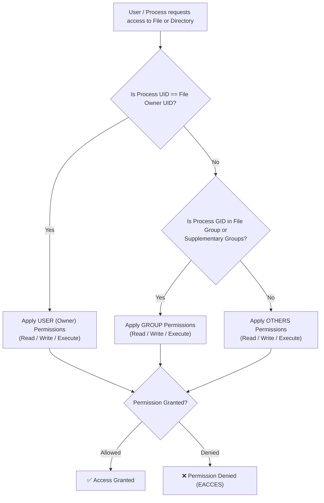
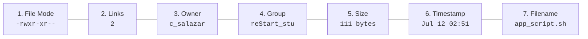
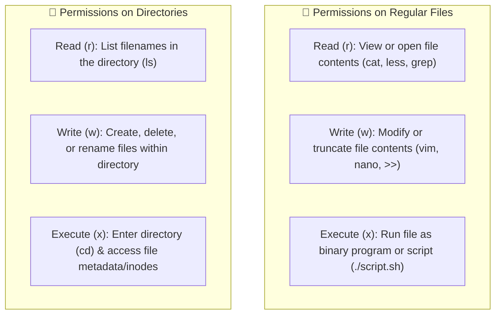
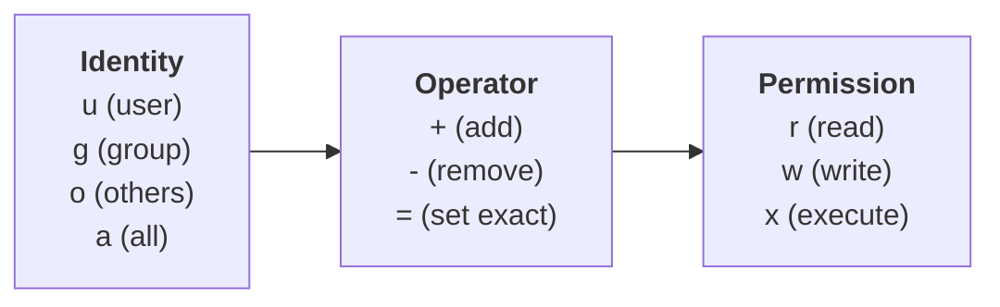
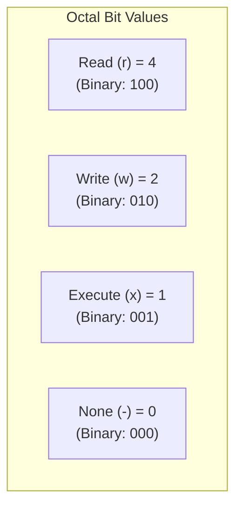
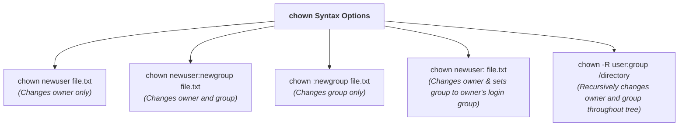
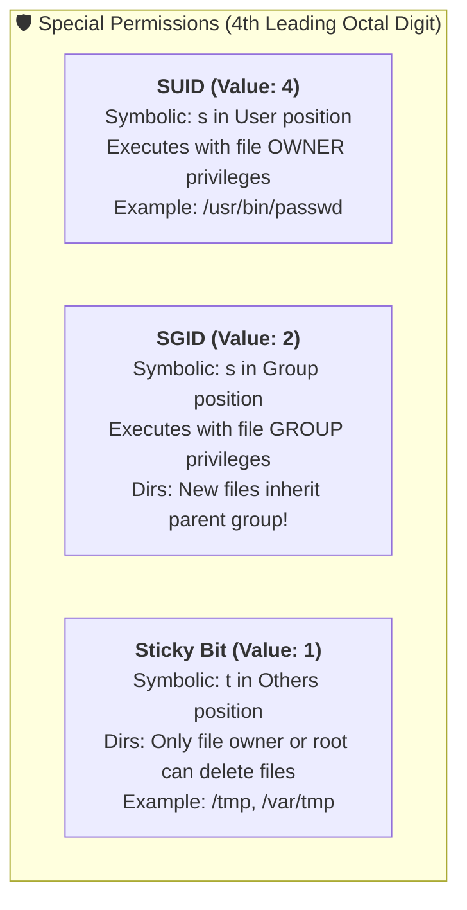
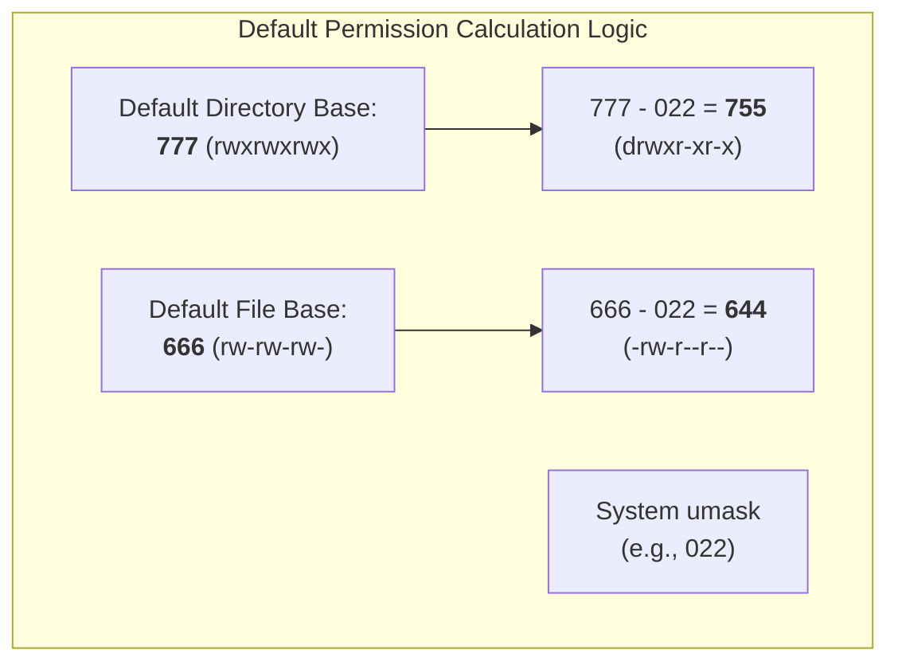
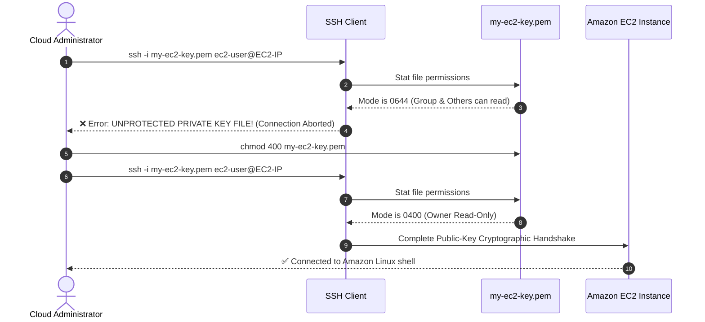

# 🔐 Module 02: Managing File Permissions – Study Guide

> **Course**: AWS re/Start Linux Fundamentals  
> **Module**: M02 – Linux Fundamentals: Managing File Permissions  
> **Source Document**: `T06-0007-RSLX_EN-US_SG_M02_MNGFILEPERMS.pdf`  
> **Target Audience**: AWS re/Start Learners / Linux System Administrators / Cloud Practitioners  

---

## 🎯 Module Overview

Welcome to **Managing File Permissions**. Linux is an enterprise-grade multi-user operating system built on the principle of strict process and data isolation. Every file, directory, process, and hardware device abstraction in Linux is governed by Discretionary Access Control (DAC) attributes. 

File permissions dictate who can read, modify, or execute files, as well as who can inspect, populate, or traverse directories. Misconfigured file permissions represent one of the most common vectors for privilege escalation, accidental data destruction, and compliance violations in production environments and cloud infrastructures such as Amazon Web Services (AWS).

This study guide delivers a comprehensive breakdown of the Linux permissions model, deconstructing the 10-character file mode returned by `ls -l`, contrasting file versus directory permissions, mastering `chmod` in both symbolic and octal modes, changing ownership with `chown` and `chgrp`, calculating default permissions via `umask`, configuring special permissions (SUID, SGID, and Sticky Bit), and hardening cloud workloads.

### 📌 Learning Objectives
- [ ] **Deconstruct the Linux Permissions Triad**: Identify the roles and relationships of User/Owner (`u`), Group (`g`), and Others (`o`).
- [ ] **Interpret `ls -l` File Mode Attributes**: Analyze the 10-character string representing file types and tripartite permission bits.
- [ ] **Differentiate File vs. Directory Permissions**: Understand how `r`, `w`, and `x` function fundamentally differently on regular data files compared to filesystem directories.
- [ ] **Modify Permissions with `chmod`**: Execute permission adjustments using both Symbolic notation (`u/g/o/a +/-/= r/w/x`) and Octal/Numeric notation (`4`, `2`, `1`).
- [ ] **Administer File & Group Ownership**: Use `chown` and `chgrp` to reassign user and group ownership across files and directory trees.
- [ ] **Calculate Default Creation Permissions**: Compute effective directory and file permissions using base permission masks and `umask`.
- [ ] **Implement Special Permission Bits**: Configure and audit SUID (Set User ID), SGID (Set Group ID), and the Sticky Bit on shared directories like `/tmp`.
- [ ] **Apply Cloud & Enterprise Security Standards**: Implement least-privilege configurations, avoid dangerous permissions like `777`, and properly secure AWS EC2 SSH private keys (`chmod 400`).

---

## 👥 1. Linux Identity Architecture & Permission Triads

In Linux, discretionary access control evaluates user identity against filesystem metadata to determine whether an operation is permitted. Every filesystem object possesses an **Owner (User)** and an assigned **Group**.



### The Three Permission Categories

Linux divides all potential system accessors into three distinct identity categories:

| Identity | Shorthand | Description | Security Scope |
| :--- | :---: | :--- | :--- |
| **User (Owner)** | `u` | The single user account that owns the file. Typically the user who created the file. | Has primary authority over the file, including the right to alter its permissions using `chmod`. |
| **Group** | `g` | The user group associated with the file. | All user accounts that belong to this group share the group's designated permission level. |
| **Others** | `o` | Any account on the system that is **neither** the file owner **nor** a member of the assigned group. | Represents the broader system audience or public access tier. |
| **All** | `a` | Combination shorthand for User, Group, and Others (`ugo`). | Applies changes uniformly across all three tiers. |

> [!NOTE]
> **Evaluation Precedence**:
> Linux evaluates permissions strictly from left to right (**Owner** $\rightarrow$ **Group** $\rightarrow$ **Others**). If the requesting process matches the file's owner, Linux evaluates *only* the owner permissions. If the owner permissions deny access (e.g., owner has `---`), access is immediately denied even if the file's group or others have `rwx`!

---

## 🔍 2. Deconstructing `ls -l`: The 10-Character File Mode

The long listing command `ls -l` outputs detailed filesystem metadata for files and directories.

### Anatomical Breakdown of `ls -l` Output

Consider the following output line from `ls -l`:

```bash
-rwxr-xr-- 2 c_salazar reStart_stu 111 Jul 12 02:51 app_script.sh
```



| Field # | Output Field | Example Value | Description |
| :---: | :--- | :--- | :--- |
| **1** | **File Mode** | `-rwxr-xr--` | 10-character string detailing file type and permissions for owner, group, and others. |
| **2** | **Hard Link Count** | `2` | Number of directory entry links referencing this underlying inode. |
| **3** | **Owner Name** | `c_salazar` | The username of the file's owner. |
| **4** | **Group Name** | `reStart_stu` | The group associated with the file. |
| **5** | **File Size** | `111` | Size of the file in bytes (or human-readable with `-h`). |
| **6** | **Timestamp** | `Jul 12 02:51` | Date and time of last content modification (mtime). |
| **7** | **File / Dir Name** | `app_script.sh` | Name of the file, directory, or link target. |

---

### The 10-Character Mode String

The first field of `ls -l` consists of 10 characters structured into four distinct segments:

```text
 1   2 3 4   5 6 7   8 9 10
 -   r w x   r - x   r - -
 |   |___|   |___|   |___|
 |     |       |       |
 |     |       |       +---> Others Permissions (r--)
 |     |       +-----------> Group Permissions (r-x)
 |     +-------------------> User/Owner Permissions (rwx)
 +-------------------------> File Type Indicator (-)
```

#### 1. File Type Indicator (Position 1)
The very first character identifies the filesystem object type:

| Symbol | Object Type | Description |
| :---: | :--- | :--- |
| `-` | **Regular File** | Standard data file, binary executable, or text file. |
| `d` | **Directory** | A folder containing references to other files and directories. |
| `l` | **Symbolic Link** | A pointer / shortcut referencing another file or directory path. |
| `c` | **Character Device** | Serial/stream hardware device interface (e.g., `/dev/tty`, `/dev/null`). |
| `b` | **Block Device** | Block-addressable storage device (e.g., `/dev/sda`, `/dev/nvme0n1`). |
| `s` | **Unix Domain Socket** | Local inter-process communication endpoint. |
| `p` | **Named Pipe (FIFO)** | Inter-process first-in, first-out communication pipe. |

#### 2. The Permission Triads (Positions 2 through 10)
- **Positions 2–4 (`rwx`)**: Permissions assigned to the **File Owner (User)**.
- **Positions 5–7 (`r-x`)**: Permissions assigned to the **Associated Group**.
- **Positions 8–10 (`r--`)**: Permissions assigned to **Others**.

A hyphen (`-`) in any permission position indicates that the corresponding privilege is **denied**.

---

## ⚖️ 3. File Permissions vs. Directory Permissions

One of the most critical concepts in Linux administration is that the three permission flags (`r`, `w`, `x`) carry fundamentally different meanings when applied to a **regular file** versus a **directory**.



### Detailed Functional Comparison

| Permission | On a Regular File (`-`) | On a Directory (`d`) | Command Examples |
| :--- | :--- | :--- | :--- |
| **Read (`r`)** | Allows opening and reading the internal contents of the file. | Allows listing the filenames contained inside the directory. | `cat file.txt`<br>`ls /dir` |
| **Write (`w`)** | Allows modifying, appending to, or truncating the file's data. | Allows **creating**, **deleting**, and **renaming** files within the directory. | `nano file.txt`<br>`touch /dir/new`<br>`rm /dir/old` |
| **Execute (`x`)** | Allows executing the file as an application binary or interpreted script. | Allows **entering / traversing** into the directory (`cd`) and accessing file metadata (inodes). | `./backup.sh`<br>`cd /var/log`<br>`stat /dir/file` |

### ⚠️ Critical Security Nuance: Directory Write vs. File Write

> [!WARNING]
> **Deleting Files You Cannot Write To**:
> In Linux, the ability to delete or rename a file is controlled by the **write and execute permissions of the parent directory**, NOT the permissions on the file itself!
> 
> If user `jdoe` has `rwx` permissions on directory `/shared`, `jdoe` can delete any file inside `/shared` using `rm`—even if the file is owned by `root` with read-only permissions (`-r--------`)!

### Directory Permission Combination Matrix

| Directory Mode | `cd` into dir? | `ls` filenames? | `ls -l` file metadata? | Create / Delete files? |
| :---: | :---: | :---: | :---: | :---: |
| `---` (0) | ❌ Denied | ❌ Denied | ❌ Denied | ❌ Denied |
| `--x` (1) | ✅ Allowed | ❌ Denied | ❌ Denied | ❌ Denied (Can open known files directly) |
| `-w-` (2) | ❌ Denied | ❌ Denied | ❌ Denied | ❌ Denied (Useless without `x`) |
| `r--` (4) | ❌ Denied | ✅ Allowed (Names only) | ❌ Shows `?` for sizes/dates | ❌ Denied |
| `r-x` (5) | ✅ Allowed | ✅ Allowed | ✅ Allowed | ❌ Denied (Standard read-only directory) |
| `rwx` (7) | ✅ Allowed | ✅ Allowed | ✅ Allowed | ✅ Allowed (Full directory management) |

---

## 🛠️ 4. Modifying Permissions: The `chmod` Command

The `chmod` (**ch**ange **mod**e) command modifies access permissions on files and directories. Only the **file owner** or the **root superuser** can alter a file's mode.

Linux supports two distinct syntaxes for `chmod`:
1. **Symbolic Mode**: Intuitive letter-and-symbol syntax.
2. **Absolute (Numeric/Octal) Mode**: Three-to-four digit octal number syntax.

---

### Method 1: Symbolic Mode

Symbolic mode uses characters to specify **who** is affected, **what action** to perform, and **which permissions** to apply.

$$\text{chmod } \mathbf{[Identity]} \mathbf{[Operator]} \mathbf{[Permission]} \text{ <target>}$$



#### Symbolic Components Reference

| Category | Character | Meaning |
| :--- | :---: | :--- |
| **Identities** | `u` | **User** (Owner) |
| | `g` | **Group** |
| | `o` | **Others** |
| | `a` | **All** (`ugo`) |
| **Operators** | `+` | **Grant / Add** the specified permission without changing others |
| | `-` | **Revoke / Remove** the specified permission |
| | `=` | **Set Exact** permission (removes unlisted permissions for that identity) |
| **Permissions** | `r` | **Read** |
| | `w` | **Write** |
| | `x` | **Execute** |
| | `X` | **Conditional Execute** (adds `x` only if target is a directory or already has `x` for another user) |

#### Practical Symbolic Examples

```bash
# Grant execute permission to the file owner
chmod u+x deploy.sh

# Revoke write permission from group members
chmod g-w shared_notes.txt

# Remove all access permissions for others
chmod o-rwx database.env

# Set exact permissions: User gets read/write, Group gets read, Others get none
chmod u=rw,g=r,o= config.yml

# Grant read permission to all identities simultaneously
chmod a+r public_notice.md

# Recursively apply read to all, and execute ONLY to directories or existing executables
chmod -R a+rX /var/www/html/
```

---

### Method 2: Absolute / Numeric (Octal) Mode

In absolute mode, permissions are represented by an octal (base-8) number where each permission is assigned a mathematical bit weight:



By summing these values, any permission combination can be expressed as a single digit from `0` to `7`:

$$\text{Permission Value} = \mathbf{r}(4) + \mathbf{w}(2) + \mathbf{x}(1)$$

#### Octal Value Reference Table

| Octal Digit | Binary Representation | Symbolic Equivalent | Access Level |
| :---: | :---: | :---: | :--- |
| **`7`** | `111` | `rwx` | Read, Write, and Execute |
| **`6`** | `110` | `rw-` | Read and Write |
| **`5`** | `101` | `r-x` | Read and Execute |
| **`4`** | `100` | `r--` | Read only |
| **`3`** | `011` | `-wx` | Write and Execute (Rarely used) |
| **`2`** | `010` | `-w-` | Write only (Rarely used) |
| **`1`** | `001` | `--x` | Execute only (Directory traversal) |
| **`0`** | `000` | `---` | No permissions granted |

#### Deconstructing a Three-Digit Octal Mode

When passing three octal digits to `chmod`, each digit maps to one of the three identity triads:

$$\mathbf{chmod} \quad \underbrace{\mathbf{7}}_{\text{Owner}} \quad \underbrace{\mathbf{5}}_{\text{Group}} \quad \underbrace{\mathbf{5}}_{\text{Others}} \quad \text{script.sh}$$

- **Owner**: `7` $\rightarrow 4 + 2 + 1 \rightarrow$ `rwx`
- **Group**: `5` $\rightarrow 4 + 0 + 1 \rightarrow$ `r-x`
- **Others**: `5` $\rightarrow 4 + 0 + 1 \rightarrow$ `r-x`
- Resulting mode: `-rwxr-xr-x`

#### Industry Standard Octal Modes in Enterprise & AWS

| Octal Mode | Symbolic | Common Use Cases in Production |
| :---: | :---: | :--- |
| **`755`** | `rwxr-xr-x` | Standard for public directories, system utilities (`/usr/bin`), shell scripts, and web server document trees. |
| **`644`** | `rw-r--r--` | Standard for non-sensitive data files, configuration files (`/etc/hosts`), and HTML files. |
| **`700`** | `rwx------` | User-exclusive directories, such as user home directories and SSH key stores (`~/.ssh`). |
| **`600`** | `rw-------` | Sensitive user-exclusive files: SSH user keys (`~/.ssh/id_rsa`), database credentials, SSL private keys. |
| **`400`** | `r--------` | **AWS EC2 SSH Key Pairs (`.pem`)**: Read-only by file owner; blocks all modifications and prevents unauthorized user inspection. |
| **`777`** | `rwxrwxrwx` | **DANGEROUS**: Grants unrestricted read, write, and execute privileges to all system accounts. |

> [!CAUTION]
> **Why `chmod 777` Must Be Avoided**:
> Granting `777` allows any unprivileged user, compromised service account, or malicious process to overwrite, append malicious code to, or delete your files. In AWS environments, automated security compliance scanners (e.g., AWS Security Hub, Amazon GuardDuty) flag `777` permissions as high-severity vulnerabilities.

---

## 👤 5. Changing Ownership: `chown` & `chgrp`

While `chmod` adjusts permissions, the `chown` (**ch**ange **own**er) and `chgrp` (**ch**ange **gr**ou**p**) commands alter file and directory ownership.

### The `chown` Command

In modern Linux systems, **only the root superuser** (or an administrator using `sudo`) can change file ownership to prevent users from bypassing disk quotas or delegating malicious binaries to other accounts.

$$\text{chown [options] } \mathbf{[owner][:[group]]} \text{ <target>}$$



#### Practical `chown` Examples

```bash
# 1. Change owner to c_salazar
sudo chown c_salazar report.docx

# 2. Change owner to c_salazar and group to reStart_stu
sudo chown c_salazar:reStart_stu project_data/

# 3. Change group only using the colon syntax
sudo chown :developers codebase.py

# 4. Recursively update ownership across an entire web application tree
sudo chown -R apache:apache /var/www/html/
```

### The `chgrp` Command

The `chgrp` command is dedicated specifically to altering group ownership:

```bash
# Change group ownership to reStart_stu
sudo chgrp reStart_stu shared_doc.txt

# Recursively change group ownership for an entire directory
sudo chgrp -R webadmins /srv/webapps/
```

> [!NOTE]
> Unlike `chown`, standard unprivileged users can run `chgrp` on files they own, provided they are actively members of the target group.

---

## 🔒 6. Special Permissions: SUID, SGID, and Sticky Bit

Standard Linux permissions handle most daily operations, but multi-user systems require advanced access patterns for password changes, shared team folders, and temporary workspaces. These are governed by **Special Permissions**, represented by a **4th leading octal digit**:

$$\mathbf{chmod} \quad \underbrace{\mathbf{S}}_{\text{Special}} \quad \underbrace{\mathbf{U}}_{\text{User}} \quad \underbrace{\mathbf{G}}_{\text{Group}} \quad \underbrace{\mathbf{O}}_{\text{Others}} \quad \text{target}$$



### 1. SUID (Set User ID) – Numeric Value: `4`
- **Function on Files**: When an executable binary with SUID is launched, it executes with the privileges of the **file owner** rather than the user running it.
- **Symbolic Representation**: An `s` in the user execute position (e.g., `-rwsr-xr-x`). If the file lacks the underlying user execute bit, it appears as an uppercase `S`.
- **Classic Example**: `/usr/bin/passwd`
  ```bash
  $ ls -l /usr/bin/passwd
  -rwsr-xr-x. 1 root root 33600 Apr  7  2020 /usr/bin/passwd
  ```
  *Why it is necessary*: Regular users must be able to change their passwords, which requires writing to `/etc/shadow`. Because `/etc/shadow` is owned by `root` with `000` permissions for others, the SUID bit temporarily grants root authority to the `passwd` executable during execution.

### 2. SGID (Set Group ID) – Numeric Value: `2`
- **Function on Files**: Executable runs with the permissions of the file's assigned group.
- **Function on Directories (Collaboration Pattern)**: When SGID is set on a directory, **any new file or directory created within it automatically inherits the group ownership of the parent directory**, rather than the primary group of the creating user.
- **Symbolic Representation**: An `s` in the group execute position (e.g., `drwxrwsr-x`). If group execute is missing, it displays as uppercase `S`.
- **Setting SGID on Team Directories**:
  ```bash
  sudo chmod 2775 /shared/engineering/
  # Or symbolically:
  sudo chmod g+s /shared/engineering/
  ```

### 3. Sticky Bit – Numeric Value: `1`
- **Function on Directories**: In a world-writable directory, the Sticky Bit prevents users from deleting or renaming files owned by other users. A file can only be deleted or renamed by the **file owner**, the **directory owner**, or the **root superuser**.
- **Symbolic Representation**: A `t` in the others execute position (e.g., `drwxrwxrwt`). If others execute is missing, it displays as uppercase `T`.
- **Classic Example**: The shared temporary directory `/tmp`:
  ```bash
  $ ls -ld /tmp
  drwxrwxrwt. 14 root root 4096 Oct 12 04:00 /tmp
  ```
- **Setting the Sticky Bit**:
  ```bash
  sudo chmod 1777 /shared/scratch/
  # Or symbolically:
  sudo chmod +t /shared/scratch/
  ```

### Special Permissions Summary

| Special Bit | Octal Value | Target | Symbolic Position | Example File Mode | Practical Application |
| :---: | :---: | :--- | :---: | :---: | :--- |
| **SUID** | `4` | Files | User (`u`) $\rightarrow$ `s` / `S` | `-rwsr-xr-x` (`4755`) | Utilities requiring temporary root escalation (`passwd`, `ping`, `sudo`). |
| **SGID** | `2` | Directories | Group (`g`) $\rightarrow$ `s` / `S` | `drwxrwsr-x` (`2775`) | Collaborative group shares ensuring consistent group ownership. |
| **Sticky Bit** | `1` | Directories | Others (`o`) $\rightarrow$ `t` / `T` | `drwxrwxrwt` (`1777`) | Public temporary directories (`/tmp`, `/var/tmp`) preventing cross-user deletion. |

---

## 🧮 7. Default Permissions & The `umask` Calculation

When a user or process creates a new file or directory, Linux automatically assigns default permissions based on the system **`umask`** (user file-creation mode mask).



### Base Permissions Before Masking

Linux starts with fixed base permission masks:
- **Base for Directories**: `777` (`rwxrwxrwx`) — Directories require execute (`x`) permission to allow directory navigation (`cd`).
- **Base for Files**: `666` (`rw-rw-rw-`) — Files are deliberately created **without execute permission** for security.

### How `umask` Filters Bits

The `umask` acts as a bitmask filter: **any bit present in the umask is stripped (revoked) from the base permissions**.

$$\text{Effective Mode} = \text{Base Mode } \mathbf{\&} \ (\sim\text{umask})$$

For standard umask configurations, this can be calculated using subtraction:

$$\text{Directory Permissions} = 777 - \text{umask}$$
$$\text{File Permissions} = 666 - \text{umask}$$

*(Note: For files, if the subtraction would result in an odd number representing execute, the execute bit is dropped to an even number because files never start with execute enabled).*

### Common Umask Scenarios

| User / Role | Typical `umask` | Effective Directory Mode | Effective File Mode | Description |
| :--- | :---: | :---: | :---: | :--- |
| **Root User** | `022` | `755` (`rwxr-xr-x`) | `644` (`rw-r--r--`) | World-readable; only root can write. |
| **Standard User (UPG)** | `002` | `775` (`rwxrwxr-x`) | `664` (`rw-rw-r--`) | Group members can write; used with User Private Groups. |
| **Strict Security** | `027` | `750` (`rwxr-x---`) | `640` (`rw-r-----`) | Members of file group can read; others have zero access. |
| **Paranoid / Private** | `077` | `700` (`rwx------`) | `600` (`rw-------`) | Complete isolation; only the owner has access. |

### Inspecting and Modifying `umask`

```bash
# View the current shell umask in octal format
$ umask
0022

# View the current umask in symbolic format
$ umask -S
u=rwx,g=rx,o=rx

# Change the umask for the active terminal session
$ umask 027
```

To persist umask adjustments globally or per-user, configure `/etc/bashrc`, `/etc/profile`, or user-level configuration files (`~/.bashrc`, `~/.bash_profile`).

---

## 💻 8. Hands-On Demonstration: Identifying & Configuring File Permissions

This practical walkthrough directly mirrors the lab demonstration from Slide 18 of the course curriculum.

### Step 1: Create a Test File
Log in as a standard user (`c_salazar` or `ec2-user`) and create a new empty file using `touch`:

```bash
[c_salazar@linux-server ~]$ touch file_1
```

### Step 2: Examine Initial Attributes with `ls -l`
Inspect the default permissions generated by the system umask:

```bash
[c_salazar@linux-server ~]$ ls -l file_1
-rw-rw-r--. 1 c_salazar reStart_stu 0 Jul 12 02:51 file_1
```

**Observation Checklist**:
- **File Type**: `-` (regular file).
- **Owner**: `c_salazar` (has read and write: `rw-`).
- **Group**: `reStart_stu` (has read and write: `rw-`).
- **Others**: Everyone else has read-only access (`r--`).

### Step 3: Make the File Read-Only by Owner (`chmod 400`)
Restrict permissions so that only the owner can read the file, and all other access is stripped:

```bash
[c_salazar@linux-server ~]$ chmod 400 file_1
```

### Step 4: Verify the New Permission State
Re-run `ls -l` to verify the configuration:

```bash
[c_salazar@linux-server ~]$ ls -l file_1
-r--------. 1 c_salazar reStart_stu 0 Jul 12 02:51 file_1
```

The output confirms:
- User (Owner): `r--` (read-only).
- Group: `---` (no access).
- Others: `---` (no access).

---

### ☁️ AWS Cloud Connection: The `chmod 400` EC2 SSH Key Rule

When connecting to Amazon EC2 Linux instances using SSH and a private key pair (`.pem` file), OpenSSH mandates strict permissions on the key file:

```bash
# Attempting SSH with default download permissions (e.g. 644):
$ ssh -i my-ec2-key.pem ec2-user@54.214.10.25
@@@@@@@@@@@@@@@@@@@@@@@@@@@@@@@@@@@@@@@@@@@@@@@@@@@@@@@@@@@
@         WARNING: UNPROTECTED PRIVATE KEY FILE!          @
@@@@@@@@@@@@@@@@@@@@@@@@@@@@@@@@@@@@@@@@@@@@@@@@@@@@@@@@@@@
Permissions 0644 for 'my-ec2-key.pem' are too open.
It is required that your private key files are NOT accessible by others.
This private key will be ignored.
Load key "my-ec2-key.pem": bad permissions
Permission denied (publickey).
```



**Remediation Command**:
```bash
chmod 400 my-ec2-key.pem
```

---

## 🛡️ 9. Security Best Practices & Enterprise Hardening

Managing file permissions in production Linux and AWS environments requires adherence to security frameworks:

1. **Enforce the Principle of Least Privilege (PoLP)**:
   Grant users and service daemons only the minimum permissions necessary to accomplish their specific tasks. Expand privileges only upon documented operational requirements.
2. **Never Use `chmod 777` in Production**:
   Using `777` as a quick troubleshooting fix introduces critical security vulnerabilities. If a service cannot write to a directory, adjust group membership or ownership with `chown`, rather than granting universal write access.
3. **Lock Down Secret Credentials**:
   Files containing passwords, API tokens, `.env` configurations, and private SSH keys must be restricted to `600` (`rw-------`) or `400` (`r--------`).
4. **Audit SUID and SGID Binaries Regularly**:
   Adversaries frequently leverage misconfigured SUID binaries for root privilege escalation. Scan the filesystem periodically:
   ```bash
   sudo find / -perm /6000 -type f -exec ls -ld {} + 2>/dev/null
   ```
5. **Standardize Filename Hygiene**:
   Limit filenames to alphanumeric characters, hyphens (`-`), underscores (`_`), and periods (`.`). Avoid spaces, shell metacharacters (`*`, `?`, `;`, `&`, `|`, `$`), or unprintable characters that could trigger unintended command injection during script automation.
6. **Enforce Restrictive Umasks**:
   Configure default umasks to `027` or `077` on hardened servers to ensure that newly created files are never exposed to unauthorized system accounts.

---

## 🧠 10. Checkpoint & Knowledge Check

Test your understanding of Linux permissions, ownership, and security concepts.

### Question 1
**What risks are involved if you do not specify proper permissions for your files and directories?**
> **Answer**: You risk exposing confidential information to unauthorized users, enabling tampering or corruption of critical system data, and allowing malicious privilege escalation. Overly permissive configurations (such as `777`) allow any compromised process to alter or delete system files.

---

### Question 2
**What are the primary differences between absolute (numeric) mode and symbolic mode in `chmod`, and when would you choose each?**
> **Answer**:
> - **Absolute Mode** uses three-digit octal numbers (e.g., `chmod 755 file`) to set all permissions for user, group, and others simultaneously. It is preferred when standardizing exact, reproducible permissions.
> - **Symbolic Mode** uses letters and operators (e.g., `chmod g+w file` or `chmod u+x script.sh`) to modify specific permissions without altering the rest of the existing mode. It is preferred for targeted adjustments.

---

### Question 3
**A user has `rwx` permissions on directory `/data`, but only `r--` permission on `/data/report.csv`. Can this user delete the `report.csv` file? Explain why or why not.**
> **Answer**: **Yes, the user can delete the file.**  
> **Explanation**: File deletion and creation are controlled by the **write (`w`) and execute (`x`) permissions of the parent directory**, not the permissions on the target file itself. Because the user has `w` permission on `/data`, they can remove the directory entry pointing to `report.csv`.

---

### Question 4
**Why does an SSH connection to an Amazon EC2 instance fail with the error `UNPROTECTED PRIVATE KEY FILE!`, and what command fixes it?**
> **Answer**: OpenSSH requires that private key files (`.pem`) be accessible only by the file owner. If permissions allow group or other accounts to read the key (e.g., `644`), SSH aborts the connection for security. The fix is running `chmod 400 key.pem` (or `chmod 600 key.pem`).

---

### Question 5
**What is the purpose of setting the Sticky Bit on the `/tmp` directory?**
> **Answer**: The Sticky Bit (`drwxrwxrwt`, octal `1777`) allows all users to create and edit their own temporary files in `/tmp`, but prevents users from deleting or renaming files owned by others. Only the file owner, directory owner, or root superuser can delete a sticky-bit protected file.

---

### Question 6
**If a system has a default `umask` of `027`, what will be the resulting permissions for a newly created regular file and a newly created directory?**
> **Answer**:
> - **Directory**: `777 - 027 = 750` (`drwxr-x---`)
> - **File**: `666 - 027 = 640` (`-rw-r-----`)  
> *(The owner gets full access, the group gets read/traverse, and others have zero access).*

---

## 📝 11. Key Takeaways

- Every Linux file and directory assigns permissions across three distinct tiers: **User/Owner (`u`)**, **Group (`g`)**, and **Others (`o`)**.
- The `ls -l` command displays a **10-character file mode** string: position 1 designates the file type (`-`, `d`, `l`), followed by three triads of `rwx` permissions.
- Permissions have different meanings on files vs. directories:
  - **Read (`r`)**: Read file contents vs. List directory contents.
  - **Write (`w`)**: Edit file contents vs. Add/delete/rename files in directory.
  - **Execute (`x`)**: Run executable/script vs. Enter directory (`cd`) and access inodes.
- The **`chmod`** command adjusts permissions using **symbolic notation** (`u+x`, `g-w`, `o=`) or **absolute/octal notation** (`755`, `644`, `400`).
- Octal values are based on binary weights: **Read = 4**, **Write = 2**, **Execute = 1**, **None = 0**.
- **`chown`** reassigns user and group ownership (`chown user:group file`), while **`chgrp`** alters group ownership.
- Special permissions provide advanced security and collaboration capabilities:
  - **SUID (`4`)**: Executes binary with owner privileges (e.g., `passwd`).
  - **SGID (`2`)**: Inherits parent directory group for newly created files.
  - **Sticky Bit (`1`)**: Restricts file deletion in world-writable directories (e.g., `/tmp`).
- Default permissions are calculated at creation time by subtracting the **`umask`** from the base masks (`777` for directories, `666` for files).
- Always secure AWS EC2 private keys with **`chmod 400`** to satisfy SSH client security requirements.
