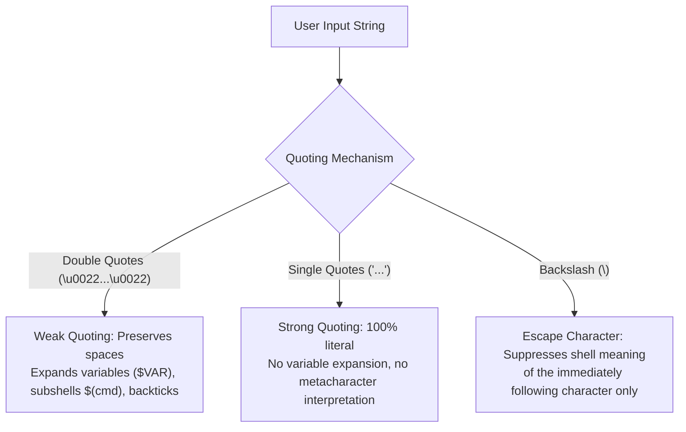
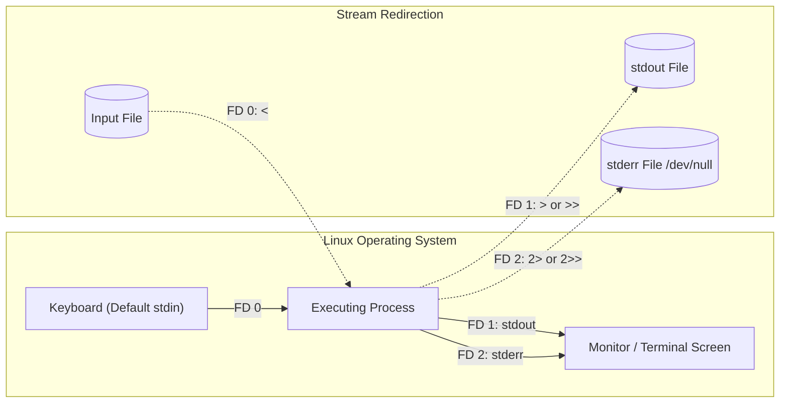
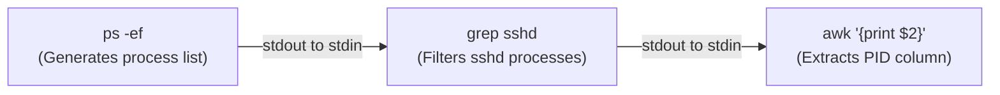
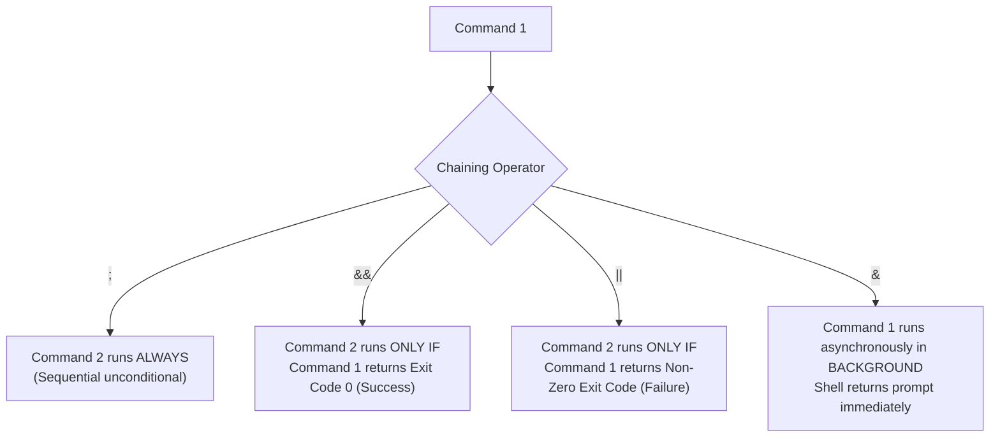
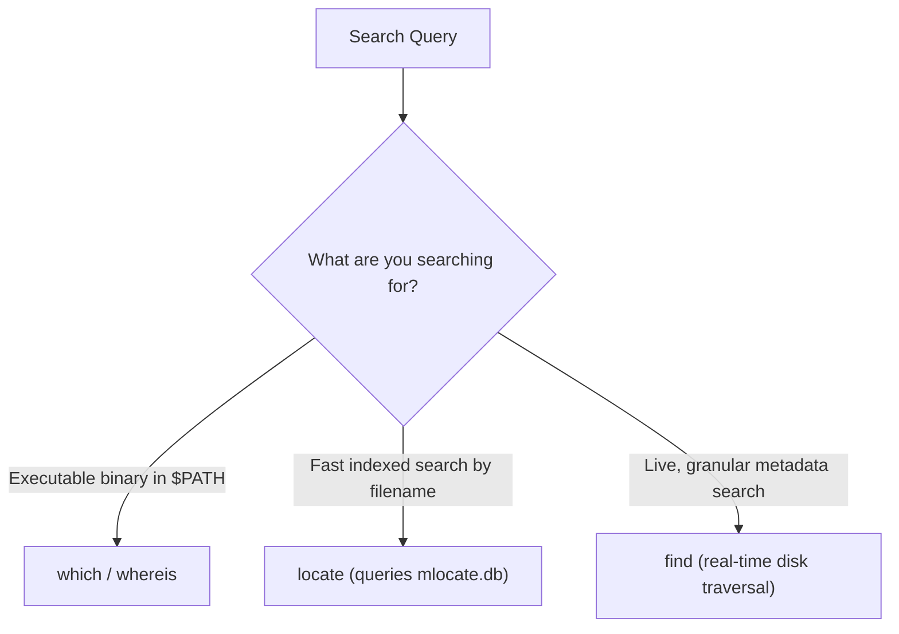
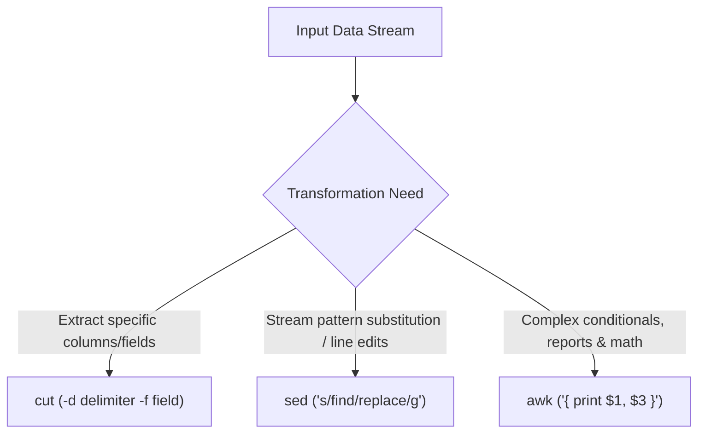
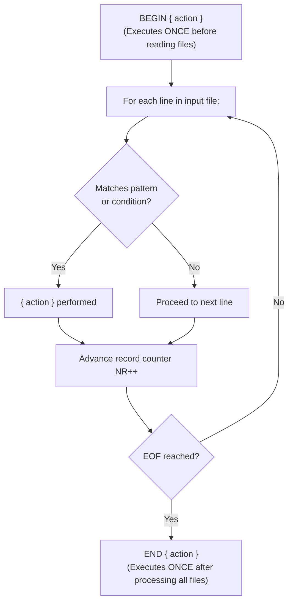
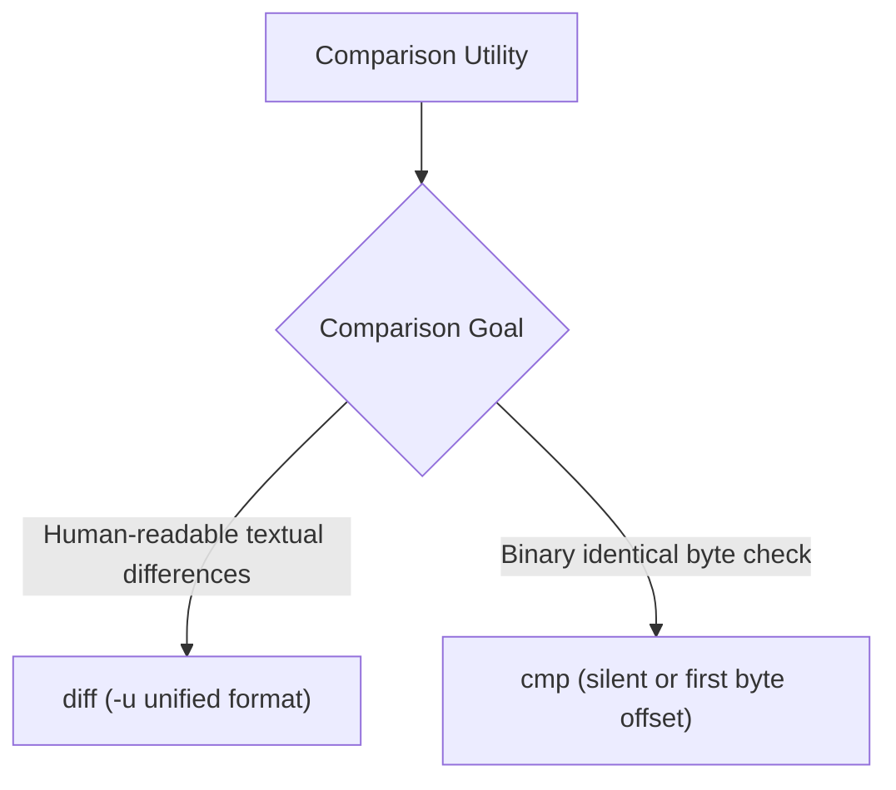

# ⚙️ Module 02: Working with Commands – Study Guide

> **Course**: AWS re/Start Linux Fundamentals  
> **Module**: M02 – Working with Commands  
> **Source Document**: `T06-0008-RSLX_EN-US_SG_M02_WORKINGCMNDS.pdf`  
> **Target Audience**: AWS re/Start Learners / Linux System Administrators / Cloud Practitioners  

---

## 🎯 Module Overview

In modern cloud computing and enterprise Linux administration, mastering individual commands is only the beginning. The true strength of the Linux Command Line Interface (CLI) lies in **combinatorial power**: the ability to assemble simple, modular utilities into sophisticated data processing pipelines. By adhering to the Unix philosophy—*"write programs that do one thing well, and write programs to work together"*—administrators and cloud engineers can extract insights from gigabytes of log files, automate repetitive infrastructure tasks, and perform system forensics without writing complex software applications.

This study guide examines the core mechanisms that turn the Bash shell into a high-productivity automation engine:
1. **Command Syntax & Shell Delimiters**: How the shell interprets whitespace, arguments, and quoting mechanisms.
2. **Metacharacters & Wildcard Expansion**: How globbing matches dynamic file patterns without manual enumeration.
3. **Standard Input/Output Redirection & Stream Routing**: How file descriptors (`stdin`, `stdout`, `stderr`) are directed, appended, separated, and safeguarded against accidental clobbering.
4. **Pipes and Multi-Stage Stream Processing**: How data flows seamlessly between processes in memory using `|` and `tee`.
5. **Command Substitution & Chaining Operators**: How command results are captured into runtime parameters and sequenced conditionally (`&&`, `||`, `;`, `&`).
6. **Advanced File Finding & Locating**: Locating assets across hierarchical filesystems with `find`, `locate`, `which`, and `whereis`.
7. **The Text Processing Powerhouse Trio**: Filtering and transforming textual streams using `grep`, `cut`, `awk`, and `sed`.
8. **Sorting, Deduplication, Counting, and Diffing**: Organizing tabular data and comparing files with `sort`, `uniq`, `wc`, `diff`, and `cmp`.

---

### 📌 Learning Objectives

- [ ] **Analyze Shell Delimiters & Quoting Mechanisms**: Contrast unquoted strings, double quotes (`" "`), single quotes (`' '`), and the backslash escape (`\`) when passing arguments with embedded whitespace or metacharacters.
- [ ] **Apply Bash Wildcards & Globbing**: Implement glob patterns using asterisk (`*`), question mark (`?`), character classes (`[a-z]`, `[0-9]`), negation (`[!a-z]`), and brace expansions (`{}`) to batch-process files.
- [ ] **Master Standard I/O Redirection**: Route File Descriptors 0 (`stdin`), 1 (`stdout`), and 2 (`stderr`) using `<`, `>`, `>>`, `2>`, `2>>`, and `&>`; prevent data loss using the `noclobber` shell option.
- [ ] **Construct Memory-Efficient Pipelines**: Chain commands with the pipe operator (`|`) and split output streams simultaneously to terminal screens and log files with `tee` (and `tee -a`).
- [ ] **Execute Command Substitution & Chaining**: Nest dynamic subshell output using `$(command)` and `` `command` ``, and sequence command execution conditionally using `;`, `&&`, `||`, and background tasks with `&`.
- [ ] **Locate Files & Binaries Accurately**: Query files by metadata (name, type, size, modification time) using `find` with `-exec`, compare with the indexed database of `locate`/`updatedb`, and identify binary paths with `which` and `whereis`.
- [ ] **Perform Advanced Text Filtering**: Extract pattern matches from log files using `grep` and `grep -E` (or `egrep`) with essential flags (`-i`, `-v`, `-n`, `-c`, `-r`, `-w`, `-l`, `-o`).
- [ ] **Transform Structured Text**: Dissect delimited data using `cut` (`-d`, `-f`, `-c`, `-b`), perform programmatic stream edits with `sed` (`s/pattern/replacement/[g|n]`, line deletion `d`, in-place editing `-i`), and write field-oriented report programs using `awk` (`-F`, `$1...$NF`, `NR`, `NF`, `BEGIN`/`END`, conditional logic).
- [ ] **Sort, Deduplicate, Count, and Compare Data**: Reorder lines with `sort` (`-n`, `-r`, `-k`, `-u`, `-M`), aggregate recurring lines with `uniq` (`-c`, `-d`), count volume with `wc` (`-l`, `-w`, `-c`), and detect differences using `diff` and `cmp`.

---

## 🔤 1. Shell Delimiters, Arguments & Quoting Rules

### Whitespace as a Delimiter
In Bash, the whitespace character (space or tab) serves as the primary **argument delimiter**. When a command line is submitted, the shell scans the string and splits it into discrete tokens separated by spaces:
- Token 0: The command binary, alias, or built-in function name.
- Tokens 1..*N*: Individual arguments passed into the command.

```bash
usermod -c devuser jdoe
# Token 0: 'usermod'
# Token 1: '-c'
# Token 2: 'devuser' (the comment argument)
# Token 3: 'jdoe'    (the target username)
```

If an argument contains spaces that are meant to belong to a single value, failing to quote that argument causes Bash to split it into multiple separate parameters, leading to syntax errors:

```bash
usermod -c This is a dev user jdoe
# ERROR: usermod expects exactly two parameters with -c:
# -c <comment> <username>
# Bash passes: 'This', 'is', 'a', 'dev', 'user', 'jdoe' (6 parameters!)
```

### The Three Quoting Mechanisms in Bash

To instruct Bash to treat whitespace and metacharacters literally rather than as delimiters or control operators, Linux provides three distinct quoting mechanisms:



| Quoting Mechanism | Shell Notation | Behavior & Interpretation | Practical Example | Resulting Value |
| :--- | :---: | :--- | :--- | :--- |
| **Double Quotes** *(Weak Quoting)* | `"..."` | Preserves whitespace; allows variable expansion (`$VAR`), command substitution (`$(cmd)`), and arithmetic expansion (`$((...))`). Suppresses wildcards (`*`, `?`). | `USER="admin"; echo "User is $USER"` | `User is admin` |
| **Single Quotes** *(Strong Quoting)* | `'...'` | Treats every character literally. Variable expansion, globbing, and escape sequences are completely disabled. | `echo 'User is $USER'` | `User is $USER` |
| **Backslash** *(Character Escape)* | `\` | Strips special shell meaning from the single character directly following it. | `echo \$USER\ is\ \$10` | `$USER is $10` |

```bash
# Correctly adding a multi-word user comment using double quotes:
usermod -c "This is a dev user" jdoe

# Contrasting quoting behavior:
PRICE=50
echo "The price is $PRICE dollars"   # Output: The price is 50 dollars
echo 'The price is $PRICE dollars'   # Output: The price is $PRICE dollars
echo "The price is \$PRICE dollars"  # Output: The price is $PRICE dollars
```

---

## 🌟 2. Bash Metacharacters & Globbing Wildcards

Bash metacharacters are characters that carry special syntactic meaning to the shell rather than representing literal text. When used for matching file names, this process is known as **globbing** (pathname expansion). Globbing is performed by the shell *before* the resulting arguments are passed to the command.

### Primary Wildcards & Metacharacters

| Metacharacter | Technical Name | Meaning / Expansion Rule | Practical Example | Matches |
| :---: | :--- | :--- | :--- | :--- |
| `*` | Asterisk / Star | Matches **zero or more** characters of any type (excluding leading dots in hidden files). | `cp *.txt /backup/` | `a.txt`, `log.txt`, `very_long_file_name.txt` |
| `?` | Question Mark / Hook | Matches **exactly one** character of any type. | `rm sales_201?.txt` | `sales_2017.txt`, `sales_2018.txt`, `sales_2019.txt` (NOT `sales_2020.txt`) |
| `[...]` | Character Class / Set | Matches **any single character** explicitly enclosed within the brackets. | `ls log_[abc].txt` | `log_a.txt`, `log_b.txt`, `log_c.txt` |
| `[a-z]` | Range Expression | Matches any single character within the specified ASCII / collation range. | `ls log_[a-e].txt` | `log_a.txt`, `log_b.txt`, `log_c.txt`, `log_d.txt`, `log_e.txt` |
| `[!...]` or `[^...]` | Negated Character Set | Matches any single character **not** listed inside the brackets. | `ls file_[!0-9].txt` | `file_a.txt`, `file_z.txt` (Excludes `file_1.txt`) |
| `~` | Tilde | Expands to the absolute path of the current user's **home directory** (`/home/username`). | `cd ~/Documents` | `/home/ec2-user/Documents` |
| `-` | Hyphen / Dash | In directory navigation (`cd -`), references the **previous working directory** (`$OLDPWD`). | `cd -` | Toggles back to prior directory |
| `;` | Semicolon | Command separator; executes sequential commands regardless of exit status. | `date ; whoami ; pwd` | Runs all three commands in sequence |

---

### Wildcard Matching Mechanics & Case Studies

#### Case Study A: The Asterisk (`*`) Multi-Character Wildcard
Consider a directory containing:
```text
myfile.txt
myFilesList.txt
sales_22082020.txt
myFile
pic.png
Desktop/
documents/
```

Executing:
```bash
cp *.txt documents/
```
The shell matches every filename ending in `.txt`. Only `myfile.txt`, `myFilesList.txt`, and `sales_22082020.txt` are passed to `cp`. Files lacking the extension (`myFile`), other extensions (`pic.png`), and directories are ignored.

#### Case Study B: The Question Mark (`?`) Single-Character Wildcard
A financial directory contains sales and customer logs:
```text
sales_2017.txt
sales_2018.txt
sales_2019.txt
sales_2020.txt
sales_2021.txt
customers_2020.txt
customers_2021.txt
```

Executing:
```bash
rm sales_201?.txt
```
- `sales_2017.txt`, `sales_2018.txt`, and `sales_2019.txt` match `sales_201` + **single character** + `.txt` and are deleted.
- `sales_2020.txt` and `sales_2021.txt` do **not** match because the fourth digit is `2` (not preceded by `201`).
- `customers_*.txt` files do not match the prefix and remain untouched.

#### Case Study C: Bracket Character Sets & Composite Expressions
Bracket sets can specify literal lists, ranges, or alphanumeric combinations:

```bash
# Match exact characters 'a', 'b', or 'c':
ls log_[abc].txt          # Matches log_a.txt, log_b.txt, log_c.txt

# Match range from 'a' through 'e':
ls log_[a-e].txt          # Matches log_a.txt ... log_e.txt

# Match one alphanumeric letter followed by one digit:
ls log_[a-zA-Z][0-9].txt  # Matches log_A1.txt, log_z9.txt

# Composite wildcard combining ?, bracket ranges, and *:
ls log_?[a-zA-Z0-9]*
# Breakdown:
# 1. Starts with literal 'log_'
# 2. Exactly one arbitrary character (?)
# 3. Exactly one alphanumeric character ([a-zA-Z0-9])
# 4. Zero or more arbitrary trailing characters (*)
```

---

## 🔀 3. Standard I/O Streams & Redirection

In Linux, all process communication relies on the POSIX abstraction of **Standard Input/Output (I/O) Streams**. Every executing process is automatically assigned three standard file descriptors (FD 0, FD 1, and FD 2) by the kernel:



### File Descriptors and Redirection Operators

| File Descriptor | Stream Name | Default Device | Operator | Behavior |
| :---: | :--- | :--- | :---: | :--- |
| **0** | **`stdin`** (Standard Input) | Keyboard (`/dev/tty`) | `<` | Redirects input from a file into the command. |
| **1** | **`stdout`** (Standard Output) | Screen / Console | `>` | **Overwrites** command output into a target file. |
| **1** | **`stdout`** (Standard Output) | Screen / Console | `>>` | **Appends** command output to the end of a file. |
| **2** | **`stderr`** (Standard Error) | Screen / Console | `2>` | **Overwrites** error messages into a target file. |
| **2** | **`stderr`** (Standard Error) | Screen / Console | `2>>` | **Appends** error messages to the end of a file. |
| **1 & 2** | Both `stdout` & `stderr` | Screen / Console | `&>` or `>&` | Redirects **both** standard output and error to a file. |
| **1 & 2** | Both `stdout` & `stderr` | Screen / Console | `> file 2>&1` | POSIX-compliant syntax directing `stdout` to file and `stderr` to `stdout`. |

---

### Practical Redirection Workflows

#### 1. Constructing System Diagnostic Records
Using `>` to initialize a file and `>>` to append subsequent diagnostic data without truncating earlier entries:

```bash
# Overwrite or create info.txt with system uptime:
uptime > info.txt

# Append the system hostname:
hostname >> info.txt

# Append network interface IP address details:
ip addr show eth0 >> info.txt

# Inspect accumulated file content:
cat info.txt
# Output:
#  14:22:05 up 12 days,  3:14,  1 user,  load average: 0.05, 0.03, 0.00
#  ip-172-31-42-105.ec2.internal
#  2: eth0: <BROADCAST,MULTICAST,UP,LOWER_UP> mtu 9001 qdisc mq state UP ...
```

#### 2. Redirecting Standard Input (`<`)
Rather than relying on arguments, commands can ingest stream buffers from files:
```bash
# Supply input text from info.txt to less pager:
less < info.txt

# Count lines using stdin (omits file name from output):
wc -l < /etc/passwd
```

#### 3. Error Redirection & The Bit Bucket (`/dev/null`)
When running commands across unprivileged directories, non-root users encounter permission errors that clutter screen output. Separating `stdout` from `stderr` keeps output clean:

```bash
# Divert error messages into error.log:
find /var/log -name "*.log" 2> error.log

# Suppress errors completely by sending FD 2 to the Linux null device (/dev/null):
find / -name "app.config" 2> /dev/null

# Log valid results to results.txt while discarding errors:
find /home -user ec2-user > results.txt 2> /dev/null
```

---

### The `noclobber` Safety Mechanism

> [!CAUTION]
> By default, the `>` redirection operator **silently overwrites** existing file contents without prompt or confirmation. A single typo like `echo "done" > /etc/hosts` can corrupt vital system configuration files.

To prevent accidental file clobbering, modern Linux administrators configure the shell option `noclobber`:

```bash
# Enable protection against accidental overwrites:
set -o noclobber

# Attempting to overwrite an existing file triggers an error:
echo "test1" > textfile.txt
echo "test2" > textfile.txt
# Bash response: -bash: textfile.txt: cannot overwrite existing file

# Appending remains fully permitted:
echo "test2" >> textfile.txt

# Forcing an intentional overwrite using the special redirection operator >| :
echo "forced overwrite" >| textfile.txt

# Disable noclobber protection (revert to default behavior):
set +o noclobber
```

---

## ⛓️ 4. Pipelines & Stream Splitting (`|` and `tee`)

### The Pipe Operator (`|`)
The pipe operator connects the **Standard Output (FD 1)** of one process directly into the **Standard Input (FD 0)** of the succeeding process. Data transfers occur in kernel memory buffers without creating temporary intermediate files on disk.



```bash
# Filter active secure shell processes:
ps -ef | grep sshd

# Pipe directory listing through less for interactive pagination:
ls -l /etc | less

# Multi-stage pipeline: List processes, filter by user, extract columns:
ps -au | grep ec2-user | awk '{print $1, $2}'
```

---

### The `tee` Command: Splitting Output Streams
Standard redirection is binary: output goes **either** to the screen (default) **or** to a file (`>`). 

The `tee` utility acts as a T-junction pipe fitting: it reads standard input and writes it simultaneously to **both** standard output (the terminal screen) and one or more target files.

```mermaid
flowchart LR
    Cmd["hostname"] -->|pipe \| | Tee["tee file1.txt"]
    Tee -->|"Stream 1 (stdout)"| Term["Terminal Display"]
    Tee -->|"Stream 2 (write)"| Disk[("file1.txt")]
```

| Syntax | Screen Display | Target File Action | Use Case |
| :--- | :---: | :---: | :--- |
| `cmd > file.txt` | No | Overwrite file | Silent batch output capture |
| `cmd \| less` | Yes (in pager) | No file created | Visual interactive reading |
| `cmd \| tee file.txt` | Yes | **Overwrites** file | Real-time monitoring + logging |
| `cmd \| tee -a file.txt` | Yes | **Appends** to file | Audited script execution & builds |

```bash
# Capture hostname to terminal and file simultaneously:
hostname | tee file1.txt

# Capture package installation log in real time while viewing terminal progress:
yum update -y | tee -a /var/log/system_update.log
```

---

## ⚡ 5. Command Substitution & Execution Chaining

### Command Substitution: `$(command)` vs `` `command` ``
Command substitution executes a shell command within a subshell, captures its standard output, strips trailing newlines, and substitutes that output directly into the outer command line.

- **Modern Form (POSIX Preferred)**: `$(command)`
  - Fully nestable: `$(dirname $(which python3))`
  - Clear readability with matched parentheses.
- **Legacy Form**: `` `command` `` (Backticks)
  - Obsolete; difficult to distinguish from single quotation marks (`'`).
  - Nesting requires cumbersome backslash escapes: `` `cmd1 \`cmd2\` ` ``.

```bash
# Inject current date into a backup archive filename:
tar -czvf backup-$(date +%F).tar.gz /var/www/html/

# Query and display kernel release dynamically:
echo "Current operating kernel is $(uname -r)"

# Store command output in a variable for script reuse:
IP_ADDR=$(hostname -I | awk '{print $1}')
echo "Binding service to IP: $IP_ADDR"
```

> [!TIP]
> **Performance & Idempotence Notice**: If a command takes significant time or queries an external network resource, invoke it once via command substitution into a shell variable. Do not invoke it repeatedly in a loop if the value remains static. Conversely, if the system state changes dynamically during execution (e.g., checking process memory usage), re-evaluate the command instead of caching it.

---

### Execution Chaining Operators

Linux provides four distinct operators to control command sequencing, concurrency, and conditional logic:



| Operator | Name | Logic / Execution Rule | Example |
| :---: | :--- | :--- | :--- |
| `;` | **Semicolon** | **Unconditional Sequence**: Runs Command 2 after Command 1 finishes, regardless of success or failure. | `date ; uptime ; whoami` |
| `&&` | **Logical AND** | **Conditional Success**: Runs Command 2 **only if** Command 1 completes with exit status `0` (Success). | `mkdir -p /app/data && cd /app/data` |
| `\|\|` | **Logical OR** | **Conditional Failure**: Runs Command 2 **only if** Command 1 exits with a **non-zero** status (Error). | `ping -c 1 8.8.8.8 \|\| echo "Network Down"` |
| `&` | **Background Task** | **Asynchronous**: Spawns command as a background job, freeing the shell immediately. | `yum -y update &` |

```bash
# Enterprise web server bootstrap chain:
# Updates packages, installs Apache, and starts service only if preceding steps succeed:
yum update -y && yum install -y httpd && systemctl start httpd
```

---

## 🔍 6. Searching & Locating Assets: `find`, `locate`, `which`, `whereis`

Linux provides complementary utilities for discovering files and binaries across the filesystem:



### Comparing File Discovery Utilities

| Command | Search Target | Search Scope | Data Source | Speed | Metadata Filtering |
| :--- | :--- | :--- | :--- | :---: | :---: |
| **`which`** | Executables only | Directories in `$PATH` | `$PATH` environment | Instant | No |
| **`whereis`** | Binaries, sources, man pages | Standard system paths | Hardcoded system directories | Instant | No |
| **`locate`** | File names only | Entire system | Pre-built database (`mlocate.db`) | Very Fast | No (Name only) |
| **`find`** | Files, directories, sockets, pipes | Specified root path down | Live filesystem tree traversal | Moderate | **Extremely Granular** |

---

### Deep Dive: The `find` Utility
The `find` command traverses one or more directory hierarchies, evaluating file attributes against user-defined tests and executing actions against matches.

```bash
find [search_path] [options_and_predicates] [actions]
```

#### Essential `find` Predicates

| Predicate | Purpose | Examples & Syntax |
| :--- | :--- | :--- |
| **`-name`** / **`-iname`** | Matches file name (`-iname` is case-insensitive). Supports wildcards enclosed in quotes. | `find /etc -name "*.conf"`<br/>`find /var/www -iname "index.html"` |
| **`-type`** | Filters by filesystem object type (`f`=regular file, `d`=directory, `l`=symlink, `s`=socket). | `find /var/log -type f`<br/>`find /etc -type d` |
| **`-size`** | Filters by size (`+`=greater than, `-`=less than; units: `k`=KiB, `M`=MiB, `G`=GiB). | `find /var -size +100M`<br/>`find /tmp -size -10k` |
| **`-mtime`** | Filters by modification time in 24-hour days (`+N`=older than N days, `-N`=within last N days). | `find /var/log -mtime +30`<br/>`find /data -mtime -7` |
| **`-mmin`** | Filters by modification time in minutes. | `find /etc -mmin -60` *(modified in last hour)* |
| **`-user`** / **`-group`** | Matches files owned by specific user or group. | `find /home -user ec2-user` |
| **`-perm`** | Matches file permission modes (octal notation). | `find /var/www -perm 644` |

#### The `-exec` Action
The `-exec` predicate executes an arbitrary Linux command on every discovered object:
- `{}` is replaced by the current file path.
- `\;` executes the command once per matched file.
- `+` aggregates matched files as arguments into a single command invocation (substantially faster, like `xargs`).

```bash
# Locate and remove all temporary log files older than 14 days:
find /var/log/custom -type f -name "*.tmp" -mtime +14 -exec rm -f {} \;

# Locate all world-writable files and secure them to 644 in batches:
find /var/www/html -type f -perm 777 -exec chmod 644 {} +

# Locate files containing specific text using find piped to grep:
find /etc -type f -name "*.conf" -exec grep -Hn "Listen" {} +
```

---

### `locate`, `which`, and `whereis`

```bash
# 1. Update the index database before running locate (requires root):
sudo updatedb

# 2. Instantly locate all files containing 'nginx' in the path:
locate nginx.conf

# 3. Discover the exact executable path resolved by Bash:
which python3
# Output: /usr/bin/python3

# 4. Locate binary, source, and manual page locations simultaneously:
whereis nginx
# Output: nginx: /usr/sbin/nginx /etc/nginx /usr/share/man/man8/nginx.8.gz
```

---

## 🎯 7. Text Filtering with `grep` & `grep -E` (Regular Expressions)

`grep` (*Global Regular Expression Print*) processes input line by line and outputs lines that match a specified pattern or regular expression.

```bash
grep [options] 'pattern' [file(s)]
```

### Essential `grep` Flags & Options

| Option Flag | Long Flag | Description & Operational Effect |
| :---: | :--- | :--- |
| **`-i`** | `--ignore-case` | Ignores character case distinctions (`FAIL`, `Fail`, and `fail` all match). |
| **`-v`** | `--invert-match` | Inverts matching logic; selects non-matching lines (essential for stripping comments/blanks). |
| **`-n`** | `--line-number` | Prefixes each matching output line with its 1-based line number in the source file. |
| **`-c`** | `--count` | Suppresses normal output and displays only the numerical count of matching lines. |
| **`-r`** / **`-R`** | `--recursive` | Traverses directories recursively (`-R` dereferences symbolic links). |
| **`-w`** | `--word-regexp` | Matches only whole words bounded by whitespace or non-word characters. |
| **`-l`** | `--files-with-matches` | Suppresses matching lines and lists only the names of files containing matches. |
| **`-o`** | `--only-matching` | Prints only the exact matching segment of the line rather than the full line. |
| **`-E`** | `--extended-regexp` | Enables POSIX Extended Regular Expressions (ERE), identical to running `egrep`. |

---

### Practical `grep` Patterns in Cloud Administration

```bash
# 1. Inspect failed authentication attempts in system security logs:
grep -i "failed" /var/log/secure

# 2. View clean configuration files without comments (#) or empty lines:
grep -v "^#" /etc/ssh/sshd_config | grep -v "^$"

# 3. Search recursively for database credentials across configuration files:
grep -rn "DB_PASSWORD" /var/www/html/

# 4. Count the number of HTTP 500 errors in an access log:
grep -c "HTTP/1.1\" 500" /var/log/httpd/access_log

# 5. Using Extended Regular Expressions (ERE) with grep -E:
# Match instances where error status is either 500, 502, 503, or 504:
grep -E "HTTP/1.1\" (500|502|503|504)" /var/log/nginx/access.log

# Match valid IPv4 addresses using character classes and repetition:
grep -Eo '([0-9]{1,3}\.){3}[0-9]{1,3}' /var/log/messages
```

---

## ✂️ 8. Text Transformation: `cut`, `sed`, and `awk`

Linux provides three specialized tools for parsing, altering, and reformatting structured text.



---

### Tool 1: The `cut` Command
`cut` extracts vertical slices (bytes, characters, or delimited fields) from each line of text and emits them to `stdout`.

```bash
cut [options] [file]
```

| Option | Flag Description | Practical Use Case |
| :---: | :--- | :--- |
| **`-d 'char'`** | Delimiter | Specifies field separator character (default is tab `\t`). |
| **`-f N,M`** | Field selection | Selects field indices (1-indexed); supports lists (`1,3`) and ranges (`2-4`). |
| **`-c N-M`** | Character selection | Extracts characters by column positions. |
| **`-b N-M`** | Byte selection | Extracts raw bytes (relevant for multi-byte Unicode/UTF-8 encodings). |

#### `cut` Syntax & Examples

```bash
# Sample CSV data file (names.csv):
# Alejandro,Rosalez,38,Developer
# Jane,Doe,29,Architect
# Carlos,Salazar,42,Manager

# Extract only the first name (-d ',' -f 1):
cut -d ',' -f 1 names.csv
# Output:
# Alejandro
# Jane
# Carlos

# Extract first name and title (-f 1,4):
cut -d ',' -f 1,4 names.csv

# Extract characters 1 through 5 of each line:
cut -c 1-5 names.csv

# Extract from character 4 to the end of the line:
cut -c 4- names.csv

# Extract from character 1 through 3:
cut -c -3 names.csv

# Parse system usernames from /etc/passwd:
cut -d ':' -f 1 /etc/passwd
```

---

### Tool 2: The `sed` Stream Editor
`sed` (*Stream Editor*) is a non-interactive, programmable text editor. It reads lines sequentially into a pattern buffer, applies user-supplied editing commands, and outputs the result without modifying the original input file (unless requested with `-i`).

```bash
sed [options] 'command' [input_file]
```

#### The Substitution Command Structure: `s/pattern/replacement/flags`

```text
sed 's/page/website/g' example.txt
     │ └─┬─┘ └──┬──┘ │
     │   │      │    └─ Flags: g = global (all matches on line); n = nth occurrence
     │   │      └────── Replacement string
     │   └───────────── Search pattern / regular expression
     └───────────────── Action: s = substitute
```

| Substitution Variant | Syntax | Operational Outcome |
| :--- | :--- | :--- |
| **First Occurrence** | `sed 's/page/website/' file.txt` | Replaces only the **first** match on each line. |
| **Nth Occurrence** | `sed 's/page/website/2' file.txt` | Replaces only the **second** occurrence on each line. |
| **Global Replacement** | `sed 's/page/website/g' file.txt` | Replaces **every** occurrence across all lines. |
| **In-place Editing** | `sed -i 's/foo/bar/g' file.txt` | Modifies the target file directly on disk. |
| **In-place with Backup** | `sed -i.bak 's/foo/bar/g' file.txt` | Edits file on disk while saving original as `file.txt.bak`. |
| **Specific Line Only** | `sed '3 s/page/website/' file.txt` | Applies substitution exclusively to line 3. |
| **Line Range** | `sed '1,5 s/page/website/g' file.txt` | Applies substitution only on lines 1 through 5. |
| **Line Deletion** | `sed '/^#/d' file.txt` | Deletes all lines matching pattern (comments starting with `#`). |

```bash
# Pipeline substitution:
echo "Welcome to the test page on this page" | sed 's/page/website/'
# Output: Welcome to the test website on this page (only 1st match altered)

echo "Welcome to the test page on this page" | sed 's/page/website/g'
# Output: Welcome to the test website on this website (all matches altered)

# Stream cleanup: delete blank lines and comment lines:
sed -e '/^$/d' -e '/^#/d' /etc/nginx/nginx.conf
```

---

### Tool 3: The `awk` Data Processing Language
Created by Alfred **A**ho, Peter **W**einberger, and Brian **K**ernighan, `awk` is a full pattern-scanning and data processing programming language. It is optimized for columnar tables and structured records.

#### `awk` Operational Model
`awk` reads input file(s) line by line (records). For each record, it parses columns split by whitespace (default) or a custom field delimiter (`-F`), assigning values to built-in positional variables:
- `$0`: The entire line.
- `$1, $2, ... $NF`: Individual fields 1 through N.
- `NF`: Built-in variable representing the **Number of Fields** on the current line.
- `NR`: Built-in variable representing the **Number of Records** (current line number).

```bash
awk [options] 'pattern { action }' input_file
```



#### Core Syntax & Options

| Option / Pattern | Syntax | Description |
| :--- | :--- | :--- |
| **Field Separator** | `awk -F ',' '{print $1}'` | Sets input field separator to comma. |
| **Explicit Script File** | `awk -f script.awk data.txt` | Reads awk rules from an external script file. |
| **Variable Declaration**| `awk -v threshold=80 '$2 > threshold'` | Injects external shell variable into awk runtime. |
| **`BEGIN` Block** | `BEGIN { print "Report Header" }` | Runs initialization logic prior to record processing. |
| **`END` Block** | `END { print "Total Records: " NR }` | Runs summarization logic after final record. |

#### Practical `awk` Examples

```bash
# Sample data: names.csv
# Alejandro,38,developer
# Jane,29,architect
# Carlos,42,manager
# Pat,9,intern

# 1. Print specific fields:
awk -F ',' '{ print $1, $3 }' names.csv
# Output:
# Alejandro developer
# Jane architect
# Carlos manager
# Pat intern

# 2. Filter records where the age ($2) is strictly greater than 35:
awk -F ',' '$2 > 35 { print $1 " is older than 35 (" $2 ")" }' names.csv
# Output:
# Alejandro is older than 35 (38)
# Carlos is older than 35 (42)

# 3. Pattern match with regex (lines containing two consecutive digits):
awk -F ',' '/[0-9][0-9]/ { print $1 }' names.csv
# Outputs: Alejandro, Jane, Carlos (Pat is filtered out because age 9 has only 1 digit)

# 4. Formatted reporting with BEGIN and END blocks:
awk -F ',' '
BEGIN { print "=== EMPLOYEES REPORT ===" }
{ print NR ". Name: " $1 " | Role: " $3 }
END { print "=== Processed " NR " total employees ===" }' names.csv

# 5. Extract system usernames and primary group IDs from /etc/passwd:
awk -F ':' '{ printf "%-20s GID: %d\n", $1, $4 }' /etc/passwd
```

---

## 📊 9. Sorting, Deduplication, Counting & File Comparison

### Sorting Data with `sort`
The `sort` command arranges lines of text from standard input or files into ordered sequences.

```bash
sort [options] [file]
```

#### Collation & Precedence Rules
By default (without flags), `sort` evaluates entire lines using standard ASCII character ordering:
1. Lines beginning with numbers appear first.
2. Lines beginning with uppercase letters or lowercase letters follow based on locale settings (`LC_COLLATE`).
3. Lexicographic comparison (`10` appears before `2` because character `'1'` < `'2'`).

#### Essential `sort` Flags

| Flag | Meaning | Detailed Operational Effect |
| :---: | :--- | :--- |
| **`-n`** | Numeric sort | Sorts based on arithmetic numerical value (`2` evaluates before `10`). |
| **`-r`** | Reverse order | Inverts the sort results (descending order). |
| **`-u`** | Unique | Deduplicates lines during sorting (emits only the first of duplicate keys). |
| **`-k N`** | Key / Column | Sorts according to the *N*-th column field (can specify `-k 2,2`). |
| **`-t 'char'`** | Field separator | Defines the column delimiter when used alongside `-k` (default: whitespace). |
| **`-M`** | Month sort | Recognizes 3-letter month abbreviations (`JAN`, `FEB`, `MAR`). |
| **`-o file`** | Output file | Writes results directly to file (safe to specify the input file as output). |
| **`-c`** | Check sorted | Checks whether file is sorted; exits with non-zero status if unsorted. |

```bash
# Sort usernames numerically by UID (column 3 of /etc/passwd):
sort -t ':' -k 3,3n /etc/passwd

# Sort file by month and save to output:
sort -M server_events.log -o sorted_events.log
```

---

### Deduplication with `uniq`
The `uniq` command detects, reports, or filters out duplicate lines from input streams.

> [!IMPORTANT]
> **Prerequisite of `uniq`**: `uniq` detects adjacent identical lines **only**. If duplicate lines are separated by other content, `uniq` will not catch them. Therefore, input **must always be piped through `sort` first**:
> ```bash
> sort file.txt | uniq [options]
> ```

| Option | Name | Operational Effect |
| :---: | :--- | :--- |
| **`-c`** | Count | Prefixes lines with the number of times each line occurred in the input. |
| **`-d`** | Duplicates only | Displays **only** lines that occurred more than once. |
| **`-u`** | Unique only | Displays **only** lines that occurred exactly once (no duplicates). |
| **`-i`** | Ignore case | Case-insensitive comparison. |

```bash
# Count frequency of IP addresses accessing a web server:
awk '{print $1}' /var/log/httpd/access_log | sort | uniq -c | sort -nr | head -n 10
# Sample output:
#    452 192.168.1.100
#    184 10.0.0.45
#     92 172.16.5.12
```

---

### Counting Metrics with `wc`
`wc` (*Word Count*) calculates line, word, character, and byte metrics.

```bash
wc [options] [file]
```

| Flag | Metric Measured | Description |
| :---: | :--- | :--- |
| **`-l`** | Newline / Line count | Total count of newline characters (`\n`). |
| **`-w`** | Word count | Count of whitespace-delimited words. |
| **`-c`** | Byte count | Total byte size of file. |
| **`-m`** | Character count | Total characters (relevant for multi-byte UTF-8). |

```bash
# Determine total number of user accounts on system:
wc -l /etc/passwd
# Output: 38 /etc/passwd

# Count files in current directory without directory listings:
ls -1 | wc -l
```

---

### Comparing Files: `diff` and `cmp`
When auditing configuration files across environments or rollbacks, engineers compare files using `diff` and `cmp`.



| Utility | Input Type | Output Format | Primary Use Case |
| :--- | :--- | :--- | :--- |
| **`diff`** | Plaintext files | Line-by-line diff (`<` old, `>` new, or `---`/`+++` unified) | Code review, configuration change audit, patches |
| **`diff -u`** | Plaintext files | Unified format with context lines | Standard Git and patch generation |
| **`cmp`** | Binary or text | Byte number and line number of first divergence | Fast binary equality checks |

```bash
# Generate unified diff between original and updated config:
diff -u /etc/nginx/nginx.conf /etc/nginx/nginx.conf.new

# Output sample:
# --- /etc/nginx/nginx.conf     2026-10-12 10:00:00.000000000 +0000
# +++ /etc/nginx/nginx.conf.new 2026-10-12 10:05:00.000000000 +0000
# @@ -15,3 +15,3 @@
# -    worker_connections 768;
# +    worker_connections 1024;

# Binary check between two compiled assets:
cmp -s build_v1.bin build_v2.bin
echo $?  # 0 = identical, 1 = differ
```

---

## 🛠️ 10. Production Recipes & End-to-End Pipelines

In real-world cloud architectures, single commands are combined to extract telemetry, perform security audits, and transform system logs.

### Recipe 1: Top 5 HTTP Client IP Addresses Generating Traffic
Extract client IPs from Nginx/Apache logs, sort, count occurrences, and display the top 5 contributors:

```bash
awk '{print $1}' /var/log/nginx/access.log \
  | sort \
  | uniq -c \
  | sort -nr \
  | head -n 5
```

### Recipe 2: Auditing Non-System Users with Interactive Shells
Extract regular users (UID $\ge$ 1000) whose login shell is an interactive shell (`/bin/bash` or `/bin/sh`):

```bash
awk -F ':' '$3 >= 1000 && $7 ~ /(bash|sh)/ { printf "User: %-15s UID: %-5s Home: %s\n", $1, $3, $6 }' /etc/passwd
```

### Recipe 3: Batch Updating Outdated Configuration Directives
Perform an in-place configuration change across multiple configuration files, replacing legacy port `8080` with `443` while retaining safety backups:

```bash
find /etc/app/conf.d/ -type f -name "*.conf" -exec sed -i.bak 's/8080/443/g' {} +
```

### Recipe 4: Finding Large Inactive Log Files Consuming Disk Space
Identify regular files in `/var/log` greater than 50 Megabytes modified over 30 days ago:

```bash
find /var/log -type f -size +50M -mtime +30 -exec ls -lh {} +
```

### Recipe 5: Monitoring Real-Time Failed SSH Login Attacks
Stream `/var/log/secure` in real time, extract failed login IP addresses, and write to an incident report while alerting the console:

```bash
tail -n 0 -F /var/log/secure \
  | grep --line-buffered -i "Failed password" \
  | awk '{for(i=1;i<=NF;i++) if($i=="from") print $(i+1)}' \
  | tee -a /var/log/ssh_failed_attempts.log
```

---

## 📋 11. Command & Metacharacter Quick-Reference Cheat Sheet

### Metacharacters & Redirection

| Operator | Category | Purpose | Syntax Example |
| :---: | :--- | :--- | :--- |
| `*` | Globbing | Matches 0 or more characters | `ls *.log` |
| `?` | Globbing | Matches exactly 1 character | `ls file_202?.csv` |
| `[a-z]` | Globbing | Character range class | `ls host[1-4]` |
| `"` | Quoting | Weak quoting (preserves space, expands `$`) | `"Hello $USER"` |
| `'` | Quoting | Strong quoting (preserves exact literal text) | `'No $EXPANSION'` |
| `>` | Redirection | Overwrites `stdout` to file | `uptime > up.txt` |
| `>>` | Redirection | Appends `stdout` to file | `hostname >> up.txt` |
| `<` | Redirection | Directs file content to `stdin` | `wc -l < data.txt` |
| `2>` | Redirection | Overwrites `stderr` to file | `app 2> err.log` |
| `2>>` | Redirection | Appends `stderr` to file | `app 2>> err.log` |
| `&>` | Redirection | Directs both `stdout` & `stderr` | `build &> build.log` |
| `\|` | Redirection | Pipes `stdout` to next `stdin` | `ps aux \| grep py` |
| `$(...)` | Substitution | Captures output of command | `DIR=$(pwd)` |
| `;` | Execution | Sequences commands unconditionally | `cmd1 ; cmd2` |
| `&&` | Execution | Sequences commands if prior succeeds | `test -f f && cat f` |
| `\|\|` | Execution | Sequences commands if prior fails | `test -f f \|\| touch f` |
| `&` | Execution | Runs command asynchronously in background | `backup.sh &` |

---

### Text Processing & System Utilities

| Command | Key Flags | Core Description | Example |
| :--- | :--- | :--- | :--- |
| **`find`** | `-name`, `-type`, `-size`, `-mtime`, `-exec` | Searches filesystem by metadata | `find / -name "*.conf" 2>/dev/null` |
| **`locate`** | `-i`, `-n` | Searches pre-indexed file database | `locate nginx.conf` |
| **`which`** | None | Returns path to binary in `$PATH` | `which aws` |
| **`whereis`** | `-b`, `-m`, `-s` | Locates binary, man page, source | `whereis python` |
| **`grep`** | `-i`, `-v`, `-n`, `-c`, `-r`, `-w`, `-l`, `-E` | Filters text matching regex pattern | `grep -rn "error" /var/log/` |
| **`cut`** | `-d`, `-f`, `-c`, `-b` | Extracts delimited fields or columns | `cut -d: -f1,7 /etc/passwd` |
| **`sed`** | `-i`, `s/find/repl/g`, `/patt/d` | Non-interactive stream editor | `sed -i 's/foo/bar/g' file.txt` |
| **`awk`** | `-F`, `$1`, `NF`, `NR`, `BEGIN`, `END` | Columnar pattern-scanning language | `awk -F, '$2>50 {print $1}' f.csv` |
| **`sort`** | `-n`, `-r`, `-u`, `-k`, `-t`, `-M`, `-o` | Sorts lines numerically/alphabetically | `sort -nr -k2 data.txt` |
| **`uniq`** | `-c`, `-d`, `-u`, `-i` | Aggregates/filters adjacent lines | `sort file \| uniq -c` |
| **`wc`** | `-l`, `-w`, `-c`, `-m` | Counts lines, words, bytes | `wc -l /etc/services` |
| **`tee`** | `-a` | Duplicates stdin to stdout and files | `echo "hi" \| tee -a log.txt` |
| **`diff`** | `-u`, `-i`, `-w` | Displays line-by-line file differences | `diff -u fileA fileB` |
| **`cmp`** | `-s`, `-l` | Byte-level file comparison | `cmp file1.bin file2.bin` |

---

## ❓ 12. Checkpoint Questions & Knowledge Review

### Slide Checkpoint Questions & Authoritative Solutions

#### Question 1: When do you use the `?` wildcard instead of the `*` wildcard?
**Answer**:
Use the question mark (`?`) wildcard when you need to match **exactly one single unknown character** in a specific position, rather than an arbitrary or indefinite number of characters. 
- Use case for `?`: You have a directory with quarterly reports named `report_2021_Q1.pdf` through `report_2021_Q4.pdf` and want to target strictly those single-digit quarters using `report_2021_Q?.pdf`.
- If you used `report_2021_Q*.pdf`, it would also match unwanted multi-character names like `report_2021_Q1_final_revision_v2.pdf`.

#### Question 2: How does the `uniq` command help with log-file analysis?
**Answer**:
Log files in enterprise servers contain thousands or millions of redundant entries (e.g., repeated error traces, web client visits, or authentication queries). 
1. When combined with `sort`, running `uniq -c logfile.log` summarizes massive log files by consolidating identical lines and prefixing each entry with an occurrence count.
2. Administrators can pipe this output into `sort -nr` to immediately highlight the most frequent events—such as identifying brute-force attacks originating from a single IP address or pinpointing recurrent database timeout errors.

#### Question 3: How can command substitution make a Bash script run faster? Does command substitution have any other advantages?
**Answer**:
1. **Performance Optimization**: If a Bash script requires the result of a resource-intensive or slow command (such as querying an external API, performing an EC2 metadata call, or scanning a large file system), running that command repeatedly in every iteration of a loop degrades performance. By using command substitution once to store the result in a shell variable (`INSTANCE_ID=$(curl -s http://169.254.169.254/latest/meta-data/instance-id)`), the script references the cached variable instantly in memory.
2. **Maintenance Advantages**: Consolidating command execution to a single variable definition ensures centralized maintainability. If the underlying utility or flags change, the administrator updates only one line of code rather than searching and modifying every occurrence across a multi-hundred-line script.
3. **Caveat**: If the underlying system state is expected to change while the script executes (such as free disk capacity or process state), cached command substitution must not be used; the command must be re-executed dynamically.

---

### Comprehensive Self-Assessment

#### 1. What is the outcome of running `echo "test" >| file.txt` when `set -o noclobber` is active?
- [ ] A) An error occurs: `cannot overwrite existing file`.
- [ ] B) The word `"test"` is appended to the bottom of `file.txt`.
- [x] C) `file.txt` is forcefully overwritten with `"test"` because `>|` overrides the `noclobber` option.
- [ ] D) The shell prompts the user for interactive confirmation before writing.

*Explanation: The special redirection operator `>|` explicitly bypasses the `noclobber` shell option, forcing an overwrite.*

#### 2. Why does the command `cut -d ',' -f 2- names.csv` differ from `cut -d ',' -f 2 names.csv`?
- [ ] A) It extracts fields 1 and 2.
- [ ] B) It extracts only the second character of each line.
- [x] C) It extracts from field 2 through the remainder of the line, preserving all subsequent fields.
- [ ] D) It treats `-` as a literal delimiter.

*Explanation: In `cut`, a trailing hyphen without an end bound (`2-`) specifies an open range matching field 2 up to the final field.*

#### 3. How does `sed 's/80/443/' server.conf` differ from `sed 's/80/443/g' server.conf`?
- [ ] A) The first command edits the file in place on disk.
- [ ] B) The second command operates globally across files in the directory.
- [x] C) The first command replaces only the first occurrence of `80` on each line; the second command replaces every occurrence of `80` on each line.
- [ ] D) The first command operates in case-sensitive mode; the second is case-insensitive.

*Explanation: Without the `g` (global) flag, `sed`'s `s` (substitute) action alters only the first matching pattern instance per line.*

#### 4. Which `awk` command accurately outputs records from `data.txt` where the third field is greater than 100?
- [ ] A) `awk '{ if ($0 > 100) print $3 }' data.txt`
- [x] B) `awk '$3 > 100' data.txt`
- [ ] C) `awk -F 3 '$3 > 100 { print $0 }' data.txt`
- [ ] D) `awk 'print $3 > 100' data.txt`

*Explanation: In `awk`, an expression without an explicit action block defaults to `{ print $0 }`. `$3 > 100` filters lines where column 3 evaluates to $> 100$.*

---

## 📌 Summary & Key Takeaways

1. **Quotation Marks Override Space Delimiters**: Bash interprets spaces as parameter separators. Enclosing strings in double quotes (`" "`) preserves internal whitespace while allowing variable expansion (`$VAR`) and command substitution (`$(cmd)`). Single quotes (`' '`) enforce strict literal evaluation.
2. **Metacharacters & Globbing**: Wildcards automate file selection without requiring manual file lists. `*` represents 0 or more characters, `?` represents exactly one character, and `[...]` specifies discrete character classes and ranges.
3. **I/O Redirection Controls Data Flow**: By default, commands read from keyboard (`stdin`, FD 0) and emit results to the terminal screen (`stdout`, FD 1; `stderr`, FD 2). Operators `<`, `>`, `>>`, `2>`, and `&>` route data across files and devices.
4. **Safeguard Data with `noclobber`**: The default `>` operator overwrites files silently. Setting `set -o noclobber` prevents data loss by prohibiting destructive overwrites, which can be overridden when necessary with `>|`.
5. **Pipelines Streamline Execution**: The pipe (`|`) connects processes in memory without writing intermediate files to disk. The `tee` utility splits pipelines to output data to screens and log files simultaneously.
6. **Execution Sequencing**: Control process logic using `;` (unconditional sequence), `&&` (execute on success), `||` (execute on failure), and `&` (background execution).
7. **Text Processing Powerhouses**:
   - `grep` searches for lines matching string or regex patterns.
   - `cut` extracts vertical columns by character, byte, or delimiter.
   - `sed` executes programmable search-and-replace transformations directly on streams.
   - `awk` processes structured columnar files, supporting variables, arithmetic comparisons, and formatted reporting.
8. **Always Sort Before `uniq`**: Because `uniq` only merges adjacent duplicate lines, pipelines must sequence input through `sort` prior to `uniq`.
