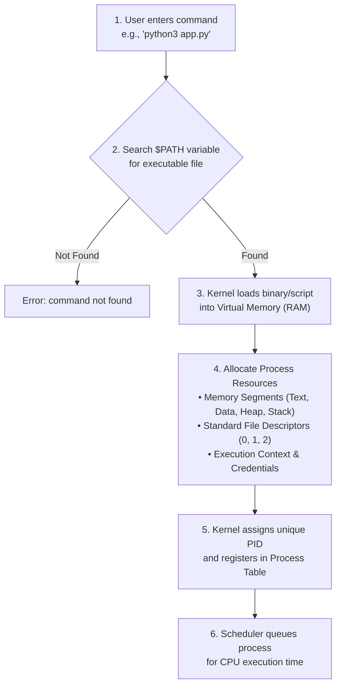
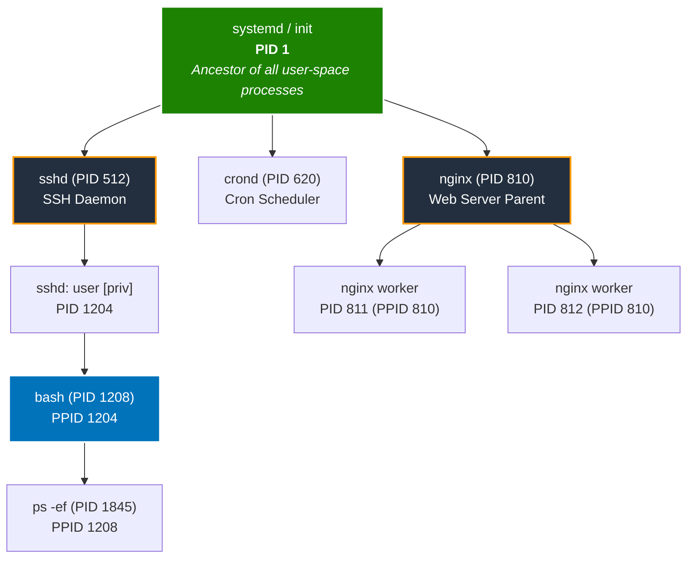
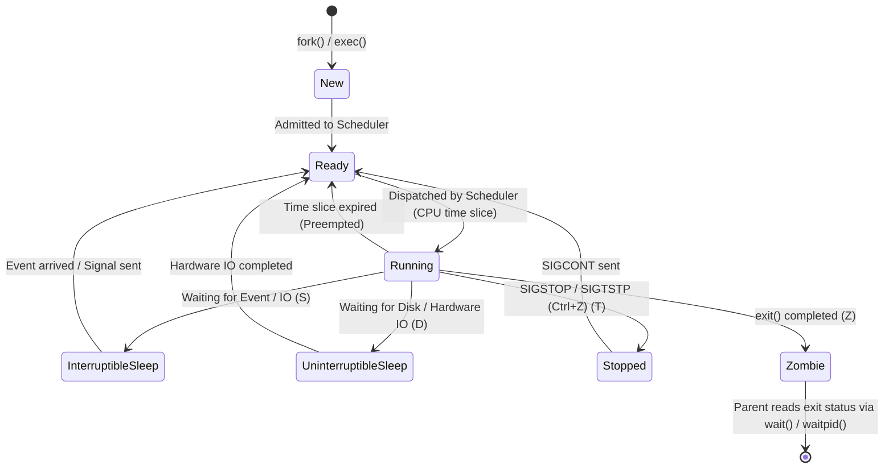
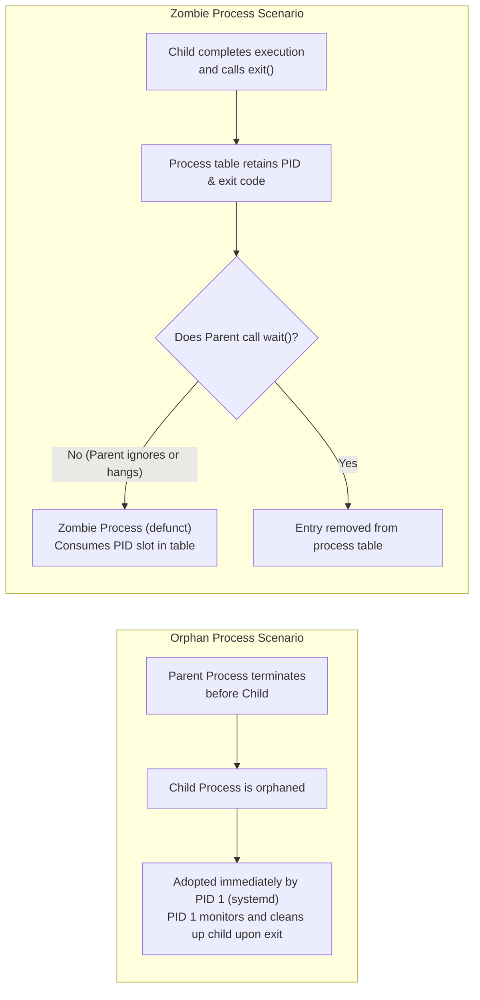
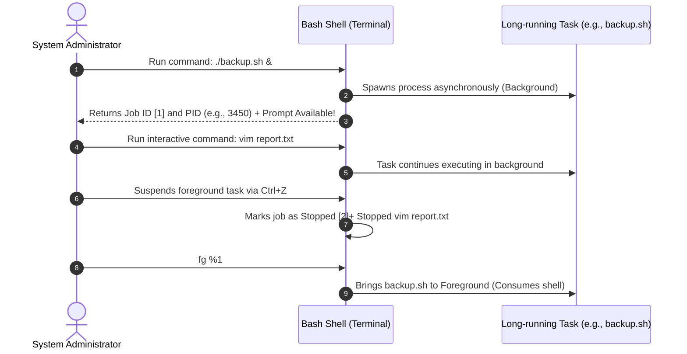
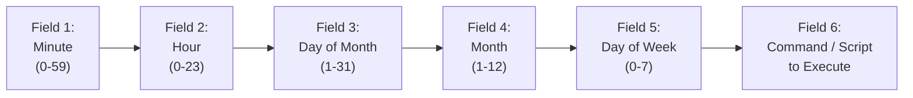

# 🐧 Module 02: Managing Processes – Study Guide

> **Course**: AWS re/Start Linux Fundamentals  
> **Module**: M02 – Managing Processes  
> **Source Document**: `T06-0009-RSLX_EN-US_SG_M02_MNGPROCESSES.pdf`  
> **Target Audience**: AWS re/Start Learners / Linux System Administrators / Cloud Practitioners  

---

## 🎯 Module Overview

In modern multi-user, multi-tasking operating systems, process management is a fundamental administrative discipline. Linux servers—whether running physical hardware, virtualized instances like Amazon Elastic Compute Cloud (Amazon EC2), or containerized microservices via Amazon ECS and Amazon EKS—concurrently run dozens or hundreds of independent programs, background daemons, and system services. Understanding how processes are instantiated, monitored, scheduled, prioritized, and safely terminated is essential for maintaining server performance, reliability, and security.

This study guide provides an in-depth exploration of Linux process management. We will examine the distinction between static programs and dynamic processes, deconstruct process hierarchies starting from PID 1 (`systemd` or `init`), evaluate process lifecycle states, master monitoring tools (`ps`, `pstree`, `top`, `htop`, `pidof`, `pgrep`), manage terminal jobs in the foreground and background (`&`, `Ctrl+Z`, `jobs`, `bg`, `fg`, `nohup`), manipulate process priority with `nice` and `renice`, terminate errant tasks using POSIX signals (`SIGTERM`, `SIGKILL`, `SIGHUP`, `SIGINT`), and automate recurring system administration workloads using `at` and `cron`.

### 📌 Learning Objectives
- [ ] **Define a Process & Deconstruct Process Anatomy**: Contrast static executable programs with active processes, explain `$PATH` resolution, virtual memory allocation, and the roles of Process IDs (PID) and Parent Process IDs (PPID).
- [ ] **Trace the Linux Process Hierarchy**: Understand process creation mechanisms (`fork()` and `exec()`) and identify the root ancestor process (`systemd` / `init` with PID 1).
- [ ] **Analyze Process Lifecycle States**: Distinguish among Running (`R`), Sleeping (`S` interruptible vs. `D` uninterruptible), Stopped (`T`), and Zombie (`Z`) states, and understand orphan adoption and zombie reaping.
- [ ] **Master Process Inspection Tools**: Utilize `ps` (System V `-ef` and BSD `aux` syntax), `pstree`, `pidof`, and `pgrep` to inspect active processes and locate specific targets.
- [ ] **Interpret Real-Time System Metrics in `top` and `htop`**: Decipher system load averages, task summaries, CPU percentage breakdowns (`us`, `sy`, `id`, `wa`, `st`), and physical/swap memory allocations.
- [ ] **Manage Foreground & Background Shell Jobs**: Control terminal execution flow using `&`, `Ctrl+Z`, `jobs`, `bg`, `fg`, and decouple long-running jobs from terminal hangup signals using `nohup` and `disown`.
- [ ] **Control Processes via Linux Signals**: Understand POSIX signals, differentiate graceful termination (`SIGTERM` 15) from forced termination (`SIGKILL` 9), and apply `kill`, `killall`, and `pkill`.
- [ ] **Configure Process Scheduling Priority**: Calculate execution priority using `nice` (-20 to +19) and dynamically adjust running processes using `renice`.
- [ ] **Automate Scheduled Tasks with `at` and `cron`**: Schedule one-time tasks using `at` and recurring automated jobs using `crontab`, analyzing crontab time fields, predefined directories, and environment best practices.

---

## ⚙️ 1. Programs, Processes & The Process Hierarchy

### Programs vs. Processes

To understand how Linux runs workloads, administrators must clearly differentiate between an executable **program** and an active **process**:

| Characteristic | Program (Static) | Process (Dynamic) |
| :--- | :--- | :--- |
| **Definition** | A passive collection of compiled binary code or script instructions stored on persistent disk storage. | An active instance of a program loaded into memory and currently being executed by the CPU. |
| **State** | Dormant; consumes disk space only. | Dynamic; consumes RAM, CPU cycles, file descriptors, and kernel resources. |
| **Lifecycle** | Persists indefinitely until uninstalled or deleted. | Ephemeral; created, transitions across states, and terminates upon completion. |
| **Identification** | File path (e.g., `/usr/bin/sshd`, `/bin/bash`). | Unique numeric Process ID (PID) assigned by the Linux kernel. |
| **Multiplicity** | A single program file exists on the disk. | A single program can spawn multiple distinct processes concurrently (e.g., multiple web server workers). |

Linux classifies programs into two broad categories:
1. **System Programs**: Foundational utility programs and services that provide primal operating system functionality (e.g., `systemd`, `sshd`, `rsyslog`, shell environments). They run natively and rarely interact directly with human desktop users.
2. **Application Programs**: User-facing or workload-specific software added to the system to perform business tasks (e.g., web servers like NGINX or Apache, databases like PostgreSQL, development runtimes like Python, or text editors like Vim).

### How an Executable Becomes a Process

When a user or script enters a command in the terminal (such as `ls` or `python3 script.py`), the operating system executes a specific sequence:



1. **Path Resolution**: The shell inspects the command. If not an absolute or relative path (e.g., `/usr/bin/ls`), it sequentially searches the colon-separated directories defined in the `$PATH` environment variable:
   ```bash
   echo $PATH
   # Output: /usr/local/sbin:/usr/local/bin:/usr/sbin:/usr/bin:/root/bin
   ```
2. **Binary Loading**: The Linux kernel reads the binary from disk and maps it into virtual memory.
3. **Resource Allocation**: The kernel establishes memory segments:
   - **Text Segment**: Machine instructions to be executed (read-only).
   - **Data Segment**: Initialized and uninitialized global/static variables.
   - **Heap Segment**: Dynamically allocated memory during runtime.
   - **Stack Segment**: Local function variables, return addresses, and execution frames.
4. **PID Assignment**: The kernel assigns a unique integer known as the **Process ID (PID)**.
5. **CPU Scheduling**: The Completely Fair Scheduler (CFS) places the process into the run queue to receive processor time slices.

### Process Hierarchy: Parents, Children, and PID 1

Every process in Linux exists within a strict parent-child tree hierarchy:
- **Parent Process ID (PPID)**: The identifier of the process that spawned this process.
- **Process ID (PID)**: The unique numeric identifier of the newly instantiated process.

Process creation in Linux occurs through two complementary system calls:
1. `fork()`: An existing parent process duplicates its own execution context to create an identical child process.
2. `exec()` (or `execve()`): The child process replaces its memory space with the code and instructions of the new program to be executed.



> [!IMPORTANT]
> **PID 1 (`systemd` or `init`)** is the ultimate ancestor of all user-space processes in a Linux system. It is spawned directly by the Linux kernel during system boot. PID 1 never dies while the system is running; if PID 1 terminates unexpectedly, the kernel triggers a **Kernel Panic** and the operating system halts.

---

## 🔄 2. Linux Process Lifecycle & States

### Process Execution Lifecycle

From creation to final exit, a Linux process transitions across several execution states depending on CPU availability, I/O activity, and external control signals.



### Process State Descriptions & Codes

When inspecting processes with `ps` or `top`, Linux displays single-letter status codes representing the exact current state:

| State Code | State Name | Detailed Description | Can it receive signals? |
| :---: | :--- | :--- | :---: |
| **`R`** | **Running / Runnable** | The process is currently executing on a CPU core or is waiting in the kernel's run queue for its next scheduled time slice. | Yes |
| **`S`** | **Interruptible Sleep** | The process is sleeping, waiting for an external event, user input, socket message, or timer. It will immediately wake up if it receives a signal. | Yes |
| **`D`** | **Uninterruptible Sleep** | The process is waiting for hardware I/O (typically disk read/write or NFS network operations). It cannot be interrupted or terminated even by `kill -9 SIGKILL` until the hardware responds. | No (ignores signals until I/O returns) |
| **`T`** | **Stopped** | The process has been suspended by a job control signal (such as `SIGSTOP` or `Ctrl + Z` `SIGTSTP`) or is being traced by a debugger (`ptrace`). | Resumes only with `SIGCONT` |
| **`Z`** | **Zombie (Defunct)** | The process has finished executing its instructions and released its memory, but its entry remains in the kernel process table because its parent has not yet read its exit code via the `wait()` system call. | No (already dead) |

### Additional State Modifier Flags in `ps`

In `ps aux` output, the `STAT` column frequently includes secondary modifier characters:
- `<`: High priority (not nice to other processes).
- `N`: Low priority (nice to other processes).
- `L`: Has pages locked into memory (real-time or custom I/O).
- `s`: Session leader (e.g., a login shell).
- `l`: Multi-threaded process (contains sub-threads).
- `+`: Foreground process group member (currently attached to the terminal).

### Orphan vs. Zombie Processes



> [!NOTE]
> **How to Eliminate Zombie Processes**: Because a zombie is already dead, running `kill -9 <zombie_PID>` has no effect. To remove a zombie, you must:
> 1. Signal the parent process (`kill -SIGCHLD <parent_PID>`) to prompt it to harvest the exit code.
> 2. Terminate the parent process (`kill <parent_PID>`). The zombie child is then reparented to PID 1 (`systemd`), which immediately reaps it from the process table.

---

## 🔍 3. Monitoring & Inspecting Processes

Linux offers a suite of command-line tools for inspecting system workloads. System administrators must know when to use static snapshot utilities (`ps`, `pstree`, `pgrep`) versus dynamic real-time performance monitors (`top`, `htop`).

### The `ps` Command: Process Status Snapshot

The `ps` command generates a static snapshot of the current processes running on the system. It supports two primary syntax styles: **System V (Unix)** options (preceded by a single dash `-`) and **BSD** options (written without dashes).

#### Common Syntax Styles

```bash
# 1. System V (POSIX) standard syntax:
ps -ef

# 2. BSD syntax:
ps aux
```

#### Understanding `ps -ef` Output

```text
UID        PID  PPID  C STIME TTY          TIME CMD
root         1     0  0 08:00 ?        00:00:02 /usr/lib/systemd/systemd --switched-root --system --deserialize 31
root         2     0  0 08:00 ?        00:00:00 [kthreadd]
ec2-user  1208  1204  0 08:15 pts/0    00:00:00 -bash
ec2-user  1845  1208  0 08:30 pts/0    00:00:00 ps -ef
```

- **`UID`**: The username or user ID owning the process.
- **`PID`**: The unique Process ID.
- **`PPID`**: The Parent Process ID. Notice that `ps -ef` (PID 1845) has PPID 1208 (`bash`).
- **`C`**: Integer percentage of CPU utilization.
- **`STIME`**: Start time of the process.
- **`TTY`**: The terminal device controlling the process (`pts/0` = pseudo-terminal; `?` = background daemon not tied to a terminal).
- **`TIME`**: Cumulative CPU time consumed by the process (`HH:MM:SS`).
- **`CMD`**: The command name and arguments that launched the process.

#### Understanding `ps aux` Output

```text
USER       PID %CPU %MEM    VSZ   RSS TTY      STAT START   TIME COMMAND
root         1  0.0  0.4 175620 16212 ?        Ss   08:00   0:02 /usr/lib/systemd/systemd
ec2-user  1208  0.0  0.1  24156  4820 pts/0    Ss   08:15   0:00 -bash
ec2-user  1890  0.0  0.0  58440  3210 pts/0    R+   08:32   0:00 ps aux
```

- **`%CPU` / `%MEM`**: Exact percentage of total CPU and physical memory (RAM) consumed.
- **`VSZ`**: Virtual Memory Size in kilobytes (total memory space mapped by the process).
- **`RSS`**: Resident Set Size in kilobytes (actual physical RAM currently occupied).
- **`STAT`**: Current process state code (`Ss`, `R+`, `D`, `Z`).

#### Essential `ps` Command Options

| Option | Syntax | Purpose |
| :--- | :--- | :--- |
| **`-e` / `-A`** | `ps -e` | Selects every process running across the entire system. |
| **`-f`** | `ps -ef` | Generates a full-format listing (adds UID, PPID, STIME, C). |
| **`-u user`** | `ps -u ec2-user` | Displays processes owned by a specific username. |
| **`-p pid`** | `ps -p 1208` | Filters and displays information for a specific PID. |
| **`-C cmd`** | `ps -C sshd` | Selects processes by command name. |
| **`-o format`** | `ps -eo pid,ppid,user,%cpu,%mem,cmd` | Customizes specific output columns. |
| **`--forest`** | `ps -ef --forest` | Renders ASCII tree branches illustrating parent-child inheritance. |

### Targeted Search: `grep`, `pgrep`, and `pidof`

When hundreds of processes are running, finding a specific application by scrolling is inefficient. Linux offers three primary methods to locate specific PIDs:

```bash
# Method 1: Traditional pipeline using grep
ps -ef | grep sshd

# Method 2: Modern pgrep utility (searches process names directly)
pgrep sshd
pgrep -l sshd            # Displays PID alongside the process name
pgrep -u root sshd       # Displays PIDs matching name owned by root

# Method 3: pidof command (exact binary name lookup)
pidof sshd
pidof -s sshd            # Returns only a single PID even if multiple exist
```

> [!TIP]
> When running `ps -ef | grep sshd`, the `grep` command itself often appears in the output because `grep` runs as a process containing `sshd` in its argument. To exclude the grep command itself, use character class brackets:
> ```bash
> ps -ef | grep '[s]shd'
> ```

### The `pstree` Command: Visualizing Process Trees

The `pstree` command displays running processes in a clear hierarchical tree structure:

```bash
pstree
pstree -p                # Displays PIDs in parentheses next to process names
pstree -a                # Shows full command line arguments
pstree -u                # Displays user transitions (shows owner if different from parent)
pstree -p 1204           # Shows process sub-tree rooted at PID 1204
```

Example output:
```text
systemd(1)─┬─amazon-ssm-agent(2105)───8*[{amazon-ssm-agent}(2106)]
           ├─auditd(1120)───{auditd}(1121)
           ├─crond(1450)
           ├─dbus-daemon(1142)
           ├─sshd(1312)───sshd(2890)───bash(2895)───pstree(3421)
           └─systemd-journal(980)
```
- Square brackets `[ ]` and prefix counts (e.g., `8*[{amazon-ssm-agent}]`) denote multiple threads or subprocesses grouped together.
- Curly braces `{ }` indicate lightweight kernel threads belonging to the parent application.

---

## 📊 4. Real-Time Resource Monitoring: `top` & `htop`

While `ps` captures a static moment in time, the `top` command provides an interactive, dynamically refreshing real-time dashboard displaying system utilization and resource consumption.

```bash
top
```

### Deconstructing the `top` Dashboard Header

```text
top - 14:22:10 up 3 days,  4:12,  2 users,  load average: 0.15, 0.08, 0.02
Tasks: 112 total,   1 running, 111 sleeping,   0 stopped,   0 zombie
%Cpu(s):  1.3 us,  0.7 sy,  0.0 ni, 97.8 id,  0.1 wa,  0.0 hi,  0.1 si,  0.0 st
KiB Mem :  2048500 total,   421800 free,   812400 used,   814300 buff/cache
KiB Swap:  1048572 total,  1048572 free,        0 used.  1092300 avail Mem
```

#### 1. Uptime and Load Average (Row 1)
- **Current Time**: `14:22:10`
- **Uptime**: System has been running for `3 days, 4 hours, 12 minutes`.
- **Logged-in Users**: `2 users`.
- **Load Average (`0.15, 0.08, 0.02`)**: Average number of processes requesting CPU time over the last **1 minute**, **5 minutes**, and **15 minutes**.
  - On a 1-core CPU, a load average of `1.00` indicates 100% saturation.
  - On a 4-core CPU, a load average of `4.00` indicates 100% saturation.

#### 2. Tasks Summary (Row 2)
Displays process counts categorized by state: Total (`112`), Running (`1`), Sleeping (`111`), Stopped (`0`), and Zombie (`0`).

#### 3. CPU Utilization Breakdown (Row 3)

| Metric | Field Name | Description | Cloud Administrator Insight |
| :---: | :--- | :--- | :--- |
| **`us`** | User CPU | Time executing un-niced user-space processes (e.g., web servers, Python code). | High value indicates heavy application computational workload. |
| **`sy`** | System CPU | Time executing kernel-space code and system calls. | High value points to high I/O requests, networking overhead, or system call thrashing. |
| **`ni`** | Nice CPU | Time executing user processes with a positive (lowered) nice value. | Workloads voluntarily deprioritized. |
| **`id`** | Idle CPU | Percentage of processor time when CPU is doing nothing. | Higher is better for capacity headroom. |
| **`wa`** | I/O Wait | Percentage of CPU time stalled waiting for disk or network I/O to complete. | High values (`> 15%`) indicate storage disk bottlenecks or saturated EBS volumes. |
| **`hi`** | Hardware Interrupts | Time servicing physical hardware interrupt requests. | High values indicate failing hardware or saturated network interfaces. |
| **`si`** | Software Interrupts | Time servicing software interrupt requests. | High values frequently correlate with high network packet reception. |
| **`st`** | **Steal Time** | Percentage of CPU time stolen from the virtual machine by the hypervisor to service other tenants. | **Critical for AWS EC2**: High `st` on EC2 indicates physical host contention or exhausted T2/T3/T4g CPU burst credits. |

#### 4. Physical Memory & Virtual Swap Breakdown (Rows 4 & 5)
- **`total`**: Total physical RAM installed (measured in KiB).
- **`free`**: Memory completely untouched by the operating system.
- **`used`**: Memory consumed by active applications and kernel structures.
- **`buff/cache`**: Memory used by the Linux kernel to cache files from disk. Linux automatically frees this cache if applications demand more memory.
- **`avail Mem`**: The realistic estimate of RAM available for starting new applications without requiring disk swapping.

### Essential Interactive Keybindings in `top`

While `top` is running, pressing individual keys instantly alters the view:

| Key | Action |
| :---: | :--- |
| **`q`** | Quits `top` and returns to the command prompt. |
| **`h` / `?`** | Displays the interactive help menu. |
| **`k`** | Prompts for a PID and a signal number to kill a process directly from `top`. |
| **`r`** | Prompts for a PID to **renice** (adjust priority) directly from `top`. |
| **`P`** | Sorts process list by **%CPU** utilization (default). |
| **`M`** | Sorts process list by **%MEM** utilization. |
| **`T`** | Sorts process list by cumulative execution **TIME**. |
| **`1`** | Toggles between an aggregated CPU line and individual CPU core displays. |
| **`c`** | Toggles between displaying the binary command name and the full command path with arguments. |
| **`E` / `e`** | Switches memory units between KiB, MiB, GiB, TiB, PiB, and EiB. |

### Running `top` in Batch Mode for Automation

```bash
# Run top for 1 iteration in batch mode and output to a log file
top -b -n 1 > /tmp/system_snapshot.txt

# Run top sorted by CPU usage
top -o %CPU
```

### Modern Real-Time Alternative: `htop`

`htop` is an interactive process viewer that improves on `top` with:
- Color-coded visual gauges for individual CPU cores, RAM, and Swap.
- Horizontal and vertical scrolling through the full command string.
- Direct interactive mouse support (clicking headers to sort).
- Easy tree-view toggling via `F5`.
- Built-in signal sending via `F9`.

```bash
# Launch htop (install via 'sudo dnf install htop' or 'sudo yum install htop' if needed)
htop
```

---

## 🎛️ 5. Managing Jobs: Foreground, Background & `nohup`

When executing tasks in the terminal, Linux categorizes processes into **Foreground Jobs** and **Background Jobs**.

### Concepts of Shell Job Control

- **Foreground Job**: A process that attaches to standard input and standard output, occupying the terminal prompt until execution finishes.
- **Background Job**: A process that executes asynchronously in memory while immediately returning prompt control to the user.
- **Job ID (`%n`)**: A small integer assigned by the shell (e.g., `[1]`, `[2]`) to track background tasks within the current terminal session, distinct from the global system PID.



### Essential Job Control Commands

```bash
# 1. Launch a process directly in the background using ampersand (&)
sleep 300 &
# Output: [1] 4102   (Job ID 1, Process ID 4102)

# 2. Suspend a running foreground command
# Press Ctrl + Z in the active terminal
# Output: [1]+  Stopped                 sleep 300

# 3. List active jobs managed by current shell session
jobs
jobs -l    # Lists Job ID alongside the system PID

# 4. Resume a stopped job in the background
bg %1
# Output: [1]+ sleep 300 &

# 5. Bring a background job to the foreground
fg %1
# Output: sleep 300 (terminal prompt blocked until finished or suspended)
```

### Decoupling Processes from the Terminal: `nohup` & `disown`

By default, when an SSH session terminates or the terminal window closes, the shell sends the `SIGHUP` (Signal 1 - Hangup) signal to all sub-processes, killing all background jobs initiated in that session.

To run long-running scripts that must persist after logging out:

```bash
# Run command immune to hangups, redirecting stdout/stderr to nohup.out
nohup ./long_running_script.sh &

# Custom redirect for output and error
nohup ./long_running_script.sh > /var/log/script.log 2>&1 &

# Disown an already running background job from the current shell
jobs -l
disown -h %1
```

---

## 🛑 6. Terminating Processes & Linux Signals

### Inter-Process Communication via Signals

Linux uses **Signals** as an asynchronous inter-process communication mechanism to notify processes of system events or administrative commands. When a signal is sent to a process, the process either executes its custom signal handler, executes the kernel default action, or is terminated immediately.

### Essential POSIX Signals Reference Table

| Signal Number | Signal Name | Standard Keystroke | Kernel Default Action | Can it be caught or ignored? | Typical Administrative Use Case |
| :---: | :--- | :---: | :--- | :---: | :--- |
| **`1`** | **`SIGHUP`** | Terminal disconnect | Terminate process | **Yes** | Sent to daemons (e.g., `sshd`, `nginx`, `systemd`) to instruct them to **reload configuration files** without restarting the service or dropping active client connections. |
| **`2`** | **`SIGINT`** | `Ctrl + C` | Interrupt / Terminate | **Yes** | Gracefully interrupts a foreground command from the terminal keyboard. |
| **`3`** | **`SIGQUIT`** | `Ctrl + \` | Core dump & Terminate | **Yes** | Quits process and produces a core dump for debugging. |
| **`9`** | **`SIGKILL`** | — | Immediate Unconditional Termination | ❌ **NO** | The kernel immediately terminates the process and reclaims its memory. The process cannot catch, handle, or ignore this signal. Used as a last resort for frozen processes. |
| **`15`** | **`SIGTERM`** | — | Graceful Termination | **Yes** | **Default signal sent by `kill`**. Allows the application to complete open transactions, close files, flush buffers, remove socket locks, and exit cleanly. |
| **`18`** | **`SIGCONT`** | — | Continue Execution | **Yes** | Resumes execution of a process previously suspended by `SIGSTOP` or `SIGTSTP`. |
| **`19`** | **`SIGSTOP`** | — | Pause / Suspend | ❌ **NO** | Immediately halts process execution. Cannot be caught or ignored by the process. |
| **`20`** | **`SIGTSTP`** | `Ctrl + Z` | Pause / Suspend | **Yes** | Terminal stop request generated by keyboard to suspend a foreground program. |

> [!WARNING]
> **Avoid Defaulting to `SIGKILL` (`kill -9`)**:
> Always send **`SIGTERM` (15)** first. `SIGKILL` bypasses application shutdown routines, which can corrupt database tables, leave locked temporary files on disk, or leave orphaned network sockets open. Only invoke `kill -9` if a process fails to respond to `SIGTERM` after a reasonable timeout.

### Command Utilities for Signaling: `kill`, `killall`, and `pkill`

```bash
# 1. The kill command (targets specific PIDs)
kill 3421               # Sends default SIGTERM (15) to PID 3421
kill -15 3421           # Explicitly sends SIGTERM
kill -SIGTERM 3421      # Using signal name
kill -9 3421            # Forcefully terminates PID 3421 with SIGKILL
kill -1 1312            # Sends SIGHUP to reload configuration

# 2. The killall command (targets all processes matching binary name)
killall httpd           # Sends SIGTERM to all processes named httpd
killall -9 nginx        # Forcefully terminates all nginx instances
killall -u ec2-user     # Terminates all processes owned by ec2-user

# 3. The pkill command (pattern-based matching with options)
pkill -f "python3 app.py"     # Matches full command line string
pkill -u ec2-user sleep        # Kills sleep processes owned by ec2-user
pkill -9 -t pts/1             # Terminates all processes attached to terminal pts/1
```

---

## ⚖️ 7. Process Priority & Scheduling: `nice` and `renice`

Linux uses a preemptive multitasking scheduler (the Completely Fair Scheduler, CFS). To manage how much CPU time a process receives relative to others, Linux assigns each process a **Nice Value** (`NI`).

### The Nice Scale: `-20` to `+19`

The term "nice" reflects how courteous a process is toward other competing processes:
- **`-20` (Highest Priority)**: Extremely "un-nice" to other tasks. Receives maximum CPU time slices.
- **`0` (Default Priority)**: Standard baseline priority assigned to normal user processes.
- **`+19` (Lowest Priority)**: Extremely "nice" to others. Yields CPU time whenever other processes need it.

```text
Priority Scale:
High CPU Priority <-----------------------------------------> Low CPU Priority
-20                   -10                   0                  +10                 +19
[Aggressive/Critical]                   [Default]                            [Background/Nice]
```

> [!IMPORTANT]
> **Privilege Rules for Nice Values**:
> - **Standard Users** can only lower priority (set nice values between `0` and `+19`). Standard users cannot give their processes higher priority than default.
> - **The Root Superuser (`root`)** can set any nice value across the entire range from `-20` to `+19`.

### Priority (PR) vs. Nice (NI) in `top`

In `top` output, you will see two related columns:
- **`NI`**: The user-configured Nice value (`-20` to `+19`).
- **`PR`**: The internal kernel scheduling priority (`0` to `39` for normal tasks).
- The mathematical relationship for standard processes is:
  $$\text{PR} = 20 + \text{NI}$$
  - A default process with $\text{NI} = 0$ has $\text{PR} = 20$.
  - A high-priority task with $\text{NI} = -10$ has $\text{PR} = 10$.
  - A low-priority task with $\text{NI} = +15$ has $\text{PR} = 35$.

### Launching with `nice` & Modifying with `renice`

```bash
# 1. Launch a new process with a positive nice value (lower priority)
nice -n 10 tar -czf backup.tar.gz /var/log/

# 2. Launch a high-priority task (requires sudo/root)
sudo nice -n -15 ./critical_process.sh

# 3. Adjust priority of an already RUNNING process using renice
# Syntax: renice -n <new_nice_value> -p <PID>
renice -n 5 -p 4102

# 4. Renice all processes owned by a user
sudo renice -n 10 -u ec2-user

# 5. Renice all processes matching a group
sudo renice -n 5 -g developers
```

---

## ⏰ 8. Automated Task Scheduling: `at` and `cron`

System administrators routinely need to execute tasks automatically at predetermined times. Linux provides two complementary scheduling subsystems:

| Feature | `at` Command | `cron` Daemon |
| :--- | :--- | :--- |
| **Execution Frequency** | **One-time only** (runs once, then discards). | **Recurring / Repetitive** (runs on scheduled intervals: hourly, daily, weekly, monthly). |
| **Underlying Daemon** | `atd` | `crond` |
| **Configuration Tool** | `at`, `atq`, `atrm` | `crontab -e`, `crontab -l` |
| **Typical Use Case** | Running a one-off database migration at 02:00 AM tonight. | Running daily log rotations, database backups, or metric harvesting scripts. |

### The `at` Command: One-Time Task Execution

The `at` command queues commands for a single future execution:

```bash
# Syntax: at <time specification>
at 16:00
at 4:00 PM tomorrow
at now + 2 hours
at 02:30 AM Jul 15
```

When you press `Enter`, `at` opens an interactive input prompt (`at>`) where you enter the shell commands to execute. Press `Ctrl + D` (EOF) to save and exit:

```bash
$ at 03:00 tomorrow
at> /usr/local/bin/backup_database.sh
at> echo "Backup complete" | mail -s "DB Status" admin@example.com
at> <EOT>
job 4 at Tue Jul 14 03:00:00 2026
```

#### Managing Queued `at` Jobs

```bash
# List all pending scheduled jobs (or use atq)
at -l
atq
# Output: 4    Tue Jul 14 03:00:00 2026 a ec2-user

# Inspect the environment and script of job #4
at -c 4

# Remove/delete a scheduled job
atrm 4
```

### The `cron` Subsystem: Recurring Automated Scheduling

The `cron` daemon (`crond`) awakens every minute, reads system and user schedule tables, and executes any commands matching the current date and time.

#### Predefined Cron System Directories

For simple administrative scripts that need to run at standard recurring intervals without custom minute/hour configurations, administrators can place executable scripts directly into predefined system directories in `/etc/`:
- `/etc/cron.hourly/`: Scripts execute once every hour.
- `/etc/cron.daily/`: Scripts execute once every day (usually early morning).
- `/etc/cron.weekly/`: Scripts execute once a week.
- `/etc/cron.monthly/`: Scripts execute once a month.

> [!NOTE]
> Scripts placed in `/etc/cron.*` directories must have executable permissions (`chmod +x script.sh`) and must **not** contain file extensions like `.sh` or `.py` on Debian/Ubuntu systems, or `run-parts` may skip them.

#### Crontab File Format: The Five Time Fields

When custom scheduling is needed, administrators configure **crontab** (cron table) files. A crontab entry consists of **five time/date fields** followed by the command to execute:

```text
 ┌───────────── Minute (0 - 59)
 │ ┌───────────── Hour (0 - 23, 24-hour format)
 │ │ ┌───────────── Day of the Month (1 - 31)
 │ │ │ ┌───────────── Month of the Year (1 - 12 or JAN - DEC)
 │ │ │ │ ┌───────────── Day of the Week (0 - 7, where 0 and 7 = Sunday)
 │ │ │ │ │
 * * * * *  <command to execute>
```



#### Special Crontab Characters

- **`*` (Asterisk)**: Wildcard representing every possible value in that field.
- **`,` (Comma)**: Value list separator (e.g., `1,15,30` in DOM means the 1st, 15th, and 30th).
- **`-` (Hyphen)**: Range of values (e.g., `1-5` in DOW means Monday through Friday).
- **`/` (Slash)**: Step/interval values (e.g., `*/15` in Minute means every 15 minutes).

#### Common Crontab Scheduling Examples

| Crontab Entry | Schedule Meaning |
| :--- | :--- |
| `0 4 * * * /scripts/backup.sh` | Every day at 04:00 AM |
| `30 2 * * 0 /scripts/weekly.sh` | Every Sunday at 02:30 AM |
| `*/15 * * * * /scripts/check_health.sh` | Every 15 minutes, every hour, every day |
| `0 9 1 * * /scripts/monthly_report.sh` | On the 1st day of every month at 09:00 AM |
| `0 18 * * 1-5 /scripts/workday_end.sh` | Monday through Friday at 06:00 PM (18:00) |
| `0 0 1,15 * * /scripts/biweekly.sh` | On the 1st and 15th of every month at midnight |

#### Special Shorthand Macros

Crontab supports convenient macro shortcuts that replace the 5 time fields:
- `@reboot`: Run once at system startup.
- `@hourly`: Run once an hour (`0 * * * *`).
- `@daily` / `@midnight`: Run once a day (`0 0 * * *`).
- `@weekly`: Run once a week (`0 0 * * 0`).
- `@monthly`: Run once a month (`0 0 1 * *`).
- `@yearly` / `@annually`: Run once a year (`0 0 1 1 *`).

### User Crontabs vs. System Crontabs

1. **User Crontabs**:
   - Stored in `/var/spool/cron/crontabs/$USERNAME` (Debian/Ubuntu) or `/var/spool/cron/$USERNAME` (RHEL/Amazon Linux).
   - Never edit these files directly with a standard text editor.
   - Always manage them using the `crontab` command.
2. **System Crontabs**:
   - Stored in `/etc/crontab` and `/etc/cron.d/`.
   - Contain an additional **User** field between the Day-of-Week field and the Command:
     ```text
     # Min Hour DOM Mon DOW User Command
     0 2 * * * root /usr/sbin/logrotate /etc/logrotate.conf
     ```

### Managing Crontabs: `crontab -e` and `crontab -l`

```bash
# 1. Edit the current user's crontab (uses default editor, e.g. Vim or nano)
crontab -e

# 2. Display / list the current user's crontab
crontab -l

# 3. Remove / delete all entries in current user's crontab
crontab -r

# 4. Root managing another user's crontab
sudo crontab -u ec2-user -e
sudo crontab -u ec2-user -l
```

> [!TIP]
> **Best Practices for Crontab Scripts**:
> 1. **Always use absolute paths**: `cron` executes in a minimal environment where `$PATH` is usually limited to `/usr/bin:/bin`. Always specify `/usr/bin/python3` or `/usr/local/bin/aws` rather than plain command names.
> 2. **Redirect output and errors**: By default, `cron` attempts to email uncaptured output to the user. Redirect stdout and stderr to a log file:
>    ```bash
>    0 3 * * * /usr/local/bin/backup.sh >> /var/log/backup.log 2>&1
>    ```
> 3. **Backup before editing**: Before running `crontab -e`, save a copy of your current crontab:
>    ```bash
>    crontab -l > ~/crontab.backup
>    ```

---

## 🧪 9. Hands-On Practical Demonstration: Process Management Workflow

Follow this step-by-step walkthrough to practice managing, inspecting, and controlling processes in a Linux terminal:

### Step 1: Inspect System Processes with `ps` and `pstree`
```bash
# Display your active terminal shell processes
ps

# View all processes in full-format mode
ps -ef | head -n 15

# View the hierarchical process tree
pstree -p | head -n 20
```

### Step 2: Monitor Real-Time Workloads with `top`
```bash
# Launch top
top

# While inside top:
# Press '1' to see individual CPU cores
# Press 'M' to sort by Memory usage
# Press 'P' to sort by CPU usage
# Press 'c' to view full command paths
# Press 'q' to exit
```

### Step 3: Practice Shell Job Control
```bash
# Start a simulated background job
sleep 600 &

# Verify the job is running
jobs -l

# Start another sleep job in the foreground
sleep 300

# Suspend the foreground job: Press Ctrl + Z
# Output: [2]+ Stopped sleep 300

# Resume job 2 in the background
bg %2

# List all active jobs
jobs -l

# Bring job 1 back to the foreground and terminate it
fg %1
# Press Ctrl + C to terminate
```

### Step 4: Prioritize and Terminate Tasks
```bash
# Launch a background process with reduced priority (nice value +10)
nice -n 10 sleep 500 &

# Identify the PID and nice value
ps -o pid,ni,cmd -p $(pgrep sleep)

# Modify the priority of the running process to +15
renice -n 15 -p $(pgrep -o sleep)

# Gracefully terminate the process using SIGTERM
kill -15 $(pgrep -o sleep)

# Clean up any remaining sleep processes using pkill
pkill -9 sleep
```

---

## 📋 10. Process Management Command Reference

| Command | Category | Standard Syntax | Description |
| :--- | :--- | :--- | :--- |
| **`ps`** | Inspection | `ps -ef` / `ps aux` | Displays a static snapshot of current processes. |
| **`pstree`** | Inspection | `pstree -p [PID]` | Visualizes running processes as a hierarchical tree. |
| **`pidof`** | Inspection | `pidof [program]` | Prints the Process ID of a running program binary. |
| **`pgrep`** | Inspection | `pgrep -l [pattern]` | Searches and lists PIDs matching a process name or attribute. |
| **`top`** | Real-Time | `top [-b -n 1]` | Dynamic real-time system performance and process monitor. |
| **`htop`** | Real-Time | `htop` | Interactive, color-coded visual process viewer. |
| **`jobs`** | Job Control | `jobs -l` | Lists active jobs running in the current shell session. |
| **`bg`** | Job Control | `bg %jobnumber` | Resumes a suspended job in the background. |
| **`fg`** | Job Control | `fg %jobnumber` | Brings a background job to the foreground. |
| **`nohup`** | Persistence | `nohup command &` | Runs a command immune to terminal hangups (`SIGHUP`). |
| **`kill`** | Signaling | `kill [-SIGNAL] PID` | Sends a termination or control signal to a specific PID. |
| **`killall`** | Signaling | `killall [-SIGNAL] name` | Sends a signal to all processes matching a program name. |
| **`pkill`** | Signaling | `pkill [-SIGNAL] pattern`| Sends a signal to processes matching name/attributes. |
| **`nice`** | Priority | `nice -n value command` | Launches a new program with a specified nice priority (-20 to +19). |
| **`renice`** | Priority | `renice -n value -p PID` | Dynamically alters the nice priority of a running process. |
| **`at`** | Scheduling | `at [time]` | Queues a command for one-time future execution. |
| **`atq`** | Scheduling | `atq` | Lists pending jobs queued in the `at` spool. |
| **`atrm`** | Scheduling | `atrm [job#]` | Removes a scheduled job from the `at` spool. |
| **`crontab`** | Scheduling | `crontab -e` / `-l` | Edits or lists recurring scheduled tasks for a user. |

---

## ❓ 11. Checkpoint Review & Self-Assessment

### Question 1
**Why might a system administrator need to manually terminate a process?**
> **Answer**:  
> A process can become unresponsive, enter an infinite computational loop, leak memory, or freeze without releasing system resources. A common scenario is a web server or database process consuming 100% of CPU capacity while failing to serve network requests. If normal shutdown routines or graceful systemctl stop commands fail, an administrator must intervene manually to terminate the offending process and restore system stability.

---

### Question 2
**Why is the command pipeline `ps -ef | grep [process name]` useful during troubleshooting?**
> **Answer**:  
> It allows an administrator to quickly search through hundreds of active system processes to verify whether a specific daemon, script, or application is currently running, determine its unique Process ID (PID) and Parent Process ID (PPID), check what user account owns it, and examine the exact command-line arguments and configuration file flags passed to it at startup.

---

### Question 3
**What is the fundamental operational difference between the `at` command and the `cron` daemon?**
> **Answer**:  
> - **`at`** is designed exclusively for **one-time** task execution at a designated future time (e.g., executing a single database patch script tonight at 03:00 AM). Once executed, the job is removed from the system.  
> - **`cron`** is designed for **recurring, repetitive** automated task execution based on predefined time intervals (e.g., rotating logs every night at midnight, or running health-check scripts every 5 minutes).

---

### Question 4
**What occurs when a process enters a Zombie (`Z`) state, and why does `kill -9 <PID>` fail to remove it?**
> **Answer**:  
> A zombie process has already finished executing its code and released its memory and processor allocations; it is technically already dead. However, its entry remains in the kernel process table because its parent process has not yet executed the `wait()` or `waitpid()` system call to read the child's exit status. Because a zombie is already terminated, sending `kill -9` has no effect. To remove a zombie, the administrator must either signal the parent process (`kill -SIGCHLD <parent_PID>`) to harvest it, or terminate the parent process so that PID 1 (`systemd`) adopts and cleans up the zombie.

---

### Question 5
**Explain the meaning of CPU Steal Time (`%st`) in `top` and why it is uniquely important in cloud computing (AWS EC2).**
> **Answer**:  
> Steal time (`%st`) represents the percentage of time that a virtual machine's virtual CPU (vCPU) wanted to run instructions, but was forced to wait because the underlying physical hypervisor host was allocating processor cycles to other virtual machines. On AWS EC2, a high steal time indicates that the physical underlying hardware is oversubscribed, or that a burstable instance type (such as `t3` or `t4g`) has exhausted its CPU credits and is being throttled by AWS.

---

### Question 6
**How do nice values relate to process scheduling priority, and what restrictions apply to non-root users?**
> **Answer**:  
> The nice scale ranges from **`-20` (highest priority)** to **`+19` (lowest priority)**, with `0` being the default. Higher positive values mean the process is "nicer" to others, giving up CPU cycles. Negative values indicate high-priority tasks that demand more CPU time. Standard non-privileged users can only assign nice values between `0` and `+19` to lower their own processes' priority; only the superuser (`root`) can assign negative nice values (`-20` to `-1`) to increase process priority.

---

## 📝 12. Key Takeaways & Best Practices

1. **Hierarchy Originates at PID 1**:
   - The Linux kernel launches `systemd` (or `init`) as PID 1, which acts as the ancestor of all user-space processes.
   - Child processes inherit attributes from parents through `fork()` and replace code via `exec()`.

2. **Always Prefer `SIGTERM` (15) Over `SIGKILL` (9)**:
   - Allow processes to shut down gracefully so they can persist data, flush caches, and delete temporary lock files. Reserve `SIGKILL` for completely frozen or unresponsive processes.

3. **Master Real-Time Performance Signals in `top`**:
   - Understand Load Averages across 1, 5, and 15 minutes relative to available CPU cores.
   - Watch `wa` (I/O Wait) for storage bottlenecks and `st` (Steal Time) for AWS EC2 CPU contention or credit exhaustion.

4. **Job Control Accelerates CLI Productivity**:
   - Run asynchronous jobs with `&`.
   - Suspend foreground tasks with `Ctrl + Z`, inspect them with `jobs`, and resume with `bg` or `fg`.
   - Use `nohup` or `disown` to protect long-running background tasks from terminal hangup signals (`SIGHUP`).

5. **Automate Responsibly with `cron`**:
   - Memorize the 5 crontab fields: **Minute, Hour, Day of Month, Month, Day of Week**.
   - Always specify absolute paths for executables and files inside crontab scripts.
   - Redirect stdout and stderr (`>> /var/log/job.log 2>&1`) to prevent silent failures and keep actionable logs.
