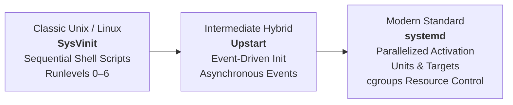
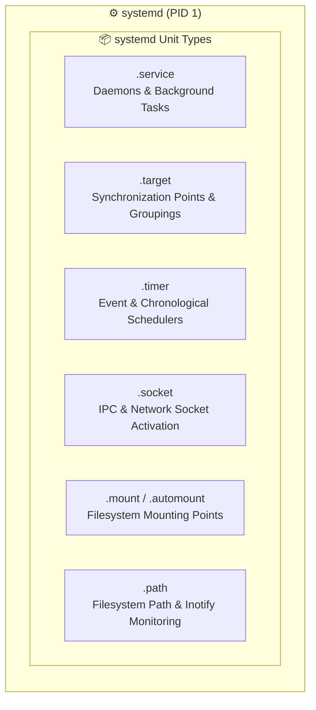
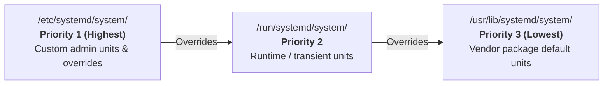
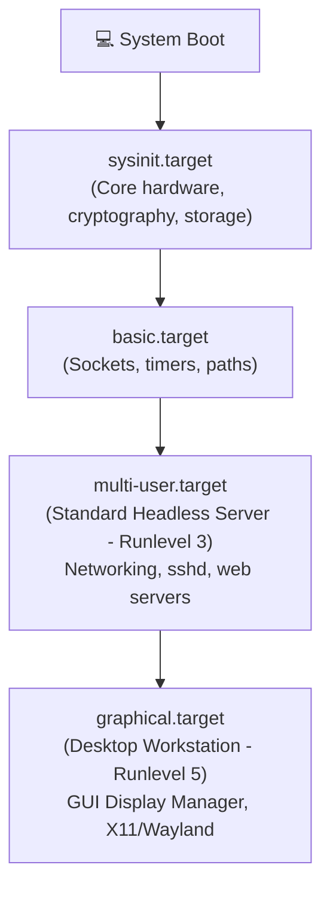
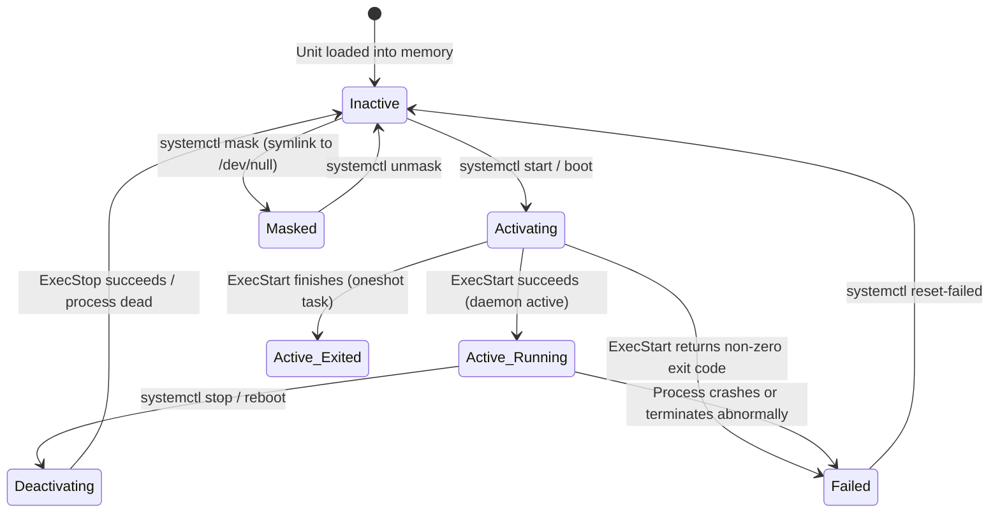
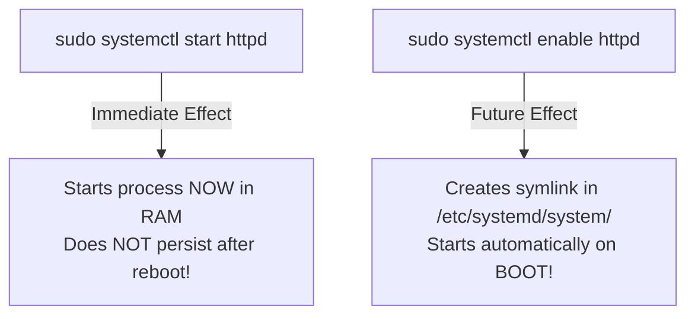
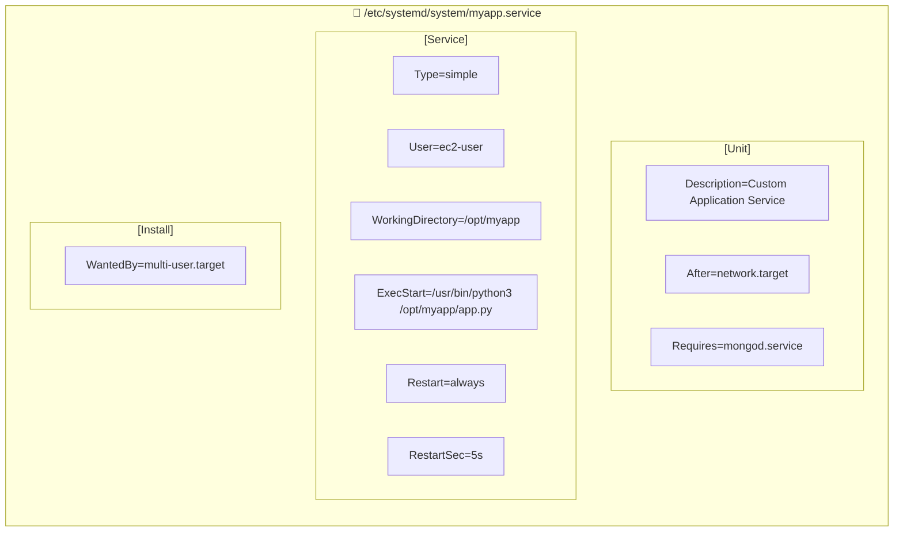
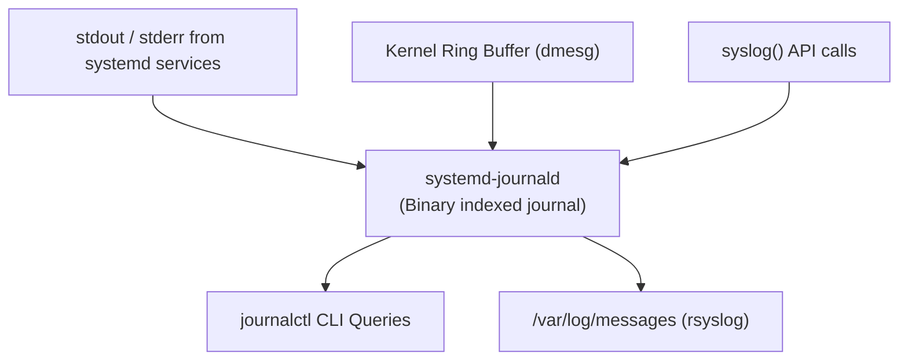
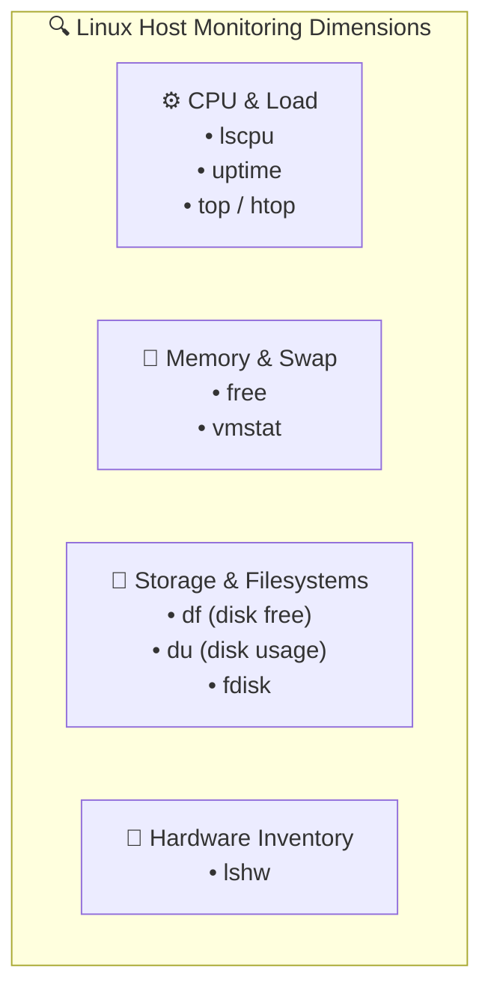
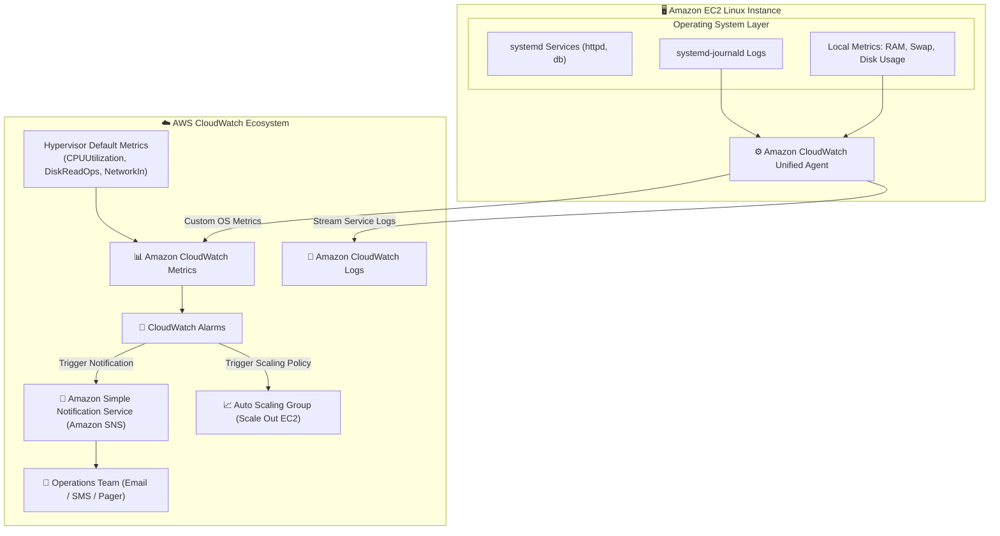

# ⚙️ Module 02: Managing Linux Services and Monitoring – Study Guide

> **Course**: AWS re/Start Linux Fundamentals  
> **Module**: M02 – Linux Fundamentals: Managing Services  
> **Source Document**: `T06-0010-RSLX_EN-US_SG_M02_MNGSERVICES.pdf`  
> **Target Audience**: AWS re/Start Learners / Cloud Practitioners / Linux System Administrators  

---

## 🎯 Module Overview

In modern operating systems and cloud architectures, background services—traditionally known as **daemons** in Unix and Linux—form the operational engine of every running machine. Background services provide vital system capabilities including remote management (`sshd`), web serving (`httpd`, `nginx`), database engines (`mariadb`, `postgresql`), time synchronization (`chronyd`), and network routing.

Unlike desktop applications that launch interactively inside a graphical window and terminate when closed by a user, services start silently in the background, run detached from any interactive terminal session, and remain operational to serve incoming requests or monitor system states.

Managing these services requires robust tools to control their lifecycle (starting, stopping, restarting, reloading configurations, and enabling auto-start at boot) without interrupting other workloads running on the same server. Furthermore, system administrators and cloud engineers must proactively monitor system resource consumption (CPU, memory, storage, process loads) and inspect centralized logs to diagnose performance anomalies and service failures.

This study guide provides comprehensive coverage of modern Linux service management using **systemd** and **`systemctl`**, contrasts legacy init systems (**SysVinit**, **Upstart**) with systemd, details unit file construction, explains service log inspection with **`journalctl`**, breaks down core performance monitoring utilities (`top`, `uptime`, `free`, `vmstat`, `df`, `du`, `lscpu`, `lshw`, `fdisk`), and demonstrates integration with **Amazon CloudWatch** and **Amazon SNS** for scalable cloud observability.

---

### 📌 Learning Objectives

- [ ] **Contrast System Initialization Paradigms**: Differentiate between legacy SysVinit, event-driven Upstart, and the modern unified systemd init architecture.
- [ ] **Deconstruct systemd Unit Architecture**: Explain unit types (`.service`, `.target`, `.timer`, `.socket`, `.mount`) and identify unit file storage hierarchies across `/etc`, `/run`, and `/usr/lib`.
- [ ] **Map Runlevels to systemd Targets**: Translate SysVinit runlevels (0–6) into standard systemd targets (`multi-user.target`, `graphical.target`, `rescue.target`, `emergency.target`).
- [ ] **Master Service Lifecycle with `systemctl`**: Confidently operate `systemctl` subcommands including `start`, `stop`, `restart`, `reload`, `status`, `enable`, `disable`, `mask`, `unmask`, `is-active`, and `is-enabled`.
- [ ] **Author Custom systemd Unit Files**: Structure custom `.service` unit files containing valid `[Unit]`, `[Service]`, and `[Install]` directives.
- [ ] **Inspect Centralized Logs via `journalctl`**: Query and filter binary systemd logs using flags `-u`, `-f`, `-e`, `--since`, and priority filtering (`-p err`).
- [ ] **Evaluate Linux System Resource Performance**: Analyze processor, memory, storage, and process metrics using `lscpu`, `lshw`, `uptime`, `free`, `vmstat`, `df`, `du`, `fdisk`, and `top`.
- [ ] **Bridge OS Monitoring to AWS CloudWatch**: Connect local Linux service metrics and logs to Amazon CloudWatch metrics, alarms, and Amazon Simple Notification Service (Amazon SNS).

---

## 🔄 1. Linux System Initialization Evolution: SysVinit, Upstart & systemd

When a Linux system powers on, the computer's firmware (BIOS or UEFI) initializes hardware and loads the bootloader (GRUB2). The bootloader then extracts the Linux kernel into memory. Once initialized, the kernel mounts the root filesystem and executes the very first user-space process: **PID 1** (Process ID 1). 

Every other user process, service, and daemon running in user space is a direct or indirect descendant of PID 1. Over the evolution of Linux, three major initialization systems have managed PID 1:



---

### 1. SysVinit (System V Init)
Derived from AT&T Unix System V, SysVinit served as the standard Linux init system for decades:
- **Execution Model**: Relies on shell scripts located in `/etc/init.d/`.
- **Sequential Execution**: During boot, scripts are executed one after another in numerical order (e.g., `S01logging`, `S10network`, `S50sshd`). A single slow or hanging script delays the entire boot sequence.
- **Runlevels**: Relies on static runlevels (0 through 6) to define the operating state of the machine.
- **Service Control**: Managed through the legacy `service` command or direct script invocation:
  ```bash
  sudo service httpd start
  # Or directly:
  sudo /etc/init.d/httpd start
  ```

---

### 2. Upstart
Developed by Canonical for Ubuntu 6.10 and adopted in Red Hat Enterprise Linux 6 (RHEL 6):
- **Execution Model**: Event-driven architecture designed to handle asynchronous hardware events (e.g., USB plug-in, network interface arrival).
- **Limitation**: While it parallelized startup tasks triggered by events, its configuration syntax was complex, and it lacked unified process tracking and cgroup management across the operating system.

---

### 3. systemd (System Daemon)
Created by Lennart Poettering and Kay Sievers, **systemd** is the modern standard init system and service manager adopted by virtually all major Linux enterprise distributions, including **Amazon Linux 2**, **Amazon Linux 2023**, RHEL/CentOS 7+, Fedora, Debian 8+, Ubuntu 15.04+, and SUSE Linux Enterprise:
- **Parallelized Boot**: Starts independent services simultaneously by leveraging Unix domain socket activation and D-Bus interfaces.
- **Control Groups (cgroups)**: Tracks all processes spawned by a daemon inside dedicated Linux cgroups. Even if a daemon double-forks to orphan child processes, systemd retains visibility and can cleanly terminate or monitor the entire process tree.
- **Declarative Units**: Replaces complex, error-prone shell scripts with declarative configuration files (`.service`, `.target`, `.timer`).
- **On-Demand Activation**: Supports socket activation, D-Bus activation, device activation, and path activation, delaying service launch until the resource is first accessed.

---

### Initialization Systems Comparison Matrix

| Feature / Dimension | SysVinit | Upstart | systemd |
| :--- | :--- | :--- | :--- |
| **Startup Paradigm** | Purely sequential (synchronous) | Event-driven (asynchronous) | Aggressively parallelized with socket activation |
| **Configuration Format** | Imperative Bash shell scripts (`/etc/init.d/`) | Declarative event stanzas (`/etc/init/`) | Declarative INI-style unit files (`.service`, `.target`) |
| **State Organization** | Numeric Runlevels (`0` – `6`) | Job states and event runlevels | Semantic Targets (`multi-user.target`, etc.) |
| **Process Tracking** | PID files (fragile; fails if daemon double-forks) | PID tracking heuristics | Linux Control Groups (`cgroups`) (watertight tracking) |
| **Logging Mechanism** | Plaintext `/var/log/` via `rsyslog` / `syslogd` | Standard syslog files | Centralized binary journal (`systemd-journald`) |
| **Scheduled Tasks** | Separate `cron` daemon | Separate `cron` daemon | Native `.timer` units or traditional `cron` |
| **Primary Management CLI** | `service <name> start`<br>`chkconfig <name> on` | `initctl start <name>`<br>`service <name> start` | `systemctl <action> <name>` |

---

## 🏗️ 2. systemd Architecture: Units, Targets, and Unit Files

In systemd, any resource managed by the operating system is encapsulated as a **Unit**. Each unit has a specific name and an extension that reflects its type.



---

### Common systemd Unit Types

| Unit Extension | Type Name | Description and Cloud Use Case |
| :--- | :--- | :--- |
| **`.service`** | **Service** | Manages a background daemon or one-time batch process (e.g., `sshd.service`, `httpd.service`, `docker.service`). Controls execution commands, restart policies, and environment variables. |
| **`.target`** | **Target** | Groups other units together and defines system states or synchronization milestones during startup (e.g., `multi-user.target`, `network.target`). Analogous to runlevels. |
| **`.timer`** | **Timer** | Provides systemd-native task scheduling, triggering `.service` units at fixed intervals or calendar dates (modern replacement for legacy `cron`). |
| **`.socket`** | **Socket** | Encapsulates an IPC or network socket. systemd listens on the socket on behalf of the service and starts the service only when an incoming connection arrives. |
| **`.mount`** | **Mount** | Controls filesystem mount points (automatically generated from `/etc/fstab` or created manually). |
| **`.path`** | **Path** | Monitors files or directories for creation, modification, or deletion via the kernel's `inotify` subsystem, triggering a corresponding service upon change. |
| **`.device`** | **Device** | Represents kernel-exposed hardware devices managed via `udev`. |

---

### Unit File Storage Locations & Precedence

Unit configuration files reside in three main filesystem locations. systemd evaluates them according to a strict precedence order, allowing administrators to override vendor defaults cleanly without editing package files directly:



1. **`/etc/systemd/system/` (Priority 1 – Highest)**:
   - Reserved exclusively for the system administrator.
   - Any unit file or symlink placed here overrides files of the exact same name in `/run` and `/usr/lib`.
   - Also holds `.wants/` and `.requires/` dependency directories created when services are enabled.
2. **`/run/systemd/system/` (Priority 2 – Intermediate)**:
   - Stores runtime-generated units created dynamically during execution.
   - Resides in volatile memory (`tmpfs`) and does not survive a system reboot.
3. **`/usr/lib/systemd/system/` (Priority 3 – Lowest / Upstream)**:
   - Stores default unit files installed by the distribution package manager (`yum`, `dnf`, `apt`, `rpm`).
   - **Never edit files in this directory directly**, as package updates will overwrite your changes.

> [!TIP]
> **Safe Configuration Overrides**:
> To customize a package-provided unit file (such as `httpd.service`), never modify `/usr/lib/systemd/system/httpd.service`. Instead, run:
> ```bash
> sudo systemctl edit httpd.service
> ```
> This creates a drop-in override directory at `/etc/systemd/system/httpd.service.d/override.conf`, preserving package update compatibility.

---

## 🎯 3. Runlevels vs. systemd Targets

In legacy SysVinit systems, the system's operational state was designated by a single numeric **runlevel** from `0` to `6`. In systemd, runlevels are replaced by **Target units** (`.target`). 

Targets act as synchronization milestones that group multiple services together. Unlike single-digit runlevels, multiple systemd targets can be active concurrently.



---

### Runlevel to systemd Target Mapping

| SysVinit Runlevel | systemd Target | Purpose & Operational State |
| :---: | :--- | :--- |
| **`0`** | `poweroff.target` | Halts and powers off the system hardware cleanly. |
| **`1` / `S`** | `rescue.target` | Single-user administrative maintenance mode. Minimal services; presents a root shell prompt; no network access. |
| **`2`** | `multi-user.target` | Multi-user text-mode without networking (rarely used historically). In systemd, aliased to multi-user. |
| **`3`** | `multi-user.target` | **Standard Multi-User Text Mode (CLI)**. Full networking, multi-user logins, background daemons. **Default state for AWS EC2 Linux servers**. |
| **`4`** | `multi-user.target` | User-definable custom runlevel (historically unused; aliased to multi-user). |
| **`5`** | `graphical.target` | **Multi-User Graphical Mode (GUI)**. Includes all multi-user network services plus the display manager and graphical desktop. |
| **`6`** | `reboot.target` | Shuts down all active services and reboots the system. |
| *N/A* | `emergency.target` | Most minimal recovery mode; mounts root filesystem read-only without starting services. |

---

### Managing System Targets with `systemctl`

System administrators frequently inspect or change default boot targets:

```bash
# Display the current default boot target
systemctl get-default
# Output example: multi-user.target

# Set the default boot target to multi-user (headless server mode)
sudo systemctl set-default multi-user.target

# Set the default boot target to graphical mode (desktop workstations)
sudo systemctl set-default graphical.target

# Switch to a target immediately in the running session without rebooting
sudo systemctl isolate multi-user.target
```

---

## 🎮 4. `systemctl` Command Mastery

The primary utility for controlling systemd and inspecting service state is **`systemctl`**.

### Basic Command Syntax
```bash
systemctl [subcommand] [unit_name]
```
*(Note: If the unit extension `.service` is omitted, `systemctl` automatically assumes `.service` for most commands).*

---

### Service Lifecycle State Machine

A systemd service transitions through distinct operational lifecycle states:



---

### Core `systemctl` Operations

#### 1. Checking Service Status (`status`)
Inspects whether a service is currently running, its boot-enable status, process ID, memory footprint, and recent log messages:
```bash
sudo systemctl status httpd
```
**Sample Output Breakdown**:
```text
● httpd.service - The Apache HTTP Server
     Loaded: loaded (/usr/lib/systemd/system/httpd.service; enabled; vendor preset: disabled)
     Active: active (running) since Mon 2026-10-12 14:22:05 UTC; 1h 15min ago
       Docs: man:httpd.service(8)
   Main PID: 12450 (httpd)
     Status: "Total requests: 120; Idle/Busy workers 100/0;Requests/sec: 0.0267"
      Tasks: 213 (limit: 4627)
     Memory: 32.4M
        CPU: 1.241s
     CGroup: /system.slice/httpd.service
             ├─12450 /usr/sbin/httpd -DFOREGROUND
             ├─12451 /usr/sbin/httpd -DFOREGROUND
             └─12452 /usr/sbin/httpd -DFOREGROUND

Oct 12 14:22:05 ip-10-0-1-50.ec2.internal systemd[1]: Starting The Apache HTTP Server...
Oct 12 14:22:05 ip-10-0-1-50.ec2.internal systemd[1]: Started The Apache HTTP Server.
```
- **Loaded**: Shows if the unit definition was read into memory, the path of the unit file, and if it is `enabled` or `disabled` at boot.
- **Active**: Shows current status (`active (running)`, `inactive (dead)`, `activating`, or `failed`).
- **Main PID**: The primary process ID assigned by the Linux kernel.
- **CGroup**: The cgroup tree displaying all processes belonging to this service.
- **Log Snippet**: The last several log lines captured by `journald`.

---

#### 2. Starting, Stopping, Restarting, and Reloading

```bash
# Start an inactive service immediately in the current session
sudo systemctl start httpd

# Stop a currently running service
sudo systemctl stop httpd

# Stop and immediately restart a service (causes brief service downtime)
sudo systemctl restart httpd

# Reload service configuration files WITHOUT dropping active client connections
sudo systemctl reload httpd

# Attempt to reload configuration; if reload is unsupported by the daemon, restart it
sudo systemctl reload-or-restart httpd
```

> [!IMPORTANT]
> **Restart vs. Reload**:
> - **`restart`**: Kills the existing running process and spawns a fresh one. Active network connections are severed. Use this when updating binary executables or when major structural changes occur.
> - **`reload`**: Sends a signal (typically `SIGHUP`) to the running process instructing it to re-read configuration files from disk without terminating the process or disconnecting clients.

---

#### 3. Enabling vs. Disabling Services (Boot Behavior)

Starting a service (`systemctl start`) and enabling a service (`systemctl enable`) perform completely distinct tasks:



```bash
# Configure a service to launch automatically during system boot
sudo systemctl enable httpd
# Output: Created symlink /etc/systemd/system/multi-user.target.wants/httpd.service → /usr/lib/systemd/system/httpd.service.

# Disable automatic launch at boot (removes the symlink)
sudo systemctl disable httpd
# Output: Removed /etc/systemd/system/multi-user.target.wants/httpd.service.

# Enable and immediately start a service in a single command
sudo systemctl enable --now httpd
```

---

#### 4. Verification & Scripting Predicates

When writing automation scripts (such as Bash scripts or AWS EC2 User Data bootstrap scripts), interactive human-readable output is undesirable. systemd provides programmatic predicates that return standard Unix exit codes (`0` for true, non-zero for false):

```bash
# Check if the service is currently running
systemctl is-active httpd
# Prints "active" or "inactive" and returns exit code 0 if running

# Check if the service is configured to launch at boot
systemctl is-enabled httpd
# Prints "enabled" or "disabled" and returns exit code 0 if enabled

# Check if the service has failed
systemctl is-failed httpd
# Prints "failed" or "active"/"inactive"
```

**Bash Scripting Example**:
```bash
if systemctl is-active --quiet httpd; then
    echo "Apache is running."
else
    echo "Apache is down! Triggering alert..."
fi
```

---

#### 5. Masking and Unmasking Services

Occasionally, an administrator must guarantee that a conflicting or dangerous service cannot be started under any circumstances—neither manually by another user, nor automatically as a dependency of another service:

```bash
# Mask the service (links the unit file to /dev/null)
sudo systemctl mask iptables
# Output: Created symlink /etc/systemd/system/iptables.service → /dev/null.

# Attempting to start a masked service will fail:
sudo systemctl start iptables
# Error: Failed to start iptables.service: Unit iptables.service is masked.

# Unmask the service (removes the /dev/null symlink)
sudo systemctl unmask iptables
# Output: Removed /etc/systemd/system/iptables.service.
```

---

#### 6. Listing and Inspecting Units

```bash
# List all active units currently in memory
systemctl

# List all units of type service, regardless of state (active, exited, failed)
systemctl list-units --type=service

# List only active services
systemctl list-units --type=service --state=active

# List all failed units (crucial for troubleshooting)
systemctl --failed

# List all installed unit files and their enabled/disabled boot status
systemctl list-unit-files --type=service

# List active timer units and their next trigger times
systemctl list-timers
```

---

### `systemctl` Command Reference Summary

| Command | Action | Persists Across Reboot? |
| :--- | :--- | :---: |
| `systemctl start <svc>` | Starts the service immediately | ❌ No |
| `systemctl stop <svc>` | Terminates the service immediately | ❌ No |
| `systemctl restart <svc>` | Stops and restarts the service | ❌ No |
| `systemctl reload <svc>` | Hot-reloads configuration files | ❌ No |
| `systemctl status <svc>` | Displays running status, PID, and recent logs | ℹ️ Informational |
| `systemctl enable <svc>` | Creates symlink to auto-start at boot | ✅ Yes |
| `systemctl disable <svc>` | Removes symlink; will not start at boot | ✅ Yes |
| `systemctl enable --now <svc>` | Enables for boot AND starts immediately | ✅ Yes |
| `systemctl mask <svc>` | Symlinks unit to `/dev/null`; prevents start | ✅ Yes |
| `systemctl unmask <svc>` | Unmasks unit, restoring normal operation | ✅ Yes |
| `systemctl is-active <svc>` | Returns exit code 0 if service is running | ℹ️ Informational |
| `systemctl is-enabled <svc>` | Returns exit code 0 if enabled at boot | ℹ️ Informational |
| `systemctl daemon-reload` | Re-reads all unit files from disk | ℹ️ System refresh |

---

## 📝 5. Creating Custom systemd Service Units

One of the greatest strengths of systemd is the ease with which custom software applications, microservices, and background scripts can be managed as first-class system services.

A custom unit file is a plain-text file divided into three main sections:
1. **`[Unit]`**: Metadata and dependency relationships.
2. **`[Service]`**: Execution parameters, credentials, process type, and restart behaviors.
3. **`[Install]`**: Boot target relationships.



---

### Anatomy of Unit Directives

#### `[Unit]` Directives
- **`Description=`**: A clear human-readable name displayed in `systemctl status` and system logs.
- **`Documentation=`**: URI or man page reference (e.g., `https://example.com/docs`).
- **`After=`**: Ordering directive. Ensures this service starts *after* the specified units (e.g., `After=network.target`). *Note: This controls boot sequence timing, not strict hard dependency.*
- **`Requires=`**: Strict hard dependency. If any unit listed in `Requires` fails or stops, this service fails or stops as well.
- **`Wants=`**: Weak dependency. systemd will attempt to start the listed units, but this service will start even if the wanted units fail.
- **`Conflicts=`**: Negative dependency. If a conflicting unit is started, this unit will be automatically stopped.

#### `[Service]` Directives
- **`Type=`**: Defines process execution behavior:
  - `simple` (default): The process specified in `ExecStart` is the main service process.
  - `forking`: The process spawns a child process and exits (traditional Unix daemon model). Requires `PIDFile=`.
  - `oneshot`: Executes a short-lived task and terminates before proceeding (useful for initialization scripts).
  - `notify`: The service sends a notification signal to systemd via `sd_notify()` once initialization is complete.
- **`ExecStart=`**: The exact absolute path to the binary command to execute when launching the service.
- **`ExecStop=`**: Command to run when stopping the service (optional).
- **`ExecReload=`**: Command to trigger configuration reloads without termination.
- **`Restart=`**: Automatic failure recovery policy: `no`, `always`, `on-success`, `on-failure`, `on-abnormal`.
- **`RestartSec=`**: Time to wait before attempting a restart (e.g., `5s`).
- **`User=` & `Group=`**: Drops root privileges to run the process under an unprivileged user (best practice for security).
- **`WorkingDirectory=`**: The working directory where the process executes.
- **`EnvironmentFile=`**: Path to a file containing environment variables (e.g., `/etc/sysconfig/myapp`).

#### `[Install]` Directives
- **`WantedBy=`**: Specifies the target unit that should pull in this service when enabled. For standard servers, this is almost always `multi-user.target`.

---

### Step-by-Step Practical Lab: Creating a Custom Service

#### Step 1: Create the Application Script
Create a simple Python daemon script at `/opt/app/server.py`:
```python
#!/usr/bin/env python3
import time
import sys

print("Custom Server Service is initializing...", flush=True)
while True:
    print("Service heartbeat: operational.", flush=True)
    time.sleep(10)
```
Ensure execution permissions:
```bash
sudo chmod +x /opt/app/server.py
```

#### Step 2: Write the systemd Unit File
Create the file `/etc/systemd/system/myapp.service`:
```ini
[Unit]
Description=My Custom Cloud Application Daemon
Documentation=https://internal.docs.example.com/myapp
After=network.target

[Service]
Type=simple
User=ec2-user
Group=ec2-user
WorkingDirectory=/opt/app
ExecStart=/usr/bin/python3 /opt/app/server.py
Restart=always
RestartSec=5s
StandardOutput=journal
StandardError=journal

[Install]
WantedBy=multi-user.target
```

#### Step 3: Inform systemd and Activate
Whenever unit files in `/etc/systemd/system/` are created or modified, reload the systemd manager configuration:
```bash
# Reload systemd manager configuration
sudo systemctl daemon-reload

# Enable the service for boot and start it immediately
sudo systemctl enable --now myapp.service

# Verify the operational status
sudo systemctl status myapp.service
```

---

## 📜 6. Inspecting Service Logs with `journalctl`

systemd includes a unified logging subsystem called **`systemd-journald`**. Rather than having every service independently open and write to disparate plaintext log files across `/var/log/`, `systemd-journald` captures standard output (`stdout`), standard error (`stderr`), kernel messages, and syslog events into an indexed binary journal.

The command-line tool used to query and filter these logs is **`journalctl`**.



---

### Key `journalctl` Commands and Filtering Techniques

#### 1. Filter by Specific Service Unit (`-u`)
View all log messages originating from a particular unit:
```bash
sudo journalctl -u httpd.service
```

#### 2. Follow Logs in Real Time (`-f`)
Acts like `tail -f`, continuously outputting new log entries as they are generated:
```bash
sudo journalctl -u httpd.service -f
```

#### 3. Jump to the End of the Log (`-e`)
Opens the pager directly at the most recent log entries:
```bash
sudo journalctl -u httpd.service -e
```

#### 4. Filter by Time Window (`--since` and `--until`)
Query logs generated within specific historical timeframes:
```bash
# View logs generated in the last 30 minutes
sudo journalctl -u httpd.service --since "30 minutes ago"

# View logs between specific calendar timestamps
sudo journalctl --since "2026-10-12 08:00:00" --until "2026-10-12 12:00:00"

# View logs generated since today's date
sudo journalctl -u httpd.service --since today
```

#### 5. Filter by Log Priority Level (`-p`)
Filter messages according to syslog severity levels (`emerg`, `alert`, `crit`, `err`, `warning`, `notice`, `info`, `debug`):
```bash
# View only errors and critical failures
sudo journalctl -p err

# View errors specifically for the httpd service
sudo journalctl -u httpd -p err
```

#### 6. System Boot Filtering (`-b`)
View logs generated during the current or previous system boots:
```bash
# Current boot logs
sudo journalctl -b

# Previous boot logs (useful after an unexpected kernel panic or reboot)
sudo journalctl -b -1
```

#### 7. Limiting Output and Disabling Pager
```bash
# View the last 50 lines without launching less/more pager
sudo journalctl -u httpd.service -n 50 --no-pager
```

#### 8. Managing Journal Disk Usage
```bash
# Inspect current storage consumption of journal files
journalctl --disk-usage

# Reclaim space by retaining only the last 500 MB of logs
sudo journalctl --vacuum-size=500M

# Reclaim space by retaining only logs from the last 14 days
sudo journalctl --vacuum-time=14d
```

---

## 📊 7. Linux System Performance and Monitoring Commands

To ensure services are operating efficiently, system administrators must monitor the host's underlying hardware resources. The Linux operating system provides powerful command-line utilities for inspecting CPU, memory, storage, and active processes.



---

### 1. CPU & Host Architecture: `lscpu` and `uptime`

#### `lscpu` (List CPU Information)
Gathers CPU architecture information from the `/proc/cpuinfo` kernel interface:
```bash
lscpu
```
**Key Metrics to Examine**:
- **Architecture**: CPU instruction set (e.g., `x86_64` for Intel/AMD, `aarch64` for AWS Graviton).
- **CPU(s)**: Total virtual CPUs (vCPUs) available to the OS.
- **Thread(s) per core**: Indicates hyper-threading (`2` means multi-threading enabled).
- **CPU MHz**: Processor clock frequency.
- **Virtualization**: Shows hypervisor flags (e.g., `KVM`, `Xen`), essential when verifying cloud instances.

#### `uptime` (System Running Time and Load Averages)
Displays how long the system has been continuously running without a reboot:
```bash
uptime
# Output: 15:42:10 up 45 days, 3:12,  2 users,  load average: 0.15, 0.08, 0.02
```
**Breakdown**:
1. **Current Time**: `15:42:10`
2. **Uptime Duration**: `up 45 days, 3:12`
3. **Active Logged-in Users**: `2 users`
4. **Load Averages**: Three numbers representing system load over **1 minute**, **5 minutes**, and **15 minutes**.
   - Load average indicates the average number of processes in a **runnable** state (using or waiting for CPU) or **uninterruptible sleep** state (waiting for disk I/O).
   - On a machine with 4 vCPUs, a load average below `4.00` indicates spare capacity; a load consistently above `4.00` indicates resource saturation.

---

### 2. Hardware Inventory: `lshw`

#### `lshw` (List Hardware)
Generates an extensive hardware inventory of the machine, reading DMI/SMBIOS tables and PCI buses:
```bash
# Print a summarized, tabular hardware summary
sudo lshw -short
```
**Sample Output**:
```text
H/W path         Device      Class          Description
=======================================================
                             system         HVM domU (Amazon EC2)
/0                           bus            Motherboard
/0/0                         memory         64KiB BIOS
/0/4                         processor      Intel(R) Xeon(R) CPU E5-2676 v3 @ 2.40GHz
/0/1000                      memory         8GiB System Memory
/0/100/1.1       /dev/xvda   disk           30GB Elastic Block Store (EBS)
/0/100/3         eth0        network        Elastic Network Adapter (ENA)
```

---

### 3. Memory & Virtual Memory: `free` and `vmstat`

#### `free` (Physical and Swap Memory Utilization)
Displays physical RAM and swap space utilization:
```bash
free -h
```
*(The `-h` flag renders quantities in human-readable units: MiB, GiB).*

**Sample Output**:
```text
               total        used        free      shared  buff/cache   available
Mem:           7.6Gi       1.8Gi       3.2Gi        24Mi       2.6Gi       5.5Gi
Swap:          2.0Gi          0B       2.0Gi
```
**Interpreting the Metrics**:
- **total**: Total physical RAM installed on the machine.
- **used**: Memory actively allocated by running processes.
- **free**: Memory completely untouched by the operating system.
- **buff/cache**: Memory used by the Linux kernel for filesystem cache and disk buffers. **Linux uses idle RAM as cache to accelerate disk reads**. This memory is instantly reclaimed and freed when applications demand more RAM.
- **available**: **The most important metric for cloud administrators**. Estimates the actual RAM available to launch new applications without resorting to swap.
- **Swap**: Disk-backed virtual memory space used when physical RAM is exhausted. Constant non-zero swap activity indicates RAM starvation.

#### `vmstat` (Virtual Memory Statistics)
Reports real-time memory, paging, block I/O, and CPU activity:
```bash
# Sample every 2 seconds, 4 times
vmstat 2 4
```
**Sample Output**:
```text
procs -----------memory---------- ---swap-- -----io---- -system-- ------cpu-----
 r  b   swpd   free   buff  cache   si   so    bi    bo   in   cs us sy id wa st
 1  0      0 342104  12480 268420    0    0     4    22   45  120  2  1 97  0  0
```
**Crucial Columns to Monitor**:
- **`procs -> r`**: Number of processes running or waiting for CPU runtime.
- **`procs -> b`**: Number of processes in uninterruptible sleep (waiting on disk I/O).
- **`swap -> si / so`**: Swap In / Swap Out. If `so` (swap out to disk) is consistently > 0, the system is severely memory constrained.
- **`cpu -> us`**: User CPU time spent executing non-kernel code.
- **`cpu -> sy`**: System CPU time spent inside kernel operations.
- **`cpu -> id`**: Idle CPU time percentage.
- **`cpu -> wa`**: **Wait I/O percentage**. High `wa` indicates the CPU is throttled waiting for slow storage drives (EBS volume IOPS throttling).
- **`cpu -> st`**: **Steal time**. In cloud virtualization (EC2), `st` represents time the physical CPU was stolen by the hypervisor to service other virtual machines on the shared physical host.

---

### 4. Storage & Filesystem Capacity: `df`, `du`, and `fdisk`

#### `df` (Disk Free)
Displays total storage space, used capacity, and available blocks across all mounted filesystems:
```bash
df -h
```
**Sample Output**:
```text
Filesystem      Size  Used Avail Use% Mounted on
devtmpfs        3.8G     0  3.8G   0% /dev
tmpfs           3.8G     0  3.8G   0% /dev/shm
/dev/xvda1       30G   14G   16G  47% /
/dev/xvdf       100G   25G   75G  25% /data
```
> [!IMPORTANT]
> When troubleshooting a service that unexpectedly fails to start or crashes (such as a database or web server), running `df -h` is often the first troubleshooting step. If `/` or `/var` reaches **100% capacity**, daemons cannot write PID files or logs and immediately fail.

#### `du` (Disk Usage)
Estimates file and directory space usage recursively. While `df` monitors the overall filesystem, `du` tracks down exactly which directories or files are consuming that space:
```bash
# Display total size of the current directory in human-readable format
du -sh .

# Identify the largest 5 directories in /var
sudo du -h --max-depth=1 /var | sort -hr | head -n 5
```

#### `fdisk` (Partition Table Utility)
Displays, creates, and manipulates disk partition tables:
```bash
# List all attached storage devices and partition tables
sudo fdisk -l
```
Shows disk size, sector count, disk model, partition scheme (MBR vs. GPT), and filesystem partition identifiers.

---

### 5. Interactive Process Monitoring: `top`

The **`top`** command provides an interactive, real-time dynamic view of active system processes and overall system health:
```bash
top
```

```text
top - 16:15:20 up 22 days,  4:10,  1 user,  load average: 0.85, 0.42, 0.20
Tasks: 112 total,   2 running, 110 sleeping,   0 stopped,   0 zombie
%Cpu(s): 12.5 us,  3.2 sy,  0.0 ni, 83.1 id,  1.0 wa,  0.0 hi,  0.2 si,  0.0 st
MiB Mem :   7824.2 total,   3240.1 free,   2110.5 used,   2473.6 buff/cache
MiB Swap:   2048.0 total,   2048.0 free,      0.0 used.   5420.2 avail Mem 

  PID USER      PR  NI    VIRT    RES    SHR S  %CPU  %MEM     TIME+ COMMAND
 3421 apache    20   0  540212  45120  12480 S  18.5   0.6   2:14.30 httpd
 1240 mysql     20   0 1845120 412580  24110 S   8.2   5.3  14:32.10 mysqld
 4110 ec2-user  20   0  162420   4210   2100 R   0.7   0.1   0:00.12 top
    1 root      20   0  175200   9810   6540 S   0.0   0.1   0:04.55 systemd
```

#### Understanding the Process Table Columns
- **PID**: Process ID.
- **USER**: The Linux user owning the process.
- **PR / NI**: Priority and Niceness value (`-20` highest priority to `+19` lowest priority).
- **VIRT**: Virtual memory size requested by the process.
- **RES**: Resident Set Size—the actual non-swapped physical RAM currently consumed.
- **SHR**: Shared memory used by the process.
- **S (Process State)**:
  - `R`: Running or runnable.
  - `S`: Interruptible sleep (waiting for an event).
  - `D`: Uninterruptible sleep (usually disk I/O).
  - `Z`: Zombie (terminated process whose exit status has not been reaped by its parent).
- **%CPU**: Percentage of CPU time currently used.
- **%MEM**: Percentage of physical RAM currently used.
- **TIME+**: Total cumulative CPU time accumulated since the process launched.
- **COMMAND**: Process executable name.

#### Key Interactive Keystrokes inside `top`
- **`P`**: Sort the process list by **CPU consumption** (default).
- **`M`**: Sort the process list by **Memory consumption**.
- **`T`**: Sort the process list by **Running Time**.
- **`k`**: Kill a process (prompts for the target PID and signal, e.g., `15` for `SIGTERM` or `9` for `SIGKILL`).
- **`r`**: Renice a running process (modifies scheduling priority).
- **`1`**: Toggle display between individual CPU cores and aggregate CPU metrics.
- **`q`**: Quit `top` and return to the shell.

---

### Linux Performance Monitoring Utilities Summary

| Command | Primary Resource Measured | Key Options | Practical Use Case |
| :--- | :--- | :--- | :--- |
| **`lscpu`** | CPU hardware architecture | *(None)* | Check vCPU count, virtualization flags, and architecture. |
| **`uptime`** | System runtime & load | `-p` (pretty), `-s` (since) | Quick glance at system stability and 1/5/15-min load averages. |
| **`lshw`** | Comprehensive hardware inventory | `-short`, `-C <class>` | Audit hardware components, memory slots, and network interfaces. |
| **`free`** | RAM and swap space | `-h` (human), `-m` (MiB) | Determine available RAM and detect if swap thrashing is occurring. |
| **`vmstat`** | Virtual memory, I/O & CPU | `[interval] [count]` | Real-time analysis of swap I/O (`so`), disk wait (`wa`), and CPU steal (`st`). |
| **`df`** | Mounted filesystem disk space | `-h` (human), `-T` (type) | Identify full disk partitions (`100% full`) preventing services from running. |
| **`du`** | Directory and file space consumption | `-sh`, `--max-depth=1` | Pinpoint specific oversize files or directories consuming disk space. |
| **`fdisk`** | Block device partition tables | `-l` (list) | Inspect attached block devices, partitions, and sector alignments. |
| **`top`** | Dynamic process and system monitor | `-u <user>`, `-p <pid>` | Real-time troubleshooting of CPU/RAM spikes and identifying runaway processes. |

---

## ☁️ 8. Cloud Integration: AWS CloudWatch & Linux Services

In enterprise cloud environments, administrators cannot manually log into every virtual server to run `top`, `df`, or `systemctl`. Instead, operating system monitoring and service health are centralized using **Amazon CloudWatch**.



---

### Default EC2 Metrics vs. The CloudWatch Unified Agent

Amazon EC2 automatically provides **hypervisor-level metrics** to CloudWatch every 5 minutes (or every 1 minute with detailed monitoring enabled) without installing any software inside the guest OS:
- **`CPUUtilization`**: Percentage of allocated compute capacity in use.
- **`NetworkIn` / `NetworkOut`**: Volume of network traffic flowing through the virtual network interface.
- **`DiskReadOps` / `DiskWriteOps`**: Storage transactions on instance store volumes.
- **`StatusCheckFailed_Instance`**: Checks if the guest operating system is responding.
- **`StatusCheckFailed_System`**: Checks if AWS underlying hardware infrastructure is healthy.

> [!CAUTION]
> **The CloudWatch Hypervisor Visibility Gap**:
> Because Amazon Web Services enforces strict virtualization security boundaries, the hypervisor **cannot look inside** the guest operating system's kernel. Consequently, default CloudWatch **CANNOT see**:
> - Memory (RAM) utilization
> - Swap space utilization
> - Disk filesystem capacity (`df` / percentage of free disk space)
> - systemd service statuses or `journalctl` service logs
>
> To monitor RAM, disk capacity, and service logs in CloudWatch, you must install the **Amazon CloudWatch Unified Agent** inside the Linux instance.

---

### CloudWatch Alarms & Amazon SNS Architecture

When an EC2 metric breaches an operational threshold, CloudWatch triggers an automated response:
1. **CloudWatch Alarm**: Evaluates metric thresholds (e.g., `CPUUtilization >= 80% for 2 consecutive periods of 5 minutes`).
2. **State Transitions**: The alarm transitions from `OK` to `ALARM`.
3. **Notification via Amazon SNS**: The alarm sends an event to an **Amazon Simple Notification Service (Amazon SNS)** topic.
4. **Subscriber Delivery**: Amazon SNS distributes the notification to subscribers via **Email**, **SMS**, or **HTTPS webhooks** (such as Slack or PagerDuty).
5. **Automated Remediation**: The alarm can also trigger an **EC2 Auto Scaling policy** (launching additional EC2 instances to share traffic) or trigger an **EC2 Action** (rebooting or stopping a failed instance).

---

## 🧠 9. Checkpoint & Knowledge Check

Test your understanding of Linux service management, monitoring, and cloud observability concepts.

### Question 1
**Why do you restart a service instead of restarting the entire computer when troubleshooting?**
> **Answer**: A production server often hosts dozens of concurrent services (such as SSH, databases, background queue workers, and DNS resolvers) supporting multiple users. Rebooting the entire physical or virtual server interrupts all properly running, healthy services. Restarting only the failing service allows all other services to continue serving traffic uninterrupted, drastically reducing downtime and blast radius.

---

### Question 2
**How might you use the `top` command when you are troubleshooting a slow or unresponsive server?**
> **Answer**: You can use `top` to view real-time CPU and memory utilization sorted by highest consumer. If CPU utilization is at 100%, pressing `P` immediately identifies the exact runaway process or daemon responsible (via PID and command name). You can also press `k` directly within `top` to send a termination signal (`SIGTERM` or `SIGKILL`) to that process, restoring system responsiveness.

---

### Question 3
**What is the functional difference between `systemctl start httpd` and `systemctl enable httpd`?**
> **Answer**:
> - `systemctl start httpd` starts the web server immediately in the current running session, but does **not** configure it to start after a reboot.
> - `systemctl enable httpd` creates a symbolic link in `/etc/systemd/system/multi-user.target.wants/` instructing systemd to start the web server automatically upon subsequent reboots, but does **not** start it in the current session.  
> *(To perform both actions in a single step, use `systemctl enable --now httpd`)*.

---

### Question 4
**What occurs when a service is masked using `systemctl mask <service>`?**
> **Answer**: systemd creates a symbolic link pointing the unit file directly to `/dev/null` in `/etc/systemd/system/`. This guarantees that the service cannot be started under any circumstances—neither manually by an administrator, nor automatically as a dependency of another service.

---

### Question 5
**Which systemd target corresponds to legacy SysVinit Runlevel 3 (standard multi-user text console with networking)?**
> **Answer**: `multi-user.target`. This is the standard operational target for headless cloud servers and AWS EC2 instances.

---

### Question 6
**Which command and flags would you use to follow real-time logs generated by the `nginx.service` daemon?**
> **Answer**: `sudo journalctl -u nginx.service -f` (or `sudo journalctl -fu nginx`).

---

### Question 7
**In the output of the `free -h` command, why is the `available` column more important than the `free` column when sizing workloads?**
> **Answer**: The Linux kernel intentionally allocates idle, unassigned RAM to filesystem caching and buffers (`buff/cache`) to accelerate disk I/O performance. The `free` column only reflects memory that is completely untouched. The `available` column represents memory that can be immediately allocated to new or expanding applications by reclaiming cache space without swapping.

---

### Question 8
**Why can't Amazon CloudWatch display Linux guest memory (RAM) utilization by default without installing the CloudWatch Unified Agent?**
> **Answer**: Amazon CloudWatch hypervisor metrics are collected outside the virtual machine from the physical host virtualization layer. For security and isolation reasons, the hypervisor cannot inspect guest operating system memory tables or internal filesystem data structures. The CloudWatch Unified Agent runs inside the guest OS user space and pushes internal OS metrics to CloudWatch via the AWS API.

---

## 📝 10. Key Takeaways

- **Services and Daemons**: Background processes that execute without an attached terminal session, powering core networking, administrative, and application workloads.
- **Init Evolution**: Linux transitioned from sequential shell scripts (**SysVinit**) and event hooks (**Upstart**) to parallelized, cgroup-managed declarative units (**systemd**).
- **systemd Units**: Resources configured via declarative unit files; major unit types include `.service` (daemons), `.target` (boot states), `.timer` (scheduled jobs), and `.socket` (socket activation).
- **Target vs. Runlevel**: Modern systemd targets replace numeric runlevels. `multi-user.target` represents standard headless multi-user network servers (Runlevel 3); `graphical.target` represents desktop GUIs (Runlevel 5).
- **Service Management**:
  - `systemctl start / stop / restart / reload` manages runtime status in the active session.
  - `systemctl enable / disable` manages automated launch on boot by creating or removing symlinks in `/etc/systemd/system/`.
  - `systemctl mask` links a unit to `/dev/null`, preventing manual or dependency-triggered startup.
- **Log Inspection**: `journalctl` queries the centralized binary journal maintained by `systemd-journald`. Use `-u` for service filtering, `-f` for real-time streaming, and `-p err` for errors.
- **Host Resource Monitoring**:
  - `top`: Real-time interactive process inspection (sort with `P` for CPU, `M` for RAM).
  - `uptime`: Runtime duration and 1-, 5-, 15-minute load averages.
  - `free -h`: Physical RAM and swap space utilization (focus on `available` memory).
  - `vmstat`: Virtual memory, disk I/O wait (`wa`), and virtualization steal time (`st`).
  - `df -h`: Filesystem storage availability; prevents disk full outages.
  - `du -sh`: Directory and file space consumption analysis.
- **AWS CloudWatch Integration**: Default EC2 hypervisor metrics track CPU and network, but guest OS memory and disk metrics require the **Amazon CloudWatch Unified Agent**. Alarms trigger notifications via **Amazon SNS** or initiate EC2 Auto Scaling actions.
