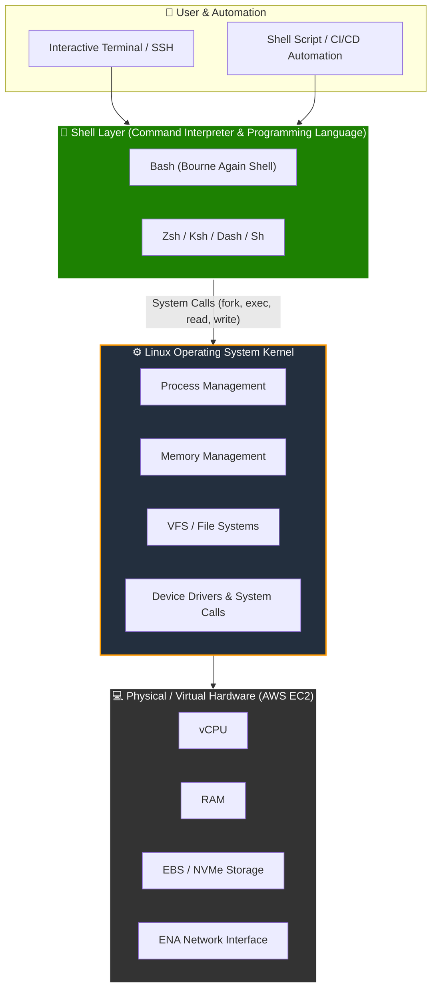
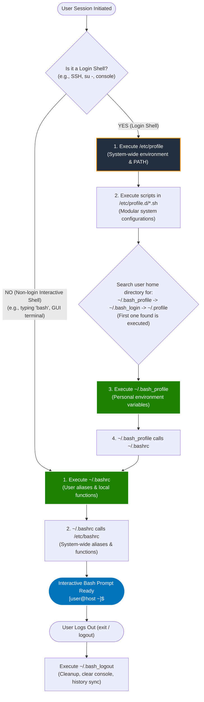
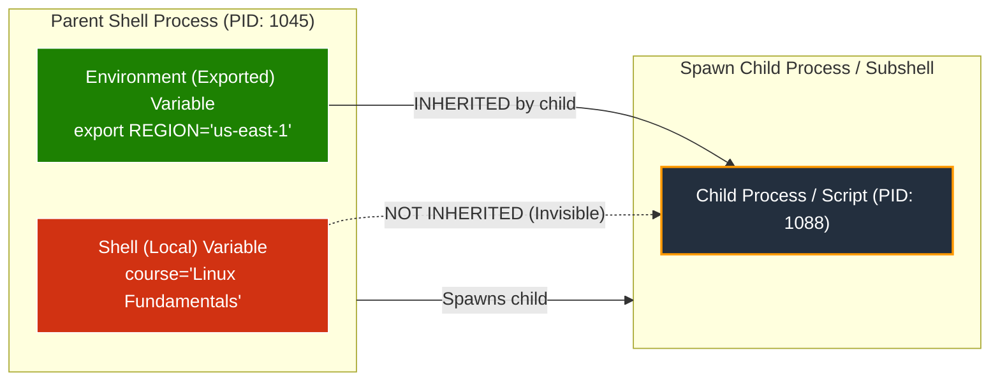
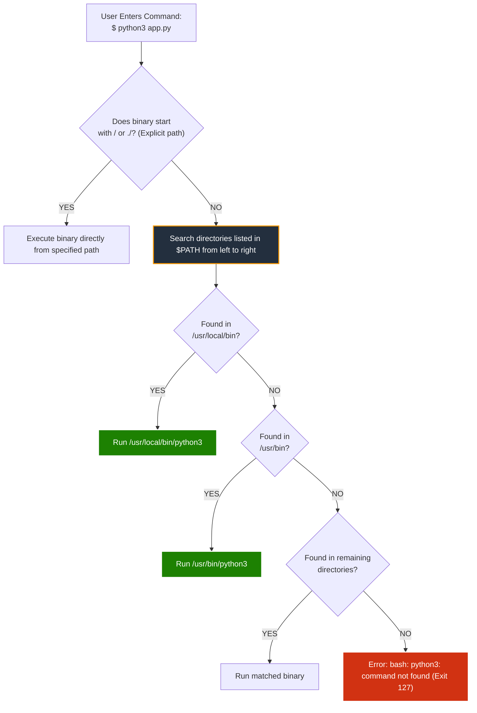
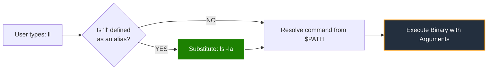
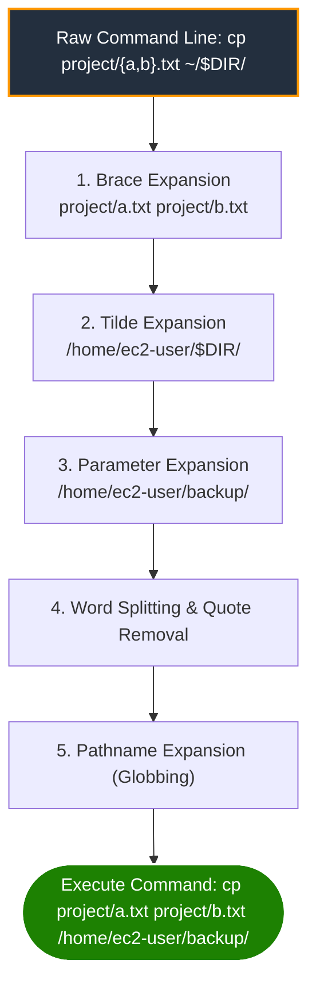

# 🐧 Module 02: The Bash Shell – Study Guide

> **Course**: AWS re/Start Linux Fundamentals  
> **Module**: M02 – The Bash Shell  
> **Source Document**: `T06-0011-RSLX_EN-US_SG_M02_BASHSHELL.pdf`  
> **Target Audience**: AWS re/Start Learners / Linux System Administrators / Cloud Practitioners  

---

## 🎯 Module Overview

The **Bourne Again Shell (Bash)** is the standard interactive command interpreter and scripting environment across Linux systems and cloud platforms. Whenever you open a terminal emulator or establish a secure SSH session into an Amazon EC2 instance (such as Amazon Linux 2 or Amazon Linux 2023), Bash is typically the engine interpreting your keystrokes, managing running processes, expanding parameters, and arbitrating between user input and the Linux kernel.

Mastering the shell environment is a cornerstone skill for cloud practitioners and DevOps engineers. In this study guide, you will explore the role of the shell, contrast the major Unix/Linux shell implementations, trace the initialization and lifecycle of shell configuration files (`/etc/profile`, `~/.bash_profile`, `~/.bashrc`), configure local vs. global environment variables, customize workflows using command aliases, and harness the full power of Bash shell expansions.

### 📌 Learning Objectives
- [ ] **Define the Linux Shell and Shell Architectures**: Explain the dual role of the shell as both an interactive command interpreter and a scripting programming language, and compare standard shell families (`sh`, `bash`, `zsh`, `ksh`, `csh`).
- [ ] **Trace Shell Initialization and Configuration Lifecycles**: Distinguish between login and non-login interactive shells, mapping the exact execution hierarchy across `/etc/profile`, `/etc/bashrc`, `~/.bash_profile`, `~/.bashrc`, and `~/.bash_logout`.
- [ ] **Differentiate Shell Variables vs. Environment Variables**: Master variable declaration syntax, naming conventions, scope inheritance rules, and the purpose of `set`, `env`, `printenv`, and `export`.
- [ ] **Manipulate Common System Environment Variables**: Inspect, utilize, and modify standard variables including `$PATH`, `$HOME`, `$USER`, `$SHELL`, `$PS1`, and `$?`.
- [ ] **Create, Manage, and Persist Command Aliases**: Define temporary command shortcuts with `alias`, remove them using `unalias`, and persist custom aliases across sessions in `~/.bashrc`.
- [ ] **Master Bash Shell Expansions**: Construct robust commands using brace expansion `{}`, tilde expansion `~`, parameter expansion `$`, command substitution `$()`, arithmetic expansion `$(( ))`, and pathname globbing (`*`, `?`, `[]`).
- [ ] **Execute Hands-on Shell Tasks & Verify Knowledge**: Complete step-by-step guided demonstrations, troubleshoot common syntax mistakes, and test conceptual retention through comprehensive checkpoint assessments.

---

## 🐚 1. The Linux Shell & The Bash Shell Environment

### What is a Shell?

At its core, an operating system's **kernel** manages the underlying physical hardware: the CPU, physical memory (RAM), disk controllers, and network interfaces. The kernel does not directly provide a human-friendly interactive text interface.

A **shell** is an outer software layer (encapsulating the kernel, hence the metaphor "shell") that:
1. **Acts as a Command Interpreter**: Accepts commands typed by human operators via the Command Line Interface (CLI) or terminal, parses tokens, resolves paths, and instructs the kernel to execute binaries.
2. **Serves as a Programming Language**: Supports variables, loops, conditionals, functions, error handling, and standard I/O redirection to automate multi-step system workflows via executable shell scripts.



### Major Linux Shell Families

Although Bash is the de facto standard on modern Linux distributions, several Unix and Linux shells have evolved over the decades. Each family possesses distinct syntax rules, configuration files, and scripting capabilities.

| Shell Name | Binary Path | Creator / Origin | Distinct Features & Common Use Cases |
| :--- | :--- | :--- | :--- |
| **sh** (Bourne Shell) | `/bin/sh` | Stephen Bourne (AT&T Bell Labs, 1979) | The classic Unix shell. Highly portable, lightweight, but lacks modern interactive conveniences like command history and tab completion. Often symlinked to `dash` or `bash` in POSIX mode. |
| **bash** (Bourne Again Shell) | `/bin/bash` | Brian Fox (GNU Project, 1989) | The standard default shell on GNU/Linux distributions (RHEL, CentOS, Fedora, Amazon Linux, Debian, older macOS). Superset of `sh` featuring rich expansions, command history, and aliases. |
| **zsh** (Z Shell) | `/bin/zsh` | Paul Falstad (1990) | Highly extensible interactive shell featuring advanced tab-completion, programmable themes (e.g., Oh My Zsh), spell correction, and globbing. Default login shell on modern macOS. |
| **ksh** (Korn Shell) | `/bin/ksh` | David Korn (AT&T Bell Labs, 1983) | Backward-compatible with `sh`, adding associative arrays, built-in arithmetic, and advanced job control. Popular in enterprise Unix (AIX, Solaris). |
| **csh / tcsh** (C Shell / TENEX C Shell) | `/bin/csh`, `/bin/tcsh` | Bill Joy (UC Berkeley, 1978) | Syntactically patterned after the C programming language. Introduced command history and alias mechanisms. Rarely used for systems scripting due to syntactic quirks. |
| **dash** (Debian Almquist Shell) | `/bin/dash` | Herbert Xu (Debian port of Ash) | Ultra-lightweight POSIX-compliant shell. Minimal memory footprint; used by Debian/Ubuntu for system boot scripts (`/bin/sh -> /bin/dash`). |

> [!NOTE]
> To discover all valid shells installed on your current Linux system, inspect the `/etc/shells` configuration file:
> ```bash
> cat /etc/shells
> ```
> To determine which shell is actively executing your current session, run:
> ```bash
> echo "$SHELL"        # Displays your assigned login shell
> echo "$0"            # Displays the name of the currently running shell process
> ```

---

## ⚙️ 2. Shell Initialization Files & Execution Lifecycle

When Bash launches, it reads and executes specific startup files depending on whether it starts as a **login shell** or a **non-login shell**, and whether it is **interactive** or **non-interactive**.

### Login Shell vs. Non-Login Shell

1. **Login Shell**:
   - Initialized when a user authenticates to the system with credentials.
   - Examples: Logging in at the local text console, authenticating over SSH (`ssh ec2-user@instance`), or running `su - username`.
   - Reads system-wide profile files and personal profile files to initialize the overall environment.
2. **Non-Login Interactive Shell**:
   - Spawned from within an existing login session without re-authenticating.
   - Examples: Opening a new terminal tab in a GUI desktop, launching a subshell by typing `bash` at the prompt, or running `su username` (without the hyphen).
   - Inherits environment variables from the parent shell and executes rc (run-commands) files for aliases and prompt settings.
3. **Non-Interactive Shell**:
   - Spawned automatically to execute a shell script file (e.g., `bash script.sh`).
   - Does not present a prompt, does not load interactive aliases, and reads files defined in the `$BASH_ENV` variable.



### Detailed Breakdown of Bash Configuration Files

| Configuration File | Scope | Shell Type | Primary Responsibility & Contents |
| :--- | :--- | :--- | :--- |
| **`/etc/profile`** | System-wide (All users) | Login shell | Sets global environment variables (`PATH`, `USER`, `HOSTNAME`), sets standard `umask`, and configures terminal settings. Loops through `/etc/profile.d/*.sh`. |
| **`/etc/profile.d/*.sh`** | System-wide (All users) | Login shell | Modular configuration directory containing application-specific environment setups (e.g., AWS CLI paths, Java home, color prompts). |
| **`/etc/bashrc`** (or `/etc/bash.bashrc`) | System-wide (All users) | Interactive shell | Defines system-wide aliases, shell functions, default prompt strings (`PS1`), and shell behaviors applied to interactive sessions. |
| **`~/.bash_profile`** (or `~/.profile`) | Per-user (`$HOME`) | Login shell | User-specific environment customizations. Defines private directory paths added to `$PATH`. Typically contains logic to source `~/.bashrc`. |
| **`~/.bashrc`** | Per-user (`$HOME`) | Interactive non-login & login | Stores personal user aliases (e.g., `alias ll='ls -la'`), shell options (`shopt`), and prompt customizations. Executed every time a subshell opens. |
| **`~/.bash_logout`** | Per-user (`$HOME`) | Login shell exit | Executed immediately upon session termination (`logout` or `exit`). Often clears the virtual terminal screen or creates automated backup logs. |

> [!IMPORTANT]
> When Bash starts as an interactive login shell, it searches for user startup files in the following strict sequential order and **executes only the first readable file it finds**:
> 1. `~/.bash_profile`
> 2. `~/.bash_login` (if `~/.bash_profile` does not exist)
> 3. `~/.profile` (if neither of the above exists)
>
> To ensure aliases and settings in `~/.bashrc` are still loaded during a login session, `~/.bash_profile` explicitly includes code to source `~/.bashrc`:
> ```bash
> # Get the aliases and functions
> if [ -f ~/.bashrc ]; then
>     . ~/.bashrc
> fi
> ```

---

## 🔤 3. Shell Variables vs. Environment Variables

In Linux, a **variable** is a named symbolic pointer to an allocated area of computer memory used to store, manipulate, and retrieve data. By default, Bash treats all variables as **strings of characters**, even if they contain numeric digits.



### Key Differences: Shell vs. Environment Variables

| Property | Shell (Local) Variables | Environment (Global) Variables |
| :--- | :--- | :--- |
| **Scope** | Restricted exclusively to the current running shell process. | Available to the current shell AND inherited by all descendant child processes, subshells, and scripts. |
| **Inheritance** | **Not inherited** by child processes or subshells. | **Inherited** automatically upon creation of child processes. |
| **Creation** | Simple assignment: `variable=value` | Assignment with `export`: `export VARIABLE=value` |
| **Inspection Utility** | `set` (displays all local and global variables) | `env` or `printenv` (displays only exported environment variables) |
| **Naming Convention** | Standard convention: **lowercase** (e.g., `student_name`, `app_port`). | Standard convention: **UPPERCASE** (e.g., `PATH`, `HOME`, `AWS_REGION`). |
| **Memory Persistence** | Ceases to exist when the shell session terminates. | Persists across processes in the session tree until parent shell exits. |

### Syntax & Naming Rules for Bash Variables

When creating variables in the Bash shell, strict syntax rules must be observed:

1. **No Spaces Around the Assignment Operator (`=`)**:
   - ✅ Correct: `restart_student="Li Juan"`
   - ❌ Invalid: `restart_student = "Li Juan"` *(Bash interprets `restart_student` as a command name and `=` as an argument!)*
2. **Allowed Characters**:
   - Variable names can contain only alphanumeric characters (`a-z`, `A-Z`, `0-9`) and underscores (`_`).
   - Variable names **cannot start with a digit** or contain special symbols like `@`, `!`, `-`, `$`, or spaces.
3. **Good vs. Bad Variable Naming Conventions**:

```bash
# Good Variable Names (Descriptive, valid characters, clear purpose)
restart_student="Jane Doe"
restart_us_cohort_1="Active"
restart_spring_student="AWS"
DATABASE_PORT=3306

# Bad / Invalid Variable Names
student="Jane"               # Vague; lacks context in large automation scripts
us_cohort="Active"           # Ambiguous cohort identifier
spring!="Invalid"            # ERROR: '!' is an illegal special character
1st_student="Error"          # ERROR: Cannot start with a numeric digit
restart-student="Error"      # ERROR: Hyphens are arithmetic minus signs, not valid in identifiers
```

### Variable Assignment and Expansion Mechanics

To retrieve the value stored inside a variable, prefix the variable name with the dollar symbol (`$`):

```bash
# Defining a variable
student_name="Carlos"

# Referencing a variable
echo $student_name           # Output: Carlos
echo ${student_name}         # Output: Carlos (curly braces prevent ambiguous concatenation)

# Distinction with curly braces
echo "${student_name}_certified"   # Output: Carlos_certified
echo "$student_name_certified"     # Output: (empty! Bash looks for variable named student_name_certified)
```

### Quoting Rules in Variable Assignment

Bash interprets strings differently depending on quotation style:

| Quoting Syntax | Example | Behavior & Interpretation |
| :--- | :--- | :--- |
| **Unquoted** | `greeting=Hello World` | Fails or splits words. `greeting=Hello` sets variable; `World` is treated as a separate command. |
| **Double Quotes (`"..."`)** | `greeting="Hello $USER"` | **Weak quoting**: Preserves spaces, allows parameter expansion (`$`), command substitution (`$()`), and arithmetic expansion. |
| **Single Quotes (`'...'`)** | `greeting='Hello $USER'` | **Strong quoting**: Treats every enclosed character strictly as a literal string. Suppresses all expansions. |

```bash
# Example demonstrating quoting differences
USER="Maria"
echo "Welcome, $USER!"      # Output: Welcome, Maria!
echo 'Welcome, $USER!'      # Output: Welcome, $USER!
```

---

## 🛠️ 4. Managing Variables: `set`, `env`, `printenv`, and `export`

Linux provides distinct built-in commands and external utilities to view, create, and manage variables.

### The Four Core Variable Utilities

| Utility | Command Type | Purpose & Scope | Example Usage |
| :--- | :--- | :--- | :--- |
| **`set`** | Bash Shell Built-in | Displays **all** variables (both local shell variables and exported environment variables), plus shell functions. | `set \| grep student_name` |
| **`env`** | GNU Coreutils Binary (`/usr/bin/env`) | Displays **only environment variables** exported to the current session. Can also run a utility in a modified environment. | `env` or `env -i /bin/sh` |
| **`printenv`** | GNU Coreutils Binary (`/usr/bin/printenv`) | Prints all or specific environment variables. Returns exit code 1 if variable does not exist. | `printenv PATH` |
| **`export`** | Bash Shell Built-in | Exports a local variable, converting it into an environment variable inherited by subshells and child processes. | `export CLUSTER="prod-01"` |

### The `export` Lifecycle & Child Scope Protection

When a variable is exported, any subsequent command, script, or child subshell inherits a copy of that variable:

```bash
# 1. Create a local variable
COHORT="Cloud-Batch-12"

# 2. Launch a subshell
bash -c 'echo "Inside subshell: $COHORT"'
# Output: Inside subshell: (empty! Local variable is not passed to child)

# 3. Export the variable
export COHORT

# 4. Launch the subshell again
bash -c 'echo "Inside subshell: $COHORT"'
# Output: Inside subshell: Cloud-Batch-12 (Inherited successfully)
```

> [!CAUTION]
> **Variable Inheritance is Strictly Unidirectional**:
> A child process receives an independent copy of exported environment variables. A child process **cannot** modify or destroy the environment variables of its parent shell. When the child process terminates, any modifications it made to its own environment are discarded.

---

## 🌐 5. Common System Environment Variables

Every Linux interactive session initializes standard environment variables that provide system runtime information, path resolution directories, and configuration settings to utilities.



### Critical Environment Variables Reference Table

| Variable | Description & Purpose | Typical Default Value / Example |
| :--- | :--- | :--- |
| **`$HOME`** | Absolute path to the current user's personal home directory. Used when evaluating `cd` or `~`. | `/home/ec2-user` or `/root` |
| **`$PATH`** | Colon-separated list of directories searched sequentially when executing commands entered without an explicit path. | `/usr/local/bin:/usr/bin:/usr/local/sbin:/usr/sbin` |
| **`$USER`** | Username of the currently authenticated user. | `ec2-user`, `ubuntu`, or `root` |
| **`$SHELL`** | Absolute path to the user's default login shell as defined in `/etc/passwd`. | `/bin/bash` |
| **`$PS1`** | **Prompt String 1**: Defines the formatting and color of the primary interactive command prompt. | `[\u@\h \W]\$ ` |
| **`$?`** | **Exit Status**: Stores the exit status (0 = success, 1–255 = error) of the most recently executed command. | `0` |
| **`$PWD`** | Current Working Directory path (mirrors `pwd`). | `/var/log` |
| **`$OLDPWD`** | Previous working directory before the last `cd` operation (used by `cd -`). | `/home/ec2-user` |
| **`$HOSTNAME`**| Fully qualified domain name or network hostname of the host system. | `ip-172-31-45-12.ec2.internal` |
| **`$TERM`** | Specifies the terminal emulation capabilities supported by the current console. | `xterm-256color` |
| **`$UID`** | Real user ID integer of the current user (`0` for `root`). | `1000` (standard user) / `0` (root) |
| **`$$`** | Process ID (PID) of the current running shell process. | `14238` |

### Deep-Dive: The `$PATH` Variable

When you execute a command such as `ls`, Linux does not scour the entire storage filesystem. Instead, it reads `$PATH`, splitting the string at colon (`:`) boundaries, and checks each folder in sequence from left to right until the executable binary is located.

```bash
# View the current search path
echo "$PATH"
# Output: /usr/local/bin:/usr/bin:/usr/local/sbin:/usr/sbin:/home/ec2-user/.local/bin:/home/ec2-user/bin

# Extending the PATH variable for custom scripts
export PATH="$PATH:/opt/custom_app/bin"

# Prepending a directory to take highest priority
export PATH="/opt/node/bin:$PATH"
```

> [!CAUTION]
> **Security Guardrail: Never place `.` (Current Working Directory) in `$PATH`**:
> If `.` or an empty element (`::`) is included in `$PATH`, an attacker who places a malicious executable named `ls` or `cd` in a world-writable directory (like `/tmp`) could trick an administrator or automated script into executing unauthorized code with elevated privileges.

### Deep-Dive: Customizing the Shell Prompt (`$PS1`)

The primary command prompt is governed by `$PS1`. Special backslash-escaped characters allow dynamic data injection:

| Code | Escape Sequence Meaning |
| :--- | :--- |
| `\u` | Current username |
| `\h` | Hostname up to the first `.` |
| `\H` | Complete fully qualified hostname |
| `\w` | Full current working directory (e.g., `/var/log/nginx`) |
| `\W` | Basename of current working directory (e.g., `nginx`) |
| `\d` | Date formatted as "Weekday Month Date" (e.g., "Mon Oct 12") |
| `\t` | Current time in 24-hour HH:MM:SS format |
| `\$` | Displays `#` if UID is 0 (`root`), or `$` for all normal users |

```bash
# Example: Setting an informative AWS prompt
export PS1="[\u@\h (\w)]\$ "
# Yields prompt: [ec2-user@ip-10-0-1-5 (/var/log)]$
```

---

## ⚡ 6. Command Aliases: Definition, Usage & Persistence

An **alias** is a customizable keyboard shortcut or substitute string that maps a short user-defined keyword to an existing command with preferred options, flags, or parameters.



### Practical Reasons to Use Aliases

1. **Shorten Repetitive, Verbose Commands**: Reducing lengthy commands to 2–3 keystrokes saves administrative time.
2. **Prevent Accidental Data Loss (Safety Nets)**: Injecting `-i` (interactive confirmation) on destructive commands.
3. **Set Default Flags**: Always enabling human-readable output (`-h`) or color highlighting.

### Creating, Viewing, and Removing Aliases

```bash
# 1. Syntax for creating an alias
alias alias_name='command_to_run'

# Common examples:
alias ll='ls -la'                    # Long list including hidden files
alias rm='rm -i'                     # Confirm before deleting files
alias cp='cp -i'                     # Confirm before overwriting files
alias mv='mv -i'                     # Confirm before moving over files
alias df='df -h'                     # Disk usage in human-readable GB/MB
alias free='free -m'                 # Memory usage in megabytes
alias grep='grep --color=auto'       # Syntax highlighting on grep matches

# 2. Viewing all active aliases
alias

# 3. Viewing a specific alias definition
alias ll

# 4. Removing an alias from the current session
unalias ll

# 5. Removing ALL aliases in the current session
unalias -a
```

> [!TIP]
> **Bypassing an Alias**:
> If you have aliased `rm` to `rm -i` but need to delete numerous files without being prompted for every single file, you can bypass the alias in one of three ways:
> 1. Prepend a backslash: `\rm file.txt`
> 2. Specify the absolute binary path: `/bin/rm file.txt`
> 3. Use the `command` built-in: `command rm file.txt`

### Persisting Aliases Permanently in `~/.bashrc`

When an alias is defined directly at the terminal prompt, it exists **only for the lifespan of that specific terminal session**. As soon as the terminal closes or you disconnect from SSH, the alias vanishes.

To make an alias permanent for your user account:

1. Open the user's run-commands file in a text editor:
   ```bash
   nano ~/.bashrc
   # OR: vim ~/.bashrc
   ```
2. Navigate to the `# User defined aliases` section and append your alias definitions:
   ```bash
   # Custom Aliases
   alias ll='ls -la'
   alias update='sudo dnf update -y'
   alias myip='curl -s checkip.amazonaws.com'
   ```
3. Save and close the editor.
4. Reload the configuration into your active session immediately without logging out:
   ```bash
   source ~/.bashrc
   # OR using the dot operator:
   . ~/.bashrc
   ```

---

## 🚀 7. Bash Shell Expansions

Before Bash executes a command, it performs **expansion** on the command-line string. Expansion is the transformation of tokens, patterns, and shorthand notations into complete strings, lists of files, or calculated values.

Bash performs expansions in a specific order:
1. **Brace Expansion** (`{}`)
2. **Tilde Expansion** (`~`)
3. **Parameter & Variable Expansion** (`$`)
4. **Command Substitution** (`$()` or `` ` ` ``)
5. **Arithmetic Expansion** (`$(( ))`)
6. **Word Splitting**
7. **Pathname Expansion (Globbing)** (`*`, `?`, `[]`)



### 1. Brace Expansion (`{}`)
Brace expansion produces arbitrary strings generated from a comma-separated list or an integer/character range. It does not require files to exist on disk.

```bash
# List expansion: Creates project directories
mkdir -p app/{frontend,backend,database,docs}
# Creates: app/frontend app/backend app/database app/docs

# Range expansion (numbers)
touch report-2026-month{01..12}.log
# Creates: report-2026-month01.log ... report-2026-month12.log

# Range expansion (alphabetical with steps)
echo {A..Z..2}
# Output: A C E G I K M O Q S U W Y

# Quick file backup idiom
cp nginx.conf{,.bak}
# Expands to: cp nginx.conf nginx.conf.bak
```

### 2. Tilde Expansion (`~`)
Tilde expansion resolves user home directories:
- `~`: Resolves to the current user's `$HOME` (e.g., `/home/ec2-user`).
- `~username`: Resolves to the specific user's home directory (e.g., `~root` $\rightarrow$ `/root`).
- `~+`: Resolves to `$PWD` (current working directory).
- `~-`: Resolves to `$OLDPWD` (previous working directory).

### 3. Parameter / Variable Expansion (`$`)
Substitutes variable names with their assigned values. Advanced parameter expansion provides string slicing, default fallback values, and length queries:

```bash
# Basic variable expansion
echo "Welcome $USER"

# Providing default value if variable is unset or empty
echo "${COHORT:-DefaultCohort}"

# Measuring string length
NAME="AWS-ReStart"
echo "${#NAME}"             # Output: 11
```

### 4. Command Substitution (`$()` and `` ` ` ``)
Command substitution takes the standard output (`stdout`) of one command and replaces the token with that output text directly on the command line.

```bash
# Modern syntax: $(command) - Preferred because it supports easy nesting
CURRENT_DATE=$(date +%Y-%m-%d)
echo "Backup created on: $CURRENT_DATE"

# Nested command substitution
KERNEL_INFO="Running on $(hostname) with kernel $(uname -r)"

# Legacy syntax: `command` (backticks) - Avoid due to confusing escaping rules
ARCH=`arch`
```

### 5. Arithmetic Expansion (`$(( ))`)
Allows the shell to evaluate integer arithmetic expressions natively without launching external utilities like `expr` or `bc`:

```bash
# Basic integer arithmetic
echo $(( 10 + 5 ))          # 15
echo $(( 20 * 4 ))          # 80
echo $(( 100 / 3 ))         # 33 (Integer division truncates decimals)
echo $(( 10 % 3 ))          # 1 (Modulo / remainder)
echo $(( 2 ** 8 ))          # 256 (Exponentiation)

# Incrementing variables
count=5
(( count++ ))
echo "$count"               # 6
```

### 6. Pathname Expansion / Globbing (`*`, `?`, `[]`)
Pathname expansion searches the actual filesystem for filenames matching wildcards (wildcard patterns):

| Pattern | Character Description | Example Matching Behavior |
| :--- | :--- | :--- |
| `*` | Matches **zero or more** arbitrary characters. | `*.log` matches `app.log`, `error.log`, `.log` |
| `?` | Matches **exactly one** arbitrary character. | `file?.txt` matches `file1.txt`, `fileA.txt`, but not `file10.txt` |
| `[...]` | Matches **any one** character enclosed in the brackets. | `data[123].csv` matches `data1.csv`, `data2.csv`, `data3.csv` |
| `[a-z]` | Matches any character within the alphanumeric range. | `log[0-9].txt` matches digits 0 through 9 |
| `[!...]` or `[^...]` | Matches any character **NOT** enclosed in the set. | `test[!0-9].sh` matches `testA.sh`, but not `test1.sh` |

```bash
# Examples of globbing
ls /var/log/*.log            # All log files
ls /etc/rc[0-6].d            # Runlevel directories rc0.d through rc6.d
rm -f backup-[0-9][0-9].tar  # Removes backups with 2-digit identifiers
```

---

## 💻 8. Instructor Demonstrations & Step-by-Step Hands-On Labs

The following hands-on demonstrations walk through the exact interactive procedures highlighted in the curriculum slides.

### 🧪 Lab Exercise 1: Inspecting & Displaying Environment Variables

#### Objective
Query the current Linux shell environment using `echo`, `env`, and `printenv`.

#### Step-by-Step Procedure

```bash
# Step 1: Open your Bash terminal or connect to your Amazon EC2 instance

# Step 2: Display your home directory
echo "$HOME"
# Expected Output: /home/ec2-user (or /home/username)

# Step 3: Display your active login shell
echo "$SHELL"
# Expected Output: /bin/bash

# Step 4: Display your current authenticated username
echo "$USER"
# Expected Output: ec2-user

# Step 5: Display the command binary search path
echo "$PATH"
# Expected Output: /usr/local/bin:/usr/bin:/usr/local/sbin:/usr/sbin:...

# Step 6: Query system environment variables using the env command
env | head -n 15

# Step 7: Filter environment variables using grep
env | grep -E "USER|SHELL|HOME|PATH"
```

---

### 🧪 Lab Exercise 2: Exploring Bash Initialization Files

#### Objective
Locate, inspect, and analyze system-wide and user-specific shell initialization files.

#### Step-by-Step Procedure

```bash
# Step 1: Navigate to your home directory
cd ~

# Step 2: List all files including hidden dotfiles
ls -la

# Notice .bash_profile, .bashrc, and .bash_logout

# Step 3: View the contents of your user .bashrc file
cat ~/.bashrc
# Examine default alias definitions and sourcing logic

# Step 4: View your user .bash_profile
cat ~/.bash_profile
# Observe how PATH is modified and ~/.bashrc is called

# Step 5: Inspect system-wide profile scripts
ls -la /etc/profile
head -n 25 /etc/profile

# Step 6: Inspect modular scripts in /etc/profile.d/
ls -l /etc/profile.d/
```

---

### 🧪 Lab Exercise 3: Creating, Testing, Unaliasing & Persisting Aliases

#### Objective
Create custom command aliases, observe shell execution, remove aliases with `unalias`, and make an alias permanent by editing `~/.bashrc`.

#### Step-by-Step Procedure

```bash
# Step 1: Check if an alias for 'll' currently exists
alias ll

# Step 2: Create a temporary alias for detailed directory listing
alias ll='ls -la'

# Step 3: Test the alias
ll

# Step 4: Create a safety alias for file removal
alias rm='rm -i'

# Step 5: Remove the temporary alias using unalias
unalias ll

# Step 6: Verify the alias has been removed
ll
# Expected Output: bash: ll: command not found...

# Step 7: Make the alias permanent by appending to ~/.bashrc
echo "alias ll='ls -la'" >> ~/.bashrc
echo "alias c='clear'" >> ~/.bashrc

# Step 8: Reload ~/.bashrc into the current session
source ~/.bashrc

# Step 9: Verify the permanent aliases are active
alias ll
alias c
```

---

## ❓ 9. Checkpoint Questions & Knowledge Checks

Test your comprehension against the primary curriculum checkpoint questions.

```carousel
### Checkpoint Question 1: Alias Creation Scenarios
**Question**: What real-world commands and workflows are ideal candidates for aliases in the Bash shell?

<!-- slide -->
### Answer 1: Analysis & Technical Rationale
**Answer**:
1. **Safety Nets for Destructive Commands**:
   - `alias rm='rm -i'`, `alias cp='cp -i'`, `alias mv='mv -i'`: Forces the shell to prompt for confirmation before deleting or overwriting files, preventing catastrophic administrative errors.
2. **Shortening Long or Frequently Repeated Commands**:
   - `alias ll='ls -la'`: Detailed file listings with permissions and hidden dotfiles.
   - `alias update='sudo dnf update -y'`: Speeds up routine OS patch management.
   - `alias gs='git status'`: Streamlines common developer workflows.
3. **Displaying System Diagnostic Summaries**:
   - `alias ports='netstat -tulpn'`: Quickly view listening TCP/UDP ports.
   - `alias myip='curl -s checkip.amazonaws.com'`: Retrieves the public IP of an EC2 instance.
4. **Calculations & Static Parameter Shortcuts**:
   - Setting predefined complex queries or fixed financial/conversion calculations.

<!-- slide -->
### Checkpoint Question 2: The `env` Command
**Question**: What does the `env` command display, and how does it differ from `set`?

<!-- slide -->
### Answer 2: Analysis & Technical Rationale
**Answer**:
- The `env` command displays all **exported environment variables** in the current operating environment.
- **Key Differences**:
  - `env` shows only variables that have been marked for export (global variables passed to child processes).
  - `set` displays **both** local shell variables and exported environment variables, in addition to all defined shell functions.
  - `env` can also run a specified program in an altered or clean environment without modifying the caller shell (e.g., `env -i /bin/sh`).
```

---

## 🧠 10. Comprehensive Concept Review & Self-Assessment

### Multiple-Choice Self-Assessment

#### Question 1
A systems administrator logs into an Amazon EC2 Linux instance via SSH. Which file is executed **first** by the login shell to set global environment variables across all users?
- [ ] A) `~/.bashrc`
- [ ] B) `/etc/bashrc`
- [x] C) `/etc/profile`
- [ ] D) `~/.bash_logout`

> **Explanation**: During an interactive login shell initialization (such as an SSH session), `/etc/profile` is the very first configuration file executed. It establishes system-wide variables, default `umask` settings, and sources scripts in `/etc/profile.d/`.

---

#### Question 2
You define a variable in your terminal: `app_tier="production"`. You then launch a script: `./deploy.sh`. Inside `deploy.sh`, you attempt to reference `$app_tier`, but the value is empty. Why?
- [ ] A) Variable names cannot contain underscores.
- [ ] B) Variables must always be declared in uppercase.
- [x] C) The variable was created as a local shell variable and was not exported to child processes.
- [ ] D) The `.bashrc` file blocked the script from reading memory.

> **Explanation**: By default, assignments like `app_tier="production"` create local shell variables visible only within that immediate process. To pass the variable to scripts or child subshells, it must be exported via `export app_tier="production"`.

---

#### Question 3
Which Bash expansion occurs when executing: `mkdir -p /opt/app/{logs,bin,config}`?
- [x] A) Brace Expansion
- [ ] B) Pathname Expansion (Globbing)
- [ ] C) Arithmetic Expansion
- [ ] D) Command Substitution

> **Explanation**: The `{...}` syntax represents Brace Expansion, which generates a list of words (`/opt/app/logs`, `/opt/app/bin`, `/opt/app/config`) before passing them to `mkdir`.

---

#### Question 4
What is the effect of placing single quotes (`'`) around a variable reference, such as `echo '$USER'`?
- [ ] A) It prints the username in uppercase.
- [ ] B) It executes `$USER` as a command substitution.
- [x] C) It prints the literal characters `$USER` without performing parameter expansion.
- [ ] D) It exports `$USER` to the parent shell.

> **Explanation**: Single quotes enforce **strong quoting**, disabling all shell expansions (including parameter expansion, command substitution, and arithmetic evaluation). The text is treated strictly as literal characters.

---

#### Question 5
How do you permanently save an alias so it remains available across future terminal sessions?
- [ ] A) Type `alias save` at the prompt.
- [ ] B) Type `export alias_name` into `/etc/passwd`.
- [x] C) Add the `alias name='command'` line to `~/.bashrc` and source the file.
- [ ] D) Execute `unalias -p`.

> **Explanation**: Aliases defined at the terminal prompt are volatile. Adding them to the user's `~/.bashrc` configuration file ensures they are loaded each time an interactive shell is initialized.

---

## 📌 11. Key Takeaways & Quick Reference Cheat Sheet

```
+----------------------------------------------------------------------------------------------------+
|                                    BASH ENVIRONMENT CHEAT SHEET                                    |
+----------------------+-----------------------------------------------------------------------------+
| Command / Syntax     | Action & Purpose                                                            |
+----------------------+-----------------------------------------------------------------------------+
| echo $VAR            | Print value of variable $VAR to stdout.                                     |
| export VAR="value"   | Define environment variable inherited by all child processes.              |
| env / printenv       | Display all exported environment variables.                                |
| set                  | Display all local shell variables, environment variables, and functions.   |
| unset VAR            | Delete a variable from the shell session.                                   |
+----------------------+-----------------------------------------------------------------------------+
| alias name='cmd'     | Define a temporary command alias.                                           |
| unalias name         | Remove an existing alias.                                                   |
| unalias -a           | Remove all defined aliases.                                                 |
| source ~/.bashrc     | Reload shell configuration immediately without logging out.                 |
+----------------------+-----------------------------------------------------------------------------+
| $HOME                | Current user's home directory path.                                         |
| $PATH                | Search directories for executable command binaries.                         |
| $USER                | Username of active authenticated user.                                      |
| $SHELL               | Default login shell assigned to user (/bin/bash).                           |
| $?                   | Exit status code of last command (0 = success, non-zero = failure).         |
+----------------------+-----------------------------------------------------------------------------+
| {a,b,c}              | Brace Expansion: Generates combinations or lists.                           |
| {1..10}              | Brace Expansion: Generates sequential numeric/alphabetic ranges.            |
| $(command)           | Command Substitution: Inserts output of command into line.                  |
| $(( expression ))    | Arithmetic Expansion: Evaluates native integer math operations.             |
| * / ? / [...]        | Globbing / Pathname Expansion: Wildcard matching against files on disk.     |
+----------------------+-----------------------------------------------------------------------------+
```

### Module Summary Checklist
- [x] **Shell Role Understood**: Acts as both a user command interpreter and an automation scripting language.
- [x] **Initialization Hierarchy Mapped**: Traced login sequence (`/etc/profile` $\rightarrow$ `~/.bash_profile` $\rightarrow$ `~/.bashrc` $\rightarrow$ `/etc/bashrc`).
- [x] **Variable Scope Mastered**: Local variables stay in the shell; exported variables transfer to child processes.
- [x] **System Variables Identified**: Core variables (`$PATH`, `$HOME`, `$USER`, `$SHELL`, `$PS1`, `$?`) queried and explained.
- [x] **Aliases Configured**: Temporary shortcuts defined with `alias`, removed with `unalias`, and persisted in `~/.bashrc`.
- [x] **Expansions Applied**: Brace `{}`, tilde `~`, parameter `$`, command `$()`, arithmetic `$(( ))`, and wildcard globbing practiced.
