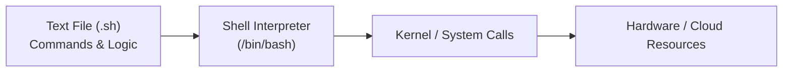
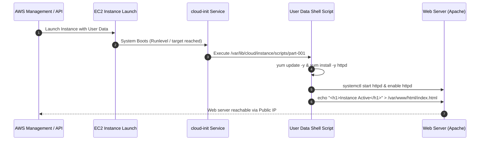
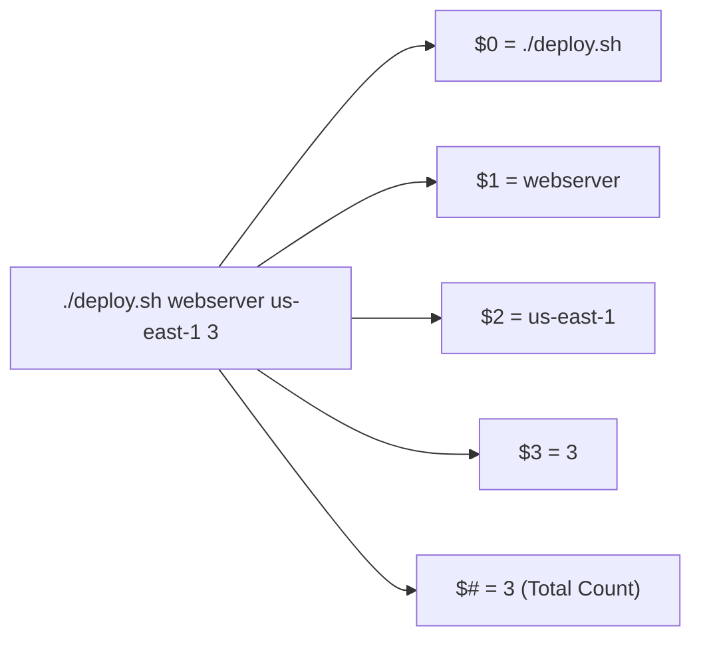
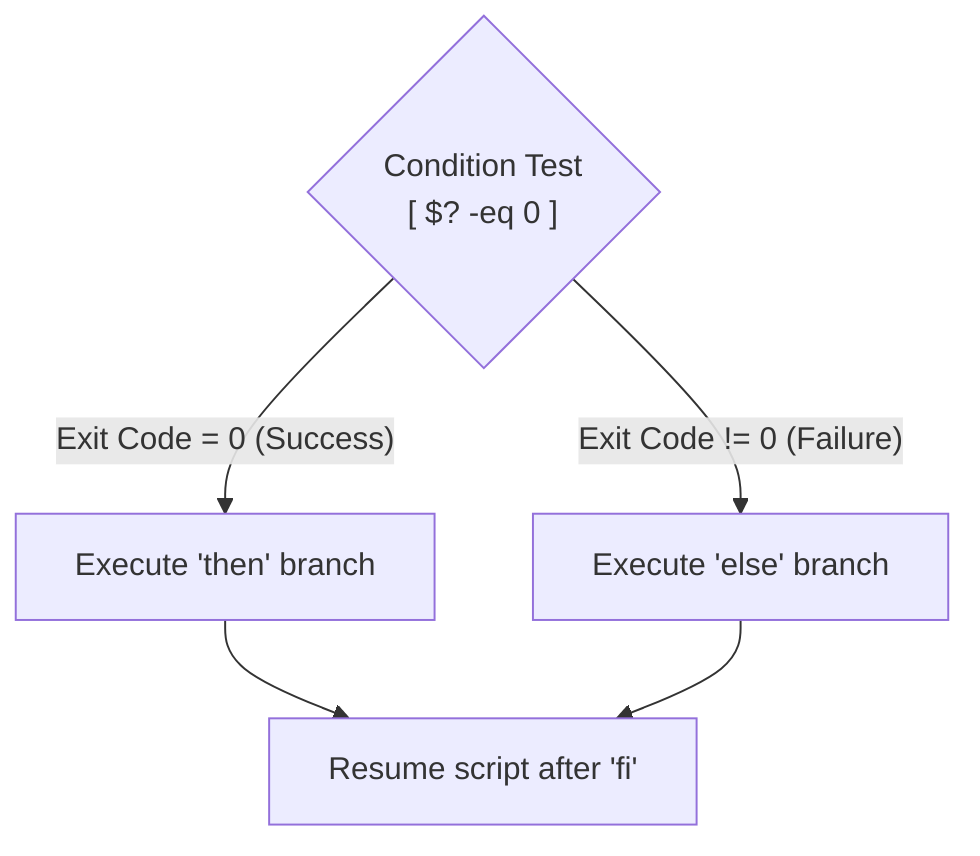
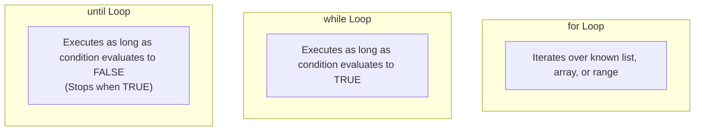
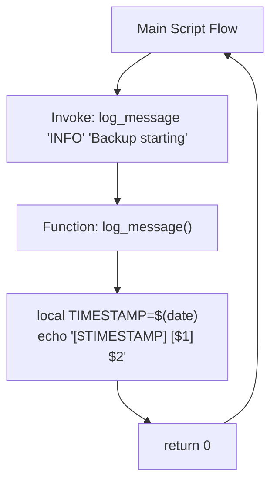

# 📜 Module 02: Bash Shell Scripts – Study Guide

> **Course**: AWS re/Start Linux Fundamentals  
> **Module**: M02 – Bash Shell Scripts  
> **Source Document**: `T06-0012-RSLX_EN-US_SG_M02_BASHSCRIPTS.pdf`  
> **Target Audience**: AWS re/Start Learners / Cloud Practitioners / DevOps Engineers / Linux Systems Administrators  

---

## 🎯 Module Overview

Welcome to **Bash Shell Scripts**. In modern IT operations and cloud computing, manual execution of repetitive command-line operations is slow, error-prone, and impossible to scale. Shell scripting empowers systems engineers and cloud architects to group sequences of commands into reusable, automated programs. From provisioning Amazon Elastic Compute Cloud (Amazon EC2) instances with user data scripts to scheduling complex database backups, rotating log archives, and monitoring system health, Bash scripts represent the foundational automation engine of Linux environments.

This comprehensive study guide covers everything from basic syntax, shebang directives, and execution permissions to variables, user input, arithmetic expressions, conditional tests, looping structures, functions, defensive error handling, and production-grade automation patterns.

---

### 📌 Learning Objectives

- [ ] **Define Shell Scripts & Automation Value**: Understand what shell scripts are, why automation eliminates human error, and identify common cloud and system administration automation use cases.
- [ ] **Master Script Execution & Permissions**: Differentiate between running scripts via `./script.sh`, `bash script.sh`, and `source script.sh`, and manage executable file permissions with `chmod`.
- [ ] **Deconstruct Script Anatomy**: Utilize the shebang directive (`#!/bin/bash`), write informative comments, and establish standardized script documentation templates.
- [ ] **Manage Variables & User Input**: Declare variables, capture interactive console input with `read -p`, and evaluate arithmetic expressions using `$(( expression ))`.
- [ ] **Harness Positional Parameters & Special Variables**: Leverage `$0` through `$9`, `$#`, `$@`, `$*`, and examine command exit statuses with `$?`.
- [ ] **Implement Robust Conditional Logic**: Master `if`, `elif`, `else`, `fi`, and `case` statements; contrast legacy single brackets `[ ]` with modern double brackets `[[ ]]` and arithmetic double parentheses `(( ))`.
- [ ] **Apply Comprehensive Test Operators**: Evaluate integer comparisons (`-eq`, `-gt`), string tests (`=`, `!=`, `-z`, `-n`), and filesystem tests (`-f`, `-d`, `-r`, `-w`, `-x`).
- [ ] **Control Flow with Loops**: Construct `for`, `while`, and `until` loops, and control iteration flow with `break` and `continue`.
- [ ] **Write Modular Functions**: Structure scripts into reusable functions with localized variables (`local`), parameters, and exit codes.
- [ ] **Apply Defensive Scripting & Debugging**: Implement Bash strict mode (`set -euo pipefail`), inspect command execution with `bash -x`, and trap exit signals for graceful cleanup.
- [ ] **Deploy Cloud Automation**: Analyze Amazon EC2 user data scripts for automated software provisioning during instance initialization.

---

## 🛠️ 1. Introduction to Shell Scripting & Cloud Automation

### What is a Shell Script?
A **shell script** is an executable text file containing an ordered sequence of commands, control statements, and data that an interpreter (such as the GNU Bourne Again Shell, Bash) reads and executes sequentially from top to bottom.



Instead of manually typing commands into an interactive terminal one after another, an administrator bundles those instructions into a single file. When executed, the shell runs them with machine speed, perfect consistency, and complete repeatability.

### Why Shell Scripting is Critical in Cloud Administration
1. **Automation & Speed**: Shell scripts execute complex, multi-command workflows in seconds, vastly outpacing manual interactive administration.
2. **Error Elimination**: Human typing mistakes, omitted flags, or skipped steps are eliminated once an operational workflow is codified into a tested script.
3. **Scheduled Maintenance via cron**: Scripts integrate seamlessly with cron daemons to perform scheduled maintenance tasks (e.g., nightly backups, log rotation) without human intervention.
4. **Cloud Instance Bootstrapping**: Cloud platforms like Amazon Web Services rely heavily on shell scripts. When launching virtual machines, shell scripts handle instance configuration automatically.

### Common Automation Use Cases
- **Data Backups**: Creating compressed tar archives of databases or user home directories and pushing them to remote storage (e.g., Amazon S3).
- **Log Archival & Rotation**: Truncating or compressing log files in `/var/log` to prevent storage exhaustion.
- **Service & Package Provisioning**: Automatically installing, configuring, and starting web servers, firewalls, and application runtimes.
- **System Health Monitoring**: Checking free memory, disk space thresholds, CPU load averages, and alerting administrators when limits are breached.
- **User Account Auditing**: Inspecting `/etc/passwd` and `/etc/shadow` for unauthorized accounts, stale accounts, or weak permissions.

### Cloud Context: Amazon EC2 User Data Scripts
When you launch an Amazon Elastic Compute Cloud (Amazon EC2) virtual instance, AWS enables you to provide an **EC2 User Data script**. This script executes automatically with `root` privileges during the very first boot cycle of the virtual machine.



#### Example: Amazon EC2 User Data Bootstrap Script
```bash
#!/bin/bash
# Update installed packages
yum update -y

# Install Apache Web Server (httpd)
yum install -y httpd

# Start and enable the service across system reboots
systemctl start httpd
systemctl enable httpd

# Query instance metadata via IMDSv2 token and generate a landing page
TOKEN=$(curl -s -X PUT "http://169.254.169.254/latest/api/token" -H "X-aws-ec2-metadata-token-ttl-seconds: 21600")
INSTANCE_ID=$(curl -s -H "X-aws-ec2-metadata-token: $TOKEN" http://169.254.169.254/latest/meta-data/instance-id)
AZ=$(curl -s -H "X-aws-ec2-metadata-token: $TOKEN" http://169.254.169.254/latest/meta-data/placement/availability-zone)

cat <<EOF > /var/www/html/index.html
<!DOCTYPE html>
<html>
<head><title>AWS EC2 Bootstrapped Node</title></head>
<body>
  <h1>Server Provisioned via Bash User Data Script</h1>
  <p><strong>Instance ID:</strong> $INSTANCE_ID</p>
  <p><strong>Availability Zone:</strong> $AZ</p>
  <p><strong>Deployment Timestamp:</strong> $(date)</p>
</body>
</html>
EOF
```

---

## ⚙️ 2. Script Anatomy, Permissions & Execution Mechanics

### The Shebang Line (`#!`)
The very first line of any executable Unix shell script must be the **shebang** (also called *hash-bang* or *hash-exclamation*):

```bash
#!/bin/bash
```

- The characters `#!` form a 2-byte magic number (`0x23 0x21`) recognized by the Linux kernel loader (`execve` system call).
- The path following the shebang specifies the absolute filesystem path of the command interpreter that should be spawned to parse the remainder of the file.
- If the shebang is omitted, the operating system will fall back to executing the script inside the caller's current interactive shell, which can cause erratic behavior if features specific to Bash are evaluated by `dash` or `/bin/sh`.

> [!TIP]
> **Portable Shebang Pattern**: While `#!/bin/bash` is the standard location on virtually all Linux distributions, you will frequently see `#!/usr/bin/env bash` in cross-platform open-source projects. This queries the user's `$PATH` for the active `bash` binary, ensuring portability across FreeBSD, macOS, and non-standard Linux installations.

### Comments & Script Documentation Templates
Any line beginning with a hash symbol `#` (outside of quotes or arithmetic blocks) is treated as a comment and completely ignored by the interpreter.

Writing clear, descriptive header documentation transforms a fragile, throwaway script into an enterprise-ready automation asset.

```bash
#!/bin/bash
# ==============================================================================
# Script Name   : backup_homedir.sh
# Description   : Compresses and archives the /home/ec2-user directory to /backup
# Author        : Jane Doe (Cloud Engineering Team)
# Email         : sysadmin@example.com
# Date Created  : 2026-03-15
# Version       : 1.2.0
# Usage         : ./backup_homedir.sh [TARGET_DIRECTORY]
# License       : MIT License
# ==============================================================================
```

### Script File Permissions (`chmod`)
When a script is created using a text editor (e.g., `nano`, `vi`, or `vim`), default file creation permissions typically assign read and write rights, but **not execute rights** (e.g., `644` or `-rw-r--r--`).

```bash
# View initial permissions
ls -l backup.sh
# Output: -rw-rw-r-- 1 ec2-user ec2-user 452 Oct 12 10:00 backup.sh

# Add execute permissions for the user (owner)
chmod u+x backup.sh

# Or grant execute permissions for all users
chmod +x backup.sh

# Or set explicit octal permissions (Read/Write/Execute for owner, Read for group/others)
chmod 744 backup.sh
# Permission bit representation: rwxr--r--
```

| Octal Value | Symbol | Meaning | User / Owner | Group | Others |
| :--- | :--- | :--- | :--- | :--- | :--- |
| `755` | `rwxr-xr-x` | Read, write, execute for owner; read & execute for group and others (Standard for scripts) | `rwx` (7) | `r-x` (5) | `r-x` (5) |
| `700` | `rwx------` | Full access for owner; zero access for group or others (Secured administrative scripts) | `rwx` (7) | `---` (0) | `---` (0) |
| `744` | `rwxr--r--` | Full access for owner; read-only for group and others | `rwx` (7) | `r--` (4) | `r--` (4) |

### Three Ways to Run a Shell Script

Understanding how scripts are executed in Linux is critical to avoid variable scope bugs and permission errors.

```mermaid
flowchart TD
    subgraph Method1["Method 1: Direct Execution (./script.sh)"]
        M1A["Requires chmod +x"] --> M1B["Kernel reads Shebang"]
        M1B --> M1C["Spawns New Subshell"]
        M1C --> M1D["Variables isolated to Subshell"]
    end

    subgraph Method2["Method 2: Interpreter Invocation (bash script.sh)"]
        M2A["Does NOT require +x"] --> M2B["Directly runs /bin/bash"]
        M2B --> M2C["Spawns New Subshell"]
        M2C --> M2D["Variables isolated to Subshell"]
    end

    subgraph Method3["Method 3: Sourcing (. script.sh or source)"]
        M3A["Does NOT require +x"] --> M3B["No Subshell spawned"]
        M3B --> M3C["Executes in CURRENT Shell"]
        M3C --> M3D["Variables & Functions PERSIST in Current Shell"]
    end
```



| Execution Method | Syntax Example | Requires `chmod +x`? | Execution Environment | Variables Persist After Exit? | Typical Use Case |
| :--- | :--- | :--- | :--- | :--- | :--- |
| **Direct Execution** | `./script.sh` or `/opt/bin/script.sh` | **Yes** | New Subshell | No | Standard standalone automation scripts |
| **Interpreter Invocation** | `bash script.sh` | **No** (only read access) | New Subshell | No | Testing, debugging with `bash -x`, running unprivileged files |
| **Sourcing** | `source script.sh` or `. script.sh` | **No** (only read access) | **Current Shell** | **Yes** | Loading environment variables, profile configurations, function libraries |

### Why `./` is Required (The `$PATH` Variable)
When you type a command in Bash (like `ls`, `grep`, or `tar`), the shell searches through the directories listed in the `$PATH` environment variable:

```bash
echo $PATH
# Output: /usr/local/bin:/usr/bin:/usr/local/sbin:/usr/sbin:/home/ec2-user/.local/bin:/home/ec2-user/bin
```

- Linux deliberately **omits the current working directory (`.`) from `$PATH` for security reasons**. If `.` were in `$PATH`, an attacker could place a malicious script named `ls` in `/tmp` and trick `root` into executing it.
- Because `.` is not in `$PATH`, attempting to run a script simply as `myscript.sh` results in:
  ```bash
  myscript.sh: command not found
  ```
- Prefixing the script with `./` (e.g., `./myscript.sh`) instructs the shell: *"Do not search the system `$PATH`; execute the file located specifically in the current directory."*

> [!IMPORTANT]
> **Scheduled Jobs & cron**: When configuring scheduled cron jobs via `crontab -e`, cron runs with a minimal, stripped-down `$PATH` (often just `/usr/bin:/bin`). Therefore, cron jobs **must always specify absolute filesystem paths** for both the script and all commands called within it (e.g., `/home/ec2-user/scripts/backup.sh`).

### Shell Configuration Files
Bash environments and user profiles are initialized through specific configuration dotfiles located in the user's home directory:
- `~/.bashrc`: Executed for interactive non-login shells (e.g., opening a new terminal window or running a subshell). Defines user aliases, shell options, and custom functions.
- `~/.bash_profile` or `~/.profile`: Executed once upon initial interactive login (e.g., logging in via SSH). Typically sets environment variables and sources `~/.bashrc`.
- `~/.bash_history`: Persists the recorded list of commands executed by the user across past terminal sessions.

---

## 🔡 3. Variables, Arithmetic Expressions & User Input

### Declaring and Referencing Variables
Variables in Bash store strings, integers, and paths without needing explicit type declarations.

#### Syntax Rules:
1. **No Spaces Around Assignment Operator**: `VAR=value` is valid. `VAR = value` or `VAR= value` fails with a syntax error because Bash attempts to execute `VAR` as a command with `=` as an argument.
2. **Variable Naming Conventions**: By convention, environment and global script variables use uppercase (`BACKUP_DIR="/opt/backup"`), while local or temporary variables often use lowercase (`counter=1`). Names can contain alphanumeric characters and underscores, but cannot begin with a number.
3. **Dereferencing with `$`**: To read the value stored in a variable, precede its identifier with a dollar sign: `$VAR` or `${VAR}`.

```bash
#!/bin/bash
# Variable assignment
SERVER_NAME="web-prod-01"
PORT=8080

# Referencing variables
echo "Connecting to $SERVER_NAME on port $PORT"

# Curly bracket notation prevents ambiguity with adjacent text
ENVIRONMENT="prod"
echo "Deploying to ${ENVIRONMENT}_backup_server"
```

### Quoting Rules: Single vs. Double Quotes vs. Backticks
Understanding quotation in Bash is essential to prevent unexpected word splitting and variable expansion:

```bash
GREETING="Hello"
NAME="Mary Major"

# Double quotes (" "): Expand variables and interpret escape sequences
echo "$GREETING, $NAME! The date is $(date +%F)"
# Output: Hello, Mary Major! The date is 2026-10-12

# Single quotes (' '): Treat all enclosed text literally (no variable expansion)
echo '$GREETING, $NAME!'
# Output: $GREETING, $NAME!

# Command substitution ($(...) or legacy `...`): Executes command and captures stdout
CURRENT_KERNEL=$(uname -r)
echo "Current Linux Kernel: $CURRENT_KERNEL"
```

### Reading Interactive User Input (`read`)
The `read` command captures text entered by the user from standard input (`stdin`) and assigns it to one or more variables.

```bash
#!/bin/bash
# Basic read prompt
echo "Enter your deployment target environment (dev/stage/prod):"
read TARGET_ENV
echo "Target environment selected: $TARGET_ENV"

# Professional inline prompt using the -p flag
read -p "Enter server hostname: " HOSTNAME
echo "Provisioning $HOSTNAME..."

# Silent input for sensitive credentials using -s (e.g., passwords or tokens)
read -s -p "Enter database administrative password: " DB_PASS
echo ""  # Print newline after hidden input
echo "Password received successfully."

# Input with timeout (-t) and default value
read -t 10 -p "Continue with deployment? [y/N] (10s timeout): " CONFIRM || CONFIRM="N"
echo "Response: $CONFIRM"
```

### Positional Parameters & Special Variables
When a script is invoked with command-line arguments (e.g., `./deploy.sh webserver us-east-1 3`), Bash automatically maps those arguments to **positional parameters**:



| Parameter | Description | Practical Example |
| :--- | :--- | :--- |
| `$0` | Name or path of the script currently executing | `echo "Usage: $0 <input_file> <output_file>"` |
| `$1` .. `$9` | The 1st through 9th command-line arguments passed to the script | `SOURCE_DIR="$1"` |
| `${10}` .. | Arguments beyond the 9th must be enclosed in curly braces | `LOG_LEVEL="${10}"` |
| `$#` | The total count of positional arguments passed to the script | `if [ $# -lt 2 ]; then echo "Missing args"; fi` |
| `$@` | All positional parameters as individual quoted words (`"$1"` `"$2"` ...) | `for arg in "$@"; do ... done` (Best practice for loops) |
| `$*` | All positional parameters merged into a single concatenated string (`"$1 $2 ..."`) | Useful for log messages and single string summaries |
| `$?` | **Exit status** of the most recently executed foreground command (0 = success) | `cp file /tmp; if [ $? -eq 0 ]; then ...` |
| `$$` | Process ID (PID) of the current shell executing the script | `TEMP_FILE="/tmp/scratch_$$.tmp"` |
| `$!` | Process ID (PID) of the most recently spawned background job | `my_service & echo "Service PID: $!"` |

#### Positional Argument Demonstration Script:
```bash
#!/bin/bash
# argument_demo.sh

echo "Script executed: $0"
echo "Total arguments received: $#"
echo "First argument  (\$1): $1"
echo "Second argument (\$2): $2"

# Iterate over all supplied arguments cleanly
echo "--- Argument Iteration ---"
counter=1
for arg in "$@"
do
    echo "Argument $counter: $arg"
    ((counter++))
done
```

### Arithmetic Operations & Expressions
Bash performs integer arithmetic natively using the `$(( expression ))` construct.

```bash
#!/bin/bash
VAL1=15
VAL2=4

# Addition, Subtraction, Multiplication, Division, Modulo
SUM=$(( VAL1 + VAL2 ))       # 19
DIFF=$(( VAL1 - VAL2 ))      # 11
PRODUCT=$(( VAL1 * VAL2 ))   # 60
QUOTIENT=$(( VAL1 / VAL2 ))  # 3 (integer division, truncates decimals)
REMAINDER=$(( VAL1 % VAL2 )) # 3

echo "$VAL1 + $VAL2 = $SUM"
echo "$VAL1 / $VAL2 = $QUOTIENT with remainder $REMAINDER"

# In-place incrementing
COUNT=0
((COUNT++))     # Increments COUNT to 1
((COUNT += 5))  # Adds 5, COUNT becomes 6
echo "Final count: $COUNT"
```

> [!NOTE]
> Bash natively supports only **integer arithmetic**. For floating-point operations (decimals), pipe mathematical expressions to the `bc` (Basic Calculator) utility:
> ```bash
> CPU_USAGE=$(echo "scale=2; 15 / 4" | bc)
> echo "Result: $CPU_USAGE"  # Outputs: 3.75
> ```

---

## 🔀 4. Conditional Statements & Test Constructs

### Exit Status Codes & Truth in Bash
In Unix, every command outputs an integer **exit status** (return code) between `0` and `255`:
- `0`: Indicates **Success** (no error occurred).
- Non-zero (`1` to `255`): Indicates **Failure** or an error condition.

Bash conditional statements evaluate command success: if the tested command or condition returns exit status `0`, the branch evaluates to **true**.



### Syntax of Conditional Statements

#### 1. Single `if` statement:
```bash
if [ -f "/etc/nginx/nginx.conf" ]; then
    echo "Nginx configuration file found."
fi
```

#### 2. `if - else` statement:
```bash
if ping -c 1 8.8.8.8 > /dev/null 2>&1; then
    echo "Internet connectivity active."
else
    echo "Network unreachable! Check default gateway."
fi
```

#### 3. `if - elif - else` statement:
```bash
#!/bin/bash
SCORE=$1

if [ -z "$SCORE" ]; then
    echo "Error: Please supply a numerical score."
    exit 1
elif [ "$SCORE" -ge 90 ]; then
    echo "Grade: A (Distinction)"
elif [ "$SCORE" -ge 75 ]; then
    echo "Grade: B (Proficient)"
elif [ "$SCORE" -ge 60 ]; then
    echo "Grade: C (Passing)"
else
    echo "Grade: F (Needs Improvement)"
fi
```

### Test Constructs Compared: `test`, `[ ]`, `[[ ]]`, and `(( ))`

Bash offers multiple mechanisms to test expressions:

| Test Construct | Description | Advantages & Key Characteristics |
| :--- | :--- | :--- |
| `test expr` | Builtin command that evaluates expression | Standard POSIX syntax; identical to `[ expr ]`. |
| `[ expr ]` | The classic POSIX single bracket test | Portable across all Unix shells (`sh`, `dash`, `ksh`). Requires manual escaping for `<` and `>` (`\<`, `\>`). Does not support regex. |
| `[[ expr ]]` | Modern Bash extended test bracket | **Recommended for Bash scripts**. Prevents word-splitting bugs on unquoted variables, supports regex (`=~`), glob pattern matching (`== pattern*`), and native logical operators (`&&`, `\|\|`). |
| `(( expr ))` | Arithmetic evaluation bracket | Designed specifically for numerical logic; supports standard math operators (`<`, `>`, `<=`, `>=`, `==`, `!=`) without hyphenated flags. |

```bash
# Example Comparison:

# Legacy POSIX bracket (requires quoting to avoid word-splitting errors)
if [ "$USER_INPUT" = "yes" ] && [ "$AGE" -gt 18 ]; then ...

# Modern Bash double bracket (safe, expressive)
if [[ $USER_INPUT == "yes" && $AGE -gt 18 ]]; then ...

# Arithmetic double parentheses
if (( AGE >= 18 && AGE <= 65 )); then ...
```

### Comprehensive Comparison Operators

#### 1. Integer Comparison Operators
| Flag (Used in `[ ]` & `[[ ]]`) | Arithmetic Operator (Used in `(( ))`) | Meaning | Example |
| :--- | :--- | :--- | :--- |
| `-eq` | `==` | Equal to | `[ "$a" -eq "$b" ]` |
| `-ne` | `!=` | Not equal to | `[ "$a" -ne "$b" ]` |
| `-gt` | `>` | Greater than | `[ "$a" -gt "$b" ]` |
| `-ge` | `>=` | Greater than or equal to | `[ "$a" -ge "$b" ]` |
| `-lt` | `<` | Less than | `[ "$a" -lt "$b" ]` |
| `-le` | `<=` | Less than or equal to | `[ "$a" -le "$b" ]` |

#### 2. String Comparison Operators
| Operator | Meaning | Construct Requirement | Example |
| :--- | :--- | :--- | :--- |
| `=` or `==` | String equality | `[ ]` or `[[ ]]` | `[[ "$str1" == "$str2" ]]` |
| `!=` | String inequality | `[ ]` or `[[ ]]` | `[[ "$str1" != "$str2" ]]` |
| `<` | Less than in ASCII sort order | In `[ ]` must escape: `\<`<br>In `[[ ]]` unescaped: `<` | `[[ "$str1" < "$str2" ]]` |
| `>` | Greater than in ASCII sort order | In `[ ]` must escape: `\>`<br>In `[[ ]]` unescaped: `>` | `[[ "$str1" > "$str2" ]]` |
| `-z` | String is **empty / zero length** | `[ ]` or `[[ ]]` | `[ -z "$VAR" ]` (True if empty) |
| `-n` | String is **not empty / non-zero length** | `[ ]` or `[[ ]]` | `[ -n "$VAR" ]` (True if set) |
| `=~` | Regular expression match | Supported **only** in `[[ ]]` | `[[ "$EMAIL" =~ ^[A-Za-z0-9._%+-]+@[A-Za-z0-9.-]+\.[A-Za-z]{2,}$ ]]` |

#### 3. Filesystem Test Operators
File test operators are critical for system scripts to verify file existence, file types, and access permissions before attempting operations.

| Operator | Evaluates to True If... | Practical Use Case |
| :--- | :--- | :--- |
| `-e file` | Path **exists** (file, directory, socket, etc.) | Checking if a path exists before referencing it |
| `-f file` | Path exists and is a **regular file** (not a directory) | Ensuring target is a standard readable file |
| `-d file` | Path exists and is a **directory** | Verifying destination directory exists before copying |
| `-s file` | Path exists and has a **size greater than zero** | Ensuring a log or data file is not empty |
| `-r file` | File exists and has **read permission** for current user | Pre-checking configuration file readability |
| `-w file` | File exists and has **write permission** for current user | Verifying output target is writable |
| `-x file` | File exists and has **execute permission** | Checking if a binary or script can be run |
| `-L file` | Path exists and is a **symbolic link** | Detecting symlinks to prevent directory loops |

### Pattern Matching with `case` Statements
When evaluating a single variable against multiple possible values, cascading `if-elif-else` chains can become messy. The `case` statement offers clean, readable multi-way branching.

```bash
#!/bin/bash
# service_control.sh

ACTION="$1"
SERVICE="nginx"

case "$ACTION" in
    start)
        echo "Starting $SERVICE..."
        systemctl start "$SERVICE"
        ;;
    stop)
        echo "Stopping $SERVICE..."
        systemctl stop "$SERVICE"
        ;;
    restart|reload)
        echo "Restarting $SERVICE..."
        systemctl restart "$SERVICE"
        ;;
    status)
        systemctl status "$SERVICE"
        ;;
    *)
        echo "Usage: $0 {start|stop|restart|reload|status}"
        exit 1
        ;;
esac
```

---

## 🔁 5. Looping Structures & Flow Control

Loops automate the repeated execution of command blocks until a termination condition is reached.



### The `for` Loop

#### 1. Iterating Over an Explicit List
```bash
for item in server1 server2 server3 database1
do
    echo "Pinging cluster node: $item"
    ping -c 1 "$item" > /dev/null 2>&1 && echo "  -> Node UP" || echo "  -> Node DOWN"
done
```

#### 2. Iterating Over a Numeric Range (`{start..end..step}`)
```bash
for i in {1..5}
do
    echo "Spawning worker thread #$i"
done
```

#### 3. Iterating Over Files via Wildcard Expansion
```bash
for logfile in /var/log/*.log
do
    echo "Compressing archive: $logfile"
    gzip -k "$logfile"
done
```

#### 4. C-Style Three-Expression `for` Loop
```bash
for (( counter=0; counter<5; counter++ ))
do
    echo "Current index: $counter"
done
```

### The `while` Loop
The `while` loop continues executing its command block as long as the test condition returns exit status `0` (true).

```bash
#!/bin/bash
# Retry loop for cloud resource availability
ATTEMPTS=1
MAX_ATTEMPTS=5

while [ $ATTEMPTS -le $MAX_ATTEMPTS ]
do
    echo "Checking API endpoint status (Attempt $ATTEMPTS of $MAX_ATTEMPTS)..."
    if curl -s -f "https://api.example.com/health" > /dev/null; then
        echo "API endpoint is healthy and responding!"
        break
    fi
    echo "Service unavailable. Retrying in 5 seconds..."
    sleep 5
    ((ATTEMPTS++))
done
```

### Reading Files Line-by-Line with `while`
To process structured files (e.g., CSV files or `/etc/passwd`), the standard Bash idiom combines `while` with `IFS= read -r`:

```bash
#!/bin/bash
# Process user account list line by line
INPUT_FILE="users.txt"

while IFS= read -r line || [ -n "$line" ]
do
    echo "Provisioning user account: $line"
    useradd -m "$line"
done < "$INPUT_FILE"
```

> [!TIP]
> - `IFS=` (Internal Field Separator set to empty) prevents trimming of leading and trailing whitespace.
> - `-r` prevents backslash escapes from being interpreted.
> - `|| [ -n "$line" ]` guarantees the very last line of the file is processed even if it lacks a trailing newline character.

### The `until` Loop
The `until` loop is the exact logical inverse of the `while` loop: it continues executing until the condition becomes **true** (i.e., it loops while the condition is false).

```bash
#!/bin/bash
counter=1

until [ $counter -gt 5 ]
do
    echo "Until counter value: $counter"
    ((counter++))
done
echo "Loop terminated because counter exceeded 5."
```

### Loop Control: `break` and `continue`
- `break`: Instantly terminates the entire loop and transfers execution to the command immediately following `done`.
- `continue`: Skips all remaining instructions in the **current iteration** and jumps directly to the loop condition test for the next iteration.

```bash
#!/bin/bash
# Demonstration of break and continue

for num in {1..10}
do
    # Skip even numbers
    if (( num % 2 == 0 )); then
        continue
    fi

    # Abort loop completely if number is 9
    if (( num == 9 )); then
        echo "Threshold 9 reached! Aborting loop via break."
        break
    fi

    echo "Processing odd number: $num"
done
# Output will display 1, 3, 5, 7, then terminate at 9
```

---

## 🧩 6. Functions & Modular Script Design

As scripts grow in complexity, writing modular, maintainable code requires encapsulating logic into **functions**. Functions eliminate code duplication, improve testability, and isolate variable scopes.



### Defining and Calling Functions
Functions can be declared using either standard syntax:

```bash
# Syntax 1: POSIX standard (Recommended)
function_name() {
    # commands
}

# Syntax 2: Bash keyword
function function_name {
    # commands
}
```

### Function Parameters & Local Variables
Inside a function:
- Positional parameters (`$1`, `$2`, `$@`) refer to the arguments passed directly to the function, **not** to the parent script.
- By default, all variables in Bash are **global**. To prevent functions from overwriting variables in the outer script, always declare internal variables using the `local` keyword.
- The `return` statement exits the function with an integer status code (`0`–`255`).

```bash
#!/bin/bash
# function_demo.sh

# Reusable logging utility
log_message() {
    local LOG_LEVEL="$1"
    local MESSAGE="$2"
    local TIMESTAMP
    TIMESTAMP=$(date "+%Y-%m-%d %H:%M:%S")

    echo "[$TIMESTAMP] [$LOG_LEVEL] $MESSAGE"
}

# Function with arithmetic calculation and return status
calculate_percentage() {
    local PART="$1"
    local TOTAL="$2"

    if [ "$TOTAL" -eq 0 ]; then
        echo "Error: Division by zero!"
        return 1
    fi

    local PERCENT=$(( (PART * 100) / TOTAL ))
    echo "$PERCENT"
    return 0
}

# Invoking functions
log_message "INFO" "Starting storage inspection..."

DISK_USED=45
DISK_TOTAL=100

UTILIZATION=$(calculate_percentage "$DISK_USED" "$DISK_TOTAL")
STATUS=$?

if [ $STATUS -eq 0 ]; then
    log_message "INFO" "Disk utilization is ${UTILIZATION}%"
else
    log_message "ERROR" "Failed to calculate disk utilization!"
fi
```

---

## 🛡️ 7. Defensive Scripting, Error Handling & Debugging

Production automation must fail fast, communicate errors cleanly, and never execute dangerous commands if preceding steps fail.

### The Unofficial Bash Strict Mode (`set -euo pipefail`)
Placing this configuration near the top of your scripts prevents the most catastrophic shell scripting bugs:

```bash
set -euo pipefail
```

1. **`set -e` (`errexit`)**: Immediately exits the script if any command returns a non-zero exit code (failure). This prevents a script from continuing blindly when an essential step fails.
   - *Example Hazard*: If `cd /tmp/scratch` fails, a subsequent `rm -rf *` would execute in the current root directory! `set -e` aborts before the destructive command runs.
2. **`set -u` (`nounset`)**: Treats uninitialized or unset variables as an immediate fatal error and aborts execution.
   - *Example Hazard*: If `TARGET_DIR` is accidentally typed as `TARGET_DRI` in `rm -rf "$TARGET_DIR/*"`, an unquoted unset variable evaluates to empty string, expanding to `rm -rf /*`! `set -u` halts the script immediately.
3. **`set -o pipefail`**: By default, Bash evaluates pipeline exit status based solely on the *last* command in a pipe chain (e.g., `cmd1 | cmd2 | cmd3`). If `cmd1` crashes but `cmd3` succeeds, `$?` reports `0`. With `pipefail` enabled, the pipeline fails if **any** command in the chain fails.

> [!WARNING]
> While `set -e` is powerful, intentional non-zero exits (such as `grep` returning `1` when no lines match) will abort the script unless caught. Handle expected failures gracefully using `|| true`:
> ```bash
> grep -q "pattern" file.txt || true
> ```

### Active Debugging with `bash -x`
To trace script execution instruction by instruction:
- Run from terminal: `bash -x ./script.sh`
- Enable trace dynamically inside a script: `set -x` (enable) and `set +x` (disable).

When active, Bash prints each command preceded by a `+` sign after expanding all variables, allowing you to see the exact commands being dispatched to the operating system.

```bash
#!/bin/bash
set -x  # Turn on debugging trace

DIR="/opt/data"
mkdir -p "$DIR"
touch "$DIR/testfile.txt"

set +x  # Turn off debugging trace
echo "Debugging completed."
```

### Signal Trapping & Graceful Cleanup (`trap`)
Scripts that create temporary files, lockfiles, or background jobs should register a `trap` to ensure resources are cleaned up upon normal exit, unexpected termination, or user interrupts (`Ctrl+C` / `SIGINT`).

```bash
#!/bin/bash
# Trap handler demonstration
set -euo pipefail

# Create a unique temporary directory
TEMP_DIR=$(mktemp -d /tmp/audit_script_XXXXXX)
echo "Created temporary working directory: $TEMP_DIR"

# Define cleanup handler
cleanup() {
    echo "Performing cleanup: Removing $TEMP_DIR..."
    rm -rf "$TEMP_DIR"
}

# Register trap for EXIT (runs on script exit, crash, or interrupt)
trap cleanup EXIT INT TERM

# Script logic proceeds
echo "Simulating intensive processing..."
touch "$TEMP_DIR/report.csv"
sleep 2

echo "Processing finished successfully."
# When script terminates, cleanup() is invoked automatically
```

---

## 💻 8. Production-Ready Example Automation Scripts

Here are three complete, production-grade automation scripts demonstrating the principles covered in this module.

### Script 1: Automated Directory Backup & Archival (`backup_manager.sh`)
This script archives a target directory, compresses it with gzip, verifies successful compression, logs output, and purges archives older than 7 days.

```bash
#!/bin/bash
# ==============================================================================
# Script Name: backup_manager.sh
# Description: Automated compressed directory backup with retention management
# Usage      : ./backup_manager.sh <SOURCE_DIRECTORY> <BACKUP_DESTINATION>
# ==============================================================================

set -euo pipefail

# 1. Parameter Validation
if [ "$#" -ne 2 ]; then
    echo "Error: Invalid number of arguments."
    echo "Usage: $0 <SOURCE_DIRECTORY> <BACKUP_DESTINATION>"
    exit 1
fi

SOURCE_DIR="$1"
DEST_DIR="$2"
DATE_STAMP=$(date "+%Y%m%d_%H%M%S")
BACKUP_FILE="${DEST_DIR}/backup_$(basename "$SOURCE_DIR")_${DATE_STAMP}.tar.gz"
LOG_FILE="${DEST_DIR}/backup.log"
RETENTION_DAYS=7

# 2. Filesystem Pre-checks
if [ ! -d "$SOURCE_DIR" ]; then
    echo "Error: Source directory '$SOURCE_DIR' does not exist!" >&2
    exit 2
fi

if [ ! -r "$SOURCE_DIR" ]; then
    echo "Error: Source directory '$SOURCE_DIR' is not readable!" >&2
    exit 3
fi

# Ensure destination directory exists
mkdir -p "$DEST_DIR"

log() {
    local MSG="[$(date '+%Y-%m-%d %H:%M:%S')] $1"
    echo "$MSG"
    echo "$MSG" >> "$LOG_FILE"
}

# 3. Execution
log "Starting backup of '$SOURCE_DIR' to '$BACKUP_FILE'..."

# Create compressed tar archive
if tar -czf "$BACKUP_FILE" -C "$(dirname "$SOURCE_DIR")" "$(basename "$SOURCE_DIR")"; then
    FILE_SIZE=$(du -h "$BACKUP_FILE" | cut -f1)
    log "Backup successful! Archive size: $FILE_SIZE"
else
    log "Backup failed during tar compression!"
    exit 4
fi

# 4. Retention Policy: Prune backups older than 7 days
log "Purging backups older than $RETENTION_DAYS days in '$DEST_DIR'..."
find "$DEST_DIR" -name "backup_*.tar.gz" -type f -mtime "+$RETENTION_DAYS" -exec rm -f {} +

log "Backup workflow completed successfully."
exit 0
```

---

### Script 2: Linux User Account & Security Audit (`user_audit.sh`)
This script inspects `/etc/passwd` and system security configuration to identify active human users, superuser accounts (UID 0), and members of the administrative `sudo`/`wheel` groups.

```bash
#!/bin/bash
# ==============================================================================
# Script Name: user_audit.sh
# Description: Security audit script identifying local users and elevated rights
# Usage      : sudo ./user_audit.sh
# ==============================================================================

set -euo pipefail

# Require root privileges
if [ "$EUID" -ne 0 ]; then
    echo "Error: This security audit script must be run as root (or with sudo)." >&2
    exit 1
fi

REPORT_DATE=$(date "+%Y-%m-%d %H:%M:%S")

echo "============================================================"
echo "          SYSTEM SECURITY & USER ACCOUNT AUDIT              "
echo "          Generated: $REPORT_DATE                           "
echo "============================================================"
echo ""

# 1. Check for unauthorized UID 0 (Superuser) accounts
echo "[1] Checking for accounts with UID 0 (Root Privileges)..."
UID_ZERO_USERS=$(awk -F: '($3 == 0) {print $1}' /etc/passwd)

for u in $UID_ZERO_USERS; do
    if [ "$u" == "root" ]; then
        echo "  [OK] Default root user found: root"
    else
        echo "  [ALERT] Non-standard superuser account detected: $u!"
    fi
done
echo ""

# 2. Check for human user accounts (UID >= 1000)
echo "[2] Active Human Users (UID >= 1000 with interactive shell):"
printf "  %-20s %-8s %-25s %-15s\n" "USERNAME" "UID" "HOME DIRECTORY" "SHELL"
printf "  %-20s %-8s %-25s %-15s\n" "--------" "---" "--------------" "-----"

while IFS=: read -r username password uid gid comment homedir shell; do
    if [ "$uid" -ge 1000 ] && [ "$shell" != "/sbin/nologin" ] && [ "$shell" != "/bin/false" ]; then
        printf "  %-20s %-8s %-25s %-15s\n" "$username" "$uid" "$homedir" "$shell"
    fi
done < /etc/passwd
echo ""

# 3. Check Administrative Group Membership
echo "[3] Administrative Group Membership:"
ADMIN_GROUP="wheel"
if ! grep -q "^wheel:" /etc/group; then
    ADMIN_GROUP="sudo"
fi

MEMBERS=$(grep "^$ADMIN_GROUP:" /etc/group | cut -d: -f4)
echo "  Administrative Group: $ADMIN_GROUP"
echo "  Authorized Members  : ${MEMBERS:-None}"
echo ""

# 4. Check for Empty Password Hashes in /etc/shadow
echo "[4] Checking for accounts with empty passwords..."
EMPTY_PASSWORDS=$(awk -F: '($2 == "") {print $1}' /etc/shadow || true)
if [ -z "$EMPTY_PASSWORDS" ]; then
    echo "  [OK] No accounts with empty passwords detected."
else
    echo "  [ALERT] Accounts with EMPTY passwords detected: $EMPTY_PASSWORDS"
fi

echo ""
echo "Audit complete."
```

---

### Script 3: Server Health Check & Monitoring (`health_check.sh`)
This script inspects system metrics (disk usage, memory consumption, load average, and critical service status) and alerts administrators if predefined thresholds are exceeded.

```bash
#!/bin/bash
# ==============================================================================
# Script Name: health_check.sh
# Description: Automated server health check and threshold monitor
# Usage      : ./health_check.sh
# ==============================================================================

set -uo pipefail

# Threshold configurations
DISK_THRESHOLD=80
MEM_THRESHOLD=85
CRITICAL_SERVICES=("sshd" "crond")

ALERT_FLAG=0

echo "=== System Health Inspection: $(hostname) [$(date)] ==="
echo ""

# 1. CPU Load Average Check
LOAD_1MIN=$(awk '{print $1}' /proc/loadavg)
CPU_CORES=$(nproc)
echo "[CPU Load Average]"
echo "  1-minute Load: $LOAD_1MIN (Cores: $CPU_CORES)"
echo ""

# 2. Memory Utilization Check
echo "[Memory Utilization]"
TOTAL_MEM=$(free -m | awk '/^Mem:/{print $2}')
USED_MEM=$(free -m | awk '/^Mem:/{print $3}')
MEM_PERCENT=$(( (USED_MEM * 100) / TOTAL_MEM ))

echo "  Total: ${TOTAL_MEM}MB | Used: ${USED_MEM}MB | Utilization: ${MEM_PERCENT}%"
if [ "$MEM_PERCENT" -ge "$MEM_THRESHOLD" ]; then
    echo "  [WARNING] Memory utilization exceeds threshold of ${MEM_THRESHOLD}%!"
    ALERT_FLAG=1
else
    echo "  [OK] Memory usage is within normal operating limits."
fi
echo ""

# 3. Root Disk Space Check
echo "[Disk Space Utilization]"
ROOT_DISK_USAGE=$(df -h / | awk 'NR==2 {print $5}' | tr -d '%')
echo "  Root Partition Usage: ${ROOT_DISK_USAGE}%"

if [ "$ROOT_DISK_USAGE" -ge "$DISK_THRESHOLD" ]; then
    echo "  [WARNING] Root disk space exceeds threshold of ${DISK_THRESHOLD}%!"
    ALERT_FLAG=1
else
    echo "  [OK] Disk space is healthy."
fi
echo ""

# 4. Critical Daemon Status Check
echo "[Critical Daemon Verification]"
for srv in "${CRITICAL_SERVICES[@]}"; do
    if systemctl is-active --quiet "$srv"; then
        echo "  [OK] Service '$srv' is ACTIVE (running)."
    else
        echo "  [ALERT] Service '$srv' is DOWN or INACTIVE!"
        ALERT_FLAG=1
    fi
done
echo ""

# Final Exit Status Code
if [ "$ALERT_FLAG" -ne 0 ]; then
    echo "STATUS: SYSTEM WARNINGS DETECTED"
    exit 2
else
    echo "STATUS: SYSTEM HEALTHY"
    exit 0
fi
```

---

## 🧠 9. Knowledge Check & Practice Assessment

Test your understanding of Bash shell scripting concepts, syntax rules, and error handling.

---

### Question 1
**What is the primary function of the `#!/bin/bash` line placed at the very top of a script?**
- A) It comments out the line so that the shell ignores it during parsing.
- B) It instructs the operating system kernel which interpreter to invoke to execute the script's instructions.
- C) It grants executable file permissions automatically without running `chmod`.
- D) It exports all script variables to the global system environment.

<details>
<summary>👉 View Answer and Explanation</summary>

**Correct Answer: B) It instructs the operating system kernel which interpreter to invoke to execute the script's instructions.**

**Explanation**:  
The two-character sequence `#!` is the "shebang" magic number. The operating system kernel reads this line upon execution to determine the exact path of the interpreter binary (in this case `/bin/bash`) that will spawn to execute the script commands.
</details>

---

### Question 2
**An administrator creates a script named `deploy.sh` in their current working directory (`/home/ec2-user`). When they type `deploy.sh`, the shell outputs `deploy.sh: command not found`. However, when they type `./deploy.sh`, the script executes successfully. Why?**
- A) The script was created without execute permissions.
- B) The current working directory (`.`) is intentionally not included in the `$PATH` environment variable for security reasons.
- C) The shell requires root administrative privileges to execute commands without full paths.
- D) Only binary compiled executables can be run without prefixing `./`.

<details>
<summary>👉 View Answer and Explanation</summary>

**Correct Answer: B) The current working directory (`.`) is intentionally not included in the `$PATH` environment variable for security reasons.**

**Explanation**:  
Bash only searches directories explicitly defined in `$PATH`. The current directory (`.`) is omitted from `$PATH` in Unix to prevent users from executing unauthorized or spoofed binaries in untrusted folders. Typing `./deploy.sh` gives the shell an explicit relative path to the script in the current directory.
</details>

---

### Question 3
**Which special variable holds the numerical exit status code of the most recently executed foreground command in Bash?**
- A) `$#`
- B) `$@`
- C) `$?`
- D) `$$`

<details>
<summary>👉 View Answer and Explanation</summary>

**Correct Answer: C) `$?`**

**Explanation**:  
The `$?` variable stores the exit status of the last executed command: `0` represents success, while any non-zero value (`1`–`255`) indicates an error or failure condition. `$#` stores the number of arguments, `$@` stores all arguments, and `$$` stores the current shell's process ID (PID).
</details>

---

### Question 4
**What is the crucial behavioral difference between running a script as `./script.sh` versus running it via `source script.sh`?**
- A) `./script.sh` executes in the current shell, while `source script.sh` spawns a subshell.
- B) `source script.sh` executes the script within the *current* interactive shell environment, meaning variable assignments and function declarations persist after the script finishes.
- C) `source script.sh` requires `chmod +x` execute permissions, whereas `./script.sh` does not.
- D) `./script.sh` cannot accept command-line positional parameters.

<details>
<summary>👉 View Answer and Explanation</summary>

**Correct Answer: B) `source script.sh` executes the script within the current interactive shell environment, meaning variable assignments and function declarations persist after the script finishes.**

**Explanation**:  
Executing `./script.sh` spawns an isolated child subshell process; any variables declared inside terminate with that subshell. In contrast, `source script.sh` (or `. script.sh`) reads and executes commands directly in the calling shell process, causing exported variables and aliases to persist.
</details>

---

### Question 5
**Which comparison operator correctly checks whether a file exists AND is a regular file (not a directory or socket) in Bash?**
- A) `[ -d "$FILE" ]`
- B) `[ -e "$FILE" ]`
- C) `[ -f "$FILE" ]`
- D) `[ -s "$FILE" ]`

<details>
<summary>👉 View Answer and Explanation</summary>

**Correct Answer: C) `[ -f "$FILE" ]`**

**Explanation**:  
- `-f` tests if the target exists and is a regular file.
- `-d` tests if the target is a directory.
- `-e` tests if the target exists regardless of file type.
- `-s` tests if the file exists and has a size greater than zero bytes.
</details>

---

### Question 6
**Consider the following code snippet:**
```bash
counter=1
while [ $counter -le 5 ]
do
    if [ $counter -eq 3 ]; then
        ((counter++))
        continue
    fi
    echo -n "$counter "
    ((counter++))
done
```
**What will be printed to standard output?**
- A) `1 2 3 4 5 `
- B) `1 2 `
- C) `1 2 4 5 `
- D) `3 `

<details>
<summary>👉 View Answer and Explanation</summary>

**Correct Answer: C) `1 2 4 5 `**

**Explanation**:  
When `counter` equals 3, the `if` condition evaluates to true. The script increments `counter` to 4 and encounters `continue`, which immediately skips the remainder of the current loop iteration (bypassing `echo -n "$counter "`). The loop resumes at 4 and 5, producing `1 2 4 5 `.
</details>

---

### Question 7
**What is the effect of including `set -u` near the beginning of a Bash script?**
- A) The script exits immediately if any command returns a non-zero exit status.
- B) The script prints every command to the terminal prior to execution for debugging.
- C) The script treats any reference to an unset or uninitialized variable as an error and terminates immediately.
- D) The script disables all user input prompts via `read`.

<details>
<summary>👉 View Answer and Explanation</summary>

**Correct Answer: C) The script treats any reference to an unset or uninitialized variable as an error and terminates immediately.**

**Explanation**:  
`set -u` (or `set -o nounset`) prevents subtle bugs caused by misspelled variable names (such as `rm -rf "$MISTYPED_DIR/*"`) by treating unassigned variables as fatal errors and aborting script execution immediately.
</details>

---

### Question 8
**Why is `[[ $a == $b ]]` generally preferred over `[ "$a" = "$b" ]` in modern Bash scripts?**
- A) Single bracket `[ ]` is deprecated and will not work in Amazon Linux.
- B) Double brackets `[[ ]]` prevent syntax errors caused by word splitting on unquoted empty variables and support pattern matching and regular expressions.
- C) Double brackets execute faster by compiling shell script lines into native assembly.
- D) Single bracket `[ ]` cannot compare strings.

<details>
<summary>👉 View Answer and Explanation</summary>

**Correct Answer: B) Double brackets `[[ ]]` prevent syntax errors caused by word splitting on unquoted empty variables and support pattern matching and regular expressions.**

**Explanation**:  
The `[[ ... ]]` construct is a native Bash keyword rather than an external program. It does not perform word splitting or pathname expansion on expressions inside it, preventing unexpected syntax errors when testing empty variables (e.g. `[ $a = "foo" ]` fails with `[: =: unary operator expected` if `$a` is unset, whereas `[[ $a == "foo" ]]` handles it gracefully).
</details>

---

## 📝 10. Key Takeaways & Review Checklist

- [x] **Shell Script Automation**: A shell script is a text file containing an ordered sequence of Linux commands and control logic that automates complex multi-step operations.
- [x] **Shebang Directive (`#!/bin/bash`)**: The first line tells the kernel loader which interpreter binary to launch to parse the file.
- [x] **Execution Permissions (`chmod +x`)**: Scripts require execute permissions (`chmod 755` or `chmod +x`) to run directly via `./script.sh`.
- [x] **The `$PATH` Variable**: The current directory `.` is excluded from `$PATH` for security reasons; `./` informs Bash to execute the file in the current directory.
- [x] **Subshell vs. Sourcing**: Running `./script.sh` executes in an isolated subshell; sourcing via `source script.sh` or `. script.sh` executes in the current shell, preserving variable changes.
- [x] **Variable Rules**: No whitespace is permitted around `=` during variable assignment (`VAR=value`). Dereference variables using `$VAR` or `${VAR}`.
- [x] **User Input (`read -p`)**: The `read` command captures interactive console input; `-p` provides prompt text and `-s` hides sensitive input (passwords).
- [x] **Positional Parameters**: `$0` is the script name, `$1`–`$9` represent command arguments, `$#` is the argument count, and `$@` expands to individual quoted parameters.
- [x] **Exit Status (`$?`)**: Successful commands return `0`; non-zero exit codes (`1`–`255`) indicate errors.
- [x] **Arithmetic Expressions**: Evaluate integer calculations using `$(( expression ))`.
- [x] **Test Constructs**: Single brackets `[ ]` provide POSIX compatibility; modern double brackets `[[ ]]` support pattern matching, regex, and prevent word-splitting bugs; `(( ))` handles numerical logic.
- [x] **File Test Operators**: `-f` tests for regular files, `-d` tests for directories, `-s` tests for non-empty files, and `-x` tests for executable rights.
- [x] **Looping Mechanics**: `for` iterates over known lists/ranges; `while` loops while true; `until` loops while false; `break` exits loops, and `continue` skips to the next iteration.
- [x] **Modular Functions**: Functions encapsulate reusable tasks; use `local` variables to prevent polluting the global shell namespace.
- [x] **Defensive Scripting**: Employ `set -euo pipefail` to fail fast on errors, unassigned variables, or broken pipes; utilize `trap` to guarantee cleanup of temporary files upon exit.
- [x] **Cloud Bootstrapping**: EC2 user data scripts execute as `root` upon initial instance launch to install software packages and configure services automatically.
