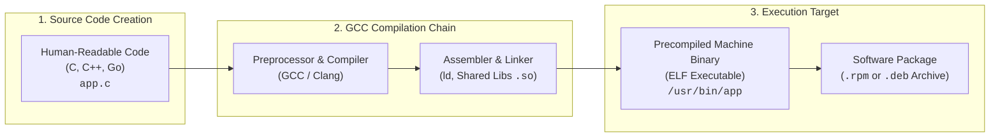
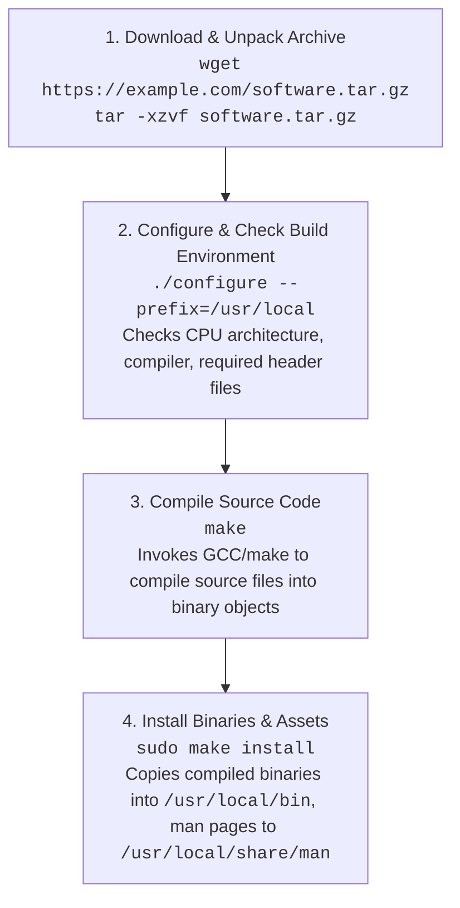
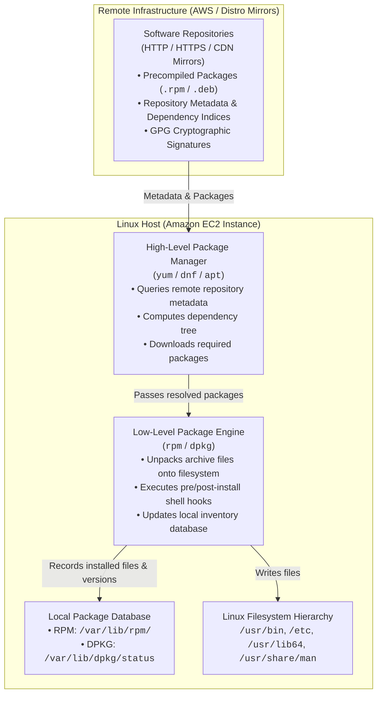
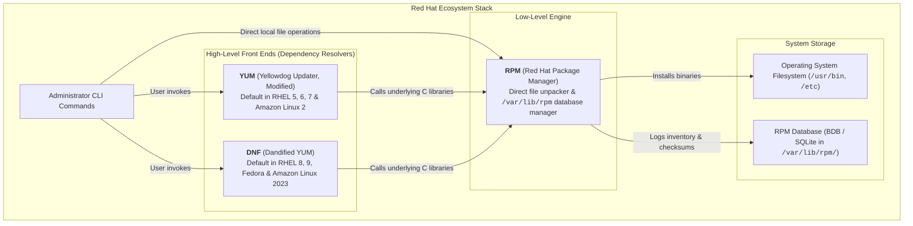
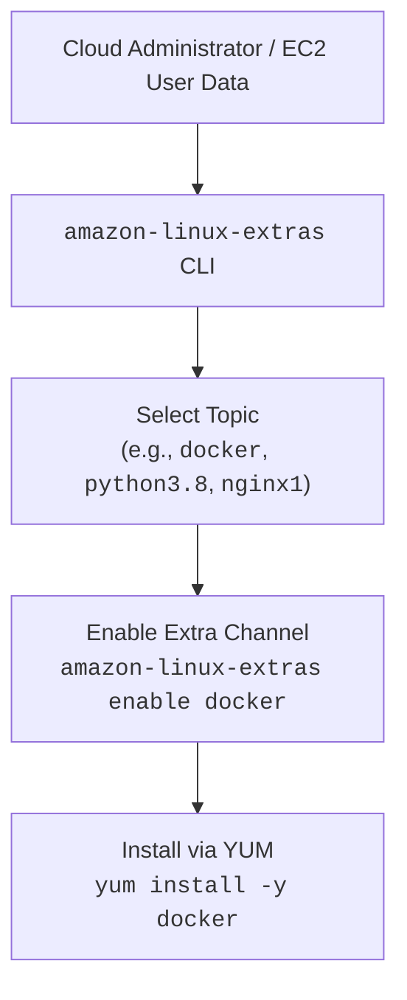
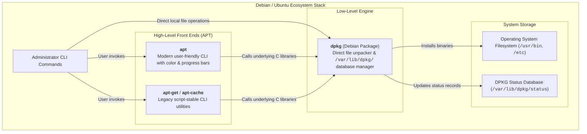
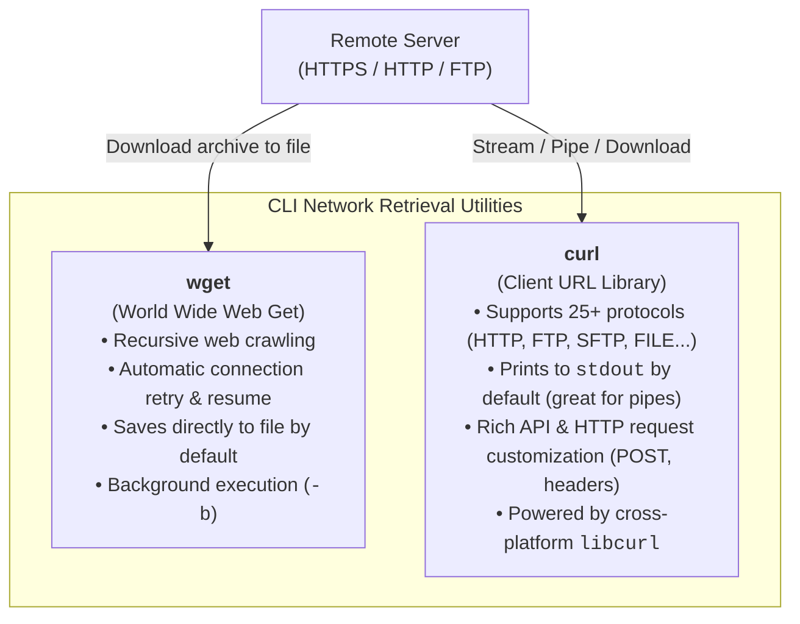
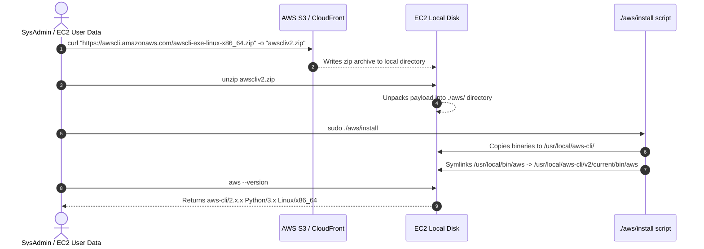

# 📦 Module 02: Linux Software Management – Study Guide

> **Course**: AWS re/Start Linux Fundamentals  
> **Module**: M02 – Linux Fundamentals: Software Management  
> **Source Document**: `T06-0013-RSLX_EN-US_SG_M02_SOFTWAREMGMT.pdf`  
> **Target Audience**: AWS re/Start Learners / Cloud Practitioners / Linux System Administrators / DevOps Engineers  

---

## 🎯 Module Overview

In modern operating systems, cloud engineering, and server administration, managing the lifecycle of software—installing applications, applying critical security patches, upgrading dependencies, maintaining inventories, and cleanly removing obsolete packages—is a foundational operational task. Linux servers in production environments rarely operate as static appliances; they continuously evolve to run web servers, container engines, cloud automation agents, database management systems, and proprietary applications.

Historically, Unix and early Linux administrators installed software by manually obtaining source code, compiling it with a C compiler, and placing binary executables directly into system directories. While this approach granted ultimate customization, it frequently resulted in severe dependency conflicts—often termed **"dependency hell"**—and made inventorying or upgrading software across distributed systems virtually impossible.

To solve this complexity, modern Linux distributions rely on **package managers** and centralized **software repositories**. Package management systems package precompiled binary programs, configuration templates, documentation, and metadata into standardized container files (`.rpm` or `.deb`), automatically calculating and resolving software dependencies before committing changes to disk.

In cloud platforms like **Amazon Web Services (AWS)**, managing software efficiently is vital. Whether provisioning Amazon EC2 instances running **Amazon Linux 2**, **Amazon Linux 2023**, Red Hat Enterprise Linux (RHEL), or Ubuntu, or authoring automated bootstrap scripts via EC2 User Data, cloud practitioners must master both low-level package engines (`rpm`, `dpkg`) and high-level repository front ends (`yum`, `dnf`, `apt`). Additionally, when third-party tools or cloud utilities (such as the **AWS CLI v2**) are distributed outside traditional package repositories, engineers rely on network retrieval tools like `wget` and `curl` to fetch, extract, and install software safely.

This study guide provides an exhaustive, practical exploration of Linux software management. It covers the end-to-end software compilation lifecycle, contrasts low-level package engines with high-level repository managers, breaks down the Red Hat/Fedora/Amazon Linux ecosystem (`rpm`, `yum`, `dnf`, `amazon-linux-extras`), details the Debian/Ubuntu ecosystem (`dpkg`, `apt`, `apt-get`), compares file retrieval utilities (`wget` vs. `curl`), and walks through real-world deployment patterns for AWS cloud environments.

---

### 📌 Learning Objectives

- [ ] **Explain Software Compilation & Lifecycle**: Differentiate between human-readable source code and precompiled machine binaries, detailing the stages of compilation using the GNU Compiler Collection (GCC).
- [ ] **Deconstruct Package Management Concepts**: Explain how software packages, package managers, and repositories eliminate manual dependency tracking and prevent "dependency hell".
- [ ] **Master the RPM & YUM/DNF Ecosystem**: Confidently execute low-level package operations with `rpm` (install, upgrade, query, erase) and high-level automated repository operations with `yum` and `dnf` on Amazon Linux, RHEL, and CentOS.
- [ ] **Leverage Amazon Linux Repositories & Extras**: Navigate `amzn2-core`, use `amazon-linux-extras` for version-curated software topics in Amazon Linux 2, and understand deterministic version locking in Amazon Linux 2023 (AL2023) using `dnf`.
- [ ] **Master the Debian & Ubuntu Ecosystem**: Operate low-level `dpkg` commands and high-level `apt` / `apt-get` workflows (update, upgrade, install, remove, purge, search) on Debian-family systems.
- [ ] **Contrast Package Management Across Distros**: Map equivalent package commands and configuration files across Red Hat, Debian, SUSE, and Arch Linux distributions using structured comparison tables.
- [ ] **Compare Direct Download Utilities (`wget` vs. `curl`)**: Evaluate the technical strengths, protocols, connection recovery, and flags of `wget` and `curl` for non-interactive server automation.
- [ ] **Execute Real-World Cloud Software Installations**: Download, unpack, and install standalone utilities like the AWS Command Line Interface (AWS CLI v2) using `curl`, `unzip`, and custom installer binaries.

---

## ⚙️ 1. Software Management Fundamentals: Source Code vs. Precompiled Binaries

Every computer program running in Linux begins as human-readable source code written in programming languages such as C, C++, Rust, Go, or Python. However, the computer's CPU can only execute binary machine code—sequences of zeros and ones representing raw machine instructions.



---

### Compiling Software from Source Code

In the early decades of Unix, software was distributed almost exclusively as source code archives (commonly called **tarballs**, compressed with `gzip` or `bzip2`, e.g., `software-1.0.tar.gz`). To install the application, an administrator had to execute the classic three-step GNU build system workflow:



#### The Four Stages of Building from Source:

1. **Download and Extract Archive**:
   The administrator retrieves the compressed source archive and decompresses it using `tar`:
   ```bash
   wget https://ftp.gnu.org/gnu/nano/nano-7.2.tar.gz
   tar -zxvf nano-7.2.tar.gz
   cd nano-7.2
   ```

2. **System Inspection and Configuration (`./configure`)**:
   A shell script included with the software checks the local system to verify that all necessary compilers, header files, libraries, and system dependencies are installed. It also generates the distribution's tailored `Makefile`:
   ```bash
   ./configure --prefix=/usr/local
   ```
   If any required dependency (such as `libncurses-dev`) is missing, the script halts with an error.

3. **Compilation (`make`)**:
   The `make` utility reads the `Makefile` and systematically executes the compiler (typically `gcc` for C, `g++` for C++) to convert source code files into object files (`.o`) and links them into an executable binary:
   ```bash
   make
   ```

4. **Installation (`sudo make install`)**:
   The install target in the `Makefile` copies the newly compiled binary executables, configuration templates, shared libraries, and manual documentation into the appropriate system directories (by default, `/usr/local/bin`, `/usr/local/etc`, `/usr/local/share`):
   ```bash
   sudo make install
   ```

---

### Source Code Compilation vs. Binary Package Installation

| Dimension | Compiling from Source Code | Binary Package Installation (`yum`, `apt`) |
| :--- | :--- | :--- |
| **Delivery Format** | Plaintext source files (`.c`, `.h`, `.cpp`) in a `.tar.gz` | Precompiled machine binaries and assets in `.rpm` or `.deb` |
| **Compiler Requirement**| Requires GCC, Clang, Make, and development headers (`-devel`, `-dev`) | No compiler required; runs directly out of the box |
| **Installation Speed** | Slow (large software projects like the Linux kernel or PostgreSQL can take hours to compile) | Instantaneous (decompresses prebuilt files in seconds) |
| **Optimization** | Can be custom-tuned to the exact host CPU microarchitecture (e.g., `-march=native`, AVX-512 flags) | Compiled for a generic baseline CPU architecture (e.g., `x86_64` or `aarch64`) |
| **Custom Features** | Extreme flexibility; enable or disable specific modules at compile time | Features fixed by the Linux distribution maintainer |
| **Dependency Handling** | Manual; failing checks require locating, downloading, and building prerequisites | Automatic; high-level package manager computes and fetches the full dependency tree |
| **Inventory & Removal** | Very difficult; files are scattered across `/usr/local/`; uninstallation relies on unstandardized `make uninstall` | Trivial; registered in package database (`rpm -qa`, `dpkg -l`); clean removal via one command |
| **Security Patching** | Must manually track upstream vulnerabilities, re-download, re-compile, and re-install | Automated via centralized OS repositories (`yum update -y`, `apt upgrade -y`) |

> [!NOTE]
> In production cloud infrastructure (such as AWS EC2 auto-scaling groups or container images), building software from source is strongly discouraged because it increases bootstrap latency, consumes heavy CPU/RAM during deployment, and requires development toolchains (`gcc`, `make`) that expand the attack surface of the instance. Precompiled packages are the enterprise standard.

---

### The Problem of "Dependency Hell"

In early Linux distributions (prior to 2003), software packages were delivered as individual `.rpm` or `.deb` archives without automatic dependency resolution. 

When an administrator attempted to install a package:
```bash
sudo rpm -ivh application-2.0.x86_64.rpm
```
The system would fail with:
```text
error: Failed dependencies:
    libpng16.so.16()(64bit) is needed by application-2.0.x86_64
    libssl.so.1.1()(64bit) is needed by application-2.0.x86_64
```
When the administrator searched for `libpng`, that package in turn required `libz`, and `libssl` required another library. In worst-case scenarios, circular dependencies arose where Package A required Package B, which required Package C, which required Package A.

This frustrating cycle was known as **Dependency Hell**. It paralyzed system maintenance until high-level package managers (**YUM**, **DNF**, **APT**) were engineered to solve the problem mathematically by querying remote repository metadata, building a directed acyclic graph (DAG) of requirements, and installing all prerequisites in the correct sequential order automatically.

---

## 🏛️ 2. Package Management Architecture: Components and Repositories

A complete Linux package management system consists of four symbiotic components:



---

### Anatomical Structure of a Software Package

A software package (whether `.rpm` or `.deb`) is an archive file structured specifically to install and configure software safely:

1. **Payload (Precompiled Files)**:
   - Binaries (placed into `/usr/bin`, `/usr/sbin`)
   - Shared dynamic libraries (placed into `/usr/lib`, `/usr/lib64`)
   - Default configuration files (placed into `/etc`)
   - Documentation and manual pages (placed into `/usr/share/doc`, `/usr/share/man`)
2. **Metadata**:
   - Package Name, Version, Release, and Target Hardware Architecture (e.g., `x86_64`, `aarch64`)
   - Human-readable description, summary, and vendor/license information
   - Explicit list of dependencies (packages or library capabilities this software requires to function)
   - Capabilities provided (virtual symbols or libraries this package offers to other programs)
3. **Control Scripts (Install Hooks)**:
   - `pre-install`: Scripts that run before files are unpacked (e.g., creating a system user account like `nginx`).
   - `post-install`: Scripts that run immediately after unpacking (e.g., updating systemd unit files or symlinks).
   - `pre-uninstall`: Scripts executed before removal (e.g., stopping a running service via `systemctl stop`).
   - `post-uninstall`: Scripts executed after package removal (e.g., cleaning up temporary cache files).
4. **Digital Cryptographic Signature (GPG)**:
   - Prevents supply-chain attacks. Package maintainers sign each package using their private key. The package manager verifies the signature using the distribution's public GPG key before permitting installation.

---

### Software Repositories: Online vs. Local

A **Repository** (often shortened to "repo") is a centralized storage location—hosted on web servers, content delivery networks (CDNs), or local file servers—that holds software packages and searchable database metadata index files.

- **Online Repositories**: Maintained by Linux distributions or cloud providers (e.g., Red Hat, Debian, Ubuntu, Amazon Web Services). EC2 instances automatically query AWS-hosted repository mirrors located in the same AWS Region for ultra-fast, zero-egress-fee downloads.
- **Local Repositories**: Maintained within an enterprise network or private VPC. Essential for air-gapped environments, compliance isolation, or hosting custom proprietary internal software packages.

#### Amazon Linux 2 Repository Architecture
In Amazon Linux 2, repository configuration files are stored in `/etc/yum.repos.d/` (such as `amzn2-core.repo`). AWS hosts multiple purpose-built repositories:
- **`amzn2-core`**: Contains the core operating system components, kernel updates, security patches, and foundational utilities.
- **`amzn2extra-*`**: Specialized repositories providing modern versions of rapidly evolving software (e.g., Docker, Python 3.8, PostgreSQL, Redis) curated to prevent breaking base OS stability.

```bash
# View all configured repositories and their status on Amazon Linux
$ yum repolist
Loaded plugins: extras_suggestions, langpacks, priorities, update-motd
repo id                       repo name                                     status
amzn2-core/2/x86_64           Amazon Linux 2 core repository                26,845
amzn2extra-docker/2/x86_64    Amazon Linux 2 Extra Packages - docker           112
amzn2extra-kernel-5.10/x86_64 Amazon Linux 2 Extra Packages - kernel-5.10       62
repolist: 27,019
```

---

## 🔴 3. Red Hat / Amazon Linux / Fedora Ecosystem: RPM, YUM, and DNF

The Red Hat family of Linux distributions—which includes **Red Hat Enterprise Linux (RHEL)**, **Fedora**, **CentOS**, **Rocky Linux**, **AlmaLinux**, and **Amazon Linux (AL2 and AL2023)**—uses the **RPM** packaging format and high-level managers **YUM** and **DNF**.



---

### Low-Level Package Management: `rpm`

The `rpm` utility interacts directly with local `.rpm` package files and the host's internal database located at `/var/lib/rpm/`.

> [!IMPORTANT]
> The `rpm` command **does not know how to connect to remote repositories** and **does not automatically resolve missing dependencies**. If a required library is missing, `rpm` simply aborts with an error.

#### RPM Package Naming Convention

RPM package filenames strictly adhere to a standardized naming convention:

$$\underbrace{\text{zsh}}_{\text{Name}}-\underbrace{\text{5.0.2}}_{\text{Version}}-\underbrace{\text{34.amzn2.0.1}}_{\text{Release}}.\underbrace{\text{x86\_64}}_{\text{Architecture}}.\text{rpm}$$

- **Name**: The name of the software application (`zsh`).
- **Version**: The upstream developer's software version number (`5.0.2`).
- **Release**: The distribution maintainer's build and patch revision (`34.amzn2.0.1`).
- **Architecture**: The CPU architecture the binaries were compiled for:
  - `x86_64`: 64-bit Intel/AMD x86 processors.
  - `aarch64`: 64-bit ARM processors (e.g., AWS Graviton instances).
  - `noarch`: Architecture-independent packages (Python scripts, shell scripts, icons, documentation).

---

#### Core `rpm` Command Flags and Operations

RPM commands use specific mode flags (`-i`, `-U`, `-q`, `-e`, `-V`) combined with operational options:

```bash
# General syntax:
rpm [mode-flag] [options] [package-name or file.rpm]
```

##### 1. Installing Packages (`-i`)
Installs a new package from a local file on disk:
- `-i` : Install
- `-v` : Verbose (displays detailed progress messages)
- `-h` : Hash marks (prints hash marks `#` as a visual progress bar)

```bash
# Install a downloaded RPM package with progress feedback
sudo rpm -ivh zsh-5.0.2-34.amzn2.0.1.x86_64.rpm
```

##### 2. Upgrading Packages (`-U`)
Upgrades an existing package, or installs it if it is not currently present on the system:
- `-U` : Upgrade (removes older version after unpacking new version)
- `-F` : Freshen (only upgrades the package if an older version is *already* installed)

```bash
# Upgrade or install a package
sudo rpm -Uvh nginx-1.20.0-1.amzn2.0.1.x86_64.rpm
```

##### 3. Querying Packages (`-q`)
Queries the local RPM database (`/var/lib/rpm/`) to inspect installed software or uninstalled `.rpm` files:

```bash
# Query if a specific package is installed
$ rpm -q httpd
httpd-2.4.58-1.amzn2.x86_64

# Query ALL installed packages on the system
$ rpm -qa | head -n 5
filesystem-3.2-25.amzn2.0.4.x86_64
basesystem-10.0-7.amzn2.0.1.noarch
tzdata-2023c-1.amzn2.0.1.noarch
bash-4.2.46-35.amzn2.0.2.x86_64
glibc-2.26-60.amzn2.0.3.x86_64

# Count total packages installed on the system
$ rpm -qa | wc -l
542

# Query which package installed/owns a specific file on the filesystem
$ rpm -qf /etc/ssh/sshd_config
openssh-server-7.4p1-22.amzn2.0.1.x86_64

# Display detailed metadata/information about an installed package
$ rpm -qi openssh-server

# List every file installed by an installed package
$ rpm -ql openssh-server

# List configuration files installed by a package
$ rpm -qc openssh-server

# List documentation files installed by a package
$ rpm -qd openssh-server

# Query an uninstalled RPM file on disk (add -p)
$ rpm -qip ./custom-package.rpm
$ rpm -qlp ./custom-package.rpm
```

##### 4. Erasing / Uninstalling Packages (`-e`)
Removes an installed package from the system and updates `/var/lib/rpm/`:

```bash
# Erase (uninstall) a package
sudo rpm -e zsh

# Erase without checking dependencies (DANGEROUS: can break dependent packages)
sudo rpm -e --nodeps zsh
```

##### 5. Verifying Package Integrity (`-V`)
Compares the files on the filesystem against the cryptographic digests, permissions, and file sizes recorded in the RPM database when the package was installed:

```bash
# Verify all files belonging to openssh-server
$ rpm -V openssh-server
S.5....T.  c /etc/ssh/sshd_config
```
> [!NOTE]
> In the verification output above, `S` indicates file Size has changed, `5` indicates MD5/SHA256 checksum mismatch, `T` indicates modification Time has changed, and `c` denotes that this is a configuration file. This is an indispensable troubleshooting technique for detecting unauthorized tampering or configuration mistakes.

---

### High-Level Package Management: `yum` (Yellowdog Updater, Modified)

While `rpm` operates on isolated files, `yum` provides automatic dependency resolution, downloads packages from remote repositories, verifies cryptographic GPG signatures, and manages transactions.

#### YUM Configuration Files:
- Global Configuration: `/etc/yum.conf` (sets cache path, proxy settings, log file location `/var/log/yum.log`).
- Repository Definitions: `/etc/yum.repos.d/*.repo` (contains repository URLs, enabled status, and GPG key locations).

Example repository definition in `/etc/yum.repos.d/amzn2-core.repo`:
```ini
[amzn2-core]
name=Amazon Linux 2 core repository
mirrorlist=http://amazonlinux.$awsregion.$awsdomain/$releasever/core/latest/$basearch/mirror.list
enabled=1
gpgcheck=1
gpgkey=file:///etc/pki/rpm-gpg/RPM-GPG-KEY-amazon-linux-2
```

---

#### Essential `yum` Commands and Practical Workflows

```bash
# General syntax:
yum [options] [command] [package_name]
```

##### 1. Searching and Inspecting Packages
```bash
# Search repository packages matching keywords (name, summary, description)
$ yum search nginx

# Display detailed information about a package from repositories
$ yum info nginx

# Check what package provides a specific binary or library file
$ yum provides /usr/sbin/semanage
$ yum provides "*libssl.so*"
```

##### 2. Installing Packages
```bash
# Install a package with interactive confirmation prompt
sudo yum install zsh

# Install with automatic "yes" to all prompts (standard in automation & EC2 User Data)
sudo yum install -y zsh

# Install a local RPM file while using YUM to automatically fetch dependencies
sudo yum localinstall -y ./custom-tool.rpm
# (In modern YUM/DNF, standard 'yum install ./file.rpm' works identically)
```

##### 3. Updating Software
```bash
# Check if any updates are available for installed packages
yum check-update

# Update a specific package to the latest version
sudo yum update -y openssl

# Update the entire operating system and all installed packages to latest versions
sudo yum update -y
```

##### 4. Inventorying Installed Software
```bash
# List all installed packages
yum list installed

# Combine yum list installed with grep to find specific software
yum list installed | grep ssh
```
Sample output:
```text
openssh.x86_64                     7.4p1-22.amzn2.0.1               @amzn2-core
openssh-clients.x86_64             7.4p1-22.amzn2.0.1               @amzn2-core
openssh-server.x86_64              7.4p1-22.amzn2.0.1               @amzn2-core
```

##### 5. Removing Packages
```bash
# Remove a package along with any unused dependencies that were installed with it
sudo yum remove -y zsh
```

##### 6. Managing Repository Caches
```bash
# Clean out cached package headers, metadata, and downloaded RPM files
sudo yum clean all

# Rebuild local repository metadata cache
sudo yum makecache
```

##### 7. Viewing Transaction History
YUM maintains a full relational history of every install, update, and erase action:
```bash
# View recent transactions
$ sudo yum history
Loaded plugins: priorities, update-motd
ID     | Command line             | Date and time    | Action(s)      | Altered
-------------------------------------------------------------------------------
     3 | install -y nginx         | 2026-10-12 10:14 | Install        |    4   
     2 | update -y                | 2026-10-10 08:30 | Update         |   18 EE
     1 |                          | 2026-09-01 12:00 | Install        |  485   

# Undo transaction #3 (safely rolls back the installation of nginx)
sudo yum history undo 3 -y
```

---

### Amazon Linux Extras (`amazon-linux-extras`)

In Amazon Linux 2 (AL2), AWS introduced the **Amazon Linux Extras** mechanism. In long-term support (LTS) operating systems, core libraries and compilers are kept static to guarantee rock-solid stability. However, developers and cloud engineers often require modern runtime environments (such as newer PHP, Python, Docker, Go, or Ruby) without compromising OS integrity.

The `amazon-linux-extras` tool provides curated software topics outside the core repository:



#### Common `amazon-linux-extras` Workflows:

```bash
# 1. List available topics and their enabled status
$ amazon-linux-extras list
  ...
  11  nginx1=latest            enabled      [ =stable ]
  33  docker=latest            enabled      [ =stable ]
  38  python3.8=latest         available    [ =stable ]
  61  redis6=latest            available    [ =stable ]
  62  postgresql14=latest      available    [ =stable ]

# 2. Enable a specific topic (e.g., Docker)
sudo amazon-linux-extras enable docker

# 3. Install the software using standard YUM
sudo yum clean metadata
sudo yum install -y docker

# 4. Alternatively, enable and install in a single command
sudo amazon-linux-extras install -y python3.8
```

---

### Modern Red Hat & Amazon Linux Evolution: DNF (Dandified YUM)

In **Fedora 22+**, **RHEL 8/9**, and **Amazon Linux 2023 (AL2023)**, **DNF (Dandified YUM)** replaced YUM as the default high-level package manager.

#### Key Enhancements in DNF:
1. **libsolv SAT Solver**: DNF uses the high-performance `libsolv` library (developed by openSUSE) based on Boolean satisfiability (SAT) solvers for lightning-fast, mathematically sound dependency resolution.
2. **Reduced Memory Footprint & C Core**: YUM was written entirely in Python 2; DNF implements its performance-critical logic in C, drastically lowering RAM consumption (crucial for small cloud instances like `t3.nano` and `t4g.micro`).
3. **Clean Python 3 API**: Fully compatible with modern Python 3 development toolchains.
4. **CLI Compatibility**: On modern systems, `yum` is simply a symbolic link pointing to `dnf` (`/usr/bin/yum -> /usr/bin/dnf-3`). All familiar commands (`install`, `update`, `remove`, `search`) work seamlessly.

#### Package Management in Amazon Linux 2023 (AL2023)
In **AL2023**, AWS made significant architectural updates:
- **`dnf` is the primary package manager**: Native commands like `dnf install`, `dnf update`, and `dnf upgrade` are standard.
- **Retirement of `amazon-linux-extras`**: AL2023 eliminates `amazon-linux-extras` in favor of standardized package versions and native DNF modules.
- **Deterministic Version Locking**: AL2023 supports locking the instance to a specific repository release version (e.g., `2023.2.20231016`), ensuring that automated scale-out EC2 events produce completely bit-for-bit identical servers regardless of when they boot.

```bash
# AL2023 deterministic release locking example:
sudo dnf check-release-update
sudo dnf upgrade --releasever=2023.2.20231016
```

---

## 🟣 4. Debian / Ubuntu Ecosystem: dpkg, apt, and apt-get

The Debian family of Linux distributions—including **Debian**, **Ubuntu**, **Linux Mint**, and **Raspberry Pi OS**—uses the **Debian package format (`.deb`)**, low-level package manager **`dpkg`**, and the **Advanced Package Tool (APT)** front end.



---

### Low-Level Package Management: `dpkg`

The `dpkg` command unpacks `.deb` files directly, manages file installation, and logs package states into `/var/lib/dpkg/status`. Like `rpm`, it **cannot connect to remote repositories** and **does not automatically resolve dependencies**.

#### Debian Package Naming Convention:
$$\underbrace{\text{nginx}}_{\text{Package Name}}\_\underbrace{\text{1.18.0}}_{\text{Upstream Version}}-\underbrace{\text{0ubuntu1.4}}_{\text{Debian/Ubuntu Revision}}\_\underbrace{\text{amd64}}_{\text{Architecture}}.\text{deb}$$

- `amd64`: Standard 64-bit Intel/AMD CPU.
- `arm64`: 64-bit ARM CPU (AWS Graviton).
- `all`: Architecture-independent files.

#### Core `dpkg` Commands:

```bash
# 1. Install a local .deb package
sudo dpkg -i package_name.deb

# 2. List all installed packages
dpkg -l

# 3. Filter installed packages with grep
dpkg -l | grep ssh

# 4. Remove a package (leaves configuration files intact in /etc)
sudo dpkg -r package_name

# 5. Purge a package (removes package AND completely deletes all /etc config files)
sudo dpkg -P package_name

# 6. Query which package owns a specific file on disk
dpkg -S /usr/bin/python3

# 7. List all files installed by a package
dpkg -L package_name

# 8. Inspect details and status of an installed package
dpkg -s package_name

# 9. Extract/inspect contents of an uninstalled .deb file without installing
dpkg -c package_name.deb
```

> [!TIP]
> **Fixing Broken Dependencies with `apt-get -f install`**:  
> If an administrator installs a package via `sudo dpkg -i app.deb` and it fails due to missing dependencies, running `sudo apt-get -f install` (or `sudo apt --fix-broken install`) instructs APT to automatically download and install the missing dependencies and complete the configuration of the pending `.deb` package.

---

### High-Level Package Management: `apt` and `apt-get`

The **Advanced Package Tool (APT)** handles remote repository synchronization, dependency resolution, GPG signature verification, and automated system upgrades.

#### Repository Configuration:
- Main repository list: `/etc/apt/sources.list`
- Modular third-party repository lists: `/etc/apt/sources.list.d/*.list`

Example `/etc/apt/sources.list` entry:
```text
deb http://archive.ubuntu.com/ubuntu jammy main restricted universe multiverse
deb http://security.ubuntu.com/ubuntu jammy-security main restricted
```

---

#### Core APT Commands:

```bash
# 1. Synchronize repository package indices (DOES NOT install or upgrade any software)
# Must ALWAYS be run before installing or upgrading software!
sudo apt update

# 2. Upgrade all installed packages with newer versions available in repos
sudo apt upgrade -y

# 3. Full distribution upgrade (can install new dependencies or remove obsolete ones)
sudo apt full-upgrade -y  # (or 'sudo apt-get dist-upgrade')

# 4. Search remote repositories for packages matching keyword
apt search nginx

# 5. Display detailed information about a package
apt show nginx

# 6. Install software with automatic dependency resolution
sudo apt install -y nginx

# 7. Remove software but KEEP configuration files
sudo apt remove -y nginx

# 8. Remove software AND DELETE all configuration files
sudo apt purge -y nginx

# 9. Remove orphaned dependencies no longer needed by any installed program
sudo apt autoremove -y

# 10. Clean downloaded .deb package archives from local cache (/var/cache/apt/archives/)
sudo apt clean
```

> [!WARNING]
> **Difference between `apt update` and `apt upgrade`**:
> - `apt update` ONLY downloads the latest repository metadata catalogs and updates the local index of available package versions. It does **not** modify or upgrade a single byte of installed software.
> - `apt upgrade` reads the newly updated index and actually downloads and installs newer packages over older versions on disk.
> - Forgetting to run `apt update` prior to `apt install` frequently causes `404 Not Found` errors because the local repository index references package build versions that have been superseded and removed from remote mirrors.

---

## 📊 5. Cross-Distribution Package Management Comparison Matrix

Understanding how commands translate across different Linux distributions is an essential skill for cloud engineers working in multi-OS enterprise environments.

### Complete Command Translation Table

| Operational Task | Red Hat / Amazon Linux (RPM) | Red Hat / AL2 (`yum`) / AL2023 (`dnf`) | Debian / Ubuntu (`dpkg`) | Debian / Ubuntu (`apt` / `apt-get`) |
| :--- | :--- | :--- | :--- | :--- |
| **Install local package file** | `rpm -ivh file.rpm` | `yum install file.rpm`<br>`dnf install file.rpm` | `dpkg -i file.deb` | `apt install ./file.deb` |
| **Upgrade existing package** | `rpm -Uvh file.rpm` | `yum update package`<br>`dnf update package` | `dpkg -i file.deb` | `apt install --only-upgrade pkg` |
| **Upgrade entire OS / packages** | *N/A (single files only)* | `yum update -y`<br>`dnf upgrade -y` | *N/A (single files only)* | `apt update && apt upgrade -y` |
| **Uninstall / Remove package** | `rpm -e package` | `yum remove package`<br>`dnf remove package` | `dpkg -r package` | `apt remove package` |
| **Purge package & configurations**| *N/A* | *N/A* | `dpkg -P package` | `apt purge package` |
| **Remove orphaned dependencies** | *N/A* | `yum autoremove`<br>`dnf autoremove` | *N/A* | `apt autoremove` |
| **Search remote repositories** | *N/A* | `yum search query`<br>`dnf search query` | *N/A* | `apt search query`<br>`apt-cache search query` |
| **Show package details / info** | `rpm -qi package` | `yum info package`<br>`dnf info package` | `dpkg -s package` | `apt show package`<br>`apt-cache show package` |
| **List all installed packages** | `rpm -qa` | `yum list installed`<br>`dnf list installed` | `dpkg -l` | `apt list --installed` |
| **Find which package owns file** | `rpm -qf /path/to/file` | `yum provides /path/to/file`<br>`dnf provides /path/to/file` | `dpkg -S /path/to/file` | `apt-file search /path/to/file` |
| **List files inside installed pkg**| `rpm -ql package` | `repoquery -l package` (yum-utils) | `dpkg -L package` | `dpkg -L package` |
| **Update repository index** | *N/A* | `yum makecache`<br>`dnf makecache` | *N/A* | `apt update` |
| **Clear downloaded package cache** | *N/A* | `yum clean all`<br>`dnf clean all` | *N/A* | `apt clean` |
| **List active repositories** | *N/A* | `yum repolist`<br>`dnf repolist` | *N/A* | Look in `/etc/apt/sources.list` |
| **Config file storage directory** | `/etc/rpm/` | `/etc/yum.repos.d/` | `/etc/dpkg/` | `/etc/apt/sources.list.d/` |
| **Underlying package database** | `/var/lib/rpm/` | `/var/lib/rpm/` | `/var/lib/dpkg/status` | `/var/lib/dpkg/status` |

---

## 🌐 6. File Retrieval Utilities for Direct Downloads: `wget` vs. `curl`

While package managers are ideal for repository-backed software, system administrators frequently need to download standalone archives, installer scripts, configuration files, ISO images, or cloud agents directly from web and FTP servers.

The two preeminent Linux command-line download utilities are **`wget`** and **`curl`**.



---

### Deep Dive: `wget`

**`wget`** (World Wide Web Get) is a non-interactive, network command-line downloader created by the GNU Project:
- **Resilience and Retries**: Engineered specifically to endure unstable or unreliable network links. If a connection drops halfway through a 10 GB file download, `wget` pauses and automatically retries connecting until the download finishes.
- **Recursive Downloading**: Can crawl an entire web page or FTP directory tree, downloading all hyperlinked resources up to a specified depth.
- **Default Behavior**: Automatically writes the downloaded resource directly to a local file named after the URL's trailing resource path.

#### Key `wget` Commands and Flags:

```bash
# 1. Basic download (saves to ./software.zip)
wget https://www.example.com/software.zip

# 2. Specify custom output filename (-O)
wget -O custom-name.zip https://www.example.com/software.zip

# 3. Resume an interrupted/partially downloaded file (-c / --continue)
wget -c https://www.example.com/large-database-dump.sql.gz

# 4. Limit download transfer bandwidth to prevent network congestion (--limit-rate)
wget --limit-rate=2m https://www.example.com/backup.iso

# 5. Download in background detached from current terminal (-b)
wget -b https://www.example.com/heavy-archive.tar.gz
# (Logs output to ./wget-log)

# 6. Recursive download / website mirror (-r, -l depth, -np no parent)
wget -r -l 2 -np https://www.example.com/documentation/

# 7. Quiet mode / suppress output (-q)
wget -q https://www.example.com/script.sh
```

---

### Deep Dive: `curl`

**`curl`** (Client URL) is an extremely versatile command-line tool and shared library (`libcurl`) created by Daniel Stenberg for transferring data with URLs:
- **Multi-Protocol Support**: Supports an extensive list of protocols: `HTTP`, `HTTPS`, `FTP`, `FTPS`, `SFTP`, `SCP`, `FILE`, `TELNET`, `LDAP`, `DICT`, `MQTT`, and more.
- **Streams to Standard Output (`stdout`)**: By default, `curl` does not create a file on disk; it outputs the fetched data stream directly to your terminal. This makes `curl` the gold standard for command pipelines (`curl | bash`, `curl | jq`).
- **RESTful API & HTTP Method Mastery**: Native support for setting custom request headers (`-H`), sending JSON payloads (`-d`), specifying HTTP verbs (`-X POST`, `-X PUT`, `-X DELETE`), and inspecting HTTP status codes (`-I`).
- **Portability**: Runs across virtually every operating system in existence, including Linux, macOS, Windows, AIX, Solaris, and embedded IoT systems.

#### Key `curl` Commands and Flags:

```bash
# 1. Stream contents of a URL to stdout
curl https://checkip.amazonaws.com

# 2. Save downloaded file using the remote server's exact filename (-O / --remote-name)
curl -O https://www.example.com/archive.tar.gz

# 3. Save to a custom local filename (-o / --output)
curl -o custom-name.tar.gz https://www.example.com/archive.tar.gz

# 4. Follow HTTP 301/302 Redirects (-L / --location)
# CRITICAL: Without -L, curl will return the HTML redirect page instead of the actual file!
curl -L -o release.zip https://github.com/user/project/releases/latest/download/file.zip

# 5. Fetch HTTP response headers only without downloading body (-I / --head)
curl -I https://aws.amazon.com

# 6. Silent mode (-s) combined with showing errors (-S)
curl -sS https://example.com/data.json

# 7. Resume broken download (-C -)
curl -C - -O https://www.example.com/largefile.iso

# 8. Send HTTP POST request with JSON payload (-X POST -H ... -d ...)
curl -X POST https://api.example.com/v1/metrics \
     -H "Content-Type: application/json" \
     -d '{"cpu_utilization": 82.5, "host": "web-01"}'

# 9. Use the FILE protocol to read local files
curl file:///etc/hosts
```

---

### Side-by-Side Comparison: `wget` vs. `curl`

| Feature / Capability | `wget` | `curl` |
| :--- | :--- | :--- |
| **Default Output Target** | Local file on disk | Terminal standard output (`stdout`) |
| **Recursive Directory Crawl**| Yes (`-r`, mirrors web/FTP directories) | No (downloads a single URL resource at a time) |
| **Auto-Resume Interrupted** | Built-in automatic retry and resume (`-c`) | Manual retry flags (`-C -`, `--retry`) |
| **Supported Protocols** | HTTP, HTTPS, FTP, FTPS | HTTP, HTTPS, FTP, FTPS, SFTP, SCP, FILE, LDAP, MQTT, etc. |
| **Underlying Engine** | Standalone monolithic executable | Powered by `libcurl` (callable from C, Python, PHP, Ruby) |
| **REST API / HTTP Methods** | Basic GET/POST support | Comprehensive (`-X`, `-H`, `-d`, basic/digest/OAuth auth) |
| **Pipeline Interoperability** | Low (requires `-O -` to pipe) | Exceptional (pipes directly to `sh`, `jq`, `tar`, `grep`) |
| **Primary Use Case** | Bulk downloads, mirroring, network resilience | API testing, script pipelines, versatile cross-protocol transfers |

---

## ☁️ 7. Real-World Cloud Use Case: Installing AWS CLI v2 via `curl`

A classic administrative scenario on an AWS EC2 instance occurs when a software tool is not packaged in the standard OS package repositories or when the version in the repository is outdated. The **AWS Command Line Interface version 2 (AWS CLI v2)** is officially distributed by AWS as a standalone precompiled binary bundle.



---

### Step-by-Step Installation Procedure

#### Step 1: Download the Package via `curl`
Use `curl` with the `-o` option to specify the local output destination filename (`awscliv2.zip`). The download URL retrieves the official 64-bit Linux zip bundle:

```bash
curl "https://awscli.amazonaws.com/awscli-exe-linux-x86_64.zip" -o "awscliv2.zip"
```
*(On ARM64 Graviton instances, use `awscli-exe-linux-aarch64.zip`)*.

#### Step 2: Unzip the Installation File
Decompress the downloaded archive. If `unzip` is not installed on the system, install it first (`sudo yum install -y unzip` or `sudo apt install -y unzip`):

```bash
unzip awscliv2.zip
```
This extraction creates an `aws/` directory in the current working directory containing all precompiled libraries, Python runtimes, and the installation script.

#### Step 3: Run the Installation Program
Execute the bundled install script with superuser privileges:

```bash
sudo ./aws/install
```

What `./aws/install` does behind the scenes:
1. Installs the self-contained AWS CLI files into `/usr/local/aws-cli/v2/current/`.
2. Creates a symbolic link in `/usr/local/bin/aws` pointing to the executable.

#### Step 4: Verify Installation and Clean Up
Confirm that the executable is accessible in the system `$PATH`:

```bash
$ aws --version
aws-cli/2.15.15 Python/3.11.6 Linux/5.10.205-195.807.amzn2.x86_64 botocore/2.4.7

# Remove temporary installation files to save disk space
rm -rf awscliv2.zip ./aws/
```

---

## 📋 8. Comprehensive Command Cheat Sheet

### Package Management & Download Quick Reference

```bash
# ==============================================================================
# 1. RED HAT / AMAZON LINUX 2 / AL2023 (RPM / YUM / DNF)
# ==============================================================================
# Low-level RPM operations
rpm -ivh package.rpm           # Install local RPM with verbose progress
rpm -Uvh package.rpm           # Upgrade existing package or install if missing
rpm -qa                        # List all installed packages
rpm -qa | grep <name>          # Search installed packages by name
rpm -qf /path/to/file          # Identify which package owns a specific file
rpm -qi package_name           # Display detailed metadata for an installed package
rpm -ql package_name           # List all files installed by package
rpm -qc package_name           # List configuration files installed by package
rpm -e package_name            # Uninstall/erase package
rpm -V package_name            # Verify file integrity against RPM database

# High-level YUM / DNF operations
yum install -y <package>       # Install package, auto-confirming prompts
yum update -y                  # Update all installed packages and OS
yum update -y <package>        # Update only specific package
yum remove -y <package>        # Uninstall package and unused dependencies
yum search <keyword>           # Search repository package names and summaries
yum info <package>             # Display detailed repo package information
yum list installed             # List all installed packages
yum provides </path/to/file>   # Find which repo package provides a file/binary
yum repolist                   # Display enabled repositories
yum clean all                  # Delete cached packages and metadata
yum history                    # View transaction history
yum history undo <id> -y       # Roll back a specific transaction

# Amazon Linux Extras (AL2 only)
amazon-linux-extras list       # List available software topics and status
amazon-linux-extras enable <t> # Enable software topic (e.g., docker, nginx1)
amazon-linux-extras install <t># Enable and install in a single command

# ==============================================================================
# 2. DEBIAN / UBUNTU (DPKG / APT)
# ==============================================================================
# Low-level DPKG operations
sudo dpkg -i package.deb       # Install local .deb package
dpkg -l                        # List all installed packages
dpkg -l | grep <name>          # Filter installed packages
dpkg -S /path/to/file          # Find which package owns a specific file
dpkg -L package_name           # List all files installed by package
sudo dpkg -r package_name      # Remove package (preserves config files)
sudo dpkg -P package_name      # Purge package (deletes package and configs)
sudo apt --fix-broken install  # Fix missing dependencies after dpkg -i failure

# High-level APT operations
sudo apt update                # Update local package index from repositories
sudo apt upgrade -y            # Upgrade all installed packages to latest versions
sudo apt install -y <package>  # Install package with dependency resolution
sudo apt remove -y <package>   # Remove package (preserves config files)
sudo apt purge -y <package>    # Purge package and delete config files
sudo apt autoremove -y         # Remove obsolete/orphaned dependencies
apt search <keyword>           # Search repository for packages
apt show <package>             # Display package description and dependencies
sudo apt clean                 # Delete downloaded .deb files in local cache

# ==============================================================================
# 3. DIRECT FILE RETRIEVAL (WGET & CURL)
# ==============================================================================
# WGET operations
wget <url>                     # Download file, saving under original filename
wget -O custom.zip <url>       # Download and save with custom filename
wget -c <url>                  # Resume partially downloaded file
wget -b <url>                  # Download in background (view progress in wget-log)
wget --limit-rate=1m <url>     # Cap download bandwidth speed at 1 MB/s
wget -q <url>                  # Run silently without progress output

# CURL operations
curl <url>                     # Stream contents to stdout (terminal screen)
curl -o custom.zip <url>       # Save downloaded file as custom.zip
curl -O <url>                  # Save using remote file's filename
curl -L -O <url>               # Follow HTTP 301/302 redirects and save file
curl -I <url>                  # Retrieve HTTP response headers only
curl -sS -O <url>              # Silent mode, but display errors if transfer fails
curl -C - -O <url>             # Resume broken download
```

---

## 🧠 9. Checkpoint & Knowledge Check

Test your mastery of Linux software management, package architectures, commands, and cloud download workflows.

### Question 1
**How is the software installed by a package manager provided?**
> **Answer**: Software installed by a package manager is provided in a standardized **software package** (such as an `.rpm` file in Red Hat distributions or a `.deb` file in Debian distributions). The package bundles precompiled binary executables, configuration files, libraries, documentation, metadata (dependencies, version, architecture), and installation scripts into a single distributable archive.

---

### Question 2
**What is another way to install software on a Linux system besides using a package manager?**
> **Answer**: Software can be installed by **compiling it from source code** (typically distributed as a `.tar.gz` tarball) using a compiler like the GNU Compiler Collection (**GCC**). Other alternative methods include downloading standalone binary executables (such as the AWS CLI v2 bundle using `curl` and `unzip`), running container images (via Docker/Podman), or using language-specific package managers (`pip` for Python, `npm` for Node.js).

---

### Question 3
**Which of the file retrieval utilities—`wget` or `curl`—automatically tries to resume a download operation if the network connection is temporarily interrupted and then restored?**
> **Answer**: **`wget`**. It was specifically designed for network resilience and non-interactive downloading, automatically retrying and resuming interrupted transfers when connectivity is re-established. While `curl` can resume downloads using the `-C -` flag, it requires explicit manual flags or script logic to achieve automated retry loops.

---

### Question 4
**Why does running `sudo rpm -ivh package.rpm` often fail on a newly installed Linux instance, whereas `sudo yum install package` succeeds?**
> **Answer**: The low-level `rpm` command only unpacks local files and checks its local database. If `package.rpm` requires shared libraries or external packages that are not already present on the system, `rpm` fails immediately with an unresolved dependency error. In contrast, `yum` queries remote repository metadata, computes the entire dependency graph, downloads all prerequisite packages in the correct order, and installs them automatically alongside the target application.

---

### Question 5
**What is the functional difference between `apt remove nginx` and `apt purge nginx` on an Ubuntu server?**
> **Answer**: 
> - `apt remove nginx` uninstalls the binary executables and package files but **leaves configuration files** (such as `/etc/nginx/nginx.conf` and server blocks) intact on disk. This enables seamless re-installation without losing customizations.
> - `apt purge nginx` completely uninstalls the application **and deletes all associated configuration files** from `/etc`, restoring the system to a clean state.

---

### Question 6
**Why must you execute `sudo apt update` before running `sudo apt install <package>` on a newly launched Ubuntu EC2 instance?**
> **Answer**: Ubuntu stores its catalog of available repository packages and exact version numbers locally in `/var/lib/apt/lists/`. Cloud AMI images do not include up-to-the-minute package lists. If you do not run `apt update`, APT will query outdated version numbers that may have been superseded or removed from upstream mirrors, causing the download to fail with `404 Not Found` errors.

---

### Question 7
**What purpose does `amazon-linux-extras` serve on Amazon Linux 2, and why was it replaced in Amazon Linux 2023 (AL2023)?**
> **Answer**: In Amazon Linux 2, `amazon-linux-extras` allowed administrators to install newer, rapidly evolving runtime environments (such as Docker, Python 3.8, PostgreSQL 14, and Redis 6) without upgrading the entire operating system or breaking the stability of core OS libraries. In AL2023, AWS replaced this mechanism with native **`dnf`**, which provides deterministic version locking and native modular repositories, eliminating the need for a separate custom tool.

---

### Question 8
**When downloading files using `curl` in a shell script, why is it critical to include the `-L` (or `--location`) flag?**
> **Answer**: Many modern download URLs (such as GitHub release assets or short links) use HTTP 301 or 302 redirects to route clients to content delivery network (CDN) storage (e.g., Amazon S3). Without the `-L` flag, `curl` will only download the tiny HTML redirect notification page instead of following the redirection header to download the actual target payload file.

---

## 📝 10. Key Takeaways

- **Source Code vs. Packages**: Source code requires compilation via GCC and manual dependency management. Modern production environments utilize precompiled software packages (`.rpm`, `.deb`) for speed, consistency, and clean uninstallation.
- **Dependency Hell Solved**: Early package installation suffered from circular or missing library dependencies. High-level package managers (**YUM**, **DNF**, **APT**) automatically compute dependency graphs and resolve requirements from remote repositories.
- **Red Hat / Amazon Linux Stack**:
  - `rpm` manages local package files (`-ivh` install, `-Uvh` upgrade, `-qa` list, `-qf` owner, `-e` erase, `-V` verify).
  - `yum` / `dnf` automates repository downloads, dependency resolution, updates, and transaction rollbacks (`yum history`).
  - Amazon Linux 2 uses `amazon-linux-extras` for modern software versions; Amazon Linux 2023 natively adopts `dnf` and deterministic version locking.
- **Debian / Ubuntu Stack**:
  - `dpkg` operates directly on local `.deb` files (`-i` install, `-l` list, `-r` remove, `-P` purge).
  - `apt` / `apt-get` synchronizes repositories (`apt update`), upgrades systems (`apt upgrade`), and resolves dependencies (`apt install`, `apt purge`, `apt autoremove`).
- **`wget` vs. `curl`**:
  - `wget` is optimized for recursive crawling, file downloads, and automatic network connection resume (`-c`).
  - `curl` supports 25+ protocols, defaults to streaming output (`stdout`) for UNIX pipelines, and provides robust REST API manipulation. Always use `-L` with `curl` when following web redirects.
- **AWS CLI v2 Installation**: Distributed as a standalone zip archive; deployed using `curl -o`, `unzip`, and `sudo ./aws/install` to create symlinks in `/usr/local/bin/`.
