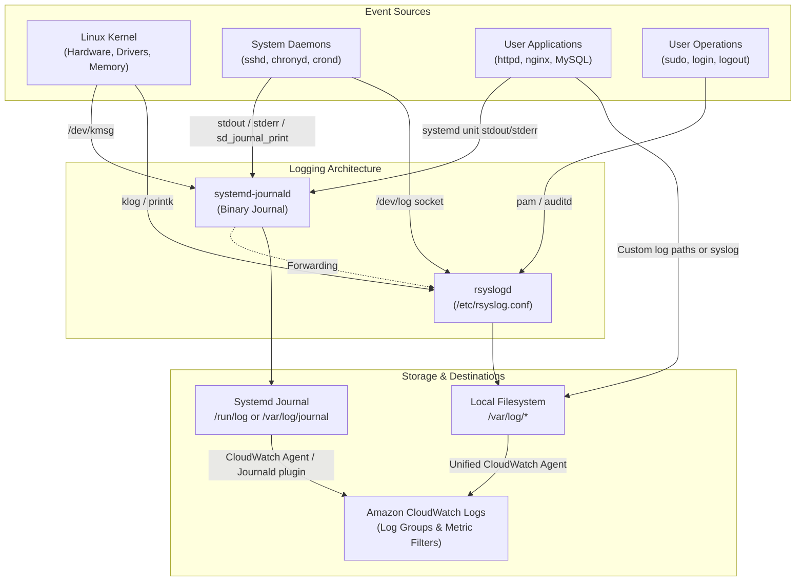
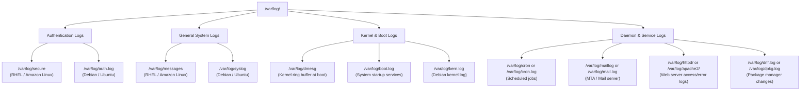
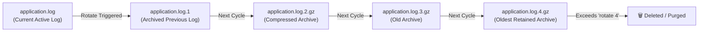
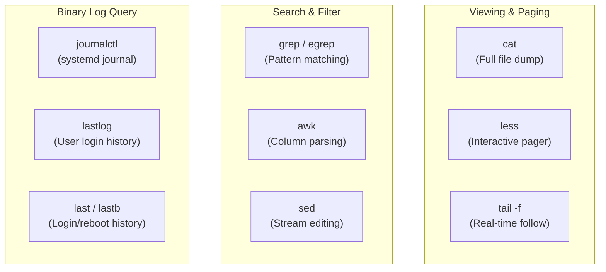
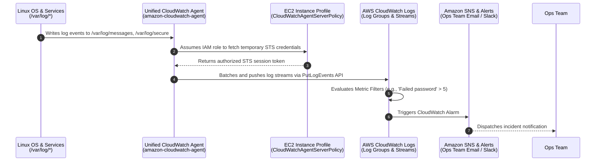

# 📜 Module 02: Managing Log Files in Linux – Study Guide

> **Course**: AWS re/Start Linux Fundamentals  
> **Module**: M02 – Linux Fundamentals: Managing Log Files  
> **Source Document**: `T06-0014-RSLX_EN-US_SG_M02_MNGLOGFILES.pdf`  
> **Target Audience**: AWS re/Start Learners / Cloud Practitioners / Linux System Administrators / DevOps Engineers  

---

## 🎯 Module Overview

In modern operating systems, enterprise datacenters, and cloud architectures, log files represent the primary historical record of system behavior, health, security, and administrative actions. Every event—from system initialization and kernel device detection to authentication attempts, service daemon activity, scheduled cron jobs, and web server traffic—generates structured or semi-structured telemetry recorded as log messages.

Without robust logging and centralized log management, systems administrators and cloud engineers operate blindly. Log analysis is the cornerstone of:
1. **Root Cause Analysis (RCA)**: Diagnosing service crashes, memory faults, and kernel panics.
2. **Security & Forensic Auditing**: Identifying unauthorized access, brute-force SSH attacks, privilege escalation attempts, and data exfiltration.
3. **Compliance & Governance**: Fulfilling regulatory frameworks (such as PCI-DSS, HIPAA, SOC 2, and ISO 27001) that mandate immutable audit trails.
4. **Service-Level Agreements (SLAs)**: Detecting performance degradation and ensuring troubleshooting begins within contractual response windows.
5. **Automated Cloud Monitoring**: Feeding operating system telemetry into cloud-native observability platforms such as **Amazon CloudWatch**.

This study guide provides an in-depth, hands-on exploration of Linux logging architectures. It covers the standard `/var/log` directory hierarchy, classic and modern logging daemons (**syslog**, **rsyslog**, and **systemd-journald**), standard syslog severity levels (RFC 5424), automated log lifecycle management using **`logrotate`**, command-line analysis tools (`tail -f`, `grep`, `awk`, `journalctl`, `lastlog`), and enterprise cloud log shipping via the **AWS Unified CloudWatch Agent**.

---

### 📌 Learning Objectives

- [ ] **Define Linux Logging Fundamentals**: Articulate the purpose of system, event, application, and service logs in enterprise and cloud environments.
- [ ] **Navigate the `/var/log` Hierarchy**: Identify standard log file paths, their specific roles, and the distributions that use them (Red Hat vs. Debian families).
- [ ] **Master Syslog Severity Levels**: Memorize and apply the 8 standard syslog severity levels (RFC 5424, 0–7) from Emergency to Debug.
- [ ] **Deconstruct Linux Logging Daemons**: Explain the operational architecture of `syslogd`, `rsyslogd` (rules, facilities, `/etc/rsyslog.conf`), and `systemd-journald`.
- [ ] **Configure Log Rotation (`logrotate`)**: Design and implement `/etc/logrotate.conf` and `/etc/logrotate.d/*` configuration blocks using key directives (`daily`, `rotate`, `compress`, `missingok`, `notifempty`, `create`).
- [ ] **Analyze Logs with Command-Line Utilities**: Filter, parse, and monitor real-time logs using `cat`, `less`, `head`, `tail -f`, `grep`, `awk`, and `journalctl`.
- [ ] **Audit User Logins with `lastlog`**: Inspect user authentication history and filter login records by username and time window.
- [ ] **Implement AWS CloudWatch Logs Integration**: Configure the Unified CloudWatch Agent to capture local Linux log files and push them into Amazon CloudWatch Log Groups for alerting and dashboarding.

---

## 🔍 1. Purpose & Importance of Logs in Linux and Cloud Operations

A log file is an append-only file containing chronological records of events, messages, alerts, and operational telemetry generated by the Linux kernel, system daemons, user applications, and administration utilities.



### The Operational Pillars of Logging

| Pillar | Operational Focus | Real-World Scenario |
| :--- | :--- | :--- |
| **Proactive Troubleshooting** | Identifying anomalies before service outage occurs | Detecting intermittent disk I/O latency errors or network interface drops in `/var/log/messages` before an application crashes. |
| **Root Cause Analysis (RCA)** | Determining the exact sequence of events leading to a failure | Inspecting `/var/log/httpd/error_log` following an HTTP 500 error to identify an unhandled PHP database connection exception. |
| **Security & Forensics** | Uncovering unauthorized access, brute-force attacks, and intrusions | Auditing `/var/log/secure` (or `/var/log/auth.log`) to locate repeated failed SSH login attempts from an unknown public IP address. |
| **Regulatory Compliance** | Providing immutable evidence for external and internal audits | Retaining 365 days of system access records to comply with PCI-DSS Requirement 10 or SOC 2 Trust Services Criteria. |
| **Service-Level Agreements (SLAs)** | Tracking availability and incident response metrics | Measuring the exact timestamp when a customer-facing service stopped responding to calculate uptime percentages and MTTR (Mean Time to Resolution). |

> [!NOTE]
> In Linux, log files are stored under the `/var` filesystem hierarchy because `/var` stands for **variable data**—files whose content, frequency of writes, and overall size dynamically fluctuate during normal system operations.

---

## 🗂️ 2. The `/var/log` Directory Hierarchy

On virtually all Linux distributions, centralized and service-specific logs reside within `/var/log`. However, subtle differences exist between **Red Hat-derived distributions** (e.g., Red Hat Enterprise Linux, CentOS, Amazon Linux 2, Amazon Linux 2023, Fedora) and **Debian-derived distributions** (e.g., Debian, Ubuntu).



### Comprehensive Log File Reference

| Log File Path | Primary Function & Contents | Distribution Family | Security & Access |
| :--- | :--- | :--- | :--- |
| **`/var/log/messages`** | General system messages, non-critical daemon events, service startups, and hardware notifications. | Red Hat / Amazon Linux / SUSE | Requires `root` or `adm` group |
| **`/var/log/syslog`** | Comprehensive central system log capturing virtually everything except authentication events. | Debian / Ubuntu | Requires `root` or `adm` group |
| **`/var/log/secure`** | Authentication and authorization logs: SSH logins, `sudo` invocations, PAM authentications, user additions/deletions. | Red Hat / Amazon Linux | Strictly restricted (`0600` or `root:root`) |
| **`/var/log/auth.log`** | Authentication and authorization logs: identical function to `/var/log/secure`. | Debian / Ubuntu | Strictly restricted (`0640` or `root:adm`) |
| **`/var/log/boot.log`** | Messages generated during system boot as systemd units and initialization scripts execute. | Distribution agnostic | Readable by `root` |
| **`/var/log/dmesg`** | Hardware detection, device initialization, and early kernel messages during bootstrap. | Distribution agnostic | Can also be viewed via `dmesg` CLI |
| **`/var/log/cron`** (or `cron.log`) | Records execution of scheduled tasks by the `crond` daemon, including command invocations and failures. | RHEL (`cron`), Debian (`cron.log`) | Restricted to `root` |
| **`/var/log/maillog`** (or `mail.log`) | Postfix, Sendmail, Exim, or other Mail Transfer Agent (MTA) transaction logs. | RHEL (`maillog`), Debian (`mail.log`) | Readable by mail/admin users |
| **`/var/log/httpd/`** (or `apache2/`) | Apache HTTP Server logs: `access_log` (incoming HTTP requests) and `error_log` (runtime errors). | RHEL (`httpd/`), Debian (`apache2/`) | Owner `apache` or `root` |
| **`/var/log/nginx/`** | NGINX web server logs: `access.log` and `error.log`. | Distribution agnostic | Owner `nginx` or `root` |
| **`/var/log/lastlog`** | Binary database of the most recent login timestamp, UID, and terminal for each system account. | Distribution agnostic | Queried via `lastlog` CLI |
| **`/var/log/wtmp`** | Binary database recording all user login and logout history, plus system reboot events. | Distribution agnostic | Queried via `last` CLI |
| **`/var/log/btmp`** | Binary database recording all failed login attempts across interactive and SSH sessions. | Distribution agnostic | Queried via `lastb` CLI (requires `root`) |
| **`/var/log/yum.log`** / **`dnf.log`** | History of package installations, updates, and removals via YUM / DNF package managers. | Red Hat / Amazon Linux | Readable by `root` |
| **`/var/log/dpkg.log`** | History of package installations, removals, and upgrades performed by `dpkg` / `apt`. | Debian / Ubuntu | Readable by `root` |

> [!IMPORTANT]
> Files like `/var/log/lastlog`, `/var/log/wtmp`, and `/var/log/btmp` are **binary databases**, not plaintext files. Attempting to view them with `cat`, `less`, or `vi` will produce garbled terminal output. You must inspect them using dedicated utilities: `lastlog`, `last`, and `lastb`.

---

## 🚦 3. Syslog Severity Levels (RFC 5424)

Standardized under **RFC 5424** (The Syslog Protocol), Linux operating systems and enterprise applications classify messages into eight discrete numerical severity levels, ranging from **0 (Emergency)** down to **7 (Debug)**.

Understanding these levels is vital for configuring logging filters, setting alarm thresholds, and diagnosing production outages.

```mermaid
graph TD
    subgraph SeverityScale["Syslog Severity Scale (RFC 5424)"]
        direction TB
        L0["0: EMERGENCY (System unusable / kernel panic)"]
        L1["1: ALERT (Action must be taken immediately)"]
        L2["2: CRITICAL (Critical conditions / hardware failure)"]
        L3["3: ERROR (Error conditions / service failures)"]
        L4["4: WARNING (Warning conditions / approaching limits)"]
        L5["5: NOTICE (Normal but significant conditions)"]
        L6["6: INFORMATIONAL (Informational events / normal operations)"]
        L7["7: DEBUG (Debug-level messages / diagnostic tracing)"]
    end

    style L0 fill:#d9534f,stroke:#333,stroke-width:1px,color:#fff
    style L1 fill:#f0ad4e,stroke:#333,stroke-width:1px,color:#fff
    style L2 fill:#f0ad4e,stroke:#333,stroke-width:1px,color:#fff
    style L3 fill:#f39c12,stroke:#333,stroke-width:1px,color:#fff
    style L4 fill:#f1c40f,stroke:#333,stroke-width:1px,color:#333
    style L5 fill:#5bc0de,stroke:#333,stroke-width:1px,color:#fff
    style L6 fill:#5cb85c,stroke:#333,stroke-width:1px,color:#fff
    style L7 fill:#7f8c8d,stroke:#333,stroke-width:1px,color:#fff
```



### Detailed Severity Matrix

| Numerical Level | Keyword / Identification | System Impact | Detailed Description & Examples |
| :---: | :--- | :--- | :--- |
| **0** | `EMERGENCY` (`emerg`) | System Unusable | The highest severity. The operating system has experienced a catastrophic fault (e.g., kernel panic, disk corruption on root partition, hardware CPU failure) and is about to halt or crash. Broadcast to all terminals. |
| **1** | `ALERT` (`alert`) | Immediate Action Required | Urgent issue requiring immediate administrator intervention (e.g., primary database corruption, primary ISP link failure, root filesystem 99.9% full). |
| **2** | `CRITICAL` (`crit`) | Critical Component Failure | Serious hardware or software subsystem failure (e.g., redundant power supply failure, RAID array degraded, network interface driver fault). |
| **3** | `ERROR` (`err`) | Non-Fatal Functional Failure | An operation or service failed to complete its task, but the operating system continues to function (e.g., daemon failed to start, database query timeout, file write permission denied). |
| **4** | `WARNING` (`warning`) | Potential Risk Detected | An unusual condition that is not currently an error, but could lead to an outage if ignored (e.g., disk usage exceeded 85%, memory pool reaching capacity, deprecated API called). Often the default production log level. |
| **5** | `NOTICE` (`notice`) | Normal Significant Event | Normal operational state, but signifies an event worthy of tracking (e.g., service gracefully restarted, IP address renewed via DHCP, configuration file reloaded). |
| **6** | `INFORMATIONAL` (`info`) | Standard Operational Trace | Routine informational messages detailing standard system activities (e.g., user logged in successfully via SSH, HTTP 200 GET request logged, cron job completed). |
| **7** | `DEBUG` (`debug`) | Granular Diagnostic Telemetry | Extremely verbose internal state information generated for developers and engineers during code debugging and troubleshooting. Should be disabled in high-traffic production environments to avoid I/O bottlenecks. |

> [!TIP]
> **Priority Filtering Logic**: In syslog and rsyslog configuration, specifying a priority level (e.g., `*.warn`) instructs the daemon to capture messages of that specified level **and all higher-severity levels** (numerically lower values: Warning, Error, Critical, Alert, Emergency).

---

## ⚙️ 4. Linux Logging Daemons: syslog, rsyslog & systemd-journald

Over the evolution of Linux, log management has transitioned from simple text collectors to high-performance, multi-threaded pipelines, and unified binary journals.

### 1. Traditional `syslog` (`syslogd`)
- Original Unix logging daemon standard (RFC 3164).
- Single-threaded and synchronous: each message caused an immediate disk write.
- Limited filtering capabilities, lacking support for TCP transmission or encrypted log shipping.

---

### 2. Modern `rsyslog` (Rocket-Fast System for Log Processing)
`rsyslog` is the standard replacement for `syslogd` on enterprise Linux distributions (including Amazon Linux 2, RHEL, CentOS, Debian, and Ubuntu):
- **Multi-threaded & High Throughput**: Capable of processing over a million messages per second.
- **Transport Reliability**: Supports UDP (port 514), TCP (port 514), and TLS-encrypted network log forwarding to central syslog servers.
- **Flexible Rules Architecture**: Uses facility-priority selectors and structured filtering scripts.

#### Understanding Facilities and Priorities in `/etc/rsyslog.conf`

An rsyslog selector follows the syntax: `facility.priority action`

```text
# Syslog Facilities:
# auth, authpriv, cron, daemon, kern, lpr, mail, mark, news, syslog, user, uucp, local0-local7

# Priority Qualifiers:
# debug, info, notice, warning, err, crit, alert, emerg, none
```

```bash
# Example /etc/rsyslog.conf excerpts:

# 1. Log all kernel messages to /var/log/kernel.log
kern.*                                                 /var/log/kernel.log

# 2. Log authentication messages with any priority to /var/log/secure
authpriv.*                                              /var/log/secure

# 3. Log all messages of info or higher priority, excluding mail, authpriv, and cron, to /var/log/messages
*.info;mail.none;authpriv.none;cron.none                /var/log/messages

# 4. Broadcast all emergency messages to all currently logged-in users
*.emerg                                                 :omusrmsg:*

# 5. Forward all logs to a remote centralized syslog server over TCP
*.*                                                     @@central-syslog.internal.aws:514
# Note: Single '@' denotes UDP; double '@@' denotes TCP.
```

---

### 3. Modern `systemd-journald`
Part of the **systemd** suite, `systemd-journald` is an event-logging service that collects telemetry from:
- Kernel log messages (via `/dev/kmsg`)
- Standard system log messages (via `/dev/log`)
- Standard output (`stdout`) and standard error (`stderr`) of all systemd unit services
- Audit records from the Linux audit subsystem

#### Key Features of systemd-journald:
1. **Binary Storage Format**: Stores logs in structured binary format, preventing tampering and enabling lightning-fast indexing by PID, UID, unit name, and executable path.
2. **Rich Metadata**: Automatically attaches context to every message (e.g., `_PID`, `_UID`, `_SYSTEMD_UNIT`, `_HOSTNAME`, `_COMM`, `_BOOT_ID`).
3. **Storage Modes**:
   - **Transient Storage** (`/run/log/journal/`): Stored in RAM; logs are cleared upon reboot.
   - **Persistent Storage** (`/var/log/journal/`): Stored on the persistent root filesystem; retained across reboots.

```bash
# Verify whether persistent journaling is active:
ls -ld /var/log/journal

# To enable persistent journal storage if not present:
sudo mkdir -p /var/log/journal
sudo systemd-tmpfiles --create --prefix /var/log/journal
sudo systemctl restart systemd-journald
```

---

## 🔄 5. Automated Log Rotation: The `logrotate` Utility

Because servers execute mission-critical applications that continuously log transactions, unmanaged log files will grow indefinitely until the filesystem runs out of disk space (**100% disk utilization**), crashing applications and the operating system itself.

**Log rotation** solves this challenge by automatically archiving, compressing, truncating, and removing aged log files on a scheduled basis.



### Logrotate Architecture & Invocation
1. `logrotate` is typically executed as a daily scheduled task via a systemd timer (`logrotate.timer`) or daily cron script (`/etc/cron.daily/logrotate`).
2. Main configuration file: `/etc/logrotate.conf` (sets global default policies).
3. Service-specific configuration directory: `/etc/logrotate.d/` (contains custom policies for `httpd`, `nginx`, `rsyslog`, `chrony`, etc.).

### Critical `logrotate` Configuration Directives

| Directive | Description & Purpose | Example |
| :--- | :--- | :--- |
| **`daily` / `weekly` / `monthly`** | Defines the time interval between rotation triggers. | `weekly` |
| **`rotate <count>`** | Number of rotated log archives to retain before purging the oldest. | `rotate 4` (retains 4 archives) |
| **`size <size>`** | Rotates log file whenever it exceeds a specified size (e.g., `100M`, `1G`), overriding time intervals. | `size 50M` |
| **`compress`** | Compresses old rotated log files using `gzip` (creates `.gz` files). | `compress` |
| **`delaycompress`** | Postpones compression of the most recent rotated archive until the next cycle (useful when software needs to finish writing). | `delaycompress` |
| **`missingok`** | If the target log file does not exist, proceed without issuing an error message. | `missingok` |
| **`notifempty`** | Do not rotate the log file if it is empty (saves disk space and prevents empty archives). | `notifempty` |
| **`create <mode> <owner> <group>`** | Immediately creates a new empty log file after rotation with specified permissions. | `create 0640 root adm` |
| **`dateext`** | Appends date stamp (`YYYYMMDD`) to rotated filename instead of a sequential number (`.1`, `.2`). | `dateext` |
| **`postrotate ... endscript`** | Shell commands executed immediately after log rotation completes (typically sends a SIGHUP signal to daemon). | `systemctl reload httpd` |

### Annotated Practical Example: `/etc/logrotate.d/httpd`

```text
/var/log/httpd/*log {
    daily                     # Rotate the log files every 24 hours
    missingok                 # Suppress errors if a log file is absent
    notifempty                # Do not rotate empty files
    size 100M                 # Force rotation if file reaches 100 Megabytes
    rotate 14                 # Retain 14 archived cycles (2 weeks of history)
    compress                  # Compress archives with gzip to save storage
    delaycompress             # Leave the most recent archive uncompressed
    create 0640 apache root   # Create new active log file with permissions
    sharedscripts             # Run postrotate script only once for the entire glob
    postrotate
        /bin/systemctl reload httpd.service > /dev/null 2>/dev/null || true
    endscript
}
```

```bash
# Test and verify logrotate configuration without modifying files (Dry Run):
sudo logrotate -d /etc/logrotate.d/httpd

# Force immediate execution of rotation regardless of schedule or size:
sudo logrotate -f /etc/logrotate.d/httpd
```

---

## 🛠️ 6. Analyzing Log Files with CLI Utilities

Linux provides a versatile toolkit of text processing and binary querying tools for reading and analyzing log records.



### 1. `cat`, `head`, `less`, and `tail`
- **`cat /var/log/messages`**: Outputs the entire file directly to the console. Suitable only for small files.
- **`head -n 20 /var/log/messages`**: Displays the first 20 lines (useful for checking early boot entries).
- **`less /var/log/messages`**: Opens interactive pager. Allows scrolling, backward/forward navigation, and keyword searching (`/pattern`). Press `q` to exit.
- **`tail -n 50 /var/log/messages`**: Displays the final 50 lines of the file.
- **`tail -f /var/log/messages`**: **Follow mode**. Keeps the file open and streams newly appended lines to the terminal in real time. Essential for live troubleshooting.
- **`tail -F /var/log/httpd/access_log`**: Follows by filename across log rotations (handles file truncation and recreation).

---

### 2. Searching Logs with `grep`
The `grep` (Global Regular Expression Print) command filters input lines that match a specified string or regular expression pattern.

```bash
# Search for case-insensitive occurrences of 'error' in /var/log/messages:
grep -i "error" /var/log/messages

# Search for SSH failed login attempts in Red Hat / Amazon Linux:
sudo grep "Failed password" /var/log/secure

# Search for SSH failed login attempts in Debian / Ubuntu:
sudo grep "Failed password" /var/log/auth.log

# Stream logs in real-time while filtering only ERROR lines:
tail -f /var/log/httpd/error_log | grep -i "error"

# Count the number of failed login attempts:
sudo grep -c "Failed password" /var/log/secure

# Search for matches with 3 lines of context before and after:
grep -C 3 "OutOfMemory" /var/log/messages

# Invert match (exclude lines containing 'CRON'):
grep -v "CRON" /var/log/syslog

# Export filtered results to a shared report file:
sudo grep "LOGIN" /var/log/secure > /tmp/login_audit_report.txt
```

---

### 3. Parsing Log Fields with `awk`
When log files have structured tabular columns (such as web server access logs or authentication logs), `awk` allows precise field-based extraction and aggregation.

```bash
# Inspect standard Apache Common Log Format:
# 192.168.1.100 - - [12/Oct/2026:14:32:10 +0000] "GET /index.html HTTP/1.1" 200 4521

# Extract only Client IP ($1), Request URL ($7), and HTTP Status Code ($9):
awk '{print $1, $7, $9}' /var/log/httpd/access_log

# Find all requests resulting in HTTP 500 Internal Server Error:
awk '$9 == 500 {print $1, $4, $7}' /var/log/httpd/access_log

# Identify top 10 unique IP addresses making requests to the server:
awk '{print $1}' /var/log/httpd/access_log | sort | uniq -c | sort -nr | head -n 10
```

---

### 4. Querying the Binary Journal with `journalctl`
On systemd-based Linux systems, `journalctl` is the command used to query logs captured by `systemd-journald`.

```bash
# View all journal logs from earliest to newest:
journalctl

# View logs in reverse chronological order (newest first):
journalctl -r

# Jump directly to the end of the journal (like less +G):
journalctl -e

# Follow journal entries in real-time (equivalent to tail -f):
journalctl -f

# Filter logs for a specific systemd service unit:
journalctl -u httpd.service
journalctl -u sshd.service -f

# Filter logs by priority level (e.g., err, warning, info):
journalctl -p err..emerg

# Filter logs generated during the current boot cycle:
journalctl -b

# Filter logs within a specific time window:
journalctl --since "2026-10-12 08:00:00" --until "2026-10-12 12:00:00"
journalctl --since "1 hour ago"

# Output logs in JSON format for automated ingestion:
journalctl -u httpd.service -o json-pretty -n 5
```

---

### 5. Auditing User Access with `lastlog`, `last`, and `lastb`

```bash
# Report the most recent login for all system accounts:
lastlog

# Report login details for a specific user account:
lastlog -u ec2-user

# Report logins that occurred within the last 3 days:
lastlog -t 3

# Display list of last logged-in users and system reboot events (/var/log/wtmp):
last -n 10

# Display bad/failed login attempts (/var/log/btmp):
sudo lastb -n 20
```

---

## ☁️ 7. Enterprise Integration: Pushing Linux Logs to AWS CloudWatch Logs

In modern cloud environments like Amazon Web Services (AWS), storing logs exclusively on local EC2 instance disk drives introduces serious architectural vulnerabilities:
- **Ephemeral Storage**: When an EC2 instance in an Auto Scaling Group terminates, its local EBS root volume is typically destroyed, losing all log history.
- **Decentralized Visibility**: Diagnosing an issue across an Auto Scaling fleet of 50 instances requires individually logging into 50 separate servers.
- **Security Compliance**: Local logs can be tampered with or deleted by an adversary who compromises root credentials.

The industry best practice is **centralized log shipping** to **Amazon CloudWatch Logs** using the **Unified CloudWatch Agent** (`amazon-cloudwatch-agent`).



### Step 1: IAM Role Configuration
Before installing the agent, attach an IAM role with the AWS-managed policy **`CloudWatchAgentServerPolicy`** to the EC2 instance's Instance Profile.

Permissions provided:
- `cloudwatch:PutMetricData`
- `logs:CreateLogGroup`
- `logs:CreateLogStream`
- `logs:PutLogEvents`
- `logs:DescribeLogStreams`

---

### Step 2: Install the Unified CloudWatch Agent
On Amazon Linux 2 or Amazon Linux 2023:

```bash
# Install the agent via DNF/YUM package manager:
sudo dnf install -y amazon-cloudwatch-agent
# Or on Amazon Linux 2:
sudo yum install -y amazon-cloudwatch-agent
```

---

### Step 3: Configure the CloudWatch Agent JSON
Create the configuration file at `/opt/aws/amazon-cloudwatch-agent/etc/amazon-cloudwatch-agent.json`:

```json
{
  "agent": {
    "metrics_collection_interval": 60,
    "run_as_user": "root"
  },
  "logs": {
    "logs_collected": {
      "files": {
        "collect_list": [
          {
            "file_path": "/var/log/messages",
            "log_group_name": "/aws/ec2/linux/system",
            "log_stream_name": "{instance_id}/messages",
            "timestamp_format": "%b %d %H:%M:%S",
            "timezone": "UTC"
          },
          {
            "file_path": "/var/log/secure",
            "log_group_name": "/aws/ec2/linux/security",
            "log_stream_name": "{instance_id}/secure",
            "timestamp_format": "%b %d %H:%M:%S",
            "timezone": "UTC"
          },
          {
            "file_path": "/var/log/httpd/error_log",
            "log_group_name": "/aws/ec2/httpd/errors",
            "log_stream_name": "{instance_id}/error_log",
            "timezone": "UTC"
          }
        ]
      }
    }
  }
}
```

---

### Step 4: Start and Verify the CloudWatch Agent Service

```bash
# Apply configuration and start the agent daemon:
sudo /opt/aws/amazon-cloudwatch-agent/bin/amazon-cloudwatch-agent-ctl \
    -a fetch-config \
    -m ec2 \
    -s -c file:/opt/aws/amazon-cloudwatch-agent/etc/amazon-cloudwatch-agent.json

# Check operational status:
sudo systemctl status amazon-cloudwatch-agent

# Enable auto-start across system reboots:
sudo systemctl enable amazon-cloudwatch-agent
```

---

## 📋 8. Linux Log Management Quick Reference Cheat Sheet

| Task / Objective | Command | Purpose |
| :--- | :--- | :--- |
| **Follow system messages in real time** | `tail -f /var/log/messages` | Live debugging of kernel and daemon events |
| **Follow authentication events live** | `sudo tail -f /var/log/secure` | Live monitoring of SSH logins and sudo executions |
| **Search for case-insensitive errors** | `grep -i "error" /var/log/messages` | Locate error events across logs |
| **Follow log and filter for pattern** | `tail -f /var/log/httpd/error_log \| grep "404"` | Real-time pattern filtering |
| **Stream systemd service logs** | `journalctl -u httpd.service -f` | Real-time monitoring of specific systemd daemon |
| **View logs since last boot** | `journalctl -b` | Inspect messages from current boot cycle |
| **View high-severity journal errors** | `journalctl -p err..emerg -e` | Jump to latest critical/error entries |
| **Query login history for user** | `lastlog -u ec2-user` | Check last login time and originating IP |
| **Inspect recent user logins** | `last -n 15` | Show recent 15 logins and reboots |
| **Inspect failed login attempts** | `sudo lastb -n 15` | Show recent 15 failed authentication attempts |
| **Dry-run log rotation** | `sudo logrotate -d /etc/logrotate.conf` | Test logrotate logic without modifying files |
| **Force immediate log rotation** | `sudo logrotate -f /etc/logrotate.d/httpd` | Manually rotate target log file immediately |
| **Verify CloudWatch Agent status** | `sudo amazon-cloudwatch-agent-ctl -m ec2 -a status` | Confirm CloudWatch agent is actively running |

---

## 🧠 9. Knowledge Check & Review Questions

Test your understanding of Linux log file management, daemons, rotation, and cloud observability:

### Question 1
**Which log file should a Linux administrator on Amazon Linux 2023 inspect to troubleshoot repeated failed SSH authentication attempts?**
- A) `/var/log/syslog`
- B) `/var/log/messages`
- C) `/var/log/secure`
- D) `/var/log/boot.log`

> **Answer: C**  
> **Explanation**: Red Hat-derived distributions (such as RHEL, CentOS, Amazon Linux 2, and Amazon Linux 2023) record authentication, sudo usage, and authorization messages in `/var/log/secure`. Debian-derived systems (such as Ubuntu) store this telemetry in `/var/log/auth.log`.

---

### Question 2
**According to RFC 5424 syslog standard, what is the numerical severity level assigned to `EMERGENCY` messages?**
- A) `0`
- B) `1`
- C) `4`
- D) `7`

> **Answer: A**  
> **Explanation**: Syslog numerical levels range from 0 (Emergency—system is unusable) to 7 (Debug—detailed diagnostic messages). The lower the number, the higher the severity.

---

### Question 3
**An administrator notices that `/var/log/httpd/access_log` is 45 GB and consuming 98% of the root filesystem. What Linux utility should be configured to prevent this issue from recurring?**
- A) `rsyslogd`
- B) `systemd-journald`
- C) `logrotate`
- D) `lastlog`

> **Answer: C**  
> **Explanation**: `logrotate` is designed specifically to automate the archival, compression, rotation, and cleanup of expanding log files based on time intervals (daily/weekly) or file size thresholds.

---

### Question 4
**What is the primary operational risk of relying solely on local instance storage (`/var/log/*`) for EC2 instances in an AWS Auto Scaling Group?**
- A) Log files cannot be compressed on Linux filesystems.
- B) Terminated Auto Scaling instances delete local EBS volumes, destroying all historical logs.
- C) The `grep` command cannot search files stored on AWS EBS storage.
- D) Linux cannot record HTTP logs on cloud instances.

> **Answer: B**  
> **Explanation**: EC2 instances in Auto Scaling Groups are ephemeral. When scaling in or replacing unhealthy instances, root EBS volumes are deleted by default, resulting in permanent data loss unless logs are pushed to a centralized service like Amazon CloudWatch Logs.

---

### Question 5
**Which command combination allows a systems engineer to monitor new lines being written to `/var/log/messages` in real time while filtering exclusively for lines containing the word `kernel`?**
- A) `cat /var/log/messages | grep kernel`
- B) `tail -f /var/log/messages | grep kernel`
- C) `less /var/log/messages | head -n 10`
- D) `lastlog -u kernel`

> **Answer: B**  
> **Explanation**: The `-f` (follow) flag of `tail` keeps the file stream open and displays newly appended lines in real time. Pipelining (`|`) into `grep kernel` ensures only incoming lines matching the pattern are output to the terminal.

---

## 🔑 Key Takeaways & Summary

1. **Telemetry Centralization**: In Linux, the `/var/log` directory is the canonical repository for operating system, kernel, daemon, and application log files.
2. **Distribution Divergence**: 
   - Authentication logs are stored in `/var/log/secure` on Red Hat/Amazon Linux and `/var/log/auth.log` on Debian/Ubuntu.
   - General system logs are stored in `/var/log/messages` on Red Hat/Amazon Linux and `/var/log/syslog` on Debian/Ubuntu.
3. **Syslog Severity Scale**: Standardized under RFC 5424 from level **0 (Emergency)** down to **7 (Debug)**. Specifying a priority filter captures that level and all higher-severity (numerically lower) events.
4. **Binary Logs vs. Text**: While most `/var/log` entries are plaintext, authentication databases like `/var/log/lastlog`, `/var/log/wtmp`, and `/var/log/btmp` are binary files and must be parsed with `lastlog`, `last`, and `lastb`.
5. **Storage Hygiene via `logrotate`**: Prevents disk saturation through automated rotation, compression (`.gz`), age limits, and post-rotation daemon reloading (`postrotate`).
6. **systemd-journald**: Provides high-performance, indexed, binary logging accessible via `journalctl` with filtering by unit (`-u`), boot cycle (`-b`), priority (`-p`), and time window (`--since`).
7. **Cloud Observability**: In AWS environments, the Unified CloudWatch Agent should continuously ship local Linux logs to Amazon CloudWatch Logs to enable centralized auditing, alerting via Amazon SNS, and retention beyond instance termination.
