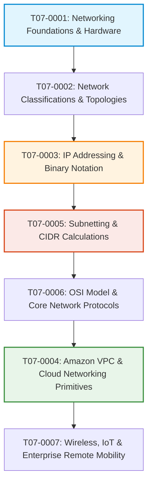

# T07 — Networking Fundamentals (Module 03)

> **Course**: AWS re/Start Networking Fundamentals  
> **Module**: T07 – Networking in Cloud & Enterprise Environments  
> **Standard**: Compliant with [`PROJECT_STANDARDS.md`](../PROJECT_STANDARDS.md)

---

## 📖 Module Overview

Computer networking is the connective tissue of all distributed computing, cloud architectures, and Internet applications. This module provides complete, in-depth coverage of fundamental networking architectures, topologies, the OSI 7-layer model, IPv4 and IPv6 addressing, binary conversion, classless subnetting (CIDR), AWS Virtual Private Cloud (VPC) primitives, communication protocols (TCP, UDP, DNS, DHCP, TLS), and modern wireless/IoT technologies.

---

## 🗺️ Curriculum Structure & Navigation

| Index | Title / Document | Type | Primary Topics Covered | Guide Link |
|---|---|:---:|---|:---:|
| **T07-0001** | Introduction to Networking | Study Guide | ARPANET history, Endpoints, Network Interface Cards (NICs), Switches, Routers, Media, Client-Server vs P2P | [View Guide](./T07-0001-RSNF_EN-US_SG_M03_INTRONETWORKING.md) |
| **T07-0002** | Networking Concepts | Study Guide | PAN/LAN/CAN/MAN/WAN/SAN classifications, Network topologies (Star, Mesh, Bus, Ring, Tree), SDN, Protocol lifecycle | [View Guide](./T07-0002-RSNF_EN-US_SG_M03_NETCONCEPTS.md) |
| **T07-0003** | Internet Protocol (IP) | Study Guide | IPv4 32-bit dotted-decimal, Binary conversion tables, Classful A/B/C/D/E, RFC 1918 Private IP ranges, IPv6, Port multiplexing | [View Guide](./T07-0003-RSNF_EN-US_SG_M03_INTERNETPROTOCOL.md) |
| **T07-0004** | Networking in the AWS Cloud | Study Guide | Amazon VPC, Public & Private subnets, Internet Gateways (IGW), NAT Gateways, Route Tables, Security Groups vs NACLs | [View Guide](./T07-0004-RSNF_EN-US_SG_M03_AWSCLOUD.md) |
| **T07-0005** | Introduction to IP Subnetting | Study Guide | Subnet masks, CIDR prefix notation (/16 to /30), Usable hosts formula ($2^h - 2$), AWS 5 Reserved IP addresses ($2^h - 5$) | [View Guide](./T07-0005-RSNF_EN-US_SG_M03_IPSUBNETTING.md) |
| **T07-0006** | Additional Networking Protocols | Study Guide | OSI 7-Layer & TCP/IP models, TCP 3-way handshake vs UDP, DNS, DHCP (DORA), HTTP/HTTPS, SSH, CLI diagnostics (`ping`, `traceroute`, `ss`) | [View Guide](./T07-0006-RSNF_EN-US_SG_M03_ADDPROTOCOLS.md) |
| **T07-0007** | Additional Networking Technologies | Study Guide | Wi-Fi 802.11 (Wi-Fi 4 through 7), WPA3, BLE, RFID, NFC, 5G cellular, IoT Architecture, AWS IoT Core, BYOD, Amazon WorkSpaces | [View Guide](./T07-0007-RSNF_EN-US_SG_M03_ADDTECHNOLOGIES.md) |

---

## 🎯 Learning Roadmap

---

## 💡 Key Architectural Takeaways

1. **Layered Model Separation**:
   - Understand the difference between Layer 2 frames (MAC address, local segment forwarding via switches) and Layer 3 packets (IP address, end-to-end internetwork routing via routers).
2. **Subnetting & AWS Reservations**:
   - In traditional networking, every subnet sacrifices 2 IP addresses (network ID and broadcast).
   - In **AWS VPC subnets**, exactly **5 IP addresses are reserved** in every CIDR block (`.0` Network, `.1` VPC router, `.2` Amazon DNS resolver, `.3` future AWS reservation, `.255` network broadcast).
3. **Cloud Security Perimeter**:
   - **Security Groups** operate at the virtual network interface (ENI / instance) level and are **stateful** (return traffic is automatically allowed).
   - **Network ACLs (NACLs)** operate at the subnet boundary and are **stateless** (both inbound and outbound rules must explicitly permit bidirectional traffic, including ephemeral return ports).
