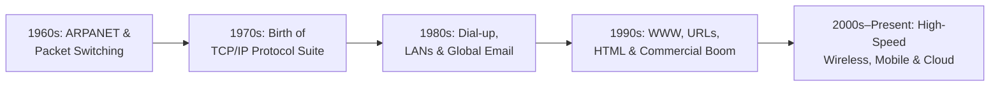
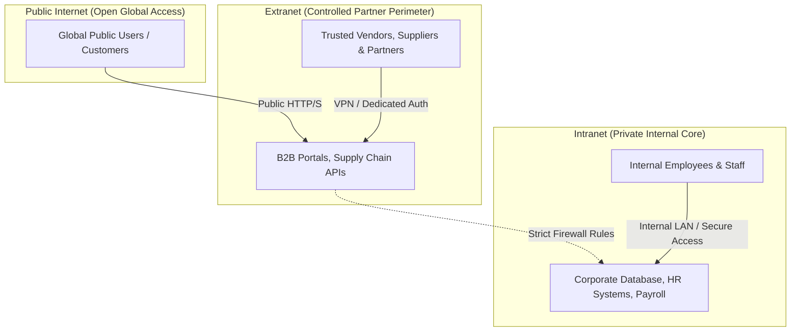
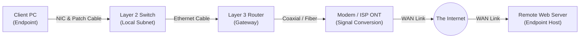
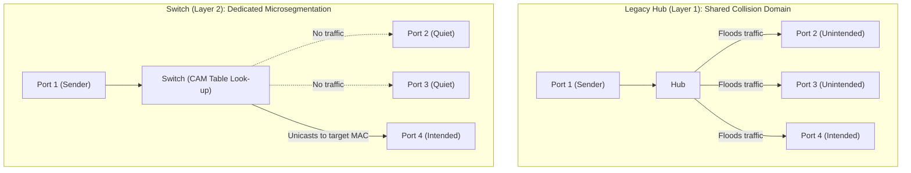
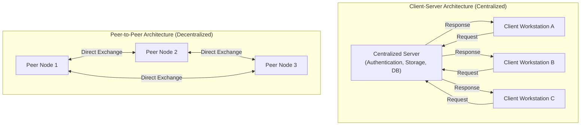
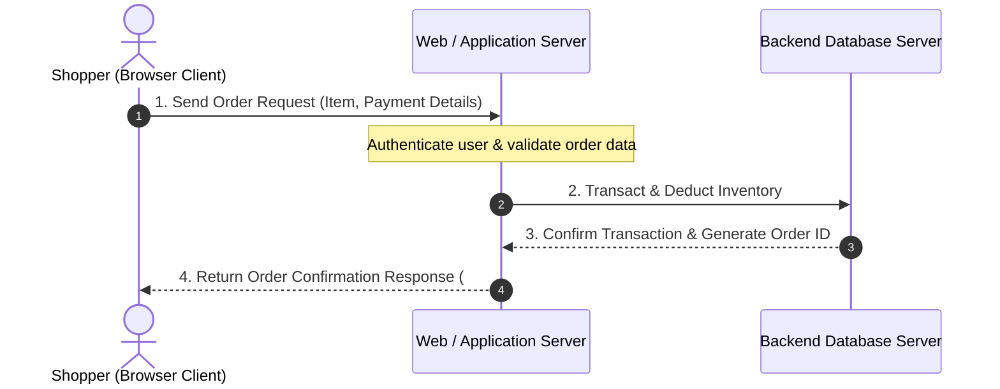
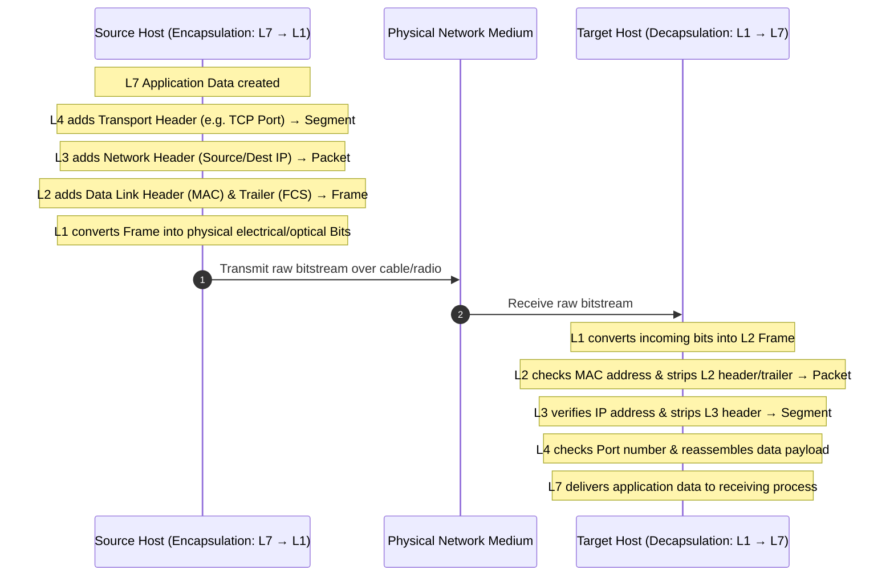

# 🌐 Introduction to Computer Networking

> **Course**: AWS re/Start  
> **Module**: Networking Fundamentals (M03 – Introduction to Networking)  
> **Source Document**: `T07-0001-RSNF_EN-US_SG_M03_INTRONETWORKING.pdf`  
> **Target Audience**: AWS re/Start Learners / Cloud & Network Practitioners  

---

## 🎯 Module Overview

Computer networking provides the fundamental communication fabric that enables modern computing, the World Wide Web, and cloud platforms like Amazon Web Services (AWS). Every cloud interaction—whether launching an Amazon EC2 virtual machine, querying an Amazon RDS database, or transferring objects to Amazon S3—relies entirely on underlying network protocols, routing mechanisms, and data transmission models.

This module introduces core networking terminology, the historical emergence of the modern Internet, network architectural classifications, physical and logical components, and the foundational Open Systems Interconnection (OSI) reference model.

### 📌 Learning Objectives
- [ ] Define what a computer network is and identify its fundamental components (nodes, hosts, links, protocols).
- [ ] Trace the historical milestones in networking from ARPANET and packet switching to the modern cloud era.
- [ ] Contrast the scope, accessibility, and security perimeters of the Internet, intranets, and extranets.
- [ ] Differentiate between network endpoints (clients, servers) and intermediary devices (NICs, hubs, switches, routers, modems).
- [ ] Compare physical transmission media (twisted-pair, coaxial, fiber-optic) and wireless transmission.
- [ ] Analyze architectural patterns: Client-Server vs. Peer-to-Peer (P2P).
- [ ] Explain the 7 layers of the Open Systems Interconnection (OSI) reference model and trace data encapsulation and decapsulation (Frames vs. Packets).

---

## 🛣️ 1. Definition of Computer Networking

A **computer network** is a collection of computing devices that are logically and physically interconnected to communicate, exchange data, and share hardware, software, and information resources.

### The Highway Analogy
Think of a computer network as an **interstate highway system**:
- **Point A (Origin)**: Your residence (the **client** computer).
- **Point B (Destination)**: A regional distribution center or grocery store (the **server** hosting a web service).
- **Vehicles**: The messages, requests, and data packages traveling between locations.
- **Roadways & Interchanges**: The cables, wireless frequencies, switches, and routers that guide traffic safely and efficiently to its destination.
- **Rules of the Road**: The network protocols (such as TCP/IP, Ethernet, and HTTP) ensuring safe, orderly, and collision-free transit.

```
┌────────────────────────────────────────────────────────────────────────┐
│                        The Network Highway Analogy                     │
│                                                                        │
│   [ Client / Host ]  ───(Request)───►  [ Highways / Cables ]          │
│     (Your House)                       (Interstate Network)            │
│          ▲                                      │                      │
│          │                                      ▼                      │
│   [ Client / Host ]  ◄──(Response)───  [ Server / Data Center ]        │
│     (Order Received)                   (Fulfillment Center)            │
└────────────────────────────────────────────────────────────────────────┘
```

### Fundamental Network Terminology

| Concept | Definition | Primary Examples |
| :--- | :--- | :--- |
| **Node** | Any addressable device attached to a network that can generate, receive, or forward data. | Computers, printers, switches, routers, IP security cameras, smartphones |
| **Host / Endpoint** | A specialized node equipped with an IP address that runs user applications or network services. Every host is a node, but not every node is a host. | End-user laptops, database servers, web servers, print servers |
| **Transmission Link** | The physical or wireless communications channel connecting nodes together. | Copper Ethernet cabling, fiber-optic glass cables, radio waves (Wi-Fi, 5G) |
| **Protocol** | A standardized set of syntactic, semantic, and timing rules governing data exchange. | TCP, IP, HTTP, HTTPS, DNS, DHCP, SSH |
| **Data Representation** | Discrete binary values (**bits** [0 or 1] and **bytes** [8 bits]) representing characters, numeric values, text, and rich media. | ASCII text, JSON payloads, JPEG images, MP4 video streams |

> [!NOTE]
> **Node vs. Host**: While all network hosts are nodes, intermediary devices operating purely at Layer 1 or Layer 2 (such as basic unmanaged switches or hubs) are nodes rather than hosts because they forward traffic without acting as endpoints for user applications.

---

## 📜 2. Evolution of Networking: From ARPANET to the Cloud

Modern cloud computing is built on decades of incremental networking innovations. Understanding this progression illuminates why modern protocols operate as they do.



### Chronological Milestones

#### 1. 1960s: ARPANET and Packet-Switching Theory
- **DARPA Project**: In the late 1960s, the United States Department of Defense Advanced Research Projects Agency (DARPA) funded research into fault-tolerant distributed communications.
- **Packet-Switching Breakthrough**: Rather than relying on fragile dedicated circuits (like legacy telephone lines), packet switching divides messages into small, individually addressed chunks called **packets**. If one route fails, packets dynamically traverse alternate physical links and are reassembled at the destination.
- **First Transmission**: In October 1969, the first node-to-node communication occurred between UCLA and the Stanford Research Institute (SRI).

#### 2. 1970s: The Creation of TCP/IP
- **Vint Cerf & Bob Kahn**: Formulated the **Transmission Control Protocol (TCP)** and **Internet Protocol (IP)**.
- **The Network of Networks**: TCP/IP created an open, vendor-neutral standard allowing disparate, heterogeneous networks to interconnect seamlessly, establishing the architectural foundation of the global Internet.

#### 3. 1980s: Local Area Networks (LANs), Dial-up, and Global Email
- **Expansion of LANs**: Organizations widely adopted Ethernet technologies to interconnect office computers within local facilities.
- **Dial-Up Modems**: Analog telephone lines were repurposed using audio frequencies, enabling remote users to dial into networks.
- **Email Communication**: Electronic mail transformed organizational correspondence, proving the immense utility of widespread electronic data exchange.

#### 4. 1990s: The World Wide Web, Hypertext, and Commercial Expansion
- **Tim Berners-Lee (1989–1991)**: Invented the **World Wide Web (WWW)** at CERN, integrating:
  - **Hypertext Markup Language (HTML)**: Document formatting language with clickable hyperlinks.
  - **Hypertext Transfer Protocol (HTTP)**: Standard protocol for transferring multimedia web pages.
  - **Uniform Resource Locator (URL)**: Universal addressing scheme for online assets.
- **Commercialization (1995)**: The decommissioning of the NSFNET backbone opened the Internet to public commerce. 1995 saw the release of Microsoft Windows 95 (bringing Internet connectivity to consumer desktops) and the founding of major online enterprises such as Amazon.com.

#### 5. 2000s to Present: Wireless, Mobile Devices, and Cloud Computing
- **Broadband & Fiber**: High-speed digital subscriber line (DSL), cable broadband, and fiber-optic backbones replaced dial-up connections.
- **Wireless Ubiquity**: Wi-Fi (IEEE 802.11) and cellular networks (3G, 4G LTE, 5G) untethered computing devices.
- **Cloud Computing**: Virtualized, software-defined networks (such as Amazon Virtual Private Clouds, or Amazon VPC) abstract physical infrastructure, enabling elastic, multi-tenant global architectures provisioned in seconds.

---

## 🔒 3. Network Scopes: Internet vs. Intranet vs. Extranet

Organizations segment their network resources according to who needs access, establishing defined security and operational boundaries.



### Comparative Analysis of Network Scopes

| Scope | Definition | Accessibility | Typical Authentication | Common Use Cases |
| :--- | :--- | :--- | :--- | :--- |
| **Internet** | A globally connected public network of computers communicating via TCP/IP. | Public to anyone worldwide with an ISP connection. | Open access for public resources; user-level account logins for specific sites. | Public websites, e-commerce stores (Amazon.com), streaming media, public search engines. |
| **Intranet** | A private, internal computer network restricted exclusively to members of a single organization. | Strictly private; accessible only from internal physical networks or secure VPN tunnels. | Corporate Directory Services (Active Directory, LDAP, Single Sign-On / MFA). | Internal HR portals, employee knowledge bases, payroll processing, proprietary source code repositories. |
| **Extranet** | A controlled private network that allows specific, authorized external entities (vendors, partners, clients) access to subset internal resources. | Semi-private; access is strictly restricted to authenticated external partner organizations. | Partner credentials, mutual TLS (mTLS), site-to-site IPsec VPNs, dedicated API gateways. | Supply chain logistics systems, B2B wholesale portals, cross-enterprise collaboration platforms. |

> [!IMPORTANT]
> In cloud architectures, an Amazon VPC functions as a virtual private **Intranet**. When you connect it to corporate offices via AWS Direct Connect or AWS Site-to-Site VPN, or expose selective APIs to partners via AWS PrivateLink, you are constructing secure **Intranets** and **Extranets** in the cloud.

---

## 🧩 4. Core Network Components

A functional computer network requires both endpoint systems that process and generate data, and intermediary hardware that transports and directs signals across physical and wireless media.



---

### A. Endpoints: Clients and Servers

Endpoints represent the origin and termination points of all network communications.

#### 1. The Client
- **Definition**: A computer hardware device or software program that initiates network requests to access data, files, or computing services hosted elsewhere.
- **Hardware Clients**: Laptops, desktop workstations, smartphones, tablets, IoT sensors.
- **Software Clients**: Web browsers (Chrome, Firefox), command-line tools (`curl`, `aws-cli`), email clients (Thunderbird, Outlook), database management GUIs.

#### 2. The Server
- **Definition**: A computer system or software daemon that listens for, processes, and serves responses to client requests over a network.
- **Common Server Roles**:
  - **Web Server**: Delivers web assets (HTML, CSS, JavaScript, images) via HTTP/HTTPS (e.g., Apache HTTP Server, Nginx, Microsoft IIS).
  - **Database Server**: Manages relational or NoSQL database engines and answers query requests (e.g., MySQL, PostgreSQL, Oracle Database, Amazon Aurora).
  - **File Server**: Centralizes storage and file sharing across an enterprise using protocols like SMB/CIFS or NFS.
  - **Mail Server**: Routes and delivers electronic mail using SMTP, IMAP, and POP3.
  - **Print Server**: Manages print queues, spooling, and access permissions for network-connected printers.

---

### B. Network Interface Card (NIC)

A **Network Interface Card (NIC)** (also called a **network adapter**) is the hardware component that connects an electronic device to a computer network.

- **Physical Media Support**: NICs can be **wired** (featuring an RJ-45 copper port or fiber-optic SFP cage) or **wireless** (utilizing an integrated radio transceiver and antenna).
- **OSI Layer Position**: The NIC operates primarily at **Layer 2 (Data Link Layer)**, with its physical connector and transceivers operating at **Layer 1 (Physical Layer)**.
- **Media Access Control (MAC) Address**:
  - Every NIC is assigned a unique, permanent hardware identifier by its manufacturer called a **MAC address**.
  - **Format**: A 48-bit (6-byte) hexadecimal address separated by colons or hyphens:  
    `00:1A:2B:3C:4D:5E` or `00-1A-2B-3C-4D-5E`.
  - **Organizationally Unique Identifier (OUI)**: The first 24 bits (3 bytes) identify the manufacturer (assigned by the IEEE).
  - **Network Interface Controller Specific**: The remaining 24 bits (3 bytes) represent a unique serial number assigned by that specific vendor.
  - **Function**: MAC addresses ensure that data delivered across a local network segment reaches the exact physical receiver intended.

```
┌────────────────────────────────────────────────────────┐
│               48-Bit MAC Address Breakdown             │
│                                                        │
│     [  00 : 1A : 2B  ]     :     [  3C : 4D : 5E  ]    │
│     └───────┬────────┘           └───────┬────────┘    │
│             │                            │             │
│   Organizationally Unique       Vendor-Assigned Unique │
│      Identifier (OUI)                Device ID         │
│   (Vendor: Cisco/Intel/etc.)                           │
└────────────────────────────────────────────────────────┘
```

---

### C. Transmission Media: Wired and Wireless

Transmission media provide the physical pathway over which data bits travel between network nodes.

```
┌────────────────────────────────────────────────────────────────────────┐
│                        Physical Cable Comparison                       │
│                                                                        │
│  [ Twisted-Pair ] ─── Multiple twisted copper wire pairs; RJ-45 jack   │
│  [ Coaxial      ] ─── Single copper core + dielectric + braided shield │
│  [ Fiber-Optic  ] ─── Glass / plastic optical core transmitting light  │
└────────────────────────────────────────────────────────────────────────┘
```

#### 1. Twisted-Pair Cable (Ethernet)
- **Structure**: Pairs of insulated copper wires twisted around each other in a spiral pattern to cancel out electromagnetic interference (EMI) and radio frequency interference (RFI) from adjacent pairs (**crosstalk**).
- **Varieties**:
  - **Unshielded Twisted-Pair (UTP)**: Most common and cost-effective; used inside standard corporate offices and residential buildings.
  - **Shielded Twisted-Pair (STP)**: Features additional foil or braided shielding around wire pairs to protect against severe EMI in industrial environments or data centers.
- **Connector**: Modular 8-pin **RJ-45** connector.
- **Distance Limit**: Maximum certified length of **100 meters (328 feet)** per segment without a repeater.

#### 2. Coaxial Cable
- **Structure**: Consists of a central solid copper conductor surrounded by a flexible dielectric insulator, wrapped in a woven metallic braid/shield, and encased in an outer plastic jacket.
- **Current Role**: Largely replaced by fiber-optic backbones for high-speed enterprise interconnects, but remains widely deployed by cable television operators and Internet Service Providers (ISPs) to deliver broadband cable modem service into homes and offices.
- **Connectors**: Threaded **F-type** or **BNC** connectors.

#### 3. Fiber-Optic Cable
- **Structure**: Uses an ultra-pure glass or plastic core surrounded by reflective **cladding**. Data is encoded into pulses of **light** (photons) emitted by light-emitting diodes (LEDs) or lasers rather than electrical voltages.
- **Key Characteristics**:
  - **Extreme Immunity**: Completely immune to electromagnetic interference, radio frequency interference, and lightning surges.
  - **Immense Bandwidth & Range**: Can transmit multi-gigabit and terabit data streams over tens of kilometers without signal degradation.
  - **Security**: Difficult to tap without causing detectable signal loss.
- **Types**: Single-mode fiber (SMF) for long-haul carrier backbones; Multi-mode fiber (MMF) for high-density intra-data-center links.

#### 4. Wireless Media
- Utilizes the electromagnetic spectrum (radio waves and microwaves) to transmit signals through the air.
- Standardized under IEEE 802.11 (Wi-Fi 4/5/6/7), Bluetooth, and cellular standards (4G LTE, 5G).
- Enables user mobility but requires cryptographic protection (WPA3) and is subject to signal attenuation, physical obstructions, and environmental interference.

### Transmission Media Summary Table

| Media Type | Signal Carrier | Typical Max Distance | Data Rates | EMI Resistance | Cost & Complexity |
| :--- | :--- | :--- | :--- | :--- | :--- |
| **Twisted-Pair (UTP/STP)** | Electrical voltage | 100 meters | 10 Mbps – 10 Gbps (Cat5e to Cat8) | Moderate (UTP) to High (STP) | Low cost; simple termination |
| **Coaxial** | Electrical voltage | 200 – 500 meters | 10 Mbps – 1 Gbps (DOCSIS standards) | High (due to heavy braid) | Moderate cost; rigid cable |
| **Fiber-Optic** | Light pulses (photons) | Up to 40+ km (Single-mode) | 10 Gbps – 400+ Gbps | Complete immunity | Higher initial cost; precision splicing required |
| **Wireless (Wi-Fi / RF)** | Radio frequency waves | 30 – 100 meters (indoor) | Up to 9.6 Gbps (Wi-Fi 6) | Susceptible to interference | No cable installation; requires secure configuration |

---

### D. Intermediary Devices: Hubs, Switches, Routers, and Modems

Intermediary devices ensure that data moving across the network reaches its designated recipient securely and without collision.



#### 1. Hub vs. Switch

- **Hub (Layer 1 Device)**:
  - An outdated, legacy device that acts as a simple multiport physical repeater.
  - When electrical signals arrive on one port, the hub indiscriminately **floods (repeats)** the signal out of all other ports.
  - All connected devices share the same **collision domain** and bandwidth, severely degrading performance as network traffic increases.
- **Switch (Layer 2 Device)**:
  - Operates at **Layer 2 (Data Link Layer)**, processing incoming data as **frames**.
  - Maintains an internal **MAC Address Table** (also known as a **Content Addressable Memory [CAM] table**) that maps physical MAC addresses to specific switch ports.
  - When a frame arrives, the switch examines the destination MAC address and transmits the frame **only to the specific port** hosting that receiving device (unicast).
  - Eliminates collisions by providing dedicated micro-segmented bandwidth for each port.

#### 2. Router (Layer 3 Device)

- **Definition**: An intelligent network device that connects different logical networks or subnets together.
- **OSI Layer Position**: Operates primarily at **Layer 3 (Network Layer)**, dealing with data in the form of **packets**.
- **Key Functions**:
  - **Path Determination**: Uses routing tables and dynamic routing protocols (e.g., OSPF, BGP) to determine the optimal path across interconnected networks.
  - **Traffic Filtering & Security**: Examines source and destination **Internet Protocol (IP) addresses**, applying access control lists (ACLs) and stateful firewall rules to permit or deny traffic.
  - **Broadcast Domain Isolation**: Routers do not forward broadcast frames by default, effectively containing broadcast traffic within its origin subnet.

#### 3. Modem (Modulator-Demodulator)

- **Definition**: A device that converts signals between digital computer data and analog or RF communication signals used by service provider infrastructure.
- **Operation**:
  - Connects a home or branch office to an Internet Service Provider (ISP) via coaxial cable, twisted-pair telephone copper (DSL), or fiber optical networks.
  - Typically provides a single WAN input port (connected to the ISP line) and an Ethernet LAN port (connected to the local router or integrated gateway).

### Intermediary Devices Comparison

| Device | Primary OSI Layer | Data Unit Handled | Addressing Used | Forwarding Behavior | Broadcast Separation? |
| :--- | :--- | :--- | :--- | :--- | :--- |
| **Hub** | Layer 1 (Physical) | Bits / Electrical signals | None | Floods all ports simultaneously | No (Single collision domain) |
| **Switch** | Layer 2 (Data Link) | Frames | MAC addresses (Hardware) | Direct forwarding to target port | No (Single broadcast domain per VLAN) |
| **Router** | Layer 3 (Network) | Packets | IP addresses (Logical) | Routed based on IP routing table | **Yes** (Breaks up broadcast domains) |
| **Modem** | Layer 1 / Layer 2 | Analog/RF signals to Bits | Modulation carrier | Translates WAN signals to LAN format | N/A (Point-to-point translation) |

---

## 🏛️ 5. Network Architectures: Client-Server vs. Peer-to-Peer (P2P)

Network architectures define how tasks, responsibilities, and data storage are allocated among connected devices.



### 1. Client-Server Architecture

In a **Client-Server** model, workloads are partitioned between dedicated service providers (**servers**) and service requesters (**clients**).

#### Workflow Example: Purchasing on Amazon.com
1. **Client Request**: A shopper accesses `amazon.com` in their web browser and submits an order. The browser (client) packages an HTTP POST request and sends it over the Internet.
2. **Server Processing**: Amazon's web application servers receive the request, authenticate the user, query database servers to confirm inventory and payment status, and initiate warehouse order processing.
3. **Server Response**: The server generates an order confirmation with an order number and returns it to the client browser, which renders the confirmation screen.



- **Advantages**:
  - Centralized security, user management, and compliance enforcement.
  - Simplified automated backups since critical data resides on centralized servers.
  - High scalability through load balancing and cloud auto-scaling groups.
- **Disadvantages**:
  - Central point of failure: If a non-redundant server fails, all dependent clients lose service.
  - Server hardware and cloud resource costs can be substantial.

---

### 2. Peer-to-Peer (P2P) Architecture

In a **Peer-to-Peer (P2P)** network, there is no centralized server. Instead, all participating nodes (**peers**) possess equivalent privileges and capabilities, acting concurrently as both clients and servers.

- **How It Works**: Nodes share files, computing cycles, or network bandwidth directly with one another. Each peer responds to requests from other peers while making requests for resources it lacks.
- **Real-World Examples**: File distribution networks (BitTorrent), blockchain protocols (Bitcoin, Ethereum), legacy local ad-hoc file sharing (AirDrop, Apple Bonjour).
- **Advantages**:
  - No central point of failure; the network remains operational even if many nodes disconnect.
  - Highly resilient, self-organizing, and cost-effective (no expensive centralized server infrastructure).
- **Disadvantages**:
  - Difficult to secure, administer, and manage globally.
  - Data backups must be performed individually by each peer.
  - Performance varies based on individual peer bandwidth and availability.

### Client-Server vs. Peer-to-Peer Comparison

| Attribute | Client-Server Architecture | Peer-to-Peer (P2P) Architecture |
| :--- | :--- | :--- |
| **System Control** | Centralized administration and authentication | Decentralized; each peer maintains independent control |
| **Resource Location** | Stored and managed on dedicated server hardware | Distributed across participating peer hard drives |
| **Failure Vulnerability** | Central server can be a single point of failure (unless clustered) | Highly fault-tolerant; no single point of failure |
| **Scalability** | Scaled vertically (larger server) or horizontally (clustering/load balancing) | Naturally scales as new peers contribute resources and bandwidth |
| **Implementation Cost** | Higher setup and ongoing server operating costs | Minimal infrastructure cost; utilizes existing client nodes |
| **Security & Auditing** | Straightforward to monitor, patch, and audit access logs | Complex; difficult to enforce organizational security policies |

---

## 📶 6. The Open Systems Interconnection (OSI) Reference Model

The **Open Systems Interconnection (OSI) model** is a conceptual framework published by the International Organization for Standardization (ISO) that standardizes communication functions in telecommunication and computing systems.

### The 7 Layers of the OSI Model

```
┌────────────────────────────────────────────────────────────────────────┐
│                        The 7-Layer OSI Model Architecture              │
│                                                                        │
│   Layer 7:  Application    ─── User interfaces & network services     │
│   Layer 6:  Presentation   ─── Formatting, data compression, encryption│
│   Layer 5:  Session        ─── Inter-host connection management        │
│   Layer 4:  Transport      ─── End-to-end delivery & port multiplexing │
│   Layer 3:  Network        ─── Logical addressing (IP) & routing       │
│   Layer 2:  Data Link      ─── Physical addressing (MAC) & frames      │
│   Layer 1:  Physical       ─── Raw bitstreams over physical transmission│
└────────────────────────────────────────────────────────────────────────┘
```

> [!TIP]
> **Popular Mnemonics to Memorize the 7 Layers**:
> - **Top-Down (7 to 1)**: **A**ll **P**eople **S**eem **T**o **N**eed **D**ata **P**rocessing
> - **Bottom-Up (1 to 7)**: **P**lease **D**o **N**ot **T**hrow **S**ausage **P**izza **A**way

### Detailed Layer Roles and Functions

| Layer # | Layer Name | Protocol Data Unit (PDU) | Primary Responsibilities | Common Protocols / Standards |
| :---: | :--- | :--- | :--- | :--- |
| **7** | **Application** | Data | Direct interface for applications to access network services; user-facing APIs. | HTTP, HTTPS, DNS, DHCP, FTP, SMTP, SSH |
| **6** | **Presentation** | Data | Translates, formats, encrypts, decrypts, and compresses data for application consumption. | TLS/SSL, ASCII, UTF-8, JPEG, JSON |
| **5** | **Session** | Data | Establishes, maintains, coordinates, and terminates persistent sessions between applications. | NetBIOS, RPC, Sockets, PPTP |
| **4** | **Transport** | Segment (TCP) / Datagram (UDP) | End-to-end communication, flow control, error detection/recovery, port addressing. | TCP, UDP |
| **3** | **Network** | **Packet** | Logical addressing, path determination across multiple networks, packet routing. | IPv4, IPv6, ICMP, IPsec, OSPF, BGP |
| **2** | **Data Link** | **Frame** | Physical addressing (MAC), node-to-node hop delivery on local network, error detection (CRC). | Ethernet (802.3), Wi-Fi (802.11), PPP, Switch logic |
| **1** | **Physical** | **Bits** | Transmission of unstructured raw electrical, optical, or radio bitstreams over physical media. | RJ-45, Cat6, Fiber optic cables, repeaters, hubs |

---

### Data Encapsulation and Decapsulation

When a computer transmits data, the message travels down the OSI stack from Layer 7 to Layer 1, adding protocol headers at each stage. When the destination computer receives the data, it reverses this process, peeling away headers as the payload moves from Layer 1 up to Layer 7.



### Deep Dive: Layer 2 Frames vs. Layer 3 Packets

| Characteristic | Layer 2: Data Link Layer | Layer 3: Network Layer |
| :--- | :--- | :--- |
| **PDU Name** | **Frame** | **Packet** |
| **Addressing System** | **MAC Address** (Physical / Hardware address) | **IP Address** (Logical network address) |
| **Address Scope** | Local network segment only (does not cross routers) | End-to-end across multiple global networks |
| **Primary Device** | **Network Switch**, Network Interface Card (NIC) | **Router**, Layer 3 Multilayer Switch |
| **Header Elements** | Source MAC, Destination MAC, EtherType, Frame Check Sequence (CRC trailer) | Source IP, Destination IP, Time to Live (TTL), Protocol number |
| **Analogous Concept** | The physical house number and street in a local neighborhood | The complete postal mailing address (Country, State, Zip, Street) |

---

## 💡 7. Knowledge Check & Review Questions

Use these questions and detailed explanations to test your understanding of foundational networking concepts.

### Question 1: Routers vs. Switches
**Prompt**: What can a router do that a switch cannot?

> [!NOTE]
> **Comprehensive Answer**:
> - **Inter-Network Routing**: A switch operates at **Layer 2 (Data Link Layer)** and forwards frames within a single local network segment based on MAC addresses. A router operates at **Layer 3 (Network Layer)** and connects multiple disparate networks and subnets together using logical **IP addresses**.
> - **Traffic Filtering**: A router can evaluate and filter packets based on Layer 3 and Layer 4 criteria (such as source/destination IP addresses and port numbers) using Access Control Lists (ACLs) and firewall rules. Standard Layer 2 switches forward traffic based only on destination MAC addresses without inspecting packet headers.
> - **Broadcast Domain Segmentation**: A switch forwards broadcast frames to every connected port within its broadcast domain. A router does **not** forward broadcast traffic across network boundaries, containing broadcasts within their originating subnet.

---

### Question 2: Hardware Identifiers on a NIC
**Prompt**: What does a network interface card (NIC) use that is known as a unique physical identifier assigned by the manufacturer?

> [!NOTE]
> **Comprehensive Answer**:
> - A **Media Access Control (MAC) address**.
> - A MAC address is a 48-bit (6-byte) hexadecimal hardware identifier burned into the NIC's firmware by the manufacturer.
> - It consists of a 24-bit **Organizationally Unique Identifier (OUI)** representing the vendor and a 24-bit unique serial number assigned by that vendor.
> - Operating at **Layer 2 (Data Link Layer)**, the MAC address identifies the immediate sender and recipient on a local physical network segment.

---

### Question 3: Transmission Media Selection
**Prompt**: An enterprise needs to connect two manufacturing facilities located 3 kilometers apart across an industrial zone with intense electromagnetic interference from heavy machinery. Which transmission medium is best suited for this link?

> [!NOTE]
> **Comprehensive Answer**:
> - **Single-mode Fiber-Optic Cable**.
> - **Rationale**:
>   1. **Immunity to Interference**: Fiber-optic cables transmit information using pulses of light through a glass core, making them 100% immune to electromagnetic interference (EMI) and radio frequency interference (RFI).
>   2. **Distance Capability**: Twisted-pair copper cabling is strictly limited to 100 meters per segment, making it incapable of spanning 3 kilometers without numerous repeaters. Single-mode fiber readily supports transmission distances exceeding 10 to 40 kilometers without repeaters.

---

### Question 4: Client-Server vs. Peer-to-Peer
**Prompt**: Why would a commercial financial institution choose a client-server architecture over a peer-to-peer (P2P) architecture for its core banking applications?

> [!NOTE]
> **Comprehensive Answer**:
> - **Centralized Security and Authentication**: A client-server architecture allows the institution to enforce strict access control, centralized credential management (e.g., Active Directory / LDAP), and unified regulatory compliance.
> - **Data Integrity & Centralized Backups**: Financial transaction records must be authoritative and backed up consistently. A centralized database server guarantees ACID (Atomicity, Consistency, Isolation, Durability) transaction properties.
> - **Auditability**: In a P2P architecture, data and transaction histories are scattered across autonomous client nodes without centralized audit logging, making compliance and fraud detection virtually impossible.

---

## 📌 8. Key Takeaways

1. **Definition of a Network**: A computer network is a collection of computing devices logically and physically linked together to communicate, exchange data, and share resources.
2. **Evolutionary Trajectory**: Networking originated in the 1960s with DARPA's packet switching, transitioned to standard TCP/IP in the 1970s, expanded via dial-up and LANs in the 1980s, exploded commercially with the World Wide Web in the 1990s, and evolved into high-speed mobile and cloud computing today.
3. **Network Scopes**:
   - **Internet**: Public, globally accessible network.
   - **Intranet**: Private network restricted to members of an organization.
   - **Extranet**: Private network accessible to an organization and authorized external business partners.
4. **Core Components**:
   - **Endpoints**: Clients (request resources) and Servers (provide resources).
   - **NIC**: Layer 2 hardware interface featuring a unique 48-bit MAC address.
   - **Media**: Twisted-pair (copper/Ethernet), Coaxial (broadband ISP), Fiber-optic (light pulses/EMI-immune/long-distance), and Wireless (radio waves).
   - **Switches**: Layer 2 devices that forward frames to specific ports using MAC addresses.
   - **Routers**: Layer 3 devices that route packets between distinct networks based on IP addresses and filter traffic.
5. **Architectural Models**:
   - **Client-Server**: Centralized, secure, scalable, and manageable.
   - **Peer-to-Peer**: Decentralized, resilient, and cost-effective, but challenging to secure and administer.
6. **OSI Model**: The 7-layer standard model defines the progression of data encapsulation from Application (L7) down to Physical bits (L1) and reverse decapsulation at the destination host.
