# 🌐 Module 03: Networking Concepts – Study Guide

> **Course**: AWS re/Start Networking Fundamentals  
> **Module**: M03 – Networking Concepts  
> **Source Document**: `T07-0002-RSNF_EN-US_SG_M03_NETCONCEPTS.pdf`  
> **Target Audience**: AWS re/Start Learners / Cloud Practitioners / Solutions Architects  

---

## 🎯 Module Overview

Welcome to **Networking Concepts**. Computer networking forms the foundational substrate upon which all cloud infrastructure, distributed systems, and modern digital applications operate. Whether deploying an enterprise tier across multiple Availability Zones in Amazon Web Services (AWS) or orchestrating hybrid architectures that bridge on-premises data centers to the cloud, network architecture determines system performance, availability, fault tolerance, and security boundaries.

This study guide provides an exhaustive, structured exploration of fundamental networking principles:
1. **Geographical Classifications**: Differentiating network scales from localized personal devices to planetary WANs and dedicated storage infrastructures.
2. **Network Topologies**: Evaluating physical wiring layouts and logical data paths—including star, bus, ring, mesh, tree, and hybrid architectures—with their operational tradeoffs and failure modes.
3. **Cloud Virtual Topologies**: Mapping physical networking components directly to software-defined equivalents within Amazon Virtual Private Cloud (Amazon VPC).
4. **Network Management Models**: Comparing centralized client-server systems, decentralized peer-to-peer (P2P) systems, and modern Software-Defined Networking (SDN) paradigms.
5. **Core Network Protocols**: Demystifying Layer 3 and Layer 4 communications, comparing connection-oriented (TCP) and connectionless (UDP) models, and analyzing handshake and teardown lifecycles.

---

### 📌 Learning Objectives

- [ ] **Classify Networks by Geographical Scope**: Define and contrast Personal Area Networks (PAN), Local Area Networks (LAN), Wireless LANs (WLAN), Campus Area Networks (CAN), Metropolitan Area Networks (MAN), Wide Area Networks (WAN), and Storage Area Networks (SAN).
- [ ] **Differentiate Physical vs. Logical Topologies**: Distinguish physical media placement from logical data propagation pathways across networked endpoints.
- [ ] **Analyze Core Network Topologies**: Detail architectural designs, cabling specifications, performance characteristics, pros, cons, and failure modes for Star, Bus, Ring, Mesh (Full vs. Partial), Tree, and Hybrid topologies.
- [ ] **Map Physical to Cloud Networking via Amazon VPC**: Translate traditional networking devices (switches, routers, firewalls, servers, leased lines) into AWS primitives (subnets, route tables, Security Groups, NACLs, EC2 instances, and VPC Peering).
- [ ] **Compare Network Management Models**: Evaluate administrative overhead, single points of failure, scalability, and security models of Client-Server versus Peer-to-Peer architectures.
- [ ] **Understand Software-Defined Networking (SDN)**: Describe the architectural decoupling of the control plane from the data plane and its implementation in cloud virtualization platforms.
- [ ] **Explain Network Protocol Functions**: Identify protocol roles operating at OSI Layer 3 (Network) and Layer 4 (Transport).
- [ ] **Contrast Connection-Oriented and Connectionless Protocols**: Differentiate the operational paradigms, header overheads, and reliability guarantees of TCP versus UDP.
- [ ] **Trace the TCP Communication Lifecycle**: Step through the TCP three-way handshake (SYN, SYN/ACK, ACK), orderly termination (FIN, FIN/ACK, ACK), and error handling using the reset (RST) flag.

---

## 🌍 1. Network Geographical Classifications

Computer networks are broadly classified by the physical and geographic scale they encompass. Distance affects transmission media, transmission latency, hardware complexity, administrative ownership, and error rates.

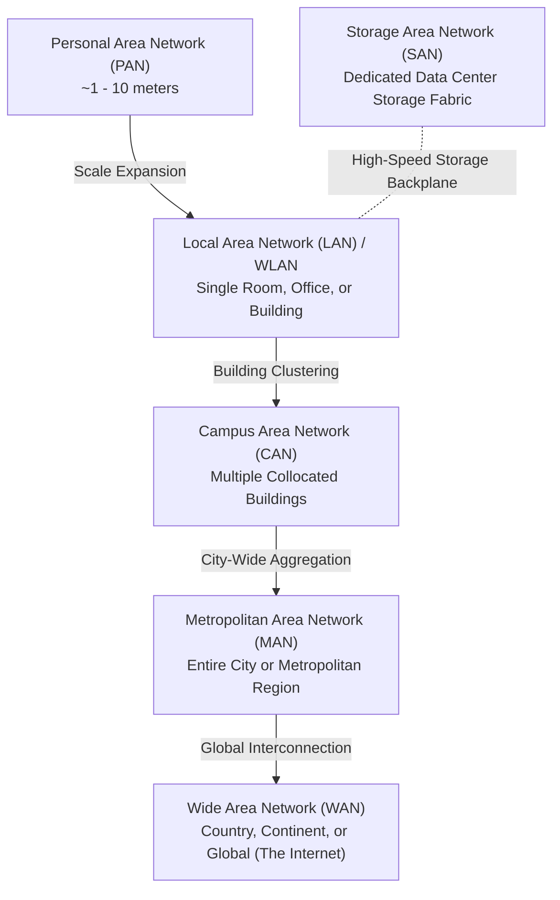

### Deep Dive into Network Classifications

#### 1. Personal Area Network (PAN)
- **Scope**: Typically within the reach of an individual, spanning a radius of 1 to 10 meters (30 feet).
- **Media & Technologies**: Bluetooth (IEEE 802.15.1), Zigbee (IEEE 802.15.4), Ultra-Wideband (UWB), Near Field Communication (NFC), and short-range USB connections.
- **Key Use Cases**: Synchronizing smartwatches with mobile phones, wireless headsets, peripheral mice and keyboards, medical monitoring sensors.

#### 2. Local Area Network (LAN)
- **Scope**: Confined to a geographically restricted footprint such as a single room, floor, office suite, or standalone building.
- **Media & Technologies**: Governed predominantly by IEEE 802.3 Ethernet standards over Twisted Pair copper cabling (Cat5e, Cat6, Cat6a) or multimode optical fiber, operating at 1 Gbps to 100 Gbps.
- **Characteristics**: Extremely high data transfer rates, very low latency (sub-millisecond), minimal transmission errors, and singular private administrative ownership (enterprise or home network administrator).
- **Core Devices**: Layer 2 Ethernet switches, internal routers/gateways, local network servers, and end-user workstations.

#### 3. Wireless Local Area Network (WLAN)
- **Scope**: The wireless equivalent and extension of a LAN, covering typical building or room footprints.
- **Media & Technologies**: Governed by the IEEE 802.11 standards family (Wi-Fi 5 / 802.11ac, Wi-Fi 6 / 802.11ax, Wi-Fi 7 / 802.11be) operating in the 2.4 GHz, 5 GHz, and 6 GHz radio frequency bands.
- **Characteristics**: Grants end-user mobility without physical tethering. Subject to Radio Frequency (RF) interference, wall attenuation, and shared medium contention (CSMA/CA).
- **Core Devices**: Wireless Access Points (WAPs), wireless client network interface cards (NICs), and wireless LAN controllers (WLCs).

#### 4. Campus Area Network (CAN)
- **Scope**: Spans multiple adjacent buildings across a defined geographical area, such as a university campus, military installation, industrial plant, or enterprise headquarters.
- **Media & Technologies**: High-speed private fiber-optic backbones (10 Gbps to 400 Gbps Single-Mode Fiber) interlinking building distribution frames (IDFs/MDFs).
- **Characteristics**: Owned and maintained entirely by the host organization without relying on recurring public telecommunication carrier transit fees for inter-building traffic.

#### 5. Metropolitan Area Network (MAN)
- **Scope**: Spans a town, municipality, or entire metropolitan area (typically 5 to 50 kilometers).
- **Media & Technologies**: Dark fiber rings, Metro Ethernet (MetroE), Synchronous Optical Networking (SONET/SDH), and high-capacity wireless microwave links.
- **Characteristics**: Larger than a campus network but smaller than a WAN. Often managed by telecommunications consortia, municipal governments, or regional utility providers that lease capacity to enterprise customers.
- **Key Use Cases**: Connecting municipal offices, branch banks throughout a city, cable television distribution, and linking multiple hospitals within a metropolitan healthcare system.

#### 6. Wide Area Network (WAN)
- **Scope**: Unconstrained geographic coverage spanning multiple metropolitan regions, provinces, nations, continents, or the entire globe.
- **Media & Technologies**: Long-haul transoceanic submarine fiber cables, terrestrial fiber backbones, satellite communication constellations (LEO/GEO), Multiprotocol Label Switching (MPLS) circuits, and IPsec VPN overlays.
- **Characteristics**: Connects distinct, geographically separated LANs. Operated by telecommunication carriers and Internet Service Providers (ISPs). Lower overall bandwidth and higher latency relative to LANs due to sheer physical distances and multi-hop routing paths.
- **The Ultimate WAN**: The **Internet** is the world's largest, publicly interconnected WAN.

#### 7. Storage Area Network (SAN)
- **Scope**: A specialized, high-performance network physically located within an enterprise data center or colocation facility.
- **Media & Technologies**: Fibre Channel (FC) switches and host bus adapters (HBAs), Fibre Channel over Ethernet (FCoE), and Internet Small Computer Systems Interface (iSCSI) running over high-speed Ethernet (10/25/100 GbE).
- **Characteristics**: Operates as a dedicated block-level storage fabric that isolates heavy storage input/output (I/O) traffic from regular LAN user and application traffic. Allows servers to access shared block storage arrays (LUNs) as though they were locally attached drives.

---

### 📊 Network Geographical Classifications Comparison Table

| Classification | Full Name | Typical Geographical Scope | Standard Media & Protocols | Throughput Rates | Administrative Ownership | Primary Use Case |
| :--- | :--- | :--- | :--- | :--- | :--- | :--- |
| **PAN** | Personal Area Network | 1 – 10 meters | Bluetooth, Zigbee, UWB, NFC, USB | 100 Kbps – 24 Mbps | Individual user | Wearables, personal peripherals, IoT sensors |
| **LAN** | Local Area Network | Room, floor, building (< 1 km) | Ethernet (IEEE 802.3), Twisted Pair, Fiber | 1 Gbps – 100 Gbps | Private organization / individual | Office networks, home automation, data center racks |
| **WLAN** | Wireless Local Area Network | Room, office footprint (~30 - 100m) | Wi-Fi (IEEE 802.11a/b/g/n/ac/ax/be) | 54 Mbps – 9.6+ Gbps | Private organization / individual | Mobile laptop, tablet, and smartphone connectivity |
| **CAN** | Campus Area Network | Multiple buildings (1 – 5 km) | Optical fiber backbones, Gigabit Ethernet | 10 Gbps – 100 Gbps | Single enterprise or university | University campuses, corporate HQ, military bases |
| **MAN** | Metropolitan Area Network | City or urban region (5 – 50 km) | Metro Ethernet, Dark Fiber, DWDM, SONET | 1 Gbps – 100 Gbps | Telecom provider / municipal consortium | Interconnecting city branches, municipal services |
| **WAN** | Wide Area Network | Regional, national, global (> 50 km) | Subsea fiber, Satellites, MPLS, Leased Lines | 10 Mbps – 400 Gbps | Telecom carriers, ISPs, Public (Internet) | Linking remote corporate offices, global cloud access |
| **SAN** | Storage Area Network | Data center server room (< 500m) | Fibre Channel (FC), iSCSI, NVMe-oF, FCoE | 16 Gbps – 128 Gbps | Enterprise storage engineering team | High-throughput, block-level database and disk arrays |

> [!NOTE]
> While LANs and WANs are the two primary geographic anchors taught in foundational networking, enterprise cloud engineers frequently interface with all seven categories. In AWS, hybrid cloud architectures bridge corporate LANs/CANs to the global AWS WAN backbone via services like AWS Direct Connect and AWS Site-to-Site VPN.

---

## 📐 2. Network Topologies: Physical vs. Logical

A **network topology** defines the structural layout and interconnectivity pattern of nodes within a computer network. A comprehensive understanding requires evaluating networks across two distinct planes:

1. **Physical Topology**: The physical arrangement, layout, and tangible placement of cabling, hardware interfaces, switches, and endpoints.
2. **Logical Topology**: The actual path, routing rules, and signaling mechanism that data frames and packets follow as they travel across the network infrastructure, regardless of physical wire routes.

```
Physical Layout: How devices are physically cabled together.
Logical Path:    How data is framed, addressed, switched, and routed across devices.
```

> [!TIP]
> A network can exhibit a **physical star** topology while functioning as a **logical bus** or **logical ring**! For instance, legacy 10BASE-T Ethernet physically cables every PC into a central hub (star), but the hub broadcasts electrical signals to every port simultaneously, forming a logical bus.

---

### Detailed Analysis of Network Topologies

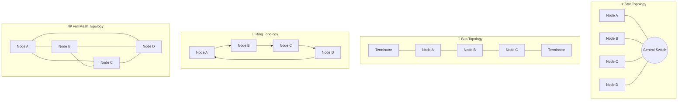

---

### 1. Star Topology

In a **Star Topology**, every host and endpoint in the network connects via a dedicated point-to-point cable to a single central network device, typically an Ethernet switch or hub.

#### Architectural Characteristics
- **Physical Layout**: Radiates outward from a centralized distribution point resembling a star.
- **Logical Flow**: Endpoints transmit data frames directly to the central switch. In an Ethernet switch, the switch examines the frame's destination MAC address, consults its Content Addressable Memory (CAM) table, and forwards the frame exclusively out the targeted port.
- **Cabling Standards**: Unshielded Twisted Pair (UTP - Cat5e/Cat6/Cat6a) with RJ-45 terminations or optical fiber patches.

#### Tradeoffs & Failure Modes
- **Advantages**:
  - **Fault Isolation**: If a single cable breaks or a network interface card fails, only that specific connected node is isolated; the remainder of the network operates uninterrupted.
  - **Ease of Troubleshooting & Modification**: Nodes can be added, relocated, or disconnected without disturbing existing operational connections.
  - **Performance**: When using full-duplex switches, collision domains are eliminated on individual ports, delivering dedicated wire speed.
- **Disadvantages**:
  - **Single Point of Failure (SPOF)**: The central switch represents an absolute SPOF. If the central switch experiences hardware or power failure, the entire network goes dark.
  - **Cabling Overhead**: Requires significant linear cabling runs compared to a linear bus, as every endpoint must run a dedicated cable directly back to the telecommunications closet.

---

### 2. Bus Topology

In a **Bus Topology** (also termed a *line* or *backbone* topology), all devices connect sequentially to a single shared central transmission cable known as the bus or trunk.

#### Architectural Characteristics
- **Physical Layout**: A continuous linear coaxial cable terminating with specialized impedance-matched terminating resistors (typically 50-ohm terminators) at both ends.
- **Logical Flow**: Signals broadcast omnidirectionally down the bus. When Node A transmits, the electrical waveform travels across the entire wire, reaching every connected node. Each node inspects the packet header; non-destination nodes discard the frame, while the intended recipient processes it.
- **Collision Mechanism**: Because the medium is shared, only one device can transmit at any given instant (half-duplex). If two devices transmit concurrently, an electrical collision occurs. Devices must utilize **Carrier Sense Multiple Access with Collision Detection (CSMA/CD)** to detect collisions, back off for a pseudo-random time window, and retransmit.

#### Tradeoffs & Failure Modes
- **Advantages**:
  - **Minimal Cabling**: Requires the least total cable footage of any physical topology.
  - **Simplicity & Low Cost**: Highly cost-effective for small legacy networks; no expensive active switching hardware required.
- **Disadvantages**:
  - **Network-Wide Fragility**: A single physical cut, break, or disconnected terminator anywhere on the bus breaks the circuit. Without terminators, electrical signals reflect back and forth across the cable (signal reflection / ringing), corrupting all communications and collapsing the entire network.
  - **High Contention & Low Scalability**: As additional devices join the bus, packet collision rates multiply exponentially, degrading throughput.
  - **Opaque Troubleshooting**: Pinpointing the exact physical location of a cable fault or bad tap requires specialized time-domain reflectometers (TDR).

---

### 3. Ring Topology

In a **Ring Topology**, every node is connected to exactly two neighboring nodes, forming an unbroken circular loop for signal transmission.

#### Architectural Characteristics
- **Physical Layout**: A closed loop where output transmitters of one node feed the input receivers of the adjacent node.
- **Logical Flow**: Data circulates unidirectionally around the ring. In classic implementations like IBM Token Ring (IEEE 802.5) or Fiber Distributed Data Interface (FDDI), access is governed by a special electronic frame called a **token**. A host may only transmit data if it captures the free token. It attaches its data frame to the token, which circulates past each node until the destination copies the data and marks the frame as acknowledged. The originating host strips the frame and releases the token back into the ring.

#### Tradeoffs & Failure Modes
- **Advantages**:
  - **Deterministic Performance**: Token passing guarantees orderly, collision-free data transmission even under heavy network traffic loads.
  - **Equal Channel Access**: Every device on the ring receives an equal opportunity to transmit, preventing high-bandwidth nodes from starving smaller nodes.
- **Disadvantages**:
  - **Single Point of Failure**: In a basic unidirectional ring, the failure or disconnection of any single node or cable segment halts token circulation and collapses the entire network.
  - **Reconfiguration Penalties**: Adding or removing nodes requires physically breaking the ring, temporarily taking all connected systems offline.
- **Mitigation Strategies**: High-reliability rings, such as **FDDI** and **SONET/SDH**, employ counter-rotating **dual rings** (a primary ring and a secondary standby ring). If the cable is severed, the adjacent stations loop back the signal between primary and secondary paths, healing the ring into a closed loop automatically.

---

### 4. Mesh Topology: Full Mesh vs. Partial Mesh

In a **Mesh Topology**, devices are redundantly interconnected to provide multiple alternate communication pathways between any two points.

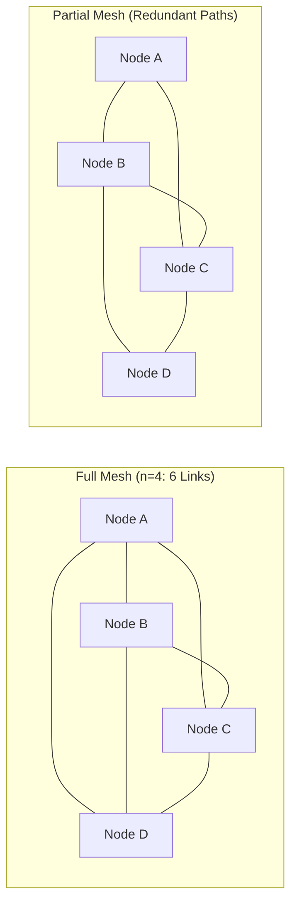

#### A. Full-Mesh Topology
- **Definition**: Every single node maintains a dedicated physical link to every other node in the network.
- **Mathematical Formula for Required Links**:
  $$\text{Links} = \frac{n(n - 1)}{2}$$
  *(Where $n$ represents the total number of networked nodes).*
  - For 4 nodes: $4 \times 3 / 2 = 6$ links
  - For 10 nodes: $10 \times 9 / 2 = 45$ links
  - For 50 nodes: $50 \times 49 / 2 = 1,225$ links!
- **Tradeoffs**:
  - **Maximum Fault Tolerance**: Zero single points of failure. Even if multiple links fail simultaneously, alternate dedicated paths remain available.
  - **High Bandwidth & Privacy**: No shared links; data moves across private point-to-point connections.
  - **Prohibitive Cost**: Hardware port density and cabling costs scale quadratically ($O(n^2)$), making physical full mesh unfeasible for medium-to-large LANs.

#### B. Partial-Mesh Topology
- **Definition**: Critical nodes are interconnected with multiple redundant links, while peripheral or secondary devices connect to only two or three nodes.
- **Tradeoffs**: Delivers significant redundancy and alternate failover routing paths without the exponential cabling expense of a full mesh.
- **Deployment**: Standard pattern for **Wide Area Networks (WANs)**, Internet Service Provider backbones, and inter-datacenter cloud backbones where dynamic routing protocols (BGP, OSPF) automatically steer packets around fiber cuts.

---

### 5. Tree Topology (Hierarchical Star)

A **Tree Topology** arranges nodes into a multi-tiered hierarchy. It consists of a top-level root node (core layer) connected to intermediate branch nodes (distribution layer), which cascade down to leaf nodes (access layer).

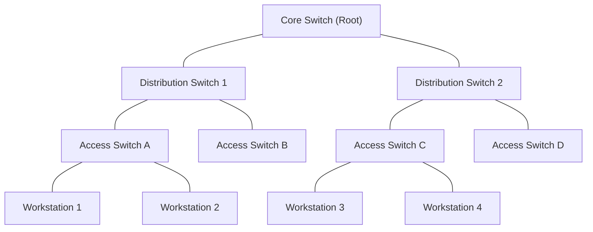

#### Architectural Characteristics
- **Hierarchical Network Design Model**: Cisco and industry-standard networks structure enterprise LANs into three tiers:
  1. **Core Layer**: Fast packet switching backplane with zero packet filtering.
  2. **Distribution Layer**: Policy-based connectivity, routing, access control lists, and VLAN routing.
  3. **Access Layer**: Connects end-user workstations, printers, and access points to the network.
- **Tradeoffs**:
  - **High Scalability**: Highly modular; entire departments or subnets can be added as new tree branches without disturbing other branches.
  - **Centralized Management**: Traffic flows through structured choke points, simplifying monitoring and security policy enforcement.
  - **Bottleneck Vulnerability**: If the root core switch or high-level distribution switch fails, entire branch segments beneath it are partitioned from the network.

---

### 6. Hybrid Topology

A **Hybrid Topology** integrates two or more distinctly different topological structures into a unified operational network.

#### Common Variants
- **Star-Bus (Most Common Modern Hybrid)**: Individual office suites or departments are wired as physical Star topologies back to departmental switches; these departmental switches are then interconnected along a high-speed fiber Bus backbone.
- **Star-Ring**: Devices connect in a star to a central Multi-station Access Unit (MAU); inside the MAU, the wiring forms an internal logical ring.

#### Tradeoffs
- **Advantages**: Extreme architectural flexibility. Organizations can adapt topologies to the physical constraints of individual buildings while preserving enterprise interoperability.
- **Disadvantages**: Complex network design, challenging diagnostic procedures, and elevated initial configuration costs.

---

### 📊 Master Topology Comparison Table

| Topology | Cabling / Port Demand | Fault Tolerance & Failure Modes | Scalability | Cost & Complexity | Typical Real-World Deployment |
| :--- | :--- | :--- | :--- | :--- | :--- |
| **Star** | Moderate; 1 dedicated cable per node | High node tolerance. Single Point of Failure at the central switch. | Excellent; add nodes without interrupting network | Low to Moderate; standard commercial switches | Modern Enterprise LANs, Home Wi-Fi/Ethernet |
| **Bus** | Very Low; single common trunk cable | Zero tolerance. Any break in trunk or terminator collapses the entire network. | Very Poor; adding nodes increases collisions and degrades performance | Very Low; passive cabling, no active switches | Legacy 10BASE2/5 networks, industrial SCADA buses |
| **Ring** | Low; point-to-point links between neighbors | Poor in single-ring. A break in any link or node halts the ring (solved by dual rings). | Poor; inserting nodes temporarily breaks the circuit | Moderate; specialized token-ring interfaces | Legacy FDDI, SONET/SDH telecom transport rings |
| **Full Mesh** | Extreme; $n(n-1)/2$ links required | Maximum; links provide redundant bypasses for any node or line failure. | Extremely Poor; cabling grows quadratically | Extremely High; massive NIC port counts required | WAN core backbones, mission-critical military links |
| **Partial Mesh** | Moderate to High; key nodes redundantly linked | High; alternate paths dynamically rerouted around damaged links. | High; new nodes added with redundant uplinks | High; requires dynamic routing protocols | Enterprise WANs, ISP routing fabrics, Multi-cloud links |
| **Tree** | Moderate; hierarchical structured cabling | Moderate. Failure of root or distribution switch cuts off dependent branches. | Outstanding; highly modular tiered expansion | Moderate to High; enterprise multi-layer switches | Multi-floor corporate campus networks, enterprise LANs |
| **Hybrid** | Variable; depends on combined topologies | Variable; typically mirrors Star-Bus resilience | High; customizable to organizational needs | High; complex configuration and troubleshooting | Large corporate enterprise networks, university campuses |

---

## ☁️ 3. Logical Topologies in the Cloud: Amazon Virtual Private Cloud (Amazon VPC)

In public cloud environments such as AWS, physical cabling, optical patch bays, and hardware racks are abstracted away. Instead, networking is defined **logically** through Software-Defined Networking (SDN).

### What is an Amazon VPC?
An **Amazon Virtual Private Cloud (Amazon VPC)** is an isolated, logically partitioned virtual network that an AWS customer defines and controls within a designated AWS Region. It behaves identically to a traditional physical data center network, but inherits the automated elasticity, scalability, high availability, and programmatic control of the AWS global infrastructure.

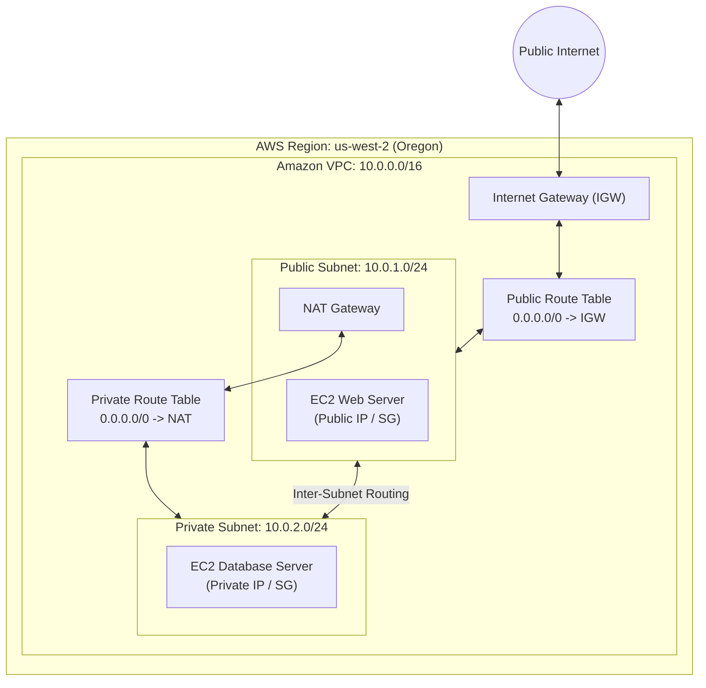

### Traditional On-Premises Architecture vs. AWS VPC Primitives

The following table provides a comprehensive side-by-side mapping between traditional on-premises data center networking and AWS VPC components:

| Traditional Network Component | AWS Cloud Service / Capability | Operational Behavior & Architectural Function |
| :--- | :--- | :--- |
| **Isolated Physical Network / Data Center** | **Amazon VPC** | A logically isolated software-defined network boundary inside an AWS Region. |
| **VLAN / Network Segment / Departmental Floor** | **VPC Subnet (Public & Private)** | A subdivision of the VPC's IP address range tied to a specific Availability Zone. |
| **Physical Router & Routing Table** | **VPC Route Tables & Implicit Local Router** | Software-defined routing rules that determine where network packets are directed. |
| **Border Gateway / Internet Edge Router** | **Internet Gateway (IGW)** | A horizontally scaled, redundant VPC component enabling direct internet communication. |
| **Host-Level Firewall (iptables / Windows Firewall)** | **Security Group (SG)** | Stateful virtual firewall operating at the EC2 instance network interface (ENI) level. |
| **Subnet-Level Border Firewall / Packet Filter** | **Network Access Control List (NACL)** | Stateless subnet-level firewall filtering inbound and outbound traffic rules. |
| **Physical Server Hardware** | **Amazon EC2 Instance** | Virtual machine compute node running application and database workloads. |
| **Corporate WAN / Leased Circuit Link** | **VPC Peering / AWS Transit Gateway** | High-performance private network connection linking distinct VPCs across regions or accounts. |

---

### Comparing LAN and WAN with Amazon VPC

#### 1. LAN vs. Amazon VPC
In an on-premises LAN, devices (servers, workstations) reside on physical switches and are segmented into subnets or VLANs, with a physical router coordinating inter-subnet traffic. 
- In AWS, an **Amazon VPC** represents that LAN.
- The **EC2 instances** represent physical servers.
- The **Public and Private Subnets** represent segmented switch fabrics.
- The **VPC Route Table** represents the physical routing logic:
  - `192.168.0.0/16 -> Local`: Internal traffic between instances across all subnets routes locally by default.
  - `0.0.0.0/0 -> igw-xxxx`: Default route out to the Internet Gateway for public traffic.

#### 2. WAN vs. Amazon VPC Peering
In traditional enterprise networking, interlinking a corporate office in Oregon with a branch office in Virginia requires a dedicated carrier WAN circuit (MPLS or leased fiber).
- In AWS, when an organization deploys one VPC in `us-west-2` (Oregon) and another VPC in `us-east-1` (N. Virginia), they link them using **VPC Peering**.
- Traffic between peered VPCs traverses the private, high-capacity **AWS Global Network Backbone** rather than the public internet. This provides encrypted transit, lower latency, and zero single points of failure.

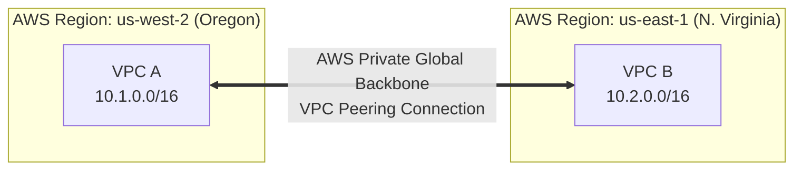

---

## 🎛️ 4. Network Management Models

A **network management model** defines how data is managed, how application workloads are hosted, how access control is administered, and how communication policies are enforced across network nodes.

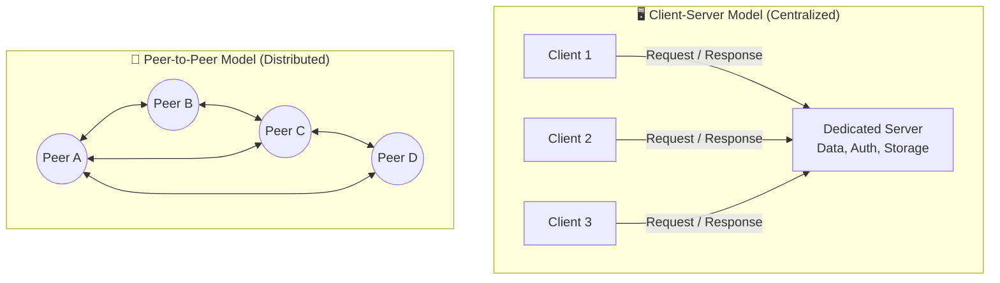

---

### 1. Client-Server Model (Centralized Architecture)

In the **Client-Server Model**, data management, compute workloads, and user access authorization are concentrated centrally on dedicated, high-capacity server systems. Client workstations consume these centralized services.

#### Operational Mechanism
- **Roles**:
  - **Server**: Listens passively on designated network ports for client requests, processes queries, executes authentication, retrieves database records, and returns response packets.
  - **Client**: Initiates outbound communication sessions to the server, presenting credentials and requests (e.g., web browser, database client, email client).
- **Core Examples**:
  - Web applications (Apache/Nginx serving web clients).
  - Database management systems (PostgreSQL/MySQL serving application tiers).
  - Centralized storage (NFS/SMB file servers).
  - Directory identity management (Active Directory / LDAP domain controllers).

#### Tradeoffs
- **Advantages**:
  - **Centralized Security & Governance**: Policies, passwords, encryption keys, and role-based access controls (RBAC) are managed in a single central repository.
  - **Streamlined Backups**: Data resides in centralized databases and file servers, making comprehensive snapshot and backup routines straightforward.
  - **Scalability of Resources**: Servers can be independently upgraded (vertical scaling) or placed behind load balancers (horizontal scaling) without modifying client workstations.
- **Disadvantages**:
  - **Single Point of Failure**: If a standalone server crashes or loses connectivity, all dependent client nodes are blocked from accessing data and applications.
  - **Server Bottlenecks**: Heavy concurrent traffic surges can overwhelm server CPU, memory, or network interfaces, causing degradation or denial of service.
  - **Operational Cost**: Requires dedicated server hardware, enterprise licensing, cooling, and specialized systems administrators.

---

### 2. Peer-to-Peer (P2P) Model (Decentralized Architecture)

In a **Peer-to-Peer Model**, every node on the network (termed a *peer*) possesses equal privileges and functions concurrently as both a client and a server.

#### Operational Mechanism
- **Roles**: No central coordinating authority exists. Each device manages its own localized files, user credentials, and security permissions. A peer can request data from a neighboring peer while simultaneously serving cached chunks of files to other peers.
- **Core Examples**:
  - Small home or small-office workgroups sharing a local printer or directory.
  - Distributed file sharing protocols (BitTorrent).
  - Decentralized blockchain ledgers (Bitcoin, Ethereum).

#### Tradeoffs
- **Advantages**:
  - **Low Implementation Cost**: No expensive dedicated server hardware or server operating system licenses required.
  - **High Fault Resilience**: The failure of an individual peer does not disrupt communications between remaining peers.
  - **Distributed Bandwidth**: In protocols like BitTorrent, file downloads accelerate as more peers join, since download streams aggregate chunks from multiple peers simultaneously.
- **Disadvantages**:
  - **Decentralized Security Vulnerabilities**: No unified administrative control. Passwords and permissions must be manually maintained on every machine.
  - **Complex Backup Strategy**: Data is fragmented across individual workstations, making systematic data protection difficult.
  - **Scalability Limit in Traditional Offices**: Unmanageable in corporate networks beyond 10–15 nodes due to administrative overhead.

---

### 📊 Client-Server vs. Peer-to-Peer Comparison

| Architectural Dimension | Client-Server Model | Peer-to-Peer (P2P) Model |
| :--- | :--- | :--- |
| **System Architecture** | Centralized | Decentralized / Distributed |
| **Data Storage** | Centralized on dedicated file/database servers | Fragmented across individual workstations |
| **Security & Authentication** | Centralized domain authority (Active Directory, LDAP) | Localized per machine; managed by each user |
| **Single Point of Failure** | Yes (server hardware, network link to server) | No (loss of one peer does not bring down the network) |
| **Cost & Overhead** | High (server hardware, operating systems, admin staff) | Very Low (utilizes existing endpoint hardware) |
| **Performance Under Load** | Server can become a bottleneck unless clustered | Workload shared; performance can increase with peer count |
| **Practical Scaling Limit** | Scales to millions of clients with load balancing | Typically restricted to < 10 nodes for enterprise tasks |

---

### 3. Software-Defined Networking (SDN) Concepts

Modern network management has evolved beyond static physical hardware configurations into **Software-Defined Networking (SDN)**. 

Traditional networking binds two functional planes tightly inside each physical router or switch:
1. **Control Plane**: The intelligence that determines routing paths, exchanges BGP/OSPF topology tables, and builds forwarding tables.
2. **Data Plane (Forwarding Plane)**: The underlying silicon chips (ASICs) that inspect incoming packet headers and forward them out specific ports.

```mermaid
flowchart TD
    subgraph Traditional["Traditional Hardware Networking"]
        R1["Router A<br>[Control Plane + Data Plane]"]
        R2["Router B<br>[Control Plane + Data Plane]"]
        R3["Router C<br>[Control Plane + Data Plane]"]
        R1 <--> R2 <--> R3
    end

    subgraph SDN["Software-Defined Networking (SDN)"]
        SDN_CTRL["Centralized SDN Controller<br>(Logically Centralized Control Plane)"]
        S1["Forwarding Device 1<br>(Pure Data Plane)"]
        S2["Forwarding Device 2<br>(Pure Data Plane)"]
        S3["Forwarding Device 3<br>(Pure Data Plane)"]
        
        SDN_CTRL ==>|Southbound API (OpenFlow/gRPC)| S1
        SDN_CTRL ==>|Southbound API| S2
        SDN_CTRL ==>|Southbound API| S3
    end
```

#### SDN Architecture
- **Plane Decoupling**: SDN extracts the control plane away from individual physical devices and centralizes it inside a software-based **SDN Controller**.
- **Programmability**: Administrators program network policies centrally via software APIs. The SDN controller computes optimal forwarding topologies and dynamically injects flow rules down into dumb forwarding switches across **Southbound APIs** (e.g., OpenFlow).
- **SDN in AWS**: Amazon VPC is an enterprise implementation of SDN. When an engineer modifies an AWS Security Group or adds a route to a VPC Route Table via the AWS Management Console or Terraform, the AWS SDN control plane instantaneously programs the hypervisor packet filtering and routing tables (AWS Nitro System) across physical virtualization hosts worldwide.

---

## 📡 5. Network Protocols & Communication Mechanisms

A **network protocol** is a formal, standardized set of rules and conventions that govern how devices format, encode, transmit, verify, and receive data across a network. Without standardized protocols, computers from different manufacturers running different operating systems would be incapable of exchanging information.

Protocols typically operate across the layers of the **Open Systems Interconnection (OSI)** reference model, with core transport operations situated at:
- **Layer 3 (Network Layer)**: End-to-end logical packet addressing and routing across disparate networks (e.g., **IP**).
- **Layer 4 (Transport Layer)**: Host-to-host multiplexing, process-level addressing via port numbers, segmentation, flow control, and data delivery integrity (e.g., **TCP**, **UDP**).

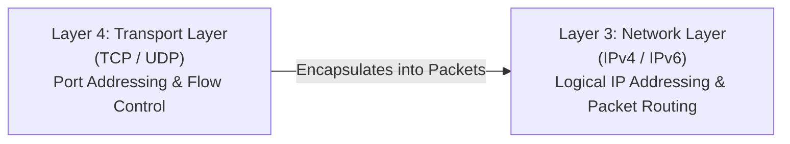

---

### Communication Paradigms: Connection-Oriented vs. Connectionless

All Layer 4 transport protocols divide into two fundamental communication paradigms:

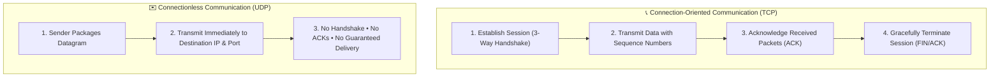

#### 1. Connection-Oriented Protocols (The Telephone Call Analogy)
- **Operational Model**: Requires endpoints to establish a dedicated, verified stateful session *before* any application payload data can be transferred.
- **Analogy**: Placing a telephone call. You dial the number; the recipient's phone rings; the recipient picks up and says "Hello"; you respond "Hello, I can hear you"; only then does meaningful conversation take place. When finished, both parties say "Goodbye" and hang up.
- **Key Characteristics**:
  - Uses synchronous handshakes.
  - Maintains session states and sequence tracking at both endpoints.
  - Automatically checks for packet loss and retransmits missing segments.
  - Guarantees in-order data assembly.
  - Incurs higher protocol overhead (larger headers, latency delays during session setup).

#### 2. Connectionless Protocols (The Postal Mail Analogy)
- **Operational Model**: The sender encapsulates data into a datagram, stamps the destination address on it, and immediately transmits it into the network. It does not verify whether the recipient is online, available, or ready.
- **Analogy**: Dropping an unstamped postcard into a mailbox. Once dropped in, the transaction is asynchronous. You receive no immediate confirmation that the letter arrived, nor do you know if it arrived in undamaged condition.
- **Key Characteristics**:
  - Zero pre-session handshaking or connection establishment.
  - Asynchronous transmission.
  - No built-in packet acknowledgments or automatic retransmissions.
  - Packets may arrive out of order, get duplicated, or drop silently.
  - Minimal protocol header overhead and near-zero connection setup latency.

---

### Core Protocol Profiles: IP, TCP, and UDP

#### 1. Internet Protocol (IP)
- **OSI Layer**: Layer 3 (Network Layer).
- **Core Role**: Defines logical host addressing (IPv4 32-bit addresses, IPv6 128-bit addresses) and handles the encapsulation, fragmentation, and hop-by-hop routing of packets across intermediate routers from origin to destination.
- **Nature**: IP is inherently **connectionless** and **unreliable (best-effort)**. It does not verify whether packets successfully arrive; that reliability is delegated to upper-layer protocols (TCP) or the application layer.

#### 2. Transmission Control Protocol (TCP)
- **OSI Layer**: Layer 4 (Transport Layer).
- **Core Role**: Delivers a reliable, connection-oriented, full-duplex, ordered byte-stream service across an underlying unreliable IP network.
- **Key Mechanisms**:
  - **Packet Sequencing**: Assigns unique sequence numbers to every byte, allowing the receiver to reorder packets that arrived out of order.
  - **Positive Acknowledgments with Retransmission (PAR)**: The receiver sends acknowledgment numbers (ACKs). If the sender does not receive an ACK before its retransmission timeout (RTO) expires, it retransmits the segment.
  - **Flow Control (Sliding Window)**: Prevents a high-speed sender from overwhelming a slower receiver's buffer.
  - **Congestion Control**: Algorithms (e.g., Cubic, BBR) dynamically detect network congestion and throttle transmission rates to prevent network collapse.
- **When to Use**: Whenever data accuracy and completeness are essential (e.g., HTTP/HTTPS web browsing, SSH console sessions, SFTP/FTP file transfers, database queries, API payloads).

---

### The TCP Three-Way Handshake (Connection Establishment)

Before two hosts exchange application data over TCP, they negotiate parameters and synchronize their initial sequence numbers (ISNs) using a **Three-Way Handshake**:

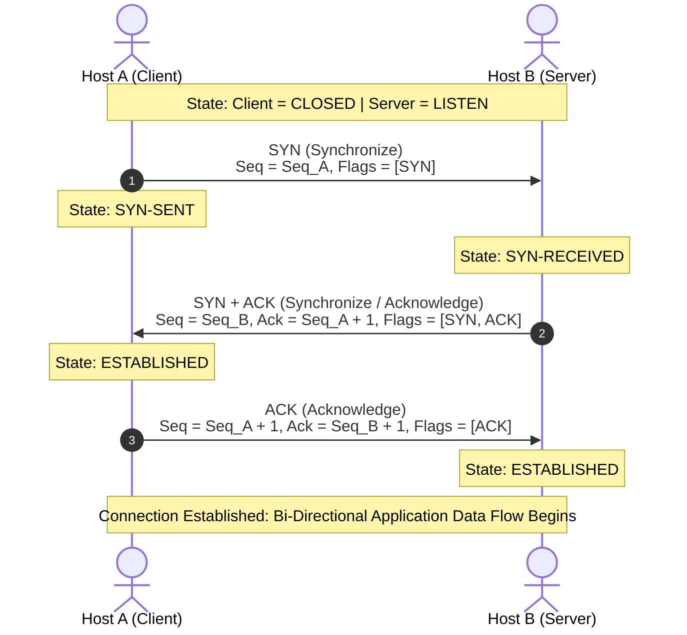

#### Step-by-Step Handshake Lifecycle
1. **Step 1: SYN (Synchronize)**
   - Host A initiates the connection by transmitting a TCP segment with the **SYN** flag set.
   - Host A picks a randomized Initial Sequence Number (e.g., `Seq_A = 1000`).
   - Purpose: Informs Host B that Host A wishes to open a communication channel and establishes Host A's starting sequence number.
2. **Step 2: SYN/ACK (Synchronize / Acknowledge)**
   - Host B receives the SYN segment and responds with a segment having both **SYN** and **ACK** flags set.
   - Host B acknowledges Host A's sequence number by setting the Acknowledgment number to `Ack = Seq_A + 1` (e.g., `1001`).
   - Host B generates its own randomized Initial Sequence Number (e.g., `Seq_B = 5000`).
   - Purpose: Verifies receipt of Host A's request and synchronizes Host B's sequence number.
3. **Step 3: ACK (Acknowledge)**
   - Host A receives the SYN/ACK and responds with a segment having the **ACK** flag set.
   - Host A sets the sequence number to `Seq = Seq_A + 1` (e.g., `1001`) and acknowledges Host B's sequence number by setting `Ack = Seq_B + 1` (e.g., `5001`).
   - Purpose: Confirms receipt of Host B's parameters. Both hosts enter the `ESTABLISHED` state and can now transmit application payload data.

---

### TCP Connection Teardown and Control Flags

TCP connections close gracefully using a four-step (or consolidated three-step) teardown sequence, ensuring both sides finish reading outstanding buffer data:

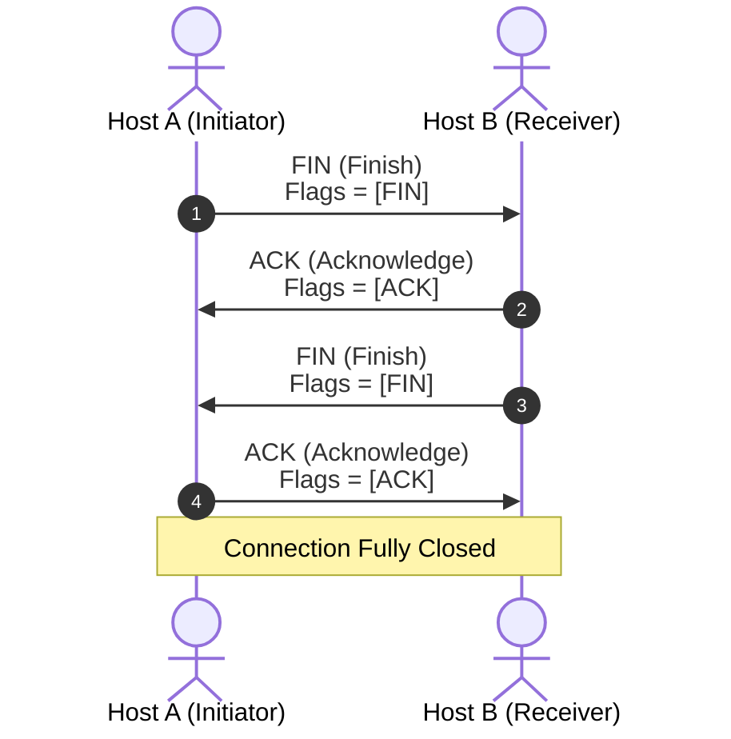

#### Teardown Steps:
1. **Host A sends FIN**: Host A finishes transmitting and sends a **FIN** flag, entering `FIN-WAIT-1`.
2. **Host B sends ACK**: Host B acknowledges with an **ACK** flag. Host B enters `CLOSE-WAIT`; Host A enters `FIN-WAIT-2`.
3. **Host B sends FIN**: When Host B completes pending data processing, it transmits its own **FIN** flag, entering `LAST-ACK`.
4. **Host A sends ACK**: Host A responds with an **ACK**, waits for a timeout period (`TIME-WAIT` to ensure no delayed packets linger), and closes. Host B closes immediately upon receiving the ACK.

#### The Reset (RST) Flag
- **RST Flag**: Indicates that a connection should be immediately aborted or rejected.
- **Triggers**: Sent when a host receives a packet targeting a closed TCP port, when a firewall forcibly rejects a connection, or when an unrecoverable state error occurs. Unlike FIN, RST does not wait for pending data buffers to flush; it drops the socket immediately.

> [!TIP]
> **Troubleshooting with `tcpdump` and Wireshark**:  
> In production environments, network engineers use packet analysis tools like `tcpdump` and Wireshark to inspect TCP flags. An abundance of **SYN** packets without matching **SYN/ACK** responses indicates security group drops, packet blackholing, or firewall blocks. Frequent **RST** flags indicate service crashes or active firewall rejections.

---

### 3. User Datagram Protocol (UDP)

- **OSI Layer**: Layer 4 (Transport Layer).
- **Core Role**: Delivers a lightweight, minimal, connectionless transport mechanism over IP networks.
- **Key Characteristics**:
  - **No Handshake**: Transmits immediately without establishing a stateful session.
  - **No Guaranteed Delivery**: Does not track sequence numbers, send ACKs, or execute retransmissions.
  - **Extremely Low Overhead**: UDP header is fixed at **8 bytes**, compared to TCP's minimum **20 bytes** (which can grow to 60 bytes with options).
  - **Low Latency**: Packets flow continuously with no head-of-line blocking delays.
- **When to Use**:
  - **Real-Time Multimedia Streaming**: Video streaming (YouTube, Netflix live feeds) and audio where dropping a frame is imperceptible, but stalling for retransmission creates unacceptable buffering lag.
  - **Voice over IP (VoIP) & Video Conferencing**: Real-time communication (Zoom, Teams) where timeliness is preferred over 100% packet integrity.
  - **Online Multiplayer Gaming**: Real-time positional coordinates must arrive immediately; old coordinate updates are useless.
  - **Lightweight Request/Response Services**: Domain Name System (DNS) queries, Dynamic Host Configuration Protocol (DHCP), and Simple Network Management Protocol (SNMP).

---

### 📊 Comprehensive Protocol Comparison: TCP vs. UDP

| Feature / Metric | Transmission Control Protocol (TCP) | User Datagram Protocol (UDP) |
| :--- | :--- | :--- |
| **Connection Model** | Connection-Oriented (Stateful session required) | Connectionless (Stateless datagrams) |
| **Setup Handshake** | Mandatory 3-way handshake (SYN, SYN/ACK, ACK) | None (transmits immediately) |
| **Reliability & Guarantees** | Guaranteed delivery; missing packets retransmitted | Best-effort; dropped packets are lost |
| **Packet Ordering** | Strict sequencing; reconstructs segments in order | No ordering; datagrams arrive in any sequence |
| **Flow & Congestion Control** | Supported (Sliding window, slow-start, congestion backoff) | None; application must manage throttling if needed |
| **Header Size** | 20 to 60 bytes | Exactly 8 bytes |
| **Speed & Latency** | Slower; latency introduced by handshakes and ACKs | Extremely fast; zero connection overhead |
| **Broadcasting / Multicasting** | Unicast only (Point-to-point between two endpoints) | Supports Unicast, Multicast, and Broadcast |
| **Analogy** | Direct telephone conversation | Snail mail postcard dropped into a collection box |
| **Typical Protocols** | HTTP, HTTPS, SSH, SFTP, SMTP, MySQL, PostgreSQL | DNS, DHCP, SNMP, NTP, VoIP (SIP/RTP), Gaming |

---

## 💡 6. Key Takeaways & Summary

- **Geographical Scale Matters**: Networks span from short-range personal devices (**PAN**), localized offices and buildings (**LAN / WLAN**), multi-building campuses (**CAN**), and city-wide municipal grids (**MAN**), to global interconnections (**WAN**), and high-speed enterprise storage fabrics (**SAN**). The Internet is the world's largest public WAN.
- **Physical vs. Logical Topologies**: Physical topology reflects the physical arrangement of cables and switches; logical topology defines the pathways and signaling rules data packets travel across those links.
- **Network Topologies**:
  - **Star**: Standard modern LAN pattern; highly resilient against individual cable breaks, but the central switch is a single point of failure (SPOF).
  - **Bus**: Linear coaxial cable with terminators; minimal cabling, but a break anywhere crashes the entire network.
  - **Ring**: Unbroken circular loop with deterministic token passing; single-ring links are vulnerable to individual station failures.
  - **Mesh**: Full mesh ($n(n-1)/2$ links) offers absolute fault tolerance at high cabling cost; partial mesh balances redundancy with cost for WAN backbones.
  - **Tree & Hybrid**: Hierarchical tiered trees (Core, Distribution, Access) and Star-Bus hybrids provide scalable architectures for large enterprise campuses.
- **Cloud Virtualization via Amazon VPC**: AWS abstracts physical data center components into Software-Defined Networking (SDN). An Amazon VPC acts as an isolated network, subnets act as switch segments, route tables guide traffic, Security Groups and NACLs provide layered stateful/stateless firewalls, and VPC Peering connects VPCs across the AWS global WAN backbone.
- **Management Models**:
  - **Client-Server**: Centralized application hosting, unified security, and streamlined backups, but the server is a potential bottleneck and failure point.
  - **Peer-to-Peer**: Equal privileges, decentralized workloads, low initial cost, and high resilience, but unmanageable security and backup control at scale.
  - **SDN**: Decouples the control plane (routing intelligence) from the data plane (packet forwarding), enabling automated, programmatic cloud network orchestration.
- **Protocol Foundations**:
  - Protocols define the formatting, timing, and transmission rules across Layer 3 (Network) and Layer 4 (Transport).
  - **Connection-Oriented (TCP)**: Stateful, reliable, ordered delivery through a 3-way handshake (SYN, SYN/ACK, ACK) and graceful teardown (FIN, FIN/ACK, ACK). Best for mission-critical data transfers.
  - **Connectionless (UDP)**: Stateless, lightweight (8-byte header), best-effort datagram delivery with zero handshake. Best for real-time streaming, VoIP, gaming, and rapid queries like DNS.

---

## 📝 7. Knowledge Check & Practice Questions

### Slide Review Questions

#### Question 1
**Which area network connects devices over large geographical areas?**

> [!NOTE]
> **Answer**: **Wide Area Network (WAN)**  
> **Explanation**: A Wide Area Network (WAN) connects devices and local networks across large geographical regions, such as across multiple cities, states, countries, or continents. The global Internet is the most prominent example of a WAN. In corporate environments, WANs connect disparate branch office LANs across the country or world.

---

#### Question 2
**Which type of protocol ensures that a connection is established? What is an example of one?**

> [!NOTE]
> **Answer**: **Connection-oriented protocol**; a prime example is **Transmission Control Protocol (TCP)**.  
> **Explanation**: A connection-oriented protocol requires a stateful session to be formally established between the sender and receiver before application payload data can be transferred. TCP achieves this through a synchronous **three-way handshake** (SYN, SYN/ACK, ACK). It guarantees packet delivery, verifies sequencing, and retransmits lost packets.

---

### Scenario-Based Practice Questions

#### Question 3
An enterprise architect is designing an on-premises network linking 8 critical core database servers. The architect requires maximum fault tolerance such that if any network link or adapter fails, every server remains directly interconnected with every other server without routing through intermediate hops. How many dedicated physical links must be provisioned, and which topology must be selected?

- [ ] A) 8 links using a Ring Topology
- [ ] B) 16 links using a Star Topology
- [ ] C) 28 links using a Full-Mesh Topology
- [ ] D) 56 links using a Tree Topology

> [!TIP]
> **Correct Answer**: **C) 28 links using a Full-Mesh Topology**  
> **Explanation**: A Full-Mesh topology provides direct point-to-point connections between every pair of nodes. The mathematical formula for links in a full mesh is $\frac{n(n - 1)}{2}$. For $n = 8$ servers: $\frac{8 \times (8 - 1)}{2} = \frac{8 \times 7}{2} = 28$ physical links.

---

#### Question 4
A cloud engineer is deploying a live video broadcasting application on Amazon EC2 that streams live esports tournaments to hundreds of thousands of concurrent viewers. Occasional frame loss is completely acceptable, but packet delays or buffering pauses severely ruin the viewer experience. Which transport protocol should the streaming service use, and why?

- [ ] A) TCP, because its three-way handshake ensures zero lost frames
- [ ] B) UDP, because its connectionless, low-overhead design avoids buffering delays caused by retransmissions
- [ ] C) TCP, because its sliding window dynamically accelerates video download speeds
- [ ] D) IP, because it replaces both Layer 3 and Layer 4 with hardware acceleration

> [!TIP]
> **Correct Answer**: **B) UDP, because its connectionless, low-overhead design avoids buffering delays caused by retransmissions**  
> **Explanation**: User Datagram Protocol (UDP) is connectionless and does not retransmit dropped packets. In live video streaming, retransmitting a dropped video frame after a delay causes visible playback buffering and audio-video desynchronization. UDP transmits immediately with minimal (8-byte) header overhead.

---

#### Question 5
In an AWS Virtual Private Cloud (VPC), which two architectural components fulfill the traditional functions of a stateful host firewall and a stateless subnet firewall, respectively?

- [ ] A) Route Tables and Internet Gateway
- [ ] B) Elastic Network Interface (ENI) and NAT Gateway
- [ ] C) Security Groups and Network Access Control Lists (NACLs)
- [ ] D) VPC Peering and AWS Direct Connect

> [!TIP]
> **Correct Answer**: **C) Security Groups and Network Access Control Lists (NACLs)**  
> **Explanation**: In AWS networking, **Security Groups** operate at the instance/ENI level as stateful firewalls (return traffic is automatically allowed regardless of inbound rules). **Network Access Control Lists (NACLs)** operate at the subnet boundary as stateless firewalls (inbound and outbound rules must be explicitly evaluated).
