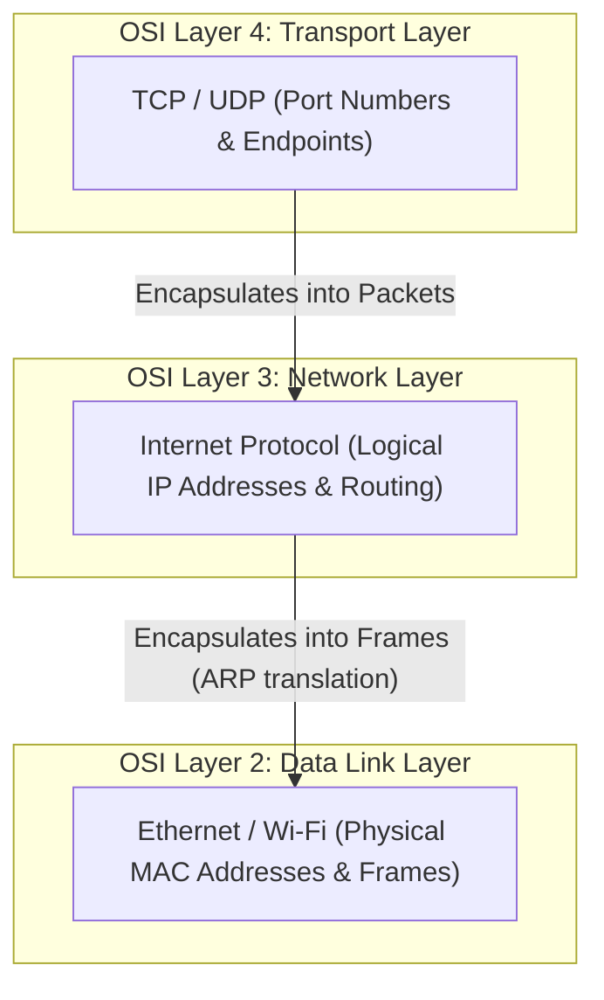
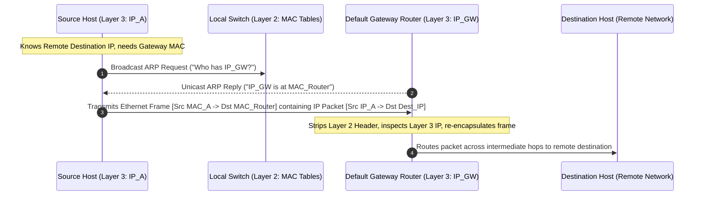
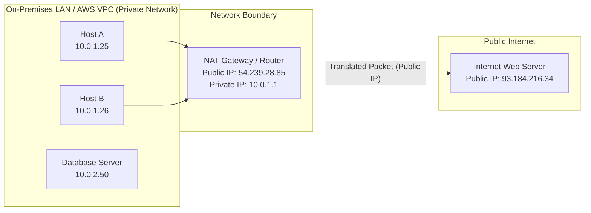
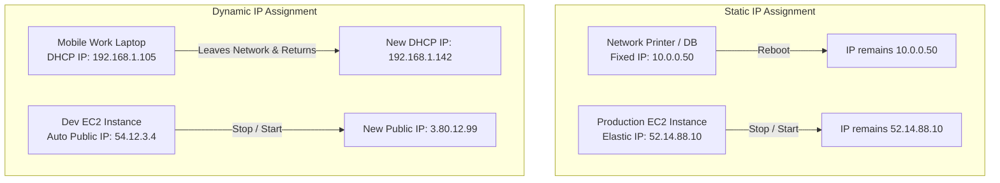
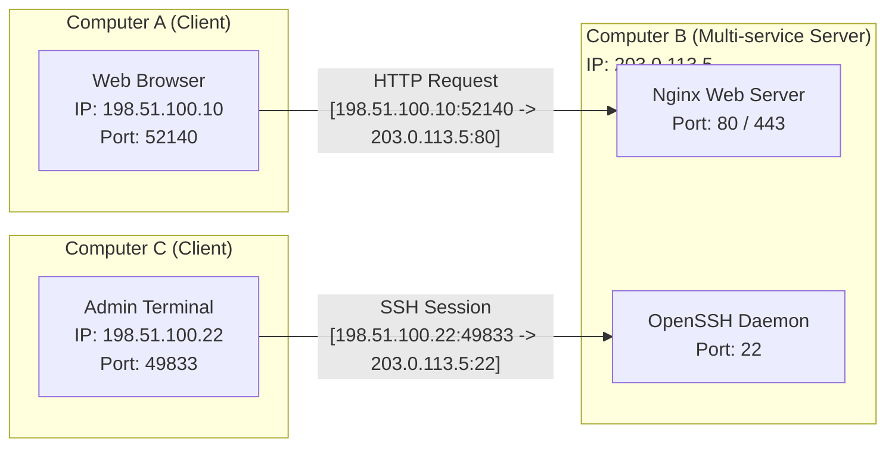
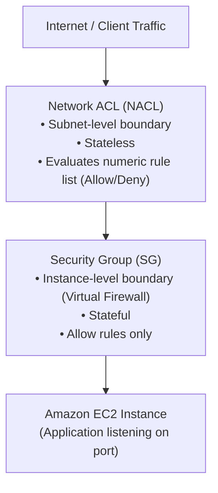

# 🌐 Internet Protocols (IP) & Network Addressing

> **Course**: AWS re/Start Networking Fundamentals  
> **Module**: Module 03 – Internet Protocols (IP)  
> **Source**: `T07-0003-RSNF_EN-US_SG_M03_INTERNETPROTOCOL.pdf`  
> **Target Audience**: AWS re/Start Learners / Cloud & Network Practitioners  

---

## 🎯 Module Overview

The **Internet Protocol (IP)** serves as the principal communications protocol in the Internet protocol suite for relaying datagrams across network boundaries. Working at **Layer 3 (Network Layer)** of the Open Systems Interconnection (OSI) reference model, IP provides the logical addressing mechanisms that enable packets of data to be routed from a source host to a destination host across interconnected networks.

In cloud computing environments like Amazon Web Services (AWS), a firm grasp of IP fundamentals—including IPv4 addressing anatomy, binary-decimal conversions, classful and classless architectures, RFC 1918 private address spaces, IPv6 expansion, and Transport Layer port numbering—is essential for designing secure Virtual Private Clouds (VPCs), subnets, routing tables, and security perimeters.

---

### 📌 Learning Objectives

- [ ] Define the Internet Protocol (IP) and its role within the TCP/IP protocol suite.
- [ ] Explain connectionless communication and best-effort delivery semantics.
- [ ] Understand IPv4 address anatomy (32 bits, 4 octets, dotted-decimal notation).
- [ ] Master decimal-to-binary and binary-to-decimal conversions using positional powers of 2.
- [ ] Distinguish between Classful IP addressing classes (Classes A, B, C, D, E, and Loopback).
- [ ] Differentiate between Private IP addresses (RFC 1918) and Public IP addresses, and explain Network Address Translation (NAT).
- [ ] Explain IPv6 architecture (128 bits, hexadecimal notation) and its role in resolving IPv4 address exhaustion.
- [ ] Contrast Dynamic vs. Static IP assignment models and their AWS cloud implementations (such as Amazon EC2 Elastic IP addresses).
- [ ] Identify special-purpose IP addresses (Network ID, Default Gateway/Router, Broadcast).
- [ ] Explain Transport Layer port numbering ranges (Well-Known, Registered, Dynamic/Ephemeral) and socket pairs (`IP:Port`).
- [ ] Apply Layer 3 and Layer 4 diagnostic tools (`ping`, `traceroute`, `netstat`, `ss`, `telnet`) to troubleshoot network connectivity issues.

---

## 📚 Key Terminology

| Term | Definition |
| :--- | :--- |
| **Internet Protocol (IP)** | A Network Layer (Layer 3) standard that governs the addressing, packetization, and routing of data packets across interconnected networks. |
| **IPv4 Address** | A 32-bit numerical label assigned to each device connected to a computer network, expressed as four decimal octets separated by periods (`dotted-decimal notation`). |
| **IPv6 Address** | A 128-bit alphanumeric address expressed as eight groups of four hexadecimal digits separated by colons, designed to replace IPv4. |
| **Octet** | A unit of digital information consisting of exactly 8 bits (1 byte), representing a decimal value from 0 to 255. |
| **Bit** | A binary digit, the smallest unit of digital data, holding a value of either `0` (off) or `1` (on). |
| **RFC 1918** | An Internet Engineering Task Force (IETF) specification defining private IPv4 address spaces reserved for internal networks. |
| **NAT (Network Address Translation)** | A method used by routers and firewalls to map multiple private IP addresses to a single public IP address for internet communication. |
| **Port Number** | A 16-bit number (0–65535) used by transport protocols (TCP/UDP) to identify specific processes, applications, or endpoints on a host. |
| **Socket Pair** | The unique combination of source IP, source port, destination IP, and destination port that identifies an active bidirectional network conversation. |
| **Default Gateway** | The node or router on a computer network that serves as an access point to other networks when no specific route matches a packet's destination. |
| **Broadcast Address** | A special network address used to transmit messages simultaneously to all connected devices on a local subnet. |
| **Elastic IP Address (EIP)** | A static, public IPv4 address allocated to an AWS account that can be dynamically remapped to any Amazon EC2 instance in a Region. |

---

## 🌐 1. What is the Internet Protocol (IP)?

The **Internet Protocol (IP)** establishes the rules and conventions for relaying and routing data across the global internet and private enterprise intranets. 

IP operates as the core protocol of the **Internet layer** within the TCP/IP model, which corresponds directly to **Layer 3 (Network Layer)** of the 7-layer OSI model.



### Core Characteristics of the Internet Protocol

1. **Logical Addressing**:
   - Every node participating in an IP network is assigned a logical IP address.
   - Unlike hardware-bound physical addresses (MAC addresses), IP addresses are hierarchical and logically assignable based on network topology.
2. **Packet Routing**:
   - IP examines destination addresses within packet headers to determine the next hop across routers and gateways.
3. **Connectionless Delivery**:
   - IP does not establish a dedicated, pre-negotiated connection between sender and receiver before transmitting data.
   - Each datagram is treated as an independent transmission and routed autonomously.
4. **Best-Effort Delivery ("Unreliable")**:
   - In networking terminology, *unreliable* does not mean the protocol performs poorly; rather, it means IP provides **no built-in guarantees** that packets will reach their destination, arrive in order, or remain duplicate-free.
   - Packet error checking, flow control, retransmission of lost packets, and ordered delivery are delegated to higher-layer protocols such as the **Transmission Control Protocol (TCP)**.

> [!NOTE]
> **The TCP/IP Suite Partnership**:  
> When paired with TCP, the resulting **TCP/IP** stack combines the flexible routing of IP with the reliable, connection-oriented, sequenced delivery of TCP. If an application requires speed over guaranteed delivery (such as real-time voice, video streaming, or DNS queries), IP pairs instead with the **User Datagram Protocol (UDP)**.

---

## 🔍 2. Layer 3 vs. Layer 2 in the OSI Model

Network communications require constant translation between logical addresses (used for inter-network routing) and physical addresses (used for local segment delivery).



### Key Differences Between Layer 2 and Layer 3:

| Architectural Metric | Layer 2 (Data Link Layer) | Layer 3 (Network Layer) |
| :--- | :--- | :--- |
| **Address Type** | **MAC Address** (Media Access Control) | **IP Address** (Internet Protocol) |
| **Address Nature** | Physical, flat, burned into hardware NIC | Logical, hierarchical, administratively assigned |
| **Scope of Communication** | Local Area Network (LAN) / single collision domain | Wide Area Network (WAN), internetworks, across routers |
| **Data Unit (PDU)** | **Frame** | **Packet** (Datagram) |
| **Primary Device** | Layer 2 Switch, Network Interface Card (NIC) | Router, Layer 3 Switch, VPC Route Table |
| **Address Resolution** | Address Resolution Protocol (ARP) translates IP $\rightarrow$ MAC | Routing protocols (BGP, OSPF) route IP packets |

---

## 🔢 3. IPv4 Address Anatomy

An **IPv4 address** is a **32-bit** numeric identifier divided into **4 octets** (each 8 bits long). For human readability, it is expressed in **dotted-decimal notation** (also known as a *dotted quad*):

```
       ┌──────────┬──────────┬──────────┬──────────┐
Octet: │ Octet 1  │ Octet 2  │ Octet 3  │ Octet 4  │
       ├──────────┼──────────┼──────────┼──────────┤
Value: │   192    .   168    .    1     .   100    │
       ├──────────┼──────────┼──────────┼──────────┤
Bits:  │ 11000000 . 10101000 . 00000001 . 01100100 │
       └──────────┴──────────┴──────────┴──────────┘
       ◄─────────────── 32 Bits Total ─────────────►
```

### The Two Logical Portions of an IP Address

Every IP address contains two components:
1. **Network Portion (`Net ID`)**:
   - Identifies the specific physical or logical network to which the host belongs.
   - All hosts residing on the same local subnet share the identical network portion.
2. **Host Portion (`Host ID`)**:
   - Identifies the specific device, interface, or node within that network.
   - Must be uniquely assigned to each interface on that subnet to prevent IP collisions.

```
Example: 10.0.0.1 on a Class A network (/8)
 ┌───────────────┬───────────────────────────────┐
 │ Network (10.) │         Host (0.0.1)          │
 └───────────────┴───────────────────────────────┘
```

---

## 🧮 4. Binary Conversion Walkthrough

Computers, network interface cards, and switches process IP addresses as pure binary data (streams of `0`s and `1`s). Network engineers and cloud architects must understand how to convert between base-10 decimal numbers and base-2 binary values.

### The Binary System (Base-2)
- Each binary digit is called a **bit**.
- A bit holds one of two possible states:
  - `0` = Off (power off / light switch turned off)
  - `1` = On (power on / light switch turned on)
- An octet contains **8 bits**, spanning values from `00000000` (decimal 0) to `11111111` (decimal 255).
- Total possible values per octet: $2^8 = 256$ possible values ($0$ through $255$).

### The 8-Bit Positional Value Table

Each bit position in an octet corresponds to a positional power of 2 ($2^n$, where $n = 7, 6, 5, 4, 3, 2, 1, 0$ from left to right):

| Bit Position | Bit 7 | Bit 6 | Bit 5 | Bit 4 | Bit 3 | Bit 2 | Bit 1 | Bit 0 |
| :--- | :---: | :---: | :---: | :---: | :---: | :---: | :---: | :---: |
| **Power of 2** | $2^7$ | $2^6$ | $2^5$ | $2^4$ | $2^3$ | $2^2$ | $2^1$ | $2^0$ |
| **Decimal Value** | **128** | **64** | **32** | **16** | **8** | **4** | **2** | **1** |

---

### Step-by-Step Conversion Methodologies

#### Method A: Decimal to Binary Conversion
1. Start with the target decimal number.
2. Compare the number with the leftmost positional value (**128**):
   - If the number is greater than or equal to 128, write a **1**, and subtract 128 from the number.
   - If the number is less than 128, write a **0**, and keep the original number.
3. Repeat the comparison for each successive bit value (**64, 32, 16, 8, 4, 2, 1**), subtracting whenever a **1** is placed.
4. When finished, you have exactly 8 binary digits.

#### Method B: Binary to Decimal Conversion
1. Write down the 8 bits underneath the positional powers of 2 table.
2. Add together only the decimal values where the bit is set to **1**.
3. Sum the values to obtain the final decimal number.

---

### 📝 Walkthrough: Instructor Demonstration

Let us convert the IPv4 address **`219.103.21.59`** to binary, octet by octet:

```
Decimal Address: 219 . 103 . 21 . 59
```

#### Octet 1: Convert `219`
- $219 \ge 128$? **Yes** $\rightarrow$ bit = `1`, remainder = $219 - 128 = 91$
- $91 \ge 64$? **Yes** $\rightarrow$ bit = `1`, remainder = $91 - 64 = 27$
- $27 \ge 32$? **No** $\rightarrow$ bit = `0`, remainder = $27$
- $27 \ge 16$? **Yes** $\rightarrow$ bit = `1`, remainder = $27 - 16 = 11$
- $11 \ge 8$? **Yes** $\rightarrow$ bit = `1`, remainder = $11 - 8 = 3$
- $3 \ge 4$? **No** $\rightarrow$ bit = `0`, remainder = $3$
- $3 \ge 2$? **Yes** $\rightarrow$ bit = `1`, remainder = $3 - 2 = 1$
- $1 \ge 1$? **Yes** $\rightarrow$ bit = `1`, remainder = $1 - 1 = 0$
- **Result for 219**: `11011011`

#### Octet 2: Convert `103`
- $103 \ge 128$? **No** $\rightarrow$ bit = `0`, remainder = $103$
- $103 \ge 64$? **Yes** $\rightarrow$ bit = `1`, remainder = $103 - 64 = 39$
- $39 \ge 32$? **Yes** $\rightarrow$ bit = `1`, remainder = $39 - 32 = 7$
- $7 \ge 16$? **No** $\rightarrow$ bit = `0`, remainder = $7$
- $7 \ge 8$? **No** $\rightarrow$ bit = `0`, remainder = $7$
- $7 \ge 4$? **Yes** $\rightarrow$ bit = `1`, remainder = $7 - 4 = 3$
- $3 \ge 2$? **Yes** $\rightarrow$ bit = `1`, remainder = $3 - 2 = 1$
- $1 \ge 1$? **Yes** $\rightarrow$ bit = `1`, remainder = $1 - 1 = 0$
- **Result for 103**: `01100111` *(Note: exactly 8 bits)*

#### Octet 3: Convert `21`
- $21 \ge 128, 64, 32$? **No** $\rightarrow$ bits = `000`, remainder = $21$
- $21 \ge 16$? **Yes** $\rightarrow$ bit = `1`, remainder = $21 - 16 = 5$
- $5 \ge 8$? **No** $\rightarrow$ bit = `0`, remainder = $5$
- $5 \ge 4$? **Yes** $\rightarrow$ bit = `1`, remainder = $5 - 4 = 1$
- $1 \ge 2$? **No** $\rightarrow$ bit = `0`, remainder = $1$
- $1 \ge 1$? **Yes** $\rightarrow$ bit = `1`, remainder = $1 - 1 = 0$
- **Result for 21**: `00010101`

#### Octet 4: Convert `59`
- $59 \ge 128, 64$? **No** $\rightarrow$ bits = `00`, remainder = $59$
- $59 \ge 32$? **Yes** $\rightarrow$ bit = `1`, remainder = $59 - 32 = 27$
- $27 \ge 16$? **Yes** $\rightarrow$ bit = `1`, remainder = $27 - 16 = 11$
- $11 \ge 8$? **Yes** $\rightarrow$ bit = `1`, remainder = $11 - 8 = 3$
- $3 \ge 4$? **No** $\rightarrow$ bit = `0`, remainder = $3$
- $3 \ge 2$? **Yes** $\rightarrow$ bit = `1`, remainder = $3 - 2 = 1$
- $1 \ge 1$? **Yes** $\rightarrow$ bit = `1`, remainder = $1 - 1 = 0$
- **Result for 59**: `00111011`

#### Summary Table for `219.103.21.59`:

| Octet | Decimal | 128 | 64 | 32 | 16 | 8 | 4 | 2 | 1 | Binary Octet |
| :---: | :---: | :---: | :---: | :---: | :---: | :---: | :---: | :---: | :---: | :---: |
| **1st** | **219** | 1 | 1 | 0 | 1 | 1 | 0 | 1 | 1 | `11011011` |
| **2nd** | **103** | 0 | 1 | 1 | 0 | 0 | 1 | 1 | 1 | `01100111` |
| **3rd** | **21**  | 0 | 0 | 0 | 1 | 0 | 1 | 0 | 1 | `00010101` |
| **4th** | **59**  | 0 | 0 | 1 | 1 | 1 | 0 | 1 | 1 | `00111011` |

$$\mathbf{219.103.21.59_{10}} = \mathbf{11011011.01100111.00010101.00111011_2}$$

---

## 🏛️ 5. Classful IP Addressing Architecture

Historically, the IPv4 address space was partitioned into five logical classes (**Class A, B, C, D, and E**) based on the leading bits of the first octet. This system is known as **Classful Addressing** (RFC 791).

```
Class A:  [ 0 ][ 7 Network Bits ][        24 Host Bits         ]
Class B:  [ 1 0 ][  14 Network Bits  ][     16 Host Bits       ]
Class C:  [ 1 1 0 ][    21 Network Bits    ][   8 Host Bits    ]
Class D:  [ 1 1 1 0 ][          28 Multicast Group Bits        ]
Class E:  [ 1 1 1 1 ][          28 Experimental Bits           ]
```

### Breakdown of Address Classes

#### 1. Class A
- **Leading Bits**: Always begins with `0` (`0xxxxxxx`).
- **First Octet Range**: `1` to `126` (Note: `0.0.0.0` is default route; `127.0.0.0` is reserved for loopback).
- **Default Subnet Mask**: `255.0.0.0` (`/8`).
- **Network vs. Host Ratio**: 8 bits Network, 24 bits Host.
- **Capacity**: 126 networks worldwide, each supporting up to $2^{24} - 2 = \mathbf{16,777,214}$ hosts.
- **Designed for**: Massive multinational organizations, telecommunication carriers, and governments.

#### 2. Class B
- **Leading Bits**: Always begins with `10` (`10xxxxxx`).
- **First Octet Range**: `128` to `191`.
- **Default Subnet Mask**: `255.255.0.0` (`/16`).
- **Network vs. Host Ratio**: 16 bits Network, 16 bits Host.
- **Capacity**: 16,384 networks, each supporting up to $2^{16} - 2 = \mathbf{65,534}$ hosts.
- **Designed for**: Medium-to-large enterprises, universities, and large regional entities.

#### 3. Class C
- **Leading Bits**: Always begins with `110` (`110xxxxx`).
- **First Octet Range**: `192` to `223`.
- **Default Subnet Mask**: `255.255.255.0` (`/24`).
- **Network vs. Host Ratio**: 24 bits Network, 8 bits Host.
- **Capacity**: 2,097,152 networks, each supporting up to $2^8 - 2 = \mathbf{254}$ hosts.
- **Designed for**: Small businesses, local branch offices, and residential networks.

#### 4. Class D (Multicast)
- **Leading Bits**: Always begins with `1110` (`1110xxxx`).
- **First Octet Range**: `224` to `239`.
- **Purpose**: Reserved for **one-to-many multicast traffic** (e.g., video streaming feeds, routing protocol updates like OSPF/EIGRP).
- **Subnet Mask**: Class D has no subnet mask and cannot be assigned to individual host network adapters.

#### 5. Class E (Experimental)
- **Leading Bits**: Always begins with `1111` (`1111xxxx`).
- **First Octet Range**: `240` to `255`.
- **Purpose**: Reserved by the IETF for experimental, research, and future developmental purposes. Cannot be assigned to hosts on the public internet.

#### Special Address Range: The Loopback Network (`127.0.0.0/8`)
- The entire `127.0.0.0` to `127.255.255.255` block is reserved for **loopback testing**.
- Packets sent to `127.0.0.1` (commonly referred to as `localhost`) never leave the local machine's TCP/IP network stack.
- Used to test internal protocol stack functioning and inter-process communications locally.

---

### Classful Addressing Comparison Matrix

| Class | First Octet (Decimal) | Leading Binary Bits | Default Mask | Net / Host Bits | Total Networks | Usable Hosts per Net | Typical Use Case |
| :---: | :---: | :---: | :---: | :---: | :---: | :---: | :--- |
| **A** | $1 - 126$ | `0` | `255.0.0.0` (`/8`) | 8 / 24 | 126 | 16,777,214 | Massive Global Entities |
| **B** | $128 - 191$ | `10` | `255.255.0.0` (`/16`) | 16 / 16 | 16,384 | 65,534 | Medium-to-Large Enterprises |
| **C** | $192 - 223$ | `110` | `255.255.255.0` (`/24`) | 24 / 8 | 2,097,152 | 254 | Small Business & Home LANs |
| **D** | $224 - 239$ | `1110` | N/A | N/A | N/A | N/A | Multicast Delivery Groups |
| **E** | $240 - 255$ | `1111` | N/A | N/A | N/A | N/A | Experimental & Research |

> [!NOTE]
> Modern networks utilize **Classless Inter-Domain Routing (CIDR)** instead of rigid class boundaries to allocate subnets flexibly (e.g., `/27`, `/20`, `/19`). However, understanding classful ranges remains foundational for certification exams and legacy network design.

---

## 🔒 6. Private IP Addresses (RFC 1918) vs. Public IP Addresses

Due to the limited pool of 32-bit IPv4 addresses (~4.29 billion), the Internet Engineering Task Force published **RFC 1918** (*Address Allocation for Private Internets*), reserving three blocks of IP addresses exclusively for private networks.



### The Three RFC 1918 Private Ranges

| Private Block | CIDR Prefix | Address Range | Total Addresses | Class Equivalent |
| :--- | :---: | :--- | :---: | :---: |
| **24-bit block** | `10.0.0.0/8` | `10.0.0.0` – `10.255.255.255` | 16,777,216 | Single Class A |
| **20-bit block** | `172.16.0.0/12` | `172.16.0.0` – `172.31.255.255` | 1,048,576 | 16 Contiguous Class Bs |
| **16-bit block** | `192.168.0.0/16` | `192.168.0.0` – `192.168.255.255` | 65,536 | 256 Contiguous Class Cs |

---

### Comparative Analysis: Public vs. Private IP Addresses

| Metric | Public IP Addresses | Private IP Addresses (RFC 1918) |
| :--- | :--- | :--- |
| **Routability** | Globally routable across the public internet. | Non-routable on the internet; dropped by ISP edge routers. |
| **Uniqueness** | Must be globally unique across all worldwide internet hosts. | Must be unique only within the local isolated network (VPC/LAN). |
| **Allocation Authority** | Assigned by IANA and regional internet registries (ARIN, RIPE, APNIC). | Freely assigned by local network administrators or cloud VPC designers. |
| **Cost** | Finite, paid resource (purchased or leased from cloud providers/ISPs). | Free to allocate internally as needed. |
| **Security Posture** | Exposed directly to internet scans, probes, and potential cyber attacks. | Shielded from direct outside access; requires NAT or reverse proxy for ingress. |
| **AWS Use Case** | Internet-facing Application Load Balancers, Bastion hosts, Elastic IPs. | Backend EC2 compute instances, Amazon RDS databases, microservices. |

### Network Address Translation (NAT)
Because private addresses cannot traverse the internet, intermediate edge devices perform **Network Address Translation (NAT)**:
- Outgoing packets from private hosts have their source IP address translated to the router’s or **AWS NAT Gateway's** public IP address.
- The router tracks outbound connections in a state table.
- When responses return from the internet, the router maps the incoming traffic back to the originating internal host's private IP address.

---

## 🏷️ 7. Special-Purpose IP Addresses

When any subnet or network block is configured, certain addresses cannot be assigned as general-purpose host addresses:

```
Subnet Range Example: 10.0.0.0 to 10.255.255.255
┌─────────────────┬──────────────────────────────────┬─────────────────┐
│   10.0.0.0      │     10.0.0.1  ... 10.255.255.254 │ 10.255.255.255  │
├─────────────────┼──────────────────────────────────┼─────────────────┤
│ Network Address │   Usable Host Addresses (Pool)   │ Broadcast Addr  │
│  (Identifies    │  (Assigned to routers, servers,  │ (Delivers to    │
│    Subnet)      │      instances, and clients)     │   all hosts)    │
└─────────────────┴──────────────────────────────────┴─────────────────┘
```

1. **Network Address (`First Address`)**:
   - The very first address in any block (all host bits set to `0`).
   - Represents the subnet wire identity itself (e.g., `10.0.0.0`). Cannot be assigned to any individual host interface.
2. **Default Router / Gateway Address (`Typically Second Address`)**:
   - The first usable IP address in the network range (e.g., `10.0.0.1`).
   - Assigned to the router interface that forwards packets destined for remote subnets or the internet.
3. **Broadcast Address (`Last Address`)**:
   - The final address in the block (all host bits set to `1`, e.g., `10.255.255.255`).
   - Used to transmit datagrams simultaneously to every active host on that physical or logical segment.

> [!IMPORTANT]
> **AWS VPC Subnet Reservation Rule**:  
> In traditional networking, only **2 addresses** are reserved per subnet (Network ID and Broadcast).  
> However, in an **AWS Virtual Private Cloud (VPC)**, AWS reserves **5 IP addresses** in every CIDR block:
> 1. `x.x.x.0`: Network address.
> 2. `x.x.x.1`: Reserved by AWS for the VPC default router.
> 3. `x.x.x.2`: Reserved by AWS for the Amazon-provided DNS server (Amazon Route 53 Resolver).
> 4. `x.x.x.3`: Reserved by AWS for future internal expansion.
> 5. `x.x.x.255`: Network broadcast address (AWS does not support broadcast in a VPC, but retains the reservation).

---

## 🔄 8. Dynamic vs. Static IP Addressing in AWS

Network hosts can be assigned IP addresses through two administrative mechanisms:

```
┌───────────────────────────────────────┬───────────────────────────────────────┐
│         Static IP Addressing          │         Dynamic IP Addressing         │
├───────────────────────────────────────┼───────────────────────────────────────┤
│ • Manually assigned or bound          │ • Automatically leased via DHCP       │
│ • Does NOT change over time or reboot │ • Can change periodically or on reboot│
│ • Ideal for servers, printers, routers│ • Ideal for laptops, phones, clients  │
└───────────────────────────────────────┴───────────────────────────────────────┘
```



### AWS EC2 Instance IP Behavior

When launching an **Amazon Elastic Compute Cloud (EC2)** instance, distinct IP addressing behaviors apply:

1. **Private IPv4 Address**:
   - Automatically allocated from the subnet's IPv4 CIDR range upon instance launch.
   - Remains fixed with the network interface (`ENI`) for the entire operational life of the instance, persisting across stop/start cycles.
2. **Auto-Assigned Public IPv4 Address**:
   - If enabled in the subnet, AWS assigns a public IP address from the AWS public pool.
   - **Ephemeral Nature**: When the instance is **stopped and started**, the public IP address is released back into the AWS public pool and a **different public IP address** is assigned upon startup!
3. **Elastic IP Address (EIP)**:
   - A static, public IPv4 address designed for dynamic cloud computing.
   - Allocated to your AWS account in a specific Region.
   - Remains yours until explicitly released.
   - Can be rapidly remapped to a standby EC2 instance in the event of an instance failure, masking host outages from DNS clients.

---

## 🌌 9. IPv6: Modern Addressing for the Next-Generation Internet

As billions of consumer smartphones, IoT sensors, cloud virtual machines, and connected smart devices proliferated, the ~4.29 billion address pool of IPv4 faced critical **address exhaustion**.

```
IPv4: 32 bits = 4,294,967,296 addresses (~4.3 Billion)
IPv6: 128 bits = 340,282,366,920,938,463,463,374,607,431,768,211,456 addresses
                 (≈ 340 Undecillion / 3.4 × 10³⁸ addresses)
```

### IPv6 Address Structure
- Length: **128 bits** (quadruple the bit length of IPv4).
- Formatting: Written as **8 groups of 4 hexadecimal characters** separated by colons (`:`).
- Each hexadecimal character represents **4 bits** (a *nibble*); each 4-character group represents **16 bits** (a *hextet*).

```
Sample IPv6 Address:
2600:1f18:22ba:8c00:ba86:a05e:a5ba:00ff
├───┤├───┤├───┤├───┤├───┤├───┤├───┤├───┤
  1     2     3     4     5     6     7     8   <- Eight 16-bit Hextets
```

### IPv6 Notation Rules:
1. **Omit Leading Zeros**: Within any 16-bit block, leading zeros may be dropped (`:00ff:` $\rightarrow$ `:ff:`).
2. **Double Colon (`::`) Compression**: A single contiguous sequence of all-zero blocks can be compressed once per address into `::` (e.g., `fe80:0000:0000:0000:0000:0000:0000:0001` becomes `fe80::1`).

### Strategic Advantages of IPv6:
- **Virtually Inexhaustible Pool**: Sufficient to assign thousands of IP addresses to every square meter of the Earth's surface.
- **Elimination of NAT**: Restores true end-to-end connectivity across the internet.
- **Streamlined Routing**: Fixed-size base headers accelerate routing hardware processing.
- **Enhanced Security Architecture**: Designed natively with IPsec encryption and authentication support.

---

## 🔌 10. Transport Layer Multiplexing: Port Numbers & Endpoints

While an IP address directs packets to the correct physical or virtual host, a host runs dozens of network services simultaneously (e.g., web servers, SSH daemons, database engines, mail agents).

A **port number** is a 16-bit numeric identifier that allows the operating system to deliver inbound network traffic to the correct application process.

> [!TIP]
> **The Hospital Phone Analogy**:  
> Think of an **IP address** like the main telephone number of a large regional hospital. Calling the main number connects you to the hospital facility (the host). However, you require a specific **extension number** (the port) to connect to the Cardiology department or Pediatrics ward (the specific application endpoint).

---

### Endpoints and Socket Pairs

When an application communicates across the network, it establishes a communication channel identified by a **socket**:

$$\mathbf{Endpoint} = \mathbf{IP\ Address} : \mathbf{Port\ Number}$$

A complete bidirectional network conversation between two computers is uniquely defined by a **Socket Pair**:

$$\mathbf{Socket\ Pair} = \{\text{Source IP} : \text{Source Port}\} \longleftrightarrow \{\text{Destination IP} : \text{Destination Port}\}$$



Thanks to port numbers, a single server can receive incoming requests simultaneously from multiple clients, and a client computer can download files over FTP from Amazon S3, stream live video from Twitch, and receive email messages over IMAP concurrently without traffic cross-talk.

---

### The Three Port Number Ranges (IANA Classification)

The 16-bit port space encompasses numbers from **0 to 65,535**:

```
0            1023 1024                         49151 49152                         65535
┌───────────────┬──────────────────────────────────┬───────────────────────────────┐
│  Well-Known   │         Registered Ports         │   Dynamic / Ephemeral Ports   │
│ (System/Root) │      (Vendors & Applications)    │      (Client Source Ports)    │
└───────────────┴──────────────────────────────────┴───────────────────────────────┘
```

1. **Well-Known Ports (`0 – 1023`)**:
   - Assigned by IANA to core network services and universal protocols.
   - On Unix/Linux systems, binding to these ports requires superuser (`root`) privileges.
2. **Registered Ports (`1024 – 49151`)**:
   - Registered by software vendors and developers for specific enterprise server applications (e.g., Microsoft RDP on 3389, MySQL on 3306).
3. **Dynamic / Private / Ephemeral Ports (`49152 – 65535`)**:
   - Short-lived client ports allocated dynamically by the operating system when initiating outbound network requests.

---

### Common Well-Known & Registered Ports Reference Table

| Port Number | Protocol | Transport | Function & AWS Relevance |
| :---: | :---: | :---: | :--- |
| **20 / 21** | **FTP** | TCP | File Transfer Protocol (data/control channels) |
| **22** | **SSH / SFTP** | TCP | Secure Shell; secure remote administration of Linux EC2 instances |
| **23** | **Telnet** | TCP | Legacy unencrypted remote command line (insecure) |
| **25** | **SMTP** | TCP | Simple Mail Transfer Protocol (email delivery) |
| **53** | **DNS** | UDP / TCP | Domain Name System; translates domain names to IPs (**Amazon Route 53**) |
| **67 / 68** | **DHCP** | UDP | Dynamic Host Configuration Protocol (IP leasing) |
| **80** | **HTTP** | TCP | Hypertext Transfer Protocol (unencrypted web traffic) |
| **110** | **POP3** | TCP | Post Office Protocol v3 (email client retrieval) |
| **143** | **IMAP** | TCP | Internet Message Access Protocol (email synchronization) |
| **443** | **HTTPS** | TCP | Hypertext Transfer Protocol Secure (TLS/SSL encrypted web commerce) |
| **3306** | **MySQL** | TCP | MySQL / Amazon Aurora database communication port |
| **3389** | **RDP** | TCP | Remote Desktop Protocol; remote GUI administration of Windows EC2 instances |
| **5432** | **PostgreSQL**| TCP | PostgreSQL / Amazon RDS database port |

---

### Controlling Port Traffic in AWS

In AWS, port access is strictly managed using two complementary layer-specific security mechanisms:



- **Security Groups**: Stateful virtual firewalls operating at the instance elastic network interface (`ENI`) level. You define allowable inbound protocols and port ranges (e.g., Allow TCP port 443 from `0.0.0.0/0`).
- **Network ACLs**: Stateless packet filters operating at the subnet boundary. They evaluate ordered rules for both inbound and outbound traffic.

---

## 🛠️ 11. Network Troubleshooting & Diagnostic Commands

When investigating network bottlenecks, timeouts, or connection failures, adopt a systematic bottom-up approach through the OSI layers:

```
Layer 7 (Application) : Curl, Web Browser, HTTP Error Codes
         ▲
Layer 4 (Transport)   : netstat, ss, telnet, nc (Socket & Port Connectivity)
         ▲
Layer 3 (Network)     : ping, traceroute / tracert (IP Routing & Latency)
         ▲
Layer 2 (Data Link)   : arp -a, ip link, MAC Learning Tables
         ▲
Layer 1 (Physical)    : Cable checks, Link lights, Physical Interfaces
```

### Essential Layer 3 Diagnostic Tools

1. **`ping` (Packet Internet Groper)**:
   - Uses **ICMP (Internet Control Message Protocol)** Echo Request (Type 8) and Echo Reply (Type 0) to verify basic Layer 3 end-to-end reachability.
   - Measures round-trip time (RTT) and identifies packet loss.
   - *Limitation*: Many corporate firewalls and AWS Security Groups block ICMP by default.
2. **`traceroute` (Linux/macOS) / `tracert` (Windows)**:
   - Tracks the hop-by-hop path taken by packets from source to destination.
   - Utilizes incrementing Time-to-Live (TTL) header values to trigger ICMP Time Exceeded messages from intermediate routers.
   - Diagnoses routing loops, intermediate link failure, and network latency choke points.

### Essential Layer 4 Diagnostic Tools

1. **`netstat` (Network Statistics)**:
   - Displays all active TCP/UDP connections, listening sockets, routing tables, and interface statistics.
   - Confirms whether a local service is listening on the expected port (e.g., `netstat -tuln`).
2. **`ss` (Socket Statistics)**:
   - The modern Linux replacement for `netstat`.
   - Queries kernel socket tables directly, delivering dramatically faster results for high-traffic servers.
3. **`telnet` / `nc` (Netcat)**:
   - Probes specific Layer 4 TCP port listeners directly across the network (e.g., `telnet web-server.example.com 443`).
   - If the connection opens, Layer 1 through Layer 4 routing, firewalling, and socket binding are confirmed healthy.

---

## 🧠 12. Knowledge Check & Practice Exercises

### Module Checkpoint Questions

#### Question 1
**Which type of IP address should be assigned to shared office printers and database servers?**
> **Answer**: **Static IP Address**.  
> **Explanation**: Shared services, printers, database servers, and domain controllers require predictable, permanent addresses so that client computers and dependent application tiers can reliably connect without configuration disruption caused by periodic IP lease expirations.

#### Question 2
**In the IP address `10.0.0.1` configured on a default Class A network, which portion represents the network and which portion represents the host?**
> **Answer**: 
> - **Network Portion**: `10.` (First octet, `/8`)
> - **Host Portion**: `0.0.1` (Remaining three octets)  
> **Explanation**: On a standard Class A network (`255.0.0.0` or `/8`), the first 8 bits define the network identity, and the remaining 24 bits are allocated for host device addressing.

---

### Comprehensive Self-Assessment

#### Question 3
**How many total bits are contained in an IPv4 address versus an IPv6 address?**
- A) 16 bits in IPv4; 64 bits in IPv6
- B) 32 bits in IPv4; 64 bits in IPv6
- C) 32 bits in IPv4; 128 bits in IPv6
- D) 64 bits in IPv4; 256 bits in IPv6
> **Answer**: **C**  
> **Explanation**: An IPv4 address is 32 bits long (4 octets of 8 bits). An IPv6 address is 128 bits long (8 groups of 16-bit hexadecimal hextets).

#### Question 4
**Which of the following IPv4 address ranges is designated as a private address space under RFC 1918?**
- A) `11.0.0.0` to `11.255.255.255`
- B) `172.16.0.0` to `172.31.255.255`
- C) `192.169.0.0` to `192.169.255.255`
- D) `127.0.0.0` to `127.255.255.255`
> **Answer**: **B**  
> **Explanation**: RFC 1918 specifies three private address ranges: `10.0.0.0/8`, `172.16.0.0/12` (`172.16.0.0` – `172.31.255.255`), and `192.168.0.0/16` (`192.168.0.0` – `192.168.255.255`). Range D is the loopback testing block.

#### Question 5
**What occurs to the auto-assigned public IPv4 address of an EC2 instance when the instance is stopped and restarted?**
- A) The instance keeps the exact same public IPv4 address permanently.
- B) The instance converts the address to an Elastic IP automatically.
- C) The public IPv4 address is released, and a new public IPv4 address is assigned upon restart.
- D) The instance loses all network interfaces and cannot boot.
> **Answer**: **C**  
> **Explanation**: Auto-assigned public IP addresses on EC2 are dynamic. When the instance is stopped, the address is returned to the AWS pool. To maintain a persistent public IP address across stop/start cycles, associate an **Elastic IP Address (EIP)**.

#### Question 6
**What is the combination of an IP address and a port number called?**
- A) Network Mask
- B) Broadcast Vector
- C) Endpoint (or Socket)
- D) Data Frame
> **Answer**: **C**  
> **Explanation**: An endpoint (or socket) is the pairing of an IP address (identifying the device) and a port number (identifying the specific application or process).

---

## 📋 13. Key Takeaways & Summary Card

```
┌────────────────────────────────────────────────────────────────────────┐
│                   INTERNET PROTOCOL (IP) SUMMARY CARD                  │
├────────────────────────────────────────────────────────────────────────┤
│ • Layer 3 Protocol : Provides logical addressing and routing.          │
│ • Delivery Model   : Connectionless and best-effort (delegates         │
│                      reliability, retransmission, and ordering to TCP).│
│ • IPv4 Anatomy     : 32 bits, 4 octets, dotted-decimal notation.       │
│ • IPv6 Anatomy     : 128 bits, 8 hexadecimal hextets, solves address   │
│                      exhaustion (340 undecillion addresses).           │
│ • Private RFC 1918 : 10.0.0.0/8 | 172.16.0.0/12 | 192.168.0.0/16.     │
│ • AWS Reservations : AWS reserves 5 IP addresses in every VPC subnet.  │
│ • Static vs Dynamic: Static for servers/infrastructure; dynamic (DHCP) │
│                      for clients. AWS Elastic IPs provide static IPv4s.│
│ • Port Numbers     : 16-bit values (0-65535) defining endpoints:       │
│                      - Well-Known : 0 - 1023 (SSH:22, HTTP:80, HTTPS) │
│                      - Registered : 1024 - 49151 (RDP:3389, MySQL)    │
│                      - Ephemeral  : 49152 - 65535 (Client sessions)   │
│ • Diagnostics      : ping (L3 ICMP), traceroute (L3 hops),            │
│                      netstat/ss (L4 sockets), telnet (L4 TCP ports).   │
└────────────────────────────────────────────────────────────────────────┘
```
