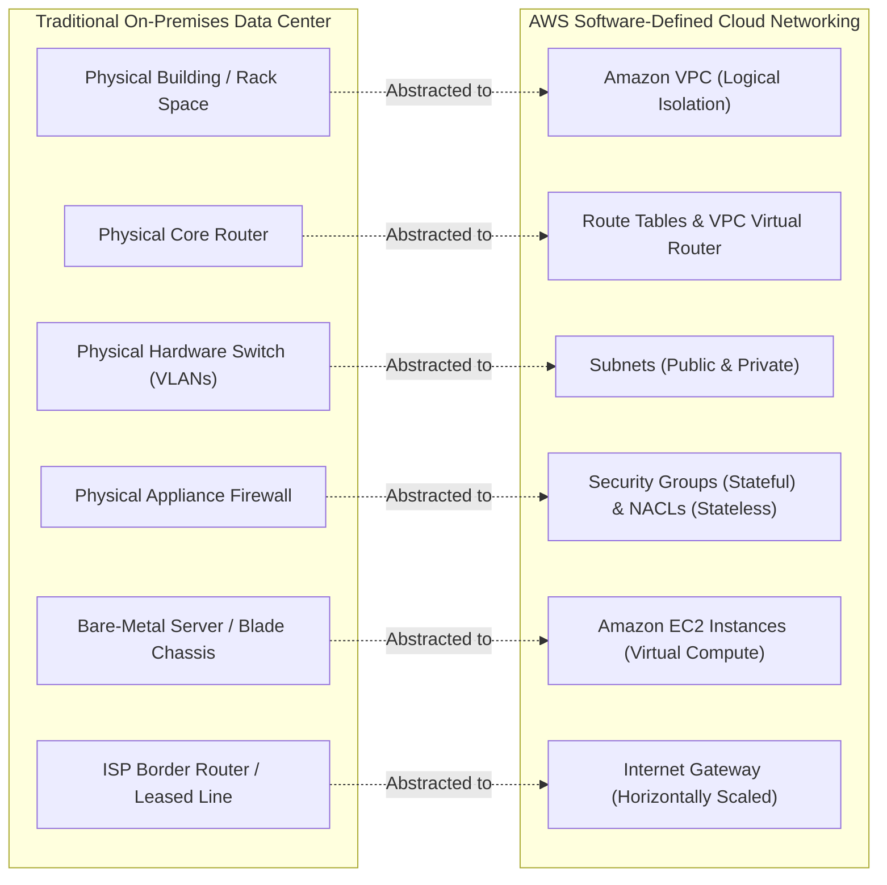
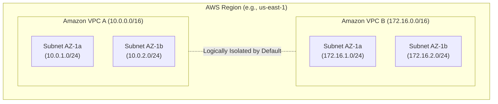
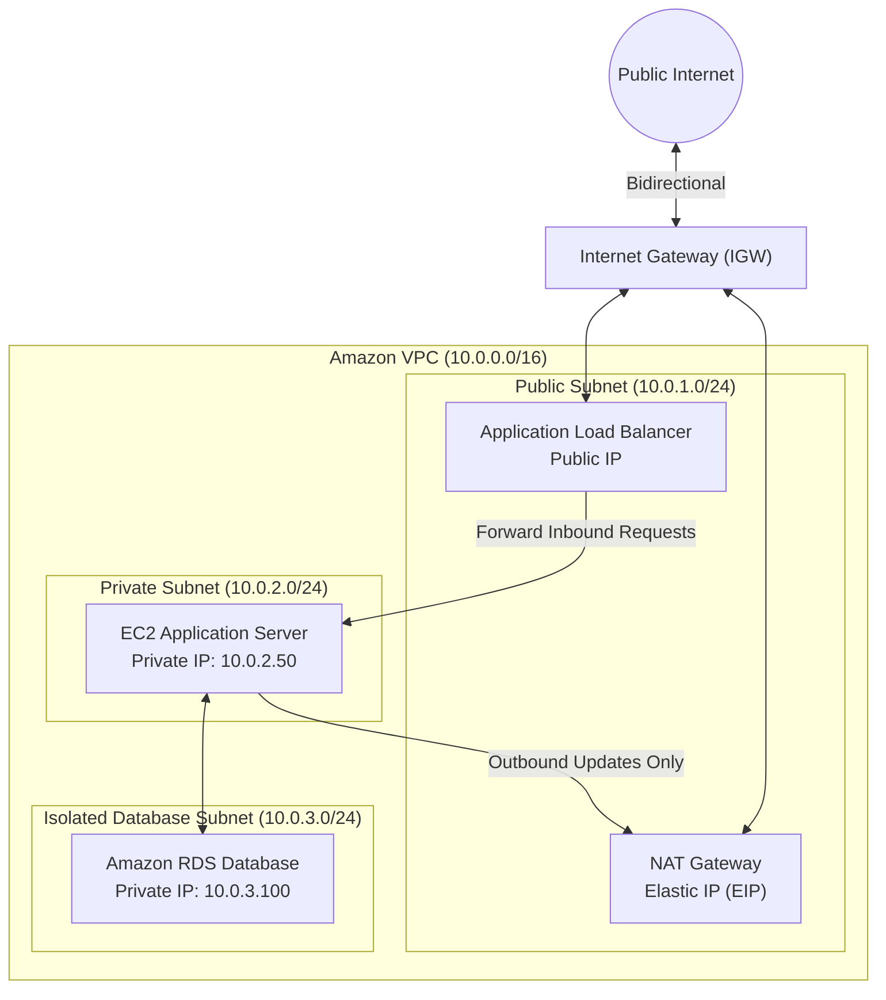
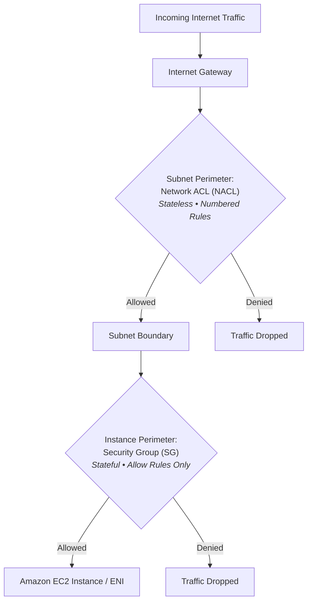
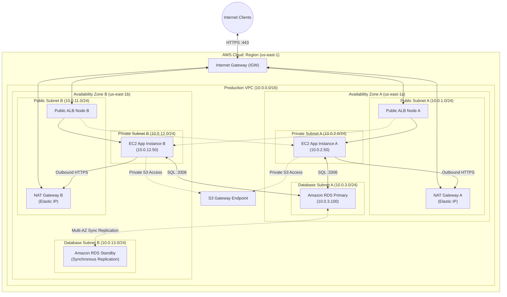

# ☁️ Amazon Virtual Private Cloud (Amazon VPC) & AWS Cloud Networking

> **Course**: AWS re/Start Networking Fundamentals  
> **Module**: M03 – Networking in the AWS Cloud  
> **Source**: `T07-Networking/T07-0004-RSNF_EN-US_SG_M03_AWSCLOUD.pdf`  
> **Target Audience**: AWS re/Start Learners, Solutions Architects, Systems Administrators, and Cloud Practitioners  

---

## 🎯 Module Overview

Networking is the foundational substrate of all cloud computing architectures. Amazon Virtual Private Cloud (**Amazon VPC**) gives cloud architects and engineers total control over their virtual networking environment in Amazon Web Services (AWS). It provides a logically isolated section of the AWS Cloud where you can launch AWS resources within a software-defined virtual network that you define and govern.

In traditional physical data centers, provisioning networking infrastructure requires procuring physical routers, switches, patch panels, firewalls, and cabling. In contrast, Amazon VPC delivers **Software-Defined Virtual Networking (SDN)**—enabling you to construct resilient, enterprise-grade, multi-tier network topologies spanning multiple Availability Zones in a matter of minutes through the AWS Management Console, AWS CLI, or Infrastructure as Code (IaC) tools like AWS CloudFormation and Terraform.

This comprehensive guide covers the architecture, core building blocks, routing mechanisms, security perimeters, hybrid connectivity options, and best practices for architecting production-ready VPCs.

---

### 📌 Learning Objectives

- [ ] **Explain Cloud Networking Fundamentals**: Contrast physical on-premises data center networking with Software-Defined Virtual Networking in AWS.
- [ ] **Understand Amazon VPC Architecture**: Define the characteristics, isolation boundaries, and Regional scope of Amazon VPC.
- [ ] **Master CIDR & IP Addressing**: Plan IPv4 CIDR blocks between `/16` and `/28` adhering to RFC 1918, understand secondary CIDRs, and identify AWS-reserved IP addresses.
- [ ] **Architect Subnets Across Availability Zones**: Configure public and private subnets mapped to distinct Availability Zones and understand their isolation models.
- [ ] **Configure Core Routing & Gateways**: Deploy and manage Internet Gateways (IGWs), Virtual Private Gateways (VGWs), and custom Route Tables.
- [ ] **Compare NAT Solutions**: Differentiate between managed AWS NAT Gateways and self-managed NAT Instances across scalability, high availability, maintenance, and cost.
- [ ] **Implement Multi-Layer VPC Security**: Master stateful Security Groups (instance-level) and stateless Network Access Control Lists (NACLs, subnet-level).
- [ ] **Analyze Advanced VPC Connectivity**: Evaluate VPC Peering, VPC Endpoints (Gateway vs. Interface powered by AWS PrivateLink), and AWS Transit Gateway.
- [ ] **Build & Troubleshoot a Production Multi-AZ VPC**: Follow a step-by-step walkthrough to build, verify, and diagnose VPC network connectivity.

---

## 📚 Key Terminology

| Term | Definition |
| :--- | :--- |
| **Amazon VPC** | A logically isolated virtual network dedicated to your AWS account within an AWS Region. |
| **Subnet** | A segmented range of logical IP addresses within a VPC that is strictly bound to a single Availability Zone (AZ). |
| **Classless Inter-Domain Routing (CIDR)** | An IP addressing allocation scheme that designates network prefixes using bit-length notation (e.g., `10.0.0.0/16`). |
| **Internet Gateway (IGW)** | A horizontally scaled, redundant, and highly available VPC component that enables two-way communication between instances in a VPC and the internet. |
| **NAT Gateway** | A managed Network Address Translation service that enables instances in a private subnet to connect outbound to the internet while preventing unsolicited inbound traffic. |
| **Route Table** | A set of rules (routes) evaluated by the virtual router to determine where network traffic from subnets or gateways is directed. |
| **Security Group (SG)** | A virtual stateful firewall that controls inbound and outbound traffic at the Elastic Network Interface (ENI) / EC2 instance level. |
| **Network ACL (NACL)** | An optional virtual stateless firewall that controls traffic entering and leaving one or more subnets using ordered allow/deny rules. |
| **VPC Peering** | A direct network connection between two VPCs enabling resources to route traffic using private IP addresses as if they belonged to the same network. |
| **VPC Endpoint** | A private network interface or gateway allowing private connectivity between a VPC and supported AWS services without internet exposure. |
| **AWS Transit Gateway** | A regional network transit hub used to interconnect hundreds or thousands of VPCs and on-premises networks in a hub-and-spoke model. |

---

## 🏛️ Section 1: Physical Data Center vs. Software-Defined Virtual Networking

In on-premises data centers, network engineers manually configure physical switches, cabling, chassis, interface cards, VLAN tags, and hardware firewalls. AWS replaces these physical primitives with **Software-Defined Virtual Networking (SDN)** running on top of AWS's hypervisors and custom silicon (AWS Nitro System).

### Conceptual Mapping: On-Premises to AWS

| Traditional Data Center Concept | AWS Cloud Service / Component | Architectural Role |
| :--- | :--- | :--- |
| **Entire Physical Data Center** | **Amazon VPC** | Provides an isolated perimeter for hosting computing, storage, and database resources. |
| **Hardware Core / Distribution Routers** | **Route Tables & Virtual Routers** | Defines next-hop targets for IP traffic based on longest-prefix matching. |
| **L2/L3 Switches & VLANs** | **Subnets** | Partitions the network address space and isolates broadcast domains logically. |
| **Boundary Hardware Firewalls** | **Network Access Control Lists (NACLs)** | Enforces stateless packet filtering at the subnet perimeter. |
| **Host-Level Firewalls (iptables, Windows FW)** | **Security Groups (SGs)** | Enforces stateful application-layer/port-level filtering at the network interface (ENI). |
| **Physical Servers & Hypervisors** | **Amazon EC2 Instances** | Virtual compute instances running guest operating systems and application workloads. |
| **ISP Circuit / Border Gateway / Modem** | **Internet Gateway (IGW)** | Translates private VPC addresses to public addresses and connects the VPC to the global internet. |
| **DMZ Proxy / NAT Appliance** | **NAT Gateway / NAT Instance** | Grants outbound-only internet connectivity for backend private servers. |



### Key Advantages of AWS Virtual Networking

1. **Instant Elasticity & Rapid Deployment**: An enterprise network that previously took weeks or months to procure and cable can be launched in minutes via code or console.
2. **Built-in Redundancy & High Availability**: AWS manages the underlying physical network topology, physical fiber links, redundant power, and switching fabrics.
3. **Zero Maintenance Overhead**: No firmware updates, hardware deprecation cycles, physical cable tracing, or cooling failures.
4. **Programmatic Automation**: Every subnet, route, rule, and gateway can be version-controlled, automated, and cloned across development, staging, and production environments.
5. **Cost Effectiveness**: Customers pay only for active resources (such as NAT Gateway operating hours and processed data transfer) with zero capital expenditure (CapEx).

---

## 🌐 Section 2: Amazon Virtual Private Cloud (Amazon VPC)

### 1. Scope & Isolation Boundaries

- **Dedicated to an AWS Account**: A VPC resides strictly within a designated AWS account.
- **Regional Scope**: A VPC is tied to a single AWS Region (e.g., `us-east-1`, `eu-west-1`, `ap-southeast-1`). A single VPC cannot span across multiple AWS Regions.
- **Multi-AZ Span**: While locked to a single Region, a VPC seamlessly spans across **all Availability Zones (AZs)** within that Region.
- **Logical Isolation**: VPC traffic is completely isolated from other customers and other VPCs on the AWS network at the hypervisor layer using encapsulation protocols. Resources in different VPCs cannot communicate unless explicitly interconnected.



### 2. IP Addressing & CIDR Block Allocation

When creating an Amazon VPC, you assign an IPv4 Classless Inter-Domain Routing (**CIDR**) block.

#### Allowed CIDR Prefix Sizes
- **Largest allowable block**: `/16` prefix = $2^{32-16} = 65,536$ IPv4 addresses.
- **Smallest allowable block**: `/28` prefix = $2^{32-28} = 16$ IPv4 addresses.

#### Recommended RFC 1918 Private Ranges

AWS strongly recommends selecting CIDR blocks from private IP address spaces established by **RFC 1918**:

| RFC 1918 Class | CIDR Block Range | Total Addresses | Typical VPC Assignment |
| :--- | :--- | :--- | :--- |
| **Class A** | `10.0.0.0` – `10.255.255.255` | 16,777,216 | `10.0.0.0/16` (Most Common Enterprise Choice) |
| **Class B** | `172.16.0.0` – `172.31.255.255` | 1,048,576 | `172.31.0.0/16` (Default VPC Allocation) |
| **Class C** | `192.168.0.0` – `192.168.255.255` | 65,536 | `192.168.0.0/16` or `192.168.1.0/24` (Branch/Home Networks) |

> [!WARNING]
> **Avoid Overlapping CIDR Blocks!**  
> If you plan to connect your VPC to an on-premises corporate network via VPN/Direct Connect, or peer it with other VPCs, **never choose overlapping CIDR blocks**. Overlapping IP blocks break routing tables and prevent peering or hybrid connectivity from functioning.

> [!NOTE]
> **Modifying CIDRs**:  
> While the primary CIDR block assigned during VPC creation cannot be changed, AWS permits adding **secondary CIDR blocks** to an existing VPC if additional address capacity is required.

---

## 🗂️ Section 3: Subnets & Availability Zone Design

### 1. Subnet Characteristics & Scope

- **Availability Zone Affinity**: A subnet **must reside entirely within a single Availability Zone (AZ)**. A subnet cannot span across multiple AZs.
- **CIDR Segmentation**: Subnet CIDR blocks must be a subset of the parent VPC CIDR and cannot overlap with any other subnet in the same VPC.
- **High Availability Multi-AZ Design**: To achieve fault tolerance and high availability, architectures must deploy redundant subnets across at least two Availability Zones (e.g., Public Subnet 1 in AZ-a, Public Subnet 2 in AZ-b).

### 2. The 5 AWS-Reserved IP Addresses per Subnet

In every subnet created in an Amazon VPC, AWS automatically reserves **5 IP addresses** for internal routing, DNS, and management. These addresses are unavailable for assignment to EC2 instances or other network interfaces:

| IP Offset | Example (`10.0.1.0/24`) | Designated Purpose |
| :--- | :--- | :--- |
| **Base + 0** | `10.0.1.0` | **Network Address**: Defines the network boundary; cannot be assigned to hosts. |
| **Base + 1** | `10.0.1.1` | **VPC Virtual Router**: Default gateway for all traffic originating inside the subnet. |
| **Base + 2** | `10.0.1.2` | **Amazon DNS Server**: Route 53 Resolver (AmazonProvidedDNS) IP address. |
| **Base + 3** | `10.0.1.3` | **Reserved by AWS**: Reserved for future internal capability additions. |
| **Last IP** | `10.0.1.255` | **Network Broadcast Address**: Broadcast is not supported in VPC, but address is reserved. |

$$\text{Usable Host IPs} = 2^{(32 - \text{prefix})} - 5$$

*Example*: A `/24` subnet contains $256 - 5 = 251$ usable host IP addresses. A `/28` subnet contains $16 - 5 = 11$ usable host IP addresses.

### 3. Public vs. Private Subnets

| Characteristic | Public Subnet | Private Subnet |
| :--- | :--- | :--- |
| **Route to Internet Gateway (IGW)** | **Yes** (`0.0.0.0/0` $\rightarrow$ `igw-xxxxxxxx`) | **No** direct route to IGW |
| **Internet Accessibility** | Bidirectional (Inbound and Outbound) | Outbound only (via NAT Gateway) or completely isolated |
| **Host IP Requirements** | Requires Public IPv4 or Elastic IP | Private IPv4 only (RFC 1918) |
| **Typical Workloads** | Internet-facing ALBs, Bastion Hosts / Jumpboxes, NAT Gateways | Web/Application Servers, Microservices, Databases (RDS/Aurora) |
| **Inbound Connection Initiation** | Direct from the public internet | Blocked from the internet; connections must originate internally |



---

## ⚙️ Section 4: Core VPC Networking Components & Routing

### 1. Internet Gateway (IGW)

An **Internet Gateway** is a managed, horizontally scaled, redundant, and highly available software VPC component.

- **Role**: Serves as the default gateway connecting the VPC to the public internet.
- **1:1 NAT Translation**: When an instance with a public IPv4 address communicates with the internet, the IGW performs line-rate 1-to-1 NAT translation between the instance's private IPv4 address and its public IPv4/Elastic IP.
- **Attachment Constraint**: You can attach **exactly one Internet Gateway per VPC**.
- **Enabling Internet Access Checklist**:
  1. Create the Internet Gateway and attach it to your VPC.
  2. Add a default route (`0.0.0.0/0`) with target `igw-xxxxxxxx` to the subnet's Route Table.
  3. Ensure instances in the subnet possess a Public IPv4 or Elastic IP (EIP).
  4. Ensure Security Groups and NACLs permit the required traffic.

### 2. Route Tables & Routing Logic

A **Route Table** contains a set of rules (routes) that dictate where network packets originating inside the subnet are dispatched.

#### Key Routing Principles
1. **Longest Prefix Match Rule**: The route table evaluates routes based on the most specific IP match (highest prefix number). If traffic matches both `10.0.0.0/16` and `10.0.1.0/24`, the more specific `/24` route takes precedence.
2. **The Immutable Local Route**: Every route table automatically includes a default local route (e.g., Destination: `10.0.0.0/16`, Target: `local`). This route allows all subnets within the VPC to communicate with each other natively and cannot be deleted or altered.
3. **Subnet Association**: Every subnet must be associated with exactly one route table. If a subnet is not explicitly associated with a custom route table, it defaults to the VPC **Main Route Table**.

#### Public vs. Private Subnet Route Tables

```
=== Public Subnet Route Table (rtb-public) ===
Destination          Target           Status
---------------------------------------------
10.0.0.0/16          local            Active
0.0.0.0/0            igw-0123456789   Active

=== Private Subnet Route Table (rtb-private) ===
Destination          Target           Status
---------------------------------------------
10.0.0.0/16          local            Active
0.0.0.0/0            nat-0987654321   Active
```

### 3. NAT Gateway vs. NAT Instance

When instances residing in private subnets need outbound internet access (e.g., applying OS security patches, downloading third-party software packages), they require Network Address Translation (**NAT**).

| Feature / Metric | AWS Managed NAT Gateway | Self-Managed NAT Instance |
| :--- | :--- | :--- |
| **Service Model** | AWS-managed serverless network component | Customer-managed EC2 instance running Amazon Linux AMI |
| **High Availability** | Highly available within its specific Availability Zone | Single point of failure; requires custom scripts for failover |
| **Bandwidth & Scaling** | Auto-scales up to 45 Gbps throughput | Constrained by EC2 instance network bandwidth (e.g., `t3.micro` vs `c5n`) |
| **Public IP Requirement** | Requires an assigned **Elastic IP (EIP)** | Requires an Elastic IP or public IP |
| **Placement** | **Must be placed in a Public Subnet** | Must be placed in a Public Subnet |
| **Source/Dest. Check** | Handled natively by AWS | **Must disable Source/Destination Check** on the EC2 instance ENI |
| **Security Mechanism** | Governed by Subnet NACLs (No Security Group) | Governed by Security Groups and Subnet NACLs |
| **Maintenance & Patching** | Fully managed by AWS (zero OS maintenance) | Customer responsible for OS patches, firewall rules, and uptime |
| **Unsolicited Inbound Traffic** | Blocks inbound traffic; drops or returns **TCP RST** | Configured via iptables rules |

> [!IMPORTANT]
> **NAT Gateway Placement Rule**:  
> A NAT Gateway **must be created inside a Public Subnet** (with a route to an IGW) and assigned an Elastic IP. Then, update the **Private Subnet's route table** to point `0.0.0.0/0` to the `nat-xxxxxxxx` target.

> [!TIP]
> **Multi-AZ NAT Gateway Architecture**:  
> A NAT Gateway is an Availability Zone-specific resource. If the AZ hosting the NAT Gateway fails, private subnets in other AZs routing through it lose internet access. In production, deploy **one NAT Gateway per Availability Zone** and associate each private subnet with its local AZ's NAT Gateway.

### 4. Virtual Private Gateway (VGW)

A **Virtual Private Gateway (VGW)** is the VPN concentrator on the AWS side of a hybrid network connection. It attaches to your VPC to terminate:
- **AWS Site-to-Site VPN**: IPsec VPN tunnels connecting corporate branch offices/data centers over the public internet.
- **AWS Direct Connect (DX)**: Dedicated private physical circuits linking enterprise colocation facilities directly to AWS.

---

## 🛡️ Section 5: VPC Security – Security Groups vs. Network ACLs

AWS uses a multi-layered defense-in-depth model within a VPC. Two distinct firewall layers safeguard network traffic: **Security Groups** at the compute/ENI layer, and **Network Access Control Lists (NACLs)** at the subnet perimeter.



### In-Depth Comparison: Security Groups vs. Network ACLs

| Feature | Security Group (SG) | Network Access Control List (NACL) |
| :--- | :--- | :--- |
| **Scope of Protection** | **Instance / ENI Level** | **Subnet Level** |
| **State Nature** | **Stateful**: If traffic is allowed inbound, response traffic is automatically permitted outbound regardless of outbound rules (and vice versa). | **Stateless**: Inbound and outbound traffic are evaluated independently. Return traffic must be explicitly permitted in both directions. |
| **Rule Types Supported** | **ALLOW rules only** (No explicit DENY rules supported). | **ALLOW and DENY rules** supported. |
| **Rule Evaluation Order** | **All rules evaluated** simultaneously before making a decision. | **Numbered rules evaluated in ascending order** (lowest number first). Stops at first match. |
| **Default Configuration (Default)** | Allows all outbound traffic; allows inbound traffic originating from members of the same SG. | Allows **all** inbound and outbound traffic (`Rule 100: * ALLOW`). |
| **Custom Configuration (New)** | Denies **all** inbound traffic; allows all outbound traffic. | Denies **all** inbound and outbound traffic until rules are added (`Rule *: * DENY`). |
| **Ephemeral Port Requirement** | Automatically tracked by state table. No ephemeral port configuration needed. | Must explicitly open **Ephemeral Ports (TCP 1024–65535)** in outbound rules to allow client responses. |

### Rule Evaluation Comparison

#### Security Group Rule Structure
A Security Group rule specifies:
- **Protocol**: TCP, UDP, ICMP, or All Traffic.
- **Port Range**: Single port (e.g., `80`, `443`, `22`) or custom range (e.g., `8080-8088`).
- **Source / Destination**: Specific IPv4 CIDR (`192.168.1.50/32`), CIDR range (`10.0.0.0/16`), anywhere (`0.0.0.0/0`), or **reference to another Security Group ID** (e.g., `sg-0abc123`).

#### Network ACL Rule Structure
A NACL rule specifies:
- **Rule Number**: 1 to 32766. Rules are processed in strict ascending numerical order. Best practice is to space rules in increments of 10 or 100 (e.g., 100, 110, 120) to allow inserting future rules.
- **Type / Protocol**: HTTP (TCP 80), HTTPS (TCP 443), SSH (TCP 22), Custom TCP, ICMP, etc.
- **Port Range**: 1–65535.
- **Source / Destination CIDR**: Target IPv4 address range.
- **Allow / Deny Action**: Decisive action taken when packet matches.
- **Catch-All Asterisk (`*`)**: The final default rule in every NACL that drops all unmatched traffic (`DENY`).

> [!CAUTION]
> **The Stateless Ephemeral Port Trap**:  
> When a web client sends an HTTP request to port 80, the client's operating system assigns a dynamic high-numbered source port (known as an **ephemeral port**, typically `1024–65535`).  
> In a Network ACL, because it is **stateless**, you must have an **Outbound Rule** permitting TCP traffic to destination ports `1024–65535`. If you forget this rule, the web server receives the request, but the return packet is blocked by the NACL, resulting in a connection timeout!

---

## 🔗 Section 6: Advanced VPC Connectivity Architecture

As cloud architectures mature, organizations must link multiple VPCs, access AWS SaaS platforms securely, and integrate on-premises networks.

```mermaid
graph TD
    subgraph VPC_A["VPC A (App Tier)<br>10.0.0.0/16"]
        App["App EC2"]
    end

    subgraph VPC_B["VPC B (Analytics Tier)<br>10.1.0.0/16"]
        Analytics["EMR / Redshift"]
    end

    subgraph VPC_C["VPC C (Shared Services)<br>10.2.0.0/16"]
        ActiveDirectory["Domain Controllers"]
    end

    subgraph Hub["Central Transit Hub"]
        TGW["AWS Transit Gateway (TGW)<br><i>Central Hub-and-Spoke</i>"]
    end

    subgraph AWS_Services["AWS Managed Services"]
        S3["Amazon S3<br><i>Gateway Endpoint</i>"]
        SSM["AWS Systems Manager<br><i>Interface Endpoint (PrivateLink)</i>"]
    end

    App <-->|VPC Peering| Analytics
    VPC_A <-->|VPC Attachment| TGW
    VPC_B <-->|VPC Attachment| TGW
    VPC_C <-->|VPC Attachment| TGW
    App -.->|Private Prefix List Route| S3
    App -.->|Private ENI (10.0.1.25)| SSM
```

### 1. VPC Peering

- **Definition**: A 1-to-1 networking connection between two VPCs allowing them to route traffic directly using private IPv4/IPv6 addresses.
- **Characteristics**:
  - Operates across AWS accounts and across AWS Regions (Inter-Region VPC Peering).
  - Uses the AWS private global fiber network; traffic never traverses the public internet.
  - **No Overlapping CIDR Blocks**: VPCs with identical or overlapping IP spaces cannot peer.
  - **Non-Transitive Routing**: VPC peering is strictly non-transitive. If VPC A is peered with VPC B, and VPC B is peered with VPC C, **VPC A cannot communicate with VPC C through VPC B**. You must establish a direct peering connection between VPC A and VPC C, or implement an AWS Transit Gateway.

### 2. VPC Endpoints (AWS PrivateLink)

A **VPC Endpoint** enables private connectivity between your VPC and supported AWS services without requiring an Internet Gateway, NAT Gateway, VPN, or AWS Direct Connect.

| Comparison Metric | Gateway Endpoints | Interface Endpoints (AWS PrivateLink) |
| :--- | :--- | :--- |
| **Supported Services** | **Amazon S3** and **Amazon DynamoDB** only | Most AWS services (EC2, SSM, CloudWatch, KMS, Secrets Manager, API Gateway) + 3rd Party SaaS |
| **Implementation** | Route Table target (Prefix List entry, e.g., `pl-63a5400a`) | **Elastic Network Interface (ENI)** with private IP in your subnet |
| **DNS Resolution** | Standard AWS public DNS names resolve natively | Private DNS integration automatically redirects public service endpoints to private ENI IP |
| **Security Controls** | VPC Endpoint Policy attached to endpoint resource | **Security Groups** attached directly to the endpoint ENI + Endpoint Policy |
| **Cost** | **Free** (No hourly charges or data processing fees) | **Hourly charge per AZ ENI** + per-GB data processing fees |

### 3. AWS Transit Gateway (TGW)

- **Hub-and-Spoke Architecture**: Acts as a high-bandwidth, regional network transit hub connecting thousands of VPCs, AWS Direct Connect gateways, and VPN connections.
- **Transitive Routing**: Simplifies complex peering meshes ($N(N-1)/2$ connections) by allowing all VPCs to route through a central router with custom route tables.
- **Multicast & Peering**: Supports IP multicast and inter-region Transit Gateway peering.

---

## 🏗️ Section 7: Production Multi-AZ VPC Architecture

The following diagram illustrates a production-ready, highly available, multi-Availability Zone AWS VPC architecture with segmented tiers:



---

## 🛠️ Section 8: Step-by-Step Hands-On Implementation Workflow

This step-by-step walkthrough outlines how to provision a production-grade VPC matching the official curriculum demonstration:

### Step 1: Create the Amazon VPC
1. Navigate to the **VPC Console** $\rightarrow$ **Your VPCs** $\rightarrow$ **Create VPC**.
2. Select **VPC only** (or use the *VPC and more* wizard).
3. Name tag: `Lab-VPC`.
4. IPv4 CIDR block: `10.0.0.0/16`.
5. Tenancy: `Default`. Click **Create VPC**.

### Step 2: Create and Attach the Internet Gateway
1. Navigate to **Internet Gateways** $\rightarrow$ **Create internet gateway**.
2. Name tag: `Lab-IGW`. Click **Create internet gateway**.
3. Select `Lab-IGW`, click **Actions** $\rightarrow$ **Attach to VPC**.
4. Choose `Lab-VPC` and confirm.

### Step 3: Create Public and Private Subnets
1. Navigate to **Subnets** $\rightarrow$ **Create subnet**.
2. Select VPC: `Lab-VPC`.
3. Configure **Public Subnet 1**:
   - Subnet name: `Public-Subnet-AZ-A`
   - Availability Zone: `us-east-1a`
   - IPv4 CIDR: `10.0.1.0/24`
4. Configure **Private Subnet 1**:
   - Subnet name: `Private-Subnet-AZ-A`
   - Availability Zone: `us-east-1a`
   - IPv4 CIDR: `10.0.2.0/24`
5. Click **Create subnet**.
6. Select `Public-Subnet-AZ-A` $\rightarrow$ **Actions** $\rightarrow$ **Edit subnet settings** $\rightarrow$ Enable **Auto-assign public IPv4 address**.

### Step 4: Deploy the NAT Gateway
1. Navigate to **NAT Gateways** $\rightarrow$ **Create NAT gateway**.
2. Name tag: `Lab-NAT-GW-AZ-A`.
3. Subnet: Select **`Public-Subnet-AZ-A`** (*Crucial: Never select the private subnet*).
4. Connectivity type: **Public**.
5. Click **Allocate Elastic IP**. Click **Create NAT gateway**.

### Step 5: Configure Route Tables
1. **Public Route Table**:
   - Create route table: `Public-Route-Table`.
   - Routes tab $\rightarrow$ **Edit routes** $\rightarrow$ Add route:
     - Destination: `0.0.0.0/0`
     - Target: `Internet Gateway` (`Lab-IGW`)
   - Subnet associations tab $\rightarrow$ Associate `Public-Subnet-AZ-A`.
2. **Private Route Table**:
   - Create route table: `Private-Route-Table`.
   - Routes tab $\rightarrow$ **Edit routes** $\rightarrow$ Add route:
     - Destination: `0.0.0.0/0`
     - Target: `NAT Gateway` (`Lab-NAT-GW-AZ-A`)
   - Subnet associations tab $\rightarrow$ Associate `Private-Subnet-AZ-A`.

### Step 6: Configure Security Groups
1. **Public Bastion/Web SG** (`sg-public`):
   - Inbound: Allow SSH (TCP 22) from your IP (`x.x.x.x/32`). Allow HTTP (TCP 80) from `0.0.0.0/0`.
   - Outbound: Allow All Traffic (`0.0.0.0/0`).
2. **Private App SG** (`sg-private`):
   - Inbound: Allow SSH (TCP 22) sourced from `sg-public` (Security Group reference).
   - Inbound: Allow ICMP (Echo Request) sourced from `10.0.1.0/24`.
   - Outbound: Allow All Traffic (`0.0.0.0/0`).

### Step 7: Launch Compute & Verify Connectivity
1. Launch an EC2 instance in `Public-Subnet-AZ-A` with `sg-public`.
2. Launch an EC2 instance in `Private-Subnet-AZ-A` with `sg-private` (no public IP).
3. Connect to the public instance via SSH or EC2 Instance Connect.
4. From the public instance, ping the private instance using its private IP:
   ```bash
   ping 10.0.2.50
   ```
5. From the private instance, verify outbound internet access through the NAT Gateway:
   ```bash
   ping 8.8.8.8
   curl -I https://aws.amazon.com
   ```
   Both commands should succeed, confirming outbound NAT connectivity without exposing the instance directly to incoming internet traffic.

---

## 🔍 Section 9: Diagnostic & Troubleshooting Guide

| Issue / Symptom | Root Cause | Remediation Steps |
| :--- | :--- | :--- |
| **Cannot connect to EC2 in Public Subnet via SSH/HTTP** | Subnet Route Table missing IGW route, or EC2 lacks a public IP. | 1. Verify route table has `0.0.0.0/0` $\rightarrow$ `igw-xxx`.<br>2. Confirm instance has a public IPv4 or Elastic IP.<br>3. Check Security Group allows SSH (22) from your IP.<br>4. Check NACL allows inbound TCP 22 & outbound ephemeral ports (1024–65535). |
| **Private Subnet instance cannot download packages or reach internet** | NAT Gateway misconfigured, placed in private subnet, or route table wrong. | 1. Ensure NAT Gateway is placed in the **Public Subnet**.<br>2. Verify an Elastic IP is associated with the NAT Gateway.<br>3. Ensure Private Subnet route table points `0.0.0.0/0` to `nat-xxx`.<br>4. Check that Public Subnet route table routes `0.0.0.0/0` to `igw-xxx`. |
| **Inter-VPC Peering traffic fails** | Route tables missing peering routes, or Security Groups blocking private CIDRs. | 1. Update route tables in **both** VPCs with routes pointing to `pcx-xxx`.<br>2. Ensure Security Groups allow traffic from the remote VPC CIDR.<br>3. Confirm CIDR ranges do not overlap. |
| **NACL blocks return web traffic** | Missing outbound ephemeral port rule in stateless NACL. | Add outbound rule to NACL allowing TCP ports `1024–65535` to `0.0.0.0/0`. |
| **Custom NAT Instance fails to forward packets** | Source/Destination Check enabled on EC2 ENI. | Select NAT EC2 instance $\rightarrow$ **Actions** $\rightarrow$ **Networking** $\rightarrow$ **Change source/dest. check** $\rightarrow$ Set to **Disabled**. |

---

## 🧩 Section 10: Checkpoint Questions & Knowledge Check

### Question 1
**Which level of the network architecture does a Security Group protect?**  
- **A)** The Subnet level  
- **B)** The Instance / Elastic Network Interface (ENI) level  
- **C)** The VPC Border level  
- **D)** The Internet Gateway level  
> **Answer**: **B**  
> **Explanation**: Security Groups operate as virtual stateful firewalls directly at the EC2 instance and Elastic Network Interface (ENI) level. In contrast, Network ACLs operate at the Subnet boundary.

---

### Question 2
**What is the largest CIDR block size (most IP addresses) that can be assigned to an Amazon VPC?**  
- **A)** `/8`  
- **B)** `/16`  
- **C)** `/24`  
- **D)** `/28`  
> **Answer**: **B**  
> **Explanation**: AWS permits VPC IPv4 CIDR blocks between `/16` (largest, providing 65,536 addresses) and `/28` (smallest, providing 16 addresses). CIDR blocks larger than `/16` (such as `/8`) are not permitted in Amazon VPC.

---

### Question 3
**How many IP addresses does AWS reserve in every created subnet, and why?**  
- **A)** 1 IP address (the broadcast address)  
- **B)** 2 IP addresses (network address and broadcast address)  
- **C)** 5 IP addresses (network address, VPC router, Amazon DNS, AWS future use, and broadcast address)  
- **D)** 0 IP addresses (all addresses in the CIDR are assignable)  
> **Answer**: **C**  
> **Explanation**: AWS reserves the first four IP addresses (`.0`, `.1`, `.2`, `.3`) and the last IP address (`.255` in a `/24`) for internal VPC routing, DNS resolution, and structural reservation.

---

### Question 4
**An engineer launches an EC2 instance in a private subnet. The instance needs to periodically download operating system updates from the public internet, but must never be accessible from inbound internet traffic. What is the recommended architectural solution?**  
- **A)** Attach an Internet Gateway directly to the private subnet's route table.  
- **B)** Assign an Elastic IP address directly to the private EC2 instance.  
- **C)** Deploy a NAT Gateway in a public subnet, and route `0.0.0.0/0` from the private subnet to the NAT Gateway.  
- **D)** Configure a VPC Peering connection with the AWS public internet gateway.  
> **Answer**: **C**  
> **Explanation**: A managed NAT Gateway placed in a public subnet enables instances in private subnets to initiate outbound connections to the internet while automatically blocking unsolicited inbound traffic from the internet.

---

### Question 5
**What is the fundamental operational difference between a Security Group and a Network ACL regarding traffic return paths?**  
- **A)** Security Groups are stateless; Network ACLs are stateful.  
- **B)** Security Groups are stateful; return traffic is automatically allowed regardless of outbound rules. Network ACLs are stateless; return traffic must be explicitly allowed.  
- **C)** Network ACLs support only allow rules; Security Groups support allow and deny rules.  
- **D)** Security Groups evaluate numbered rules in ascending order; Network ACLs evaluate all rules simultaneously.  
> **Answer**: **B**  
> **Explanation**: Security Groups are stateful. If an inbound packet is accepted, the return response is automatically tracked and allowed outbound. Network ACLs are stateless, requiring explicit rules in both directions (inbound and outbound) to permit complete communication flows.

---

## 📌 Key Takeaways & Summary

- **Software-Defined Networking**: Amazon VPC abstracts physical data center hardware into customizable, scalable, and isolated virtual networks provisioned in minutes.
- **Regional Footprint, Multi-AZ Resilience**: A VPC is constrained to a single AWS Region, but subnets can and should be distributed across multiple Availability Zones to ensure high availability and disaster recovery.
- **Strict CIDR Guidelines**: VPC CIDR blocks range from `/16` to `/28`, ideally conforming to RFC 1918 private address ranges. 5 IP addresses are reserved by AWS in every subnet.
- **Subnet Separation**: Public subnets route directly to an Internet Gateway (`0.0.0.0/0` $\rightarrow$ `igw-xxx`), whereas private subnets route outbound internet traffic through a NAT Gateway (`0.0.0.0/0` $\rightarrow$ `nat-xxx`) residing in a public subnet.
- **Dual-Layer Defense**:
  - **Network ACLs**: Stateless, subnet-level, numbered rules supporting both ALLOW and DENY actions.
  - **Security Groups**: Stateful, instance/ENI-level, supporting ALLOW rules only with automatic response tracking.
- **Inter-Network Connectivity**:
  - Use **VPC Peering** for direct 1-to-1 non-transitive VPC interconnection.
  - Use **VPC Endpoints** (Gateway for S3/DynamoDB, Interface/PrivateLink for other services) for private, zero-internet AWS service access.
  - Use **AWS Transit Gateway** to consolidate multi-VPC and hybrid network topologies into a scalable hub-and-spoke model.
