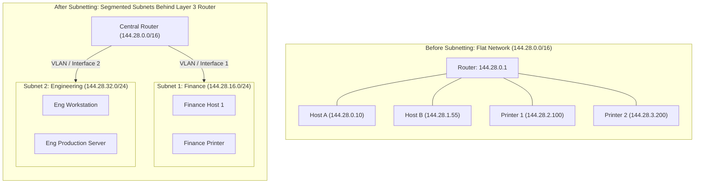
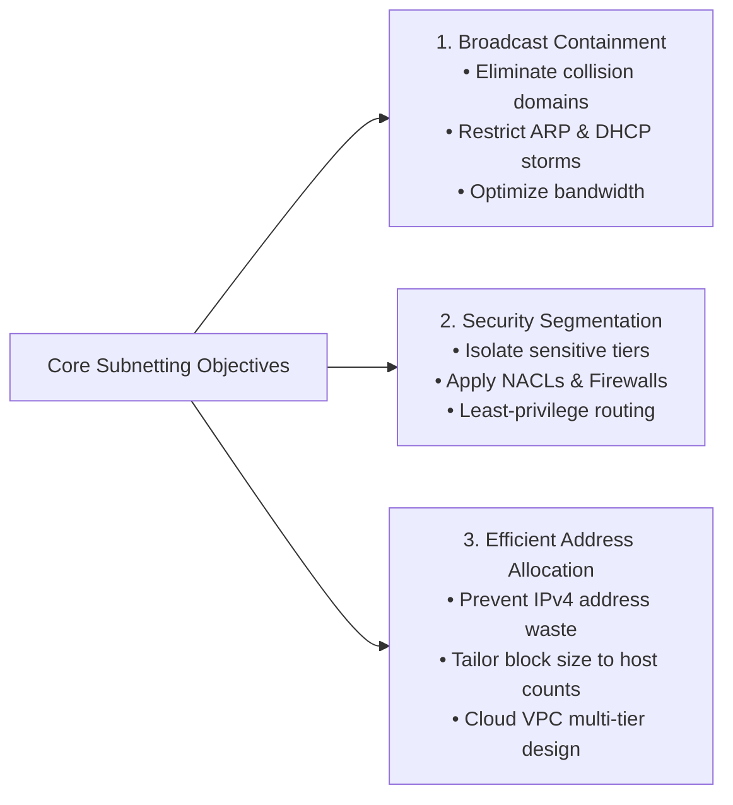
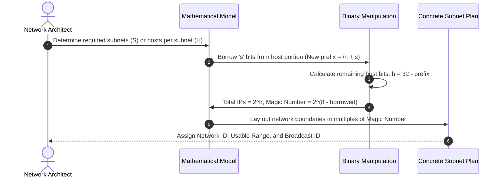
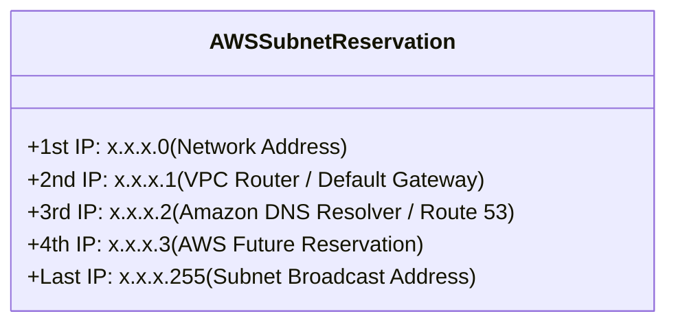
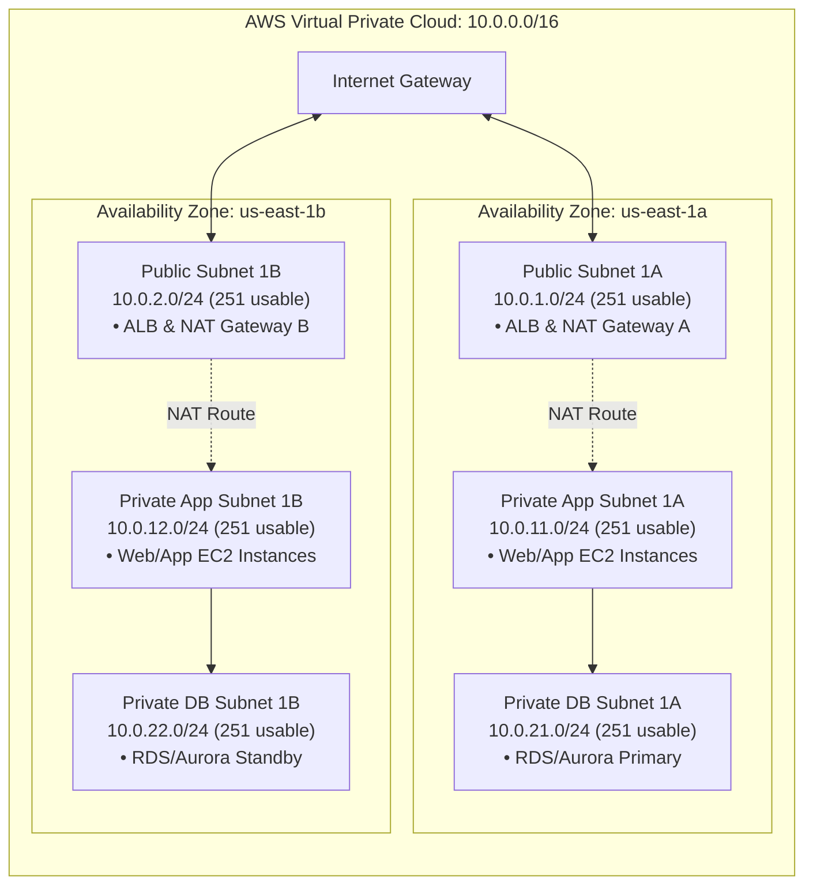

# 🌐 Introduction to IP Subnetting & CIDR Architecture

> **Course**: AWS re/Start Networking Fundamentals  
> **Module**: M03 – Networking Fundamentals: IP Subnetting  
> **Source**: `T07-0005-RSNF_EN-US_SG_M03_IPSUBNETTING.pdf`  
> **Target Audience**: AWS re/Start Learners, Cloud Practitioners, & Network Solutions Architects  

---

## 🎯 Module Overview

In modern internet and enterprise architectures, physical networks connect billions of endpoints worldwide. To direct traffic efficiently, every networked device is assigned an Internet Protocol (IPv4 or IPv6) address. However, managing flat, unsegmented networks quickly leads to catastrophic broadcast traffic congestion, severe security exposure, and massive wastage of limited IPv4 address blocks.

**IP Subnetting** is the foundational engineering discipline of logically partitioning a contiguous IP network into smaller, independent, interconnected sub-networks (subnets). Combined with **Classless Inter-Domain Routing (CIDR)**, subnetting allows network engineers and cloud architects to design high-performance, strictly isolated, and hierarchically organized environments.

Within **Amazon Web Services (AWS)**, mastering subnetting is essential for architecting a **Virtual Private Cloud (VPC)**. Cloud architects must accurately size subnets across multiple Availability Zones, account for **AWS-reserved IP addresses**, and enforce least-privilege boundary routing between public-facing and private internal workloads.

---

### 📌 Learning Objectives

- [ ] **Define Subnetting**: Articulate the purpose, anatomical components, and operational mechanics of an IP subnet.
- [ ] **Analyze Architectural Benefits**: Explain how subnetting achieves broadcast containment, fine-grained security isolation, and optimal IP address allocation.
- [ ] **Deconstruct Subnet Masks**: Analyze the binary structure of subnet masks (contiguous 1s for Network bits vs. contiguous 0s for Host bits) and default classful boundaries.
- [ ] **Master CIDR Notation**: Apply Classless Inter-Domain Routing prefix notation (`/8` through `/30`) to represent address ranges and calculate prefix boundaries.
- [ ] **Execute Subnet Calculations**: Calculate total subnets ($2^s$), total host capacity ($2^h$), and traditional usable hosts ($2^h - 2$) using the magic number increment method.
- [ ] **Apply AWS VPC Subnet Rules**: Detail the **5 Reserved IP Addresses** (.0, .1, .2, .3, and last address) in every AWS subnet and calculate usable instances using ($2^h - 5$).
- [ ] **Architect Cloud Topologies**: Formulate production-ready multi-tier VPC IP allocation plans across multiple Availability Zones.

---

## 📚 Key Terminology

| Term | Technical Definition |
| :--- | :--- |
| **IP Address (IPv4)** | A 32-bit numerical identifier assigned to each device connected to a computer network, formatted as four 8-bit octets in dotted-decimal notation (`x.x.x.x`). |
| **Subnet (Subnetwork)** | A logically partitioned segment of a larger physical or virtual IP network, forming an isolated Layer 3 broadcast domain. |
| **Subnet Mask** | A 32-bit binary mask of contiguous 1s followed by contiguous 0s used by Layer 3 devices to differentiate the Network ID from the Host ID. |
| **Network ID** | The leading portion of an IP address that designates the specific network or subnet block to which a host belongs. |
| **Host ID** | The trailing portion of an IP address that uniquely identifies a specific interface or node within a designated network segment. |
| **Broadcast Address** | A special network address used to transmit packets simultaneously to all active nodes within a specific subnet. |
| **Default Gateway** | A Layer 3 routing device interface that routes packets destined for networks outside the local subnet. |
| **CIDR (Classless Inter-Domain Routing)** | An IP addressing scheme (RFC 1518/1519) replacing rigid classful boundaries with variable-length prefix notation (`/n`). |
| **Supernetting** | The aggregation of multiple smaller contiguous subnets into a single larger routing prefix to minimize routing table entries (route summarization). |
| **Amazon VPC Subnet** | A range of IP addresses within a Virtual Private Cloud bound to a specific single Availability Zone in an AWS Region. |

---

## 🏗️ 1. Subnetting Fundamentals & Operational Motivations

### What is a Subnet?
Subnetting is the practice of dividing a single large physical or virtual network into smaller, discrete subnetworks. Without subnetting, all devices connected to an organization's network share a single flat broadcast domain.



### The Three Core Motivations for Subnetting



#### 1. Broadcast Containment & Traffic Optimization
* **The Problem**: In Ethernet Local Area Networks (LANs), data link layer broadcasts (such as Address Resolution Protocol - ARP queries or DHCP discoveries) are delivered to every host on the network. In large networks with hundreds or thousands of nodes, broadcast traffic causes severe packet collisions, high CPU utilization on endpoints, and severe network latency.
* **The Solution**: Routers (Layer 3 devices) do **not** forward Layer 2 broadcast packets. Subnetting creates smaller broadcast domains. A broadcast originating inside `144.28.16.0/24` stays confined to Subnet 1 and does not flood devices in Subnet 2.

#### 2. Fine-Grained Security Segmentation
* In a flat network, any compromised workstation can probe and access internal database servers, management interfaces, and financial systems directly via Layer 2 switching.
* By placing departments or architectural tiers into distinct subnets, inter-subnet communication **must** traverse a router or firewall. Network administrators can enforce stateful firewalls, packet filters, and **Network Access Control Lists (NACLs)** at the subnet boundary.

#### 3. Efficient Address Allocation & IPv4 Conservation
* Public IPv4 addresses are scarce and expensive. If an organization receives a Class B block (65,536 addresses) or Class C block (256 addresses) and assigns it to a branch office with only 25 computers, up to 90% of the addresses would be wasted.
* Subnetting allows network architects to carve address blocks into exactly the sizes required (e.g., allocating a `/27` with 30 host addresses to a small team, and a `/29` with 6 host addresses to a point-to-point link).

> [!NOTE]
> **Subnet Communication Rule**: Systems located within the **same subnet** communicate directly with one another over Layer 2 switching (via MAC addresses). Systems located in **different subnets** cannot communicate directly; their traffic must be forwarded through a **default gateway (router)** operating at Layer 3.

---

## 🔍 2. Anatomy of an IPv4 Address and Subnet Mask

### Structure of an IPv4 Address
An IPv4 address consists of **32 binary bits** partitioned into **four 8-bit bytes (octets)** separated by dots:

$$\text{IPv4 Address} = \underbrace{11000000}_{\text{Octet 1: 192}} \,.\, \underbrace{10101000}_{\text{Octet 2: 168}} \,.\, \underbrace{00000001}_{\text{Octet 3: 1}} \,.\, \underbrace{01100110}_{\text{Octet 4: 102}} = 192.168.1.102$$

Every IP address contains two logical parts:
1. **Network Portion (Network ID)**: Identifies the specific network to which the host belongs.
2. **Host Portion (Host ID)**: Identifies the unique host interface on that specific network.

### How a Subnet Mask Works
A **subnet mask** is a 32-bit binary number consisting of a contiguous block of binary **1s** (representing the Network bits) followed by a contiguous block of binary **0s** (representing the Host bits).

```
IP Address:   192.168.1.102 -> 11000000 . 10101000 . 00000001 . 01100110
Subnet Mask:  255.255.255.0 -> 11111111 . 11111111 . 11111111 . 00000000
                               [-------- 24 Network Bits -------] [ 8 Host ]
```

### The Bitwise AND Operation
Routers determine whether a destination IP is local or remote by performing a bitwise **AND** logic operation between the destination IP address and the subnet mask:

$$\text{Bitwise Logic Rules}: \quad 1 \text{ AND } 1 = 1, \quad 1 \text{ AND } 0 = 0, \quad 0 \text{ AND } 0 = 0$$

```
  192.168.1.102:   11000000 . 10101000 . 00000001 . 01100110
& 255.255.255.0:   11111111 . 11111111 . 11111111 . 00000000
--------------------------------------------------------------
= Network Address: 11000000 . 10101000 . 00000001 . 00000000  ->  192.168.1.0
```

### Historical Classful Addressing System

Before the adoption of CIDR, the IPv4 address space was divided into five rigid classes based on the high-order bits of the first octet:

| Class | First Octet Range | High-Order Bits | Default Subnet Mask | CIDR Prefix | Network / Host Bits | Total Usable Hosts / Network | Primary Purpose |
| :---: | :---: | :---: | :---: | :---: | :---: | :---: | :--- |
| **A** | `1` – `126` (`0` reserved) | `0...` | `255.0.0.0` | `/8` | 8 Net / 24 Host | $2^{24}-2 = 16,777,214$ | Massive multinational organizations, global backbones |
| **B** | `128` – `191` | `10...` | `255.255.0.0` | `/16` | 16 Net / 16 Host | $2^{16}-2 = 65,534$ | Large enterprise networks, universities |
| **C** | `192` – `223` | `110...` | `255.255.255.0` | `/24` | 24 Net / 8 Host | $2^8-2 = 254$ | Small to medium businesses, local branch offices |
| **D** | `224` – `239` | `1110...` | *N/A* (No host bits) | *N/A* | None | Multicast Groups | Group communication (IPTV, video conferences, routing protocols) |
| **E** | `240` – `255` | `1111...` | *N/A* (Undefined) | *N/A* | None | Reserved / Experimental | Research, future testing; `255.255.255.255` is limited broadcast |

> [!IMPORTANT]
> **Loopback Reservation**: The `127.0.0.0/8` range is reserved for local host loopback testing (`127.0.0.1` represents `localhost`). It is excluded from Class A assignable space.

---

## ⚡ 3. Classless Inter-Domain Routing (CIDR) Notation

### The Evolution from Classful to Classless
Rigid classful networking suffered from severe inefficiency:
* An organization needing 500 IP addresses was too large for a Class C network (254 hosts), forcing them to request a Class B network (65,534 hosts)—wasting over 65,000 addresses.
* In 1993, **Classless Inter-Domain Routing (CIDR)** (RFC 1518 and RFC 1519) eliminated class boundaries, allowing subnet masks of arbitrary bit lengths (`/8` through `/30`).

### CIDR Slash Notation
CIDR notation appends a forward slash (`/`) followed by the prefix length to the IP address:

$$\text{Prefix Length } (/n) = \text{Total number of contiguous binary 1s in the subnet mask}$$

For example, `192.168.1.0/24`:
* The first **24 bits** are fixed (Network ID).
* The remaining **$32 - 24 = 8$ bits** are flexible (Host ID).
* Total address capacity: $2^8 = 256$ IP addresses.

```
192.168.1.0/24:
11000000 . 10101000 . 00000001 | 00000000
[------- Fixed Network: 24 bits -------] [ Flexible Host: 8 bits ]
```

### CIDR Reference & Sizing Cheat Sheet (`/16` down to `/30`)

The following reference table outlines subnet masks, binary increments, total addresses, traditional usable hosts, and AWS usable hosts:

| CIDR Prefix | Subnet Mask (Dotted-Decimal) | Binary of Significant Octet | Block Size / Magic Increment | Total Addresses ($2^h$) | Traditional Usable ($2^h - 2$) | AWS VPC Usable ($2^h - 5$) | Typical Cloud Use Case |
| :---: | :---: | :---: | :---: | :---: | :---: | :---: | :--- |
| **/16** | `255.255.0.0` | `00000000` (Octet 3) | 1 in Octet 2 | 65,536 | 65,534 | 65,531 | AWS VPC maximum standard size |
| **/17** | `255.255.128.0` | `10000000` (Octet 3) | 128 in Octet 3 | 32,768 | 32,766 | 32,763 | Large enterprise VPC allocation |
| **/18** | `255.255.192.0` | `11000000` (Octet 3) | 64 in Octet 3 | 16,384 | 16,382 | 16,379 | High-density multi-account VPC |
| **/19** | `255.255.224.0` | `11100000` (Octet 3) | 32 in Octet 3 | 8,192 | 8,190 | 8,187 | Regional production container cluster |
| **/20** | `255.255.240.0` | `11110000` (Octet 3) | 16 in Octet 3 | 4,096 | 4,094 | 4,091 | Production Availability Zone block |
| **/21** | `255.255.248.0` | `11111000` (Octet 3) | 8 in Octet 3 | 2,048 | 2,046 | 2,043 | Multi-tier application subnet |
| **/22** | `255.255.252.0` | `11111100` (Octet 3) | 4 in Octet 3 | 1,024 | 1,022 | 1,019 | Standard enterprise private subnet |
| **/23** | `255.255.254.0` | `11111110` (Octet 3) | 2 in Octet 3 | 512 | 510 | 507 | Large shared service subnet |
| **/24** | `255.255.255.0` | `00000000` (Octet 4) | 1 in Octet 3 | 256 | 254 | 251 | Standard public/private app subnet |
| **/25** | `255.255.255.128` | `10000000` (Octet 4) | 128 in Octet 4 | 128 | 126 | 123 | Medium compute cluster |
| **/26** | `255.255.255.192` | `11000000` (Octet 4) | 64 in Octet 4 | 64 | 62 | 59 | Database tier, dedicated worker pool |
| **/27** | `255.255.255.224` | `11110000` (Octet 4) | 32 in Octet 4 | 32 | 30 | 27 | Load balancer or NAT gateway subnet |
| **/28** | `255.255.255.240` | `11111000` (Octet 4) | 16 in Octet 4 | 16 | 14 | 11 | **AWS VPC minimum subnet size** |
| **/29** | `255.255.255.248` | `11111100` (Octet 4) | 8 in Octet 4 | 8 | 6 | *N/A (AWS min /28)* | Point-to-point on-premise links |
| **/30** | `255.255.255.252` | `11111110` (Octet 4) | 4 in Octet 4 | 4 | 2 | *N/A (AWS min /28)* | Point-to-point serial router links |

---

## 🧮 4. Step-by-Step Subnet Calculation Tutorial

Subnetting involves borrowing bits from the **Host portion** to extend the **Network portion**.



### Core Mathematical Formulas

1. **Number of Created Subnets**:
   $$\text{Subnets} = 2^s$$
   Where $s$ is the number of bits borrowed from the original host portion.

2. **Total Addresses per Subnet**:
   $$\text{Total Addresses} = 2^h$$
   Where $h$ is the number of remaining flexible host bits ($h = 32 - \text{prefix}$).

3. **Traditional Usable Hosts per Subnet**:
   $$\text{Usable Hosts} = 2^h - 2$$
   Two addresses are reserved in standard networking:
   * **First address**: Network ID (cannot be assigned to an interface).
   * **Last address**: Broadcast ID (used to send traffic to all subnet members).

4. **The Magic Number (Block Increment Method)**:
   The **Magic Number** is the step size (increment) between consecutive subnet IDs within the active (changing) octet:
   $$\text{Magic Number} = 256 - \text{Subnet Mask Value in the Interesting Octet}$$

---

### Walkthrough 1: Subnetting a `/24` into Four Subnets (`/26`)

* **Starting Network**: `192.168.1.0/24` (Subnet mask: `255.255.255.0`)
* **Objective**: Carve this space into 4 equal subnets.

#### Step 1: Calculate Borrowed Bits ($s$)
To create 4 subnets: $2^s \ge 4 \implies s = 2 \text{ bits}$.
* Old prefix: `/24`
* New prefix: $24 + 2 = \mathbf{/26}$

#### Step 2: Determine New Subnet Mask
The 4th octet borrows 2 bits:
$$\text{Binary of 4th Octet} = \mathbf{11}000000_2 = 128 + 64 = 192$$
$$\text{New Subnet Mask} = 255.255.255.192$$

#### Step 3: Determine Host Bits ($h$) and Capacity
$$\text{Remaining host bits } h = 32 - 26 = 6 \text{ bits}$$
* Total addresses per subnet: $2^6 = 64$
* Traditional usable hosts: $2^6 - 2 = 62$

#### Step 4: Find the Magic Number Increment
$$\text{Magic Number} = 256 - 192 = \mathbf{64}$$

#### Step 5: Map Out the Four Subnets

| Subnet Number | Network Address (1st IP) | Usable Host Range | Broadcast Address (Last IP) | Total / Usable Hosts |
| :---: | :--- | :--- | :--- | :---: |
| **Subnet 1** | `192.168.1.0` | `192.168.1.1` – `192.168.1.62` | `192.168.1.63` | 64 / 62 |
| **Subnet 2** | `192.168.1.64` | `192.168.1.65` – `192.168.1.126` | `192.168.1.127` | 64 / 62 |
| **Subnet 3** | `192.168.1.128` | `192.168.1.129` – `192.168.1.190` | `192.168.1.191` | 64 / 62 |
| **Subnet 4** | `192.168.1.192` | `192.168.1.193` – `192.168.1.254` | `192.168.1.255` | 64 / 62 |

---

### Walkthrough 2: Subnetting a Class B `/16` into `/20` Subnets

* **Starting Network**: `10.0.0.0/16` (`255.255.0.0`)
* **Target Prefix**: `/20` (Subnet mask: `255.255.240.0`)

1. **Borrowed Bits in 3rd Octet**: $20 - 16 = 4$ bits.
2. **Subnets Created**: $2^4 = 16$ subnets.
3. **Host Bits Remaining**: $32 - 20 = 12$ bits.
4. **Total Addresses per Subnet**: $2^{12} = 4,096$ addresses.
5. **Magic Number in 3rd Octet**: $256 - 240 = \mathbf{16}$.
   * Subnet 1: `10.0.0.0/20` (Range: `10.0.0.1` – `10.0.15.254`, Broadcast: `10.0.15.255`)
   * Subnet 2: `10.0.16.0/20` (Range: `10.0.16.1` – `10.0.31.254`, Broadcast: `10.0.31.255`)
   * Subnet 3: `10.0.32.0/20` (Range: `10.0.32.1` – `10.0.47.254`, Broadcast: `10.0.47.255`)
   * Subnet 16: `10.0.240.0/20` (Range: `10.0.240.1` – `10.0.255.254`, Broadcast: `10.0.255.255`)

---

## ☁️ 5. AWS Subnet Specifics & The 5 Reserved IP Addresses

In traditional networking, exactly **2** addresses are unavailable for host assignment (Network ID and Broadcast ID).

In **Amazon Web Services (AWS) Virtual Private Cloud (VPC)**, **5 IP addresses are reserved in EVERY subnet** and cannot be assigned to an EC2 instance, elastic network interface (ENI), or container:



### Breakdown of the 5 Reserved IPs in AWS

Take an AWS subnet configured as `10.0.1.0/24`:

| Position | IP Address | Purpose & Reserved Function in AWS | Assignable to EC2? |
| :---: | :--- | :--- | :---: |
| **1st** | `10.0.1.0` | **Network Address**: Always the base/first IP of the subnet CIDR block. | ❌ No |
| **2nd** | `10.0.1.1` | **VPC Router**: Reserved by AWS for the default gateway routing interface of the subnet. | ❌ No |
| **3rd** | `10.0.1.2` | **DNS Server**: Reserved by AWS for the Amazon Route 53 Resolver (Amazon Provided DNS). | ❌ No |
| **4th** | `10.0.1.3` | **AWS Future Use**: Reserved by AWS for future internal operational capabilities. | ❌ No |
| **Last** | `10.0.1.255` | **Network Broadcast**: Reserved by AWS. AWS VPC does **not** support broadcast, but the address is preserved for standard network compliance. | ❌ No |

### The AWS Usable Host Formula

$$\text{AWS Usable Hosts} = 2^h - 5$$

Where $h = 32 - \text{prefix}$.

### AWS Usable Host Comparison Table

| Subnet CIDR | Total IPs ($2^h$) | Traditional Usable ($2^h - 2$) | AWS Usable ($2^h - 5$) | Percentage Usable in AWS |
| :---: | :---: | :---: | :---: | :---: |
| **/24** | 256 | 254 | **251** | 98.0% |
| **/25** | 128 | 126 | **123** | 96.1% |
| **/26** | 64 | 62 | **59** | 92.2% |
| **/27** | 32 | 30 | **27** | 84.4% |
| **/28** | 16 | 14 | **11** | 68.8% |

> [!CAUTION]
> **AWS Sizing Trap**: In an AWS subnet sized at `/28` (the minimum supported size in VPC), allocating 5 reserved IPs leaves only **11 usable IP addresses**. If you plan to deploy high-availability clusters, auto-scaling instances, or Application Load Balancers (which consume multiple internal IPs across AZs), sizing a subnet at `/28` can cause IP address exhaustion during scale-out events!

---

## 📐 6. Practical Cloud Subnet Design Scenarios

### Architecture Scenario: Multi-Tier, High-Availability VPC

* **VPC CIDR Block**: `10.0.0.0/16` (65,536 Total IPs)
* **Design Requirement**: Deploy a resilient 3-Tier Web Application across two Availability Zones (`us-east-1a` and `us-east-1b`):
  1. **Public Web Tier** (ALBs, NAT Gateways, Bastion Hosts)
  2. **Private Application Tier** (Auto-Scaling EC2 instances, Microservices)
  3. **Private Database Tier** (Amazon Aurora Multi-AZ database cluster)



### IP Subnet Allocation Blueprint

| Subnet Name | Availability Zone | Tier | Subnet CIDR Block | AWS Usable IPs | Internet Gateway Route? |
| :--- | :--- | :--- | :--- | :---: | :---: |
| `public-web-1a` | `us-east-1a` | Public | `10.0.1.0/24` | 251 | Yes (`0.0.0.0/0 -> igw-xxx`) |
| `public-web-1b` | `us-east-1b` | Public | `10.0.2.0/24` | 251 | Yes (`0.0.0.0/0 -> igw-xxx`) |
| `private-app-1a` | `us-east-1a` | Private | `10.0.11.0/24` | 251 | No (`0.0.0.0/0 -> nat-xxx-a`) |
| `private-app-1b` | `us-east-1b` | Private | `10.0.12.0/24` | 251 | No (`0.0.0.0/0 -> nat-xxx-b`) |
| `private-db-1a` | `us-east-1a` | Isolated | `10.0.21.0/24` | 251 | No (Isolated, local VPC routing only) |
| `private-db-1b` | `us-east-1b` | Isolated | `10.0.22.0/24` | 251 | No (Isolated, local VPC routing only) |

> [!TIP]
> **Cloud Architecture Best Practices**:
> 1. **Leave Room for Growth**: Avoid using contiguous blocks without gaps. Notice that the public subnets use `10.0.1.0/24` and `10.0.2.0/24`, leaving space for `10.0.3.0` through `10.0.10.0` for additional AZs or specialized inspection subnets.
> 2. **Never Overlap CIDR Blocks**: When setting up VPCs that will connect to on-premises data centers via AWS Direct Connect or AWS Site-to-Site VPN, ensure the VPC CIDR does not overlap with any enterprise corporate IP address space.
> 3. **Size for Microservices & Containers**: In containerized workloads (such as Amazon EKS with AWS VPC CNI), every Kubernetes pod is assigned a real private IP address from the subnet. Sizing subnets generously (e.g., `/22` or `/20`) is recommended for container worker nodes.

---

## 🛠️ 7. Hands-On Verification: Identifying Your IP Address & Mask

Network engineers routinely verify IP configuration across operating systems using command-line utilities.

### Windows Command Prompt (`ipconfig`)
1. Open the Windows search bar, type `cmd`, and press **Enter**.
2. Run:
   ```cmd
   ipconfig
   ```
3. Examine the output for the active network adapter:
   ```plaintext
   Wireless LAN adapter Wi-Fi:
      IPv4 Address. . . . . . . . . . . : 192.168.1.102
      Subnet Mask . . . . . . . . . . . : 255.255.255.0
      Default Gateway . . . . . . . . . : 192.168.1.1
   ```

### Linux & macOS Terminal (`ip` or `ifconfig`)
1. Open a terminal window.
2. Run:
   ```bash
   ip -br addr show
   # Or traditional utility
   ip addr show
   ```
3. Example Linux output displaying CIDR prefix directly:
   ```plaintext
   eth0    UP    10.0.1.45/24 metric 100
   ```

---

## 📝 8. Knowledge Check & Exam Review

### Checkpoint Questions & Answers

#### Question 1
**What are the primary operational purposes of subnetting in enterprise networks?**  
> **Answer**:  
> Organizations use subnets to:
> 1. **Minimize network traffic** and latency by breaking large networks into localized, efficient broadcast domains.
> 2. **Eliminate collision and broadcast storms** by containing ARP and broadcast transmissions behind Layer 3 boundaries.
> 3. **Maximize IPv4 addressing efficiency** and prevent the allocation of massive blocks of unused IP addresses.
> 4. **Enforce network security policies** at the inter-subnet routing boundary using firewalls, routers, and Network Access Control Lists (NACLs).

#### Question 2
**What is the function of a subnet mask during packet routing?**  
> **Answer**:  
> A subnet mask splits the 32-bit IPv4 address into the **Network portion** and the **Host portion**. By performing a bitwise AND operation between the destination IP address and the subnet mask, a host or router determines whether the destination is on the **local subnet** (can be communicated with directly via Layer 2 MAC address) or on an **external/remote network** (must be sent to the default gateway router).

#### Question 3
**Why is Classless Inter-Domain Routing (CIDR) superior to traditional classful networking?**  
> **Answer**:  
> CIDR replaces the rigid, wasteful boundaries of Class A, B, and C networks with flexible prefix notation (`/8` through `/30`). This allows organizations to allocate address blocks tailored to the exact number of required hosts, dramatically slowing IPv4 exhaustion. Furthermore, CIDR enables **supernetting** (route aggregation), where thousands of individual routes can be summarized into a single prefix in internet backbone routing tables.

#### Question 4
**In an AWS VPC subnet with CIDR `172.16.5.0/24`, what are the 5 reserved IP addresses and their specific functions?**  
> **Answer**:  
> 1. `172.16.5.0` – **Network Address**: Base identifier of the subnet CIDR block.
> 2. `172.16.5.1` – **VPC Router**: Reserved by AWS as the default gateway for the subnet.
> 3. `172.16.5.2` – **DNS Server**: Reserved by AWS for the Amazon Route 53 Resolver.
> 4. `172.16.5.3` – **AWS Future Use**: Reserved for internal AWS platform operations.
> 5. `172.16.5.255` – **Network Broadcast**: Reserved by AWS; broadcast is not supported in VPC, but the address is preserved for standard network compliance.

#### Question 5
**A cloud engineer provisions an AWS subnet with CIDR `10.200.4.0/28`. How many total IP addresses exist in this subnet, and how many EC2 instances can be launched simultaneously?**  
> **Answer**:  
> - Total addresses: $2^{32 - 28} = 2^4 = 16$ total IP addresses.  
> - AWS Usable formula: $2^h - 5 = 16 - 5 = \mathbf{11}$ usable IP addresses.  
> - Therefore, a maximum of **11 EC2 instances** (or elastic network interfaces) can be launched simultaneously.

---

## 📌 9. Key Takeaways & Cheat Sheet

```
+--------------------------------------------------------------------------------------------------+
|                                    IP SUBNETTING CHEAT SHEET                                     |
+--------------------------------------------------------------------------------------------------+
| Total Addresses per Subnet   :  2^(32 - Prefix)                                                  |
| Traditional Usable Hosts     :  2^h - 2  (Subtract .0 Network and .255 Broadcast)                |
| AWS VPC Usable Hosts         :  2^h - 5  (Subtract .0, .1 Router, .2 DNS, .3 Future, .255 Bcast) |
| Magic Number (Increment)     :  256 - [Subnet Mask Value in the Changing Octet]                  |
| AWS VPC Supported Subnet Size:  /16 (65,536 Total IPs) down to /28 (16 Total IPs)                |
+--------------------------------------------------------------------------------------------------+
```

* **Direct vs. Routed Traffic**: Devices inside the same subnet communicate directly at Layer 2. Inter-subnet traffic always requires a Layer 3 router.
* **Contiguous Mask Rule**: Subnet masks always consist of contiguous binary 1s followed by contiguous binary 0s. They cannot have interleaved 0s and 1s.
* **AWS Region vs. Subnet Scope**: An AWS VPC spans all Availability Zones within an AWS Region, but **every subnet must reside entirely within a single Availability Zone**.
