# 🌐 Module 03: Additional Networking Protocols – Study Guide

> **Course**: AWS re/Start Networking Fundamentals  
> **Module**: M03 – Additional Networking Protocols  
> **Source Document**: `T07-0006-RSNF_EN-US_SG_M03_ADDPROTOCOLS.pdf`  
> **Target Audience**: AWS re/Start Learners / Cloud Practitioners / Solutions Architects / Systems & Network Administrators  

---

## 🎯 Module Overview

Communication protocols form the foundational grammar of modern computer networking. Whenever two systems exchange information—whether fetching a static webpage from an Amazon S3 bucket, initiating an encrypted administrative shell into an Amazon EC2 instance, or querying a global DNS server—they rely on universally standardized sets of rules. 

This study guide explores the critical network protocols that operate across the **Open Systems Interconnection (OSI) 7-Layer Model** and the pragmatic **TCP/IP 4-Layer Suite**. You will explore how data is encapsulated as it descends the network stack, examine the architectural differences between connection-oriented (TCP) and connectionless (UDP) transport protocols, survey essential application, management, and support protocols (including DNS, DHCP, HTTP/S, SSH, RDP, ICMP, and ARP), and master essential Linux/Unix command-line diagnostic utilities (`ping`, `traceroute`, `mtr`, `nslookup`, `dig`, `ss`, `curl`, and `hping3`) used daily by cloud engineers to troubleshoot network latency, packet loss, and port connectivity.

---

### 📌 Learning Objectives

- [ ] **Categorize Network Protocols**: Define communication protocols and classify them into Transport, Application, Network Management, and Support tiers.
- [ ] **Master the OSI 7-Layer Reference Model**: Identify each layer from Physical (L1) to Application (L7), their distinct operational responsibilities, hardware associations, and Protocol Data Units (PDUs: Bits, Frames, Packets, Segments, Data).
- [ ] **Map the TCP/IP 4-Layer Suite to the OSI Model**: Correlate Network Access (Link), Internet, Transport, and Application layers to their corresponding OSI counterparts.
- [ ] **Deconstruct Transport Protocols (TCP vs. UDP)**: Contrast TCP's connection-oriented, reliable delivery and flow control with UDP's lightweight, connectionless, low-latency datagram transmission.
- [ ] **Trace Connection Lifecycles**: Map the TCP Three-Way Handshake (`SYN` $\rightarrow$ `SYN/ACK` $\rightarrow$ `ACK`), graceful connection termination (`FIN` $\rightarrow$ `ACK`), and connection aborts (`RST`).
- [ ] **Analyze Core Application & Remote Access Protocols**: Differentiate HTTP, HTTPS (TLS handshakes and encryption), SSH (TCP port 22), RDP (TCP port 3389), and messaging protocols (SMTP, IMAP, POP3).
- [ ] **Understand Infrastructure Support Protocols**: Explain the Domain Name System (DNS - Port 53), the Dynamic Host Configuration Protocol (DHCP - Ports 67/68 and the 4-step DORA process), Address Resolution Protocol (ARP), Network Time Protocol (NTP - Port 123), and Simple Network Management Protocol (SNMP - Port 161).
- [ ] **Execute Network Diagnostic CLI Tools**: Utilize command-line utilities (`ping`, `traceroute`/`tracert`, `mtr`, `nslookup`, `dig`, `netstat`/`ss`, `ip`/`ifconfig`, `curl`, `telnet`, and `hping3`) to isolate connectivity faults, routing hops, and port status.
- [ ] **Troubleshoot Cloud & Firewall Misconfigurations**: Apply systematic Layer 3, Layer 4, and Layer 7 diagnostic workflows to resolve security group, Network ACL (NACL), and firewall drop issues in AWS environments.

---

## 📡 1. Fundamentals of Communication Protocols

A **communication protocol** is a formal system of rules and syntactical conventions that allows two or more communicating entities within a telecommunications or computer network to transmit information over any physical or logical medium. Protocols define:
- **Syntax**: The structure or format of the data (e.g., packet headers, delimiters, field lengths).
- **Semantics**: The meaning of each section of bits or characters (e.g., control flags, command codes, error codes).
- **Timing / Synchronization**: Speed matching, sequencing, flow control, and timeout handling.

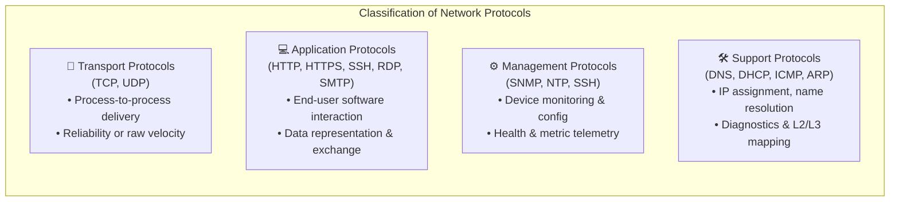

### Major Protocol Categories

1. **Transport Protocols**: Run over the best-effort Internet Protocol (IP) layer to provide host-to-host or process-to-process communication mechanisms. They arbitrate whether data delivery is acknowledged, sequenced, and retransmitted upon packet loss (TCP) or dispatched immediately with zero overhead (UDP).
2. **Application Protocols**: Govern end-user processes and services, ranging from serving distributed hypermedia web content and streaming video to transferring files and executing remote commands.
3. **Management Protocols**: Used by network engineers and automated cloud systems to configure, update, monitor, and query network infrastructure equipment (routers, switches, firewalls, and virtual instances).
4. **Support Protocols**: Facilitate and optimize baseline network plumbing behind the scenes, such as dynamically leasing IP configurations, resolving hostnames to numerical IP addresses, and alerting senders to transmission errors.

---

### Port Numbers: The Logical Gateways

In computer networking, an IP address identifies a specific network interface on a host, while a **port number** identifies the specific process or service running on that host that should handle the incoming traffic. Ports are 16-bit unsigned integers ranging from `0` to `65535`.

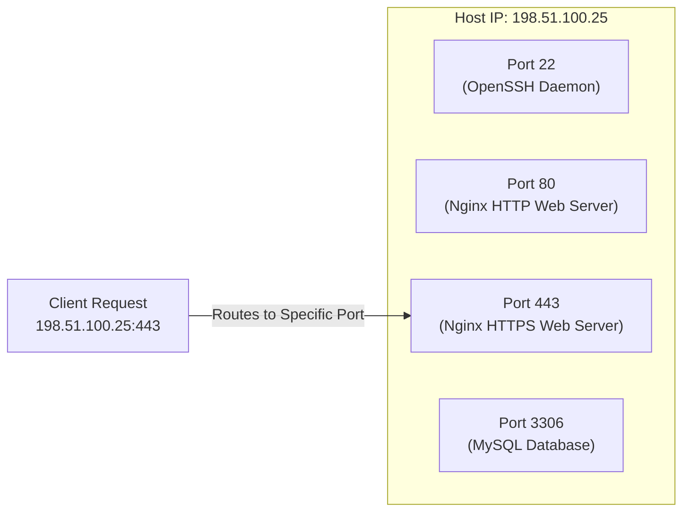

#### Port Classification Spectrum

| Port Range | Category | Description & Management Authority | Examples |
| :--- | :--- | :--- | :--- |
| **0 – 1023** | **Well-Known Ports** | Reserved for privileged system services and core standard protocols; assigned by the Internet Assigned Numbers Authority (IANA). Requires root/administrator privileges to bind. | Port 20/21 (FTP), 22 (SSH), 25 (SMTP), 53 (DNS), 80 (HTTP), 443 (HTTPS) |
| **1024 – 49151** | **Registered Ports** | Assigned by IANA to specific user processes, applications, and third-party vendor services upon request. | Port 1433 (MS SQL), 3306 (MySQL), 3389 (RDP), 5432 (PostgreSQL), 8080 (HTTP Alt) |
| **49152 – 65535** | **Dynamic / Private / Ephemeral Ports** | Automatically assigned on the fly by the host operating system's IP stack as client-side source ports when initiating outbound connections. | Client ephemeral source port `51234` connecting to remote web server port `443` |

> [!CAUTION]
> **Security Implication of Open Ports**: Every open port represents an active listening service and a potential entry pathway for malicious exploits, brute-force attacks, or remote code execution. Network security best practices dictate that all unused ports must be closed or blocked by firewalls (e.g., Linux `iptables`/`nftables`, AWS Security Groups, and Network Access Control Lists).

---

## 🏛️ 2. The OSI 7-Layer Reference Model vs. The TCP/IP 4-Layer Model

Modern networking relies on layered abstractions. Separating complex networking tasks into modular layers guarantees interoperability across heterogeneous hardware vendors, operating systems, and physical transmission media.

### The OSI 7-Layer Reference Model

Created by the International Organization for Standardization (ISO) in 1984, the **Open Systems Interconnection (OSI)** model is an architectural framework that describes seven discrete functional boundaries:

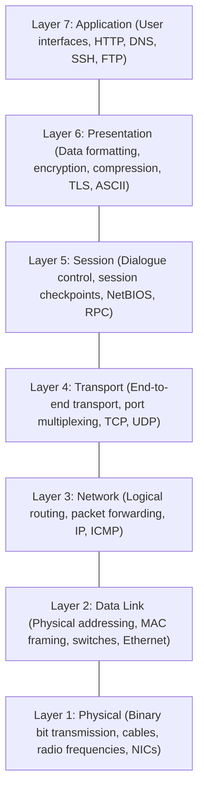

| Layer # | Layer Name | Protocol Data Unit (PDU) | Primary Operational Responsibilities | Representative Protocols & Standards | Hardware & Network Devices |
| :--- | :--- | :--- | :--- | :--- | :--- |
| **Layer 7** | **Application** | **Data** | Serves as the window for users and application processes to access network services; direct software interaction. | HTTP, HTTPS, DNS, DHCP, FTP, SSH, SMTP, IMAP, Telnet, SNMP | Workstations, Application Gateways, Reverse Proxies |
| **Layer 6** | **Presentation** | **Data** | Formats, encrypts, serializes, and compresses data so it is readable by the receiving application layer. | TLS/SSL, ASCII, Unicode, JPEG, GIF, JSON, XML, Base64 | Host OS, Cryptographic Libraries |
| **Layer 5** | **Session** | **Data** | Establishes, maintains, synchronizes, checkpoints, and terminates dialogues between communicating applications. | NetBIOS, RPC, SOCKS, Named Pipes, PPTP | Operating System Sockets API |
| **Layer 4** | **Transport** | **Segment** (TCP) / <br>**Datagram** (UDP) | Provides end-to-end process-to-process delivery, port-based multiplexing, segmentation, flow control, and error recovery. | TCP, UDP, SCTP, QUIC | Firewalls, Layer 4 Load Balancers (AWS NLB) |
| **Layer 3** | **Network** | **Packet** | Provides logical addressing (IP addresses), packet fragmentation, path determination, and internetwork routing. | IPv4, IPv6, ICMP, IPsec, OSPF, BGP, RIP | Routers, Layer 3 Switches, AWS Virtual Routers |
| **Layer 2** | **Data Link** | **Frame** | Handles physical node-to-node addressing (MAC addresses), framing, error detection (CRC/FCS), and access to physical media. | Ethernet (IEEE 802.3), Wi-Fi (802.11), ARP, PPP, VLAN (802.1Q) | Layer 2 Switches, Network Interface Cards (NICs), Bridges |
| **Layer 1** | **Physical** | **Bits** (0s & 1s) | Transmits raw unstructured bitstreams over physical transmission media via electrical pulses, optical light, or radio waves. | 1000BASE-T, Cat6/7 Cables, Fiber Optics, DSL, Bluetooth, NRZ | Hubs, Repeaters, Transceivers, Fiber Cables, Patch Panels |

---

### The TCP/IP 4-Layer Model Mapping

While the OSI model is the universal theoretical benchmark, the **TCP/IP Model** (also known as the Internet Protocol Suite or DoD Model, authored via DARPA RFCs) is the actual implementation upon which the global internet operates.

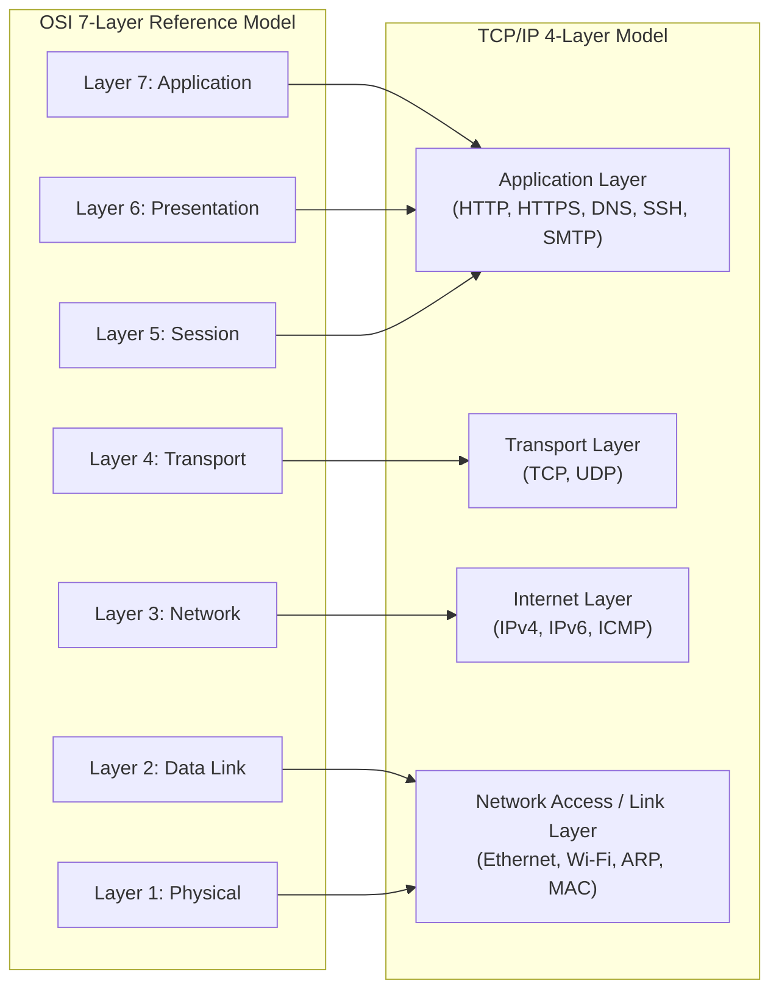

#### Layer-by-Layer Architectural Correlation

1. **TCP/IP Application Layer**: Collapses OSI Layers 5, 6, and 7 into a single cohesive layer. Applications directly handle data formatting, session management, compression, and encryption (e.g., modern web browsers executing TLS handshakes before sending HTTP payloads).
2. **TCP/IP Transport Layer**: Maps directly to OSI Layer 4. Manages end-to-end communication sessions across source and destination ports using TCP or UDP.
3. **TCP/IP Internet Layer**: Maps directly to OSI Layer 3. Defines packet formatting and routing across disjoint network boundaries using IPv4 or IPv6, accompanied by ICMP for diagnostic messaging.
4. **TCP/IP Network Access (Link) Layer**: Combines OSI Layers 1 and 2. Encompasses all hardware drivers, network interface controllers, physical media specifications, and data-link framing protocols (Ethernet, Wi-Fi) required to deliver frames between physically adjacent nodes on a local network segment.

---

### Data Encapsulation & Decapsulation (PDU Lifecycle)

When an application transmits data across the internet, the payload undergoes **encapsulation** as it travels down the source host's network stack. At each layer, header (and sometimes trailer) metadata is prepended before handing the payload to the underlying layer.

```mermaid
sequenceDiagram
    autonumber
    participant App as Application Layer (L7/L6/L5)
    participant Trans as Transport Layer (L4)
    participant Net as Network Layer (L3)
    participant Link as Data Link Layer (L2)
    participant Phys as Physical Layer (L1)

    Note over App: Payload generated (e.g., HTTP GET Request)
    App->>Trans: Data handed down
    Note over Trans: Encapsulates with Port Header [TCP Header | Data] -> Segment
    Trans->>Net: Segment handed down
    Note over Net: Encapsulates with IP Header [IP Header | TCP Header | Data] -> Packet
    Net->>Link: Packet handed down
    Note over Link: Encapsulates with MAC Header & FCS Trailer [MAC Header | IP | TCP | Data | FCS] -> Frame
    Link->>Phys: Frame converted to physical bit stream
    Note over Phys: Transmits raw electrical, optical, or radio pulses across media
```

> [!NOTE]
> **Decapsulation at Destination**: When the target device receives the physical bitstream, it reverses this entire process:
> 1. **L2**: Strips MAC header and validates Frame Check Sequence (FCS) error checksum.
> 2. **L3**: Inspects IP header, verifies destination IP matches the host, and strips IP header.
> 3. **L4**: Inspects destination port in TCP/UDP header, confirms segment order, and strips transport header.
> 4. **L7**: Hands raw application payload to the active daemon process listening on that port.

---

## 🔄 3. Transport Layer Protocols: TCP vs. UDP Deep Dive

The transport layer enables multiple applications on a single host to communicate simultaneously across a single physical network interface via **port multiplexing**. The two primary protocols at this layer represent fundamentally divergent engineering philosophies: guaranteed reliability vs. raw speed.

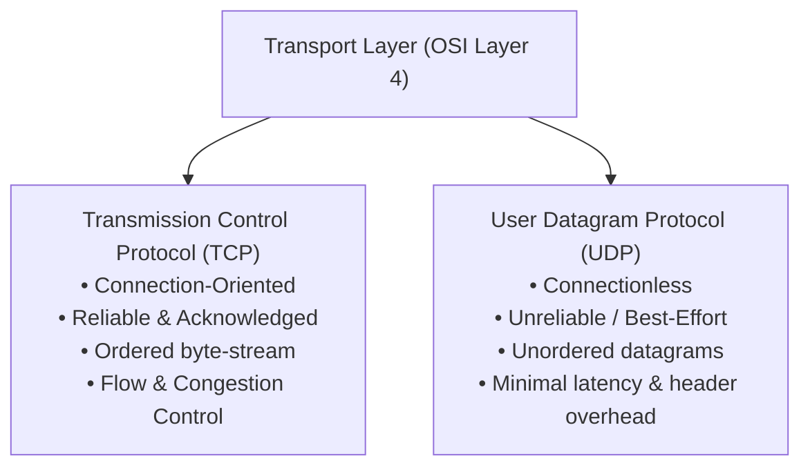

---

### Transmission Control Protocol (TCP)

**TCP** (defined in RFC 793) is a connection-oriented, reliable transport protocol. Before any application payload can be exchanged, the two participating hosts must establish a formal virtual circuit.

#### Key Mechanics of TCP

- **Connection-Oriented**: Requires stateful connection establishment before data flow and formal teardown upon completion.
- **Reliable Data Delivery**: Every transmitted segment is tracked. The receiving host acknowledges (`ACK`) received segments. If an acknowledgment is not received before a retransmission timer expires, the sender retransmits the missing segment.
- **Ordered Sequence Delivery**: IP networks are packet-switched; packets may traverse disparate physical paths and arrive out of sequence. TCP assigns monotonically increasing **Sequence Numbers** (`SEQ`) to every byte, allowing the receiver to reassemble the data in exact original order.
- **Flow Control (Sliding Window)**: Prevents a fast sender from overwhelming a slow receiver's internal memory buffer. The receiver continuously advertises its available buffer capacity (**Window Size**).
- **Congestion Control**: Prevents excessive network degradation using algorithms like Slow Start, Congestion Avoidance, Fast Retransmit, and Fast Recovery.
- **Full-Duplex Communication**: Both endpoints can transmit and receive simultaneously over a single logical connection.

---

### The TCP Three-Way Handshake

To synchronize initial sequence numbers and agree on buffer parameters, TCP executes the canonical **Three-Way Handshake** (`SYN` $\rightarrow$ `SYN/ACK` $\rightarrow$ `ACK`):

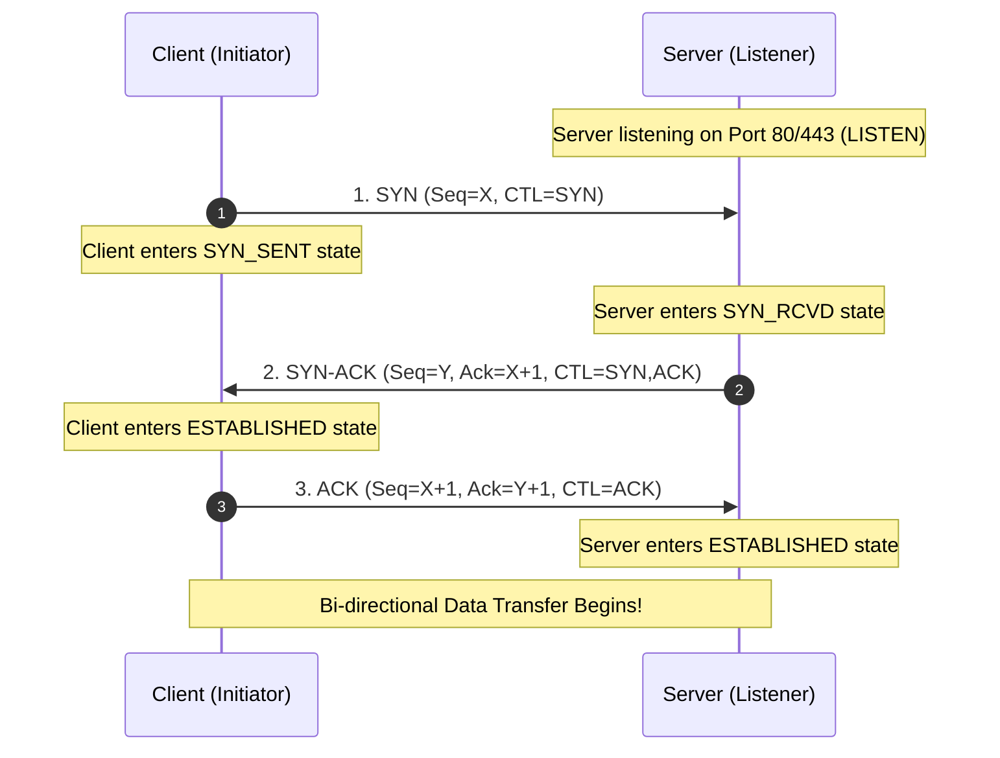

#### Step-by-Step Handshake Analysis

1. **Step 1: SYN (Synchronize)**:
   - The client generates a random Initial Sequence Number (ISN $= X$).
   - Sends a segment with the `SYN` control flag enabled to the server's listening port.
2. **Step 2: SYN-ACK (Synchronize-Acknowledge)**:
   - The server receives the `SYN` packet and allocates connection resources.
   - Generates its own random Initial Sequence Number (ISN $= Y$).
   - Sets the Acknowledgment Number to $X + 1$ (confirming receipt of the client's `SYN`).
   - Sends back a segment with both `SYN` and `ACK` flags enabled.
3. **Step 3: ACK (Acknowledge)**:
   - The client receives the `SYN/ACK`.
   - Sends a final segment with the `ACK` flag enabled, Sequence Number $X + 1$, and Acknowledgment Number $Y + 1$.
   - Both endpoints transition to the `ESTABLISHED` state and can now exchange application data.

---

### TCP Connection Termination & Reset Flags

Just as TCP explicitly negotiates a connection, it gracefully tears it down using a four-step exchange (`FIN` $\rightarrow$ `ACK` $\rightarrow$ `FIN` $\rightarrow$ `ACK`):

```mermaid
sequenceDiagram
    autonumber
    participant Client as Client (Closer)
    participant Server as Server (Receiver)

    Client->>Server: 1. FIN (Seq=U, CTL=FIN)
    Note over Client: Client enters FIN_WAIT_1
    Server->>Client: 2. ACK (Ack=U+1, CTL=ACK)
    Note over Server: Server enters CLOSE_WAIT; Client enters FIN_WAIT_2
    Note over Server: Server flushes remaining data...
    Server->>Client: 3. FIN (Seq=V, CTL=FIN)
    Note over Server: Server enters LAST_ACK
    Client->>Server: 4. ACK (Ack=V+1, CTL=ACK)
    Note over Client: Client enters TIME_WAIT (2MSL timer), then CLOSED
    Note over Server: Server enters CLOSED
```

- **FIN (Finish Flag)**: Indicates that the sender has finished transmitting application data but can still receive data from the other side (half-close).
- **RST (Reset Flag)**: Indicates an abrupt, non-graceful termination. An `RST` is dispatched when:
  - A packet arrives for a closed destination port (e.g., sending traffic to port 80 when no web daemon is listening).
  - An established connection crashes unexpectedly or drops out of state.
  - A security device (firewall or intrusion prevention system) actively resets an unauthorized session.

---

### User Datagram Protocol (UDP)

**UDP** (defined in RFC 768) is a connectionless, minimalist transport protocol. It transmits individual packets called **datagrams** without establishing a prior virtual circuit.

#### Key Mechanics of UDP

- **Connectionless**: No handshake is executed. Senders transmit datagrams immediately.
- **Unreliable (Best-Effort)**: Does not provide delivery verification, acknowledgments, or automatic retransmissions. If intermediate routers drop packets due to buffer congestion, the data is permanently lost unless handled by the upper application layer.
- **No Ordering**: Datagrams may arrive in any sequence. UDP provides no sequence numbers to reconstruct original transmission order.
- **No Flow or Congestion Control**: Senders transmit at whatever rate the application provides, regardless of downstream path capacity.
- **Low Overhead**: UDP headers are fixed at a lightweight 8 bytes (compared to TCP's minimum 20 bytes), drastically reducing protocol processing overhead and transmission latency.

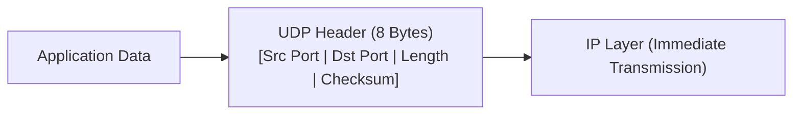

#### Why Choose UDP?
UDP is preferred whenever **low latency and speed outweigh packet completeness**:
- **Real-Time Audio / Video Streaming & VoIP**: A missing audio frame produces a minor, imperceptible pop. Halting a live conversation for 250 milliseconds while waiting for TCP retransmission and reordering ruins user experience.
- **Interactive Online Gaming**: Real-time player coordinates must reflect the exact current moment; receiving stale, delayed position packets from two seconds prior is useless.
- **Simple Request/Response Transactions**: Protocols like DNS and DHCP consist of single-packet queries and responses where maintaining a stateful multi-step handshake introduces unnecessary overhead.

---

### Comprehensive TCP vs. UDP Comparison Matrix

| Architectural Feature | Transmission Control Protocol (TCP) | User Datagram Protocol (UDP) |
| :--- | :--- | :--- |
| **Connection Paradigm** | **Connection-Oriented** (Virtual circuit established prior to data) | **Connectionless** (Datagrams dispatched independently) |
| **Handshake Mechanism** | Yes (3-Way Handshake: `SYN`, `SYN-ACK`, `ACK`) | None (Zero handshake latency) |
| **Delivery Guarantee** | **Guaranteed** (Sender retransmits unacknowledged packets) | **Best-Effort** (Packets may be dropped silently) |
| **Data Ordering** | **Strictly Preserved** (Byte-level sequence numbers) | **Unordered** (Datagrams may arrive out of sequence) |
| **Header Size** | 20 to 60 bytes (Variable, includes options and flags) | Fixed 8 bytes |
| **Flow & Congestion Control**| Yes (Sliding Window, Slow Start, Congestion Avoidance) | None |
| **Error Checking** | Comprehensive Checksum + Retransmission on error | Basic Checksum (Corrupt packets discarded; no retransmit) |
| **Transmission Overhead** | High (State maintenance, timer threads, header bytes) | Extremely Low (Minimal CPU and memory footprint) |
| **Broadcasting / Multicasting**| Unicast only (Point-to-point) | Supports Unicast, Multicast, and Broadcast |
| **Common Protocols** | HTTP, HTTPS, SSH, SFTP, FTP, SMTP, IMAP, RDP, MySQL | DNS, DHCP, SNMP, NTP, TFTP, VoIP (SIP/RTP), QUIC |

---

## 🌐 4. Key Application & Infrastructure Support Protocols

### Domain Name System (DNS) – UDP/TCP Port 53

Humans remember conceptual names (`aws.amazon.com`); network routing hardware operates solely on numerical IP addresses (`205.251.242.103` or `2600:9000:...`). The **Domain Name System (DNS)** serves as the globally distributed, hierarchical database matching human-readable domain names to machine-routable IP addresses.

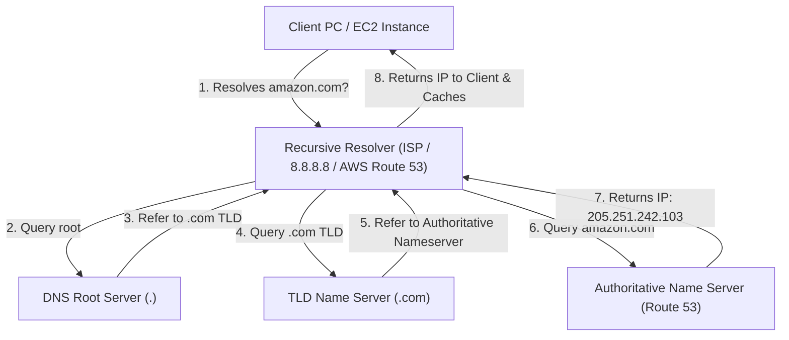

#### Core DNS Record Types

- **A Record**: Maps a hostname to an IPv4 address (e.g., `app.example.com` $\rightarrow$ `192.0.2.1`).
- **AAAA Record**: Maps a hostname to an IPv6 address (e.g., `app.example.com` $\rightarrow$ `2001:db8::1`).
- **CNAME (Canonical Name)**: Creates an alias pointing one domain name to another domain name (e.g., `www.example.com` $\rightarrow$ `lb-123.us-east-1.elb.amazonaws.com`).
- **MX (Mail Exchange)**: Specifies the mail server responsible for receiving emails for the domain.
- **TXT (Text)**: Holds arbitrary text strings; widely used for email verification security (SPF, DKIM, DMARC) and domain ownership validation.
- **NS (Name Server)**: Delegates a DNS zone to use specific authoritative name servers.
- **PTR (Pointer)**: Resolves an IP address back into a hostname (Reverse DNS lookup).
- **SOA (Start of Authority)**: Contains administrative information about the zone (serial number, primary nameserver, refresh/retry timers).

> [!TIP]
> **Why DNS Uses Both UDP and TCP Port 53**: Standard client queries and responses use **UDP Port 53** because they are lightweight and fit within standard packet boundaries (typically under 512 bytes). However, DNS automatically switches to **TCP Port 53** for large responses exceeding packet limits, DNSSEC validation payloads, or zone transfers (`AXFR`) between secondary and primary nameservers.

---

### Dynamic Host Configuration Protocol (DHCP) – UDP Ports 67 & 68

Manually configuring static IP addresses, subnet masks, default gateways, and DNS resolvers on hundreds of servers or client devices is error-prone and unscalable. **DHCP** automatically and dynamically assigns network configuration parameters from a central pool.

#### The Four-Step DORA Process

When a client device connects to a physical or virtual local network, it obtains its configuration via the **DORA** transaction:

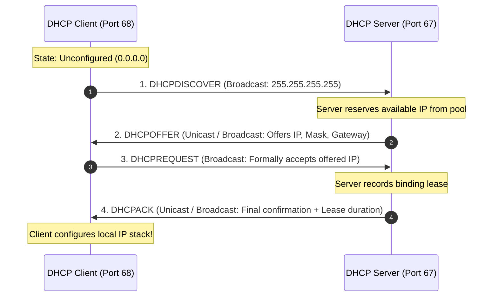

1. **Discover (`DHCPDISCOVER`)**:
   - The unconfigured client has no IP address (source IP `0.0.0.0`).
   - Dispatches a Layer 2 and Layer 3 broadcast (destination `255.255.255.255`, port `67`) asking if any DHCP server is present on the broadcast domain.
2. **Offer (`DHCPOFFER`)**:
   - One or more DHCP servers receive the broadcast.
   - A server reserves an available IP from its pool and broadcasts or unicasts an offer packet containing the candidate IP, subnet mask, lease duration, and server identifier.
3. **Request (`DHCPREQUEST`)**:
   - The client selects an offer (usually the first received) and broadcasts a formal request accepting that specific IP address while notifying any other offering servers that their proposals were declined.
4. **Acknowledge (`DHCPACK`)**:
   - The chosen server sends a final confirmation acknowledging the lease agreement and providing essential DHCP options.

#### Critical DHCP Options Provided to Clients

- **Option 1**: Subnet Mask (e.g., `255.255.255.0`).
- **Option 3**: Router / Default Gateway IP address (the egress point to reach external networks).
- **Option 6**: Domain Name Server (DNS) IP addresses.
- **Option 15**: Domain Name suffix (e.g., `ec2.internal` or `corp.local`).
- **Option 51**: IP Address Lease Time (time interval before the client must renew its lease).

---

### Web Protocols: HTTP & HTTPS

#### Hypertext Transfer Protocol (HTTP) – TCP Port 80
**HTTP** is the stateless, application-level client-server protocol used to distribute hypermedia web documents.
- The client sends an ASCII request specifying an action method (`GET`, `POST`, `PUT`, `DELETE`, `HEAD`, `PATCH`), resource URI, and request headers.
- The server responds with a three-digit status code (`200 OK`, `301 Redirect`, `404 Not Found`, `500 Internal Error`), response headers, and the payload body.
- **Vulnerability**: Plain HTTP transmits all traffic as unencrypted plaintext. Anyone positioned along the transmission path (Wi-Fi eavesdroppers, compromised intermediate routers, ISP sniffers) can intercept credentials, session cookies, and sensitive data.

#### Hypertext Transfer Protocol Secure (HTTPS) – TCP Port 443
**HTTPS** secures standard HTTP communication by wrapping it inside an encrypted **Transport Layer Security (TLS)** cryptographic channel:
- **Confidentiality / Encryption**: Conceals payload data from third-party interceptors.
- **Authentication**: Validates that the server is the legitimate entity it claims to be using trusted X.509 digital certificates.
- **Data Integrity**: Guarantees through cryptographic hashes that packets are not tampered with, altered, or injected during transit.

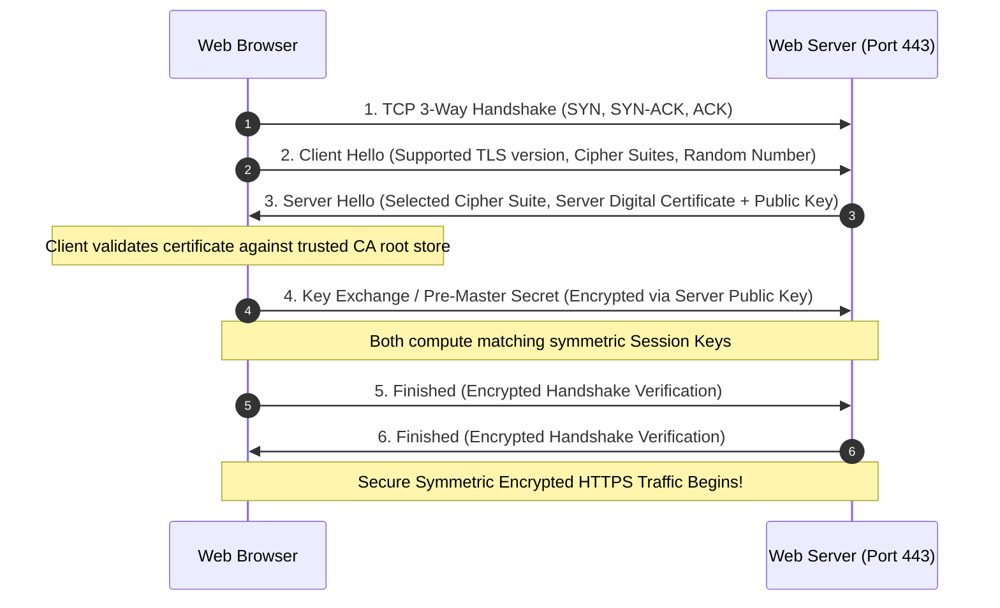

> [!IMPORTANT]
> **SSL vs. TLS Evolution**: Secure Sockets Layer (SSL) versions 1.0, 2.0, and 3.0 were deprecated due to severe cryptographic flaws (e.g., POODLE). **Transport Layer Security (TLS)** replaced SSL. Modern standards bodies (such as the Payment Card Industry Data Security Standard – PCI DSS) strictly mandate **TLS 1.2 or TLS 1.3**. In AWS, **AWS Certificate Manager (ACM)** allows organizations to provision, manage, and renew public and private SSL/TLS certificates with zero management overhead.

---

### Remote Administration Protocols: SSH vs. RDP

Cloud computing relies on secure remote access to manage virtual server instances without physical console access:

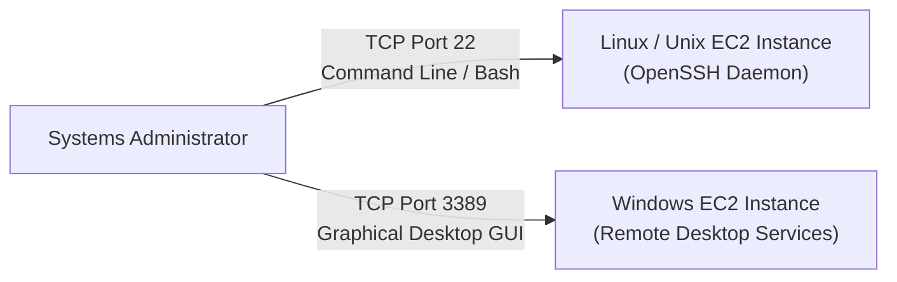

#### Secure Shell (SSH) – TCP Port 22
- **Purpose**: Provides a cryptographically secure, encrypted command-line interface (CLI) and secure data communications channel to remote Linux, Unix, and Windows systems.
- **Security Mechanism**: Uses public-key cryptography for host authentication and client identity verification. In AWS, EC2 instances are launched with asymmetric SSH key pairs:
  - **Public Key**: Injected into `~/.ssh/authorized_keys` on the instance at launch.
  - **Private Key**: Held securely on the administrator's local workstation (`.pem` format or PuTTY `.ppk` format).
- **Features**: Port forwarding (SSH tunneling), X11 graphical forwarding, and secure file transfers via SFTP and SCP.

#### Remote Desktop Protocol (RDP) – TCP Port 3389
- **Purpose**: Proprietary Microsoft protocol providing a user with a full Graphical User Interface (GUI) desktop session to a remote Windows computer.
- **Security**: Encrypted via TLS; supports Network Level Authentication (NLA) requiring users to authenticate before a full session is established.
- **Bandwidth Optimization**: Transmits display drawing commands and delta coordinate updates rather than raw video frames.

---

### Email Transmission Protocols: SMTP, POP3, and IMAP

Email delivery splits into two distinct operational phases: **transmission (push)** between mail agents and **retrieval (pull)** by end-user client devices.

```mermaid
flowchart LR
    SenderClient["Sender Mail Client<br/>(Outlook, Webmail)"] -->|SMTP (Port 587/25)<br/>Push| SenderMTA["Sender Mail Server<br/>(Postfix, Exchange)"]
    SenderMTA -->|SMTP (Port 25)<br/>Server-to-Server Relay| ReceiverMTA["Recipient Mail Server<br/>(MTA / Inbound Gateway)"]
    ReceiverMTA -->|IMAP (Port 993/143)<br/>Two-Way Sync| ReceiverClient["Recipient Client<br/>(Laptop / Mobile)"]
    ReceiverMTA -.->|POP3 (Port 995/110)<br/>Download & Delete| LegacyClient["Legacy Client"]
```

| Protocol | Full Name | Standard Port | Encrypted Port (TLS) | Functional Role & Architecture |
| :--- | :--- | :--- | :--- | :--- |
| **SMTP** | Simple Mail Transfer Protocol | Port 25 (Server-to-Server) <br>Port 587 (Client Submission) | Port 465 (SMTPS) <br>Port 587 (STARTTLS) | **Push Protocol**: Dispatches emails from a client to a mail server and relays messages across intermediate mail servers on the internet. |
| **IMAP** | Internet Message Access Protocol | Port 143 | Port 993 (IMAPS) | **Sync Pull Protocol**: Modern standard for retrieving mail. Synchronizes messages and folder structures across multiple devices while keeping mail stored centrally on the server. |
| **POP3** | Post Office Protocol v3 | Port 110 | Port 995 (POP3S) | **Download Pull Protocol**: Legacy retrieval standard. Downloads messages from the server to the local client device and typically deletes them from the server, preventing synchronization across multiple devices. |

---

### Network Management & Diagnostic Protocols

#### Internet Control Message Protocol (ICMP) – OSI Layer 3
- Operates natively within the IP layer (IP Protocol number `1`).
- Used by network devices (routers, hosts) to generate error notifications (Destination Unreachable, Time Exceeded, Redirect) and diagnostic echo messages (`ping`).
- ICMP does **not** use TCP or UDP port numbers; it uses **Type** and **Code** fields (e.g., Type 8 = Echo Request, Type 0 = Echo Reply, Type 11 = Time Exceeded).

#### Address Resolution Protocol (ARP) – OSI Layer 2/3
- Resolves known Layer 3 logical IP addresses into Layer 2 physical hardware MAC addresses on a local broadcast domain.
- When Host A wants to send an IP packet to Host B on the same subnet, Host A broadcasts an **ARP Request** (`"Who has IP 192.168.1.50? Tell 192.168.1.10"`). Host B responds with a unicast **ARP Reply** containing its MAC address. Results are cached in the host's local ARP table.

#### Network Time Protocol (NTP) – UDP Port 123
- Synchronizes computer clocks across distributed networks to within milliseconds of Coordinated Universal Time (UTC).
- Essential for cloud operations: authentication tokens (Kerberos, AWS SigV4), SSL certificate validity checks, and distributed database consistency rely on synchronized system clocks. (AWS provides the Amazon Time Sync Service at `169.254.169.123`).

#### Simple Network Management Protocol (SNMP) – UDP Port 161 (Agent) & 162 (Trap)
- Allows centralized network monitoring systems to collect telemetry, CPU utilization, interface bandwidth stats, and operational alerts from managed routers, switches, and servers.

#### File Transfer Protocol (FTP) – TCP Ports 20 & 21
- Standard network protocol used for transferring computer files between a client and server.
- Uses two separate connections:
  - **Port 21 (Control Connection)**: Sends administrative commands (`USER`, `PASS`, `LIST`, `RETR`, `STOR`).
  - **Port 20 (Data Connection)**: Transfers raw file contents (PUT and GET operations).
- **Security Warning**: Standard FTP transmits user credentials and file contents in cleartext. Modern environments replace FTP with **SFTP** (SSH File Transfer Protocol running over TCP port 22) or **FTPS** (FTP secured via TLS).

---

### Master Protocol, Port & Layer Reference Cheat Sheet

| Protocol | Standard Port | Transport | OSI Layer | TCP/IP Layer | Primary Purpose | AWS Cloud / Security Relevance |
| :--- | :--- | :--- | :--- | :--- | :--- | :--- |
| **FTP** | 20 (Data), 21 (Control) | TCP | L7 (Application) | Application | Cleartext file transfer | Legacy; insecure. Replace with AWS Transfer Family / SFTP. |
| **SSH** | 22 | TCP | L7 (Application) | Application | Encrypted remote CLI administration | Used for Amazon EC2 Linux administration; restrict CIDRs. |
| **Telnet** | 23 | TCP | L7 (Application) | Application | Unencrypted remote terminal | Insecure; used solely for quick port responsiveness testing. |
| **SMTP** | 25, 587 | TCP | L7 (Application) | Application | Email dispatch & inter-server relay | Amazon SES; port 25 is throttled by default on EC2 to curb spam. |
| **DNS** | 53 | UDP / TCP | L7 (Application) | Application | Hostname-to-IP resolution | Amazon Route 53; VPC Route 53 Resolver (`.2` IP address). |
| **DHCP** | 67 (Server), 68 (Client) | UDP | L7 (Application) | Application | Dynamic IP & option assignment | VPC DHCP Options Sets manage DNS and NetBIOS parameters. |
| **TFTP** | 69 | UDP | L7 (Application) | Application | Trivial trivial file transfer (bootstrapping)| Pre-boot execution environments (PXE); UDP without flow control. |
| **HTTP** | 80 | TCP | L7 (Application) | Application | World Wide Web plaintext transfer | Insecure; should redirect permanently (301) to HTTPS. |
| **NTP** | 123 | UDP | L7 (Application) | Application | Clock synchronization | Amazon Time Sync Service (`169.254.169.123`). |
| **SNMP** | 161, 162 | UDP | L7 (Application) | Application | Network monitoring and telemetry | CloudWatch agent or third-party monitoring appliances. |
| **HTTPS** | 443 | TCP | L7 (Application) | Application | Secure web communications via TLS | Standard for web applications, APIs, and AWS management console. |
| **RDP** | 3389 | TCP | L7 (Application) | Application | Remote desktop graphical GUI | Used for Amazon EC2 Windows instances; secure via Bastion / SSM. |
| **ICMP** | N/A (IP Proto 1) | Raw IP | L3 (Network) | Internet | Diagnostic messaging & ping echo | Must be explicitly enabled in Security Groups for ping tests. |
| **ARP** | N/A (EtherType `0x0806`) | Ethernet | L2 (Data Link) | Network Access| L3 IPv4 to L2 MAC resolution | Handled transparently by AWS VPC SDN mapping service. |

---

## 🛠️ 5. Network Diagnostic & Troubleshooting CLI Masterclass

When troubleshooting cloud application timeouts, packet drops, or unreachable ports, engineers follow a systematic diagnostic methodology from the physical/link layers up to the application layer.

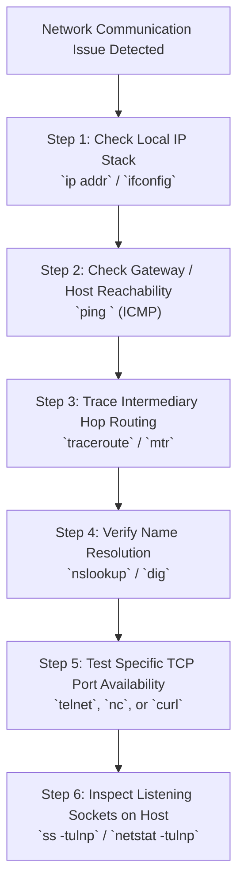

---

### Command 1: `ping` – Basic End-to-End Connectivity Testing

The `ping` utility sends ICMP Echo Request messages (Type 8) to a destination host and listens for ICMP Echo Reply messages (Type 0). It verifies whether a remote device is active on the network and measures the Round-Trip Time (RTT).

#### Linux Syntax & Practical Examples

```bash
# Ping a host 4 times and exit
ping -c 4 amazon.com

# Ping specifying packet timeout in seconds and interface
ping -c 4 -W 2 -I eth0 192.0.2.1
```

#### Sample Command Output

```text
PING amazon.com (205.251.242.103) 56(84) bytes of data.
64 bytes from 205.251.242.103: icmp_seq=1 ttl=245 time=14.2 ms
64 bytes from 205.251.242.103: icmp_seq=2 ttl=245 time=13.8 ms
64 bytes from 205.251.242.103: icmp_seq=3 ttl=245 time=14.1 ms
64 bytes from 205.251.242.103: icmp_seq=4 ttl=245 time=13.9 ms

--- amazon.com ping statistics ---
4 packets transmitted, 4 received, 0% packet loss, time 3004ms
rtt min/avg/max/mdev = 13.812/14.015/14.221/0.152 ms
```

> [!NOTE]
> **Interpreting Ping Results**:
> - `0% packet loss`: The physical path, routing, and remote IP stack are fully operational.
> - `100% packet loss`: Does not always mean the server is down. Many enterprise routers and cloud firewalls (including AWS Security Groups) drop ICMP traffic by default to prevent reconnaissance scanning while still permitting HTTP/HTTPS traffic.

---

### Command 2: `traceroute` (Linux) / `tracert` (Windows) – Hop-by-Hop Path Discovery

`traceroute` identifies each router hop along the path between the source host and the target destination. It records the latency in milliseconds for each hop by progressively incrementing the **Time-To-Live (TTL)** field in IP packets starting at 1. When a router receives a packet with $\text{TTL} = 1$, it decrements the TTL to 0, drops the packet, and returns an `ICMP Time Exceeded` (Type 11) message back to the source.

#### Linux Syntax & Practical Examples

```bash
# Standard traceroute using UDP (default on Linux)
traceroute amazon.com

# Traceroute using ICMP Echo packets (requires root)
sudo traceroute -I amazon.com

# Traceroute using TCP SYN packets to test path through firewalls (Port 80/443)
sudo traceroute -T -p 443 amazon.com
```

#### Sample Command Output

```text
traceroute to amazon.com (205.251.242.103), 30 hops max, 60 byte packets
 1  gateway (192.168.1.1)  0.342 ms  0.281 ms  0.254 ms
 2  10.0.0.1 (10.0.0.1)  2.112 ms  1.984 ms  2.045 ms
 3  isp-core-router.net (203.0.113.1)  8.452 ms  8.312 ms  8.399 ms
 4  * * *
 5  edge-router.amazon.com (54.239.100.12)  14.120 ms  14.055 ms  14.091 ms
 6  205.251.242.103 (205.251.242.103)  13.910 ms  13.850 ms  13.890 ms
```

> [!TIP]
> **What Do Asterisks (`* * *`) Mean?**:
> When a hop outputs asterisks, it indicates that the router at that specific hop timed out. This occurs because the intermediate router is configured to drop ICMP/UDP packets or rate-limit diagnostic generation to preserve CPU capacity. As long as downstream hops continue responding, the network path is healthy.

---

### Command 3: `mtr` (My Traceroute) – Real-Time Continuous Path & Loss Analysis

`mtr` combines the continuous real-time ping updates of `ping` with the hop-by-hop visibility of `traceroute`. It continuously sends diagnostic packets to all intermediate hops, displaying a live updating dashboard of packet loss percentage and latency drift.

#### Linux Syntax & Usage

```bash
# Launch interactive real-time mtr interface
mtr amazon.com

# Run in report mode for 10 cycles without curses UI (ideal for logs and scripts)
mtr --report --report-cycles 10 amazon.com
```

#### Sample Output Analysis

```text
Host                               Loss%   Snt   Last    Avg   Best   Wrst  StDev
1. 192.168.1.1                      0.0%    10    0.3    0.3    0.2    0.4    0.1
2. 10.0.0.1                         0.0%    10    2.1    2.2    1.9    2.8    0.3
3. isp-router-01.net               50.0%    10    8.5    8.6    8.1    9.2    0.4
4. transit-core.net                 0.0%    10   12.1   12.3   11.9   13.0    0.3
5. 205.251.242.103                  0.0%    10   14.0   14.1   13.8   14.5    0.2
```

> [!IMPORTANT]
> **Analyzing Sustained vs. Phantom Packet Loss**: Notice that hop 3 shows `50% Loss`, but hops 4 and 5 show `0.0% Loss`. Because downstream hops received 100% of packets, the loss at hop 3 is **phantom loss** caused by local control-plane CPU rate-limiting on that specific router. **True network packet loss is sustained**: if real packet loss occurs at hop 3, all subsequent hops (4, 5, etc.) will exhibit identical or higher loss percentages.

---

### Command 4: `nslookup` & `dig` – DNS Resolution Tools

#### `nslookup` (Name Server Lookup)
A cross-platform utility used to query DNS servers to inspect hostname-to-IP mappings and verify authoritative response sources.

```bash
# Query default system resolver for amazon.com
nslookup amazon.com

# Query a specific public DNS resolver (e.g., Google DNS 8.8.8.8)
nslookup amazon.com 8.8.8.8
```

#### `dig` (Domain Information Grooker)
The preferred Linux administration tool for DNS debugging. It queries DNS name servers directly and prints detailed response flags and header details.

```bash
# Standard lookup displaying ANSWER SECTION
dig amazon.com

# Query specific record type (e.g., MX or TXT)
dig amazon.com MX +noall +answer

# Perform reverse DNS lookup using IP address
dig -x 205.251.242.103 +short
```

---

### Command 5: `ss` & `netstat` – Socket & Port Inspection

To determine whether an application service is active and listening on a local port, Linux administrators use `ss` (Socket Statistics), which directly queries kernel socket data and supersedes the legacy `netstat` utility.

#### Practical Commands

```bash
# Inspect all listening TCP and UDP sockets with numeric ports and process names
sudo ss -tulnp

# Filter for a specific port (e.g., checking if web server port 80 or 443 is open)
sudo ss -tulnp | grep -E ':(80|443)\b'

# Legacy netstat equivalent
sudo netstat -tulnp
```

#### Output Columns Explained

```text
Netid  State   Recv-Q  Send-Q   Local Address:Port   Peer Address:Port  Process
tcp    LISTEN  0       128            0.0.0.0:22          0.0.0.0:*      users:(("sshd",pid=782,fd=3))
tcp    LISTEN  0       511            0.0.0.0:80          0.0.0.0:*      users:(("nginx",pid=1204,fd=6))
tcp    LISTEN  0       511            0.0.0.0:443         0.0.0.0:*      users:(("nginx",pid=1204,fd=7))
```
- `0.0.0.0:80`: The service is listening on all available IPv4 network interfaces on port 80.
- `127.0.0.1:3306`: The service is bound strictly to the local loopback interface, meaning it will reject external network connections.

---

### Command 6: `telnet` & `nc` (Netcat) – Testing Port Open/Closed Status

While `telnet` is obsolete for remote shell access due to cleartext transmission, it remains a fast, lightweight diagnostic tool for testing whether an arbitrary remote TCP port is accepting connections.

```bash
# Test if port 80 or 443 on amazon.com is reachable and open
telnet amazon.com 80

# Using Netcat (nc) with a 2-second timeout and zero-I/O scan mode
nc -zv -w 2 amazon.com 443
```

- **Open Port Output**:
  ```text
  Trying 205.251.242.103...
  Connected to amazon.com.
  Escape character is '^]'.
  ```
- **Closed Port / Refused Connection** (`ECONNREFUSED`): Host reached, but no process is listening on that port (server sent an immediate TCP `RST`).
- **Connection Timed Out**: Packets are being silently dropped by a security group, Network ACL, or upstream firewall.

---

### Command 7: `curl` – Application Layer (HTTP/HTTPS) Testing

`curl` transfers data to or from a server using supported application protocols. It tests web application endpoints directly from the command line without requiring a graphical web browser.

```bash
# Fetch HTTP response headers only (-I) to inspect HTTP status codes
curl -I https://amazon.com

# Verbose output (-v) displaying DNS lookup, TCP 3-way handshake, and TLS negotiation
curl -v https://aws.amazon.com

# Test connection ignoring SSL certificate validation warnings (testing self-signed certs)
curl -k https://192.0.2.50
```

---

### Command 8: `ip` & `ifconfig` – Network Interface & Route Management

The modern `iproute2` suite (`ip` command) replaces the legacy `net-tools` (`ifconfig`, `route`) package in all modern Linux distributions (Amazon Linux 2023, Ubuntu, RHEL).

```bash
# Display all network interfaces, MAC addresses, and assigned IP addresses
ip addr show

# Show IP routing table and default gateway
ip route show

# View local ARP neighbor cache table
ip neigh show
```

---

### Command 9: `hping3` – Advanced TCP/IP Packet Assembler & Analyzer

`hping3` is a command-line oriented network scanner and packet crafting utility. Unlike `ping` (which only sends ICMP), `hping3` can craft custom TCP, UDP, ICMP, and raw IP packets. It allows engineers to test firewall filtering policies, measure TCP latency, and verify that target hosts respond to specific TCP flags (`SYN`, `ACK`).

```bash
# Scan port 80 on a host by sending TCP SYN packets
sudo hping3 -S -p 80 -c 3 www.google.com
```

#### Sample Command Output

```text
HPING www.google.com (eth0 142.250.190.68): S set, 40 headers + 0 data bytes
len=46 ip=142.250.190.68 ttl=117 id=24901 sport=80 flags=SA seq=0 win=65535 rtt=18.4 ms
len=46 ip=142.250.190.68 ttl=117 id=24902 sport=80 flags=SA seq=1 win=65535 rtt=18.2 ms
len=46 ip=142.250.190.68 ttl=117 id=24903 sport=80 flags=SA seq=2 win=65535 rtt=18.5 ms

--- www.google.com hping statistic ---
3 packets transmitted, 3 packets received, 0% packet loss
round-trip min/avg/max = 18.2/18.4/18.5 ms
```

> [!NOTE]
> **Interpreting `flags=SA`**: In the output above, the returning packet has `flags=SA` set (**SYN + ACK**). This confirms that port 80 is listening, accessible through all intermediate firewalls, and actively ready to establish a full TCP connection.

---

## 🔬 6. Guided Hands-On Lab Walkthroughs

### Lab 1: End-to-End Connectivity & Name Resolution Verification

**Objective**: Verify basic host availability, measure round-trip network latency, and validate domain resolution paths.

1. Open a terminal on your Linux instance or command prompt on your workstation.
2. Execute a connectivity test against `amazon.com`:
   ```bash
   ping -c 4 amazon.com
   ```
   - Observe the returned IPv4 address of the responding server.
   - Note the average latency in milliseconds and verify that packet loss is 0%.
3. Query the DNS resolution for `amazon.com`:
   ```bash
   nslookup amazon.com
   ```
   - Inspect the `Server` line (which shows your local DNS resolver).
   - Inspect the `Non-authoritative answer` section listing the active A records.

---

### Lab 2: Path Hop Analysis & Latency Bottleneck Isolation

**Objective**: Trace the physical and logical router hops traversed by your traffic to reach an external destination.

1. Execute a path trace to `amazon.com`:
   ```bash
   traceroute amazon.com
   ```
   *(On Windows machines, execute `tracert amazon.com`)*.
2. Analyze the terminal output:
   - Identify Hop 1: Your local default gateway router.
   - Identify subsequent hops: Your local ISP core routers, internet exchange points, and target border routers.
   - Observe the round-trip latency across three distinct probe packets per hop.
   - If an intermediate hop displays asterisks (`* * *`), identify whether it is an isolated timeout (firewall drop) or a sustained failure.

---

### Lab 3: Troubleshooting an Inaccessible Local FTP Server

**Scenario**: A software developer attempts to upload a project build to an on-premises FTP server using its IP address (`192.168.1.150`). The connection immediately fails with a timeout or connection refused error. As the systems administrator, you must troubleshoot the issue.

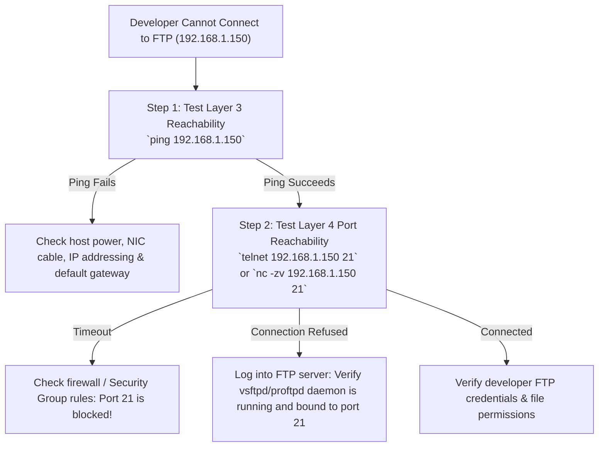

#### Remediation Steps

1. **Step 1: Validate Layer 3 IP Connectivity**:
   - Run `ping 192.168.1.150` from the developer's workstation. If ping replies, the network path, IP routing, and target OS network stack are operational.
2. **Step 2: Test Port 21 Reachability**:
   - Run `telnet 192.168.1.150 21` or `nc -zv 192.168.1.150 21`.
   - If the connection times out, verify host firewalls (`ufw`, `firewalld`, `iptables`) and AWS Security Group inbound rules to ensure traffic on **TCP Port 21** is permitted.
3. **Step 3: Verify the FTP Service Daemon**:
   - Log into the FTP server directly and check if the service is running:
     ```bash
     sudo systemctl status vsftpd
     sudo ss -tulnp | grep :21
     ```
   - If the daemon is inactive, start it using `sudo systemctl start vsftpd`.

---

## 📝 7. Key Takeaways & Summary

- **Layered Models**: The theoretical **OSI 7-Layer Model** (Application, Presentation, Session, Transport, Network, Data Link, Physical) provides the conceptual blueprint for network communications. The pragmatic **TCP/IP 4-Layer Model** (Application, Transport, Internet, Network Access) is the operational implementation of the global internet.
- **Protocol Data Units (PDUs)**: Data starts as application **Data**, is encapsulated into transport **Segments** (TCP) or **Datagrams** (UDP), network **Packets** (IP), data link **Frames** (Ethernet MAC), and physical **Bits**.
- **TCP vs. UDP**:
  - **TCP**: Connection-oriented, reliable, sequenced, flow-controlled, utilizes a 3-way handshake (`SYN`, `SYN-ACK`, `ACK`), and is ideal for web traffic (HTTP/S), file transfers (FTP/SFTP), and remote access (SSH).
  - **UDP**: Connectionless, best-effort, lightweight (8-byte header), with no handshake or retransmissions, ideal for DNS queries, DHCP configuration, VoIP, and real-time media streaming.
- **Core Infrastructure Protocols**:
  - **DNS (Port 53)**: Converts human-readable domain names to machine IP addresses.
  - **DHCP (Ports 67/68)**: Automatically leases IP configurations via the 4-step **DORA** (Discover, Offer, Request, Acknowledge) process.
  - **HTTPS (Port 443)**: Secures web traffic using TLS 1.2/1.3 encryption, server authentication, and message integrity.
  - **SSH (Port 22)** & **RDP (Port 3389)**: Provide secure CLI and GUI remote server management.
  - **ICMP**: Diagnostic and error-reporting protocol used by `ping` and `traceroute`.
- **Diagnostic Toolset**:
  - `ping`: Validates Layer 3 reachability and measures RTT.
  - `traceroute` / `tracert`: Displays router hops and per-hop latency.
  - `mtr`: Provides continuous real-time hop latency and packet loss tracking.
  - `nslookup` / `dig`: Queries DNS records and tests name servers.
  - `ss` / `netstat`: Identifies active listening ports and established sockets.
  - `telnet` / `nc`: Checks whether remote TCP ports are open and accepting connections.
  - `hping3`: Crafts custom TCP packets with specific flags (`SYN`, `ACK`) to test firewall rules and measure TCP latency.

---

## ❓ 8. Knowledge Check & Exam Review

Test your understanding of the concepts covered in this module. Detailed answer explanations are provided below each question.

---

### Question 1
A developer attempts to initiate a connection to a company's local File Transfer Protocol (FTP) server by using its IP address. However, the connection fails. As a result of the connection failure, the systems administrator decides to troubleshoot this issue for the developer.  
**Which procedures can the administrator follow to troubleshoot the developer's connection?** *(Select two)*

- [ ] A. Run `traceroute` to verify DNS resolution for the FTP domain name.
- [x] B. Test server reachability with the `ping` command.
- [ ] C. Convert the FTP server's IP address from IPv4 to IPv6.
- [x] D. Check the firewall traffic rules to verify that port 21 is open.
- [ ] E. Execute the `nslookup` command against the developer's local IP address.

> **Correct Answer: B and D**  
> **Explanation**: Because the developer connected via raw IP address, DNS resolution (`nslookup`) is not involved in the initial failure. The first troubleshooting step is verifying basic Layer 3 connectivity using `ping`. The second critical step is checking that network firewalls and host security rules permit incoming traffic on TCP port 21, the default control port for FTP.

---

### Question 2
Which protocol automatically assigns an IP address, subnet mask, default gateway, and other IP parameters to each device on a network so that these devices can communicate with other IP networks?

- [ ] A. Domain Name System (DNS)
- [ ] B. Address Resolution Protocol (ARP)
- [x] C. Dynamic Host Configuration Protocol (DHCP)
- [ ] D. Simple Network Management Protocol (SNMP)

> **Correct Answer: C**  
> **Explanation**: DHCP (operating over UDP ports 67 and 68) automatically leases IP configurations (IP address, subnet mask, default gateway router, and DNS servers) to client devices using the 4-step DORA process.

---

### Question 3
Which command-line utility can a network administrator use to quickly test whether a specific TCP port on a remote server is open and responding to requests?

- [ ] A. `ping`
- [ ] B. `traceroute`
- [x] C. `telnet`
- [ ] D. `ip route`

> **Correct Answer: C**  
> **Explanation**: `telnet` (as well as `nc` / Netcat) can target an IP address and a specific TCP port (e.g., `telnet 198.51.100.25 80`). If the connection succeeds, the port is open and listening. `ping` tests ICMP reachability rather than specific TCP/UDP application ports.

---

### Question 4
Which transport protocol is used by applications that prioritize speed and low latency over guaranteed data delivery (such as live video streaming, online gaming, and VoIP)?

- [ ] A. Transmission Control Protocol (TCP)
- [x] B. User Datagram Protocol (UDP)
- [ ] C. Internet Control Message Protocol (ICMP)
- [ ] D. Hypertext Transfer Protocol Secure (HTTPS)

> **Correct Answer: B**  
> **Explanation**: UDP is connectionless and lightweight. It does not perform handshakes, acknowledgments, or packet retransmissions, making it ideal for real-time applications where minimal latency is more critical than retransmitting dropped packets.

---

### Question 5
What is the primary role of a Domain Name System (DNS) server?

- [ ] A. To dynamically assign private IP addresses to local network interfaces.
- [ ] B. To encrypt HTTP traffic using SSL/TLS cryptographic keys.
- [x] C. To translate human-readable domain names (such as `amazon.com`) into machine-readable IP addresses.
- [ ] D. To diagnose router packet loss along intermediate internet hops.

> **Correct Answer: C**  
> **Explanation**: DNS functions as the internet's directory, translating human-readable hostnames (`amazon.com`) into numerical IP addresses (`205.251.242.103`) required for routing.

---

### Question 6
Which application layer protocol is used to send email messages from an email client to a mail server, or to transfer email messages between intermediate mail servers?

- [ ] A. Post Office Protocol 3 (POP3)
- [ ] B. Internet Message Access Protocol (IMAP)
- [x] C. Simple Mail Transfer Protocol (SMTP)
- [ ] D. Simple Network Management Protocol (SNMP)

> **Correct Answer: C**  
> **Explanation**: SMTP (TCP ports 25 and 587) is the push protocol used to submit and relay email between clients and servers, and across server-to-server paths. POP3 and IMAP are pull protocols used by client applications to retrieve email from a mailbox server.

---

### Question 7
Which protocol suite defines how to establish and maintain reliable network communications and ensures that data packets are delivered without error, loss, or duplication in exact sequence?

- [x] A. Transmission Control Protocol / Internet Protocol (TCP/IP)
- [ ] B. User Datagram Protocol (UDP)
- [ ] C. Dynamic Host Configuration Protocol (DHCP)
- [ ] D. Internet Control Message Protocol (ICMP)

> **Correct Answer: A**  
> **Explanation**: The TCP protocol within the TCP/IP suite guarantees end-to-end reliability through sequence numbers, acknowledgments, flow control, and automatic retransmission of lost segments.

---

### Question 8
Which protocol do network devices use to diagnose network communication issues, report transmission errors, and generate echo replies for the `ping` utility?

- [ ] A. Dynamic Host Configuration Protocol (DHCP)
- [ ] B. Address Resolution Protocol (ARP)
- [x] C. Internet Control Message Protocol (ICMP)
- [ ] D. Network Time Protocol (NTP)

> **Correct Answer: C**  
> **Explanation**: ICMP operates at the network layer to generate error responses (Destination Unreachable, Time Exceeded) and diagnostic queries (Echo Request / Echo Reply used by `ping`).

---

### Question 9
During the establishment of a TCP connection, which three control flag messages are exchanged between the client and server during the 3-Way Handshake?

- [ ] A. `FIN` $\rightarrow$ `FIN/ACK` $\rightarrow$ `ACK`
- [ ] B. `DISCOVER` $\rightarrow$ `OFFER` $\rightarrow$ `REQUEST`
- [x] C. `SYN` $\rightarrow$ `SYN/ACK` $\rightarrow$ `ACK`
- [ ] D. `RST` $\rightarrow$ `SYN` $\rightarrow$ `ACK`

> **Correct Answer: C**  
> **Explanation**: TCP connection establishment begins with the client sending a `SYN` packet, the server responding with a `SYN/ACK` packet, and the client confirming with an `ACK` packet.

---

### Question 10
In the OSI 7-Layer reference model, what is the correct Protocol Data Unit (PDU) name associated with Layer 4 (Transport), Layer 3 (Network), and Layer 2 (Data Link) respectively?

- [ ] A. Packet, Frame, Segment
- [x] B. Segment (or Datagram), Packet, Frame
- [ ] C. Frame, Packet, Bits
- [ ] D. Data, Segment, Packet

> **Correct Answer: B**  
> **Explanation**: In the OSI model, Layer 4 transport units are called **Segments** (TCP) or **Datagrams** (UDP), Layer 3 network units are called **Packets**, and Layer 2 data link units are called **Frames** (while Layer 1 uses **Bits** and Layers 5–7 use **Data**).
