# 📡 Module 03: Additional Networking Technologies – Study Guide

> **Course**: AWS re/Start Networking Fundamentals  
> **Module**: M03 – Additional Networking Technologies  
> **Source Document**: `T07-0007-RSNF_EN-US_SG_M03_ADDTECHNOLOGIES.pdf`  
> **Target Audience**: AWS re/Start Learners / Cloud Practitioners / Solutions Architects  

---

## 🎯 Module Overview

Modern IT architectures extend far beyond wired Ethernet cables and centralized on-premises data centers. Today's connected enterprise relies on a rich, multi-layered mesh of wireless standards, ubiquitous mobile endpoints, distributed Internet of Things (IoT) sensors, and secure cloud-hosted virtual desktops.

This study guide examines the modern wireless spectrum and edge connectivity solutions that feed data into cloud environments like AWS. We explore:
1. **Wireless Local Area Network (WLAN) Technologies**: The evolution of IEEE 802.11 Wi-Fi standards (Wi-Fi 4 through Wi-Fi 7), spectral frequencies (2.4 GHz, 5 GHz, 6 GHz), channel dynamics, interference factors, and wireless encryption protocols (WEP, WPA, WPA2, WPA3).
2. **Short-Range & Personal Area Networks (PAN)**: Bluetooth Classic, Bluetooth Low Energy (BLE), Radio Frequency Identification (RFID: active vs. passive), and Near Field Communication (NFC).
3. **Cellular Communications & Edge Mobile Networks**: The cellular roadmap from 3G through 4G LTE and 5G (sub-6 GHz vs. mmWave), physical SIMs vs. eSIMs, and dedicated cellular IoT standards (NB-IoT and LTE-M).
4. **Internet of Things (IoT) Architecture & AWS Integration**: Multi-tier IoT topology (Edge Sensors/Actuators $\rightarrow$ Gateways $\rightarrow$ Cloud Ingestion $\rightarrow$ Business Analytics), lightweight transport protocols (MQTT, HTTPS, LoRaWAN), and AWS IoT Core service capabilities.
5. **Enterprise Mobility & Mobile Security**: Bring Your Own Device (BYOD) governance, Mobile Device Management (MDM), Enterprise Mobility Management (EMM), containerization, and remote wipe capabilities.
6. **Virtual Desktop Infrastructure (VDI) with Amazon WorkSpaces**: Cloud-managed desktop virtualization, directory authentication, volume expansion constraints, desktop hardware bundles, and remote workforce use cases.

---

### 📌 Learning Objectives

- [ ] **Analyze Wireless Networking Standards**: Contrast IEEE 802.11 Wi-Fi generations (802.11b/g/n/ac/ax/be) and evaluate trade-offs between 2.4 GHz, 5 GHz, and 6 GHz spectrums regarding throughput, propagation range, attenuation, and channel congestion.
- [ ] **Evaluate Wireless Security Protocols**: Compare the cryptographic weaknesses of legacy Wired Equivalent Privacy (WEP) with Wi-Fi Protected Access standards (WPA, WPA2, WPA3) including TKIP, CCMP/AES, and Simultaneous Authentication of Equals (SAE).
- [ ] **Categorize Short-Range PAN Technologies**: Differentiate between Bluetooth Classic and Bluetooth Low Energy (BLE), and analyze the operating principles, range, and power models of active vs. passive RFID and NFC.
- [ ] **Examine Cellular Generations and Cellular IoT**: Outline the evolutionary steps from 3G to 4G LTE and high-speed 5G (contrasting Sub-6 GHz coverage with mmWave throughput), understand eSIM technology, and evaluate Narrowband IoT (NB-IoT) versus LTE-M for low-power edge devices.
- [ ] **Deconstruct Multi-Tier IoT Architecture**: Map data pipelines from sensors/actuators through edge gateways to cloud processing platforms and end-user dashboards across smart home, industrial (IIoT), and medical (IoMT) domains.
- [ ] **Master AWS IoT Core Ingestion & Protocols**: Identify transport protocols supported by AWS IoT Core—including MQTT, MQTT over WSS, HTTPS, and LoRaWAN—and evaluate their suitability for resource-constrained edge computing.
- [ ] **Implement Enterprise Mobility & MDM Safeguards**: Evaluate BYOD risks, mobile security policies, OS sandboxing/containerization, application encapsulation, and remote wipe mechanisms.
- [ ] **Architect Cloud Workspaces with Amazon WorkSpaces**: Explain virtual desktop provisioning, directory authentication (AWS Managed Microsoft AD vs. Simple AD), volume sizing and expansion rules, performance bundles, and billing models.

---

## 📚 Key Terminology

| Term | Definition |
| :--- | :--- |
| **IEEE 802.11** | The set of local area network technical standards that govern Wi-Fi wireless transmission and MAC layer operations. |
| **WLAN** | Wireless Local Area Network; a computer network linking two or more devices using wireless communication over a local coverage area. |
| **WEP** | Wired Equivalent Privacy; an obsolete, cryptographically vulnerable IEEE 802.11 security protocol based on RC4 stream ciphers and short 24-bit initialization vectors. |
| **WPA / WPA2 / WPA3** | Wi-Fi Protected Access; successive generations of wireless security protocols providing dynamic key exchange, AES-CCMP encryption, and protected management frames. |
| **BLE** | Bluetooth Low Energy (Bluetooth LE / Bluetooth Smart); a low-power, short-range PAN protocol optimized for burst transmissions of compact telemetry data. |
| **RFID** | Radio Frequency Identification; wireless technology utilizing electromagnetic fields to identify and track tags attached to objects (active or passive). |
| **NFC** | Near Field Communication; a high-frequency, ultra-short-range subset of RFID operating at 13.56 MHz over distances $\le 4\text{ cm}$. |
| **5G NR** | 5th Generation New Radio; global cellular standard featuring Sub-6 GHz and Millimeter Wave (mmWave) frequencies delivering peak theoretical speeds up to 10–20 Gbps. |
| **NB-IoT / LTE-M** | Cellular Low-Power Wide-Area Network (LPWAN) standards designed to connect resource-constrained IoT devices directly over licensed mobile networks. |
| **IoT** | Internet of Things; a network of physical objects embedded with sensors, processing software, and connectivity to exchange data autonomously over the internet. |
| **MQTT** | Message Queuing Telemetry Transport; an extremely lightweight, publish-subscribe network protocol tailored for low-bandwidth, high-latency, or constrained networks. |
| **LoRaWAN** | Long Range Wide Area Network; a point-to-multipoint networking protocol designed for battery-operated wireless sensors operating over unlicensed sub-gigahertz ISM bands. |
| **AWS IoT Core** | A managed AWS cloud platform that securely connects billions of IoT devices and routes trillions of messages to AWS services without managing server infrastructure. |
| **BYOD** | Bring Your Own Device; an organizational policy allowing personnel to connect personally owned mobile devices and laptops to corporate resources. |
| **MDM / EMM** | Mobile Device Management / Enterprise Mobility Management; centralized software platforms to monitor, configure, secure, and manage mobile devices in an enterprise. |
| **Amazon WorkSpaces** | A fully managed, secure Desktop-as-a-Service (DaaS) solution that provisions virtual Windows or Linux desktop environments in the AWS Cloud. |

---

## 📶 1. Wireless Local Area Networking (Wi-Fi)

Wireless networking enables devices to transmit data packets through radio frequency (RF) signals propagating through air rather than structured copper cables or optical fibers.

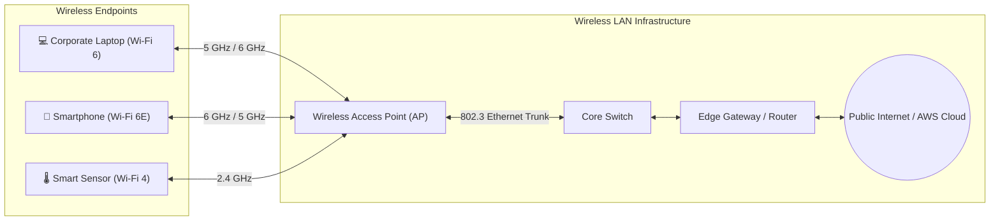

### IEEE 802.11 Standards Evolution

The Institute of Electrical and Electronics Engineers (IEEE) regulates wireless LAN standards under the **802.11** working group. To simplify consumer comprehension, the Wi-Fi Alliance adopted consumer-friendly generation naming (e.g., Wi-Fi 4, 5, 6, 7).

| Generation | IEEE Standard | Year | Operating Frequencies | Max Theoretical Speed | Channel Widths | Key Technological Features |
| :--- | :--- | :--- | :--- | :--- | :--- | :--- |
| Legacy | **802.11b** | 1999 | 2.4 GHz | 11 Mbps | 22 MHz | DSSS modulation; early mainstream adoption |
| Legacy | **802.11a** | 1999 | 5 GHz | 54 Mbps | 20 MHz | OFDM modulation; clean spectrum, short range |
| Legacy | **802.11g** | 2003 | 2.4 GHz | 54 Mbps | 20 MHz | Backward compatibility with 802.11b; OFDM |
| **Wi-Fi 4** | **802.11n** | 2009 | 2.4 GHz, 5 GHz | 600 Mbps | 20, 40 MHz | MIMO (up to 4x4 streams), frame aggregation |
| **Wi-Fi 5** | **802.11ac** | 2014 | 5 GHz (2.4 GHz via 802.11n) | 6.93 Gbps | 20, 40, 80, 160 MHz | MU-MIMO (downlink), 256-QAM, beamforming |
| **Wi-Fi 6** | **802.11ax** | 2019 | 2.4 GHz, 5 GHz | 9.6 Gbps | 20, 40, 80, 160 MHz | OFDMA, 1024-QAM, bidirectional MU-MIMO, Target Wake Time (TWT) |
| **Wi-Fi 6E** | **802.11ax** | 2021 | 2.4 GHz, 5 GHz, **6 GHz** | 9.6 Gbps | Up to 160 MHz | Unlocks up to 1,200 MHz of clean 6 GHz spectrum without legacy interference |
| **Wi-Fi 7** | **802.11be** | 2024 | 2.4 GHz, 5 GHz, **6 GHz** | 46.1 Gbps | Up to **320 MHz** | 4096-QAM, Multi-Link Operation (MLO), 16x16 MU-MIMO |

### Radio Frequency Comparison: 2.4 GHz vs. 5 GHz vs. 6 GHz

Wireless frequencies govern two physical trade-offs in RF engineering: **coverage distance** (wave propagation and physical penetration) versus **data throughput** (bandwidth and channel width).

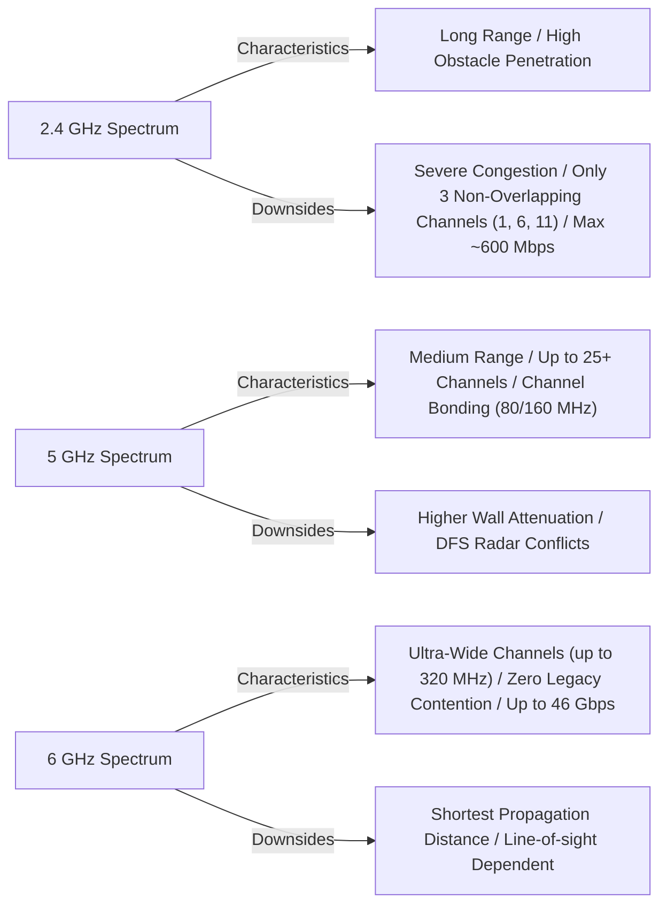

#### Detailed Spectrum Breakdown

1. **2.4 GHz Band (Industrial, Scientific, and Medical - ISM)**:
   - **Range & Penetration**: Excellent wavelength propagation (~12 cm wave), easily penetrating drywall, glass, and wood over 50–70 meters indoors.
   - **Interference & Congestion**: Crowded by Bluetooth, microwave ovens, baby monitors, and adjacent residential routers.
   - **Channel Limitations**: Only 14 channels worldwide (typically 11 in North America), with only **3 non-overlapping 20 MHz channels**: **Channels 1, 6, and 11**. Adjacent channels overlap and cause co-channel and adjacent-channel interference.
2. **5 GHz Band (UNII-1, UNII-2, UNII-3)**:
   - **Range & Penetration**: Shorter wavelength (~6 cm wave); higher attenuation through dense walls and concrete. Indoors typically reaches 20–30 meters.
   - **Throughput & Channels**: Offers up to 24 non-overlapping 20 MHz channels. Supports channel bonding into 40, 80, and 160 MHz channels for multi-gigabit throughput.
   - **DFS (Dynamic Frequency Selection)**: Certain channels (52–144) share frequencies with civilian and military weather radar. APs must detect radar pulses and dynamically vacate channels.
3. **6 GHz Band (Wi-Fi 6E / Wi-Fi 7)**:
   - **Spectral Width**: Opens an expansive 1.2 GHz of contiguous RF spectrum (5.925 GHz to 7.125 GHz) in the US and international regulatory equivalents.
   - **Exclusivity**: Prohibits legacy protocols (802.11b/a/g/n/ac). Only Wi-Fi 6E and Wi-Fi 7 devices can transmit, eliminating backward-compatibility carrier overhead and contention slots.
   - **Channel Capacity**: Accommodates fourteen 80 MHz channels or seven massive 160 MHz channels (and up to three 320 MHz channels in Wi-Fi 7).

---

### Wireless Security Protocols: WEP vs. WPA vs. WPA2 vs. WPA3

Because RF signals propagate through open air beyond physical building walls, robust cryptographic protocols are required to safeguard data confidentiality, mutual authentication, and frame integrity.

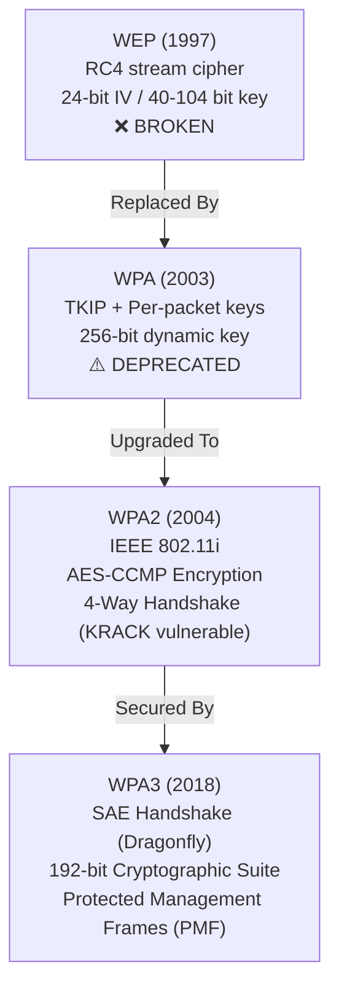

#### Cryptographic Comparison

| Parameter | WEP | WPA (WPA1) | WPA2 | WPA3 |
| :--- | :--- | :--- | :--- | :--- |
| **Release Year** | 1997 | 2003 (Interim) | 2004 (802.11i standard) | 2018 (Current standard) |
| **Cipher Algorithm** | RC4 (Stream cipher) | RC4 with TKIP wrapper | AES (Advanced Encryption Standard) | AES-GCM (128-bit) / GCMP-256 (192-bit) |
| **Encryption Mode** | Static key + 24-bit IV | TKIP (Temporal Key Integrity Protocol) | CCMP (Counter Mode CBC-MAC Protocol) | CNSA / Suite B Compliant |
| **Key Length** | 40-bit or 104-bit | 128-bit dynamic + per-packet | 128-bit or 256-bit | 128-bit (Personal) / 192-bit (Enterprise) |
| **Key Management** | Static, manually shared | 4-Way Handshake + 256-bit PSK | 4-Way Handshake + Pre-Shared Key (PSK) | Simultaneous Authentication of Equals (SAE) |
| **Vulnerabilities** | IV collision, FMS attack; crackable in $< 60$ seconds | Michael MIC collision, Beck-Tews attacks | KRACK (Key Reinstallation Attacks), offline dictionary attacks | Resistant to offline brute-force and dictionary attacks |
| **Management Frames** | Unprotected | Unprotected | Optional PMF (802.11w) | **Mandatory** Protected Management Frames (PMF) |

> [!CAUTION]
> **WEP is Completely Insecure**: The 24-bit Initialization Vector (IV) in WEP is transmitted in plain text. Because there are only $2^{24} \approx 16.7\text{ million}$ possible IVs, a busy wireless network experiences IV collisions within minutes. Attackers collecting a few thousand frames can reconstruct the master cryptographic key using open-source tools (e.g., Aircrack-ng). WEP must never be enabled in any environment.

---

## 🛜 2. Short-Range & Personal Area Networks (PAN)

Personal Area Networks (PAN) interconnect devices within an individual person's operating space or across ultra-short machine-to-machine (M2M) distances, prioritizing power efficiency, compactness, and rapid device pairing.

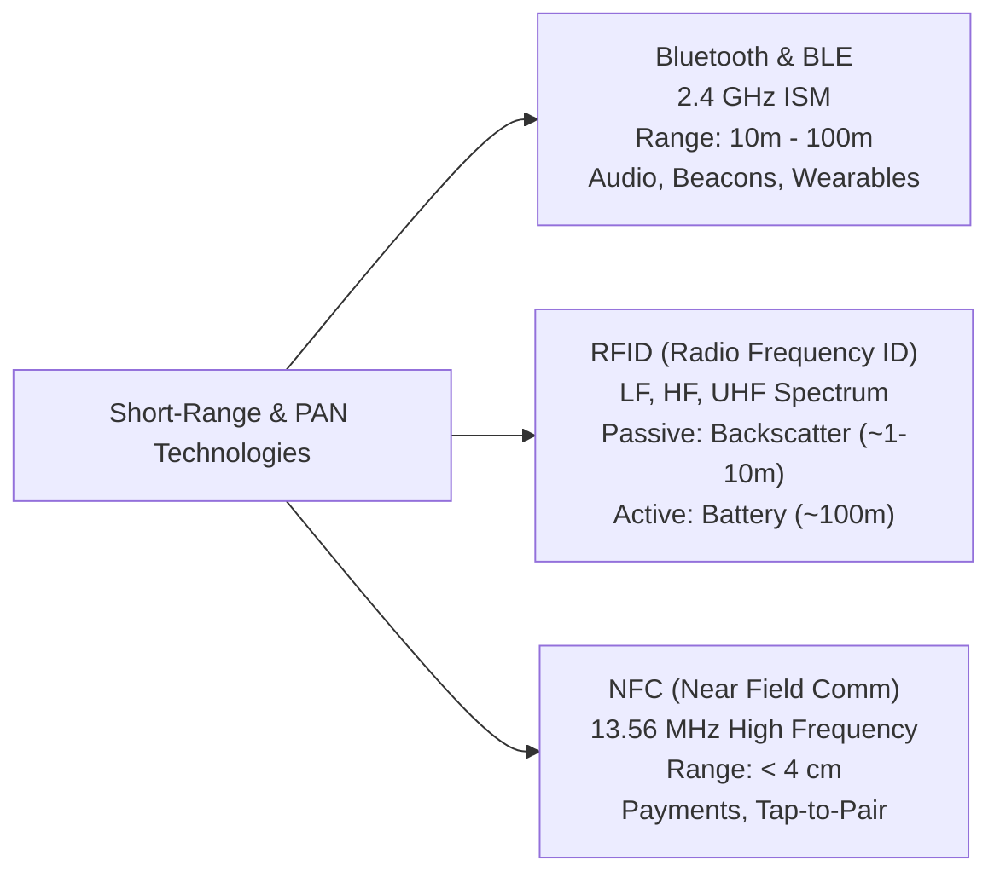

### Bluetooth Classic vs. Bluetooth Low Energy (BLE)

While both operate in the unlicensed **2.4 GHz ISM band** (2.402 GHz to 2.480 GHz) using frequency-hopping spread spectrum (FHSS), Bluetooth Classic and BLE serve distinct use cases:

- **Bluetooth Classic (BR/EDR - Basic Rate/Enhanced Data Rate)**:
  - Designed for continuous streaming data pipelines (e.g., high-definition audio headphones, wireless speakers, hands-free automotive telephony).
  - Maintains persistent connection states and continuous RF transmission.
  - Channels: 79 channels spaced by 1 MHz.
  - Power Consumption: Significant; rapidly drains small coin-cell batteries (hours to days).
- **Bluetooth Low Energy (BLE / Bluetooth Smart)**:
  - Introduced in Bluetooth 4.0 and expanded in Bluetooth 5.0/5.3/5.4.
  - Purpose-built for periodic or burst transmission of small telemetry chunks (e.g., heart rate monitors, temperature loggers, micro-location beacons, industrial sensor tags).
  - Operating Sleep State: Remains in deep sleep mode until an event occurs, waking up for milliseconds to transmit bytes before returning to ultra-low sleep current.
  - Channels: 40 channels spaced by 2 MHz (including 3 primary advertising channels: 37, 38, and 39).
  - Battery Lifespan: Capable of running for **1 to 5 years** on a standard CR2032 coin-cell battery.

### Radio Frequency Identification (RFID)

RFID uses electromagnetic fields to transmit identifying records from tags attached to physical objects to an RFID interrogator (reader).

```mermaid
flowchart TD
    subgraph PassiveModel["Passive RFID Architecture"]
        ReaderP["RFID Reader / Antenna"] -->|1. Transmits RF Carrier Wave| TagP["Passive Tag (No Internal Battery)"]
        TagP -->|2. Scavenges RF Power via Induction| TagP
        TagP -->|3. Reflects Modulated Signal (Backscatter)| ReaderP
    end

    subgraph ActiveModel["Active RFID Architecture"]
        TagA["Active Tag (Internal Battery + Transmitter)"] -->|Continuous / Scheduled Broadcast| ReaderA["RFID Reader"]
    end
```

#### Active vs. Passive RFID Tag Comparison

| Feature | Passive RFID Tags | Active RFID Tags |
| :--- | :--- | :--- |
| **Internal Power Source** | None (Powered entirely by reader's RF field) | Built-in lithium battery |
| **Read Range** | Short: Centimeters up to ~10 meters (UHF) | Long: 50 meters to over 100 meters |
| **Manufacturing Cost** | Extremely low ($0.05 to $0.20 per tag) | High ($15 to $100+ per tag) |
| **Tag Physical Lifespan** | Virtually unlimited (no battery degradation) | 3 to 8 years (limited by battery longevity) |
| **Data Storage** | Low (typically 64 to 1024 bits: EPC or serial) | High (up to 128 KB or more with onboard sensors) |
| **Onboard Sensor Ability** | Rare / basic temperature threshold indicators | Rich (GPS, ambient temperature, vibration, humidity) |
| **Primary Use Cases** | Retail inventory, library cataloging, asset tags | Real-time shipping container tracking, vehicle tolling |

### Near Field Communication (NFC)

NFC is a specialized branch of high-frequency (HF) RFID operating precisely at **13.56 MHz**.
- **Operating Distance**: Ultra-short range, strictly limited to **$\le 4\text{ cm}$** (typically requires an intentional tap).
- **Operating Principles**: Communicates through magnetic induction coupling between two loop antennas placed in each other's near field.
- **Modes of Operation**:
  1. **Card Emulation Mode**: The device (e.g., iPhone or Android phone) acts as a contactless smart card for contactless payments (Apple Pay, Google Wallet, transit passes).
  2. **Reader/Writer Mode**: The device reads or alters data stored in passive NFC tags (e.g., promotional smart posters, Wi-Fi configuration chips).
  3. **Peer-to-Peer (P2P) Mode**: Two active devices link to exchange data files (e.g., vCards, photos, cryptographic pairing keys for Bluetooth or Wi-Fi Direct).
- **Inherent Security Advantage**: The physical proximity requirement prevents eavesdropping attacks from across a room.

---

## 📱 3. Cellular Communications & Edge Mobile Networks

Cellular networking provides wide-area mobile broadband connectivity through geographically distributed base stations (cell towers), each covering a hexagonal or sectoral cell area.

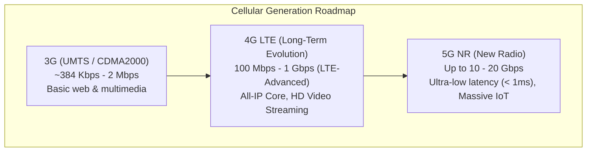

### Cellular Generations Overview

1. **3G (Third Generation - UMTS/WCDMA/EV-DO)**:
   - Established mobile internet browsing, MMS, and video calling. Speeds ranged from 384 Kbps to 42 Mbps (HSPA+). Virtually all global telecommunications providers have decommissioned or sundowned 3G spectrum to repurpose bands for 4G and 5G.
2. **4G LTE (Fourth Generation - Long-Term Evolution)**:
   - Completely transitioned the cellular voice and data core to an end-to-end all-IP network (VoLTE). Employs Orthogonal Frequency-Division Multiple Access (OFDMA) and MIMO antenna arrays. Peak speeds reach 100 Mbps mobile to 1 Gbps stationary.
3. **5G (Fifth Generation - 5G New Radio)**:
   - Designed around three operational pillars defined by the ITU (IMT-2020):
     - **eMBB (Enhanced Mobile Broadband)**: Extremely fast peak downloads (up to 10–20 Gbps) and massive throughput for virtual reality and 8K streaming.
     - **uRLLC (Ultra-Reliable and Low-Latency Communication)**: Latency under 1 millisecond for mission-critical applications (autonomous vehicles, robotic telesurgery, industrial automation).
     - **mMTC (Massive Machine-Type Communication)**: Scales to support up to **1,000,000 devices per square kilometer** for smart city and industrial telemetry.

### 5G Frequencies: Sub-6 GHz vs. Millimeter Wave (mmWave)

| Dimension | 5G Sub-6 GHz (Low & Mid-Band) | 5G Millimeter Wave (mmWave / High-Band) |
| :--- | :--- | :--- |
| **Frequency Range** | FR1: 600 MHz to 6 GHz (C-band ~3.3–3.8 GHz) | FR2: 24 GHz to 40 GHz (and up to 71 GHz) |
| **Theoretical Speeds** | 100 Mbps – 1 Gbps | 1 Gbps – 10+ Gbps |
| **Signal Range** | Several miles / kilometers per base station | Short: 100 to 300 meters line-of-sight |
| **Obstacle Penetration** | Strong penetration through buildings, walls, and foliage | Very weak; blocked by concrete, glass, hands, and rain |
| **Deployment Scenario** | Nationwide macro-cell coverage, suburban, and rural areas | Dense urban centers, sporting stadiums, airports, smart factories |
| **Infrastructure Need** | Standard macro cell towers | High-density small cell deployments on lamp posts & utility poles |

### Physical SIM vs. Embedded SIM (eSIM)

- **Physical SIM (Subscriber Identity Module)**: Removable plastic smart card (Mini, Micro, Nano SIM) containing an integrated circuit that securely stores the International Mobile Subscriber Identity (IMSI) key used to authenticate a subscriber to the mobile operator's network.
- **eSIM (Embedded SIM / eUICC)**: A tiny silicon chip soldered directly onto the device motherboard during manufacturing:
  - **Remote SIM Provisioning (RSP)**: Users can download, activate, and switch mobile network operator profiles over the air (OTA) without swapping physical cards.
  - **Industrial & IoT Advantages**: Eliminates card slots, enabling hermetically sealed water/dustproof devices, improving shock resistance, and reducing PCB space in smartwatches, connected vehicles, and field telemetry meters.

### Cellular IoT: NB-IoT vs. LTE-M

Standard 4G/5G broadband requires expensive radio modems and high battery consumption, making it impractical for remote environmental sensors or smart water meters. Cellular Low-Power Wide-Area Network (LPWAN) protocols solve this:

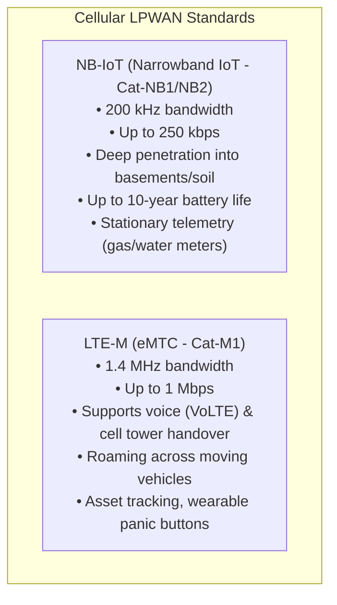

---

## 🌐 4. Internet of Things (IoT) Architecture & AWS Integration

The **Internet of Things (IoT)** refers to the vast global network of physical devices—or "things"—equipped with sensors, actuators, firmware, and network connectivity that autonomously gather, exchange, and process real-time data without human intervention.

### Multi-Tier IoT Architecture

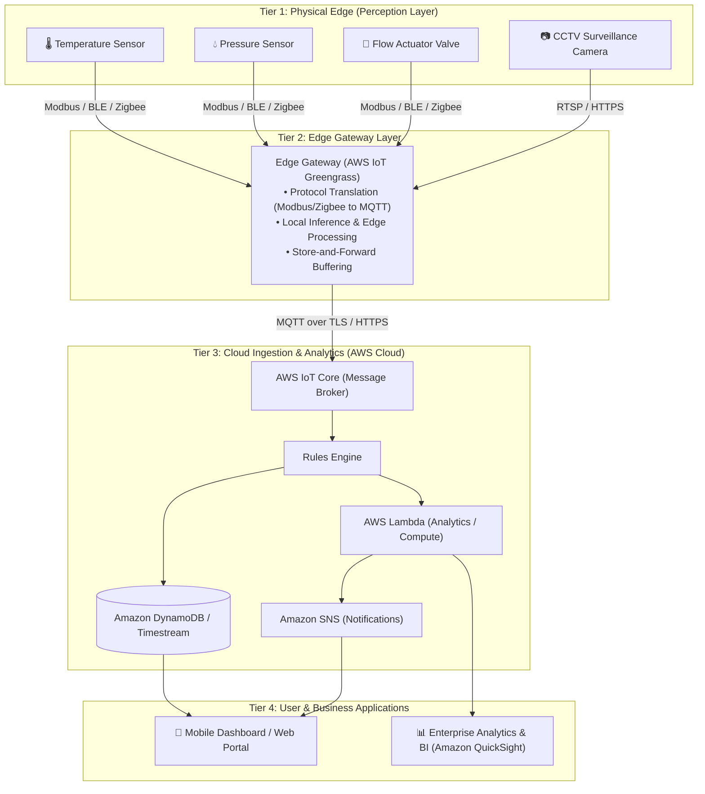

#### The Four Layers Explained

1. **Edge Perception Layer (Sensors & Actuators)**:
   - **Sensors**: Passive and active transducers converting real-world physical phenomena (temperature, humidity, acceleration, vibration, light, chemical concentration) into electrical signals.
   - **Actuators**: Electromechanical devices that receive control commands and trigger physical real-world actions (opening a solenoid valve, flipping a circuit breaker, adjusting a servo motor).
2. **Edge Gateway Layer**:
   - Small, localized compute hubs placed on-premises (in factories, ships, or vehicles).
   - Functions: Translates legacy field protocols (Modbus, CAN bus, Zigbee, Z-Wave) into standard cloud protocols (MQTT, HTTPS); runs local real-time heuristics; aggregates data; buffers readings locally during internet blackouts.
3. **Cloud Processing & Platform Layer (AWS Cloud)**:
   - Ingests high-velocity telemetry streams; authorizes and authenticates device identity using mutual TLS (mTLS); stores temporal metrics; evaluates business rules in real time.
4. **Application & Interface Layer**:
   - Dashboards, web portals, mobile phone applications, and automated alerting systems presenting synthesized operational insights to engineers and users.

---

### IoT Protocols: MQTT vs. HTTPS vs. LoRaWAN

Constrained microcontrollers have minimal RAM (kilobytes) and limited battery power, necessitating ultra-compact communication protocols:

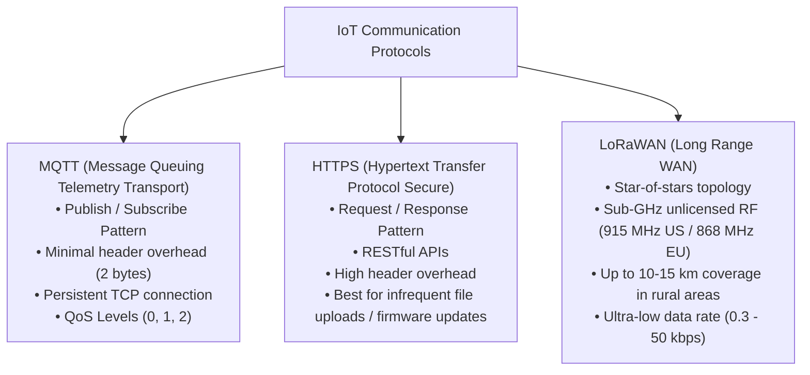

#### Protocol Technical Comparison

| Metric | MQTT | HTTPS (REST) | LoRaWAN |
| :--- | :--- | :--- | :--- |
| **Model** | Publish / Subscribe via Central Broker | Client-Server Request / Response | Star Topology via LoRa Gateway to Network Server |
| **Transport Layer** | TCP / IP (Port 8883 for TLS) | TCP / IP (Port 443 for TLS) | Sub-GHz RF Chirp Spread Spectrum (CSS) |
| **Packet Overhead** | Extremely compact (minimum 2-byte header) | Heavy (HTTP headers can exceed 500–1000 bytes) | Minimal RF payload (typically 11–242 bytes) |
| **Power Consumption** | Low (maintains lightweight persistent socket) | Medium to High (repeated TLS handshakes drain energy) | Extremely Low (transceivers sleep >99% of time) |
| **Transmission Range** | Network dependent (Local Wi-Fi, Ethernet, Cellular) | Network dependent (IP network required) | **2 to 15+ kilometers** line-of-sight |
| **Ideal Use Case** | Continuous telemetry, bi-directional commands | Infrequent data posts, firmware bundle downloads | Off-grid smart agriculture, soil probes, streetlighting |

---

### AWS IoT Core Overview & Architectural Capabilities

**AWS IoT Core** is a fully managed cloud service that allows internet-connected devices to securely interact with AWS cloud applications and other connected endpoints at global scale.

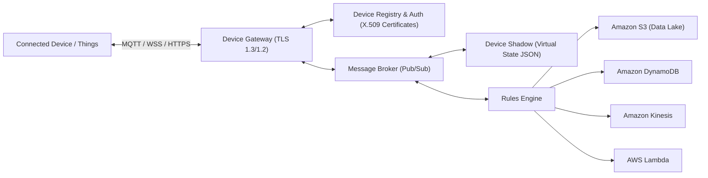

#### Core Components of AWS IoT Core

1. **Device Gateway**:
   - The secure entry portal for connected devices. Manages persistent connections across MQTT, WebSockets, and HTTP REST APIs, scaling automatically without provisioning server instances.
2. **Mutual Authentication & Security**:
   - Every connected device authenticates via **X.509 client certificates** with mutual TLS (mTLS). Device communication is encrypted end-to-end. Fine-grained AWS IoT Policies govern the exact topics a device is authorized to publish or subscribe to.
3. **Message Broker**:
   - High-throughput publish-subscribe broker delivering messages across hierarchical topics (e.g., `factory/floor2/machine4/temperature`). It decouples sensors producing data from cloud services consuming it.
4. **Device Registry**:
   - Establishes a formal identity catalog for all physical "Things," tracking device serial numbers, manufacturing attributes, hardware revisions, and cryptographic credentials.
5. **Device Shadow (Digital Twin)**:
   - A persistent JSON document stored in the cloud that records the current state and desired future state of a physical device. If a device goes offline (e.g., enters a tunnel or loses power), applications can query or update the Device Shadow. When connectivity returns, the device syncs with the shadow state.
6. **Rules Engine**:
   - Evaluates incoming message payloads continuously using SQL-like syntax (e.g., `SELECT temperature FROM 'sensors/#' WHERE temperature > 80`). Automatically routes qualifying events to downstream AWS services (DynamoDB, Lambda, S3, Kinesis, Amazon SNS) without provisioning backend EC2 servers.
7. **AWS IoT Core for LoRaWAN**:
   - Fully managed LoRaWAN Network Server (LNS). Allows customers to connect private LoRaWAN gateways directly to AWS IoT Core without maintaining third-party LNS servers.

---

### Real-World IoT Application Domains

- **Smart Home & Consumer IoT**:
  - Thermostats (e.g., ecobee, Nest) analyzing environmental metrics to adjust HVAC systems; smart lighting, robotic vacuum cleaners, and smart door locks controllable via mobile applications.
- **Industrial IoT (IIoT)**:
  - Smart factory automation, predictive maintenance on turbines and conveyor belts using vibration frequency sensors, pipeline leak detection, and fleet management tracking commercial delivery vehicles.
- **Internet of Medical Things (IoMT)**:
  - Automated insulin delivery pumps, connected pacemakers, hospital asset tracking, and real-time patient biometric monitors alerting doctors to cardiac anomalies.
- **Smart Cities**:
  - Dynamic street lighting adapting to vehicle flow, intelligent waste bins reporting fill levels to route sanitation trucks, and automated water management detecting subterranean distribution leaks.

---

## 🔒 5. Enterprise Mobility & Mobile Security

Enterprise mobility enables modern workforces to operate productively from remote locations using cellular networks, personal laptops, tablets, and smartphones. While flexibility improves productivity, it introduces significant corporate attack surfaces.

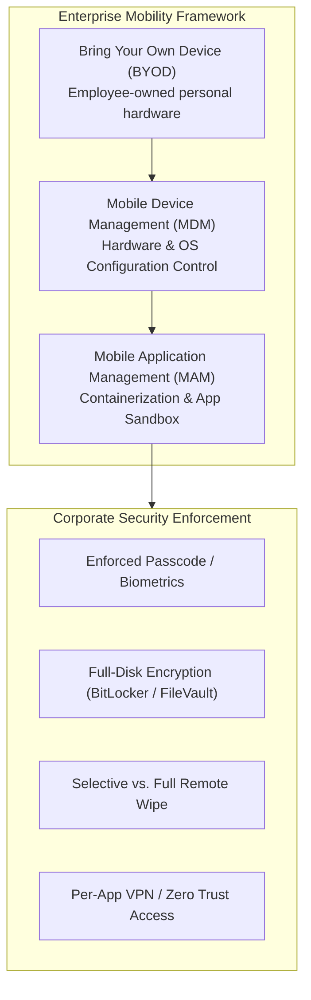

### Bring Your Own Device (BYOD): Benefits vs. Operational Risks

**BYOD** refers to the organizational policy permitting employees to use personally owned devices to access corporate networks, cloud platforms, and internal applications.

| Dimension | Organizational Advantages | Security & Operational Challenges |
| :--- | :--- | :--- |
| **Capital Expenditures** | Drastically reduced hardware procurement and leasing costs | No standardized hardware baseline; supporting disparate OS versions |
| **Employee Satisfaction** | Users operate familiar devices of their own choosing | Blurring of work-life boundaries; employee privacy concerns |
| **Deployment Speed** | Onboarding occurs rapidly without waiting for physical asset shipping | Lost/stolen devices containing unencrypted corporate proprietary files |
| **Network Exposure** | Scalable access for distributed contract workforces | Insecure home Wi-Fi networks, malware infection, jailbroken/rooted devices |

### Mobile Device Management (MDM) & Enterprise Mobility Management (EMM)

**Mobile Device Management (MDM)** is an administrative system that deploys profiles, security configurations, and monitoring agents to smartphones, tablets, and laptops. When combined with identity management, file management, and application management, it is termed **Enterprise Mobility Management (EMM)**.

Key MDM capabilities:
1. **Compliance Enforcement**:
   - Enforcing complex passcodes, biometric authentication, OS auto-updates, and disabling camera or USB mass storage ports in secure facilities.
2. **Device Posture Checking**:
   - Detecting jailbroken iOS devices or rooted Android systems, immediately revoking corporate access and isolating the endpoint from company networks.
3. **Containerization & Sandboxing**:
   - Segregating corporate emails, contacts, and documents into an encrypted, isolated container separate from personal photos, personal email, and consumer apps. Personal data cannot cross into the business container, and corporate data cannot leak into unmanaged personal storage.
4. **Remote Wipe Controls**:
   - **Full Wipe (Factory Reset)**: Wipes all user data, returning the device to original factory state (used if a corporate-owned laptop/phone is stolen).
   - **Selective / Enterprise Wipe**: Wipes only corporate files, email profiles, certificates, and work containers, leaving personal family photos and applications untouched (ideal for employee resignations under BYOD).

---

## 🖥️ 6. Desktop Virtualization with Amazon WorkSpaces

To circumvent the risks of storing sensitive corporate data on physical employee endpoints, enterprises adopt **Desktop-as-a-Service (DaaS)**.

**Amazon WorkSpaces** is a fully managed, secure desktop virtualization service running in the AWS Cloud. Customers can provision cloud-based Microsoft Windows or Amazon Linux desktops for end users in minutes.

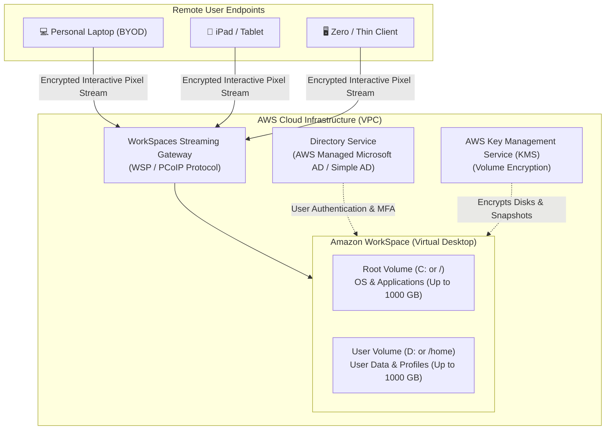

### Key Architectural Characteristics

1. **Simple Management**:
   - Eliminates desktop hardware procurement and OS re-imaging lifecycles.
   - Applications are managed and deployed centrally using **Amazon WorkSpaces Application Manager (Amazon WAM)**.
   - IT teams manage WorkSpaces using familiar enterprise tooling (Group Policy Objects, Microsoft Endpoint Configuration Manager).
2. **Enterprise Security & Compliance**:
   - **Data Stays in the Cloud**: No sensitive corporate IP resides on the user's physical laptop. Only an encrypted interactive pixel stream is transmitted across the internet.
   - **Authentication**: Integrates with on-premises Active Directory through **AWS Directory Service**, or utilizes **AWS Managed Microsoft AD** or Simple AD.
   - **Multi-Factor Authentication (MFA)**: Adds time-based one-time password (TOTP) or RADIUS MFA challenges during login.
   - **Storage Encryption**: Integrates with **AWS Key Management Service (AWS KMS)** to encrypt root volumes, user volumes, disk I/O, and volume snapshots at rest.
   - **IP Access Control**: Administrators configure IP Access Control Groups to restrict desktop access to trusted corporate VPN or office IP CIDR blocks.
3. **Storage Scaling & Expansion Rules**:
   - Each WorkSpace possesses two volumes:
     - **Root Volume**: Contains OS system files and installed application software.
     - **User Volume**: Contains the user's persistent profile, documents, and files.
   - **Maximum Volume Size**: Both root and user volumes can scale up to **1,000 GB (1 TB) each**.
   - **Expansion Frequency**: Customers can request a volume expansion **one time within a 6-hour window**.
   - **No Volume Shrinking Rule**: To preserve data integrity and prevent data corruption, **customers CANNOT decrease the size of root or user volumes after launching a WorkSpace**.
4. **Hardware Bundles & Dynamic Switching**:
   - AWS provides preconfigured hardware performance bundles:
     - **Value**: 1 vCPU, 2 GiB RAM (light browsing, single tasks).
     - **Standard**: 2 vCPU, 4 GiB RAM (standard office productivity, email, spreadsheets).
     - **Performance**: 2 vCPU, 8 GiB RAM (intensive multitasking, data manipulation).
     - **Power**: 4 vCPU, 16 GiB RAM (software development, data modeling).
     - **PowerPro**: 8 vCPU, 32 GiB RAM (heavy development, complex analytics).
     - **Graphics / GraphicsPro**: Dedicated NVIDIA GPUs for 3D modeling, CAD, and video engineering.
   - **Preserved Bundle Transitions**: Administrators can dynamically switch a user between bundles (e.g., upgrading from Standard to Performance). Amazon WorkSpaces restarts the virtual desktop on new hardware while **fully preserving the operating system, applications, user files, and storage configurations**.
5. **Flexible Billing Models**:
   - **Monthly Billing**: Fixed monthly rate per WorkSpace providing unlimited usage hours. Best for full-time employees using their desktop 40+ hours per week.
   - **Hourly Billing (AutoStop)**: A small monthly base fee covers storage and infrastructure, plus a low hourly charge only for the specific hours the WorkSpace is running. When inactive for a configured period, the desktop suspends into an AutoStop state, minimizing idle compute costs. Ideal for part-time workers, contractors, and occasional disaster recovery staff.

---

## 📊 Summary Reference Matrices

### Comprehensive Wireless Technologies Matrix

| Technology | Standard / Frequency | Max Theoretical Speed | Range | Power Profile | Primary Use Case |
| :--- | :--- | :--- | :--- | :--- | :--- |
| **Wi-Fi 6 / 6E** | 802.11ax (2.4, 5, 6 GHz) | 9.6 Gbps | 20–50 m | Medium | High-density enterprise WLANs, video streaming |
| **Bluetooth Classic**| 2.4 GHz FHSS | 2–3 Mbps | 10–30 m | Medium | Continuous audio streaming, wireless peripherals |
| **BLE** | 2.4 GHz ISM | 1–2 Mbps | 10–50 m | **Ultra-Low** | Telemetry sensors, beacons, fitness wearables |
| **Active RFID** | 433 MHz / 915 MHz / 2.4 GHz| Up to 250 kbps | Up to 100 m | Low (Battery) | Real-time cargo & container asset tracking |
| **Passive RFID**| LF / HF / UHF (860–960 MHz)| Bits to Kilobits | 0.1–10 m | **None (Passive)** | Inventory management, retail garments, badges |
| **NFC** | 13.56 MHz HF | 424 kbps | **$< 4\text{ cm}$** | Minimal | Contactless point-of-sale payments, quick-pairing |
| **5G NR** | Sub-6 GHz & mmWave | 10–20 Gbps | 100m to miles | Medium / High | Ultra-fast mobile broadband, autonomous driving |
| **NB-IoT** | Cellular licensed (200 kHz) | ~250 kbps | Up to 10 km | **Ultra-Low** | Stationary smart meters, deep indoor utility probes |
| **LoRaWAN** | Sub-GHz unlicensed ISM | 0.3–50 kbps | 2–15 km | **Ultra-Low** | Off-grid smart agriculture, city environmental sensors |

---

## ❓ Checkpoint & Knowledge Check

Test your understanding of the concepts covered in this module.

### Question 1
**True or False**: After an administrator or user launches an Amazon WorkSpace, the end user can decrease the size of the root or user volumes within the WorkSpace to lower monthly storage costs.

> **Answer**: **False**  
> **Explanation**: To ensure file system integrity and prevent data loss or catastrophic corruption, Amazon WorkSpaces supports expanding volume sizes (up to 1,000 GB each, once per 6-hour period), but **volume sizes can never be decreased** after launch.

---

### Question 2
Which protocol ensures that constrained IoT devices can connect to cloud endpoints securely using encrypted standard RESTful web communications?

> **Answer**: **HTTPS (Hypertext Transfer Protocol Secure) / TLS**  
> **Explanation**: HTTPS encapsulates standard HTTP REST requests within Transport Layer Security (TLS), ensuring mutual device authentication and data encryption in transit.

---

### Question 3
An IoT solutions architect is designing a battery-operated soil monitoring network across an expansive 10-square-kilometer vineyard. The probes need to report moisture levels once every 3 hours and operate autonomously for over 5 years without battery replacement. Which communication technology is best suited for this implementation?
- A) Bluetooth Classic
- B) Wi-Fi 6 (5 GHz)
- C) LoRaWAN / AWS IoT Core for LoRaWAN
- D) 5G mmWave

> **Answer**: **C**  
> **Explanation**: LoRaWAN provides low-power, long-range RF connectivity extending over 10–15 km in rural areas. Because transmissions are compact and infrequent, probe sensors can achieve multi-year lifespans on single batteries. Neither 5 GHz Wi-Fi nor 5G mmWave provides sufficient coverage range, and Bluetooth Classic is limited to ~10 meters.

---

### Question 4
Why is Wired Equivalent Privacy (WEP) strictly forbidden in modern wireless networks?
- A) WEP requires expensive specialized crypto-coprocessor hardware.
- B) WEP transmits the 24-bit Initialization Vector in cleartext, causing predictable IV collisions that allow mathematical recovery of the shared key in minutes.
- C) WEP only operates over 5 GHz spectrum and cannot support 2.4 GHz devices.
- D) WEP requires an external RADIUS server that small networks cannot afford.

> **Answer**: **B**  
> **Explanation**: The 24-bit IV in WEP is too short and is sent unencrypted in every frame. In high-traffic networks, IVs repeat within minutes (birthday paradox), enabling passive observers to derive the master WEP key using tools like Aircrack-ng.

---

### Question 5
An organization is adopting a BYOD policy for its remote mobile workforce. The security officer requires that if an employee's personal smartphone is misplaced or the employee leaves the company, corporate emails and proprietary customer data can be wiped without erasing the employee's personal family photos or personal applications. What capability satisfies this requirement?
- A) Hardware-enforced Full Factory Reset
- B) Remote BIOS lock
- C) Selective / Enterprise Wipe within an MDM container
- D) WPA3 Simultaneous Authentication of Equals

> **Answer**: **C**  
> **Explanation**: An Enterprise or Selective Wipe orchestrated via an MDM/EMM solution deletes only the managed work container, corporate profiles, and company keys, leaving the personal storage partition completely intact.

---

## 📝 Key Takeaways & Exam Summary

- **Evolution of Wi-Fi Standards**:
  - Wi-Fi 4 (802.11n), Wi-Fi 5 (802.11ac), Wi-Fi 6/6E (802.11ax), Wi-Fi 7 (802.11be).
  - 2.4 GHz provides superior distance penetration but suffers from co-channel congestion (channels 1, 6, 11).
  - 5 GHz offers wide bandwidth and higher data rates with shorter propagation distance.
  - 6 GHz introduces up to 1.2 GHz of uncrowded spectrum exclusively for Wi-Fi 6E/7 endpoints.
- **Wireless Cryptography**:
  - WEP is fundamentally insecure due to 24-bit IV repetition.
  - WPA introduced TKIP.
  - WPA2 standardizes AES-CCMP encryption.
  - WPA3 provides robust protection against offline dictionary attacks using Dragonfly SAE and mandatory Protected Management Frames (PMF).
- **PAN Technologies**:
  - **Bluetooth Low Energy (BLE)** transmits compact bursts of telemetry with years of battery life.
  - **Passive RFID** scavenges power from incoming RF fields; **Active RFID** houses onboard batteries for 100m tracking.
  - **NFC** operates at 13.56 MHz over $\le 4\text{ cm}$ for tap-to-pay and fast device pairing.
- **Cellular & LPWAN Roadmap**:
  - 5G divides into wide-coverage **Sub-6 GHz** and high-throughput/short-range **mmWave**.
  - **NB-IoT** and **LTE-M** deliver low-power cellular connectivity for remote sensors.
  - **eSIM** enables over-the-air profile provisioning on embedded chips.
- **IoT & AWS Architecture**:
  - Multi-tier model: Edge Sensors/Actuators $\rightarrow$ Gateway $\rightarrow$ Cloud Ingestion $\rightarrow$ Business Apps.
  - **MQTT** is the primary lightweight publish-subscribe protocol for constrained sensors.
  - **AWS IoT Core** provides a scalable Device Gateway, Message Broker, Device Registry, Device Shadows (digital twins), Rules Engine, and managed LoRaWAN support.
- **Enterprise Mobility & Virtual Desktops**:
  - **BYOD** balances device flexibility with security risks.
  - **MDM / EMM** enforces device policies, application containerization, and selective remote wiping.
  - **Amazon WorkSpaces** delivers managed Windows/Linux cloud desktops with Active Directory authentication, KMS encryption, flexible bundles, and root/user storage volumes scalable up to 1,000 GB each (which cannot be shrunk).
