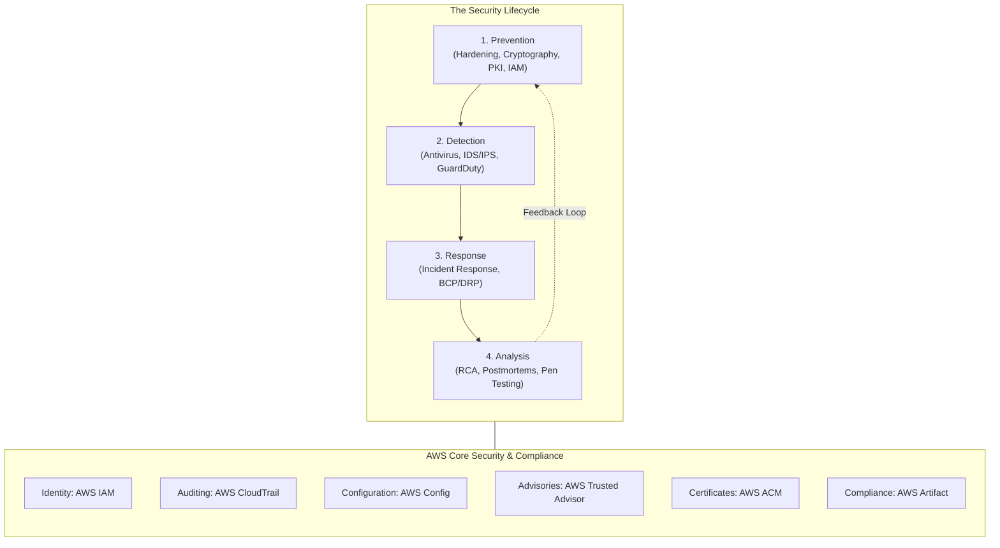

# Module T08: Security Fundamentals

> **Course**: AWS re/Start  
> **Module ID**: `T08` / Module 04  
> **Total Documents**: 19 Study Guides (18 Slides Deck Guides + 1 Hands-On Video Demonstration Tutorial)  
> **Status**: Completed (100%)  

---

## Module Overview

The **Security Fundamentals** module introduces core information security principles, foundational defensive strategies, and AWS cloud security services. Students explore the CIA triad, threat models, hardening strategies across networks and hosts, cryptographic foundations, identity and access management, proactive detection systems, incident response frameworks, compliance standards, and cloud governance tools.

---

## Curriculum Roadmap



---

## Complete Document Index

| # | Code | Title & Topics | Key Concepts Covered | Study Guide |
|---|------|----------------|----------------------|-------------|
| 01 | `T08-0001` | [Security Introduction](file:///work/tmp/aws-cf/T08-Security/T08-0001-RSSECY_EN-US_SG_M04_SECURITYINTRO.md) | CIA Triad, AAA Framework, Threat vectors, Defense-in-Depth, Security lifecycle | [Read Guide](file:///work/tmp/aws-cf/T08-Security/T08-0001-RSSECY_EN-US_SG_M04_SECURITYINTRO.md) |
| 02 | `T08-0002` | [Acceptable Use Policy (AUP)](file:///work/tmp/aws-cf/T08-Security/T08-0002-RSSECY_EN-US_SG_M04_Acceptable_Use_Policy_Example.md) | Legal/operational boundaries, Prohibited activities, Compliance monitoring, AUP design | [Read Guide](file:///work/tmp/aws-cf/T08-Security/T08-0002-RSSECY_EN-US_SG_M04_Acceptable_Use_Policy_Example.md) |
| 03 | `T08-0003` | [Security Lifecycle - Prevention](file:///work/tmp/aws-cf/T08-Security/T08-0003-RSSECY_EN-US_SG_M04_LIFECYCLEPREVENTION.md) | Prevention role, Layered prevention model, Security controls taxonomy, Awareness training | [Read Guide](file:///work/tmp/aws-cf/T08-Security/T08-0003-RSSECY_EN-US_SG_M04_LIFECYCLEPREVENTION.md) |
| 04 | `T08-0004` | [Network Hardening](file:///work/tmp/aws-cf/T08-Security/T08-0004-RSSECY_EN-US_SG_M04_PREVENTIONNETHARD.md) | Network vulnerabilities, Subnet segmentation, DMZs, Firewalls (stateless vs stateful), Security Groups vs NACLs | [Read Guide](file:///work/tmp/aws-cf/T08-Security/T08-0004-RSSECY_EN-US_SG_M04_PREVENTIONNETHARD.md) |
| 05 | `T08-0005` | [Systems Hardening](file:///work/tmp/aws-cf/T08-Security/T08-0005-RSSECY_EN-US_SG_M04_SYSTEMSHARDENING.md) | Least functionality, CIS benchmarks, Closing ports, Kernel parameter tuning, Patch management | [Read Guide](file:///work/tmp/aws-cf/T08-Security/T08-0005-RSSECY_EN-US_SG_M04_SYSTEMSHARDENING.md) |
| 06 | `T08-0006` | [Data Security & Encryption](file:///work/tmp/aws-cf/T08-Security/T08-0006-RSSECY_EN-US_SG_M04_PREVENTIONDATASECURITY.md) | Data states (transit, rest, use), Symmetric vs asymmetric encryption, Hashing (SHA-256), Access control models, AWS KMS | [Read Guide](file:///work/tmp/aws-cf/T08-Security/T08-0006-RSSECY_EN-US_SG_M04_PREVENTIONDATASECURITY.md) |
| 07 | `T08-0007` | [Public Key Infrastructure (PKI)](file:///work/tmp/aws-cf/T08-Security/T08-0007-RSSECY_EN-US_SG_M04_PREVENTIONPKI.md) | CA hierarchy, Root and intermediate CAs, X.509 digital certificates, CRL vs OCSP, TLS handshakes | [Read Guide](file:///work/tmp/aws-cf/T08-Security/T08-0007-RSSECY_EN-US_SG_M04_PREVENTIONPKI.md) |
| 08 | `T08-0008` | [ACM Video Demo Hands-On](file:///work/tmp/aws-cf/T08-Security/T08-0008-RSSCHAB_EN-US_Video_M04_ACM_Demo.md) | Requesting public certificates in ACM, Route 53 DNS validation, ALB HTTPS listener, Port 80 redirect | [Read Guide](file:///work/tmp/aws-cf/T08-Security/T08-0008-RSSCHAB_EN-US_Video_M04_ACM_Demo.md) |
| 09 | `T08-0009` | [Identity & Access Management](file:///work/tmp/aws-cf/T08-Security/T08-0009-RSSECY_EN-US_SG_M04_PREVENTIONIDMGMT.md) | Authentication factors, MFA/TOTP, SAML 2.0 / OIDC federation, AWS IAM Identity Center | [Read Guide](file:///work/tmp/aws-cf/T08-Security/T08-0009-RSSECY_EN-US_SG_M04_PREVENTIONIDMGMT.md) |
| 10 | `T08-0010` | [AWS IAM Deep Dive](file:///work/tmp/aws-cf/T08-Security/T08-0010-RSSECY_EN-US_SG_M04_AWSIAM.md) | Root user precautions, Users, Groups, Roles (STS), JSON policies evaluation logic, Managed vs Inline | [Read Guide](file:///work/tmp/aws-cf/T08-Security/T08-0010-RSSECY_EN-US_SG_M04_AWSIAM.md) |
| 11 | `T08-0011` | [Security Lifecycle - Detection](file:///work/tmp/aws-cf/T08-Security/T08-0011-RSSECY_EN-US_SG_M04_DETECTION.md) | Antivirus & EDR, NIDS vs HIDS, Signature vs anomaly detection, Amazon GuardDuty intelligent threat detection | [Read Guide](file:///work/tmp/aws-cf/T08-Security/T08-0011-RSSECY_EN-US_SG_M04_DETECTION.md) |
| 12 | `T08-0012` | [AWS CloudTrail](file:///work/tmp/aws-cf/T08-Security/T08-0012-RSSECY_EN-US_SG_M04_AWSCLOUDTRAIL.md) | Governance & auditing, Management vs Data vs Insights events, Multi-region trails, Tamper-evident log validation | [Read Guide](file:///work/tmp/aws-cf/T08-Security/T08-0012-RSSECY_EN-US_SG_M04_AWSCLOUDTRAIL.md) |
| 13 | `T08-0013` | [AWS Config](file:///work/tmp/aws-cf/T08-Security/T08-0013-RSSECY_EN-US_SG_M04_AWSCONFIG.md) | Resource inventory, Configuration items, Managed & custom rules, Automated remediation, Conformance packs | [Read Guide](file:///work/tmp/aws-cf/T08-Security/T08-0013-RSSECY_EN-US_SG_M04_AWSCONFIG.md) |
| 14 | `T08-0014` | [Security Lifecycle - Response](file:///work/tmp/aws-cf/T08-Security/T08-0014-RSSECY_EN-US_SG_M04_RESPONSE.md) | NIST/SANS 6-phase incident response, BCP vs DRP, RTO and RPO metrics, AWS disaster recovery strategies | [Read Guide](file:///work/tmp/aws-cf/T08-Security/T08-0014-RSSECY_EN-US_SG_M04_RESPONSE.md) |
| 15 | `T08-0015` | [Security Lifecycle - Analysis](file:///work/tmp/aws-cf/T08-Security/T08-0015-RSSECY_EN-US_SG_M04_ANALYSIS.md) | Root Cause Analysis (5 Whys, Ishikawa), Risk assessment ($Risk = Threat \times Vuln \times Impact$), Response strategies, Pen testing | [Read Guide](file:///work/tmp/aws-cf/T08-Security/T08-0015-RSSECY_EN-US_SG_M04_ANALYSIS.md) |
| 16 | `T08-0016` | [AWS Trusted Advisor](file:///work/tmp/aws-cf/T08-Security/T08-0016-RSSECY_EN-US_SG_M04_AWSTRUSTEDADVISOR.md) | 5 Pillars (Cost, Performance, Security, Fault Tolerance, Quotas), Core vs Full checks, Automated alerts | [Read Guide](file:///work/tmp/aws-cf/T08-Security/T08-0016-RSSECY_EN-US_SG_M04_AWSTRUSTEDADVISOR.md) |
| 17 | `T08-0017` | [AWS Account Creation Best Practices](file:///work/tmp/aws-cf/T08-Security/T08-0017-RSSECY_EN-US_SG_M04_BESTPRACTICES.md) | 8 Mandatory account setup practices, Root protection, CloudWatch billing alarms, Alternate contacts | [Read Guide](file:///work/tmp/aws-cf/T08-Security/T08-0017-RSSECY_EN-US_SG_M04_BESTPRACTICES.md) |
| 18 | `T08-0018` | [AWS Compliance Program](file:///work/tmp/aws-cf/T08-Security/T08-0018-RSSECY_EN-US_SG_M04_AWSCOMPLIANCE.md) | Laws and regulations, SOC 1/2/3, ISO 27001, PCI DSS, HIPAA, FedRAMP, GDPR, AWS Artifact self-service portal | [Read Guide](file:///work/tmp/aws-cf/T08-Security/T08-0018-RSSECY_EN-US_SG_M04_AWSCOMPLIANCE.md) |
| 19 | `T08-0019` | [AWS Security Resources](file:///work/tmp/aws-cf/T08-Security/T08-0019-RSSECY_EN-US_SG_M04_AWSSECURITYRESOURCES.md) | AWS Account teams, Support plans (Basic, Developer, Business, Enterprise), Health Dashboard, APN, Advisories | [Read Guide](file:///work/tmp/aws-cf/T08-Security/T08-0019-RSSECY_EN-US_SG_M04_AWSSECURITYRESOURCES.md) |

---

## Shared Responsibility Model Quick Reference

```
+-------------------------------------------------------------------------------+
|                        CUSTOMER RESPONSIBILITY                                |
|                        (Security IN the Cloud)                                |
|  - Customer Data (Classification, Encryption at-rest and in-transit)          |
|  - Platform, Applications, Identity & Access Management (IAM)                 |
|  - Operating System, Network & Firewall Configuration (Security Groups/NACLs) |
+-------------------------------------------------------------------------------+
|                           AWS RESPONSIBILITY                                  |
|                         (Security OF the Cloud)                               |
|  - Software: Compute, Storage, Database, Networking services                  |
|  - Hardware / Global Infrastructure: Regions, Availability Zones, Edge Points |
|  - Physical Data Center Security, Environmental controls, Hardware recycling  |
+-------------------------------------------------------------------------------+
```
