# 🛡️ Introduction to Security: Foundations, Threat Landscape & Governance

> **Course**: AWS re/Start  
> **Module**: Security (M04 – Introduction to Security)  
> **Source Document**: `T08-Security/T08-0001-RSSECY_EN-US_SG_M04_SECURITYINTRO.pdf`  
> **Target Audience**: AWS re/Start Learners, Cloud Practitioners, and Systems Operations Associates  

---

## 🎯 Module Overview

Security is universally acknowledged as **job zero** across modern technology infrastructure and enterprise operations. Whether running on-premises data centers, hybrid enterprise topologies, or native public cloud platforms like Amazon Web Services (AWS), protecting valuable business assets and digital workloads is foundational to business longevity, customer trust, and regulatory compliance.

This module introduces the foundational pillars of information security, establishes core cybersecurity terminology, deconstructs modern threat vectors, categorizes multi-layered security controls, and explores how security is operationalized across the continuous **Security Lifecycle** and the **AWS Shared Responsibility Model**.

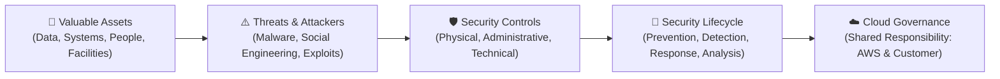

---

## 📌 Learning Objectives

By completing this module and engaging with these study materials, you will be able to:

- [ ] **Define key security terminology**: Accurately explain and differentiate between *asset*, *attacker*, *vulnerability*, *threat*, *breach / incident*, and *control*.
- [ ] **Master the CIA Triad & Core Pillars**: Formulate security objectives around **Confidentiality**, **Integrity**, and **Availability**, as well as the supporting principles of **Authenticity** and **Non-repudiation**.
- [ ] **Deconstruct the AAA Security Framework**: Explain the purpose and flow of **Authentication**, **Authorization**, and **Accounting / Auditing**.
- [ ] **Catalog the Modern Threat Landscape**: Identify primary attack vectors including malware (viruses, worms, ransomware, trojans/RATs, spyware), social engineering (phishing, spear phishing, vishing, pretexting), denial of service (DoS/DDoS), Man-in-the-Middle (MitM), SQL Injection (SQLi), and Cross-Site Scripting (XSS).
- [ ] **Classify Security Controls**: Categorize controls by timeline function (**Preventative**, **Detective**, **Corrective**) and by operational implementation domain (**Physical**, **Administrative**, **Technical**).
- [ ] **Apply Defense-in-Depth**: Architect layered security models spanning Physical, Perimeter, Network, Host, Application, Data, and Administrative/People layers.
- [ ] **Analyze Cloud Security Strategy**: Articulate what to implement (controls), when to implement (lifecycle), and who is responsible (**AWS Shared Responsibility Model**).
- [ ] **Operationalize the Security Lifecycle**: Map security tasks across Prevention, Detection, Response, Analysis, and Recovery.
- [ ] **Evaluate Administrative Policies**: Audit and interpret real-world enterprise policies such as an **Acceptable Use Policy (AUP)**.

---

## 🔐 1. Core Information Security Foundations

### 1.1 What is Security and Cybersecurity?

At its most fundamental level:
- **Security** is the operational and strategic practice of protecting valuable assets from harm, theft, unauthorized access, or destruction. Assets can be:
  - **Physical**: Human personnel, data centers, office buildings, compute hardware, networking appliances, and storage media.
  - **Digital / Logical**: Intellectual property, proprietary source code, customer databases, personal identifiable information (PII), credentials, and digital workflows.
- **Cybersecurity** is the specialized discipline focused on protecting digital devices, networks, software applications, and electronic data against:
  - **Unauthorized access**: Eavesdropping, credential theft, or privilege escalation.
  - **Malicious modification, theft, or destruction**: Data corruption, database tampering, or ransomware encryption.
  - **Disruption of intended use**: Denial of service attacks or operational downtime.

### 1.2 The CIA Triad

The cornerstone of all information security architecture is the **CIA Triad**—a model designed to guide policies and controls for information assurance.

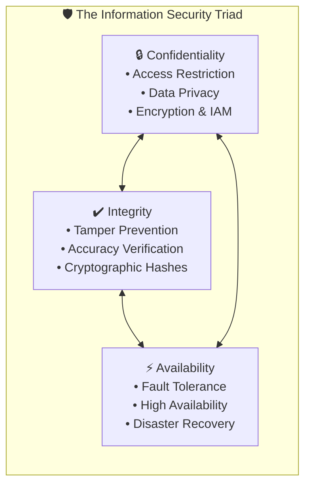

| Triad Pillar | Definition | Core Objective & Question | Real-World Protective Mechanisms | Real-World Impact if Compromised |
| :--- | :--- | :--- | :--- | :--- |
| **Confidentiality** | Preserving authorized restrictions on access and disclosure to protect personal privacy and proprietary data. | *Is private information shielded from unauthorized entities?* | • Multi-Factor Authentication (MFA)<br>• Role-Based Access Control (RBAC)<br>• Data encryption at rest (AES-256)<br>• Transport layer encryption (TLS 1.3) | Identity theft, leaked trade secrets, HIPAA/GDPR fines, reputation collapse. |
| **Integrity** | Safeguarding the accuracy, completeness, and authenticity of data against unauthorized alteration or deletion. | *Is data verified to be unaltered, authentic, and accurate across its lifecycle?* | • Cryptographic checksums & hashes (SHA-256)<br>• Digital signatures<br>• File integrity monitoring (FIM)<br>• Database transactions & ACID properties | Fraudulent financial wire transfers, poisoned medical records, tampered binaries. |
| **Availability** | Ensuring timely, dependable, and authorized access to information systems and operational resources. | *Can legitimate users access critical systems and data exactly when required?* | • Redundant infrastructure (Multi-AZ, Multi-Region)<br>• Load balancing & auto-scaling<br>• DDoS mitigation (AWS Shield)<br>• Automated backups & Disaster Recovery Plans (DRP) | Paralyzed business operations, e-commerce revenue outages, public safety disruptions. |

### 1.3 Supporting Pillars: Authenticity and Non-Repudiation

Modern enterprise security frameworks extend the CIA triad to include two additional critical concepts:

1. **Authenticity**:
   - The assurance that a message, transaction, or communicating entity is genuinely who or what it claims to be.
   - *Example*: Verifying that an email claiming to originate from executive management actually originated from the enterprise's authorized mail servers using SPF, DKIM, and DMARC.
2. **Non-Repudiation**:
   - The inability of an entity to deny having performed a specific action, transaction, or transmission.
   - *Technical Mechanism*: Achieved through asymmetric cryptography, digital signatures, and immutable audit logs (e.g., AWS CloudTrail logs written to S3 with Object Lock and MFA Delete enabled).

---

## 🔑 2. The AAA Security Framework

Access control and identity governance are governed by the **AAA Security Framework**. AAA defines the sequential stages every subject (user, service, or API script) must navigate to interact with an enterprise resource.

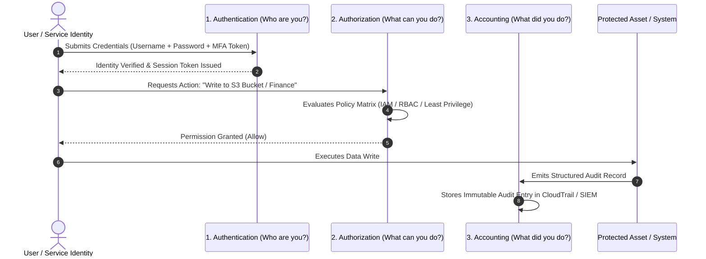

### 2.1 Authentication (AuthN) — *Who you are*
- Validates the claimed identity of the subject.
- **Authentication Factors**:
  1. *Something you know*: Passwords, passphrases, PINs.
  2. *Something you have*: Hardware security tokens (YubiKey), SMS codes, software authenticator apps (TOTP), smart cards.
  3. *Something you are*: Biometric markers (fingerprint, facial recognition, retina scans).
- **Best Practice**: Enforce Multi-Factor Authentication (MFA) requiring two or more distinct factor types.

### 2.2 Authorization (AuthZ) — *What you can do*
- Determines what operations, files, APIs, or systems an authenticated entity is permitted to access.
- Operates under the **Principle of Least Privilege (PoLP)**: Entities receive only the absolute minimum permissions strictly necessary to fulfill their legitimate job functions.
- Enforced via access control mechanisms such as:
  - **RBAC (Role-Based Access Control)**: Permissions assigned based on job roles (e.g., Database Administrator, Financial Analyst).
  - **ABAC (Attribute-Based Access Control)**: Dynamic policies evaluating tags, departments, project codes, or device health.

### 2.3 Accounting / Auditing (Acct) — *What you did*
- The continuous recording, logging, and tracking of user and machine activities while accessing resources.
- Tracks logon timestamps, IP addresses, API requests executed, resources modified, and session durations.
- Powers forensic investigations, compliance reporting (PCI-DSS, SOC 2, ISO 27001), anomaly detection, and non-repudiation.

---

## ⚠️ 3. Threat Landscape, Taxonomy & Attack Vectors

### 3.1 Basic Security Terminology & Incident Chain

Understanding how security breaches manifest requires analyzing the relationship between vulnerabilities, threats, and security controls.

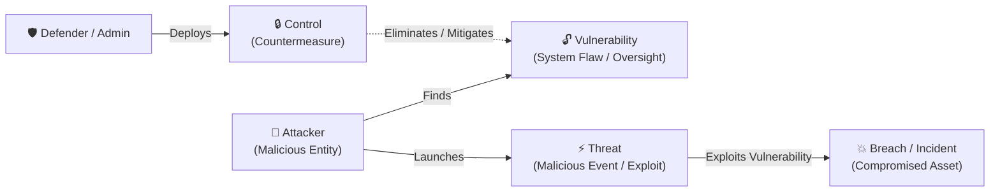

- **Attacker (Threat Actor)**: An individual, organization, or rogue nation-state with malicious intent and the technical capability to compromise a target system.
- **Vulnerability**: An unpatched flaw, configuration error, software bug, or architectural oversight that creates an exploit window.
- **Threat**: Any circumstance, action, or event with the potential to adversely impact operations, assets, or individuals via a vulnerability.
- **Breach (Security Incident)**: A confirmed event where an attacker successfully exploits a vulnerability, compromising data confidentiality, system integrity, or service availability.
- **Control (Countermeasure)**: A protective safeguard, process, or mechanism implemented to reduce risk, eliminate vulnerabilities, or mitigate damage.

---

### 3.2 Malware Taxonomy

**Malware** (Malicious Software) is software intentionally engineered to infiltrate, compromise, disrupt, or damage systems without owner consent.

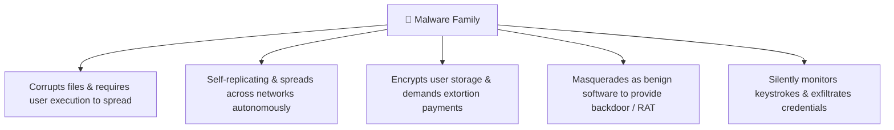

1. **Viruses**:
   - Malicious code attached to a legitimate host file or executable.
   - Requires manual user action (e.g., executing an attachment) to activate and replicate across files and local storage.
   - *Impact*: Affects Confidentiality, Integrity, and Availability.
2. **Worms**:
   - Self-contained, autonomous programs that replicate and spread across computer networks without human interaction by exploiting network protocol vulnerabilities.
   - *Impact*: Rapid network bandwidth saturation, resource exhaustion, and remote code execution across fleets of servers.
3. **Ransomware**:
   - Advanced malware that leverages robust asymmetric cryptography to lock the victim's operating system or encrypt critical files, demanding cryptocurrency payments for decryption keys.
   - *Impact*: Total loss of data and operational Availability; modern variants also exfiltrate data (double extortion) threatening Confidentiality.
4. **Trojans & Remote Access Trojans (RATs)**:
   - Disguised as legitimate software (e.g., a utility program, driver, or game update). Once installed, they establish stealth backdoors, allowing attackers to remotely control the operating system, access webcam feeds, and inject secondary payloads.
   - *Impact*: Total compromise of Confidentiality, Integrity, and Availability.
5. **Spyware & Keyloggers**:
   - Covert software that operates silently in the background, harvesting keystrokes, browser history, session tokens, and passwords before exfiltrating them to command-and-control (C2) servers.
   - *Impact*: Direct compromise of Confidentiality.

---

### 3.3 Social Engineering Attack Vectors

Social engineering bypasses technological perimeters by manipulating the human element—exploiting cognitive biases such as trust, fear, urgency, authority, and curiosity.

> [!CAUTION]
> According to the **Verizon Data Breach Investigations Report (DBIR)**, human factors and social engineering tactics are involved in over **30% to 35% of all confirmed enterprise breaches**.

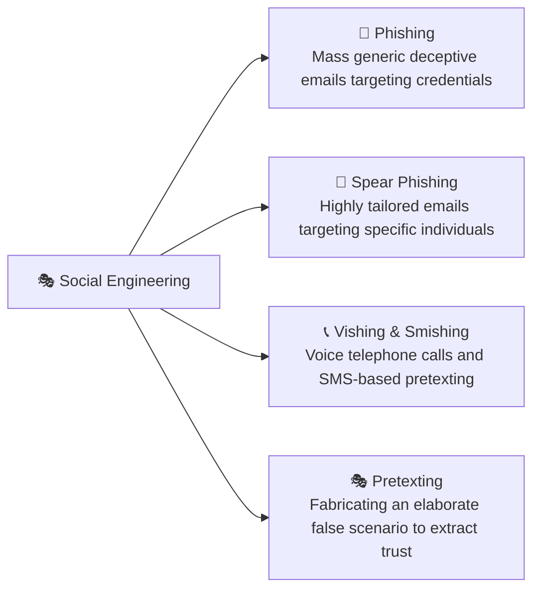

- **Phishing**: Untargeted, bulk distribution of fraudulent communications masquerading as trustworthy brands (banks, postal services, IT helpdesks) to lure victims into revealing credentials or clicking malware links.
- **Spear Phishing & Whaling**: Highly customized phishing campaigns where attackers research specific employees (using LinkedIn, social media, and corporate websites). *Whaling* specifically targets high-value executives (C-suite, finance directors) to authorize wire transfers.
- **Vishing (Voice Phishing)**: Phone-based manipulation where attackers impersonate corporate IT support, tax authorities, or executive leadership to solicit passwords or Multi-Factor Authentication (MFA) push codes.
- **Smishing (SMS Phishing)**: Text message lures carrying malicious shortlinks or fraudulent urgent account verification warnings.
- **Pretexting**: Constructing an elaborate backstory (e.g., posing as an external auditor, building maintenance contractor, or legal counsel) to deceive personnel into granting physical access or administrative overrides.

---

### 3.4 Network & Web Application Attack Vectors

| Attack Vector | Mechanism & Operational Technique | Targeted CIA Pillar | Primary Countermeasures |
| :--- | :--- | :--- | :--- |
| **Denial of Service (DoS)** | A single attacker machine overwhelms target compute, memory, or network bandwidth with garbage packets. | **Availability** | Rate limiting, stateless architecture, ingress firewalls, packet inspection. |
| **Distributed Denial of Service (DDoS)** | A distributed botnet (thousands/millions of compromised IoT devices or servers) coordinates volumetric floods (SYN floods, UDP amplification, HTTP floods). | **Availability** | AWS Shield, Amazon CloudFront, AWS WAF, Anycast IP routing, CDN caching. |
| **Man-in-the-Middle (MitM)** | An attacker positions themselves between two communicating endpoints (e.g., via ARP spoofing, rogue Wi-Fi, or DNS poisoning) to intercept or tamper with traffic. | **Confidentiality & Integrity** | Mandatory HTTPS/TLS 1.3, mutual TLS (mTLS), certificate pinning, VPN tunnels, DNSSEC. |
| **SQL Injection (SQLi)** | Malicious SQL syntax is injected into unvalidated input fields, causing the backend database engine to execute unintended commands. | **Confidentiality & Integrity** | Parameterized queries / prepared statements, stored procedures, Object-Relational Mappers (ORMs), AWS WAF SQLi rule sets. |
| **Cross-Site Scripting (XSS)** | Malicious client-side scripts are injected into web applications and executed inside the browsers of other unsuspecting users, hijacking session cookies. | **Confidentiality & Integrity** | Context-aware output encoding, strict Content Security Policy (CSP), HTTP-only cookies, automated input sanitization. |

---

### 3.5 Real-World Case Study: The SolarWinds Supply Chain Breach

To contextualize the scale of modern cyber threats, consider the landmark December 2020 **SolarWinds Orion** cyberattack:

> [!IMPORTANT]
> **Case Study Details**:
> - **The Attack Vector**: State-sponsored threat actors infiltrated the software build pipeline of SolarWinds, injecting a stealth backdoor known as *SUNBURST* directly into digitally signed updates for the Orion IT management platform.
> - **The Blast Radius**: Over 18,000 global commercial enterprises and high-level government agencies—including the US Department of Homeland Security, US Treasury, UK Government, and European Parliament—installed the poisoned update.
> - **Dwell Time**: Attackers operated completely undetected within target networks for **over 8 months**, harvesting classified emails, intellectual property, and system blueprints.
> - **Industry Takeaway**: A failure in third-party supply chain integrity can bypass traditional perimeter firewalls, highlighting the absolute necessity of **Zero Trust** architecture, continuous anomaly detection, and defense-in-depth.

```
Key Economic Breach Metrics (Ponemon Institute & Verizon DBIR Benchmarks):
├── Average global total cost of a data breach: ~$4.24 Million USD
├── Average time to identify and contain a data breach: 287 Days (212 days to identify + 75 days to contain)
├── Share of breach costs attributable to lost customer business: ~38%
└── Average direct remediation cost per lost PII record: ~$180 USD
```

---

## 🛡️ 4. Security Controls Framework & Classification Matrix

A **security control** is an architectural safeguard, operational procedure, or technological defense deployed to counter risks, eliminate vulnerabilities, and protect assets.

Security controls are categorized along two independent dimensions:
1. **By Functional Timing**: *When* does the control act relative to an incident?
2. **By Implementation Domain**: *How* is the control implemented in practice?

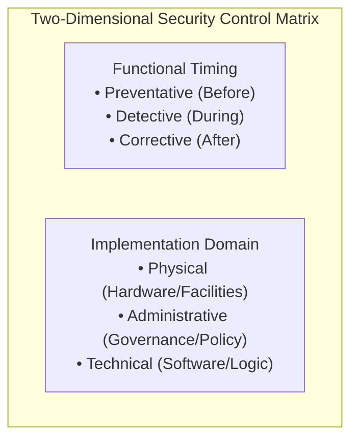

### 4.1 Functional Timing Categorization
- **Preventative Controls**: Proactive safeguards designed to block an attack or prevent a vulnerability from being exploited before it can occur.
- **Detective Controls**: Mechanisms designed to identify, discover, and alert on unauthorized activities, configuration anomalies, or active intrusions in real time or shortly thereafter.
- **Corrective Controls**: Measures taken to remediate an active breach, restore system operations, limit damage, and repair compromised assets.

### 4.2 Implementation Domain Categorization
- **Physical Controls**: Physical barriers, hardware devices, environmental facilities, and security personnel that restrict physical contact with assets.
- **Administrative (Operational / Procedural) Controls**: Formal management policies, guidelines, regulatory frameworks, onboarding procedures, and security awareness training that define human behavior.
- **Technical (Logical) Controls**: Software, firmware, hardware security appliances, operating system access lists, and cryptographic algorithms that automatically enforce security rules.

---

### 4.3 The 3x3 Security Controls Matrix

The following matrix illustrates how functional timing and implementation domains intersect:

| Control Type | Physical Domain | Administrative Domain | Technical (Logical) Domain |
| :--- | :--- | :--- | :--- |
| **Preventative** *(Stop attacks beforehand)* | • Biometric turnstiles<br>• Electronic badge card readers<br>• Server rack locks<br>• Anti-ram vehicle bollards | • Corporate Acceptable Use Policy (AUP)<br>• Mandatory background checks<br>• Separation of duties policy<br>• Security awareness training | • AWS IAM Least Privilege Policies<br>• Web Application Firewalls (AWS WAF)<br>• Security Groups & Network ACLs<br>• Strict multi-factor authentication |
| **Detective** *(Identify attacks in progress)* | • CCTV surveillance cameras<br>• Infrared motion detectors<br>• Security guard patrols<br>• Airport metal detectors | • Mandatory change management audit procedures<br>• Periodic account entitlement reviews<br>• Surprise financial audits | • AWS CloudTrail API event auditing<br>• Amazon GuardDuty threat detection<br>• Antivirus / EDR periodic disk scans<br>• Network Intrusion Detection (NIDS) |
| **Corrective** *(Remediate and restore)* | • Automated data center diesel backup generators<br>• Halon/FM-200 fire suppression systems<br>• Emergency door release mechanisms | • Formal Incident Response Plans (IRP)<br>• Business Continuity Plans (BCP)<br>• Disaster Recovery Runbooks | • Antivirus automated malware quarantine<br>• Amazon EC2 Auto Scaling instance replacement<br>• Automated snapshot restoration from Amazon S3 / AWS Backup |

### 4.4 The Structured Implementation Hierarchy

When establishing an enterprise security posture, controls are implemented hierarchically:

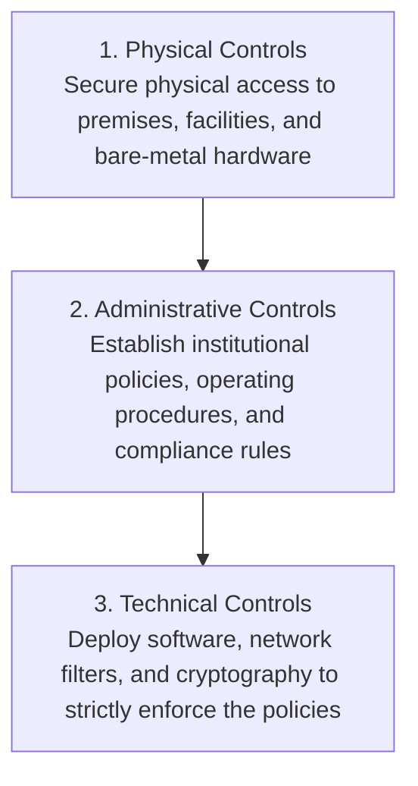

---

## 🏰 5. Defense-in-Depth Principle

No single security control is infallible. Firewalls can be bypassed, software contains zero-day bugs, and employees can make configuration mistakes. The **Defense-in-Depth** model addresses this by deploying multi-layered, redundant security controls throughout the entire IT environment.

If an attacker breaches an outer layer, successive inner defensive layers ensure the core data remains protected.

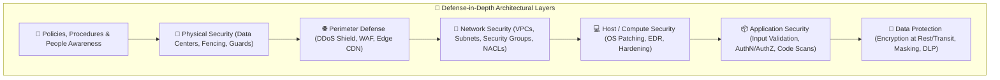

### Layer-by-Layer Breakdown

1. **Policies, Procedures & Awareness (Governance)**:
   - Acceptable Use Policies (AUP), continuous anti-phishing training, data classification standards, and non-disclosure agreements.
2. **Physical Security**:
   - Perimeter fencing, nondescript facilities, biometric access controls, 24/7 CCTV surveillance, and secure media destruction (NIST 800-88).
3. **Perimeter Defense**:
   - Edge filtering via Amazon CloudFront, managed DDoS protection via AWS Shield, and edge inspection via AWS WAF.
4. **Network Security**:
   - Network segmentation using Amazon VPCs, private subnets with NAT gateways, stateful Security Groups, stateless Network ACLs, and VPC Flow Logs.
5. **Host / Compute Security**:
   - Operating system hardening, disabling unnecessary ports and services, automated patch management via AWS Systems Manager Patch Manager, and agent-based endpoint detection.
6. **Application Security**:
   - Static Application Security Testing (SAST), software dependency analysis, strict input validation, OWASP Top 10 remediation, and API authorization tokens.
7. **Data Protection (The Crown Jewels)**:
   - Strong encryption at rest using AWS KMS (AES-256), encryption in transit using TLS 1.3, granular IAM S3 bucket policies, and sensitive data discovery using Amazon Macie.

---

## ☁️ 6. Cloud Security Strategy & The Shared Responsibility Model

### 6.1 The Three Core Pillars of a Cloud Security Strategy

An enterprise security strategy answers three fundamental questions:

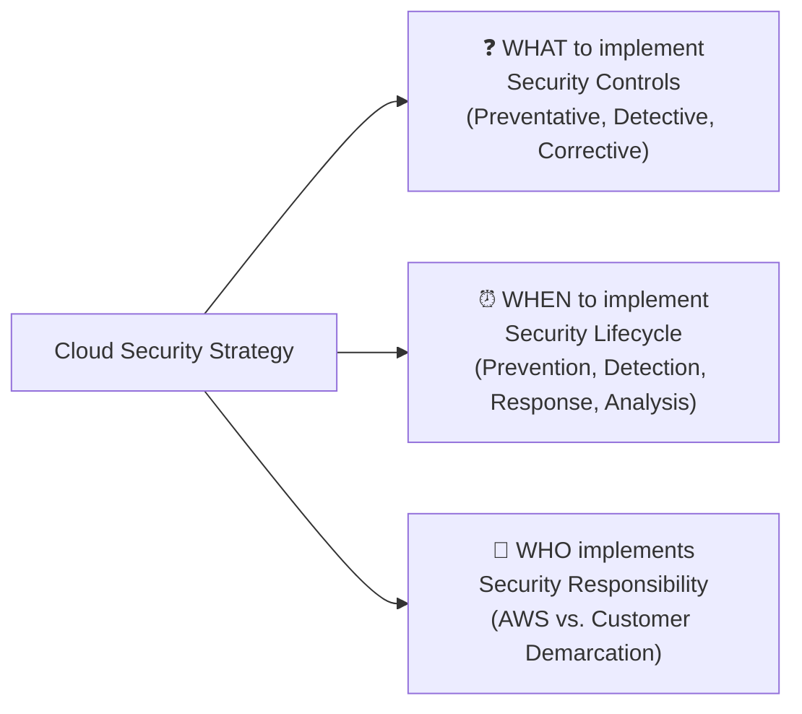

1. **WHAT**: Which security controls must be selected and configured (Physical, Administrative, Technical).
2. **WHEN**: At what operational stages are measures enacted across the continuous **Security Lifecycle**.
3. **WHO**: Which party is responsible for managing each layer of the infrastructure—defined in the cloud by the **AWS Shared Responsibility Model**.

---

### 6.2 AWS Shared Responsibility Model

In the AWS Cloud, security is a shared partnership between the cloud service provider and the customer:

> **AWS Responsibility: Security OF the Cloud**  
> AWS is responsible for protecting the global infrastructure that runs all services offered in the AWS Cloud.
>
> **Customer Responsibility: Security IN the Cloud**  
> The customer is responsible for configuring and maintaining the security of the services and data they provision within AWS.

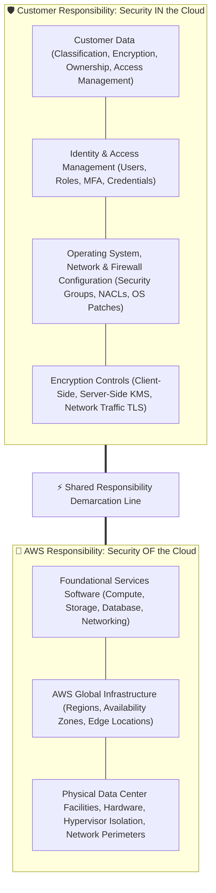

#### Detailed Breakdown of Responsibilities

```
                                  RESPONSIBILITY BREAKDOWN
┌──────────────────────────────────────────────┬──────────────────────────────────────────────┐
│       CUSTOMER (Security IN the Cloud)       │          AWS (Security OF the Cloud)         │
├──────────────────────────────────────────────┼──────────────────────────────────────────────┤
│ • Customer Data Storage & Encryption         │ • Physical Data Center Facilities & Security │
│ • IAM Accounts, Passwords & MFA              │ • Hardware Chassis, Power & Cooling Systems  │
│ • Guest OS Configuration & OS Patching       │ • Virtualization Layer & Hypervisor Isolation│
│ • Network Firewalls (Security Groups / NACL) │ • Network Infrastructure & Border Routers    │
│ • Application Logic & Code Hardening         │ • Physical Storage Device Degaussing & Purge │
│ • S3 Bucket Permissions & Object Access      │ • Managed Service Engine Automated Patching  │
└──────────────────────────────────────────────┴──────────────────────────────────────────────┘
```

---

## 🔄 7. The Security Lifecycle & Operational Governance

Security is not a static one-time checkbox; it is a continuous, iterative cycle. The **Security Lifecycle** mirrors the functional control types and provides structured operational governance.

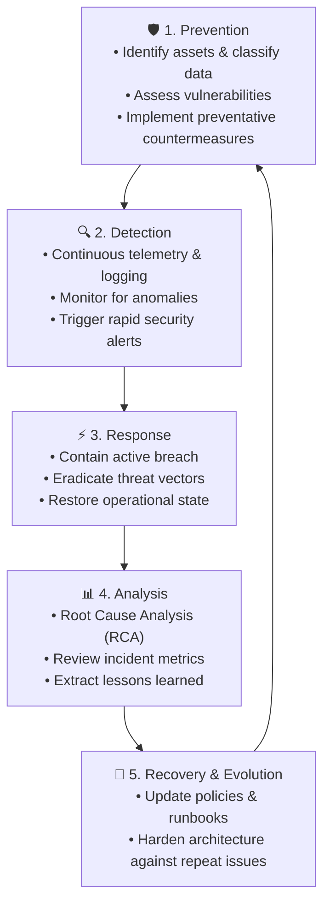

### Phase Details

1. **Phase 1: Prevention (Preventative Controls)**:
   - Identify and catalog all physical and digital assets.
   - Run vulnerability scans and penetration tests.
   - Harden operating systems, close unnecessary network ports, and configure IAM least-privilege policies.
2. **Phase 2: Detection (Detective Controls)**:
   - Centralize telemetry from operating systems, network devices, and cloud services (e.g., AWS CloudTrail, VPC Flow Logs).
   - Ingest logs into Security Information and Event Management (SIEM) systems.
   - Utilize machine learning anomaly detection (e.g., Amazon GuardDuty) to catch intrusions early.
3. **Phase 3: Response (Corrective Controls)**:
   - Activate the Incident Response Plan (IRP).
   - Quarantine infected virtual machines (e.g., isolate EC2 instances via restrictive Security Groups).
   - Revoke compromised credentials and rotate keys.
   - Restore affected servers and databases from validated backups.
4. **Phase 4: Analysis (Evaluation & Governance)**:
   - Conduct thorough Post-Incident Reviews (PIR) and Root Cause Analysis (RCA).
   - Document how the attacker established initial access, escalated privileges, and moved laterally.
   - Identify gaps in existing detective alerts or preventative policies.
5. **Phase 5: Recovery & Evolution**:
   - Update corporate security policies, firewall rules, and Acceptable Use Policies.
   - Re-train staff on discovered social engineering tactics.
   - Feed lessons learned directly back into Phase 1 (Prevention) to complete the continuous improvement loop.

---

## 📝 8. Hands-on Activity: Acceptable Use Policy (AUP) Review & Analysis

An **Acceptable Use Policy (AUP)** is an essential **administrative preventative security control**. It defines the boundaries, ethical responsibilities, and legally permissible usage of an organization’s computing hardware, networks, and services.

### Document Scenario Overview: *Example Corp AUP*
Organizations provide contractual guidelines governing how employees, contractors, and third parties access enterprise systems:
- It specifies prohibited conduct (e.g., transmitting illegal materials, fraudulent activities, security tampering, sending spam).
- It grants the organization the authority to monitor, investigate, suspend, or terminate access for non-compliance.

---

### Activity Analysis Questions & Model Answers

#### Question 1: What are three types of computing resources that are protected by this policy?
> **Model Answer**:
> 1. **Computer and Communication Systems**: Operating systems, physical desktop workstations, virtual machine instances, and messaging communication systems.
> 2. **Network Infrastructure**: Corporate local area networks (LANs), enterprise Wi-Fi, routers, switches, gateways, and cloud virtual private networks (VPCs).
> 3. **Software Applications and Corporate Websites**: Internal business software suites, external web properties (e.g., `example.com`), and corporate cloud services.

#### Question 2: What are two security-related violations that are explicitly prohibited?
> **Model Answer**:
> 1. **Violating System Security, Integrity, or Availability**: Attempting unauthorized access, probing or scanning network vulnerabilities, injecting malicious code, or launching denial of service attacks against any system, user, or network device.
> 2. **Unsolicited Mass Messaging (Spam) & Fraudulent Activity**: Distributing unsolicited advertising, phishing communications, chain emails, or utilizing company services to conduct illegal or deceptive activities.

#### Question 3: What are the consequences of violating the terms of this policy document?
> **Model Answer**:
> - **Immediate Administrative Action**: Removal of offending content and disabling or permanent termination of system accounts and service access.
> - **Employment / Disciplinary Action**: Disciplinary procedures up to and including immediate termination of employment or contract cancellation.
> - **Legal & Regulatory Recourse**: Potential civil litigation for damages and referral to law enforcement agencies for criminal prosecution.

---

## 💡 9. Discussion Scenarios & Thought Exercises

### Scenario A: The Impact of an Extended Internet & Connectivity Outage
*Reflective Question: What would be the real-world impact on your daily life and enterprise operations if all internet connectivity ceased for 72 hours?*
- **Operational Reality**: Modern businesses lose all access to cloud software (SaaS email, CRM, ERP, payroll), supply chain tracking halts, e-commerce stores cannot process credit cards, and remote work ceases.
- **Security Takeaway**: This exercise demonstrates the critical importance of the **Availability** pillar in the CIA triad and why businesses invest heavily in redundant network providers, off-line backup modes, and robust Disaster Recovery Plans (DRP).

### Scenario B: The Impact of Personal Identifiable Information (PII) Theft
*Reflective Question: What happens when an attacker steals your personal information (name, date of birth, social security number, passwords)?*
- **Personal Consequence**: Attackers execute identity theft, opening unauthorized credit lines, emptying savings accounts, filing fraudulent tax returns, and ruining credit scores.
- **Enterprise Analogy**: When corporate customer databases are breached, companies face multi-million dollar class-action lawsuits, GDPR/HIPAA regulatory fines, severe loss of customer trust, and executive resignations.
- **Security Takeaway**: Highlights why **Confidentiality** requires defense-in-depth: encryption at rest, encryption in transit, strict access control, and tokenization.

---

## 🧠 10. Checkpoint Review & Comprehensive Knowledge Check

Test your mastery of the concepts covered in this module with the following review questions:

### Question 1: What is social engineering, and what CIA attribute does it primarily threaten?
> **Answer**:
> **Social engineering** is an attack technique that relies on human psychological manipulation rather than exploiting purely technical software vulnerabilities. The attacker tricks, persuades, or deceives an authorized person into revealing confidential credentials, sensitive information, or violating standard security procedures.
> - **Primary CIA Attribute Threatened**: Primarily **Confidentiality** (due to credential harvesting and data leakage), although it frequently leads to secondary compromises of **Integrity** and **Availability**.

### Question 2: What three core components comprise a comprehensive Cloud Security Strategy?
> **Answer**:
> A cloud security strategy defines:
> 1. **WHAT security measures to implement**: Selected through **Security Controls** (Physical, Administrative, and Technical across Preventative, Detective, and Corrective categories).
> 2. **WHEN to implement security measures**: Governed by the continuous **Security Lifecycle** (Prevention, Detection, Response, Analysis, Recovery).
> 3. **WHO is responsible for implementing security measures**: Governed in the cloud by the **AWS Shared Responsibility Model** (demarcating AWS responsibility for *Security OF the Cloud* from Customer responsibility for *Security IN the Cloud*).

### Question 3: In which phase of the security lifecycle are security countermeasures primarily implemented?
> **Answer**:
> Security countermeasures are primarily planned, architected, and deployed during the **Prevention Phase** of the security lifecycle. However, they are continuously updated and refined during the **Analysis & Recovery Phases** based on lessons learned from detected incidents.

### Question 4: Under the AWS Shared Responsibility Model, who is responsible for patching the guest operating system on an Amazon EC2 instance versus an Amazon RDS database?
> **Answer**:
> - **Amazon EC2 (IaaS Model)**: The **Customer** is solely responsible for configuring, updating, and applying security patches to the guest operating system (e.g., Windows or Linux). AWS only manages the underlying physical host and hypervisor.
> - **Amazon RDS (PaaS / Managed Service Model)**: **AWS** is responsible for managing and patching the underlying operating system and database engine. The customer is responsible for network access configuration, database user accounts, and data encryption settings.

### Question 5: Match the following security controls to their correct (Timing, Domain) category:
1. *A security guard checking badges at the front entrance.*
2. *Amazon GuardDuty analyzing VPC Flow Logs for crypto-mining anomalies.*
3. *A Business Continuity Plan (BCP) invoked following a ransomware event.*

> **Answer**:
> 1. **Preventative, Physical Control**: A human guard physically preventing unauthorized entry.
> 2. **Detective, Technical Control**: Software monitoring network telemetry to identify threats in real time.
> 3. **Corrective, Administrative Control**: A documented procedural plan executed to recover business operations after an incident.

---

## 📌 11. Key Takeaways & Summary

- **Security Definition**: Security is the discipline of protecting valuable physical and digital assets against unauthorized access, modification, destruction, and disruption.
- **The CIA Triad**:
  - **Confidentiality**: Ensuring data is accessible only to authorized entities (IAM, encryption).
  - **Integrity**: Guaranteeing data is accurate and untampered (hashes, digital signatures).
  - **Availability**: Ensuring systems and data are ready and accessible when needed (redundancy, auto-scaling, backups).
- **The AAA Framework**: **Authentication** confirms *who you are*; **Authorization** determines *what you can do*; **Accounting** records *what you did*.
- **Threat Terminology**: Attackers exploit **vulnerabilities** using **threats** to cause **breaches**, which defenders mitigate using **controls**.
- **Security Controls Matrix**:
  - Controls are categorized by function (**Preventative**, **Detective**, **Corrective**) and by domain (**Physical**, **Administrative**, **Technical**).
- **Defense-in-Depth**: Robust security relies on multiple overlapping layers of defense (Policies, Physical, Perimeter, Network, Host, Application, Data) so that no single failure compromises the system.
- **Cloud Governance**: A comprehensive cloud security strategy clearly defines **What** (controls), **When** (lifecycle), and **Who** (Shared Responsibility Model). In AWS, AWS secures the infrastructure *of* the cloud, while the customer secures their data, configurations, and applications *in* the cloud.
- **The Security Lifecycle**: A continuous loop of **Prevention**, **Detection**, **Response**, **Analysis**, and **Recovery** ensuring continuous improvement and operational resilience.
