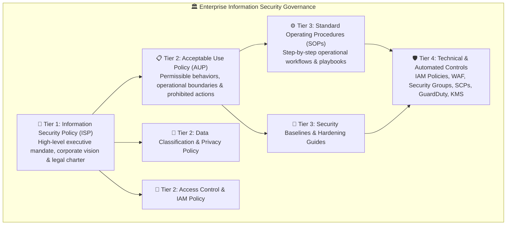
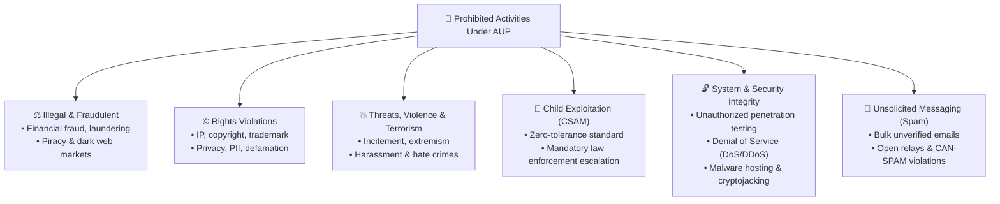
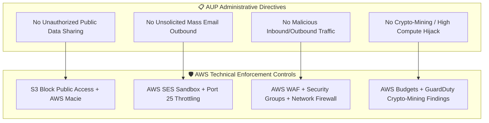
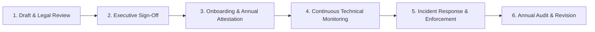

# 📋 Acceptable Use Policy (AUP) Reference Guide & Enterprise Governance

> **Course**: AWS re/Start  
> **Module**: Security (M04 – Introduction to Security & Administrative Controls)  
> **Source Document**: `T08-Security/T08-0002-RSSECY_EN-US_SG_M04_Acceptable_Use_Policy_Example.pdf`  
> **Target Audience**: AWS re/Start Learners, Cloud Practitioners, Security Analysts, and Systems Operations Associates  

---

## 🎯 Module & Document Overview

An **Acceptable Use Policy (AUP)** is an essential administrative security control and legal instrument that defines the constraints, practices, and behavioral boundaries that users must agree to before accessing a technology network, cloud computing infrastructure, or corporate digital asset. 

In public cloud environments such as Amazon Web Services (AWS), the cloud service provider's AUP establishes the contractual boundaries protecting shared physical infrastructure, public IP address reputations, multi-tenant network availability, and legal compliance. Simultaneously, modern enterprises craft their own internal AUPs for employees, contractors, and internal workloads to defend intellectual property, prevent workplace liability, and safeguard corporate data.

This guide provides the complete verbatim text of the course reference policy, unpacks each legal and operational clause, diagrams enterprise policy governance frameworks, contrasts cloud provider policies against internal enterprise policies, and equips learners with actionable enterprise best practices and scenario-based knowledge checks.

---

## 📌 Learning Objectives

By studying this reference document and governance breakdown, you will be able to:

- [ ] **Define the Purpose and Role of an AUP**: Differentiate an Acceptable Use Policy from terms of service, technical access controls, and general corporate security policies.
- [ ] **Deconstruct Prohibited Activities**: Analyze prohibitions against illegal/fraudulent operations, intellectual property rights violations, threats and violence, child exploitation (CSAM), security/system availability breaches, and unsolicited bulk messaging (spam).
- [ ] **Trace Investigation & Enforcement Mechanisms**: Understand how service providers and security operations centers (SOC) investigate violations, disable rogue resources, and enforce remediation.
- [ ] **Map the Policy Governance Hierarchy**: Model the relationship between organizational information security policies (ISPs), AUPs, standard operating procedures (SOPs), and automated technical enforcement.
- [ ] **Contrast Provider vs. Enterprise AUPs**: Distinguish between public cloud provider AUPs (e.g., AWS AUP) and internal enterprise employee AUPs.
- [ ] **Evaluate Real-World Cloud Scenarios**: Assess operational scenarios such as authorized penetration testing, mass email delivery (SES/EC2 port 25 restrictions), and crypto-mining abuse.
- [ ] **Implement Governance Best Practices**: Apply annual acknowledgment cycles, telemetry monitoring, and transparent abuse escalation pathways.

---

## 🏛️ Security Governance & Policy Hierarchy

In the context of information security controls, an Acceptable Use Policy resides firmly within the **Administrative Controls** domain. Administrative controls establish the rules of engagement, organizational directives, and human behavioral expectations, which are subsequently enforced through technical and physical mechanisms.



### Key Differences Across Policy Tiers

| Document Layer | Target Scope | Primary Purpose | Change Frequency | Enforced By |
| :--- | :--- | :--- | :--- | :--- |
| **Information Security Policy (ISP)** | Entire organization & board | Establishes strategic security charter and executive leadership mandate | Annually or upon major business changes | Executive Leadership / CISO / Legal |
| **Acceptable Use Policy (AUP)** | All users (employees, vendors, cloud tenants) | Details what is strictly allowed, restricted, or forbidden | Annual review or upon regulatory shifts | HR, Legal, IT Security, Cloud Trust & Safety |
| **Standards & Baselines** | Specific technologies (Linux, AWS, Windows) | Establishes minimum hardening benchmarks (e.g., CIS benchmarks) | Quarterly or upon new platform releases | Security Engineering & Cloud Architecture |
| **Standard Operating Procedures (SOP)** | Operations teams and engineers | Step-by-step procedural playbooks for implementation and response | Iterative / Continuous improvement | DevOps, SysAdmins, SOC Teams |
| **Technical Controls** | Compute, network, data, IAM layers | Programmatic execution of rules (IAM deny policies, firewalls, DLP) | Dynamic / Real-time | Automation, GuardDuty, AWS Config, Firewalls |

---

## 📜 Full Verbatim Reference Document: Acceptable Use Policy Example

The following text reproduces the exact curriculum reference policy document (`T08-0002-RSSECY_EN-US_SG_M04_Acceptable_Use_Policy_Example.pdf`):

***

### Acceptable Use Policy Example

> This Acceptable Use Policy (“Policy”) governs your use of the services offered by Example Corp. and its affiliates (“Services”) and our website(s) including http://example.com (“Example Site”). We may modify this Policy by posting a revised version on the Example Site. By using the Services or accessing the Example Site, you agree to the latest version of this Policy.
>
> You may not use, or facilitate or allow others to use, the Services or the Example Site:
>
> - **For any illegal or fraudulent activity;**
> - **To violate the rights of others;**
> - **To threaten, incite, promote, or actively encourage violence, terrorism, or other serious harm;**
> - **For any content or activity that promotes child sexual exploitation or abuse;**
> - **To violate the security, integrity, or availability of any user, network, computer or communications system, software application, or network or computing device;**
> - **To distribute, publish, send, or facilitate the sending of unsolicited mass email or other messages, promotions, advertising, or solicitations (or “spam”).**
>
> #### Investigation and Enforcement
> We may investigate any suspected violation of this Policy, and remove or disable access to any content or resource that violates this Policy. You agree to cooperate with us to remedy any violation.
>
> When determining whether there has been a violation of this Policy, we may consider your ability and willingness to comply with this Policy, including the policies and processes you have in place to prevent or identify and remove any prohibited content or activity.
>
> #### Reporting of Violations
> To report any violation of this Policy, please follow our abuse reporting process.
>
> ---
> *© 2022, Amazon Web Services, Inc. or its affiliates. All rights reserved.*

***

---

## 🔍 In-Depth Clause-by-Clause Technical & Legal Analysis

### 1. Preamble, Scope & Modification Clause

```
This Acceptable Use Policy (“Policy”) governs your use of the services offered by Example Corp. and its affiliates (“Services”) and our website(s) including http://example.com (“Example Site”). We may modify this Policy by posting a revised version on the Example Site. By using the Services or accessing the Example Site, you agree to the latest version of this Policy.
```

#### Legal and Operational Breakdown
- **Bilateral Contractual Enforceability**: Usage constitutes acceptance. Simply logging in, provisioning resources via API, or accessing web properties legally binds the client to the policy.
- **Unilateral Revision Authority**: Cloud providers and infrastructure operators reserve the legal right to adapt their AUP to emerging threats, zero-day vulnerabilities, or evolving statutory mandates (e.g., GDPR, NIS2, US state privacy acts) by posting an updated version.
- **Affiliate Coverage**: Covers not just the parent company, but all subsidiaries, regional corporate entities, and acquired platforms.

> [!NOTE]
> **Enterprise Implication**: Cloud customers must actively monitor provider policy changes. In enterprise environments, legal and compliance teams review cloud terms of service updates during vendor management audits.

---

### 2. Vicarious Liability & The "Facilitate or Allow Others" Clause

```
You may not use, or facilitate or allow others to use, the Services or the Example Site...
```

#### Technical Breakdown
- **Third-Party & End-User Liability**: As an account owner or organization administrator, you are strictly liable not only for your direct staff, but also for **downstream end users, tenants, and third-party contractors** accessing workloads hosted on your infrastructure.
- **Compromised System Liability**: If an EC2 instance, container, or serverless function in your account is compromised by an external attacker and weaponized as a botnet node or crypto-miner, **your account remains in violation** because you "allowed" the use through inadequate system hardening or vulnerable configurations.

> [!CAUTION]
> **No Defense of Ignorance**: In public cloud environments, stating *"we were hacked; an external attacker sent that spam"* does not exempt an organization from cloud account suspension. Tenants are responsible for securing their resources under the **AWS Shared Responsibility Model**.

---

### 3. Detailed Breakdown of Prohibited Activities



#### 3.1 Illegal or Fraudulent Activity
- **Scope**: Any action that breaches municipal, federal, or international statutes.
- **Specific Examples**:
  - Operating Ponzi schemes, phishing landing pages, or wire-fraud operations.
  - Selling counterfeit physical goods or black-hat digital goods.
  - Operating unlicensed cryptocurrency exchanges or money transmitter conduits designed to bypass Anti-Money Laundering (AML) / Know Your Customer (KYC) regulations.
- **Technical Mitigations**: Identity verification, behavioral anomaly detection, automated payment fraud scoring, and immediate account blacklisting.

#### 3.2 Violation of Rights of Others
- **Scope**: Infringing upon intellectual property, civil rights, privacy, or trade secrets.
- **Specific Examples**:
  - Hosting torrent trackers, pirated video streaming portals, or cracked software repositories.
  - Exfiltrating, scraping, or publishing personally identifiable information (PII) without legal basis (doxxing).
  - Hosting proprietary source code, internal trade secrets, or patient health information (PHI) stolen from third parties.
- **Legal Nexus**: Governed by the **Digital Millennium Copyright Act (DMCA)** Notice and Takedown processes and international privacy frameworks (GDPR, CCPA/CPRA).

#### 3.3 Threats, Incitement, Violence, Terrorism & Serious Harm
- **Scope**: Using digital resources to facilitate physical harm, violent disruption, or terroristic activity.
- **Specific Examples**:
  - Hosting recruitment, training, or propaganda material for designated terrorist entities.
  - Distributing digital blueprints for illicit weapons or manufacturing controlled biological/chemical agents.
  - Organizing targeted physical attacks, swatting campaigns, or death threats.

#### 3.4 Child Sexual Exploitation or Abuse (CSAM / CSAE)
- **Scope**: Absolute zero-tolerance prohibition across every reputable cloud infrastructure provider and enterprise.
- **Enforcement Mechanisms**:
  - Automated hash matching (e.g., PhotoDNA cryptographic hashes) across public media storage.
  - Immediate operational freeze of the offending environment.
  - Statutory mandatory reporting to the **National Center for Missing & Exploited Children (NCMEC)** and national law enforcement bodies under federal statutes (e.g., 18 U.S.C. § 2258A).

#### 3.5 Security, Integrity, or Availability Violations
- **Scope**: Protecting the CIA triad of all networked systems, software applications, and endpoints.
- **Specific Violations**:
  - **Unauthorized Scanning & Probing**: Port scanning, vulnerability scanning, or brute-force credential stuffing directed against external third-party targets or internal cloud infrastructure.
  - **Denial of Service (DoS / DDoS)**: Launching UDP floods, SYN floods, HTTP flood attacks, or participating in amplification attacks (DNS, NTP, SSDP).
  - **Malware & Botnets**: Hosting Command & Control (C2) servers, droppers, Trojans, ransomware binaries, or keyloggers.
  - **Inter-Tenant Attacks**: Attempting hypervisor escape, network packet sniffing across virtual private clouds (VPCs), or ARP spoofing inside shared virtualization environments.
  - **Cryptocurrency Mining**: Running unauthorized cryptominers that consume multi-tenant shared CPU/GPU capacity, violate power usage agreements, or indicate compromised credentials.

> [!IMPORTANT]
> **AWS Penetration Testing Policy Update**:  
> In the past, customers had to submit formal request forms before conducting penetration tests. Today, AWS permits customer-initiated penetration testing and vulnerability scanning against **user-owned EC2 instances, NAT Gateways, Elastic Load Balancers, RDS, CloudFront, Aurora, API Gateways, AWS Lambda, Lightsail, and ECS environments** *without prior approval*, **provided** that the testing adheres strictly to the AWS Customer Support Policy for Penetration Testing (e.g., no testing against AWS control plane, DNS servers, or infrastructure owned by other tenants).

#### 3.6 Unsolicited Mass Email & Spam
- **Scope**: Distributing bulk unsolicited messages, high-frequency marketing without opt-in consent, or deceptive messaging.
- **Specific Violations**:
  - Sending email lists scraped from websites without verifiable double opt-in consent.
  - Running open mail relays that allow third-party spammers to route junk mail through cloud IP addresses.
  - Violating the **CAN-SPAM Act**, **Canada's Anti-Spam Legislation (CASL)**, or the **EU ePrivacy Directive**.
- **Impact on Cloud Ecosystem**: If an AWS IP address is blacklisted by major Spamhaus or SpamCop blocklists, legitimate enterprise senders sharing adjacent IP ranges suffer severe deliverability failures.

---

## ⚖️ Cloud Provider AUP vs. Enterprise Internal AUP

A critical distinction for security practitioners is understanding who authored the policy and what assets are being protected.

```mermaid
flowchart LR
    subgraph ProviderAUP["☁️ Cloud Provider AUP (e.g., AWS)"]
        direction TB
        P1["Protects Provider Infrastructure & IP Space"]
        P2["Enforces Shared Multi-Tenant Stability"]
        P3["Applies to Account Root & All Workloads"]
        P4["Remedy: Resource Quarantining / Account Ban"]
    end

    subgraph EnterpriseAUP["🏢 Enterprise Employee AUP"]
        direction TB
        E1["Protects Corporate Data & Assets"]
        E2["Regulates Employee Workstation & Mobile Use"]
        E3["Governs Social Media, Email & Shadow IT"]
        E4["Remedy: Disciplinary Action / Termination"]
    end

    ProviderAUP -.->|Intersects in Cloud Accounts| EnterpriseAUP
```



### Detailed Comparative Analysis

| Dimension | Cloud Provider Acceptable Use Policy | Enterprise Internal Acceptable Use Policy |
| :--- | :--- | :--- |
| **Primary Authors** | Cloud Legal, Trust & Safety, Infrastructure Security | Corporate Legal, Human Resources, CISO, IT Governance |
| **Bound Parties** | Cloud Customers, Account Owners, Technical Administrators | Full-time Employees, Contractors, Vendors, Interns |
| **Protected Assets** | Data centers, physical servers, public IP ranges, multi-tenant network bandwidth | Laptops, mobile devices, corporate email, intellectual property, internal databases |
| **Typical Prohibitions** | Port scanning, DDoS, unauthorized penetration tests, spam relays, crypto-mining | Visiting malicious/inappropriate websites, downloading unauthorized freeware, plugging personal USB keys |
| **Monitoring Mechanism** | Network flow telemetry, abuse reports, IP blacklist scrapers, automated guardrails | Endpoint Detection & Response (EDR), DLP proxies, email gateways, Mobile Device Management (MDM) |
| **Violations Result In** | Instance termination, AWS account freeze, IP blacklisting, civil litigation | Written reprimands, employee termination, revocation of security clearance, criminal charges |
| **Governing Framework** | AWS Customer Agreement, Master Services Agreement (MSA) | Employee Handbook, Employment Agreement, Code of Conduct |

---

## 🔍 Investigation, Enforcement & Abuse Lifecycle

The reference policy outlines:
> *"We may investigate any suspected violation of this Policy, and remove or disable access to any content or resource that violates this Policy. You agree to cooperate with us to remedy any violation."*

### The Cloud Abuse & Enforcement Workflow

```mermaid
sequenceDiagram
    autonumber
    actor Attacker as Malicious Actor
    participant Victim as External Third Party
    participant Tenant as Customer AWS Workload
    participant Provider as Cloud Provider (Trust & Safety)
    actor Admin as Customer Cloud Administrator

    Attacker->>Tenant: Compromises EC2 / Container via unpatched vulnerability
    Tenant->>Victim: Launches brute-force / spam attack using Provider IP
    Victim->>Provider: Files Abuse Report with timestamp, headers & target logs
    Provider->>Provider: Verifies telemetry (VPC Flow Logs, GuardDuty, NetFlow)
    Provider->>Admin: Issues Security Abuse Notice (requires action within 24-48 hrs)
    alt Admin Remediation Successful
        Admin->>Tenant: Isolates instance, applies Security Group, patches CVE
        Admin->>Provider: Reports root-cause analysis & proof of remediation
        Provider->>Admin: Case closed; normal operations maintained
    else No Response or Uncooperative
        Provider->>Tenant: Programmatically isolates / terminates offending resource
        Provider->>Admin: Account privileges suspended / account termination
    end
```

### Proactive Cooperation & Mitigating Factors

The reference policy highlights a pivotal governance principle:
> *"When determining whether there has been a violation of this Policy, we may consider your ability and willingness to comply with this Policy, including the policies and processes you have in place to prevent or identify and remove any prohibited content or activity."*

When cloud providers evaluate abuse cases, they differentiate between:
1. **Malicious Tenants**: Bad actors who knowingly register accounts to execute cyberattacks, spam, or scams. (Immediate termination and ban).
2. **Compromised Victims with Mature Controls**: Legitimate enterprises whose systems were breached due to a zero-day exploit, but who maintain:
   - Automated alerts via **Amazon GuardDuty**.
   - Rapid Incident Response (IR) runbooks.
   - Dedicated abuse contact emails registered in the **AWS Account Management Console**.
   - Immediate willingness to quarantine offending EC2 instances and rotate credentials.

> [!TIP]
> **Operational Best Practice**: Always configure an up-to-date **Security Contact** and **Operations Contact** in the AWS Console (`Account` $\rightarrow$ `Alternate Contacts`). When AWS Trust & Safety detects an incident, they email this designated security address first before taking punitive isolation steps.

---

## 🛠️ Technical Enforcement: Translating AUP into AWS Controls

Administrative policies without technical enforcement remain mere wishes. The following matrix illustrates how organizations convert AUP mandates into automated technical guardrails:



### AUP Policy-to-Control Mapping Table

| AUP Rule | Operational Risk | Primary AWS Technical Enforcement Control |
| :--- | :--- | :--- |
| **No Spam or Unsolicited Mass Email** | IP reputation blacklisting, resource exhaustion | - Default restriction on outbound **Port 25 (SMTP)** across all EC2 instances.<br>- **Amazon SES (Simple Email Service)** sandbox mode requiring domain verification and SPF/DKIM authentication. |
| **No Security or Availability Violations (DDoS)** | Infrastructure degradation, high egress bills | - **AWS Shield Standard & Advanced** for Layer 3/4 DDoS protection.<br>- **AWS WAF** (Web Application Firewall) rate-limiting rules. |
| **No Crypto-Mining or Botnet C2 Activity** | Compute theft, cost spike, account compromise | - **Amazon GuardDuty** (findings: `CryptoCurrency:EC2/BitcoinTool.B!DNS`, `Trojan:EC2/DriveBySource`).<br>- **AWS Budgets** alerts triggering Lambda quarantine functions. |
| **No Unintended Public Exposure of Data** | PII leak, DMCA violation, compliance failure | - **Amazon S3 Block Public Access** enabled at organization root.<br>- **AWS Organizations SCPs (Service Control Policies)** denying `s3:PutBucketPolicy` with wildcard principals. |
| **No Unauthorized Network Probing** | External abuse reports, malicious egress | - **VPC Flow Logs** ingested into Amazon CloudWatch / Athena.<br>- **AWS Network Firewall** stateful inspection blocking known malicious C2 IP blocks. |

---

## 🏢 Enterprise AUP Implementation Checklist & Best Practices

For security analysts designing or auditing an organization's internal Acceptable Use Policy, the following checklist ensures comprehensive operational coverage:



### Best Practice Implementation Framework

1. **Clear, Jargon-Free Language**:
   - Write prohibitions in plain language so that non-technical employees, contractors, and executives understand their legal boundaries.
2. **Explicit Scope of Privacy Expectations**:
   - Explicitly state that corporate devices, emails, Slack/Teams chats, and cloud-hosted data are corporate property, and employees have **no expectation of personal privacy** on company-owned systems.
3. **Explicit Bring Your Own Device (BYOD) Guidelines**:
   - Define whether personal devices may access corporate networks, required Mobile Device Management (MDM) enrollment, and containerization of corporate data.
4. **Social Media & Public Representation**:
   - Clarify rules regarding representing company viewpoints online, sharing screenshots containing internal corporate IP or architecture diagrams.
5. **Periodic Attestation & Training**:
   - Require **annual digital re-acknowledgment** of the AUP during mandatory security awareness training.
6. **Transparent Violation Handling**:
   - Coordinate with Human Resources and Legal to articulate progressive discipline (e.g., verbal counseling $\rightarrow$ written reprimand $\rightarrow$ suspension $\rightarrow$ termination of employment and legal referral).

---

## 🧠 Comprehensive Knowledge Check & Scenario Analysis

Test and consolidate your understanding of Acceptable Use Policies, cloud governance, and technical enforcement.

### Question 1: Cloud Shared Responsibility and Malicious Activity
**Scenario**: An engineer at a start-up launches an unpatched WordPress web server on an Amazon EC2 instance. Three days later, an external threat actor exploits a known remote code execution (RCE) vulnerability in a WordPress plugin, installs a botnet agent, and begins launching SYN flood DDoS attacks against a financial institution's website. AWS Trust & Safety notifies the account owner that their instance is attacking a third party. The engineer responds: *"We didn't launch the attack; an external hacker did, so our company is not responsible for violating the AWS AUP."*

**Is the engineer's defense valid? Explain why or why not.**

> [!NOTE]
> **Detailed Answer**:  
> **No, the engineer's defense is invalid.**  
> Under the AUP, account holders agree that they will not use, **"or facilitate or allow others to use"**, the services for prohibited activities, including violating the security, integrity, or availability of any system or network.  
> Under the **AWS Shared Responsibility Model**, the customer is solely responsible for OS patching, application security, and firewall configurations (Security **IN** the Cloud). Failing to patch the workload effectively *allowed* a third party to weaponize the infrastructure. The account owner is contractually and operationally accountable for all traffic originating from their provisioned resources.

---

### Question 2: Penetration Testing vs. AUP Violations
**Scenario**: A newly hired cloud security intern wants to practice their penetration testing skills. They configure a Kali Linux instance inside their company's AWS account and run intense port scans, SQL injection attacks, and vulnerability probes against:
1. Target A: Their company's public EC2 web application.
2. Target B: An AWS DNS endpoint (`169.254.169.253`) and underlying AWS hypervisor endpoints.
3. Target C: A competitor company's website hosted on AWS.

**Which of these activities comply with the AWS Acceptable Use Policy and penetration testing rules?**

> [!NOTE]
> **Detailed Answer**:
> - **Target A (Company's EC2 web application)**: **Permissible**, provided the company owns the account and the intern has authorized approval from corporate management. Under modern AWS Penetration Testing policies, user-owned EC2 instances can be tested without prior AWS notification.
> - **Target B (AWS DNS / Hypervisor)**: **Direct AUP Violation**. Customers are strictly prohibited from probing, scanning, or attacking AWS-owned shared infrastructure, virtualization layers, and control plane services.
> - **Target C (Competitor's website)**: **Severe AUP & Criminal Violation**. Scanning or attacking any third-party infrastructure without explicit, written authorization from the target owner violates the clause prohibiting *“any illegal or fraudulent activity”* and *“violating the security, integrity, or availability of any user, network, computer...”*, constituting an offense under computer crime legislation (e.g., the US Computer Fraud and Abuse Act - CFAA).

---

### Question 3: Outbound Port 25 Restrictions
**Scenario**: A company migrates their customer notification application from an on-premises server to an AWS EC2 instance. When testing email dispatch, all outbound SMTP connections to external mail servers on TCP port 25 timeout immediately. The developer opens an AWS support ticket complaining that EC2 networking is defective.

**Why does AWS restrict outbound TCP Port 25 by default, and how does this relate to the AUP?**

> [!NOTE]
> **Detailed Answer**:  
> AWS intentionally blocks outbound traffic on **TCP Port 25** by default across all EC2 instances to enforce the AUP clause prohibiting **unsolicited mass email and spam**.  
> If spammers could freely register temporary AWS accounts and blast millions of junk emails through EC2, AWS Elastic IP address blocks would be swiftly blacklisted on global spam monitoring databases (e.g., Spamhaus). This would degrade email delivery for every other legitimate business running on AWS.  
> To send email legitimately, AWS instructs customers to:
> 1. Use **Amazon Simple Email Service (SES)**, which incorporates sender reputation management, DKIM/SPF verification, and complaint tracking.
> 2. Submit a formal request through AWS Support to remove the Port 25 restriction, requiring justification, reverse DNS (rDNS) records, and proof of legitimate business need.

---

### Question 4: Mitigating Factors During Abuse Investigations
**Scenario**: AWS Trust & Safety detects outbound cryptocurrency mining traffic from an AWS account and emails the registered abuse contact. Customer Alpha ignores the email for five days until AWS terminates the instance. Customer Beta responds within 30 minutes, immediately quarantines the instance using a zero-ingress/egress security group, takes an EBS volume snapshot for forensics, identifies that an IAM access key was leaked on GitHub, rotates the key, and replies to AWS with their completed incident response report.

**How does the AUP address Customer Beta's response, and what is the outcome?**

> [!NOTE]
> **Detailed Answer**:  
> The AUP explicitly states: *"When determining whether there has been a violation of this Policy, we may consider your ability and willingness to comply with this Policy, including the policies and processes you have in place to prevent or identify and remove any prohibited content or activity."*  
> Because **Customer Beta** demonstrated rapid cooperation, documented incident response processes, and remediated the root cause proactively, AWS Trust & Safety will typically close the investigation without penalizing the account. Conversely, **Customer Alpha's** failure to cooperate or respond justifies immediate termination of cloud services to protect overall platform integrity.

---

## 📚 Key Takeaways & Summary

1. **Administrative Cornerstone**: An Acceptable Use Policy is a foundational administrative control defining legal, ethical, and operational boundaries for technology consumers.
2. **Vicarious Responsibility**: You are legally and technically accountable for all activity traversing your accounts—including rogue processes spun up by attackers after a security compromise.
3. **Core Prohibitions**: AUPs universally forbid illegal acts, intellectual property infringement, violent incitement, child exploitation, system availability disruptions (DoS/DDoS/crypto-mining), and spam.
4. **Technical Reinforcement**: Effective governance requires enforcing administrative policies through automated technical guardrails (AWS SES, GuardDuty, AWS WAF, Security Groups, SCPs).
5. **Cooperation is Mandatory**: Rapid response, transparent remediation, and registered security contacts are vital to preserving account standing during cloud security incidents.
