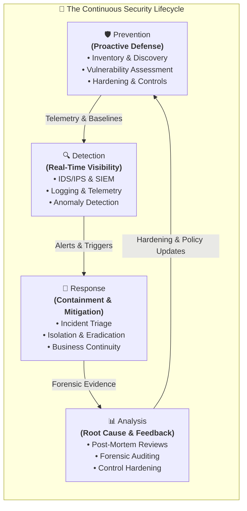
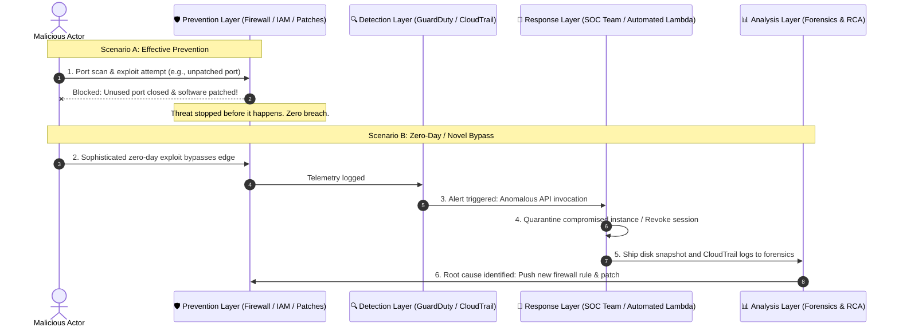
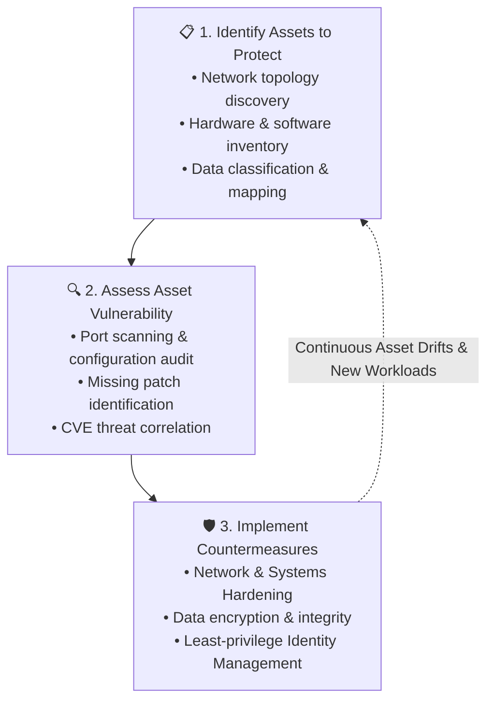
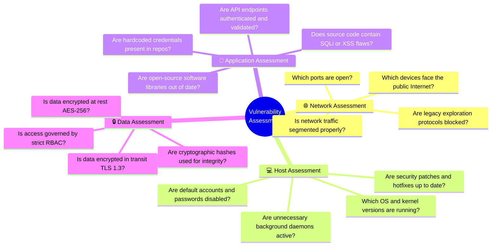
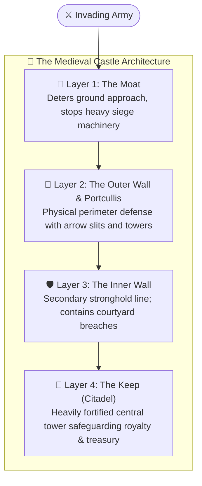
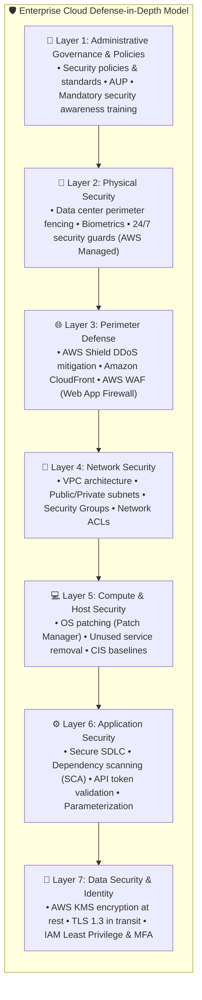
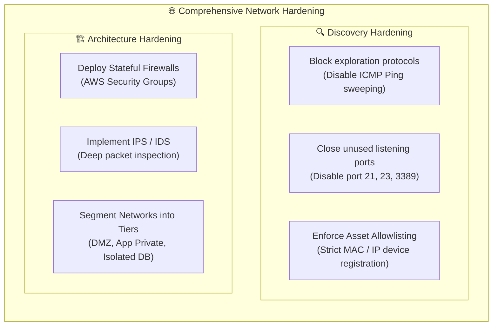
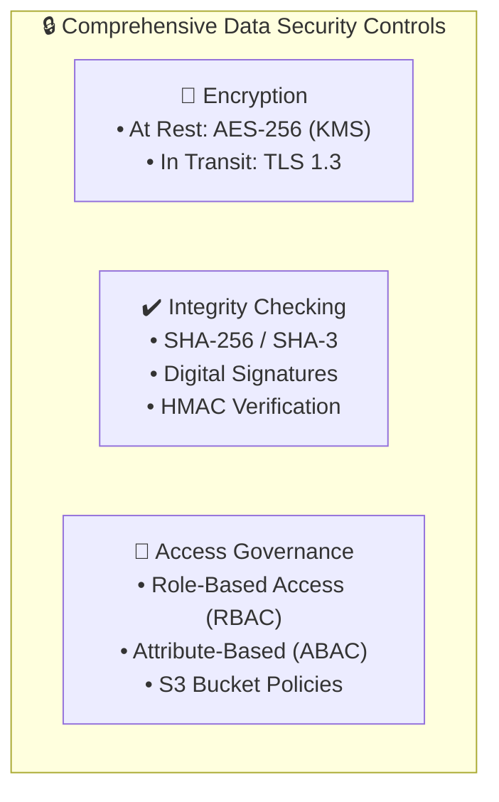
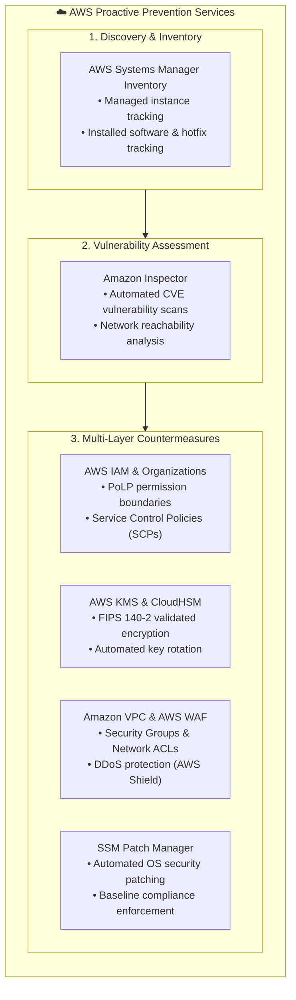
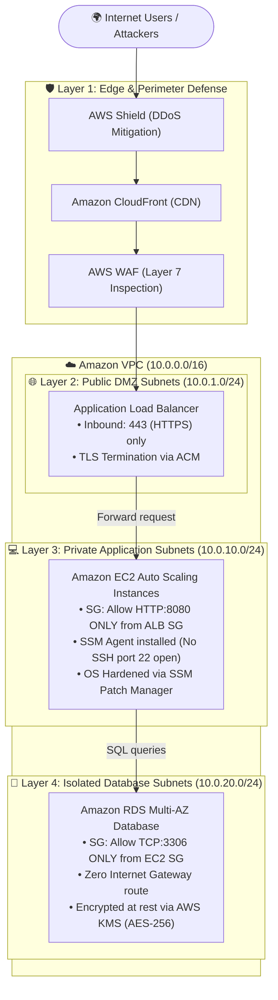

# 🛡️ Security Lifecycle: Prevention – Proactive Defense, Hardening & Layered Security Controls

> **Course**: AWS re/Start  
> **Module**: Security (M04 – Security Lifecycle: Prevention)  
> **Source Document**: `T08-Security/T08-0003-RSSECY_EN-US_SG_M04_LIFECYCLEPREVENTION.pdf`  
> **Target Audience**: AWS re/Start Learners, Cloud Practitioners, Security Engineers, and Systems Operations Associates  

---

## 🎯 Module Overview

In modern cybersecurity and cloud operations, **Prevention** represents the foundational, proactive phase of the continuous **Security Lifecycle**. The primary objective of prevention is unequivocal: **stop threats before they become security incidents or breaches**. While detective controls identify suspicious activity in progress and incident response limits damage after an intrusion occurs, preventative controls eliminate vulnerabilities, minimize the attack surface, and block unauthorized access attempts before malicious actors can establish a foothold.

A robust prevention strategy does not rely on a single defensive barrier. Instead, it utilizes a **layered security model (Defense-in-Depth)** where overlapping physical, administrative, and technical controls protect critical computing assets and sensitive data. If an adversary manages to bypass or compromise one defensive layer, subsequent defensive barriers stand ready to prevent unauthorized access.

This guide explores the three foundational tasks of the prevention phase—**identifying assets**, **assessing vulnerabilities**, and **implementing countermeasures**—alongside architectural hardening strategies across network, host, data, and identity domains.

---

## 📌 Learning Objectives

By completing this module and engaging with these study materials, you will be able to:

- [ ] **Explain the strategic importance of Prevention**: Articulate why prevention is the first, proactive, and most cost-effective phase of the Security Lifecycle.
- [ ] **Contrast Security Lifecycle Phases**: Differentiate between Prevention, Detection, Response, and Analysis in terms of operational timing, core objectives, and implementation mechanisms.
- [ ] **Execute the Three Core Prevention Tasks**:
  - [ ] **Identify Assets**: Build, maintain, and automate system inventories of network devices, compute hosts, applications, and data assets using utilities (e.g., `ping`, `nmap`) and cloud services (AWS Systems Manager Inventory).
  - [ ] **Assess Asset Vulnerability**: Formulate tailored assessment questions for network, host, application, and data layers, utilizing authoritative repositories like the Common Vulnerabilities and Exposures (CVE) database sponsored by CISA.
  - [ ] **Implement Countermeasures**: Architect defensive controls aligned with organizational risk appetite and compliance mandates.
- [ ] **Apply the Defense-in-Depth Layered Security Model**:
  - [ ] Relate layered defense to historical precedents (the medieval castle analogy: moat, outer wall, inner wall, keep).
  - [ ] Map security controls across all seven layers of the Open Systems Interconnection (OSI) reference model.
  - [ ] Implement cloud-native defense-in-depth spanning Administrative, Physical, Perimeter, Network, Compute/Host, Application, and Data layers.
- [ ] **Deconstruct Prevention Hardening Domains**:
  - [ ] **Network Hardening**: Differentiate network discovery hardening (blocking port scans and ICMP exploration) from network architecture hardening (firewalls, IPS, VPC subnet segmentation).
  - [ ] **Systems / Host Hardening**: Establish patch management cadences, eliminate unnecessary daemons/services, and enforce automated configuration drift monitoring.
  - [ ] **Data Security Controls**: Implement encryption at rest/in transit, cryptographic hashing for integrity, and Role-Based Access Control (RBAC).
  - [ ] **Identity Management**: Enforce the Principle of Least Privilege (PoLP), strict credential policies, Multi-Factor Authentication (MFA), and the AAA framework.
- [ ] **Evaluate Prevention Measures by Control Domain**: Compare and classify technical, administrative, and physical controls across modern hybrid and cloud infrastructures.

---

## 🛡️ 1. Prevention in the Security Lifecycle

### 1.1 The Role of Prevention

Security operations cannot succeed solely by reacting to incidents after they happen. While detection and incident response are mandatory operational capabilities, they are inherently **reactive**—they respond to active compromises, data exfiltration, or service disruptions.

In contrast, **Prevention is proactive**:
- It addresses the root causes of security incidents: misconfigurations, unpatched software vulnerabilities, excessive user privileges, and exposed network entry points.
- By neutralizing threats prior to execution, organizations protect their customer trust, intellectual property, financial stability, and brand reputation.
- Prevention reduces operational fatigue on Security Operations Center (SOC) teams by suppressing the sheer volume of attack noise and low-hanging exploits that trigger detective alerts.

> [!IMPORTANT]
> **The Economics of Prevention**: Industry studies (such as the Ponemon Institute / IBM *Cost of a Data Breach Report*) consistently show that remediating a security breach after exfiltration costs organizations an average of millions of dollars in forensic investigation, legal fees, regulatory fines, customer churn, and operational downtime. In contrast, implementing automated patching, network segmentation, and least-privilege IAM during the prevention phase costs a small fraction of that amount.

### 1.2 Comparison: Prevention vs. Detection vs. Response vs. Analysis

The four phases of the security lifecycle operate in a continuous closed-loop feedback cycle:

| Dimension | 🛡️ Prevention | 🔍 Detection | 🚨 Response | 📊 Analysis |
| :--- | :--- | :--- | :--- | :--- |
| **Operational Timing** | **Pre-Incident** (Continuous, prior to attack execution) | **Intra-Incident** (Real-time or near real-time during an event) | **Post-Breach / Immediate** (Active event mitigation and triage) | **Post-Incident** (Forensic evaluation and lessons learned) |
| **Primary Objective** | Eliminate vulnerabilities, reduce attack surface, block unauthorized access | Identify anomalous activity, malicious payloads, policy violations | Contain the breach, isolate compromised hosts, eradicate threat | Discover root cause, calculate blast radius, refine defensive controls |
| **Core Question Asked** | *"How can we stop an unauthorized actor or exploit from succeeding?"* | *"Is an attack currently underway or has an intrusion occurred?"* | *"How do we contain the damage, evict the intruder, and restore service?"* | *"Why did this happen, what failed, and how do we prevent recurrence?"* |
| **Typical Controls & Tools** | • Firewalls & Security Groups • Systems Manager Patching • Strict IAM Least Privilege • Data Encryption (KMS) • Anti-malware Endpoint Protection | • AWS GuardDuty • AWS CloudTrail • VPC Flow Logs • SIEM systems (Splunk) • Intrusion Detection (IDS) | • AWS Systems Manager Automation • Network isolation / Quarantine subnets • Forensic snapshots (EBS) • Incident Response Playbooks | • AWS Security Hub analytics • Memory & disk digital forensics • Post-Mortem Root Cause Analysis (RCA) • CVE database vulnerability mapping |
| **Success Metric (KPI)** | • Zero unauthorized entries • 100% critical patch compliance • Reduced exposed ports/services | • Mean Time to Detect (MTTD) • Low false-positive alert rates | • Mean Time to Remediate (MTTR) • Limited blast radius • Minimized data loss | • Zero repeat incidents from same vector • Updated security baselines |

---

## 📋 2. The Three Core Security Prevention Tasks

The prevention phase centers around three sequential, cyclical operational tasks:

### 2.1 Task 1: Identifying Assets to Protect

You cannot protect what you do not know exists. An incomplete or outdated asset inventory leaves blind spots that attackers actively exploit. Organizations must establish and maintain an authoritative, dynamic **asset inventory**.

#### What Assets Must Be Cataloged?
1. **Network Devices**: Routers, switches, wireless access points, hardware firewalls, load balancers, and cloud Virtual Private Clouds (VPCs), subnets, and internet gateways.
2. **Compute Hosts & Servers**: Physical servers, virtual machines (Amazon EC2 instances), container nodes (Amazon ECS/EKS), serverless functions (AWS Lambda), and administrative workstations.
3. **Applications & Services**: Enterprise web applications, APIs, background daemon services, database engines (Amazon RDS, DynamoDB), message brokers, and legacy internal software.
4. **Data Repositories**: Object storage buckets (Amazon S3), block storage volumes (Amazon EBS), relational/NoSQL databases, file systems (Amazon EFS), and backup archives.

#### Inventory Sources and Discovery Utilities
Asset lists are extracted from existing architecture documentation and validated using automated discovery tools:
- **Design Documentation**: Network topology diagrams, cloud architecture schematics, infrastructure-as-code (IaC) templates (AWS CloudFormation, Terraform).
- **Network Discovery Tools**:
  - `ping` (ICMP Echo): Basic reachability and IP address verification across subnets.
  - `Nmap` (Network Mapper): Powerful open-source network discovery and port scanner. It identifies active IP addresses, open TCP/UDP listening ports, running operating systems (OS fingerprinting), and running software versions.

> [!TIP]
> **Automated Cloud Discovery with AWS Systems Manager (SSM) Inventory**:  
> In AWS environments, manual inventory tracking quickly becomes obsolete due to dynamic auto-scaling. **AWS Systems Manager Inventory** automates metadata collection across Amazon EC2 instances and on-premises virtual machines running the SSM Agent.

AWS Systems Manager Inventory captures rich instance telemetry across multiple categories:
- **Managed Instances List**: Instance ID, computer name, ping/health status, platform type (Amazon Linux, Ubuntu, Windows Server), and private/public IP addresses.
- **Instance Configuration & Network Telemetry**: Availability Zone, VPC/subnet association, attached IAM instance profile, and EC2 key pair used for administrative access.
- **Installed Applications**: Application names, installed software versions, software publisher, and install date.
- **AWS Components**: SSM Agent version, AWS CLI version, elastic network adapter (ENA) drivers, and CloudWatch agent status.
- **System Files**: Specific executable names, file sizes, versions, file hashes, and creation/modification timestamps.
- **OS & Kernel Details**: Operating system distribution, OS version, kernel build, CPU architecture (`x86_64`, `arm64`).
- **Services & Daemons**: System service names, operational status (Running, Stopped), dependent services, and startup types (Automatic, Manual, Disabled).
- **OS Updates / Hotfixes**: Applied Windows hotfix IDs (`KBxxxxxxx`), Linux package update records, installed dates, and pending update requirements.

---

### 2.2 Task 2: Assessing Asset Vulnerability

Once assets are inventoried, security teams evaluate the security posture of each component to uncover weaknesses before adversaries discover them.

#### Assessment Dimensions by Asset Type

- **Network Vulnerability Assessment**:
  - *Core questions*: Which TCP and UDP ports are open? Which IP addresses are directly reachable from the public internet? Are routing tables permitting unauthorized transit?
  - *Mechanism*: External and internal network port scanning, firewall rule evaluations, network configuration audits.
- **Host / Compute Assessment**:
  - *Core questions*: Are operating systems running vulnerable kernel builds? Are critical vendor security patches missing? Are administrative remote protocols (e.g., RDP port 3389, Telnet port 23) open to untrusted CIDR blocks?
  - *Mechanism*: Automated host vulnerability assessment tools (e.g., **Amazon Inspector**), compliance baselines (CIS Benchmarks).
- **Application Assessment**:
  - *Core questions*: Does proprietary application source code suffer from injection vulnerabilities, insecure deserialization, or broken access control? Are third-party dependencies vulnerable?
  - *Mechanism*: Static Application Security Testing (SAST), Dynamic Application Security Testing (DAST), Software Composition Analysis (SCA).
- **Data Assessment (CIA Alignment)**:
  - *Core questions*: Is sensitive customer data (PII) stored in unencrypted S3 buckets? Is database traffic traversing the network in plaintext HTTP instead of HTTPS? Are data integrity checksums verified?

#### The Common Vulnerabilities and Exposures (CVE) Repository
Security vulnerability assessments rely on globally standardized catalogs of known flaws. The **Common Vulnerabilities and Exposures (CVE)** system (maintained by MITRE Corporation and sponsored by the U.S. Cybersecurity and Infrastructure Security Agency – CISA) assigns a unique, standardized identifier to publicly disclosed cybersecurity vulnerabilities.

Every CVE record contains structured threat intelligence:
1. **Standardized Identifier**: `CVE-YYYY-NNNN` (e.g., `CVE-2021-44228`).
2. **Affected Software Component**: Specific application name, vendor, and vulnerable version range.
3. **Description of the Threat**: How the vulnerability manifests (e.g., remote code execution, denial of service, memory buffer overflow).
4. **Impact Assessment**: Common Vulnerability Scoring System (CVSS) severity rating (Base score from 0.0 to 10.0: Low, Medium, High, Critical).
5. **Remediation & Fix Information**: Links to vendor patches, updated package releases, configuration workarounds, and mitigating controls.

> [!NOTE]
> **Case Study – The Apache Log4j Vulnerability (`CVE-2021-44228` / "Log4Shell")**:  
> In December 2021, a critical zero-day remote code execution (RCE) flaw in the ubiquitous Apache Log4j Java logging library was disclosed. The CVE entry cataloged that improper input validation of JNDI (Java Naming and Directory Interface) strings allowed unauthenticated attackers to execute arbitrary code on remote servers. Organizations with automated asset inventories and vulnerability scanners quickly searched for instances running affected Log4j versions, while those without inventories faced chaotic manual audits. Remediation involved patching Log4j to version 2.15.0+ and disabling message lookup configurations.

---

### 2.3 Task 3: Implementing Countermeasures

After identifying assets and uncovering their vulnerabilities, the final prevention task is to implement robust **countermeasures (security controls)**.

Countermeasures are organized around four core hardening domains:
1. **Network Hardening**: Stopping network-based attacks through port restrictions and architectural isolation.
2. **Systems Hardening**: Protecting compute hosts by patching, disabling unused services, and controlling configuration drift.
3. **Data Security Controls**: Securing information through encryption, cryptographic integrity verification, and access barriers.
4. **Identity Management**: Regulating who can access systems and what actions they can perform via least privilege and robust authentication.

---

## 🏰 3. Layered Security Model: Defense-in-Depth

An effective security prevention strategy must never depend on a single security control. Firewalls can be misconfigured, passwords can be phished, and software patches can be delayed. 

To withstand determined attackers, security architects employ **Defense-in-Depth (Layered Defense)**: an architectural strategy that places multiple, diverse, redundant defensive layers between an adversary and valuable enterprise assets.

### 3.1 Historical Analogy: The Medieval Castle

The concept of defense-in-depth is rooted in military fortress architecture:

- **The Moat**: The first defensive barrier surrounding the castle. It slows down approaching attackers and stops heavy siege equipment. (*Analogous to Perimeter Security: DDoS mitigation, DNS filtering, edge firewalls.*)
- **The Outer Wall**: High stone fortifications that block physical entry and channel invaders into designated checkpoints. (*Analogous to Network Security: DMZ firewalls, network ACLs, boundary routers.*)
- **The Inner Wall**: A second defensive line within the courtyard. Even if the outer wall is scaled or breached, attackers find themselves trapped in a secondary kill zone. (*Analogous to Internal Subnet Segmentation and Host Firewalls.*)
- **The Keep**: The most heavily fortified structure in the center of the fortress, containing the most valuable assets (the royal treasury and command staff). (*Analogous to Data Security: Encrypted databases, hardware security modules, and strict identity authorization.*)

### 3.2 The Open Systems Interconnection (OSI) Layered Security Model

In digital networking, the seven-layer OSI model demonstrates how specific preventative security controls must be engineered into every communication layer:

| OSI Layer | Layer Name | Common Protocol / Unit | Vulnerabilities & Threats | Preventative Countermeasures |
| :---: | :--- | :--- | :--- | :--- |
| **7** | **Application** | HTTP, HTTPS, DNS, SMTP | SQL Injection (SQLi), Cross-Site Scripting (XSS), CSRF, API abuse | • Web Application Firewalls (AWS WAF) • Input validation & parameterized queries • Application vulnerability scanning |
| **6** | **Presentation** | SSL/TLS, ASCII, JPEG | Data tampering, plaintext eavesdropping, format string bugs | • Enforced TLS 1.3 transport encryption • Strong cryptographic cipher suites • Automated data serialization validation |
| **5** | **Session** | RPC, NetBIOS, PPTP | Session hijacking, man-in-the-middle session token theft | • Mutual TLS (mTLS) authentication • Cryptographically random session tokens • Short session timeouts |
| **4** | **Transport** | TCP, UDP | SYN floods, port scans, unencrypted transport channels | • Stateful firewalls & Security Groups • Port knocking / strict port closures • TCP connection rate limiting |
| **3** | **Network** | IP, ICMP, IPsec, BGP | IP address spoofing, ICMP ping sweeps, routing manipulation | • Network Access Control Lists (NACLs) • Private VPC subnets & route table isolation • IPsec VPN tunnels & BGP Route Filtering |
| **2** | **Data Link** | Ethernet, MAC, 802.1Q | MAC flooding, ARP poisoning / spoofing, VLAN hopping | • Switch port security & 802.1X authentication • Dynamic ARP Inspection (DAI) • Private VLANs & MAC address filtering |
| **1** | **Physical** | Cables, radio, fiber | Physical wiretapping, unauthorized hardware tapping, theft | • Facility access badges & biometric locks • Tamper-evident cable conduits • Cloud provider data center isolation (AWS) |

### 3.3 The Modern Cloud Defense-in-Depth Stack

In enterprise cloud environments, Defense-in-Depth encompasses human governance down to the bits stored on encrypted magnetic platters:

---

## ⚙️ 4. Prevention Hardening Domains

### 4.1 Network Hardening Measures

Network hardening focuses on stopping threats at the communication and transport boundaries. It is divided into two primary disciplines: **Network Discovery Hardening** and **Network Security Architecture Hardening**.

#### 1. Network Discovery Hardening
The goal of network discovery hardening is to make your infrastructure "invisible" or non-responsive to automated scanning and reconnaissance tools used by attackers:
- **Block Network Exploration Protocols**: Threat actors use ICMP echo requests (`ping`) and traceroute packets to map active hosts within an IP block. By disabling unnecessary ICMP response traffic at the perimeter router or firewall, systems do not acknowledge discovery probes.
- **Close Unused Ports**: Every open TCP/UDP port represents an entry portal into the operating system. If a server is dedicated to hosting web traffic, ports like `21` (FTP), `23` (Telnet), `110` (POP3), and `445` (SMB) must be closed.
- **Maintain Network Device Allowlisting**: Ensure that only pre-approved, inventoried network interfaces and MAC/IP configurations can connect to internal switches and virtual subnets. Any rogue hardware or unrecognized instance interface is immediately rejected.

#### 2. Network Security Architecture Hardening
Architecture hardening establishes structural boundaries that prevent unauthorized traffic transit and contain lateral movement:
- **Firewalls (Stateful Inspection)**: Inspect incoming and outgoing network packets based on source IP, destination IP, protocol, and port. Modern stateful firewalls track the connection state (e.g., matching returning TCP response packets to outgoing requests automatically).
- **Intrusion Prevention Systems (IPS)**: Unlike passive Intrusion Detection Systems (IDS) that only alert on suspicious traffic, an **IPS sits inline** within the traffic stream. It performs deep packet inspection (DPI) against known exploit signatures and behavioral anomalies, actively dropping malicious packets and severing attacker connections in real time.
- **Network Segmentation & Micro-Segmentation**: Never place all servers on a flat network. Decompose the topology into distinct functional subnets:
  - *Public Subnet (DMZ)*: Only contains internet-facing load balancers.
  - *Private Application Subnet*: Contains compute instances running business logic; accessible only via load balancer traffic.
  - *Isolated Database Subnet*: Contains database clusters; accessible only from application tier security groups, completely isolated from public internet routes.

---

### 4.2 Systems & Host Hardening Measures

Systems hardening implements security controls directly on compute endpoints, including servers, developer workstations, and cloud virtual machines (Amazon EC2 instances).

#### 1. Regular Operating System Patching and Security Updates
As operating system vendors (Red Hat, Canonical, Microsoft, Amazon Linux) and software maintainers discover software flaws, they publish security advisories and software patches:
- **The Vulnerability Window**: The time elapsed between a public CVE disclosure and the deployment of a patch is the prime exploitation window for cybercriminals.
- **Automated Patch Management**: Utilizing tools like **AWS Systems Manager Patch Manager**, organizations define automated patch baselines. Security patches categorized as *Critical* or *Important* are installed during predefined maintenance windows without requiring manual SSH logins.

#### 2. Removing Unused Applications and Services
Default operating system installations frequently include utility daemons, print spoolers, web servers, and sample scripts:
- **Attack Surface Minimization**: Every installed package is a potential security vulnerability. If an unneeded service (such as `rpcbind`, `finger`, or an old Apache web server) is running, attackers can exploit zero-day vulnerabilities in that service.
- **Resource Reclaim**: Uninstalling unused software frees CPU cycles, memory, and disk space, streamlining operations and simplifying compliance audits.

#### 3. Monitoring and Controlling Configuration Changes
Uncontrolled, undocumented manual changes—known as **configuration drift**—are among the leading causes of security breaches:
- **Change Control Policies**: All configuration adjustments (e.g., modifying firewall rules, updating OS configurations, creating local accounts) must go through automated configuration management tools (Ansible, Chef, SSM State Manager) driven by version-controlled code repositories.
- **Audit Logging**: Organizations must maintain complete operational traceability to answer the four fundamental governance questions:
  - *Who* initiated the change?
  - *What* exact parameter was modified?
  - *Where* in the infrastructure did it occur?
  - *When* was the change executed?

---

### 4.3 Data Security Controls

Data represents the ultimate target of virtually all cyberattacks. Prevention controls must secure data across its entire lifecycle: in transit, at rest, and in use.

#### 1. Encrypting Data in Transit and Data at Rest
- **Data in Transit**: Information traveling across internal networks or the public internet must be encrypted using secure transport protocols (TLS 1.2 / TLS 1.3). Digital X.509 certificates (managed via **AWS Certificate Manager**) cryptographically authenticate server identity and establish encrypted sessions, preventing Man-in-the-Middle (MitM) eavesdropping and packet sniffing.
- **Data at Rest**: Information stored on disks, databases, and backup volumes must be encrypted using strong symmetric algorithms like AES-256. Cloud-native Key Management Services (**AWS KMS**) enable automated envelope encryption, separating data keys from Master Keys (KMS keys) with strict access policies.

#### 2. Data Integrity Checking Tools
Integrity controls ensure data is not tampered with, corrupted, or altered in transit or storage:
- **Cryptographic Hashes**: A cryptographic hash function (e.g., SHA-256) takes an arbitrary input file and generates a fixed-length string (digest). Hashes are deterministic and one-way: even a single modified bit in a multi-gigabyte file produces a completely different hash value.
- **Verification Workflow**:
  1. The sender hashes the file before transmission: $\text{Hash}_{\text{original}} = \text{SHA256}(\text{Data})$.
  2. The receiver computes the hash upon receipt: $\text{Hash}_{\text{received}} = \text{SHA256}(\text{Data})$.
  3. If $\text{Hash}_{\text{original}} == \text{Hash}_{\text{received}}$, integrity is intact; if they differ, the file was corrupted or modified.
- **Digital Signatures**: Combining cryptographic hashing with asymmetric private key encryption provides both **Integrity** and **Non-repudiation**.

#### 3. Role-Based Access Control (RBAC)
Data availability and confidentiality require that users and applications access only authorized data sets. Instead of granting permissions to individual users, permissions are assigned to **roles** (e.g., *BillingAuditor*, *DatabaseAdmin*, *ReadOnlyAnalyst*). Users assume the appropriate role matching their job function.

---

### 4.4 Identity Management Controls

Identity is the new perimeter in modern, decentralized, and cloud-first computing. Identity management defines the rules governing authentication (validating identity) and authorization (granting permission).

#### 1. The Principle of Least Privilege (PoLP)
- Users, automated services, and background applications must be granted **only the minimum permissions necessary** to perform their required tasks, and **only for the duration required**.
- Never grant wildcard administrative privileges (`"Action": "*"`) when specific, scoped API actions (e.g., `"s3:GetObject"`, `"ec2:DescribeInstances"`) suffice.
- Prevents rogue or compromised credentials from inflicting catastrophic damage across the organization.

#### 2. Strong Password Policies & Credential Hygiene
Passwords remain a primary authentication mechanism and require stringent administrative enforcement:
- **Complexity Requirements**: Minimum length (14+ characters), alphanumeric combinations, and special characters to resist brute-force and dictionary attacks.
- **Credential Rotation & Expiration**: Automated credential expiration schedules (e.g., rotating access keys every 90 days).
- **Multi-Factor Authentication (MFA)**: Requiring two or more distinct authentication factors (something you know: password; something you have: hardware token/TOTP app; something you are: biometric scan). MFA neutralizes over 99% of automated credential-stuffing and phishing attacks.

#### 3. The AAA Security Framework in Prevention
Identity controls are operationalized via the AAA framework:
- **Authentication (AuthN)**: Proves identity (*"Who are you?"*). Implemented via passwords, MFA tokens, and X.509 certificates.
- **Authorization (AuthZ)**: Enforces access bounds (*"What are you allowed to do?"*). Implemented via IAM policies, Access Control Lists, and RBAC.
- **Accounting / Auditing**: Tracks resource consumption and actions (*"What did you do and when?"*). Implemented via immutable audit logging (**AWS CloudTrail**). In the prevention phase, audit logs establish normal operational baselines against which future anomalies are detected.

---

## 📊 5. Comprehensive Comparison Matrix: Prevention Measures

Security countermeasures span three distinct operational domains: **Administrative**, **Technical**, and **Physical**. Each domain addresses specific vulnerability classes and works symbiotically within a defense-in-depth architecture.

| Control Category | Control Domain | Implementation Level | Real-World Cloud & On-Premises Examples | Strengths | Limitations & Failure Modes |
| :--- | :--- | :--- | :--- | :--- | :--- |
| **Administrative** | Policy & Governance | Organizational / Human | • Acceptable Use Policy (AUP) • Password complexity standard • Mandatory user awareness training • Background checks for new hires | Establishes legal compliance, organizational accountability, and employee behavior baselines. | Cannot mechanically block a technical exploit; relies on human compliance and enforcement. |
| **Administrative** | Operational Procedure | Process / Operational | • Change Management Review Board • Vulnerability patch management cadence • Periodic IAM access review audits | Standardizes system modifications; prevents unauthorized configuration drift. | Subject to human error, delays, administrative bottlenecks, and procedural shortcuts. |
| **Technical** | Network Security | Logical / Network | • AWS Security Groups & Network ACLs • Inline Intrusion Prevention Systems (IPS) • VPC subnet segmentation & PrivateLinks | Automatically blocks unauthorized traffic at wire speed; isolates compromised subnets. | Does not prevent valid credentials from being abused over permitted ports (e.g., port 443). |
| **Technical** | Host / Compute | Logical / System | • Automated OS patching (SSM) • Unused service removal & daemon disablement • CIS Benchmark OS hardening templates | Eliminates host vulnerabilities and local privilege escalation attack vectors. | Patching can occasionally cause software regressions; requires thorough staging testing. |
| **Technical** | Data & Cryptography | Logical / Data | • AWS KMS encryption (AES-256) • Enforced TLS 1.3 transport encryption • SHA-256 data integrity checksums | Guarantees confidentiality and tamper-evidence even if storage media is stolen. | Complex key management overhead; lost cryptographic keys result in permanent data loss. |
| **Technical** | Identity & Access | Logical / Identity | • Multi-Factor Authentication (MFA) • Least-privilege IAM policies • Role-Based Access Control (RBAC) | Restricts lateral movement; limits blast radius of compromised credentials. | Misconfigured IAM policies or overly permissive role assumptions can bypass boundaries. |
| **Physical** | Facility Security | Physical Environment | • Biometric iris/fingerprint scanners • 24/7 armed security guards • Video surveillance & perimeter fencing | Completely stops unauthorized physical access to compute hardware and cabling. | Handled entirely by AWS under the Shared Responsibility Model for cloud services; high capex on-prem. |
| **Physical** | Environmental & Hardware | Physical Infrastructure | • Dual redundant power feeds (UPS/Generators) • Fire suppression systems (inert gas) • Tamper-resistant server chassis locks | Prevents physical disruption and environmental hardware failure. | Vulnerable to natural disasters of extreme scale; requires geographic multi-region redundancy. |

---

## ☁️ 6. AWS Security Services for Proactive Prevention

Amazon Web Services provides a comprehensive ecosystem of managed services designed specifically to operationalize the prevention phase:

### Service Capabilities Breakdown

1. **AWS Systems Manager (SSM)**:
   - **Inventory**: Continuously collects software catalogs, OS details, patch levels, network configurations, and running services across EC2 and on-premises hosts.
   - **Patch Manager**: Automates the rollout of security patches across fleets of Linux and Windows instances using standardized Patch Baselines.
   - **State Manager**: Enforces desired configuration states (e.g., ensuring antivirus daemons remain active and firewall ports remain closed), automatically remediating configuration drift.

2. **Amazon Inspector**:
   - Automated vulnerability management service that continuously scans Amazon EC2 instances, container images in Amazon ECR, and AWS Lambda functions for software vulnerabilities (CVEs) and unintended network exposure.
   - Provides prioritized CVSS risk scores and actionable remediation guidance.

3. **AWS Identity and Access Management (IAM)**:
   - Fine-grained access control across all AWS API endpoints.
   - Enforces the Principle of Least Privilege through identity policies, resource policies, permission boundaries, and Service Control Policies (SCPs) in AWS Organizations.
   - Mandates hardware or virtual Multi-Factor Authentication (MFA) for privileged accounts.

4. **Amazon Virtual Private Cloud (Amazon VPC)**:
   - **Security Groups**: Stateful virtual firewalls operating at the instance/ENI level, filtering inbound and outbound traffic.
   - **Network ACLs**: Stateless subnet-level firewalls acting as an outer defensive barrier.
   - **VPC Endpoints & AWS PrivateLink**: Ensure traffic between VPC resources and AWS services never traverses the public internet.

5. **AWS Key Management Service (AWS KMS) & AWS Certificate Manager (ACM)**:
   - **AWS KMS**: Centrally generates, rotates, and manages cryptographic keys for data encryption at rest across Amazon S3, EBS, RDS, and DynamoDB.
   - **AWS Certificate Manager (ACM)**: Automates the provisioning, validation, renewal, and deployment of public and private SSL/TLS certificates for encryption in transit.

6. **AWS WAF & AWS Shield**:
   - **AWS WAF**: Layer 7 web application firewall protecting web applications and APIs against common web exploits (OWASP Top 10: SQL injection, cross-site scripting) and rate-based bot attacks.
   - **AWS Shield**: Managed Distributed Denial of Service (DDoS) protection safeguarding perimeter applications (Shield Standard enabled automatically; Shield Advanced provides dedicated 24/7 response team support).

---

## 🏗️ 7. Architecture Deep Dive: Designing a Layered Prevention Strategy

To understand how defense-in-depth operates in production, consider the end-to-end architecture of a multi-tier web application hosted on AWS.

### Layer-by-Layer Countermeasure Walkthrough

1. **Perimeter Layer (Edge Protection)**:
   - Incoming traffic first reaches **Amazon CloudFront** protected by **AWS Shield** (blocking Layer 3/4 volumetric DDoS attacks like UDP reflection and SYN floods).
   - Traffic is filtered by **AWS WAF** rules inspecting HTTP request payloads, automatically blocking SQL injection, Cross-Site Scripting, and abusive IP reputations before reaching origin compute servers.

2. **Network Layer (DMZ & Load Balancer)**:
   - The **Application Load Balancer (ALB)** resides in public subnets but accepts connections **only on TCP port 443 (HTTPS)** with modern TLS ciphers managed by **AWS Certificate Manager (ACM)**. Plaintext HTTP port 80 requests are automatically redirected to 443.

3. **Compute & Host Layer (Private Application Tier)**:
   - The EC2 instances reside in **private subnets** with **no public IPv4 addresses**. They cannot be reached directly from the internet.
   - The EC2 Security Group strictly allows inbound traffic on port 8080 **only if the traffic originates from the Application Load Balancer's Security Group**.
   - **Zero SSH (Port 22) Exposure**: Administrators do not open port 22 or manage SSH key pairs. Instead, secure remote administrative access is conducted via **AWS Systems Manager Session Manager** over encrypted IAM-authenticated HTTPS channels.
   - **Automated Patching**: The instances run automated patch baselines via **SSM Patch Manager**, ensuring zero known high/critical CVEs exist in the OS or application runtime.

4. **Data & Storage Layer (Isolated Database Tier)**:
   - The Amazon RDS database resides in dedicated database subnets with **no route to the Internet Gateway** or NAT Gateways.
   - The Database Security Group allows inbound MySQL connections (port 3306) **strictly from the Application Tier Security Group**.
   - All database tables, logs, and automated snapshots are encrypted at rest using **AWS KMS** with customer-managed keys (CMKs).
   - Data in transit between the EC2 app tier and RDS database is enforced using SSL/TLS database connection parameters.

> [!CAUTION]
> **What Happens If One Layer Fails?**  
> If an attacker discovers a remote code execution vulnerability in the application running on EC2, the defense-in-depth model prevents catastrophic disaster:
> - The compromised EC2 instance cannot be reached directly via SSH or reverse-shell listeners because inbound ports are blocked by security groups.
> - The attacker cannot directly access the database using arbitrary stolen credentials from the internet because the database subnet has zero public routing.
> - The attacker cannot delete customer data or exfiltrate S3 backups because IAM instance profiles lack destructive permissions.

---

## 🧠 8. Checkpoint Review & Comprehensive Knowledge Check

Test your understanding of the concepts covered in this module with the following review questions:

### Question 1: Which three core tasks are performed in the prevention phase of the security lifecycle?
> **Model Answer**:
> 1. **Identify assets to be protected**: Construct and maintain an accurate, comprehensive inventory of all network devices, compute hosts, applications, and data assets within the computing environment.
> 2. **Assess asset vulnerability**: Analyze each cataloged asset to evaluate its security posture, uncover software weaknesses or configuration flaws, and correlate risks against known threat repositories (such as the CVE database).
> 3. **Implement countermeasures**: Establish an overarching defense-in-depth strategy and deploy multi-layered preventative controls across network hardening, systems hardening, data security, and identity management domains.

---

### Question 2: What is the primary benefit of employing a layered security strategy (Defense-in-Depth)?
> **Model Answer**:
> A layered security strategy establishes multiple, diverse, and redundant defensive barriers protecting valuable assets. In a single-layer security model, a single misconfiguration, compromised credential, or software exploit results in an immediate catastrophic breach. In contrast, under a layered security strategy, an attacker must successfully overcome every sequential defensive layer (perimeter, network, host, application, and data controls) to compromise the asset. If one layer fails or is bypassed, subsequent layers stand ready to halt the attack, drastically reducing the probability and blast radius of a breach.

---

### Question 3: What are the primary technical domains of prevention measures introduced in this module?
> **Model Answer**:
> The primary technical domains of prevention measures are:
> 1. **Network hardening measures**: Protecting network borders and transit pathways through discovery hardening (blocking port scans and ICMP sweeping) and architectural hardening (firewalls, IPS, and subnet segmentation).
> 2. **Systems hardening measures**: Protecting compute hosts and servers by applying regular OS security updates/patches, removing unneeded applications/daemons, and enforcing automated change controls.
> 3. **Data security controls**: Safeguarding digital assets using encryption in transit (TLS) and at rest (AES-256 via KMS), cryptographic hashing (SHA-256) for integrity checking, and role-based access control (RBAC).
> 4. **Identity management controls**: Governing access using the Principle of Least Privilege (PoLP), strict password and credential policies, Multi-Factor Authentication (MFA), and the AAA (Authentication, Authorization, Accounting) framework.

---

### Question 4: How does Network Discovery Hardening differ from Network Security Architecture Hardening?
> **Model Answer**:
> - **Network Discovery Hardening** focuses on reconnaissance prevention: making network assets invisible or non-responsive to scanning utilities (such as `ping` and `Nmap`). It involves disabling ICMP exploration protocols, closing unused listening ports, and strictly enforcing asset allowlists so unauthorized devices cannot join the network.
> - **Network Security Architecture Hardening** focuses on structural containment and traffic enforcement: architecting the topology using stateful firewalls (e.g., AWS Security Groups), inline Intrusion Prevention Systems (IPS) that inspect and drop malicious packets, and network segmentation (e.g., isolating DMZ, application tiers, and database tiers into separate subnets).

---

### Question 5: Why is maintaining an automated asset inventory considered the foundational prerequisite for vulnerability assessment?
> **Model Answer**:
> An organization cannot evaluate the security posture of or patch an asset that it does not know exists. Uncataloged, forgotten, or shadow IT servers remain unmonitored and unpatched, creating easy entry points for attackers. Automated inventory tools (such as AWS Systems Manager Inventory) continuously discover compute instances, installed software versions, active services, and network configurations. This telemetry allows vulnerability scanners and security teams to accurately identify which specific systems are susceptible to newly disclosed CVE vulnerabilities (such as Log4Shell) and prioritize remediation.

---

### Question 6: Under the OSI model, at which layers would you implement a Web Application Firewall (WAF) versus a Network Access Control List (NACL)?
> **Model Answer**:
> - **Web Application Firewall (AWS WAF)**: Operates at **Layer 7 (Application Layer)**. It performs deep inspection of application protocols (HTTP/HTTPS payloads, query strings, headers, cookies) to prevent application exploits such as SQL Injection (SQLi) and Cross-Site Scripting (XSS).
> - **Network Access Control List (NACL)**: Operates at **Layer 3 (Network Layer) and Layer 4 (Transport Layer)**. It evaluates packet-level IP addresses and TCP/UDP port numbers in a stateless manner, allowing or blocking subnets without understanding application-level contents.

---

## 📌 9. Key Takeaways & Summary

- **Core Mission of Prevention**: Preventative security controls provide the ability to **stop threats before they happen**, proactively protecting assets, reducing incident response costs, and minimizing business disruptions.
- **The Three Prevention Tasks**:
  1. **Identify assets**: Maintain comprehensive, automated inventories of all network devices, hosts, services, and data repositories.
  2. **Assess vulnerabilities**: Regularly evaluate the security posture of each asset against common threat vectors and authoritative repositories like the CVE database.
  3. **Implement countermeasures**: Deploy layered defensive controls across network, host, data, and identity tiers.
- **Defense-in-Depth (Layered Defense)**:
  - An effective security strategy never relies on a single perimeter wall.
  - Mirrored after the medieval castle (moat $\rightarrow$ outer wall $\rightarrow$ inner wall $\rightarrow$ keep) and the 7-layer OSI model, cloud defense-in-depth spans Administrative Governance, Physical Data Centers, Perimeter Protection, Network Segmentation, Compute/Host Hardening, Application Security, and Data Encryption.
- **The Four Technical Prevention Hardening Domains**:
  - **Network Hardening**: Block reconnaissance sweeps (discovery hardening) and deploy stateful firewalls, IPS, and isolated subnets (architecture hardening).
  - **Systems Hardening**: Automate regular OS security patch deployments, strip out unnecessary applications/daemons, and continuously monitor configuration drift.
  - **Data Security**: Enforce end-to-end encryption (at rest via KMS, in transit via TLS), verify file integrity using cryptographic hashes (SHA-256), and enforce role-based access control.
  - **Identity Management**: Enforce the Principle of Least Privilege (PoLP), require robust password policies and Multi-Factor Authentication (MFA), and structure access governance around Authentication, Authorization, and Accounting (AAA).
- **AWS Prevention Suite**: Services like **AWS Systems Manager** (Inventory, Patch Manager, State Manager), **Amazon Inspector**, **AWS IAM**, **Amazon VPC**, **AWS KMS**, and **AWS WAF** provide enterprise-scale, automated preventative controls across the entire cloud lifecycle.

---

## 🔗 Next Steps & Course Progression

Having established the foundational principles of prevention and layered defense, subsequent modules in the AWS re/Start Security curriculum explore each prevention hardening domain in technical detail:

- **Next Module (M04-04)**: [Network Hardening Measures](file:///work/tmp/aws-cf/T08-Security/T08-0004-RSSECY_EN-US_SG_M04_PREVENTIONNETHARD.pdf) – Deep dive into firewalls, Security Groups, NACLs, IPS/IDS, and VPC micro-segmentation.
- **Subsequent Modules**:
  - [Systems Hardening Measures](file:///work/tmp/aws-cf/T08-Security/T08-0005-RSSECY_EN-US_SG_M04_SYSTEMSHARDENING.pdf) – OS baselines, CIS benchmarks, and patch automation.
  - [Data Security Controls](file:///work/tmp/aws-cf/T08-Security/T08-0006-RSSECY_EN-US_SG_M04_PREVENTIONDATASECURITY.pdf) – Cryptographic algorithms, hashing, and KMS keys.
  - [Public Key Infrastructure (PKI)](file:///work/tmp/aws-cf/T08-Security/T08-0007-RSSECY_EN-US_SG_M04_PREVENTIONPKI.pdf) – Digital certificates, X.509 standards, and AWS Certificate Manager (ACM).
  - [Identity & Access Management](file:///work/tmp/aws-cf/T08-Security/T08-0009-RSSECY_EN-US_SG_M04_PREVENTIONIDMGMT.pdf) & [AWS IAM Deep Dive](file:///work/tmp/aws-cf/T08-Security/T08-0010-RSSECY_EN-US_SG_M04_AWSIAM.pdf) – Least privilege policies, roles, and identity federation.
