# 🛡️ Network Hardening: Vulnerabilities, Discovery Protection & Architecture Defense

> **Course**: AWS re/Start  
> **Module**: Security (M04 – Prevention: Network Hardening)  
> **Source Document**: `T08-Security/T08-0004-RSSECY_EN-US_SG_M04_PREVENTIONNETHARD.pdf`  
> **Target Audience**: AWS re/Start Learners, Cloud Practitioners, Solutions Architects, and Security Operations Associates  

---

## 🎯 Module Overview

In modern cloud computing and enterprise IT, **network hardening** forms the foundational perimeter of defense in depth. A network connects all computing workloads, databases, storage services, users, and administrative consoles. Consequently, an unhardened network exposes every connected asset to discovery, reconnaissance, lateral movement, unauthorized interception, and destructive denial-of-service (DoS) attacks.

Network hardening represents the primary technical phase within the **Prevention** stage of the continuous Security Lifecycle. By applying defensive configuration baselines, restricting network discovery protocols, segmenting network zones, deploying multi-layered firewalls, and establishing encrypted communication channels, organizations drastically shrink their attack surface and prevent cyber adversaries from reconnaissance through exploitation.

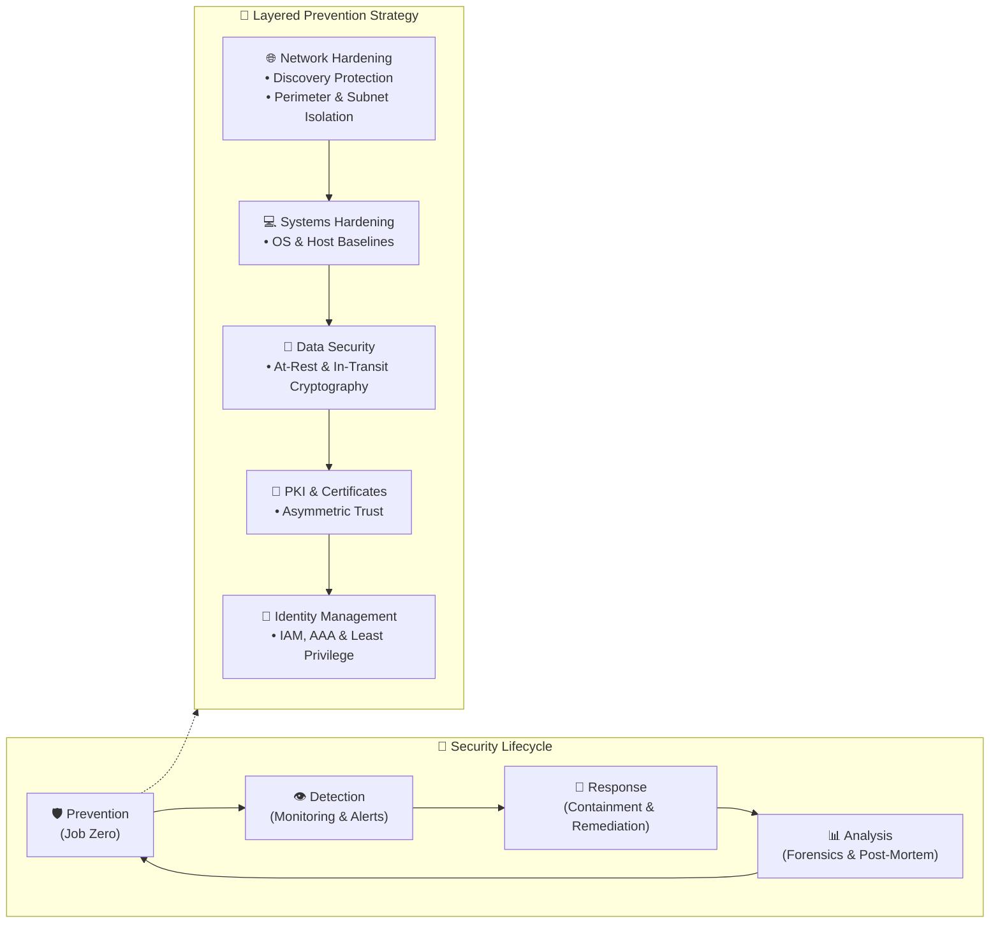

---

## 📌 Learning Objectives

By completing this module and reviewing these study materials, you will be able to:

- [ ] **Define Network Hardening**: Explain the core objectives of network hardening and contextualize its role within the **Prevention** phase of the Security Lifecycle.
- [ ] **Analyze Network Security Vulnerabilities**: Identify and dissect common network threat vectors, including unencrypted cleartext traffic, unnecessary open ports, insecure legacy protocols, IP spoofing, rogue network devices, Man-in-the-Middle (MitM) attacks, and Denial of Service (DoS/DDoS).
- [ ] **Examine Network Discovery Exploits**: Detail how threat actors employ network mapping (`ping`, `traceroute`), port scanning (`nmap`), and traffic sniffing (`Wireshark`, `tcpdump`) to build target architectural blueprints.
- [ ] **Implement Discovery Countermeasures**: Apply defense techniques including disabling ICMP echo/broadcasts, migrating from legacy SNMP to SNMPv3, suppressing server banners, deploying honeypots/canaries, and disabling promiscuous mode.
- [ ] **Establish Administrative Access Governance**: Limit remote administration attack vectors using AAA policies (Authentication, Authorization, Accounting), jump hosts/bastions, and encrypted protocols (SSH, TLS, VPN).
- [ ] **Architect Network Segmentation & DMZs**: Segment networks into logical subnets using Classless Inter-Domain Routing (CIDR), isolate public-facing ingress zones using Demilitarized Zones (DMZs), and implement zero-trust microsegmentation.
- [ ] **Differentiate Network Firewalls & IPS**: Contrast stateless packet filters, stateful firewalls, and Next-Generation Firewalls (NGFW), and evaluate signature- vs. anomaly-based Intrusion Prevention Systems (IPS).
- [ ] **Master AWS Cloud Network Defense Controls**: Design layered VPC security utilizing **Security Groups** (instance-level, stateful) and **Network Access Control Lists (NACLs)** (subnet-level, stateless).
- [ ] **Integrate Perimeter Cloud Security Services**: Evaluate the operational roles of **AWS WAF** (Layer 7 web exploits), **AWS Shield** (DDoS mitigation), **AWS Network Firewall** (VPC IPS/IDS), **Amazon Inspector** (automated reachability auditing), and encrypted tunnels (**IPsec VPNs** & **TLS**).

---

## ⚠️ 1. Network Security Vulnerabilities & Threat Landscape

### 1.1 What is a Network Security Threat?
A **network security threat** is any deliberate or accidental attempt to expose, intercept, manipulate, disable, or gain unauthorized access to an organization’s network infrastructure and data in transit. 

Modern cyber intrusions do not occur spontaneously; they adhere to a structured **Cyber Kill Chain** where attackers begin by discovering network topologies, identifying vulnerable entry points, and executing tailored exploits.

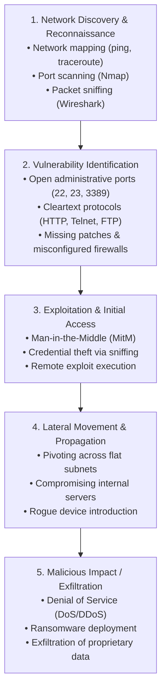

---

### 1.2 Core Network Vulnerabilities

| Vulnerability Type | Architectural Root Cause | Threat Actor Attack Method | Impact on CIA Triad | Preventive Countermeasure |
| :--- | :--- | :--- | :--- | :--- |
| **Unencrypted Traffic (Cleartext)** | Transmission of data across layers without cryptographic protection (HTTP, Telnet, FTP, LDAP). | Traffic sniffing / eavesdropping using packet analyzers (Wireshark, tcpdump). | **Confidentiality**, **Integrity** | Enforce TLS 1.3, SSHv2, HTTPS, IPsec, SFTP; mandate HTTPS redirect rules. |
| **Open Ports & Extraneous Services** | Default server installations running unnecessary listening daemons (e.g., Telnet, RPC, NetBIOS). | Automated TCP/UDP port scans targeting vulnerable service daemons. | **Confidentiality**, **Integrity**, **Availability** | Principle of least functionality; close all unused ports; host firewalls; AWS Security Groups. |
| **Legacy & Deprecated Protocols** | Use of obsolete protocol versions lacking modern cryptographic integrity (SSLv3, SNMPv1/v2c, SMBv1). | Known vulnerability exploits, replay attacks, cleartext credential harvesting. | **Confidentiality**, **Integrity** | Disable deprecated protocols; migrate to SNMPv3 (authPriv), SMBv3, TLS 1.2+. |
| **IP Address Spoofing** | Lack of source IP validation at network routing boundaries; trust based solely on header IP. | Forging packet source IP headers to bypass IP whitelists or launch reflected DoS attacks. | **Integrity**, **Availability** | Ingress and egress packet filtering (BCP 38 / RFC 2827); reverse path forwarding (uRPF). |
| **Rogue Devices & Unauthorized Hardware** | Unauthenticated physical switch ports and open wireless access points. | Inserting unauthorized laptops, rogue access points, or hardware keyloggers into the intranet. | **Confidentiality**, **Integrity** | IEEE 802.1X Network Access Control (NAC); switch port security (MAC limits); dynamic ARP inspection. |
| **Man-in-the-Middle (MitM)** | Unauthenticated network pathways and unencrypted communication lines. | ARP spoofing, DNS cache poisoning, rogue DHCP, or SSL/TLS stripping. | **Confidentiality**, **Integrity** | Strict Transport Security (HSTS); DNSSEC; mutual TLS (mTLS); secure dynamic ARP inspection (DAI). |
| **Denial of Service (DoS / DDoS)** | Finite compute, memory, socket buffers, and network link bandwidth exposed without rate controls. | Flooding infrastructure with volumetric traffic (SYN floods, UDP amplification, HTTP floods). | **Availability** | Elastic load balancing, AWS Shield Standard/Advanced, AWS WAF rate-limiting, egress scrubbing. |

---

### 1.3 Deep Dive: Reconnaissance & Discovery Exploits

#### A. Network Mapping (`ping` and `traceroute`)
Network mapping allows adversaries to deduce network topology, identify active IP addresses, and map intermediate routing hops.
- **`ping` (ICMP Echo Request/Reply)**: Transmits ICMP Type 8 packets. If a target responds with ICMP Type 0, the attacker confirms the host is live, reachable, and active.
- **`traceroute` / `tracert` (TTL Manipulation)**: Transmits packets with incrementing Time-to-Live (TTL) values. Each intermediate router decrements the TTL to `0`, drops the packet, and returns an `ICMP Time Exceeded` message (Type 11), exposing the router's IP address and round-trip latency.

```bash
# Example traceroute output illustrating exposed hops
$ traceroute amazon.com
traceroute to amazon.com (205.251.242.103), 30 hops max, 60 byte packets
 1  gw-router.corp.internal (192.168.1.1)  0.642 ms  0.612 ms  0.598 ms
 2  isp-edge-node.net (203.0.113.1)        4.120 ms  4.095 ms  4.110 ms
 ...
 12 205.251.242.103 (205.251.242.103)      18.254 ms 18.210 ms 18.230 ms
```

> [!WARNING]
> By combining sequential ping sweeps across subnets (e.g., `192.168.0.0/24`), attackers construct an exhaustive blueprint of live hosts, gateway addresses, and internal network segments.

#### B. Port Scanning (`Nmap`)
Once live hosts are mapped, port scanning determines which TCP/UDP ports are listening and what application daemons are serving requests.
- **TCP SYN Scan (Half-Open Scan)**: Sends a `SYN` packet. If the target returns `SYN-ACK`, the port is open; the scanner immediately sends `RST` to prevent full connection establishment, attempting to evade basic logging.
- **Service & Version Detection (`-sV`)**: Interrogates open ports to capture service banners and protocol versions.
- **Operating System Fingerprinting (`-O`)**: Analyzes variations in TCP window sizes, initial sequence numbers, and IP flags to deduce the host OS.

```bash
# Nmap protocol and port scan example against an internal host
$ nmap -sS -p 21,22,23,25,80,135,139,445,3389 -O 192.168.1.107
Starting Nmap 7.92 ( https://nmap.org )
Nmap scan report for 192.168.1.107
PORT     STATE    SERVICE
23/tcp   OPEN     telnet      <-- HIGH RISK: Cleartext protocol active!
80/tcp   OPEN     http
135/tcp  OPEN     msrpc
445/tcp  OPEN     microsoft-ds
Device type: general purpose
Running: Microsoft Windows 10
```

#### C. Traffic Sniffing (`Wireshark` and `tcpdump`)
Traffic sniffing (packet analysis) intercepts raw frames traversing a network interface.
- **Promiscuous Mode**: Configures a Network Interface Card (NIC) to pass all captured traffic to the operating system rather than discarding frames not addressed to its own MAC address.
- **Broadcast Domains & Hubs**: On unswitched networks or hubs, all traffic is broadcast to all ports. On switched networks, attackers execute **ARP cache poisoning** to redirect traffic through their host to perform sniffing.
- **Information Extracted**: Cleartext user credentials (HTTP Basic Auth, FTP, Telnet), email headers (SMTP), session tokens, and unencrypted database queries.

---

## 🔍 2. Network Discovery Protection & Countermeasures

Network discovery hardening seeks to deny attackers the visibility needed to map infrastructure, identify open listening ports, or inspect transmitted payloads.

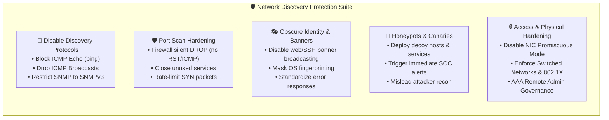

### 2.1 Restricting and Disabling Discovery Protocols

1. **ICMP Protocol Hardening**:
   - **Drop Ingress ICMP Echo Requests**: Configure external firewalls and edge routers to silently drop incoming `ICMP Type 8` (Echo Request) packets from untrusted internet networks.
   - **Suppress ICMP Unreachable Messages**: When closed ports receive packets, dropping the packet instead of returning an `ICMP Port Unreachable` (Type 3) prevents scanners from distinguishing between filtered and closed states.
   - **Disable ICMP Redirects & Broadcast Pings**: Prevents attackers from using your network to participate in Smurf amplification DDoS attacks.
2. **Hardening Simple Network Management Protocol (SNMP)**:
   - **The Vulnerability**: SNMPv1 and SNMPv2c transmit community strings (passwords) in cleartext across the network. Threat actors sniffing port 161 can capture `public` or `private` strings and read the entire Management Information Base (MIB), exposing system hardware, IP routing tables, and interface statistics.
   - **The Remedy**: Migrate to **SNMPv3**, which incorporates robust cryptographic authentication (HMAC-SHA) and privacy encryption (AES-128/256) under the `authPriv` security level.

---

### 2.2 Port Scanning Mitigation & Banner Grabbing Protection

#### Silent Drop vs. Reject Responses
- **TCP Reject (`RST`)**: When a firewall or host explicitly sends a TCP `RST` flag in response to a closed port, an attacker's port scanner immediately confirms that the host is online and filtering is inactive.
- **Silent Drop (`DROP`)**: By silently dropping non-whitelisted packets without sending a response, the scanner experiences a socket timeout. This exponentially slows down automated port scans and obscures whether the target host even exists.

#### Suppressing Service Banners
When a client connects to a server daemon, many services broadcast detailed software and version numbers (e.g., `Apache/2.4.29 (Ubuntu) OpenSSL/1.1.1`). Attackers exploit this banner information to search Common Vulnerabilities and Exposures (CVE) databases for known exploits.
- **Web Servers**: Configure Apache (`ServerTokens Prod`, `ServerSignature Off`) and Nginx (`server_tokens off;`) to hide version details.
- **SSH Daemons**: Restrict SSH banner verbosity in `/etc/ssh/sshd_config`.

---

### 2.3 Deception Technology: Honeypots & Honeytokens

A **honeypot** is an isolated decoy system designed to intentionally mimic production servers, open ports, or vulnerable services to lure potential attackers.

- **Early Detection**: Because legitimate enterprise users have no business purpose to access a honeypot, **any interaction with a honeypot is treated as malicious activity**.
- **Threat Intelligence**: Honeypots allow security teams to observe attacker tactics, techniques, and procedures (TTPs), capture malware payloads, and harvest zero-day exploit attempts.
- **Deception Types**:
  - **Low-Interaction Honeypots**: Emulate basic network services and ports (e.g., listening on port 21/FTP, 23/Telnet, 3389/RDP). Low resource overhead, zero risk of becoming a staging ground.
  - **High-Interaction Honeypots**: Full real operating systems and applications configured in monitored sandbox environments.
  - **Honeytokens / Honeycredentials**: Decoy AWS IAM credentials or API keys placed in code or internal wikis. If used, AWS CloudTrail alerts SOC operators immediately.

---

### 2.4 Sniffing Countermeasures & Local Network Hardening

1. **Disable Promiscuous Mode**:
   - Ensure hypervisors (e.g., VMware ESXi, KVM) and operating system virtual switches reject promiscuous mode on guest network adapters. In AWS VPC, the underlying hypervisor (AWS Nitro System) strictly enforces virtual interface MAC matching, rendering promiscuous sniffing impossible across tenant instances.
2. **Switching Infrastructure vs. Legacy Hubs**:
   - Traditional hubs broadcast every frame to every port. Enterprise Ethernet switches maintain a Content Addressable Memory (CAM) table to forward frames only to the designated destination MAC address port.
3. **Port Security & 802.1X**:
   - Enforce IEEE 802.1X Extensible Authentication Protocol (EAP) to require cryptographic identity authentication before granting network port access.
   - Enable switch port security to limit each physical port to a maximum number of recognized MAC addresses, preventing CAM table flooding attacks.
4. **Encrypt Sensitive Data in Transit**:
   - Encrypt all transport channels using modern cryptography (TLS 1.3, IPsec, SSHv2) so that intercepted packets yield only indecipherable ciphertext.

---

### 2.5 Limiting Remote Administration & Enforcing AAA Governance

Direct administrative exposure to the public internet is one of the leading causes of enterprise security breaches. Remote administration access must be strictly governed:

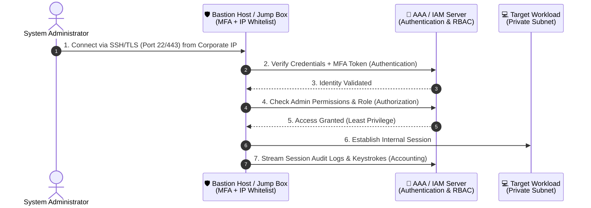

1. **Strict Protocol Restrictions**:
   - Permanently prohibit unencrypted administrative protocols (Telnet on TCP 23, rlogin, raw VNC).
   - Require modern cryptographic shells (SSH with ED25519 or RSA keys >= 4096-bit, RDP encapsulated over TLS).
2. **Access Location Boundaries**:
   - Prohibit direct public inbound administrative access (`0.0.0.0/0` on port 22 or 3389).
   - Restrict access to designated corporate VPN IP CIDRs or dedicated **Bastion Hosts (Jump Boxes)**.
   - Utilize agent-based access mechanisms such as **AWS Systems Manager Session Manager**, which completely eliminates open inbound ports and public IP exposure.
3. **Authentication, Authorization, and Accounting (AAA)**:
   - **Authentication**: Mandate Multi-Factor Authentication (MFA) for all administrative interfaces.
   - **Authorization**: Apply strict Role-Based Access Control (RBAC). Network engineers possess device configuration privileges; read-only operators access only diagnostics.
   - **Accounting / Auditing**: Log every administrative logon, session start/end, and executed command to an immutable, centralized logging repository (e.g., Amazon S3 with Object Lock or AWS CloudWatch Logs).

---

### 2.6 Automated Vulnerability Auditing: Amazon Inspector

**Amazon Inspector** is an automated vulnerability management service that continually scans AWS workloads for software vulnerabilities and unintended network exposure.

- **Network Reachability Assessment**:
  - Analyzes VPC routing tables, Internet Gateways (IGWs), Virtual Private Gateways (VGWs), Network ACLs, and Security Groups.
  - Automatically identifies whether an Amazon EC2 instance has open network paths from the internet to internal ports without needing to inject live traffic or run intrusive external scanners.
- **Automated Severity Scoring**:
  - Flags open critical ports (such as Telnet port 23 or unauthenticated Redis port 6379) with **High** or **Critical** severity findings.
  - Recommends actionable remediation steps (e.g., modify Security Group rule `sg-01234` to restrict source IP).

> [!NOTE]
> Amazon Inspector's network reachability rules evaluate configuration state directly against AWS networking APIs, eliminating the performance overhead and potential false alarms of external port-scanning tools.

---

## 🏗️ 3. Network Architecture Hardening Practices

Network architecture hardening improves security through deliberate topological design, multi-tier isolation, traffic choke points, and layered boundary controls.

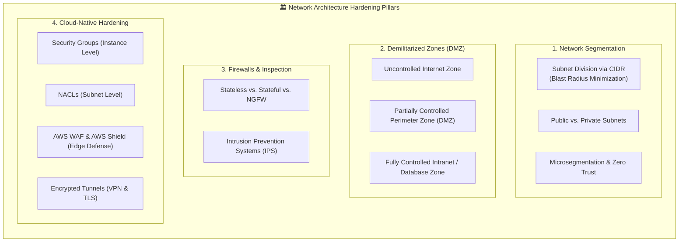

---

### 3.1 Network Segmentation & CIDR Subnetting

Network segmentation divides a large flat network into smaller, logically isolated subnets.

#### The Dangers of a Flat Network
In a flat network (a single shared broadcast domain):
- Any compromised host can freely sniff unencrypted packets traversing the broadcast domain.
- An attacker with access to a low-security machine (e.g., a receptionist workstation) can pivot directly to critical database servers with zero network obstacles.
- Broadcast storms degrade network performance across all connected devices.

#### Subnetting with Classless Inter-Domain Routing (CIDR)
CIDR notation specifies an IP address range using a base IP address followed by a slash (`/`) and the prefix length denoting the number of network bits.
- **CIDR Notation Example**: `192.168.0.0/16` represents 65,536 total IP addresses (`192.168.0.0` through `192.168.255.255`).
- Subdividing into `/24` subnets creates smaller units of 256 addresses each (e.g., `192.168.10.0/24` for HR and `192.168.20.0/24` for Public Web).

#### Benefits of Network Segmentation:
1. **Blast Radius Containment**: If a public web server in Subnet A is compromised, network firewalls and access lists prevent lateral movement to database workloads in Subnet B.
2. **Targeted Security Policies**: High-risk internal resources (e.g., HR records, financial databases) receive strict access controls, while public-facing tiers receive standard web traffic.
3. **Relieved Traffic Congestion & Improved Performance**: Local broadcast traffic stays within its designated subnet boundary.
4. **Simplified Compliance & Auditing**: Confines the regulatory scope of standards like PCI-DSS or HIPAA to specific isolated subnets.

---

### 3.2 Demilitarized Zones (DMZs) & Multi-Tier Architecture

A **Demilitarized Zone (DMZ)**, also called a perimeter network, is a specialized physical or logical subnet that exposes an organization's external-facing services to an untrusted network (the internet) while shielding the internal corporate network (intranet).

```mermaid
flowchart LR
    Internet(("🌐 Public Internet<br>(Untrusted Zone)")) <--> FW1["🔥 External Firewall<br>(Edge Perimeter)"]
    
    subgraph DMZ["🛡️ Perimeter Zone (DMZ / Public Subnet)"]
        direction TB
        ALB["⚖️ Application Load Balancer"]
        WebTier["🖥️ Web Servers<br>(Ports 80 / 443)"]
        Bastion["🏰 Bastion / Jump Box<br>(Port 22 SSH)"]
    end
    
    FW1 <--> DMZ
    DMZ <--> FW2["🔥 Internal Firewall<br>(Strict Policy)"]
    
    subgraph PrivateApp["🔒 Intranet: App Subnet (Private)"]
        AppTier["⚙️ Application Services<br>(Internal Logic)"]
    end
    
    subgraph PrivateDB["🔒 Intranet: Data Subnet (Private Isolated)"]
        DBTier["🗄️ Relational Databases<br>(MySQL/PostgreSQL)"]
    end
    
    FW2 <--> PrivateApp
    PrivateApp <--> DBTier
```

#### Network Zone Classifications:
1. **Internet Zone (Uncontrolled / Untrusted)**: The public internet where threat actors operate. Zero trust is assumed; all uninspected incoming traffic is considered potentially hostile.
2. **Perimeter Zone / DMZ (Partially Controlled)**:
   - Houses public endpoints: web servers, load balancers, reverse proxies, and mail servers.
   - Directly accepts traffic from the internet over specified ports (HTTP/HTTPS).
   - If an internet attacker compromises a server in the DMZ, the **internal firewall** prevents direct access into the internal database and corporate intranet.
3. **Internal Zone / Intranet (Fully Controlled)**:
   - Houses business logic application servers, core databases, HR file shares, and domain controllers.
   - **Never assigned public IP addresses** and strictly inaccessible from the public internet.

---

### 3.3 Microsegmentation & Zero Trust Architecture

While standard network segmentation isolates networks by subnets and zones, **microsegmentation** extends granular security perimeters down to individual workloads, containers, or virtual machines.
- **Traditional Model (Perimeter Security / "Castle-and-Moat")**: Once an attacker breaches the perimeter firewall, internal network communications are largely unrestricted.
- **Zero Trust Microsegmentation**: "Never trust, always verify." Every individual workload is surrounded by its own dedicated security perimeter (e.g., host-based firewalls, AWS Security Groups). Even instances residing on the exact same subnet cannot communicate with each other unless explicitly authorized by policy.

---

### 3.4 Firewalls: Stateless vs. Stateful vs. Next-Generation (NGFW)

A **network firewall** acts as a traffic filter controlling incoming and outgoing packets based on defined security rules.

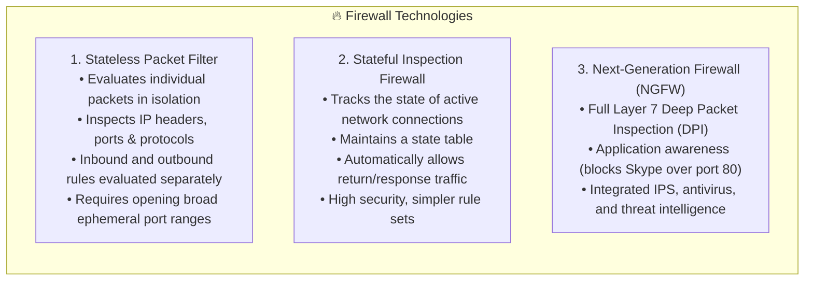

| Feature / Metric | Stateless Packet Filtering | Stateful Inspection Firewall | Next-Generation Firewall (NGFW) |
| :--- | :--- | :--- | :--- |
| **OSI Layer Scope** | Layer 3 (Network) & Layer 4 (Transport) | Layer 3 (Network) & Layer 4 (Transport) | Layers 3, 4 through Layer 7 (Application) |
| **Connection State Awareness** | **None**: Treats every packet as an isolated event. | **Full**: Tracks TCP handshakes, sequence numbers, and connection states (`NEW`, `ESTABLISHED`, `RELATED`). | **Full**: Tracks state plus application protocol transactions and user identities. |
| **Return Traffic Handling** | Requires explicit outbound rules allowing return packets back to client ephemeral ports (1024–65535). | **Automatic**: Response traffic matching an established connection is dynamically permitted. | **Automatic**: Response traffic permitted and inspected for application-layer malware. |
| **AWS Cloud Equivalent** | **Network Access Control Lists (NACLs)** | **AWS Security Groups** | **AWS Network Firewall**, AWS Marketplace NGFW appliances (Palo Alto, Fortinet) |
| **Performance vs. Overhead** | Extremely high throughput, ultra-low latency, low memory overhead. | Moderate memory overhead to maintain connection state tables. | Higher compute/memory overhead due to deep packet decryption and payload inspection. |

#### Firewall Best Practices:
1. **Default Deny (Implicit Deny)**: Configure firewall rule chains to drop all traffic by default. Explicitly whitelist only required protocols, ports, and source IPs.
2. **Place Closest to Traffic Source**: Filter malicious and irrelevant packets at the outermost network perimeter (Internet Gateway, edge boundary) before they consume internal bandwidth or processing capacity.
3. **Log All Exceptions & Drops**: Record all rejected connection attempts to detect port scans, brute-force attacks, and reconnaissance patterns.
4. **Layer Network Firewalls with Application Firewalls**: Combine Layer 3/4 network firewalls with Layer 7 Web Application Firewalls (AWS WAF) to protect against application vulnerabilities (SQLi, XSS).

---

### 3.5 Intrusion Prevention Systems (IPS)

An **Intrusion Prevention System (IPS)** is an active network security component that continuously monitors network traffic, detects malicious activity, and immediately defends against exploits in real time.

- **Placement**: Typically deployed directly inline behind perimeter firewalls. While firewalls filter based on packet headers (IP and port), the IPS inspects packet payloads.
- **Detection Mechanisms**:
  - **Signature-Based Detection**: Compares network traffic against an updated database of known threat signatures, CVE exploit byte sequences, and attack patterns. Excellent for known threats; blind to novel zero-day attacks.
  - **Anomaly-Based Detection**: Establishes a mathematical baseline of standard network traffic behavior (bandwidth, packet rates, typical protocol ratios). Alerts or drops traffic when statistical deviations occur (e.g., sudden massive spikes in outbound DNS requests or inbound HTTP volume indicative of DoS).

#### AWS Network Firewall
**AWS Network Firewall** is a managed service providing stateful network inspection, rule-based filtering, and a built-in IPS engine for Amazon VPCs.
- Uses an open-source, Suricata-compatible stateful inspection engine.
- Supports stateful rules that inspect packet attributes, byte sequences, and Layer 7 domain names (FQDN filtering).
- Enables real-time blocking of malicious traffic, such as dropping all outbound connections to known Command-and-Control (C2) servers or dropping all unauthorized ICMP traffic across a VPC.

---

## ☁️ 4. AWS Native Network Hardening Architecture

In the AWS Cloud, network security follows a robust, multi-layered defense-in-depth model within an **Amazon Virtual Private Cloud (VPC)**.

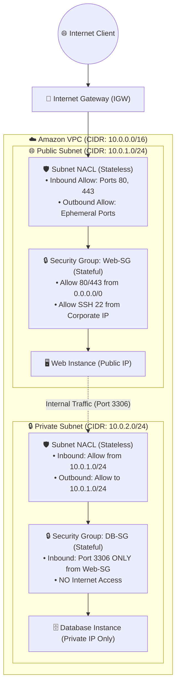

---

### 4.1 Security Groups vs. Network Access Control Lists (NACLs)

Understanding the distinct roles and interactions between **Security Groups** and **Network ACLs** is fundamental to AWS networking security:

| Feature / Characteristic | Security Group (SG) | Network Access Control List (NACL) |
| :--- | :--- | :--- |
| **Operating Level** | **Instance Level** (attached to Elastic Network Interfaces - ENIs). | **Subnet Level** (acts as a boundary gate for the entire subnet). |
| **State Nature** | **Stateful**: Return traffic is automatically allowed regardless of inbound/outbound rules. | **Stateless**: Responses must be explicitly permitted by matching return rules. |
| **Rule Types Supported** | **Allow rules ONLY**. Cannot configure explicit `DENY` rules. | Both **Allow** and **Deny** rules are supported. |
| **Rule Processing Order** | **All rules evaluated** simultaneously; the most permissive rule matches. | **Numbered rule order** (evaluated sequentially from lowest to highest; first match applies). |
| **Ephemeral Port Handling** | Handled automatically due to stateful connection tracking. | **Manual configuration required**: Outbound rules must explicitly allow ephemeral ports (1024–65535). |
| **Default Configuration** | Default SG: Allows all outbound, denies all inbound. Custom SG: Denies all inbound, allows all outbound. | Default NACL: Allows all inbound and outbound. Custom NACL: Denies all inbound and outbound until configured. |
| **Primary Architectural Use** | Microsegmentation of individual servers, microservices, and tiers based on role. | Broad subnet perimeter defense, blocking specific malicious IP CIDRs (blacklisting). |

> [!IMPORTANT]
> Because Security Groups cannot define explicit `DENY` rules, Network ACLs are the primary tool in AWS VPC for blacklisting specific offending IP addresses or compromised CIDR blocks at the subnet boundary.

---

### 4.2 Three-Tier Multi-VPC Architecture Pattern

In a classic production web application architecture, security groups should be chained using **Security Group References** (source referencing another security group ID) rather than IP CIDR ranges:

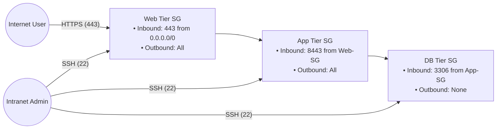

1. **Web Tier SG (`sg-web`)**:
   - Inbound: Ports `80` and `443` allowed from `0.0.0.0/0`.
   - Inbound: Port `22` (SSH) allowed *only* from corporate intranet CIDR (e.g., `198.51.100.50/32`).
2. **Application Tier SG (`sg-app`)**:
   - Inbound: Port `8443` allowed *only* from source security group `sg-web`. No internet direct access.
   - Inbound: Port `22` (SSH) allowed *only* from corporate intranet CIDR.
3. **Database Tier SG (`sg-db`)**:
   - Inbound: Port `3306` (MySQL) allowed *only* from source security group `sg-app`. Even web tier servers cannot directly query the database.
   - Inbound: Port `22` / `3389` restricted strictly to corporate management IP addresses.

---

### 4.3 Edge Perimeter Defense: AWS WAF & AWS Shield

Perimeter protection extends beyond VPC boundaries to AWS edge locations (Amazon CloudFront, Application Load Balancers, Amazon API Gateway, AWS AppSync):

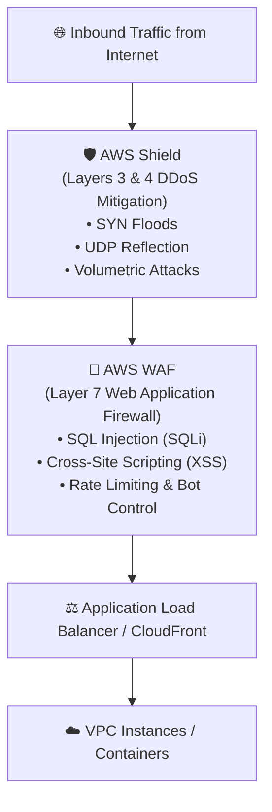

1. **AWS Shield**:
   - **Shield Standard**: Automatically enabled for all AWS customers at no additional charge. Defends against common Layer 3 and Layer 4 volumetric attacks (SYN/ACK floods, UDP reflection attacks).
   - **Shield Advanced**: Provides 24/7 access to the AWS Shield Response Team (SRT), financial DDoS cost protection against scaling spikes, and real-time attack diagnostics.
2. **AWS WAF (Web Application Firewall)**:
   - Inspects Layer 7 (HTTP/HTTPS) traffic against customizable web access control lists (Web ACLs).
   - Blocks application-layer exploits such as SQL Injection (SQLi), Cross-Site Scripting (XSS), HTTP request smuggling, and malicious web bots.
   - Enforces rate-based rules (e.g., block any client IP making over 2,000 requests in 5 minutes).

---

### 4.4 Encrypted Tunnels: VPNs, IPsec & TLS

Securing data in transit across public networks requires robust cryptographic encapsulation:

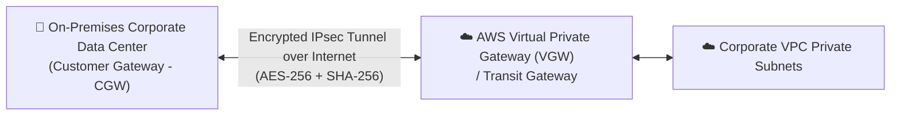

1. **IPsec VPN (AWS Site-to-Site VPN)**:
   - Connects on-premises data centers to AWS VPCs across the public internet.
   - **Internet Protocol Security (IPsec)** operates at Layer 3 (Network layer), encapsulating and encrypting all IP packets using Authentication Headers (AH) for integrity and Encapsulating Security Payload (ESP) with AES-256 for confidentiality.
2. **AWS Client VPN**:
   - Managed OpenVPN-based client service enabling remote teleworkers to securely connect to VPC workloads using mutual TLS authentication or Active Directory federated identity.
3. **Transport Layer Security (TLS 1.3)**:
   - Operates at the transport/session boundary, encrypting point-to-point application communications (HTTPS, SMTPS, secure database connections).
4. **AWS Direct Connect with MACsec**:
   - Dedicated private physical fiber connection bypassing the public internet entirely. Layer 2 IEEE 802.1AE MAC Security (MACsec) provides point-to-point line-rate encryption for 10 Gbps and 100 Gbps links.

---

## 📊 5. Comprehensive Comparison & Reference Tables

### 5.1 AWS Network Security Control Matrix

| Security Service / Component | OSI Layer | Scope of Protection | Stateful or Stateless | Key Rule Matching Criteria | Primary Use Case |
| :--- | :--- | :--- | :--- | :--- | :--- |
| **AWS Security Group** | Layer 4 (Transport) | Instance ENI | **Stateful** | Protocol, Port range, Source/Dest IP CIDR, Security Group IDs. Allow rules only. | Host & microservice isolation; multi-tier web application segmentation. |
| **VPC Network ACL (NACL)** | Layer 3 & 4 (Network/Transport) | Subnet | **Stateless** | Rule number, Protocol, Port range, Source/Dest CIDR. Allow AND Deny rules. | Subnet boundary filtering; immediate IP/CIDR blacklisting. |
| **AWS Network Firewall** | Layers 3, 4, and 7 | VPC (via dedicated subnet endpoints) | **Both** (Stateless & Stateful rule groups) | Suricata rules, 5-tuple matching, domain lists (FQDN), stateful stream inspection. | VPC-wide perimeter inspection; advanced IPS/IDS; egress domain filtering. |
| **AWS WAF** | Layer 7 (Application) | ALB, CloudFront, API Gateway, AppSync | **Application-Stateful** | HTTP headers, URI strings, query arguments, SQLi/XSS signatures, client IP rate limits. | Web application exploit prevention; bot control; rate limiting. |
| **AWS Shield** | Layer 3 & 4 (Standard), Layer 7 (Advanced) | CloudFront, Route 53, ALB, Elastic IPs | **Managed Anomaly Detection** | Volumetric traffic anomalies, SYN flood signatures, DNS amplification metrics. | Continuous, automatic DDoS defense and infrastructure protection. |

---

### 5.2 Common Network Threats vs. Defensive Countermeasures

| Threat Vector | Targeted Protocol / Port | Exploitation Mechanism | Hardening Countermeasures |
| :--- | :--- | :--- | :--- |
| **Ping Sweep / Host Mapping** | ICMP (Type 8 Echo) | Identifies live targets for targeted vulnerability scanning. | Block inbound ICMP Type 8 at perimeter firewalls and NACLs; configure host firewalls to silent drop. |
| **Port Scanning** | TCP/UDP (Various Ports) | Probes listening daemons to identify unpatched services. | Drop scanned packets silently (no RST); deploy IPS rate limits; configure minimal Security Group allow rules. |
| **Packet Sniffing** | Promiscuous NICs on shared media | Eavesdrops on cleartext passwords, session cookies, and payloads. | Enforce TLS 1.3 and SSH; disable promiscuous mode on virtual switches; deploy switched networks with 802.1X. |
| **Telnet / Cleartext Admin** | TCP 23 (Telnet), TCP 21 (FTP) | Harvests administrative credentials transmitted in cleartext. | Permanently disable Telnet and FTP; enforce SSHv2 on non-standard ports or use AWS Systems Manager Session Manager. |
| **SYN Flood DoS Attack** | TCP handshake (Port 80/443) | Sends high volumes of SYN packets without completing the handshake, exhausting server memory backlog. | Enable TCP SYN Cookies at OS level; deploy AWS Shield Standard; utilize Application Load Balancers. |
| **Cross-Tier Lateral Movement** | Internal East-West traffic | Pivoting from compromised web servers to sensitive databases. | Discontinue flat networks; enforce 3-tier subnets; isolate database security groups to accept traffic exclusively from app tier security groups. |
| **DNS Amplification Attack** | UDP 53 | Forges victim IP address to open DNS resolvers, generating overwhelming return traffic volume. | Restrict open DNS recursive resolvers; implement BCP 38 source IP egress filtering; deploy AWS Shield. |

---

## 💡 6. Practical Implementation & Hardening Checklist

Use this checklist to audit and harden any enterprise network infrastructure or AWS Virtual Private Cloud:

- [ ] **1. Disable Insecure Protocols & Close Unused Ports**
  - Verify zero listening daemons on unencrypted ports (Ports 21, 23, 69, 80 for administrative logins).
  - Enforce HTTPS redirection (HTTP 301 to Port 443) on all web endpoints.
  - Upgrade any legacy SNMP agents to SNMPv3 with `authPriv` configured.
- [ ] **2. Hardening Discovery Protocols**
  - Configure internet-facing firewalls to drop inbound ICMP Echo requests (`ping`).
  - Disable ICMP redirect transmission on all routers and gateway nodes.
  - Suppress web server banner version tokens (`ServerTokens Prod` / `server_tokens off`).
- [ ] **3. Network Segmentation & DMZ Placement**
  - Ensure zero database servers or backend services reside in public subnets or possess public IP addresses.
  - Establish distinct CIDR subnet ranges for Web (DMZ), Application (Private), and Database (Private Restricted) tiers.
  - Ensure internet egress from private subnets traverses a managed NAT Gateway or egress-only internet gateway.
- [ ] **4. Configure Multi-Tier Security Groups**
  - Verify no security group rules permit inbound traffic from `0.0.0.0/0` on administrative ports (SSH 22, RDP 3389).
  - Chain security groups together: Database security groups must specify Application security groups as the sole authorized source.
- [ ] **5. Deploy Automated Auditing & Threat Detection**
  - Activate **Amazon Inspector** network reachability assessments to detect overly permissive security configurations.
  - Enable **VPC Flow Logs** sent to CloudWatch Logs or S3 to record all accepted and rejected IP traffic flows.
  - Deploy **AWS WAF** with AWS Managed Rules (Common Rule Set, Known Bad Inputs, SQLi Rule Set) in front of ALBs.

---

## 🧠 7. Knowledge Check & Review Questions

Test your understanding of the concepts covered in this module. Try answering each question before checking the provided answer and explanation!

---

### Question 1
**What is a network discovery vulnerability, and what risk does it pose to an organization?**

<details>
<summary>👉 Click to view answer and detailed explanation</summary>

**Answer**:  
A network discovery vulnerability is a security exposure or configuration weakness that allows an attacker to discover information about a network environment—including its topology, active devices, live IP addresses, open ports, available protocols, and running software versions.

**Explanation**:  
Discovery vulnerabilities represent the reconnaissance phase of a cyberattack. Attackers leverage tools like `ping`, `traceroute`, `nmap`, and packet sniffers to build an architectural map of the network. Once the attacker identifies which devices are active and what services are listening (especially outdated or cleartext protocols like Telnet on port 23), they can launch targeted exploits, execute unauthorized access, or mount Denial of Service (DoS) attacks.
</details>

---

### Question 2
**What are two practical measures an organization can implement to prevent unauthorized network discovery?**

<details>
<summary>👉 Click to view answer and detailed explanation</summary>

**Answer**:  
1. **Disable or restrict the use of network discovery protocols** (such as blocking external ICMP Echo requests and upgrading or disabling legacy SNMP).  
2. **Limit remote administration access** (restricting administrative protocols to SSH/TLS, whitelisting specific corporate source IPs, using bastion hosts, and implementing AAA policies).

**Explanation**:  
Blocking discovery protocols prevents automated reconnaissance sweeps from verifying that a host is reachable or harvesting device configuration metadata. Limiting remote administration ensures that external adversaries cannot detect or access administrative management ports (e.g., ports 22 and 3389) across public IP spaces.
</details>

---

### Question 3
**Explain the difference between a stateless firewall (such as an AWS Network ACL) and a stateful firewall (such as an AWS Security Group) regarding how return traffic is handled.**

<details>
<summary>👉 Click to view answer and detailed explanation</summary>

**Answer**:  
- A **stateless firewall** (Network ACL) treats each packet independently with no memory of ongoing connections. Inbound and outbound rules are evaluated separately. If an inbound request is permitted on port 80, the return response packet must be explicitly allowed by an outbound rule configured for ephemeral ports (1024–65535).
- A **stateful firewall** (Security Group) maintains a state table that tracks active connections. When an inbound request is permitted, the corresponding return response traffic is automatically allowed out of the instance, regardless of any outbound rules.

**Explanation**:  
Stateful firewalls simplify firewall rule administration and provide superior protection against port scanning and packet injection because packets claiming to be "responses" are dropped unless an active matching outbound session already exists in the connection state table.
</details>

---

### Question 4
**In an AWS multi-tier web application architecture, why should database instances be placed in a private subnet, and how should their Security Groups be configured?**

<details>
<summary>👉 Click to view answer and detailed explanation</summary>

**Answer**:  
Database instances must be placed in a private subnet to ensure they do not possess public IP addresses and cannot be directly routed to or accessed from the public internet. Their Security Group should be configured to accept inbound database connections (e.g., port 3306 for MySQL) exclusively with the **Application Tier Security Group** designated as the source, rather than an IP CIDR range.

**Explanation**:  
By restricting the database security group's source to the application tier security group, database access is strictly confined to legitimate application instances. Even if another instance inside the same VPC or public subnet is compromised, it cannot establish a connection to the database.
</details>

---

### Question 5
**How does an Intrusion Prevention System (IPS) differ from a traditional network firewall, and what are its two primary detection mechanisms?**

<details>
<summary>👉 Click to view answer and detailed explanation</summary>

**Answer**:  
While a traditional network firewall filters traffic based primarily on packet headers (source/destination IP, port, and protocol at Layers 3 and 4), an **IPS** performs deeper inspection into the packet payload in real time to actively detect and block malicious exploits, malware, and protocol anomalies.

Its two primary detection mechanisms are:
1. **Signature-based detection**: Inspects traffic for known patterns, byte sequences, and threat fingerprints matching documented vulnerability exploits.
2. **Anomaly-based detection**: Compares current network behavior against established baselines of normal traffic activity and blocks statistical deviations (such as sudden massive surges in request rates typical of a DoS attack).
</details>

---

## 📌 Summary & Key Takeaways

1. **Network Hardening is Preventive "Job Zero"**: Network hardening implements configurations, policies, and architectural designs to prevent unauthorized network access, reconnaissance, misuse, alteration, and disruption.
2. **Reconnaissance Precedes Exploitation**: Attackers rely on network mapping (`ping`, `traceroute`), port scanning (`nmap`), and traffic sniffing (`Wireshark`) to uncover attack vectors. Hardening network discovery stops attacks before they start.
3. **Core Countermeasures**:
   - Suppress discovery protocols (ICMP echo, legacy SNMP).
   - Silently drop unpermitted packets rather than sending reject (`RST`) packets.
   - Enforce robust **AAA** policies (Authentication, Authorization, Accounting) and remove direct public administrative exposure.
   - Automate network reachability audits using tools like **Amazon Inspector**.
4. **Architectural Isolation**:
   - Segment networks using **CIDR subnetting** to shrink blast radiuses.
   - Deploy **Demilitarized Zones (DMZs)** to isolate internet-facing services from internal business logic and databases.
   - Transition toward **Zero Trust microsegmentation** to protect internal east-west traffic.
5. **AWS Defense-in-Depth**:
   - Combine **Network ACLs** (subnet-level, stateless, allow & deny rules) for perimeter boundary filtering with **Security Groups** (instance-level, stateful, allow rules only) for fine-grained instance protection.
   - Guard edge perimeters with **AWS WAF** (Layer 7 web exploits) and **AWS Shield** (DDoS mitigation).
   - Encapsulate remote traffic using encrypted **IPsec VPN** tunnels and **TLS 1.3**.
