# 🛡️ Prevention: Systems Hardening – Baselines, Operating System Security & Vulnerability Remediation

> **Course**: AWS re/Start  
> **Module**: Security (M04 – Prevention: Systems Hardening)  
> **Source Document**: `T08-Security/T08-0005-RSSECY_EN-US_SG_M04_SYSTEMSHARDENING.pdf`  
> **Target Audience**: AWS re/Start Learners, Cloud Practitioners, Systems Administrators, and Security Operations Associates  

---

## 🎯 Module Overview

In modern computing environments spanning on-premises data centers, hybrid topographies, remote mobile workforces, and the public cloud, unhardened systems are the primary entry point for cyber adversaries. Out of the box, operating systems and enterprise applications are typically configured for ease of use, backward compatibility, and feature richness rather than security. They ship with default credentials, unneeded background daemons, open communication ports, permissive file permissions, and legacy protocols enabled.

**Systems hardening** is the structured, disciplined practice of securing computing assets—including servers, workstations, mobile endpoints, network appliances, and applications—by systematically minimizing their vulnerabilities and reducing their overall attack surface. As an integral component of the **Prevention** phase of the **Security Lifecycle**, hardening establishes a fortified first line of defense before attacks occur.

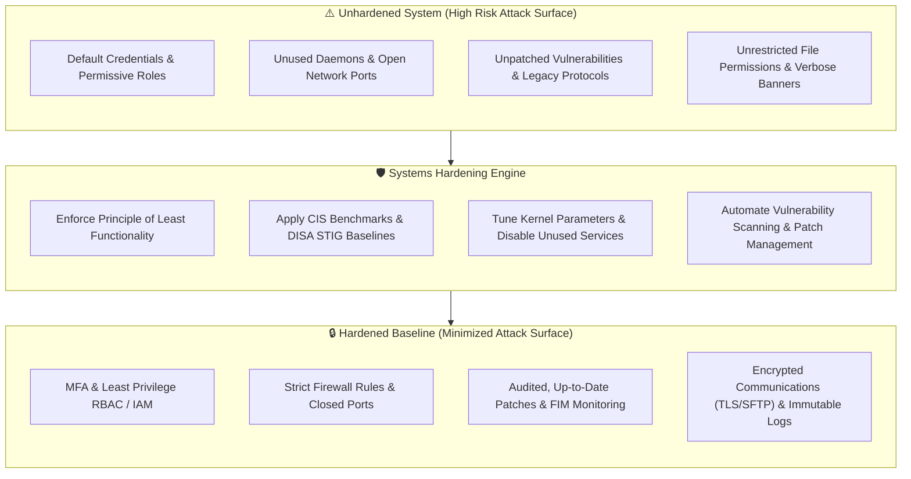

This guide details the core principles, techniques, industry baselines, patch lifecycles, administrative policies, and cloud-native assessment tools required to build, audit, and sustain resilient, hardened systems.

---

## 📌 Learning Objectives

By completing this module and working through these comprehensive materials, you will be able to:

- [ ] **Explain the Principle of Systems Hardening & Least Functionality**: Understand how eliminating non-essential services, protocols, and access rights shrinks the attack surface while striking an optimal balance between security and business usability.
- [ ] **Define and Implement Security Baselines**: Describe the purpose of baselines in establishing standard acceptable states, detecting configuration drift, and leveraging industry frameworks such as **CIS Benchmarks** and **DISA STIGs**.
- [ ] **Execute Core OS Hardening Techniques**: Apply concrete technical controls including process pruning, network port closure, default credential eradication, kernel parameter tuning (`/etc/sysctl.conf`), file system access controls, and **File Integrity Monitoring (FIM)**.
- [ ] **Deploy Auditing and Logging Controls**: Configure local and remote audit systems (such as Linux `auditd`, `journald`, and centralized syslog) to ensure non-repudiation and visibility.
- [ ] **Formulate Server-Specific Hardening Strategies**: Implement defense-in-depth measures for common enterprise servers, including FTP/SFTP, Directory Services (Active Directory), DHCP, and DNS (including DNSSEC and cache poisoning mitigation).
- [ ] **Secure Mobile and Application Workloads**: Apply **Mobile Device Management (MDM)** and bring-your-own-device (BYOD) policies, and explain application protections including Web Application Firewalls (WAF) and **Intel SGX** confidential computing enclaves.
- [ ] **Master the Enterprise Patch Management Lifecycle**: Navigate the end-to-end vulnerability discovery, testing, staged rollout, and emergency hotfix workflows.
- [ ] **Utilize Vulnerability Assessment & Compliance Tools**: Evaluate systems using security audit tools including **Lynis**, **OpenSCAP**, **Tenable Nessus**, **AWS Systems Manager Patch Manager**, and **Amazon Inspector**.
- [ ] **Integrate Cloud-Native AWS Security Services**: Leverage **AWS Trusted Advisor**, **Amazon GuardDuty**, **AWS Shield**, and **AWS CloudTrail** to monitor configurations and automate incident response.
- [ ] **Fortify the Human Layer Against Social Engineering**: Formulate organizational policies, security awareness training programs, and enforceable compliance measures to mitigate social engineering vulnerabilities.

---

## 🔐 1. Foundational Principles of Systems Hardening

### 1.1 What is Systems Hardening?

**Systems hardening** is the systematic process of eliminating security vulnerabilities and closing potential attack vectors on a computing system to minimize risk. A default installation of an operating system (such as Linux or Windows Server) is optimized for out-of-the-box utility, running dozens of background services, opening common listening ports, and enabling broad user utilities.

Every active service, open port, running application, and default account represents a potential entryway—an addition to the system's **attack surface**.

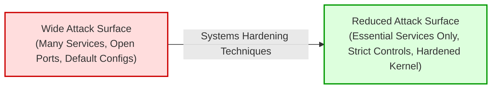

Hardening aims to make systems as close to impenetrable as operationally feasible ("hack-resistant") by enforcing layered barriers. If an attacker manages to penetrate an external perimeter, hardened host-level controls prevent lateral movement, privilege escalation, and arbitrary code execution.

### 1.2 The Principle of Least Functionality

The technical foundation of systems hardening is the **Principle of Least Functionality** (formalized in NIST SP 800-53, CM-7). 

> **Principle of Least Functionality**: A system must be configured to provide only the essential capabilities, functions, services, ports, and protocols necessary to execute its designated business purpose, and prohibit or restrict all other functions.

- If a server functions purely as a database host, it must not run a web server daemon (`httpd`/`nginx`), print spooler (`cups`), or file sharing services (`smb`/`nfs`).
- If an administrator only needs SSH access, telnet, rsh, and VNC services must be completely removed from the filesystem, not merely stopped.
- If a server communicates strictly over port 443, all other non-essential inbound network ports must be blocked at both the host firewall and the network security group.

### 1.3 Balancing Security and Productivity (Usability)

A central operational challenge in cybersecurity is finding the appropriate equilibrium between robust security controls and end-user productivity.

```
       Maximum Usability                                      Maximum Security
    (Zero Security Controls)                              (Zero Usability / Offline)
  ◄───────────────────────────────────▲───────────────────────────────────────►
                         Ideal Operational State:
                     "Hardened for Least Functionality
                         Without Impairing Workflows"
```

- **Over-Hardening Risks**: If security teams lock down systems excessively (e.g., blocking all external USB devices needed for field engineers, enforcing 30-minute password expirations, or disabling all remote desktop access required for telework), employee productivity collapses. Frustrated users frequently create insecure workarounds (shadow IT), creating even greater vulnerabilities.
- **Under-Hardening Risks**: Permissive systems allow convenience at the expense of enterprise catastrophe—such as remote ransomware propagating via unauthenticated SMB shares.
- **Modern Endpoint Context**: With hybrid work and remote workforces operating outside corporate network perimeters, endpoints regularly connect to untrusted home Wi-Fi networks. Hardening mobile devices and laptops before they leave the office is mandatory to preserve security without destroying remote productivity.

### 1.4 Systems Hardening in the Security Lifecycle

The **Security Lifecycle** comprises four continuous phases:

1. **Prevention**: The proactive first line of defense. It includes network hardening, systems hardening, data security, public key infrastructure (PKI), and identity management.
2. **Detection**: The automated identification of threats when preventative controls are tested or bypassed (e.g., IDS/IPS, SIEM, anomaly detection).
3. **Response**: The immediate tactical mitigation taken once an incident is detected (e.g., host isolation, automated lambda quarantining).
4. **Analysis**: The post-incident review to extract root causes, evaluate control efficacy, and feed lessons learned back into the prevention phase.

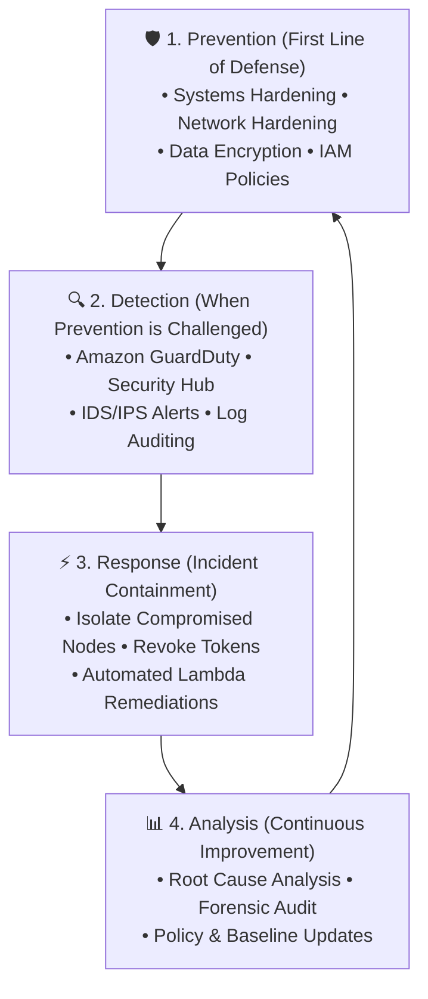

Systems hardening sits squarely at the core of **Prevention**. By eliminating vulnerabilities up front, hardening stops attacks before they trigger detection alarms or necessitate expensive incident response workflows.

### 1.5 The AAA Security Framework in Systems Hardening

A comprehensive systems hardening posture depends on the **Authentication, Authorization, and Accounting (AAA)** model:

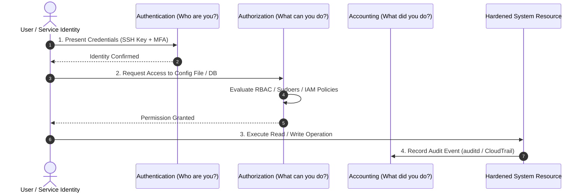

| AAA Component | Hardening Objective | Technical Implementation Mechanisms |
| :--- | :--- | :--- |
| **Authentication (AuthN)** | Verifies and validates the identity of the user, daemon, or API calling the system. Prevents unauthorized actors from establishing sessions. | • Disabling password-based authentication in favor of asymmetric cryptographic keys (e.g., Ed25519 SSH keys).<br>• Enforcing Multi-Factor Authentication (MFA).<br>• Removing default accounts (`guest`, `admin`) and disabling interactive root logins. |
| **Authorization (AuthZ)** | Verifies that an authenticated identity possesses legitimate privileges to execute specific actions or read specific data. | • Enforcing Role-Based Access Control (RBAC) and Least Privilege.<br>• Restricting `sudo` permissions via granular `/etc/sudoers` rules.<br>• File system access control lists (POSIX ACLs, SELinux/AppArmor contexts). |
| **Accounting (Acct)** | Logs and tracks all user sessions, privilege escalations, and system commands for forensic auditing, compliance, and billing. | • Centralized Linux auditing (`auditd`, `rsyslog`).<br>• Immutable cloud audit trails (AWS CloudTrail, CloudWatch Logs).<br>• Automated log integrity verification. |

### 1.6 Physical Security: The Bedrock of Hardening

Host-level software security is fundamentally undermined if an adversary gains direct physical access to the underlying hardware. An attacker with physical access to an unencrypted server can boot into single-user recovery mode via GRUB, extract storage media, clone disk drives, or insert malicious DMA hardware (e.g., BadUSB, PCIe interceptors).

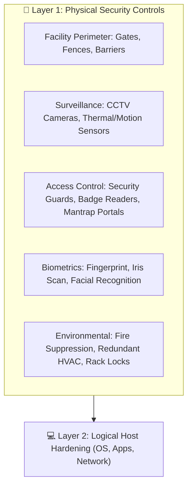

Key physical security controls include:
- **Perimeter & Facility Barriers**: Perimeter fencing, security gates, vehicle barriers, and hardened structural design resistant to physical intrusion or environmental disasters.
- **Entry Points & Mantrap Portals**: Single-person interlocking security portals (mantraps) that prevent tailgating, backed by 24/7 security personnel and high-definition closed-circuit television (CCTV).
- **Biometric Access Controls**: Multi-modal automated recognition systems using fingerprints, iris patterns, facial structure, or vein geometry to eliminate risks associated with stolen physical keycards.
- **Hardware-Level Enclosures**: Tamper-evident server racks, Kensington locks, chassis intrusion switches, and hardware disabling of unused external ports (USB, Thunderbolt).
- **Full Disk Encryption (FDE)**: Utilizing LUKS (Linux) or BitLocker (Windows) backed by a hardware **Trusted Platform Module (TPM 2.0)** to guarantee that stolen physical drives cannot be read offline.

---

## 📋 2. Security Baselines & Industry Standards

### 2.1 What is a Security Baseline?

A **security baseline** is a standardized, documented set of minimum security controls and configuration settings that an operating system, database, or application must satisfy to be deemed acceptable for production deployment.

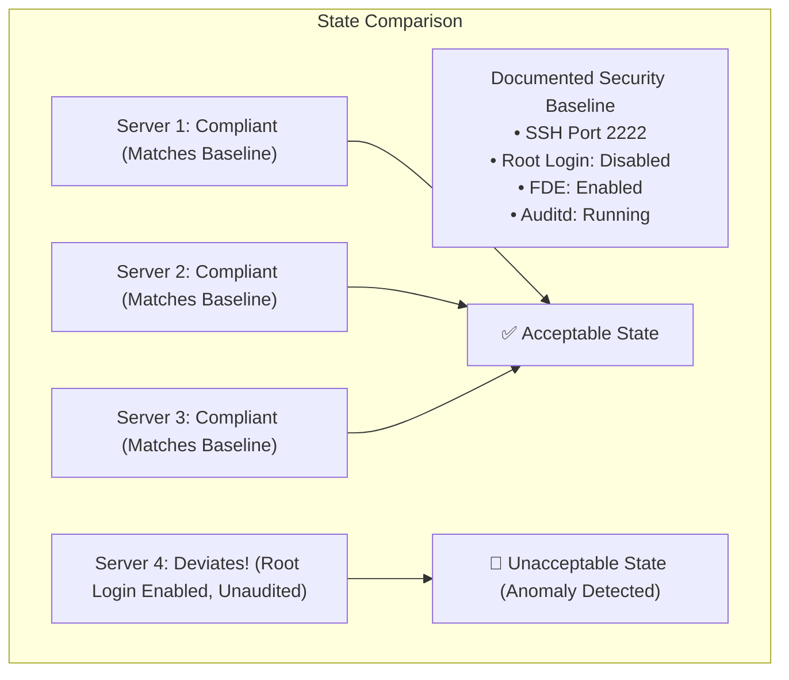

- **Reference Point**: It defines the "known-good" operational configuration.
- **Drift Detection**: When systems deviate from the baseline due to unauthorized changes, developer debugging, or malicious tampering, automated compliance tools flag the anomaly immediately.
- **Simplicity at Scale**: Maintaining a small, standardized portfolio of hardened baselines across an enterprise fleet (e.g., one hardened AMI for Linux web servers, one for relational databases) makes detecting anomalies straightforward. Without a baseline, security teams cannot distinguish between intentional operational changes and indicators of compromise (IoC).

### 2.2 Leading Industry Hardening Standards

Organizations do not need to invent hardening standards from scratch. Globally recognized cybersecurity bodies publish exhaustive, vendor-neutral, peer-reviewed configuration guides.

#### 1. Center for Internet Security (CIS) Benchmarks
The **CIS Benchmarks** are globally recognized consensus-driven security configuration best practices developed by a worldwide community of cybersecurity experts.
- **CIS Level 1 Benchmark**: Intended for standard production environments. Enforces foundational security configurations (e.g., disabling legacy protocols, setting minimum password lengths) with low operational overhead and zero disruption to typical business applications.
- **CIS Level 2 Benchmark**: Intended for defense-in-depth, high-security, or heavily regulated environments (e.g., financial systems, military). Implements aggressive security controls (e.g., stringent kernel restrictions, mandatory MAC enforcement) that may impact software compatibility if not planned carefully.
- **CIS Hardened Images**: Pre-configured virtual machine images (available on AWS Marketplace) configured to meet CIS Level 1 or Level 2 standards right out of the box.

#### 2. DISA STIGs (Defense Information Systems Agency Security Technical Implementation Guides)
Published by the United States Department of Defense (DoD), **DISA STIGs** define rigorous cybersecurity requirements for federal systems, weapons platforms, and military contractors. STIGs categorize configuration flaws into three severity categories:
- **CAT I (High)**: Vulnerabilities that directly result in immediate system compromise or unauthorized root access (e.g., default passwords, unauthenticated root remote shells).
- **CAT II (Medium)**: Vulnerabilities that result in unauthorized access to sensitive data or potential privilege escalation.
- **CAT III (Low)**: Vulnerabilities that degrade system defense postures or reveal operational information.

#### 3. NIST National Checklist Program (NCP / NIST SP 800-70)
A publicly accessible master inventory of security configuration checklists hosted by NIST, utilizing the **Security Content Automation Protocol (SCAP)** to enable automated compliance validation.

### 2.3 Industry Baseline Comparison Matrix

| Standard | Governing Body | Primary Audience | Key Characteristics | Automation Format |
| :--- | :--- | :--- | :--- | :--- |
| **CIS Benchmarks** | Center for Internet Security (Non-profit) | Global commercial enterprises, cloud architects, DevOps | Two-tier levels (Level 1 & Level 2), cloud & container coverage, community consensus | SCAP, CIS-CAT, Ansible playbooks |
| **DISA STIGs** | US Department of Defense (DoD) | Defense agencies, federal contractors, intelligence community | Highly prescriptive, strict Category I/II/III grading, zero-tolerance policies | SCAP / XCCDF, OpenSCAP, Chef InSpec |
| **NIST SP 800-70 / NCP** | National Institute of Standards & Technology | Federal civilian agencies, public sector, global organizations | Methodological guide for developing, testing, and adopting security configuration baselines | XML / SCAP, OpenSCAP |

---

## ⚙️ 3. Core Operating System Hardening Techniques

### 3.1 Removing and Disabling Unnecessary Services & Daemons

Standard operating system distributions ship with background daemons intended for desktop environments or legacy networks. Each active daemon binds to a network socket, processes incoming packets, and executes code with elevated permissions.

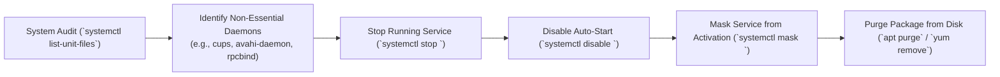

#### Essential Hardening Actions:
1. **Audit Active Services**:
   ```bash
   # List all enabled services set to run on boot
   systemctl list-unit-files --type=service --state=enabled
   ```
2. **Deactivate and Mask Unused Daemons**:
   - `cups` (Common Unix Printing System): Unnecessary on headless cloud servers.
   - `avahi-daemon` (mDNS network discovery): Exposes host discovery vectors.
   - `rpcbind` / `nfs-utils`: Historically prone to remote buffer overflows.
   ```bash
   sudo systemctl stop cups avahi-daemon
   sudo systemctl disable cups avahi-daemon
   sudo systemctl mask cups avahi-daemon  # Prevents other services from launching it
   ```
3. **Purge Unnecessary Software Packages**:
   Completely remove unneeded compilers (`gcc`, `make`), games, and diagnostic utilities from production hosts so attackers cannot utilize them after a breach.

### 3.2 Network Port & Protocol Hardening

Open network ports are listeners awaiting input. Leaving unused ports open exposes systems to port scanning, banner grabbing, and remote exploitation.

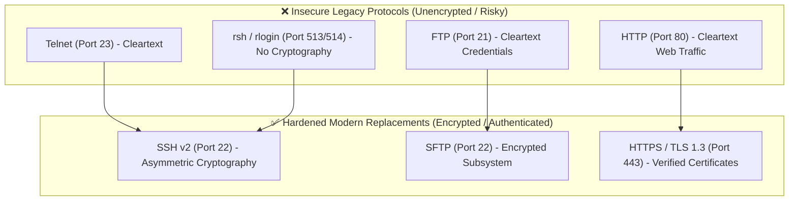

#### Essential Hardening Actions:
- **Scan Local Listening Ports**:
  ```bash
  # Check all active TCP/UDP listening sockets and the associated process PID
  ss -tulpn
  ```
- **Close Unused Inbound Ports**: Enforce host-based firewalls (`ufw`, `firewalld`, or `nftables`) to drop all inbound traffic by default, whitelisting only necessary application ports:
  ```bash
  # Example ufw setup: Default deny, allow only SSH on non-standard port and HTTPS
  sudo ufw default deny incoming
  sudo ufw default allow outgoing
  sudo ufw allow 2222/tcp comment 'Hardened SSH'
  sudo ufw allow 443/tcp comment 'HTTPS'
  sudo ufw enable
  ```
- **Deactivate Insecure Protocols**: Purge packages associated with Telnet, TFTP, finger, and rlogin. Ensure web servers automatically redirect HTTP (port 80) traffic to HTTPS (port 443) using HTTP Strict Transport Security (HSTS).

### 3.3 Credential, Account, and SSH Hardening

Compromised credentials represent the primary initial attack vector across modern breaches.

#### Essential Hardening Actions:
1. **Disable Default Accounts**:
   Lock or delete manufacturer and OS default accounts (`guest`, `operator`, `games`).
2. **Harden Root and Administrative Privileges**:
   - Prohibit direct interactive logins to the `root` account over SSH.
   - Force all administrators to log in using named individual user accounts and elevate via `sudo`.
   - Implement restrictive `sudo` configurations in `/etc/sudoers.d/`, logging all elevated commands.
3. **SSH Daemon Configuration (`/etc/ssh/sshd_config`)**:
   ```ini
   # Enforce modern SSH protocol
   Protocol 2

   # Disable direct root login
   PermitRootLogin no

   # Prohibit passwords; mandate cryptographic public keys
   PasswordAuthentication no
   PubkeyAuthentication yes

   # Disable empty passwords
   PermitEmptyPasswords no

   # Restrict authentication attempts to prevent brute force
   MaxAuthTries 3

   # Disconnect idle sessions after 10 minutes
   ClientAliveInterval 300
   ClientAliveCountMax 2

   # Disable legacy insecure cryptography
   Ciphers chacha20-poly1305@openssh.com,aes256-gcm@openssh.com
   KexAlgorithms curve25519-sha256@libssh.org,diffie-hellman-group16-sha512
   MACs hmac-sha2-512-etm@openssh.com

   # Disable X11 forwarding and .rhosts authentication
   X11Forwarding no
   IgnoreRhosts yes
   ```

### 3.4 Kernel Parameter Tuning (`/etc/sysctl.conf`)

The Linux kernel contains hundreds of configurable networking, memory, and filesystem parameters exposed via the `sysctl` interface. Tuning these parameters protects against Denial of Service (DoS), spoofing, and memory corruption attacks.

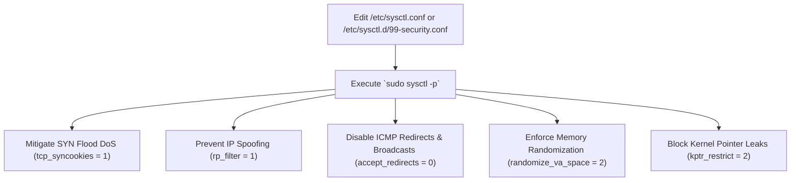

#### Production Security Tuning Matrix (`/etc/sysctl.d/99-security.conf`):

```ini
# ====================================================================
# Network Stack Hardening
# ====================================================================

# Enable TCP SYN Cookie protection against SYN flood attacks
net.ipv4.tcp_syncookies = 1

# Disable IP packet forwarding (unless the host is explicitly a router/NAT gateway)
net.ipv4.ip_forward = 0
net.ipv6.conf.all.forwarding = 0

# Ignore ICMP echo broadcasts to prevent Smurf amplification attacks
net.ipv4.icmp_echo_ignore_broadcasts = 1

# Do not accept or send ICMP redirects (prevents routing table tampering/MitM)
net.ipv4.conf.all.accept_redirects = 0
net.ipv4.conf.default.accept_redirects = 0
net.ipv4.conf.all.send_redirects = 0
net.ipv4.conf.default.send_redirects = 0
net.ipv6.conf.all.accept_redirects = 0

# Enable Reverse Path Filtering to prevent IP spoofing
net.ipv4.conf.all.rp_filter = 1
net.ipv4.conf.default.rp_filter = 1

# Ignore bogus ICMP error responses
net.ipv4.icmp_ignore_bogus_error_responses = 1

# Log packets with impossible addresses (spoofed packets)
net.ipv4.conf.all.log_martians = 1
net.ipv4.conf.default.log_martians = 1

# Disable Source Routing (prevents attackers from specifying packet routes)
net.ipv4.conf.all.accept_source_route = 0
net.ipv4.conf.default.accept_source_route = 0

# ====================================================================
# System Memory & Kernel Integrity Hardening
# ====================================================================

# Maximize Address Space Layout Randomization (ASLR) against buffer overflow exploits
kernel.randomize_va_space = 2

# Restrict dmesg / kernel log access to privileged users only
kernel.dmesg_restrict = 1

# Hide kernel symbol addresses from unprivileged users
kernel.kptr_restrict = 2

# Prevent unprivileged users from using ptrace on arbitrary processes
kernel.yama.ptrace_scope = 2

# Restrict core dump creation to prevent sensitive data leaks
fs.suid_dumpable = 0
```

### 3.5 File Permissions & Access Control

Weak file permissions allow untrusted users or compromised service accounts to overwrite binaries or harvest sensitive configuration credentials (e.g., database passwords in `.env` files).

- **Default UMASK**: Set the system-wide umask in `/etc/profile` and `/etc/login.defs` to `027` or `077` to guarantee that newly created files and directories cannot be read or written by other users.
- **Audit SUID / SGID Binaries**: SUID (Set User ID) binaries execute with the permissions of the file owner (typically `root`). Malicious actors search for misconfigured SUID binaries to execute privilege escalation attacks.
  ```bash
  # Locate all SUID files across the root filesystem
  find / -perm -4000 -type f 2>/dev/null
  ```
  Remove the SUID bit from non-essential utilities:
  ```bash
  sudo chmod u-s /usr/bin/chfn /usr/bin/chsh
  ```
- **Protect Critical Configuration Files**: Ensure sensitive system files have restrictive ownership:
  ```bash
  sudo chown root:root /etc/passwd /etc/shadow /etc/gshadow /etc/group
  sudo chmod 644 /etc/passwd /etc/group
  sudo chmod 000 /etc/shadow /etc/gshadow  # Only root can access shadow files
  ```

### 3.6 File Integrity Monitoring (FIM)

**File Integrity Monitoring (FIM)** is an automated defensive control that continuously validates the integrity of operating system binaries, kernel modules, libraries, and critical configuration files by comparing their current cryptographic hashes against a known-good baseline database.

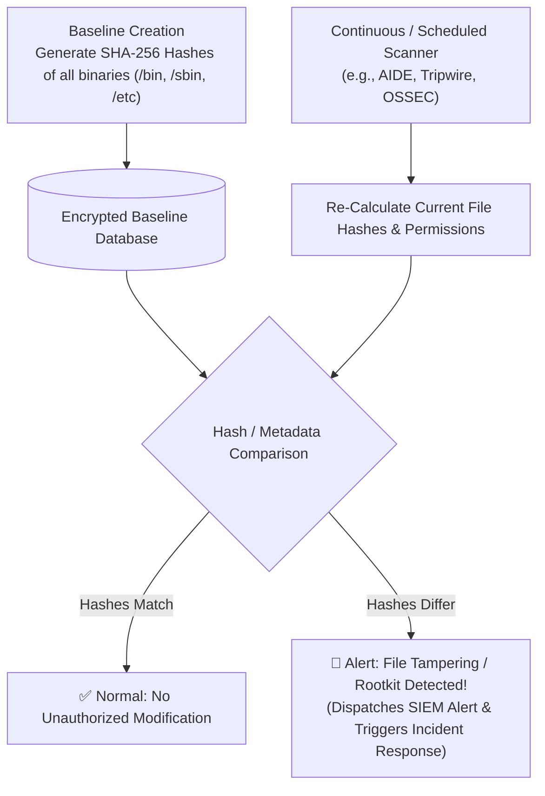

- **Tools**: **AIDE** (Advanced Intrusion Detection Environment), **Tripwire**, and **OSSEC**.
- **Detection Power**: If an adversary breaches a system and installs a rootkit, trojanizes `/bin/ps` or `/bin/ls`, or modifies `/etc/pam.d/common-auth` to inject a backdoor, FIM immediately flags that the file's hash, modification time, or inode has changed, alerting security personnel before the attacker can entrench themselves.

### 3.7 Logging and Auditing Configuration

Hardening requires complete visibility into all system activities. The **Linux Audit Daemon (`auditd`)** tracks security-relevant system calls, file access events, and privilege escalations at the kernel level.

#### Essential Auditing Actions:
1. **Audit Sensitive Files**: Configure `/etc/audit/rules.d/audit.rules` to monitor unauthorized attempts to modify critical files:
   ```ini
   # Audit modifications to user account databases
   -w /etc/passwd -p wa -k identity_changes
   -w /etc/shadow -p wa -k identity_changes
   -w /etc/sudoers -p wa -k privilege_escalation

   # Audit execution of privileged binaries
   -a always,exit -F arch=b64 -S execve -F euid=0 -k root_commands
   ```
2. **Centralize Log Shipping**: Local logs can be cleared by an attacker who achieves root privileges. Forward logs immediately over TLS to a remote, write-once centralized repository (e.g., Amazon CloudWatch Logs, OpenSearch, or a hardened central rsyslog server).

---

## 🖥️ 4. Server-Specific Hardening Strategies

Different enterprise server roles present distinct attack surfaces and require specialized hardening measures.

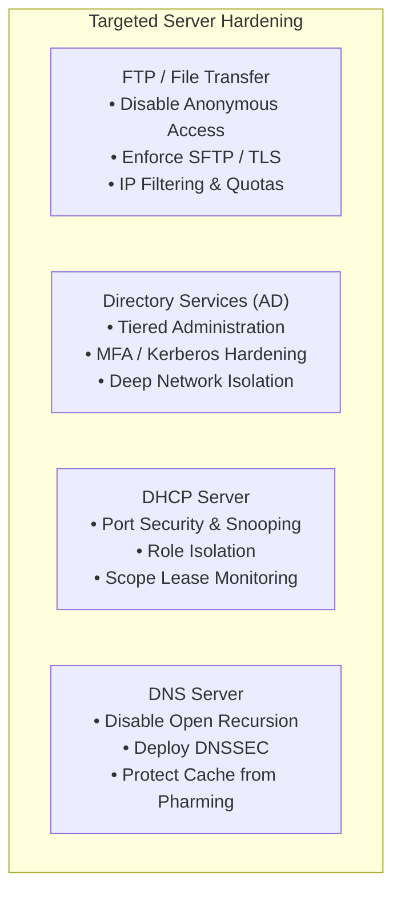

### 4.1 FTP vs. SFTP Hardening

File Transfer Protocol (FTP) is a legacy protocol designed without native cryptographic security. Credentials and files are transmitted in plain cleartext across the network.

- **FTP Vulnerabilities**: Susceptible to packet sniffing, credential harvesting, Man-in-the-Middle (MitM) attacks, and unauthorized uploads if anonymous mode is enabled.
- **FTP Hardening Steps (if FTP cannot be fully deprecated)**:
  - **Deactivate Anonymous Mode**: Disallow anonymous logins (`anonymous_enable=NO`).
  - **Restrict Root Directory (Chroot Jail)**: Restrict authenticated users strictly to their assigned home directory (`chroot_local_user=YES`).
  - **IP Filtering**: Restrict FTP access strictly to authorized enterprise IP ranges using host firewalls.
  - **Disk Storage Quotas**: Enforce strict upload quotas to prevent denial of service through storage exhaustion.
  - **Encrypt Control and Data Channels**: Enforce FTPS (FTP over TLS/SSL).
- **The Modern Standard — SFTP**:
  > [!IMPORTANT]
  > **SFTP (SSH File Transfer Protocol)** is a distinct protocol packaged with SSH. It operates over an established, encrypted SSH connection (port 22). SFTP encrypts authentication credentials, commands, and transmitted data, making it vastly superior to FTP in all operational scenarios.

### 4.2 Directory Services & Active Directory Hardening

Directory services servers (such as Microsoft Active Directory Domain Services or OpenLDAP) manage the identities, credentials, and access policies of the entire enterprise. A compromise of a Domain Controller represents total organizational compromise.

- **Network Placement**: Situate Domain Controllers deep inside secure internal network enclaves behind firewalls and administrative bastions. Domain Controllers must **never** be assigned public IP addresses or exposed directly to the public internet.
- **Strong Authentication**: Mandate Kerberos with AES encryption; disable legacy NTLMv1/LAN Manager protocols.
- **Tiered Administration Model**: Enforce administrative tiering (Tier 0 for Domain Controllers, Tier 1 for Servers, Tier 2 for Workstations). Never allow Domain Admin credentials to be used on standard user workstations.
- **Continuous Event Auditing**: Enable comprehensive event auditing for anomalous account creation, privilege escalation, and Kerberoasting attempts.

### 4.3 DHCP Server Hardening

Dynamic Host Configuration Protocol (DHCP) servers allocate IP addresses, default gateways, and DNS settings to network clients.

- **Port Security & DHCP Snooping**: Enable DHCP snooping on network switches to drop rogue DHCP offer packets. Only switch ports physically connected to authorized DHCP servers should be configured as "trusted".
- **Rogue DHCP Prevention**: Rogue DHCP servers set up by attackers can distribute rogue default gateways, routing all user traffic through an attacker-controlled Man-in-the-Middle interceptor.
- **Role Isolation**: Isolate the DHCP service on dedicated server roles rather than combining it with critical application workloads.

### 4.4 DNS Server Hardening

Domain Name System (DNS) servers translate human-readable domain names into IP addresses. Compromised or misconfigured DNS servers threaten the integrity of all communications.

- **Disable Open Recursion**:
  - An **open recursive DNS resolver** accepts and resolves recursive queries from any client anywhere on the internet.
  - *The Threat*: Attackers use open recursive resolvers to launch massive **DNS Amplification Distributed Denial of Service (DDoS)** attacks. Attackers send small spoofed requests to the resolver, which replies with massive response payloads directed at the victim's target IP.
  - *Hardening Action*: Configure DNS servers to provide recursive queries only to trusted internal network clients, and reject external recursive requests.
- **Implement DNSSEC (Domain Name System Security Extensions)**:
  - Cryptographically signs DNS records using public-key cryptography.
  - Validates that DNS responses originate from the genuine authoritative nameserver and have not been altered in transit.
- **Mitigate Cache Poisoning & Pharming**:
  - **DNS Cache Poisoning**: Attackers inject fraudulent IP mappings into a DNS resolver's cache.
  - **Pharming**: Users attempting to visit legitimate websites (e.g., `bank.com`) are redirected to identical fraudulent websites hosted on the attacker's IP.
  - *Hardening Action*: Fix writable cache vulnerabilities, enforce source port randomization (utilizing all 65,535 source ports for queries), and enforce transaction ID randomization.

### 4.5 Comparative Server Hardening Matrix

| Server Type | Primary Attack Vectors | Essential Hardening Controls | Recommended Replacement / Enhancement |
| :--- | :--- | :--- | :--- |
| **File Transfer (FTP)** | Cleartext credential sniffing, anonymous uploads, directory traversal | Disable anonymous access, enforce chroot jails, IP filtering, disk quotas | **SFTP** (over SSH) or AWS Transfer Family |
| **Directory Services (AD)** | Golden Ticket, Pass-the-Hash, Kerberoasting, privilege escalation | Network tiering, disable NTLM, mandate Kerberos AES, protect domain controllers | AWS Managed Microsoft AD with MFA |
| **DHCP Server** | Rogue DHCP rogue gateway injection, pool exhaustion DoS | DHCP Snooping on switches, port security, isolate server role | Managed VPC DHCP Options Sets |
| **DNS Server** | DNS Amplification DDoS, cache poisoning, pharming | Disable open recursion, implement **DNSSEC**, randomize source ports/IDs | **Amazon Route 53** with DNSSEC validation |

---

## 📱 5. Application Hardening & Modern Computing Protections

### 5.1 Application Hardening Strategies

Securing the underlying operating system is insufficient if the applications hosted on top contain software bugs, insecure dependencies, or administrative vulnerabilities.

- **Automated Dependency Patching**: Continuously scan and patch third-party application runtimes (e.g., Node.js packages, Python modules, Java JARs) for Known Exploited Vulnerabilities (KEVs).
- **Web Application Firewalls (WAF)**: Deploy application-layer firewalls (such as **AWS WAF**) to inspect HTTP/HTTPS payloads for OWASP Top 10 exploits, including SQL Injection (SQLi) and Cross-Site Scripting (XSS).
- **Anti-Malware & Endpoint Detection and Response (EDR)**: Deploy behavioral anti-malware agents that inspect running memory and application execution trees.
- **Centralized Password & Secret Management**: Prevent developers from embedding plain-text credentials in application code. Mandate the use of dedicated secrets managers (such as **AWS Secrets Manager** or HashiCorp Vault) with automated credential rotation.

### 5.2 Hardware-Assisted Memory Encryption: Intel SGX

Modern systems hardening extends beneath the operating system down to the CPU hardware architecture itself.

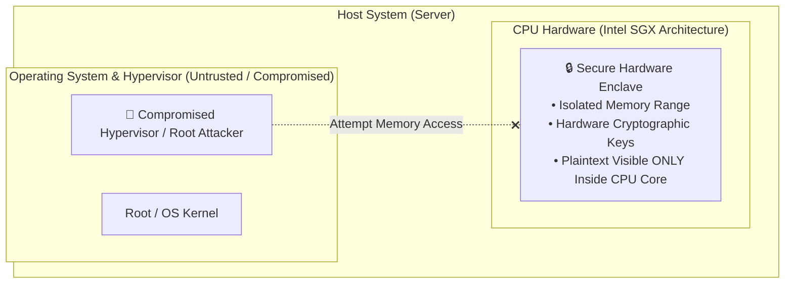

- **Intel Software Guard Extensions (SGX)**:
  - SGX enables applications to execute code and store data inside hardware-protected memory partitions called **enclaves**.
  - Memory within an enclave is encrypted directly by the CPU memory controller using hardware keys.
  - Even if an attacker gains full `root` control of the host operating system, BIOS, or virtualization hypervisor, they cannot inspect, dump, or alter the data residing within an active SGX enclave.
- **Cloud Confidential Computing**: AWS Nitro Enclaves and confidential compute instances provide isolated, hardened execution environments that protect sensitive data (e.g., cryptographic keys, PII, financial ledgers) while in use in memory.

### 5.3 Mobile Device Management (MDM) & BYOD Security

The expansion of remote work and **Bring Your Own Device (BYOD)** programs means company data is regularly accessed from smartphones, tablets, and laptops operating outside physical corporate perimeters.

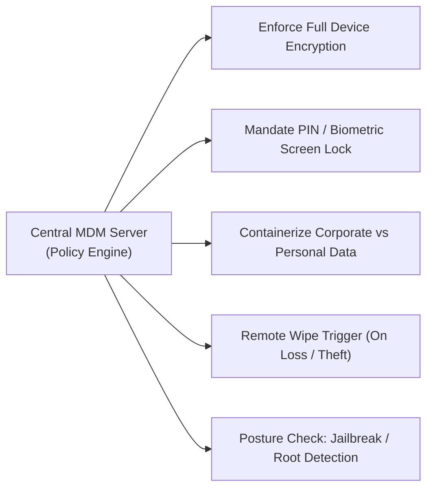

#### Key MDM Hardening Capabilities:
1. **Device Encryption**: Enforce full device storage encryption by default.
2. **Screen Lock & Authentication**: Enforce complex PINs, lock timeouts, and biometric unlocking.
3. **Data Containerization**: Separate enterprise data from personal applications, preventing corporate files from leaking into personal cloud backups.
4. **Jailbreak / Root Detection**: Block non-compliant, rooted, or jailbroken devices from connecting to corporate resources.
5. **Remote Wipe**: Allow administrators to wipe corporate credentials, VPN profiles, and proprietary data remotely if a device is lost, stolen, or an employee departs.

---

## 🔄 6. The Enterprise Patch Management Lifecycle

A **patch** is a piece of software code designed to update a computer program or its supporting data to fix security vulnerabilities (security patches), resolve operational bugs (bug fixes), or improve performance.

### 6.1 Patch Terminology

- **Hotfix**: A targeted, single-issue package released urgently to resolve an immediate critical flaw or active exploit without waiting for regular release schedules.
- **Patch**: A targeted software update designed to remediate one or more identified security vulnerabilities or stability defects.
- **Update / Maintenance Release**: A broader collection of patches and functional improvements released on a scheduled basis.
- **Service Pack / Rollup**: An extensive, tested collection of hotfixes, security patches, and critical updates bundled together into an all-in-one upgrade package.

### 6.2 The 4-Stage Patch Management Lifecycle

Applying patches blindly in production without verification introduces severe risks of application crashes, database corruption, and service downtime. Robust enterprises implement a structured 4-stage patch lifecycle:

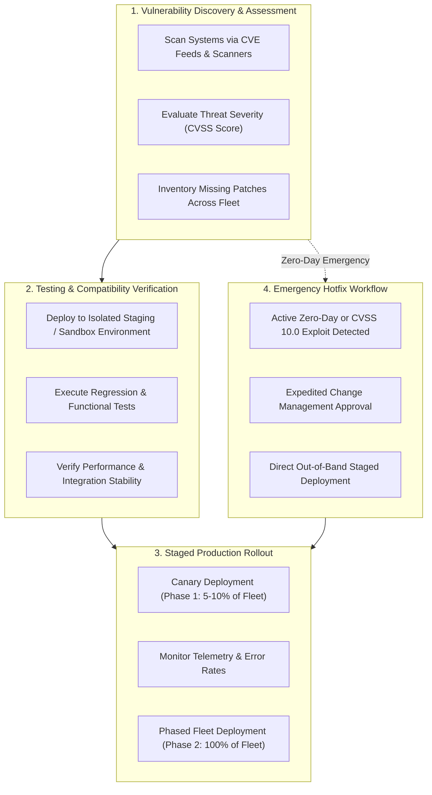

1. **Vulnerability Discovery & Inventory Assessment**:
   - Continuous scanning of OS kernels, applications, and dependencies against known vulnerability databases (e.g., NIST National Vulnerability Database - NVD, Common Vulnerabilities and Exposures - CVE).
   - Establishing an accurate software inventory to determine which specific nodes are vulnerable.
2. **Testing & Compatibility Verification**:
   - Patches are deployed into an isolated staging environment that mirrors production architecture.
   - Comprehensive functional, performance, and regression testing validates that the patch does not break existing dependencies or user workflows.
3. **Staged Rollout (Canary / Phased Deployment)**:
   - Patches are rolled out to a small percentage of production nodes (canary nodes) during scheduled maintenance windows.
   - Systems are monitored for errors, memory leaks, and performance regressions.
   - Once validated, the rollout proceeds in waves across the rest of the fleet.
4. **Emergency Hotfixes (Out-of-Band Workflow)**:
   - When an actively exploited zero-day vulnerability (e.g., Log4Shell) emerges, standard monthly patch cycles cannot wait.
   - An expedited emergency change control process allows rapid hotfix deployment across the fleet within hours, accompanied by intensified monitoring and rapid rollback plans.

---

## 🛠️ 7. Security Configuration & Vulnerability Assessment Tools

Automating the audit and enforcement of system configurations is necessary to prevent human error and detect configuration drift across enterprise fleets.

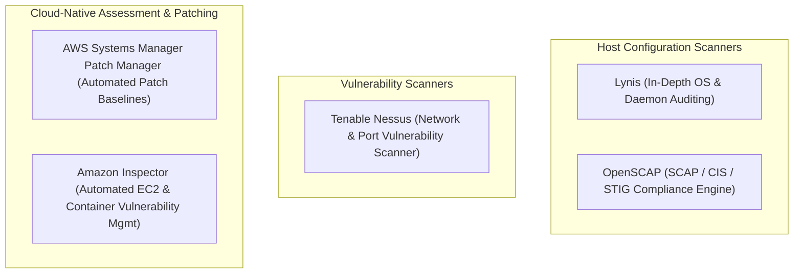

### 7.1 Automated Hardening Assessment Tools

#### 1. Lynis
- **What it is**: An open-source, battle-tested system security auditing tool for Unix/Linux systems.
- **How it works**: Runs directly on the target host as a non-privileged or root shell script, requiring no agent installation.
- **Functionality**: Evaluates hundreds of security controls including kernel options, open listening ports, file permissions, SSH configurations, installed compilers, firewall rules, and password aging policies.
- **Output**: Generates a **Hardening Index** score (0–100) along with detailed recommendations and specific remediation commands.

#### 2. OpenSCAP
- **What it is**: An open-source framework implementing the Security Content Automation Protocol (SCAP) maintained by NIST.
- **How it works**: Evaluates systems directly against standardized SCAP Datastreams containing CIS Benchmarks or DISA STIG rules.
- **Functionality**: Produces detailed HTML and XML compliance reports indicating pass/fail states for every benchmark requirement. Can automatically generate Bash or Ansible remediation playbooks to fix failed checks.

#### 3. Tenable Nessus
- **What it is**: A widely deployed network- and credential-based vulnerability assessment scanner.
- **How it works**: Probes systems remotely across network interfaces, discovering open ports, outdated software versions, missing patches, default passwords, and exploitable vulnerabilities.

### 7.2 Cloud-Native Hardening & Assessment

#### 1. AWS Systems Manager Patch Manager
- **Automated Fleet Patching**: Automates the rollout of security patches and bug fixes across fleets of Amazon EC2 instances and on-premises virtual machines.
- **Patch Baselines**: Defines rules for auto-approving patches within specified categories (e.g., "Critical" and "Important" security updates) after a designated approval delay (e.g., 7 days to allow test verification).
- **Maintenance Windows**: Schedules patching execution during approved low-traffic operational windows to minimize service disruption.
- **Compliance Dashboards**: Provides centralized visibility into missing patches and non-compliant instances across multiple AWS accounts.

#### 2. Amazon Inspector
- **Continuous Vulnerability Management**: An automated security assessment service that continuously scans Amazon EC2 instances, Amazon Elastic Container Registry (ECR) container images, and AWS Lambda functions for software vulnerabilities (CVEs) and unintended network exposure.
- **Contextual Risk Scoring**: Correlates CVE severity with network reachability to deliver contextual risk scores, prioritizing vulnerabilities that are actively accessible from the internet.

### 7.3 Comparative Assessment Tool Matrix

| Tool | Deployment Architecture | Core Capabilities | Primary Use Case | Output & Deliverables |
| :--- | :--- | :--- | :--- | :--- |
| **Lynis** | Host-based (shell script, agentless) | Deep OS auditing, system configuration checks, malware detection | Linux/Unix system hardening audits | Hardening Index score, actionable suggestions |
| **OpenSCAP** | Host-based (SCAP agent) | Formal CIS Benchmark & DISA STIG validation | Regulatory compliance & federal security audits | Pass/Fail report, Ansible remediation scripts |
| **Tenable Nessus** | Network scanner & credentialed agent | Remote port scanning, missing patch detection, exploit checks | Enterprise-wide vulnerability scanning | Categorized CVE vulnerability report |
| **AWS Systems Manager Patch Manager** | AWS Systems Manager Agent (SSM Agent) | Automated patch baselining, scheduled maintenance windows | Fleet-wide OS and application patch deployment | Centralized patch compliance dashboard |
| **Amazon Inspector** | SSM Agent / AWS Cloud-native integration | Continuous CVE scanning, container image scanning, network exposure analysis | Cloud workload vulnerability management | Aggregated findings in AWS Security Hub |

---

## ☁️ 8. Cloud-Native Systems Hardening in AWS

In cloud computing, systems hardening is governed by the **AWS Shared Responsibility Model**.

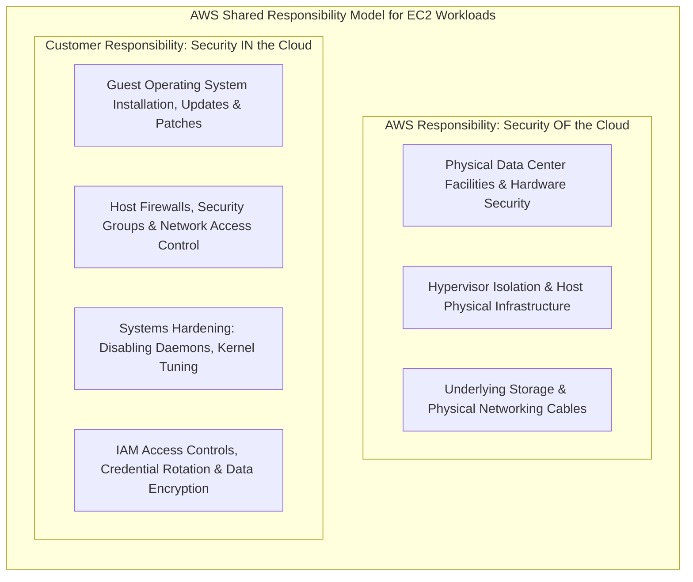

For Infrastructure as a Service (IaaS) services like Amazon EC2:
- **AWS is responsible for**: Physical data center security, physical host servers, hardware maintenance, and hypervisor virtualization layers.
- **The Customer is responsible for**: The guest operating system, applying OS security updates and patches, disabling unnecessary services, configuring host firewalls, managing user credentials, and configuring application-layer security.

### 8.1 AWS Security & Hardening Portfolio

AWS provides a specialized suite of native security tools that assist customers in hardening systems and sustaining continuous compliance:

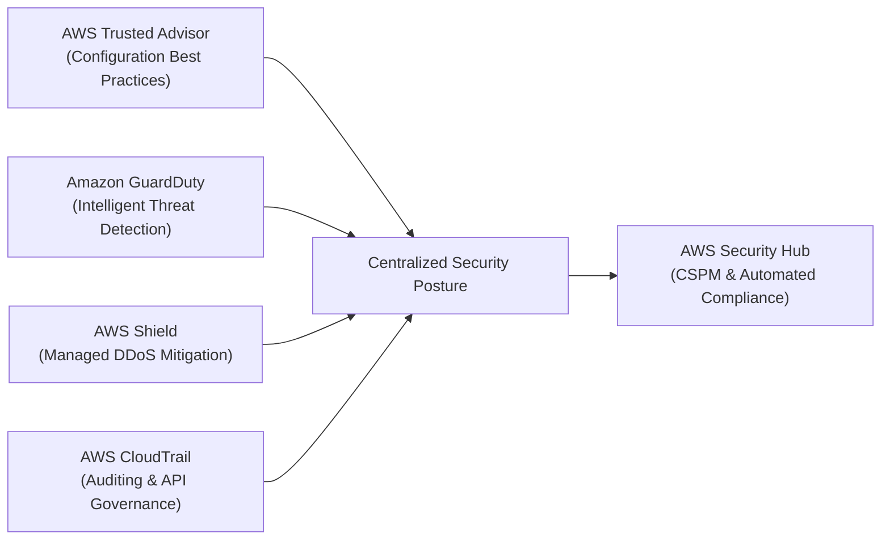

| AWS Service | Core Purpose | Role in Systems Hardening & Security | Key Features |
| :--- | :--- | :--- | :--- |
| **AWS Trusted Advisor** | Cloud optimization and best practice advisor | Audits AWS accounts against best practices in Security, Fault Tolerance, Performance, Cost Optimization, and Service Quotas. | Flags open security groups (port 0.0.0.0/0 on port 22/3389), S3 buckets with public read/write permissions, missing IAM MFA on root accounts. |
| **Amazon GuardDuty** | Intelligent threat detection service | Continuously monitors account activity and workloads for malicious or unauthorized behavior. | Analyzes VPC Flow Logs, CloudTrail logs, and DNS logs using threat intelligence feeds and machine learning to identify compromised instances. |
| **AWS Shield** | Managed DDoS protection service | Shields web applications running on AWS against distributed denial of service attacks. | **Shield Standard** provides automatic network/transport layer mitigation for all AWS customers; **Shield Advanced** adds Layer 7 DDoS mitigation and 24/7 DDoS Response Team (DRT) support. |
| **AWS CloudTrail** | Governance, compliance, and auditing | Records every API call executed in an AWS account by users, roles, and services. | Provides an immutable audit trail for accounting; non-repudiation; logs who modified security groups, launched instances, or altered IAM policies. |
| **AWS Security Hub** | Cloud Security Posture Management (CSPM) | Aggregates, organizes, and prioritizes security alerts and compliance checks from multiple AWS services. | Automatically evaluates AWS resources against the **CIS AWS Foundations Benchmark** and PCI DSS. |

### 8.2 Amazon GuardDuty: Threat Detection & Automated Remediation

Amazon GuardDuty operates without requiring software agents on EC2 instances. It consumes independent, non-intrusive cloud telemetry feeds to detect signs of system compromise:
- **VPC Flow Logs**: Network traffic flows to and from EC2 instances.
- **AWS CloudTrail Event Logs**: Management and data API calls.
- **DNS Query Logs**: Domain resolution queries made by EC2 instances.
- **Threat Intelligence Feeds**: Integrated lists of known malicious IP addresses, tor exit nodes, cryptocurrency mining pools, and malware command-and-control (C2) domains provided by AWS and third-party security partners.

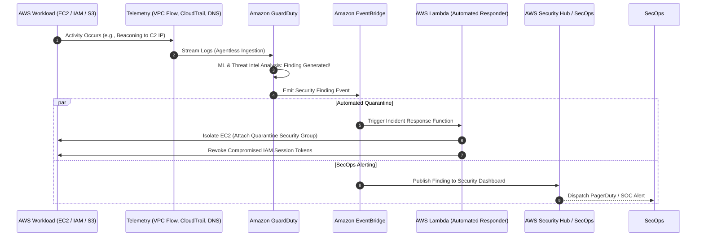

When GuardDuty detects that an EC2 instance has been compromised (e.g., communicating with a known cryptocurrency mining pool or generating anomalous outbound port scans):
1. GuardDuty publishes a structured JSON finding.
2. **Amazon EventBridge** catches the finding event.
3. An **AWS Lambda** function is triggered automatically to execute isolation:
   - Modifies the instance's Security Group to drop all inbound and outbound traffic except for forensic analysis bastions.
   - Detaches IAM roles and captures an Amazon EBS volume snapshot for post-incident forensic investigation.
4. The finding is mirrored in **AWS Security Hub** for enterprise dashboard reporting.

---

## 👥 9. Hardening the Human Layer Against Social Engineering

Technical controls can be rendered ineffective if users are manipulated into surrendering credentials, bypassing procedures, or plugging unvetted media into corporate machines.

> **Key Cybersecurity Reality**: The human element is frequently the weakest link in information security. Attackers routinely bypass complex technical firewalls by tricking authenticated users.

### 9.1 Anatomy of Social Engineering

**Social engineering** is any manipulative technique that exploits human psychology to convince individuals to break normal security procedures, divulge confidential information, or grant unauthorized access.

Common exploitation vectors include:
- **Phishing**: Mass fraudulent emails masquerading as legitimate entities (e.g., IT support, banking) containing malicious attachments or credential-harvesting links.
- **Spear Phishing**: Highly tailored phishing attacks targeting specific individuals or executives (Whaling) using reconnaissance gathered from social media.
- **Pretexting & Impersonation**: An attacker fabricates a scenario (e.g., pretending to be an auditor, external contractor, or senior executive) to elicit urgent assistance.
- **Baiting & Water Holing**: Leaving infected USB flash drives in company parking lots or compromising websites commonly visited by company personnel.

### 9.2 Organizational Vulnerability Factors

Social engineers thrive under predictable human and organizational conditions:

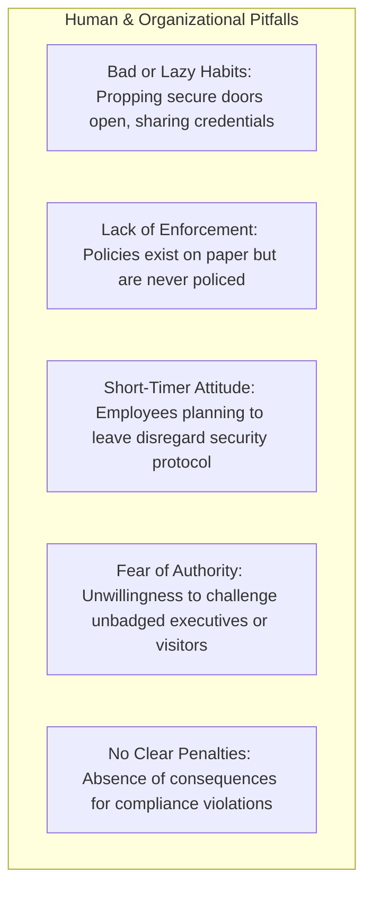

### 9.3 Hardening the Human Layer: Policies and Training

Hardening the human layer requires a multi-faceted approach combining policy, education, and enforcement:

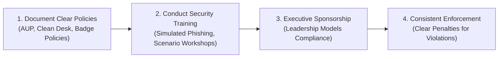

1. **Policies Come First**:
   - Establish written, unambiguous corporate security policies, including an **Acceptable Use Policy (AUP)**, Password Governance Policy, Clean Desk Policy, and Physical Badge Policy.
   - Technical controls must enforce policies wherever possible (e.g., automatically locking idle workstations after 5 minutes).
2. **Continuous Training & Simulated Exercises**:
   - Routine, interactive security awareness training.
   - Unannounced simulated phishing campaigns to identify individuals requiring remedial training.
3. **Executive Sponsorship & Cultural Safety**:
   - Security policies must apply equally to all employees, from entry-level contractors to the C-suite.
   - Foster a supportive corporate culture where employees feel safe and empowered to challenge individuals who lack badges—regardless of their apparent status on the organizational chart.
4. **Enforcing Consequences for Non-Compliance**:
   - Documented disciplinary procedures for non-compliance serve as an essential deterrent against negligent security practices.

### 9.4 Real-World Discussion Scenarios

Consider how an organization should handle these real-world social engineering scenarios:

> **Scenario 1: The Unbadged Stranger in a Secure Area**  
> *Situation*: You see someone you do not recognize walking through a secure development area without a company visitor or employee badge.  
> *Hardened Response*: Politely challenge the individual ("Hello, I don't see your badge. Can I assist you in finding reception?"). Escort them to the security checkpoint or contact physical security immediately. Never assume someone else has already validated them.

> **Scenario 2: The Known Colleague Without a Badge**  
> *Situation*: A familiar coworker from another team asks you to hold the security door open because they forgot their badge at home.  
> *Hardened Response*: Refuse entry politely and require them to visit the security badge desk for a temporary badge. Permitting "courtesy tailgating" undermines access logging and prevents security from knowing who is inside the facility in an emergency.

> **Scenario 3: The Executive Impersonator**  
> *Situation*: A caller claiming to be the Chief Financial Officer demands an urgent password reset or wire transfer, threatening disciplinary action if you do not comply immediately.  
> *Hardened Response*: Follow established out-of-band verification procedures. Never bypass authentication protocols based on perceived authority or urgency. Authentic executives respect documented security controls.

---

## 📑 10. Comprehensive Systems Hardening Checklist

Use this structured implementation checklist to verify systems hardening compliance across operating system, network, account, and cloud layers:

| Layer | Technical Hardening Check | Verification Method / Command | Status |
| :--- | :--- | :--- | :---: |
| **Accounts** | Direct root login disabled via SSH (`PermitRootLogin no`) | Inspect `/etc/ssh/sshd_config` | - [ ] |
| **Accounts** | Password-based authentication disabled in favor of SSH keys | Inspect `/etc/ssh/sshd_config` | - [ ] |
| **Accounts** | Default system accounts locked or removed | `passwd -S <user>` / `/etc/shadow` | - [ ] |
| **Accounts** | Multi-Factor Authentication (MFA) enforced on all administrative roles | Review IAM & Identity Provider configs | - [ ] |
| **Services** | Non-essential daemons stopped, disabled, and masked | `systemctl list-unit-files --state=enabled` | - [ ] |
| **Services** | Compilers (`gcc`, `make`) removed from production servers | `which gcc make` | - [ ] |
| **Network** | Host-based firewall active with default deny on inbound traffic | `ufw status` / `firewall-cmd --state` | - [ ] |
| **Network** | Insecure cleartext services (Telnet, FTP, rlogin) disabled and purged | `ss -tulpn` / check open ports | - [ ] |
| **Network** | DNS servers configured to reject open recursive queries | Query resolver from external IP | - [ ] |
| **Network** | DNSSEC validation enabled on resolvers | Inspect `named.conf` / `systemd-resolved` | - [ ] |
| **Kernel** | TCP SYN Cookies enabled (`net.ipv4.tcp_syncookies = 1`) | `sysctl net.ipv4.tcp_syncookies` | - [ ] |
| **Kernel** | IP packet forwarding disabled (`net.ipv4.ip_forward = 0`) | `sysctl net.ipv4.ip_forward` | - [ ] |
| **Kernel** | ASLR enabled at maximum level (`kernel.randomize_va_space = 2`) | `sysctl kernel.randomize_va_space` | - [ ] |
| **Kernel** | ICMP redirects and source routing disabled | `sysctl net.ipv4.conf.all.accept_redirects` | - [ ] |
| **Filesystem** | Restrictive system UMASK configured (`027` or `077`) | `umask` / check `/etc/profile` | - [ ] |
| **Filesystem** | SUID/SGID binaries audited and unneeded bits removed | `find / -perm -4000 -type f` | - [ ] |
| **Filesystem** | Sensitive file permissions secured (`/etc/shadow` is `000` or `640`) | `ls -l /etc/shadow /etc/passwd` | - [ ] |
| **Integrity** | File Integrity Monitoring (FIM) active and baselined | Verify AIDE / OSSEC daemon status | - [ ] |
| **Auditing** | Linux Audit Daemon (`auditd`) active with immutable rules | `systemctl status auditd` / `auditctl -l` | - [ ] |
| **Auditing** | Logs forwarded over TLS to centralized immutable storage | Check rsyslog / CloudWatch log agent | - [ ] |
| **Patching** | Automated patch management configured with maintenance windows | Verify AWS Systems Manager Patch Baseline | - [ ] |
| **AWS Cloud** | Security groups restrict ingress to necessary IPs only (no `0.0.0.0/0` SSH) | Review AWS Trusted Advisor security checks | - [ ] |
| **AWS Cloud** | Amazon GuardDuty enabled across all operational regions | Review GuardDuty console / API status | - [ ] |
| **AWS Cloud** | AWS CloudTrail enabled for multi-region management & data events | Verify CloudTrail trail status & S3 bucket | - [ ] |

---

## 💡 11. Knowledge Check & Review Questions

Test your understanding of systems hardening concepts:

### Slide Review Checkpoint Questions

```
Question 1: What are the common ways to harden systems?
```
> **Answer**:
> 1. **Turning off services and daemons that are not needed**: Reduces the number of listening applications and potential attack vectors.
> 2. **Implementing corporate policies and restrictions**: Enforcing centralized group policies (GPOs, IAM roles, sudo controls) to maintain consistent baseline configurations.
> 3. **Regularly applying security updates and patches**: Remediating vulnerabilities in operating systems, firmware, and applications before they can be exploited by attackers.

```
Question 2: What is the purpose of patching systems?
```
> **Answer**:
> The primary purpose of patching systems is to **remediate vulnerabilities, security flaws, or bugs** discovered after the release of software or firmware. In addition to repairing security weaknesses, patches can fix functional defects, enhance system reliability, and improve operational performance.

```
Question 3: Which AWS tool uses threat intelligence feeds, such as lists of malicious IP addresses and domains, to identify unexpected and potentially unauthorized activity within your AWS environment?
```
> **Answer**:
> **Amazon GuardDuty**. GuardDuty is an intelligent threat detection service that continuously monitors VPC Flow Logs, CloudTrail logs, and DNS logs using integrated threat intelligence feeds and machine learning to identify anomalous and unauthorized activity across AWS accounts and workloads.

---

### Advanced Conceptual Questions

```
Question 4: Why is SFTP strongly preferred over FTP for enterprise file transfer operations?
```
> **Answer**:
> FTP is an unencrypted legacy protocol that transmits usernames, passwords, commands, and file data in cleartext across the network, making it vulnerable to packet sniffing and Man-in-the-Middle attacks. In contrast, **SFTP (SSH File Transfer Protocol)** operates over an encrypted SSH connection (port 22). It provides strong authentication, cryptographic data integrity, and end-to-end encryption for all traffic without requiring separate unencrypted data channels.

```
Question 5: Explain why an open recursive DNS server presents a major security risk, and describe the attack type it facilitates.
```
> **Answer**:
> An open recursive DNS server accepts and resolves recursive queries from any internet host. Attackers exploit this configuration to launch **DNS Amplification Distributed Denial of Service (DDoS)** attacks. The attacker sends small DNS queries with spoofed source IP addresses (set to the victim's target IP) asking for large record sets (such as `ANY` or DNSSEC keys). The open resolver sends large responses to the victim, amplifying the attacker's bandwidth and overwhelming the victim's network.

```
Question 6: How does Intel Software Guard Extensions (SGX) enhance application hardening, and what threat does it protect against?
```
> **Answer**:
> Intel SGX implements **confidential computing** by creating hardware-isolated memory enclaves. Data and code inside an enclave are encrypted at the hardware level by the CPU memory controller. This protects sensitive data and operations even if an attacker gains full administrative (`root`) privileges over the host operating system, hypervisor, or BIOS.

```
Question 7: An administrator applies a patch directly to all production database servers without testing, causing application downtime due to an incompatible library. Which stage of the Patch Management Lifecycle was bypassed, and what is the best practice?
```
> **Answer**:
> The administrator bypassed **Stage 2: Testing & Compatibility Verification** and **Stage 3: Staged Rollout**. The best practice is to deploy patches first to an isolated staging or sandbox environment that mirrors production, run automated functional and regression tests, and then roll out the patch to production incrementally (e.g., a canary deployment) during an approved maintenance window.

---

## 📌 Key Takeaways & Summary

- **Attack Surface Minimization**: Systems hardening reduces the number of entry points an attacker can exploit by disabling unnecessary services, closing unused ports, and applying the **Principle of Least Functionality**.
- **Security Baselines are Essential**: A documented security baseline establishes what an acceptable system state looks like. Standards like **CIS Benchmarks** and **DISA STIGs** provide tested configurations for hardening operating systems and applications.
- **Defense-in-Depth Across Layers**: Effective systems hardening applies controls across multiple layers:
  - *Physical*: Facilities security, biometric access, locked server racks, and full disk encryption.
  - *Kernel & OS*: Tuning `/etc/sysctl.conf`, auditing SUID files, setting restrictive umasks, and running File Integrity Monitoring (FIM).
  - *Network & Services*: Disabling insecure protocols (Telnet, FTP), deploying SSH keys, closing unused ports, and isolating server roles.
  - *Applications*: Web Application Firewalls, secrets managers, and confidential computing enclaves (Intel SGX).
- **Patching is a Continuous Lifecycle**: Effective patch management follows a structured 4-stage lifecycle: discovery, testing in staging, staged rollout, and expedited emergency hotfixes.
- **Cloud-Native Hardening**: Under the AWS Shared Responsibility Model, customers secure their guest OS and applications using services like **AWS Systems Manager Patch Manager**, **Amazon Inspector**, **AWS Trusted Advisor**, and **Amazon GuardDuty**.
- **Hardening the Human Layer**: Social engineering exploits human habits and trust. Hardening organizations requires clear security policies, executive support, continuous awareness training, and consistent enforcement.
