# 🔒 Prevention: Data Security – Cryptography, Encryption & Access Control

> **Course**: AWS re/Start  
> **Module**: Security (M04 – Prevention: Data Security)  
> **Source Document**: `T08-Security/T08-0006-RSSECY_EN-US_SG_M04_PREVENTIONDATASECURITY.pdf`  
> **Target Audience**: AWS re/Start Learners, Cloud Practitioners, Security Specialists, and Systems Operations Associates  

---

## 🎯 Module Overview

Data is an organization's most valuable strategic asset. Safeguarding data against unauthorized exposure, theft, corruption, and tampering is paramount. Within the **Security Lifecycle**—comprising **Prevention**, **Detection**, **Response**, and **Analysis**—the **Prevention** phase serves as the critical first line of defense. Prevention stops security incidents before threat actors can compromise infrastructure or exfiltrate sensitive records.

Data security in the prevention phase focuses directly on the **Confidentiality** and **Integrity** pillars of the foundational **CIA Triad**:
- **Confidentiality**: Ensuring that private, sensitive, and proprietary information is shielded from unauthorized entities through robust cryptographic ciphers and granular access policies.
- **Integrity**: Guaranteeing that data remains intact, unaltered, genuine, and authentic across its entire lifecycle using cryptographic hashing algorithms, message authentication codes, and digital signatures.

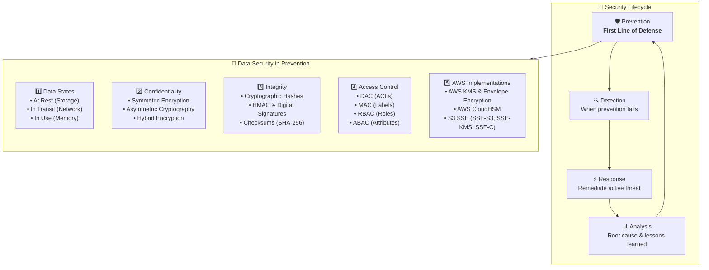

This guide details the three fundamental data states, dives deep into symmetric and asymmetric encryption algorithms, explains cryptographic hashing and digital signatures, contrasts modern access control architectures, and explores how these security principles integrate with enterprise AWS services.

---

## 📌 Learning Objectives

By completing this module and working through these notes, you will be able to:

- [ ] **Analyze the Three States of Data**: Identify and differentiate between *data at rest*, *data in transit (data in motion / in flight)*, and *data in use (in memory)*, along with their associated threat vectors and protective controls.
- [ ] **Master Cryptographic Foundations**: Define ciphers, plaintext, ciphertext, and cryptographic keys according to Kerckhoffs's principle.
- [ ] **Compare Symmetric vs. Asymmetric Encryption**: Contrast symmetric block ciphers (AES-128/192/256, 3DES, IDEA, Twofish) with asymmetric key-pair systems (RSA, ECC, Diffie-Hellman, ElGamal) in terms of computational speed, key distribution, mathematical complexity, and security guarantees.
- [ ] **Implement Hybrid Encryption Architectures**: Explain how modern secure transport protocols (TLS/SSL, SSH, PGP, S/MIME) combine asymmetric key exchange with high-speed symmetric session ciphers.
- [ ] **Validate Data Integrity with Cryptographic Hashing**: Explain one-way functions, collision resistance, pre-image resistance, the avalanche effect, and standards such as SHA-256 and SHA-3.
- [ ] **Differentiate Encoding, Encryption, and Hashing**: Clearly articulate the mathematical and operational boundaries separating two-way encoding schemes, two-way cryptographic ciphers, and one-way hash digests.
- [ ] **Evaluate Access Control Models**: Distinguish between Discretionary Access Control (DAC), Mandatory Access Control (MAC), Role-Based Access Control (RBAC), and Attribute-Based Access Control (ABAC).
- [ ] **Architect AWS Data Protection Solutions**: Leverage AWS Key Management Service (AWS KMS), envelope encryption (CMKs and DEKs), AWS CloudHSM (FIPS 140-2 Level 3 hardware appliances), and Amazon S3 Server-Side Encryption models (SSE-S3, SSE-KMS, SSE-C).

---

## 💾 1. Data Security States & Protection Domains

To protect data effectively, security engineers must identify where data resides, how it moves, and how it is processed. Data exists in three distinct states: **Data at Rest**, **Data in Transit (Data in Motion / in Flight)**, and **Data in Use (in Memory)**.


### 1.1 Data at Rest

**Data at rest** refers to static digital information stored in non-volatile physical or virtual storage systems. When an organization is not actively querying, modifying, or transmitting files across a network, that data resides "at rest."

- **Storage Targets**: Hard disk drives (HDDs), solid-state drives (SSDs), storage area networks (SAN), network-attached storage (NAS), USB flash drives, backup tapes, and cloud storage repositories (Amazon EBS volumes, Amazon S3 buckets, Amazon EFS file systems, Amazon RDS instances).
- **Primary Threats**: Physical theft of storage media, unauthorized file access, disk dumping, snapshot exfiltration, and out-of-band disk inspection.
- **Protective Countermeasures**:
  - **Full Disk Encryption (FDE)**: BitLocker (Windows), FileVault (macOS), LUKS (Linux), VeraCrypt (cross-platform open-source drive encryption).
  - **File System-Level Encryption**: Windows Encrypting File System (EFS on NTFS).
  - **Cloud Native Storage Encryption**: Amazon EBS encryption (AES-256), Amazon S3 default encryption, Amazon RDS database volume encryption.
  - **Cryptographic Eradication**: Secure key destruction ensuring decommissioned drives cannot be recovered.

### 1.2 Data in Transit (Data in Motion / In Flight)

**Data in transit** refers to active digital information traversing a communication network—internally across local area networks (LANs), between microservices in a Virtual Private Cloud (VPC), or externally over public internet circuits.

- **Transmission Targets**: Client-to-server HTTP/HTTPS sessions, database connection strings, API payloads, SSH administrative connections, inter-region cloud replication, and email relays.
- **Primary Threats**: Eavesdropping, Man-in-the-Middle (MitM) packet interception, packet sniffing (Wireshark/tcpdump), session hijacking, and replay attacks.
- **Protective Countermeasures**:
  - **Transport Layer Security (TLS)**: Successor to SSL; encrypts web traffic (`HTTPS`), database connections, and API calls.
  - **IPsec (IP Security)**: Network-layer protocol suite (originating in IPv6, backported to IPv4) providing encrypted and authenticated Virtual Private Network (VPN) tunnels.
  - **SSH (Secure Shell)**: Cryptographic network protocol for secure command-line execution and tunneling.
  - **Kerberos**: Mutual authentication protocol using symmetric key tickets to protect enterprise client-server transactions.
  - **Application-Layer Message Security**: S/MIME (Secure/Multipurpose Internet Mail Extensions) and PGP (Pretty Good Privacy) to encrypt and sign message payloads directly.

### 1.3 Data in Use (In Memory)

**Data in use** refers to non-static digital information actively residing in volatile system memory (RAM, CPU cache, registers) while being computed, analyzed, read, or rendered by a central processing unit.

- **Computing Targets**: Database query execution buffers, active decryption keys in system RAM, plaintext runtime variables, process stacks, and application heaps.
- **Primary Threats**: Memory dump inspection, Cold Boot attacks, DMA (Direct Memory Access) attacks, side-channel CPU exploits (Spectre, Meltdown), and root-level debuggers reading process memory.
- **Protective Countermeasures**:
  - **Confidential Computing**: Hardware-level memory encryption mechanisms (AMD SEV, Intel SGX).
  - **AWS Nitro Enclaves**: Fully isolated, hardened, and constrained virtual machine compute environments with no persistent storage, no interactive operator access, and cryptographic attestation to protect cryptographic keys and sensitive algorithms in use.
  - **Zeroization**: Overwriting memory buffers immediately after cryptographic key operations terminate.

### 1.4 Comprehensive Data States Comparison Matrix

| Dimension | Data at Rest | Data in Transit (in Motion) | Data in Use |
| :--- | :--- | :--- | :--- |
| **Physical Location** | Non-volatile storage (disks, tapes, S3, EBS, databases) | Network cables, fiber optics, wireless waves, routers, switches | Volatile memory (RAM, CPU L1/L2/L3 caches, registers) |
| **Operational State** | Static, archived, unread | Flowing across internal or external network paths | Actively computed, processed, read, or modified by CPU |
| **Primary Risk** | Lost/stolen laptops, compromised backup snapshots, rogue insiders | Eavesdropping, packet sniffing, MitM interception, packet alteration | Memory scraping, process dumping, RAM inspection, side-channel attacks |
| **Core Technologies** | AES-256, BitLocker, LUKS, VeraCrypt, NTFS EFS, AWS KMS | TLS 1.3, IPsec VPN, SSH, Kerberos, S/MIME, PGP | AWS Nitro Enclaves, AMD SEV, Intel SGX, Secure Memory Zeroization |
| **Key AWS Services** | Amazon EBS Encryption, Amazon S3 SSE, AWS KMS, AWS CloudHSM | AWS Certificate Manager (ACM), AWS Direct Connect MACsec, AWS VPN | AWS Nitro Enclaves, AWS Nitro System Security Model |

---

## 🔐 2. Cryptography & Encryption for Data Confidentiality

### 2.1 Cryptographic Core Principles & Terminology

**Cryptography** is the science and mathematical discipline that embodies the principles and techniques for providing data security, encompassing both **data confidentiality** and **data integrity**.

> [!NOTE]
> **Cryptography vs. Encryption**: Cryptography is the broader parent discipline. Encryption is a specific, foundational component within cryptography designed exclusively to enforce data confidentiality.

- **Plaintext ($P$)**: The original, unencrypted, human-readable data (e.g., `"AWS Rocks!"`).
- **Cipher**: The paired cryptographic algorithms used to transform readable data into unreadable text and back again (Encryption Algorithm $E$, Decryption Algorithm $D$).
- **Key ($K$)**: A discrete mathematical string of bits that feeds into the cipher algorithm. The secrecy of the key determines the strength of the encryption.
- **Ciphertext ($C$)**: The scrambled, unreadable output produced by running plaintext through the encryption cipher using the key (e.g., `QVdTIFJvY2tzIQ==` or `&A31!B)*`).
- **Kerckhoffs's Principle**: A fundamental axiom of modern cryptography stating that a cryptographic system must remain secure even if every detail of the cipher algorithm is publicly known—provided the cryptographic key remains secret.

---

### 2.2 Symmetric Encryption (Secret Key Cryptography)

In **symmetric encryption**, a single, shared secret key is utilized for both encrypting the plaintext and decrypting the ciphertext:

$$\text{Ciphertext} = E_{K}(\text{Plaintext})$$
$$\text{Plaintext} = D_{K}(\text{Ciphertext})$$

Because both parties share the exact same key, the key must remain confidential. If the secret key is intercepted or exposed, all communications encrypted under that key are compromised.

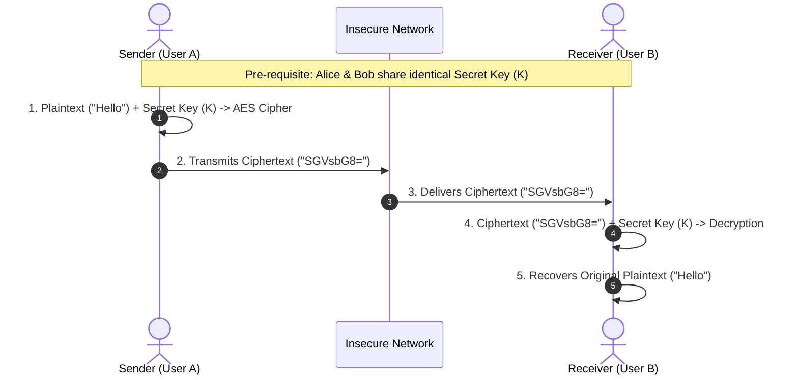

#### Key Characteristics of Symmetric Encryption
1. **Computational Velocity**: Symmetric ciphers are mathematically efficient and computationally lightweight. They execute orders of magnitude faster than asymmetric algorithms, making them the standard choice for encrypting **bulk data** (large files, database disks, file system streams, network sessions).
2. **Key Lengths**: Typically 128 bits, 192 bits, or 256 bits. An AES key of 256 bits offers $2^{256}$ possible combinations, rendering brute-force attacks mathematically infeasible under known physics.
3. **The Key Distribution Problem**: Because both parties require the exact same secret key, how do they safely transmit that key across an insecure channel without an attacker intercepting it? Furthermore, if $n$ participants want to communicate pairwise, each pair requires a unique key, resulting in $\frac{n(n-1)}{2}$ keys—a massive key management overhead.

#### Prominent Symmetric Standards & Ciphers
- **Advanced Encryption Standard (AES)**:
  - Established by the US National Institute of Standards and Technology (NIST) in 2001 to replace the aging **Data Encryption Standard (DES)** and **Triple DES (3DES)**.
  - A symmetric **block cipher** operating on fixed 128-bit blocks of plaintext with key sizes of 128, 192, or 256 bits.
  - The gold standard for global enterprise data protection. For example, **Amazon Elastic File System (Amazon EFS)**, Amazon S3, and Amazon EBS leverage AES-256 for data at rest.
- **International Data Encryption Algorithm (IDEA)**:
  - Created and patented in Switzerland (ETH Zurich); free for non-commercial use. Operates on 64-bit blocks with a 128-bit key. Known for historical use in PGP v2.
- **Twofish**:
  - A public-domain symmetric block cipher designed by Bruce Schneier; accepts keys up to 256 bits. Highly secure, though slightly slower than AES on modern x86/ARM hardware featuring hardware AES-NI instructions.
- **3DES (Triple Data Encryption Algorithm)**:
  - Applies DES three times sequentially with separate keys. Now officially deprecated due to 64-bit block collision vulnerabilities (Sweet32) and high compute overhead.

---

### 2.3 Asymmetric Encryption (Public Key Cryptography)

**Asymmetric encryption**, invented in the late 1970s, fundamentally solved the key distribution problem. Instead of a single shared key, asymmetric systems rely on a mathematically linked **key pair**:
1. **Public Key ($K_{\text{pub}}$)**: Made freely and openly accessible to the world. Anyone can use Alice's public key to encrypt a confidential message destined for Alice.
2. **Private Key ($K_{\text{priv}}$)**: Kept strictly secret by the owner. Only Alice's private key can invert the mathematical transformation and decrypt the ciphertext.

$$\text{Ciphertext} = E_{K_{\text{pub}}}(\text{Plaintext})$$
$$\text{Plaintext} = D_{K_{\text{priv}}}(\text{Ciphertext})$$

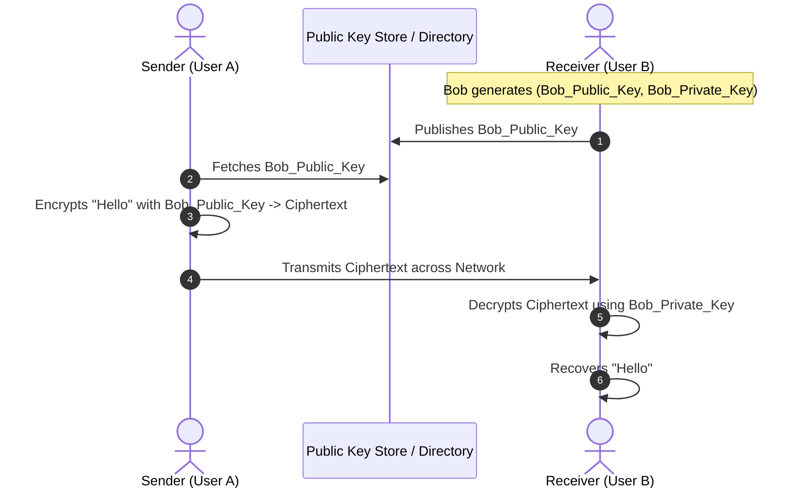

> [!IMPORTANT]
> The public key cannot be used to decrypt the message it just encrypted! Encryption is a one-way mathematical trapdoor function. Only the matching private key possesses the secret trapdoor value required to decrypt.

#### Key Characteristics of Asymmetric Encryption
1. **No Shared Secret Required**: Senders can encrypt confidential data for a recipient without ever having exchanged a prior secret.
2. **Scalable Key Management**: For $n$ participants, each participant only maintains 1 key pair (2 keys total). Thus, $n$ participants require only $2n$ keys, compared to $\frac{n(n-1)}{2}$ in symmetric setups.
3. **Computational Overhead**: Asymmetric mathematics rely on complex modular arithmetic, prime factorization, or discrete logarithms. They are **1,000 to 10,000 times slower** than symmetric ciphers. Therefore, asymmetric encryption is **never** used to encrypt large datasets or bulk file streams directly.
4. **Additional Security Services**: Asymmetric cryptography provides **Authentication** and **Non-repudiation** via digital signatures (when a sender encrypts a hash using their private key, anyone with the sender's public key can verify origin).

#### Prominent Asymmetric Algorithms
- **Rivest-Shamir-Adleman (RSA)**:
  - Based on the mathematical difficulty of factoring the product of two extraordinarily large prime numbers.
  - Standard key lengths: 2048, 3072, or 4096 bits. Used extensively for digital signatures, web certificates, and PKI.
- **Diffie-Hellman (DH) & Elliptic Curve Diffie-Hellman (ECDH)**:
  - A pioneering key-exchange protocol allowing two parties to establish a shared secret over an untrusted public channel using exponentiation in finite fields.
- **Elliptic Curve Cryptography (ECC)**:
  - Based on the algebraic structure of elliptic curves over finite fields.
  - Achieves equivalent security to RSA with substantially smaller key sizes (e.g., ECC 256-bit key yields comparable security to RSA 3072-bit), drastically reducing processing overhead and bandwidth.
- **ElGamal**:
  - An asymmetric cipher and digital signature algorithm built on the Diffie-Hellman discrete logarithm problem.

---

### 2.4 Hybrid Encryption: The Best of Both Worlds

In production networks and enterprise applications, neither symmetric nor asymmetric encryption operates in isolation. Pure symmetric encryption suffers from key distribution hazards; pure asymmetric encryption is too slow for bulk payloads.

**Hybrid encryption** synthesizes both paradigms:
1. **Asymmetric Cryptography** handles the identity exchange and securely encrypts a randomly generated one-time symmetric session key.
2. **Symmetric Cryptography** leverages that session key to encrypt the actual bulk payload at maximum speed.

This is the exact mechanism utilized by **Transport Layer Security (TLS/HTTPS)**, **SSH**, **PGP**, **S/MIME**, and **AWS Envelope Encryption**.

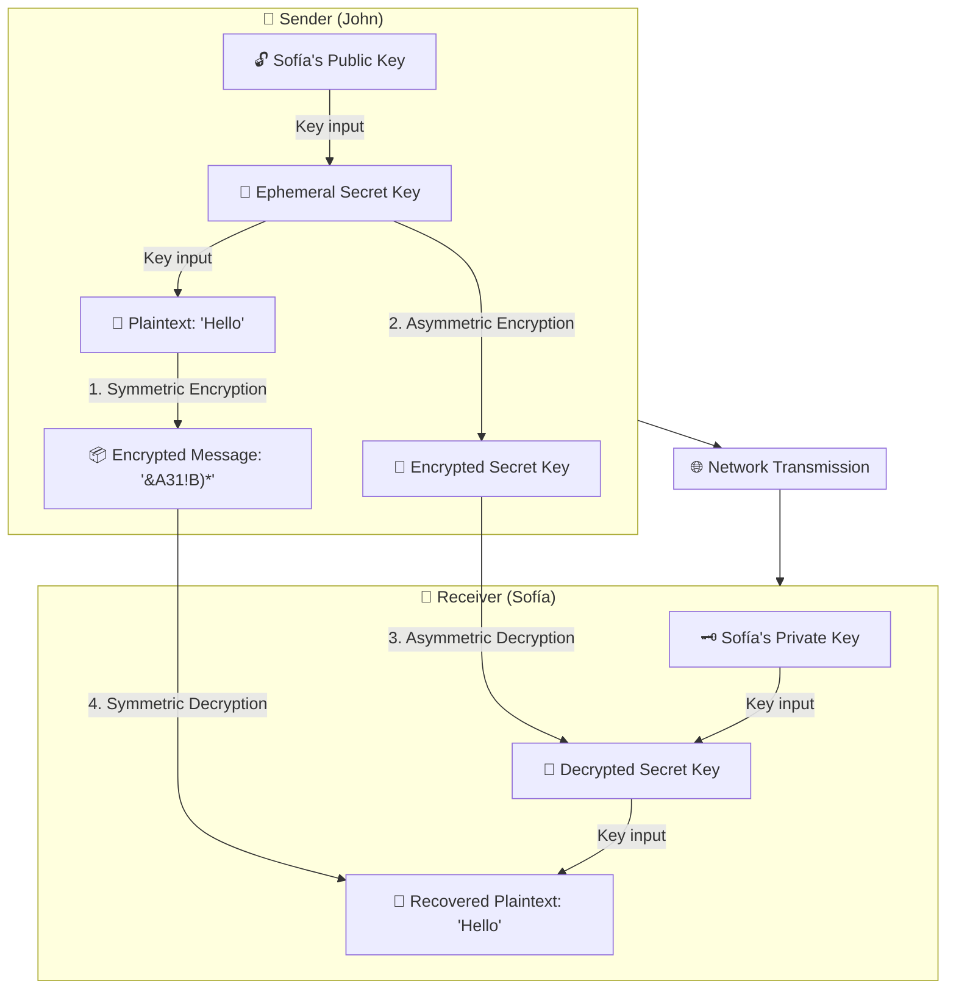

#### Step-by-Step Hybrid Encryption Walkthrough
1. **John** generates a random, ephemeral **Secret Key** (symmetric key).
2. John encrypts the plaintext message (`"Hello"`) using this secret key into ciphertext (`"&A31!B)*"`). This step is **symmetric encryption** (lightning fast).
3. John obtains **Sofía's Public Key** and encrypts the secret key. This step is **asymmetric encryption**.
4. John transmits both the **encrypted message** and the **encrypted secret key** across the network to Sofía.
5. **Sofía** receives both components. She uses her private key to decrypt the encrypted secret key. This step is **asymmetric decryption**.
6. Sofía uses the recovered symmetric secret key to decrypt the message ciphertext into plaintext (`"Hello"`). This step is **symmetric decryption**.

---

### 2.5 Detailed Comparative Matrix: Symmetric vs. Asymmetric vs. Hybrid

| Evaluation Criteria | Symmetric Encryption | Asymmetric Encryption | Hybrid Encryption |
| :--- | :--- | :--- | :--- |
| **Key Architecture** | Single shared secret key for encryption and decryption | Paired keys: Public key (encrypt) + Private key (decrypt) | Ephemeral symmetric key encrypted by asymmetric public key |
| **Computational Speed** | Extremely fast (hardware-accelerated AES-NI) | Very slow (1,000x – 10,000x slower) | Fast (bulk data encrypted with symmetric cipher) |
| **Typical Key Lengths** | 128, 192, 256 bits | RSA: 2048, 3072, 4096 bits; ECC: 256, 384 bits | Combines 256-bit symmetric + 2048+ bit asymmetric |
| **Key Distribution** | Difficult (must transmit secret out-of-band or pre-share) | Simple (public keys shared freely via PKI/directories) | Seamless (asymmetric handshake securely conveys session key) |
| **Scalability ($n$ users)** | Requires $\frac{n(n-1)}{2}$ keys across pairwise users | Requires $2n$ keys (each user has 1 key pair) | Scales gracefully across internet-scale deployments |
| **Security Services** | Confidentiality only | Confidentiality, Authentication, Non-repudiation | Confidentiality, Authentication, Non-repudiation, Forward Secrecy |
| **Primary Standard Examples** | AES-256, Twofish, IDEA, 3DES, ChaCha20 | RSA, ECC, Diffie-Hellman, ElGamal | TLS 1.3, SSH, PGP, S/MIME, AWS KMS Envelope Encryption |
| **Target Use Cases** | Full disk encryption, databases, bulk file storage, VPN payload | Digital signatures, certificate verification, key negotiation | Web browsing (HTTPS), secure email, cloud envelope encryption |

---

## #️⃣ 3. Cryptographic Hashing for Data Integrity

### 3.1 What is Data Integrity and Hashing?

While encryption guarantees **Confidentiality** (keeping secrets hidden), **Hashing** guarantees **Data Integrity** (proving that data has not been modified, corrupted, or tampered with).

A **cryptographic hash function** is an irreversible, deterministic mathematical algorithm that converts an arbitrary-sized block of data into a fixed-length string of bits, known as a **hash value**, **message digest**, or **checksum**.

$$h = H(M)$$

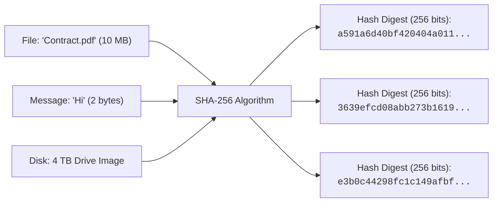

#### Crucial Mathematical Properties of Cryptographic Hash Functions
1. **Deterministic**: For any identical input file or string, the algorithm will always produce the exact same hash output every single time.
2. **Fixed Output Size**: Regardless of whether the input is a single character or a 50-terabyte disk image, the resulting hash digest length remains fixed (e.g., SHA-256 always yields 256 bits / 64 hex characters).
3. **One-Way (Pre-image Resistance)**: It is computationally impossible to invert the hash function to reconstruct the original plaintext message from the hash digest:
   $$\text{Given } h, \text{ it is infeasible to find } M \text{ such that } H(M) = h$$
4. **Avalanche Effect**: Changing even a single bit in the input data results in a radically different, uncorrelated hash digest output.
5. **Collision Resistance (Strong Collision Resistance)**: It is computationally infeasible to find any two different messages $M_1$ and $M_2$ such that $H(M_1) = H(M_2)$.
6. **Second Pre-image Resistance (Weak Collision Resistance)**: Given a specific message $M_1$, it is infeasible to find a different message $M_2$ such that $H(M_1) = H(M_2)$.

---

### 3.2 Evolution of Cryptographic Hashing Standards

| Algorithm Family | Digest Length (Bits) | Security Status | Vulnerabilities & Operational Guidance |
| :--- | :--- | :--- | :--- |
| **MD5** (Message Digest 5) | 128 bits | ❌ **Broken & Deprecated** | Severe practical collision attacks demonstrated in 2004. Should never be used for security or integrity verification. |
| **SHA-1** (Secure Hash Algorithm 1) | 160 bits | ❌ **Broken & Deprecated** | NIST deprecated SHA-1 in 2011; practical collision proven (SHAttered attack in 2017). Prohibited for TLS/digital certs. |
| **SHA-2** (SHA-224, SHA-256, SHA-384, SHA-512) | 224 to 512 bits | ✅ **Industry Standard** | NIST-approved standard. **SHA-256** is the benchmark for blockchain, SSL certificates, AWS API signing (SigV4), and OS integrity. |
| **SHA-3** (Keccak sponge function) | 224 to 512 bits | ✅ **Modern Standard** | Standardized by NIST in 2015. Completely different internal mathematical structure from SHA-2; serves as a robust defense against mathematical breaks in Merkle-Damgård constructions. |

---

### 3.3 Hashing in Practice: End-to-End File Integrity Verification Flow

In software distribution, package repositories, and web downloads, authors publish digital checksums alongside software installers. Recipients run a local hashing tool to ensure that attackers did not poison the binary in transit.

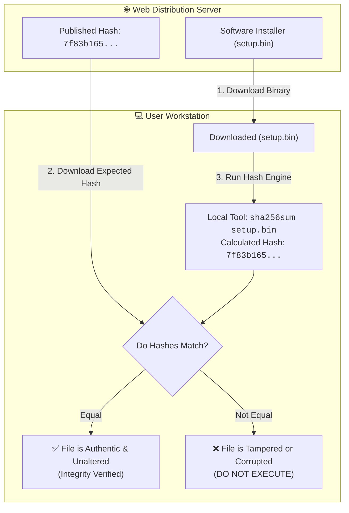

#### Step-by-Step Flow:
1. The publisher computes the SHA-256 hash of `setup.bin` and publishes both the binary and the digest on a secure portal.
2. The client downloads `setup.bin`.
3. The client executes `sha256sum setup.bin` locally.
4. The client compares the local output against the published checksum.
5. If identical, the file is guaranteed to have arrived untampered. If a single byte was altered by a network glitch or a malicious MitM injector, the hash comparison fails.

---

### 3.4 Advanced Integrity Mechanisms: HMAC & Digital Signatures

Plain hashing proves that data was not altered accidentally, but what if an attacker intercepts both the file AND the hash, modifies the file, calculates a new hash, and replaces both? To prevent this, integrity must be bound to **authenticity**.

1. **HMAC (Hash-based Message Authentication Code)**:
   - Mixes a shared secret key with the message before hashing:
     $$\text{HMAC} = H\left((K \oplus \text{opad}) \parallel H((K \oplus \text{ipad}) \parallel M)\right)$$
   - Verifies both **integrity** and **authenticity** (only an entity possessing the shared secret key could generate the valid HMAC).
   - Used in **AWS Signature Version 4 (SigV4)** to sign every HTTP request to AWS REST APIs.
2. **Digital Signatures**:
   - The sender generates a hash of the document, then encrypts that hash using their **Private Key**:
     $$\text{Signature} = E_{K_{\text{priv}}}\left(H(M)\right)$$
   - Anyone possessing the sender's **Public Key** can decrypt the signature to reveal $H(M)$ and compare it against their own locally calculated hash.
   - Provides **Integrity**, **Authentication**, and **Non-repudiation**.

---

### 3.5 Critical Distinctions: Encoding vs. Encryption vs. Hashing

A common security misconception confuses encoding, encryption, and hashing. These three processes solve fundamentally distinct engineering problems:

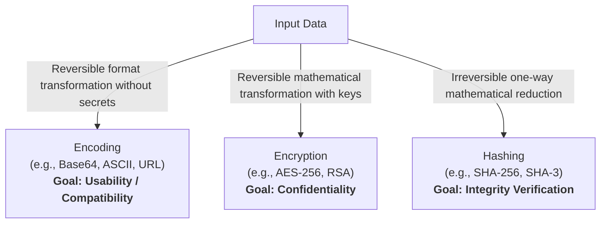

| Dimension | Encoding | Encryption | Hashing |
| :--- | :--- | :--- | :--- |
| **Core Objective** | Data representation, interoperability across systems (e.g., binary to text) | Data secrecy, privacy, and confidentiality | Data integrity, tamper detection, fingerprinting |
| **Directionality** | **Two-way**: Fully reversible | **Two-way**: Reversible only with the secret key | **One-way**: Mathematically irreversible |
| **Key Requirement** | **No key**: Algorithm is completely open | **Mandatory key**: Symmetric or asymmetric key required | **No key** (except for HMAC variants) |
| **Output Size** | Scales proportionally with input (Base64 is ~33% larger) | Approximately equal to plaintext (aligned to cipher block boundaries) | **Strictly fixed** length (e.g., 256 bits regardless of input size) |
| **Common Algorithms** | Base64, ASCII, UTF-8, URL Encoding, Hexadecimal | AES-256, RSA-2048, Twofish, ChaCha20 | SHA-256, SHA-3, MD5, SHA-1 |
| **Security Purpose** | ⚠️ **Zero security**: Anyone can decode instantly | 🛡️ **High security**: Impenetrable without key | 🛡️ **High integrity**: Detects any alteration |

---

## 🚪 4. Access Control Models & Authorization Architecture

### 4.1 Fundamentals of Permissions

While encryption protects data mathematically, **permissions and access controls** dictate which entities are authorized to interact with systems and data.

- **Subject**: An active entity that requests access to an object (e.g., a human user, an EC2 instance profile, an IAM role, a microservice application).
- **Object**: A passive entity containing information or system resources (e.g., an S3 bucket, a database table, a file system directory, an API endpoint).
- **Operation**: The specific action requested (e.g., Read, Write, Execute, Delete, List).
- **Principle of Least Privilege (PoLP)**: Subjects must be granted only the minimum permissions necessary to execute their assigned job responsibilities, and nothing more.

---

### 4.2 Discretionary Access Control (DAC)

In **Discretionary Access Control (DAC)**, the **owner** of the object possesses full discretion to grant or revoke access permissions to other subjects.

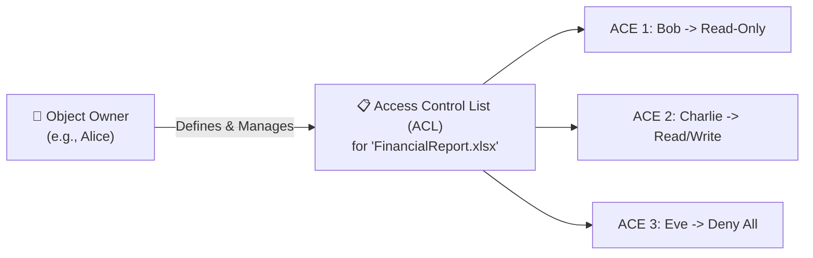

- **Core Mechanism**:
  - **Access Control List (ACL)**: A table attached to a resource that lists authorized subjects and their permitted operations.
  - **Access Control Entry (ACE)**: An individual record within an ACL specifying one subject's permissions (e.g., `User Bob: Read`).
- **Characteristics**:
  - **Decentralized Administration**: Individual resource owners manage permissions rather than a central security authority.
  - **Dynamic & Flexible**: Permissions can be modified on the fly by file creators.
  - **Vulnerabilities**: High risk of privilege creep, accidental over-permissioning, and trojan horse execution (a malicious program launched by the owner inherits all of the owner's discretionary permissions).
- **Examples**: Traditional Unix/Linux file permissions (`chmod 755`), Windows NTFS ACLs, Amazon S3 Bucket/Object ACLs.

---

### 4.3 Mandatory Access Control (MAC)

In **Mandatory Access Control (MAC)**, access decisions are strictly governed by a **central security policy administrator** and enforced by the operating system kernel or security subsystem. Individual resource owners have **no discretion** to alter access permissions.

- **Core Mechanism**:
  - **Security Labels**: Every object is assigned a sensitivity classification label (e.g., *Unclassified*, *Confidential*, *Secret*, *Top Secret*).
  - **Subject Clearances**: Every subject is assigned a formal security clearance level.
  - **Rule Enforcement**: Access is granted only if the subject's clearance matches or exceeds the object's classification, typically adhering to the **Bell-LaPadula Model** (*No Read Up, No Write Down*) to prevent confidentiality leakage.
- **Characteristics**:
  - Highest level of security and containment.
  - Completely immune to user-initiated misconfigurations or trojan horse propagation.
  - Rigid, complex to administer, and resource-intensive to configure.
- **Examples**: Military and intelligence operating systems, SELinux (Security-Enhanced Linux), AppArmor.

---

### 4.4 Role-Based Access Control (RBAC)

In **Role-Based Access Control (RBAC)**, permissions are assigned to **roles** (representing job functions), and subjects are assigned to the appropriate roles.

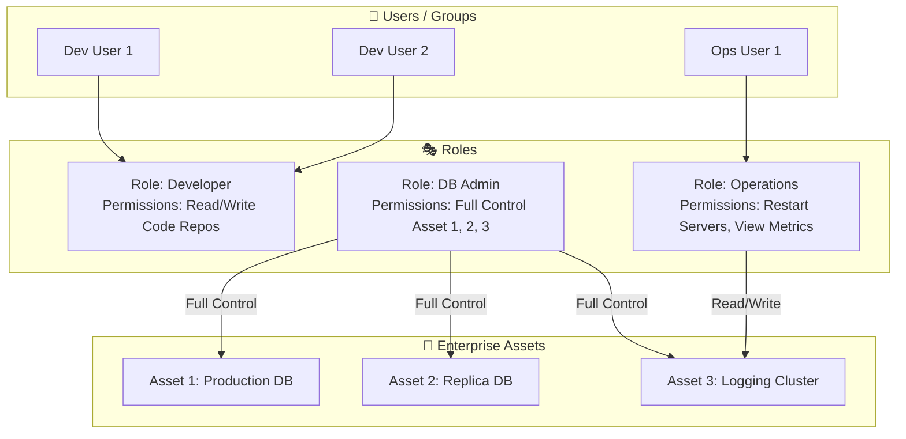

- **Why RBAC Dominates Commercial Enterprises**:
  - **Scalability with Staff Turnover**: When an employee joins, changes positions, or leaves the company, administrators simply add or remove them from the designated role group. Permissions do not need to be modified individually across thousands of files.
  - **Separation of Duties (SoD)**: Critical functions can be partitioned across distinct roles to prevent fraud or catastrophic errors.
  - **Reduced Administrative Overhead**: Eliminates the exponential complexity of point-to-point permission management.
- **Examples**: AWS IAM User Groups and IAM Roles, Microsoft Active Directory Security Groups, Kubernetes RBAC.

---

### 4.5 Attribute-Based Access Control (ABAC)

**Attribute-Based Access Control (ABAC)** is the next evolution in authorization models. It evaluates dynamic attributes across four dimensions at the exact moment an access request is evaluated:

1. **Subject Attributes**: Department, job title, clearance level, manager, MFA status.
2. **Resource Attributes**: Project tag, environment (`prod` vs. `dev`), data classification (`Confidential`).
3. **Action Attributes**: Read, Write, Delete, Terminate.
4. **Environment / Context Attributes**: Current time of day, source IP subnet, geographic location, device health compliance.

> [!TIP]
> **ABAC in AWS IAM**: AWS supports ABAC using **tags**. For example, an IAM policy can state: *"Allow developers to modify EC2 instances only if the user's `${aws:PrincipalTag/project}` matches the instance's `resourceTag/project`."* This eliminates the need to update IAM policies whenever new projects or resources are deployed.

---

### 4.6 Comprehensive Access Control Comparison Matrix

| Model | Governing Authority | Basis of Access Decision | Flexibility | Administrative Overhead | Primary Use Cases |
| :--- | :--- | :--- | :--- | :--- | :--- |
| **DAC** (Discretionary) | Resource Owner | User identity & ACL entries | High | High (scales poorly with user growth) | Local file systems (NTFS, ext4), Amazon S3 ACLs |
| **MAC** (Mandatory) | Central Security Policy | Fixed security labels & clearances | Very Low | High (rigid configuration requirements) | Defense, government, intelligence, SELinux |
| **RBAC** (Role-Based) | Enterprise Administrator | Job functions & assigned roles | Moderate | Low (efficient management for high turnover) | AWS IAM Groups/Roles, corporate Active Directory |
| **ABAC** (Attribute-Based) | Central Policy Engine | Dynamic multi-attribute context & tags | Extremely High | Low once tag taxonomy is established | Cloud-native scale, fine-grained zero-trust IAM policies |

---

## ☁️ 5. AWS Data Security Integration & Implementations

AWS provides purpose-built cryptographic and access control services that operationalize data security at global scale.

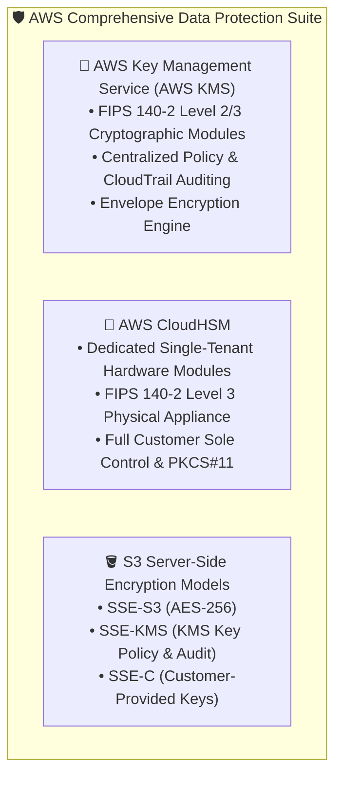

### 5.1 AWS Key Management Service (AWS KMS)

**AWS KMS** is a managed service that simplifies the creation, lifecycle management, and rotation of cryptographic keys:
- **KMS Keys (formerly Customer Master Keys / CMKs)**: Logical keys managed by KMS that never leave AWS KMS unencrypted. They are created inside hardened hardware security modules (HSMs).
- **Key Types**:
  - **AWS Owned Keys**: Internal keys used by AWS services across accounts; free of charge.
  - **AWS Managed Keys**: Created automatically by AWS services (e.g., `aws/s3`, `aws/ebs`); identifiable by `aws/` prefix; free of charge.
  - **Customer Managed Keys**: Keys created and controlled by the customer. Allows full customization of key policies, IAM integration, annual automatic key rotation, and deletion scheduling (7 to 30 days waiting window).
- **Security & Compliance**: Validated under **FIPS 140-2 Level 2 and Level 3**.
- **Auditability**: Every key access request is automatically logged to **AWS CloudTrail**, providing non-repudiable audit logs of exactly who accessed what data and when.

---

### 5.2 Envelope Encryption Architecture

Directly transmitting large datasets across the network to AWS KMS to encrypt them under a KMS key is inefficient and would hit KMS API rate limits. Instead, AWS uses **Envelope Encryption**:
- A **KMS Key (CMK)** encrypts a small, local **Data Encryption Key (DEK)**.
- The **Data Encryption Key (DEK)** encrypts the actual bulk data locally using high-speed symmetric AES-256.

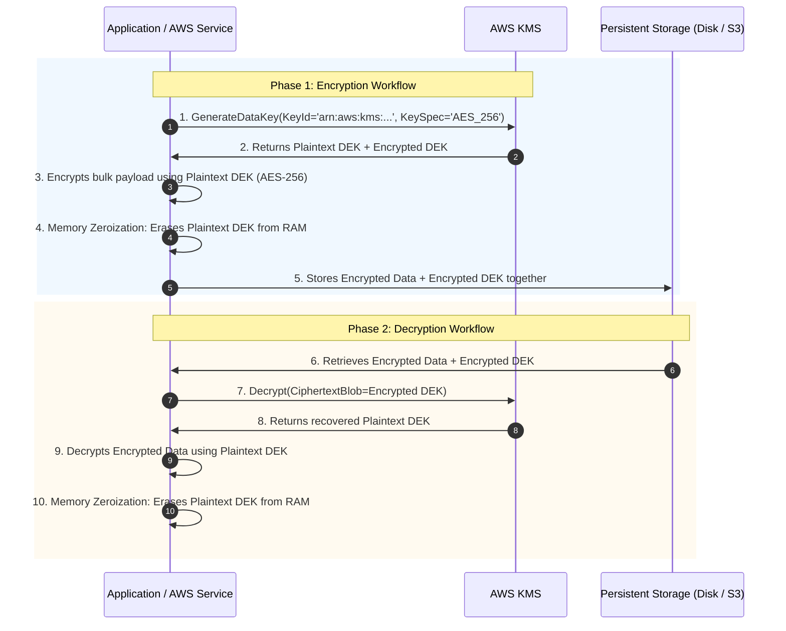

#### Why Envelope Encryption is Best Practice:
1. **Network Performance**: Huge files do not traverse the network to KMS. Only the 256-bit DEK travels over the wire.
2. **API Scalability**: Avoids KMS request rate throttling when streaming millions of files.
3. **Protection in Depth**: Even if the encrypted data and encrypted DEK are exfiltrated together from disk, they are useless to an attacker without authorization to invoke KMS `Decrypt` on the parent KMS key.

---

### 5.3 AWS CloudHSM

For organizations with stringent regulatory mandates (such as financial payment standards PCI-DSS, healthcare, or government frameworks) requiring **sole physical tenancy** of cryptographic hardware:

- **Dedicated Hardware**: CloudHSM provides single-tenant, dedicated HSM appliances running inside the customer's Amazon VPC.
- **FIPS 140-2 Level 3**: Tamper-evident, tamper-resistant physical enclosures that automatically zeroize keys upon detecting physical intrusion or side-channel probing.
- **Sole Customer Control**: AWS administrators have **no access** to keys stored inside CloudHSM. The customer owns the cryptographic domain and manages users, keys, and credentials directly.
- **Standard Industry APIs**: Supports standard cryptographic interfaces such as PKCS#11, Java Cryptography Extension (JCE), and Microsoft Cryptography Next Generation (CNG).
- **KMS Custom Key Stores**: AWS KMS can be configured to use a dedicated AWS CloudHSM cluster as its underlying cryptographic storage engine, combining KMS ease-of-use with CloudHSM's dedicated hardware isolation.

---

### 5.4 Amazon S3 Server-Side Encryption (SSE) Models

Amazon S3 offers three distinct server-side encryption models and one client-side model to safeguard data at rest:

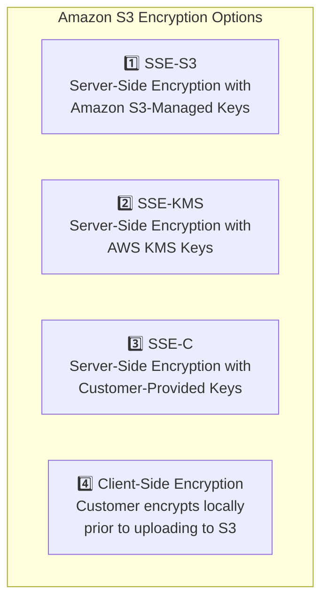

| Feature | SSE-S3 | SSE-KMS | SSE-C | Client-Side Encryption |
| :--- | :--- | :--- | :--- | :--- |
| **Key Managed By** | Amazon S3 | AWS KMS / Customer | Customer | Customer |
| **Cipher Algorithm** | AES-256 | AES-256 | AES-256 | Customer choice |
| **Key Rotation** | Automatic by AWS | Automatic annual (Customer Managed) | Customer responsibility | Customer responsibility |
| **CloudTrail Audit** | ❌ No key audit trail | ✅ Logs every `kms:Decrypt` invocation | ❌ No key audit trail | ❌ AWS has no visibility |
| **Access Control Granularity** | S3 bucket policies only | S3 policies **+** KMS Key Policies | S3 policies **+** possession of raw key | Local application policies |
| **Additional Cost** | Free (default S3 encryption) | Standard AWS KMS API call costs | Free | Free from AWS perspective |

---

## 📝 6. Checkpoint Review & Self-Assessment

### Official Slide Checkpoint Questions & Answers

#### Question 1: What are the three types of encryption?
**Official Answer**:
Symmetric, asymmetric, and hybrid.

**In-Depth Architectural Explanation**:
- **Symmetric Encryption**: Uses a single shared secret key for both encryption and decryption (e.g., AES-256). Exceptionally fast and optimized for bulk data.
- **Asymmetric Encryption**: Uses a mathematically linked key pair: a public key for encryption and a private key for decryption (e.g., RSA, ECC). Solves key distribution and provides authentication and non-repudiation.
- **Hybrid Encryption**: Synthesizes both approaches. Uses asymmetric cryptography to exchange an ephemeral symmetric session key, which then encrypts the bulk communication payload (e.g., TLS/SSL, SSH, AWS Envelope Encryption).

---

#### Question 2: What is a hash function?
**Official Answer**:
A hash is an algorithm that takes a file or message as an input and creates a unique digital signature or fixed-length string (message digest) as an output.

**In-Depth Architectural Explanation**:
A cryptographic hash function is a deterministic, one-way mathematical function that maps data of arbitrary size to a fixed-length string of bits (e.g., SHA-256 producing 256 bits). It is computationally infeasible to invert (pre-image resistance) or find two distinct inputs yielding the identical output (collision resistance). It is used to verify **data integrity** and detect unauthorized modifications.

---

#### Question 3: What is an access control list (ACL)?
**Official Answer**:
An access control list (ACL) is a document or table that defines a list of accesses, restrictions, or permissions to resources for individuals or groups of individuals.

**In-Depth Architectural Explanation**:
An ACL represents the foundational implementation of **Discretionary Access Control (DAC)**. It is attached directly to a securable object (such as a file, directory, network interface, or Amazon S3 bucket) and contains sequential **Access Control Entries (ACEs)**. Each ACE specifies a subject (user, group, or system identifier) and the permitted or denied operations (Read, Write, Execute, Delete) that the subject may perform on that object.

---

### Extended Practice Knowledge Checks

#### Question 4: Scenario Analysis – High-Performance File System Encryption
*A cloud architecture team is designing a multi-terabyte financial document storage backend on AWS. The requirements state that data must be encrypted at rest with minimal compute latency, but the company also requires full audit logging of every decryption attempt by employee role. Which encryption architecture should they deploy?*

- **A)** Pure asymmetric RSA-4096 encryption across all stored files.
- **B)** Discretionary Access Control (DAC) with unencrypted S3 storage.
- **C)** Hybrid Envelope Encryption utilizing AWS KMS with Customer Managed Keys (CMKs) and local AES-256 Data Encryption Keys (DEKs).
- **D)** MD5 checksum validation combined with Base64 encoding.

**Correct Answer**: **C**  
*Explanation*: Pure RSA-4096 is far too slow for multi-terabyte bulk file processing. Base64 is merely encoding (zero security). DAC provides authorization, not encryption. Envelope encryption using AWS KMS combines the hardware-accelerated speed of symmetric AES-256 with the centralized key policy control and AWS CloudTrail audit logging provided by KMS.

---

#### Question 5: True or False – Encoding vs. Encryption
*True or False: Converting an employee's Social Security Number into Base64 format satisfies the regulatory requirement for encryption of data at rest because unauthorized users cannot read the plain text directly.*

- **Answer**: **FALSE**  
*Explanation*: Base64 is an **encoding** scheme, not encryption. It requires no secret key and provides zero confidentiality. Anyone can decode Base64 strings back to plaintext instantly using standard command-line tools (`base64 -d`) or online decoders. Cryptographic protection requires an encryption cipher (such as AES-256) governed by a secret key.

---

## 💡 7. Key Takeaways & Exam Summary

> [!IMPORTANT]
> **Core Concepts Summary**:
> - **The Security Lifecycle**: **Prevention** is the first line of defense; **Detection** occurs when prevention fails; **Response** addresses detected incidents; **Analysis** extracts lessons learned to fortify prevention.
> - **Encryption Ensures Confidentiality**: Plaintext is scrambled into ciphertext using ciphers and keys. Symmetric is fast for bulk data; asymmetric eliminates key distribution challenges; hybrid combines both.
> - **Hashing Ensures Integrity**: One-way, irreversible, fixed-length digests (e.g., SHA-256). Detects any tampering or data corruption across transit and storage.
> - **Permissions Govern Authorization**: Subjects request access to objects. Implement via **Discretionary Access Control (DAC/ACLs)**, **Role-Based Access Control (RBAC/Roles)**, or dynamic **Attribute-Based Access Control (ABAC/Tags)**.
> - **AWS Key Management**: Use **AWS KMS** for managed keys, automated rotation, and envelope encryption; use **AWS CloudHSM** for dedicated FIPS 140-2 Level 3 hardware compliance; use **SSE-S3 / SSE-KMS / SSE-C** to protect S3 objects at rest.

### Quick Reference Cheat Sheet

```
+-----------------------------------------------------------------------------------------+
|                               DATA SECURITY SUMMARY CHEAT SHEET                         |
+----------------------+-----------------------------+------------------------------------+
| DOMAIN               | TECHNOLOGIES / STANDARDS    | PRIMARY SECURITY GOAL              |
+----------------------+-----------------------------+------------------------------------+
| Data at Rest         | AES-256, BitLocker, KMS     | Confidentiality in storage media   |
| Data in Transit      | TLS 1.3, IPsec, SSH         | Confidentiality & wire integrity   |
| Data in Use          | Nitro Enclaves, AMD SEV     | Memory protection during execution |
| Symmetric Ciphers    | AES-128/256, Twofish, IDEA  | High-speed bulk data secrecy       |
| Asymmetric Ciphers   | RSA, ECC, Diffie-Hellman    | Key exchange & digital signatures  |
| Hybrid Systems       | TLS, Envelope Encryption    | Fast bulk encryption + secure keys |
| Hash Functions       | SHA-256, SHA-3              | Tamper detection & data integrity  |
| Message Signing      | HMAC, Digital Signatures    | Integrity + Authenticity + Non-rep |
| DAC Model            | ACLs, ACEs (Owner-driven)   | Decentralized object permissions   |
| RBAC Model           | IAM Roles, User Groups      | Scalable role-based permissions    |
| ABAC Model           | IAM Principal & Resource Tag| Dynamic zero-trust contextual auth |
| Hardware Security    | AWS CloudHSM (FIPS 140-2 L3)| Single-tenant cryptographic engine |
+----------------------+-----------------------------+------------------------------------+
```
