# 🔐 Security Lifecycle – Prevention: Public Key Infrastructure (PKI) & Digital Certificates

> **Course**: AWS re/Start  
> **Module**: Security (M04 – Prevention: Public Key Infrastructure)  
> **Source Document**: `T08-Security/T08-0007-RSSECY_EN-US_SG_M04_PREVENTIONPKI.pdf`  
> **Target Audience**: AWS re/Start Learners, Cloud Practitioners, and Systems Operations Associates  

---

## 🎯 Module Overview

In modern distributed computing, secure communication across untrusted networks is non-negotiable. While symmetric and asymmetric cryptography provide the raw mathematical foundations for data confidentiality and integrity, cryptography alone cannot answer a critical question: **"Who actually owns the public key I am communicating with?"**

Without an authoritative, cryptographically verifiable mechanism to bind a public key to a real-world entity, digital communications are completely vulnerable to **Man-in-the-Middle (MitM)** attacks and identity spoofing. **Public Key Infrastructure (PKI)** is the comprehensive framework of hardware, software, policies, processes, and legal standards required to create, manage, distribute, use, store, and revoke digital certificates and public keys.

Within the **Security Lifecycle**, PKI serves as a vital pillar of the **Prevention** phase. By establishing cryptographically validated trust, PKI prevents unauthorized access, thwarts data eavesdropping, prevents session hijacking, and enforces identity verification across web applications, microservices, code deployments, and enterprise networks.

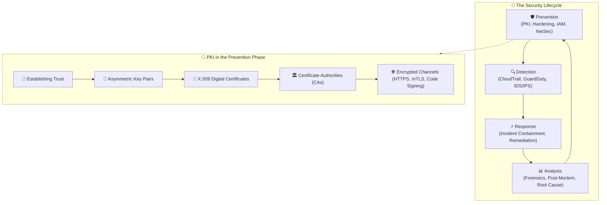

---

## 📌 Learning Objectives

By completing this module and working through these notes, you will be able to:

- [ ] **Define PKI and its core mission**: Explain the purpose of Public Key Infrastructure and how it establishes verifiable digital trust across untrusted networks.
- [ ] **Deconstruct PKI architectural roles**: Identify and describe the functions of the **Certificate Authority (CA)**, **Registration Authority (RA)**, **Validation Authority (VA)**, **Central Directory**, and **Certificate Policies (CP/CPS)**.
- [ ] **Examine X.509 digital certificate anatomy**: Detail the critical fields of an X.509 certificate, including Subject, Issuer, Public Key Info, Serial Number, Validity Period, and Extensions (such as SAN and Key Usage).
- [ ] **Analyze CA hierarchies and trust chains**: Differentiate between **Root CAs** and **Intermediate/Subordinate CAs**, explain why Root CAs remain offline, and trace the path of certificate chain validation up to operating system/browser trust stores.
- [ ] **Evaluate certificate revocation mechanisms**: Compare **Certificate Revocation Lists (CRLs)** with the **Online Certificate Status Protocol (OCSP)** and **OCSP Stapling** in terms of latency, scalability, and privacy.
- [ ] **Catalog practical PKI use cases**: Articulate real-world implementations including TLS/HTTPS, software code signing, S/MIME email encryption, and mutual TLS (mTLS).
- [ ] **Distinguish AWS certificate services**: Compare **AWS Certificate Manager (ACM)** and **AWS Private CA**, selecting the appropriate service based on exportability, internal vs. public hosting, and management overhead.

---

## 🏛️ 1. Public Key Infrastructure (PKI) Architecture & Core Principles

### 1.1 What is Public Key Infrastructure?

**Public Key Infrastructure (PKI)** is a comprehensive ecosystem of technologies, policies, operational standards, and governance procedures designed to facilitate the secure transfer of electronic information across public and private networks.

PKI is built upon **asymmetric cryptography** (public-key cryptography), which relies on mathematically linked key pairs:
1. **Public Key**: Publicly shared with the world. Used by senders to encrypt messages intended for the key owner, or by verifiers to validate digital signatures created by the key owner.
2. **Private Key**: Kept strictly confidential and securely guarded by the owner. Used to decrypt incoming ciphertexts or to generate digital signatures.

> [!IMPORTANT]
> **The Binding Problem**: Anyone can generate a public/private key pair and claim to be `bank.example.com`. Without PKI, a client connecting to `bank.example.com` has no way to prove whether the public key received over the network genuinely belongs to the legitimate bank or to a malicious eavesdropper conducting a Man-in-the-Middle attack. PKI solves this problem by having a mutually trusted third party cryptographically **bind** the public key to the verified entity name in a digital certificate.

### 1.2 The Core Security Pillars of PKI

PKI delivers four fundamental security objectives:

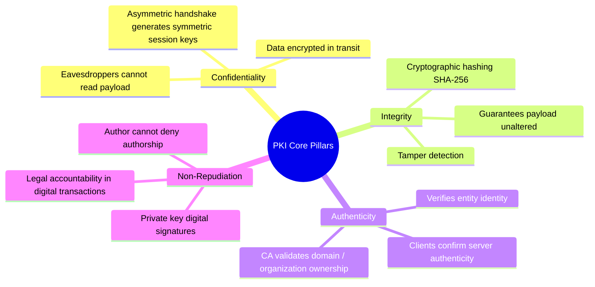

1. **Confidentiality**: Assures that data in transit cannot be read by unauthorized interceptors. During TLS negotiations, the public key is used to safely exchange or agree upon high-speed symmetric session keys (e.g., AES-GCM).
2. **Integrity**: Assures that data has not been altered, tampered with, or corrupted in transit. Any change to a signed document or certificate invalidates the cryptographic signature.
3. **Authenticity**: Proves that an entity (a website, microservice, employee, or hardware device) is truly who it claims to be.
4. **Non-Repudiation**: Guarantees that the creator of a digital signature cannot later deny having signed the message, because only their private key could have produced that specific mathematical signature.

### 1.3 PKI Components & Architecture

An enterprise PKI architecture consists of several specialized components collaborating to manage certificates across their lifecycle:

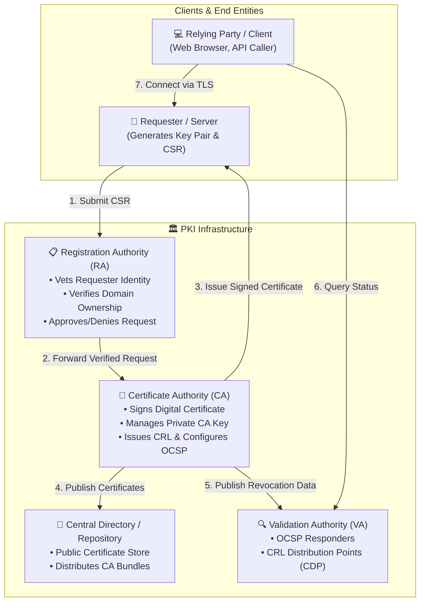

| Component | Full Name | Primary Responsibility | Analogy |
| :--- | :--- | :--- | :--- |
| **CA** | **Certificate Authority** | The trusted entity that mints, cryptographically signs, and distributes digital certificates; maintains revocation status. | Government Passport Agency |
| **RA** | **Registration Authority** | An operational entity that verifies the identity and credentials of applicants before asking the CA to issue a certificate. | Passport Application Office / DMV Clerk |
| **Central Directory** | **Public Repository** | A publicly accessible repository or directory service (e.g., LDAP, HTTP server, S3 bucket) storing active certificates and CA trust chains. | Public Registry / Phone Directory |
| **VA** | **Validation Authority** | A dedicated service (such as an OCSP Responder or CRL server) that answers relying parties regarding whether a certificate remains valid or has been revoked. | Border Patrol Passport Scanner |
| **Subject / End Entity** | **Subscriber** | The individual, server, organization, or device requesting and possessing the issued certificate. | Citizen holding the Passport |
| **Relying Party** | **Client / Consumer** | The application, browser, or client verifying the certificate to establish a secure connection. | Border Guard / Bank Inspector |

### 1.4 PKI Governance Documents: CP and CPS

A Certificate Authority does not operate in an ad-hoc manner; its trustworthiness is anchored in publicly accessible legal and operational frameworks:

* **Certificate Policy (CP)**: A high-level document defining the rules, requirements, and applicability of certificates issued by the CA. It outlines permissible usage (e.g., e-commerce, code signing, healthcare records), financial liability limits, applicant validation standards, and revocable offenses (such as fraudulent use or criminal activities).
* **Certificate Practices Statement (CPS)**: A granular, operational document detailing *how* the CA implements the policies defined in the CP. It covers physical data center security, cryptographic hardware specs (HSMs), key generation ceremonies, disaster recovery protocols, key destruction procedures, and operational vetting workflows.

---

## 📜 2. X.509 Digital Certificates: Structure & Anatomy

### 2.1 What is a Digital Certificate?

A **digital certificate** is an electronic credential that binds an identity (such as a domain name `www.example.com`, an email address, or an individual) to a specific public key. It functions identically to a digital passport or national ID card.

When an entity presents a digital certificate:
* It proves possession of the identity certified by the issuing authority.
* It presents the entity's public key to anyone who needs to establish encrypted communication.
* It carries the cryptographic digital signature of the issuing CA, proving that the certificate has not been altered.

### 2.2 Anatomy of an X.509 v3 Certificate

The international standard governing digital certificates is **ITU-T X.509** (specifically Version 3, defined in **RFC 5280**). An X.509 certificate contains well-defined standardized fields:

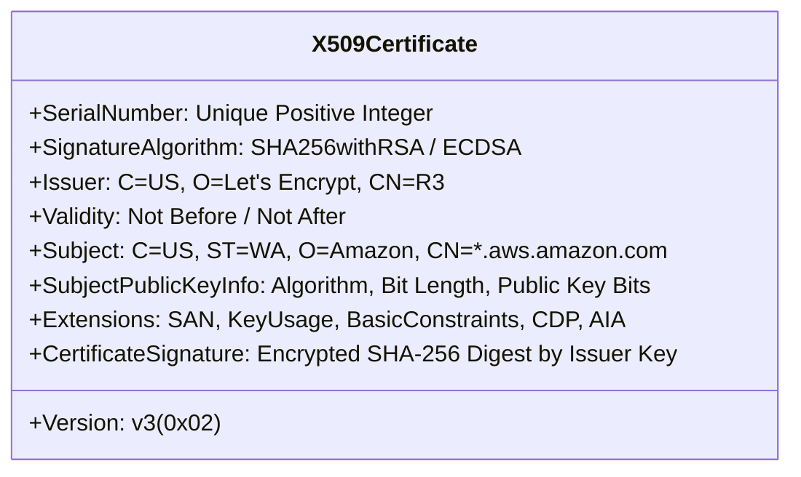

```
Certificate:
    Data:
        Version: 3 (0x2)
        Serial Number: 03:fa:8c:12:90:bc:e4:56:1a:2b:3c:4d:5e:6f:70:81
        Signature Algorithm: sha256WithRSAEncryption
        Issuer: C = US, O = DigiCert Inc, CN = DigiCert Global G2 TLS RSA SHA256 2020 CA1
        Validity
            Not Before: Oct 10 00:00:00 2026 GMT
            Not After : Nov 10 23:59:59 2027 GMT
        Subject: C = US, ST = Washington, L = Seattle, O = Amazon.com, Inc., CN = *.aws.amazon.com
        Subject Public Key Info:
            Public Key Algorithm: rsaEncryption
                RSA Public-Key: (2048 bit)
                Modulus: 00:c4:9a:...
                Exponent: 65537 (0x10001)
        X509v3 extensions:
            X509v3 Basic Constraints: critical
                CA:FALSE
            X509v3 Key Usage: critical
                Digital Signature, Key Encipherment
            X509v3 Extended Key Usage: 
                TLS Web Server Authentication, TLS Web Client Authentication
            X509v3 Subject Alternative Name: 
                DNS:*.aws.amazon.com, DNS:aws.amazon.com, DNS:console.aws.amazon.com
            X509v3 CRL Distribution Points: 
                URI:http://crl3.digicert.com/DigiCertGlobalG2TLSRSASHA2562020CA1-1.crl
            Authority Information Access: 
                OCSP - URI:http://ocsp.digicert.com
    Signature Algorithm: sha256WithRSAEncryption
    Signature Value:
        4a:7f:81:9d:02:11:ea:88:5c:21:44:98:bb:03:d9:17:...
```

#### Detailed Field Breakdown

1. **Version**: The format standard version. Almost all modern certificates are **Version 3 (v3)**, which supports custom extensions.
2. **Serial Number**: A unique positive integer assigned by the issuing CA to distinguish this certificate from all other certificates issued by that same CA.
3. **Signature Algorithm Identifier**: The cryptographic algorithm used by the CA to sign the certificate (e.g., `sha256WithRSAEncryption`, `ecdsa-with-SHA384`).
4. **Issuer (Distinguished Name - DN)**: The entity that verified the applicant and signed the certificate (e.g., Country `C=US`, Organization `O=DigiCert`, Common Name `CN=DigiCert Global Root CA`).
5. **Validity Period**:
   * **Not Before**: The exact timestamp before which the certificate is not yet valid.
   * **Not After**: The expiration timestamp after which the certificate is invalid and must no longer be trusted.
6. **Subject (Distinguished Name - DN)**: The identity of the certificate owner (e.g., `CN=*.aws.amazon.com`, `O=Amazon.com, Inc.`, `L=Seattle`, `ST=Washington`, `C=US`).
7. **Subject Public Key Info**: The public key itself, along with the algorithm identifier (e.g., RSA 2048-bit, RSA 4096-bit, or ECC secp256r1/secp384r1).
8. **Critical X.509 v3 Extensions**:
   * **Subject Alternative Name (SAN)**: Modern TLS clients mandate SAN. While the older `Common Name (CN)` allowed only a single domain name, SAN enables multi-domain certificates (`example.com`, `shop.example.com`, `portal.internal`) and wildcard certificates (`*.example.com`).
   * **Basic Constraints**: Indicates whether the certificate belongs to a Certificate Authority (`CA:TRUE` or `CA:FALSE`) and defines the maximum path length of subordinate CAs allowed below it.
   * **Key Usage & Extended Key Usage (EKU)**: Restricts what operations the public key is allowed to perform (e.g., Server Authentication, Client Authentication, Code Signing, Document Signing, CRL Signing).
   * **CRL Distribution Points (CDP)**: URLs where clients can download the issuing CA's revocation list.
   * **Authority Information Access (AIA)**: URLs pointing to the issuing CA's OCSP responder service and intermediate CA certificate bundle.

### 2.3 Self-Signed Certificates vs. CA-Signed Certificates

A digital certificate can be created and signed in two primary ways:

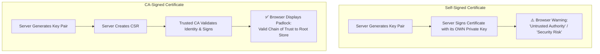

| Criterion | Self-Signed Certificate | CA-Signed Certificate (Public CA) | CA-Signed Certificate (Internal Private CA) |
| :--- | :--- | :--- | :--- |
| **Signer** | The host/server itself (Subject == Issuer) | A trusted third-party commercial/public CA | An internal organizational CA (e.g., AWS Private CA) |
| **Trust Scope** | Untrusted by default; requires manual installation into every client trust store | Globally trusted out-of-the-box by all major browsers and OSs | Trusted across enterprise devices via Active Directory GPO / MDM |
| **Browser Warnings** | Triggers severe "Untrusted Certificate Authority" warning banners | Clean lock icon; zero security alerts | Clean lock icon on managed enterprise devices |
| **Cost** | 100% Free | Free (Let's Encrypt / AWS ACM) or Paid (EV/OV certificates) | Cost of internal CA infrastructure (e.g., AWS Private CA monthly fee) |
| **Vetting Level** | None | Domain Validation (DV), Org Validation (OV), or Extended Validation (EV) | Strict organizational policies, IAM policies, and VPC controls |
| **Best Used For** | Local sandbox development, disposable test environments | Public-facing websites, public APIs, e-commerce stores | Internal corporate intranets, microservices, VPN endpoints, IoT fleets |

> [!CAUTION]
> **Never use self-signed certificates in production!**  
> While self-signed certificates provide cryptographic encryption in transit, they fail to provide **authenticity**. Because clients cannot verify who signed the certificate, users become conditioned to click through browser warning dialogs, exposing the organization to trivial Man-in-the-Middle (MitM) attacks.

---

## 🌳 3. Certificate Authority (CA) Hierarchy & Chain of Trust

### 3.1 The Hierarchical Trust Architecture

In enterprise and global PKI implementations, certificates are structured in a hierarchical tree. At the summit sits the **Root Certificate Authority**, which delegates signing authority down to one or more **Intermediate (Subordinate) Certificate Authorities**, which in turn issue **End-Entity (Leaf) Certificates** to web servers, individuals, or devices.

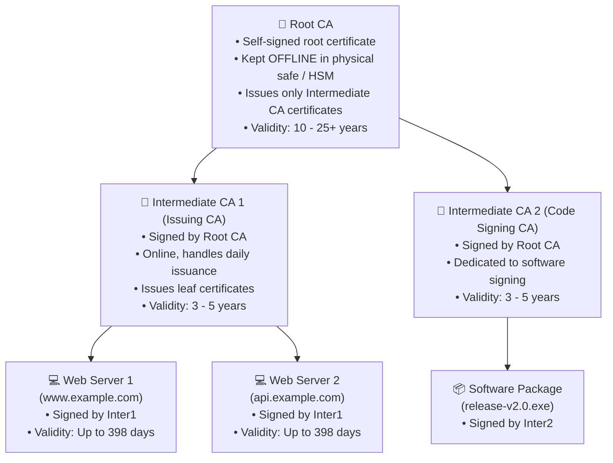

### 3.2 Why Isolate and Take the Root CA Offline?

A primary design principle of PKI architecture is **defense-in-depth through CA separation**:

* **Catastrophic Impact of Root Compromise**: If a Root CA's private key is ever exposed or stolen, every single certificate ever issued under that hierarchy—including all intermediate CAs and end-entity certificates—is immediately compromised and invalidated. Restoring trust requires distributing a brand-new root certificate to millions of client devices worldwide.
* **The Air-Gapped Root CA**: Because Root CAs only need to sign intermediate CA certificates every few years, the Root CA server is kept **completely offline** (air-gapped from any network), powered down, and stored inside a high-security physical vault. It is booted up only during audited **Key Ceremonies** attended by multiple security officers.
* **Online Subordinate (Intermediate) CAs**: Intermediate CAs operate online to service daily certificate signing requests (CSRs), issue certificates, and respond to revocation queries. If an intermediate CA key is ever compromised, the offline Root CA is simply powered up to revoke that single intermediate certificate, leaving the rest of the PKI hierarchy intact.

### 3.3 The Chain of Trust Verification Flow

When a client (such as Google Chrome, curl, or an AWS SDK client) connects to a server over HTTPS, the server presents its leaf certificate along with the intermediate CA certificates (the **certificate chain** or bundle). The client verifies the chain mathematically in reverse order:

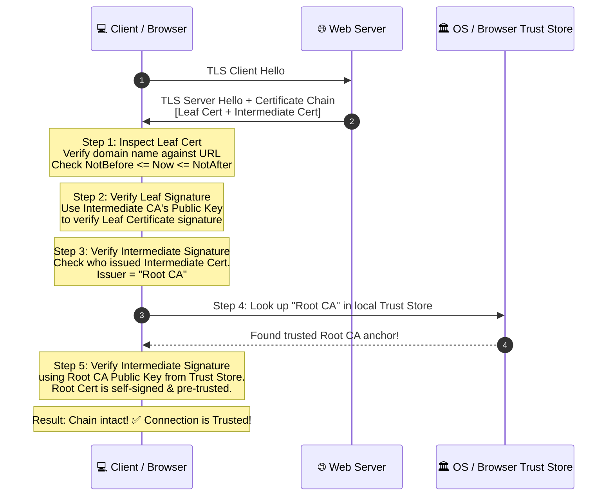

### 3.4 CA Trust Stores

How does the client know whether the Root CA itself is legitimate?

Every major operating system (Microsoft Windows, macOS, Linux, iOS, Android) and web browser (Mozilla Firefox) maintains a **Local Root Trust Store**:
* **Operating System Stores**:
  * **Windows**: CryptoAPI / CNG Certificate Store (viewable via `certmgr.msc` or `certlm.msc`).
  * **macOS / iOS**: Apple Keychain.
  * **Linux**: System CA bundle directory (e.g., `/etc/ssl/certs/ca-certificates.crt` on Debian/Ubuntu or `/etc/pki/tls/certs/ca-bundle.crt` on RHEL/Amazon Linux).
  * **Java**: The Java truststore located at `$JAVA_HOME/lib/security/cacerts`.
* **Mozilla Firefox**: Maintains its own independent root store (NSS - Network Security Services) separate from the underlying operating system.
* **Inclusion Programs**: Commercial CAs (like DigiCert, Sectigo, GlobalSign, Google Trust Services, Amazon Trust Services) undergo rigorous third-party audits (such as WebTrust or ISO 27001) to have their root certificates pre-installed in these trust stores.

### 3.5 Internal CA vs. External CA

Organizations must choose between deploying an internal private CA or purchasing/requesting certificates from an external public CA:

| Characteristic | Internal (Private) CA | External (Public) CA |
| :--- | :--- | :--- |
| **Managed By** | The internal enterprise IT/Security team | Third-party public commercial CA (or Let's Encrypt / Amazon Trust Services) |
| **Trust Domain** | Only trusted within the corporate network and on managed devices | Globally trusted by default across every internet-connected device, phone, and OS |
| **Trust Store Configuration** | Root certificate must be explicitly deployed to all employee laptops, servers, and devices via GPO, MDM, or configuration management (Ansible/Puppet) | Pre-installed in all operating systems and browsers out-of-the-box |
| **Domain Restrictions** | Can issue certificates for non-routable internal domains (`.local`, `.corp`, `api.internal.company.net`, private IPs) | Strictly limited to officially registered, publicly verifiable domain names (`.com`, `.org`, `.io`) |
| **Administrative Effort** | High (Requires architecting key storage, HSMs, backup, CRL/OCSP responders, and lifecycle monitoring) | Low (The commercial CA handles root security, auditing, CRL, and OCSP infrastructure) |
| **Cost** | Fixed operational/infrastructure cost (e.g., AWS Private CA base monthly fee + per-certificate issuance fee) | Free for public TLS (AWS ACM, Let's Encrypt) or per-cert annual fee for commercial OV/EV certificates |
| **Primary Use Cases** | Microservice service meshes (mTLS), internal ERP/intranet portals, corporate VPNs, IoT fleets, container workloads | Public-facing websites, customer-facing REST APIs, external e-commerce portals |

---

## 🔄 4. The Certificate Lifecycle & Issuance Process

### 4.1 End-to-End Certificate Issuance Workflow

The process of requesting, vetting, issuing, and deploying a digital certificate follows a standardized multi-step lifecycle:

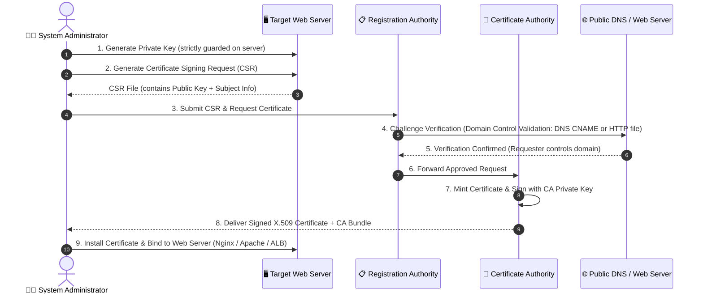

### 4.2 Practical Walkthrough: Generating a CSR with OpenSSL

On Linux and Unix-like servers, the industry-standard tool for managing cryptographic keys and certificate requests is **OpenSSL**.

#### Step 1: Generate an RSA Private Key
```bash
# Generate a secure 2048-bit RSA private key with strict file permissions
openssl genpkey -algorithm RSA -pkeyopt rsa_keygen_bits:2048 -out server.key
chmod 600 server.key
```

#### Step 2: Create a Configuration File with SAN (Recommended Best Practice)
Modern web browsers reject certificates that lack Subject Alternative Names (SAN). Create `req.cnf`:
```ini
[req]
default_bits       = 2048
prompt             = no
default_md         = sha256
distinguished_name = dn
req_extensions     = req_ext

[dn]
C  = US
ST = Washington
L  = Seattle
O  = Example Enterprise
OU = Cloud Operations
CN = app.example.com

[req_ext]
subjectAltName = @alt_names

[alt_names]
DNS.1 = app.example.com
DNS.2 = www.app.example.com
DNS.3 = api.example.com
```

#### Step 3: Generate the Certificate Signing Request (CSR)
```bash
# Generate the CSR using the private key and configuration file
openssl req -new -key server.key -out server.csr -config req.cnf
```

#### Step 4: Inspect the Generated CSR
Verify that the CSR contains the public key and identity data, but **never** the private key:
```bash
openssl req -text -noout -verify -in server.csr
```

### 4.3 Certificate Storage & Protection

The security of the entire PKI model hinges on the confidentiality of the **private key**. If the private key is leaked, attackers can impersonate the server and decrypt past or future traffic.

Private keys and certificates can be stored across various physical and logical mediums:

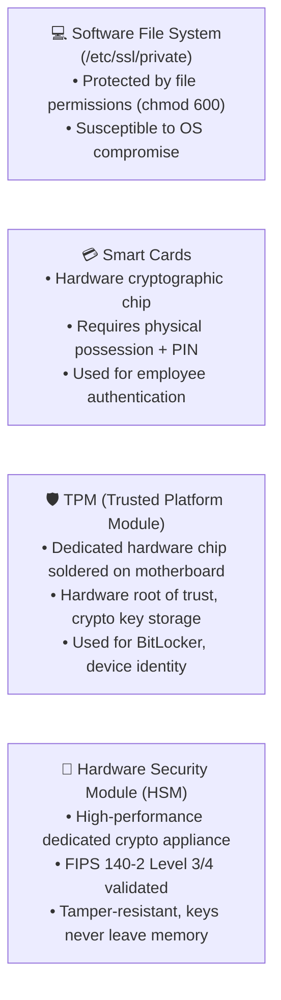

* **Software File Systems**: Stored directly on disk (e.g., `/etc/pki/tls/private/` or Windows Certificate Manager). Must be protected with restricted access permissions (`chmod 400` or `chmod 600`) and owned by root or the service account.
* **Smart Cards**: Physical credit-card-sized cards containing a microcontroller that executes cryptographic operations internally. Used extensively in government and enterprise environments (e.g., DoD CAC cards).
* **Trusted Platform Module (TPM)**: A specialized cryptographic co-processor integrated directly onto a computer motherboard. Used to secure cryptographic keys, authenticate device hardware state, and enforce measured boot.
* **Hardware Security Modules (HSMs)**: Enterprise-grade physical hardware security appliances (such as AWS CloudHSM) designed specifically to safeguard and manage cryptographic keys. HSMs provide tamper-detection circuitry that erases keys upon physical intrusion attempts.

---

## 🚫 5. Certificate Expiration, Invalidation & Revocation

### 5.1 Why Must Certificates Be Revoked?

An issued digital certificate remains valid until its `Not After` timestamp expires. However, circumstances often require invalidating a certificate *before* its official expiration date:

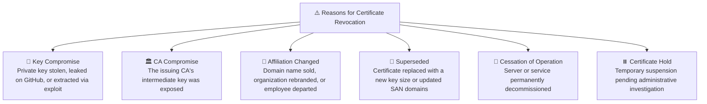

### 5.2 Certificate Revocation Lists (CRL)

A **Certificate Revocation List (CRL)** is an authoritative, digitally signed list containing the serial numbers of certificates that have been revoked prior to their scheduled expiration date.

#### How CRL Works:
1. The CA periodically generates and cryptographically signs a file containing all revoked serial numbers.
2. The CA publishes this file to a publicly reachable HTTP web server or LDAP directory (the **CRL Distribution Point - CDP**).
3. When a client validates a server's certificate, it reads the CDP URL from the certificate extensions, downloads the CRL, and searches the list for the server's serial number.

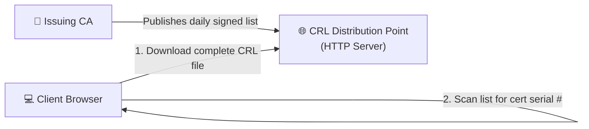

#### Major Drawbacks of CRL:
* **Massive File Sizes**: As a CA revokes more certificates over time, the CRL file grows into tens or hundreds of megabytes, creating severe network latency for every new TLS connection.
* **Latency & Performance Bottleneck**: Clients must download and parse the entire list before completing the handshake.
* **Caching Latency & Vulnerability Window**: CRLs are published on a fixed schedule (e.g., every 24 to 72 hours). If a private key is compromised at 9:00 AM and the next CRL update is at midnight, attackers have a 15-hour window to conduct successful spoofing attacks.
* **Soft-Fail Dilemma**: If the CDP server is down or blocked by a firewall, most browsers fall back to "soft-fail" mode—meaning they ignore the error and connect anyway, completely defeating revocation security.

### 5.3 Online Certificate Status Protocol (OCSP)

To eliminate the massive download overhead of CRLs, the Internet Engineering Task Force (IETF) developed the **Online Certificate Status Protocol (OCSP)**, standardized in **RFC 6960**.

#### How OCSP Works:
Instead of downloading the entire database of revoked certificates, the client queries a real-time web service called an **OCSP Responder** (Validation Authority). The client asks: *"Is certificate serial number `03:fa:8c:12:...` currently valid?"* The responder immediately returns a lightweight, cryptographically signed response: `Good`, `Revoked`, or `Unknown`.

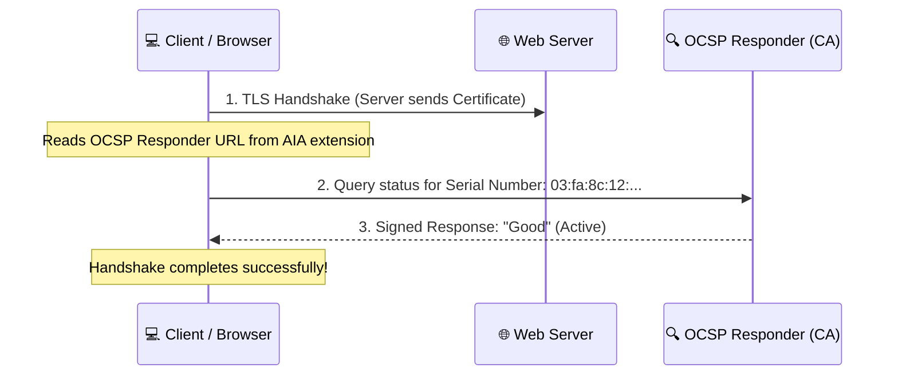

#### Challenges of Traditional OCSP:
* **Privacy Leak**: The CA learns the IP address of every client and the exact website the client is visiting in real time.
* **Handshake Latency**: The client must establish a separate DNS resolution and HTTP connection to the OCSP responder before completing the TLS handshake with the web server.
* **Scalability Bottleneck**: High-traffic public CAs must handle billions of OCSP queries per second.

### 5.4 OCSP Stapling (TLS Certificate Status Request)

**OCSP Stapling** (formally known as the TLS Certificate Status Request extension, RFC 6066) completely solves the privacy, latency, and scalability drawbacks of traditional OCSP.

#### How OCSP Stapling Works:
Instead of the client querying the CA, the **web server itself** queries the OCSP responder at regular intervals (e.g., every hour). The server caches the CA's digitally signed, time-stamped status response and "staples" it directly into the initial TLS handshake sent to the client.

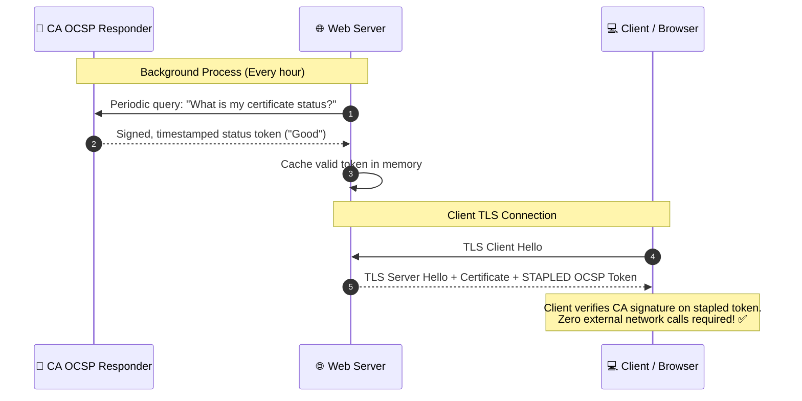

### 5.5 Comparison Matrix: CRL vs. OCSP vs. OCSP Stapling

| Evaluation Metric | Certificate Revocation List (CRL) | Traditional OCSP | OCSP Stapling |
| :--- | :--- | :--- | :--- |
| **Query Mechanism** | Client downloads full revocation list | Client queries CA responder per connection | Server fetches and staples signed token to handshake |
| **Network Overhead** | Very high (Large file downloads) | Moderate (One HTTP query per handshake) | Minimal (Few hundred bytes appended to TLS handshake) |
| **Handshake Latency** | High (Parsing large lists) | Moderate (Additional round-trip to CA) | Zero extra latency (Stapled in flight) |
| **User Privacy** | Good (CA does not know which cert was queried) | Poor (CA sees client IP and destination domain) | Perfect (Client never communicates with CA) |
| **Resilience to Outages** | Vulnerable if CDP server is offline | Vulnerable if OCSP responder is degraded | High (Server caches signed response in memory) |
| **Modern Adoption** | Deprecated / Fallback only | Phased out by major browsers | Industry Standard & Best Practice |

---

## 🌐 6. Practical Real-World Use Cases of PKI

Digital certificates and PKI underpin foundational security across modern IT infrastructure:

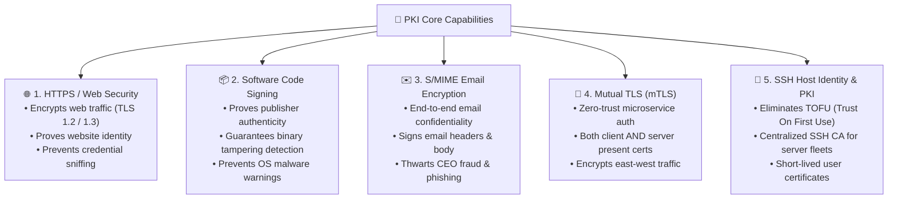

### 6.1 HTTPS and Transport Layer Security (TLS)
* **What it does**: Establishes an encrypted, authenticated tunnel between a client browser and a web server over port 443.
* **Why it matters**: Protects sensitive user inputs, payment cards, session tokens, and passwords from sniffing or tampering across open Wi-Fi and the internet.

### 6.2 Code Signing
* **What it does**: Software developers sign executable files (`.exe`, `.msi`), scripts (`.ps1`, `.sh`), and mobile application packages (`.apk`, `.ipa`) using a Code Signing certificate private key.
* **Why it matters**: When an end-user downloads the software, operating systems like Microsoft Windows Defender SmartScreen or Apple Gatekeeper verify the digital signature using the author's public key. If an attacker modifies even a single byte to insert a backdoor, the signature check fails, and the OS blocks execution.

### 6.3 Secure / Multipurpose Internet Mail Extensions (S/MIME)
* **What it does**: Provides cryptographic end-to-end encryption and digital signatures for electronic mail.
* **Why it matters**: Standard SMTP email transmits in plaintext across mail relays. S/MIME ensures that only the intended recipient's private key can decrypt the message body and attachments, while digital signatures guarantee the email genuinely came from the sender, eliminating spoofed executive phishing attacks.

### 6.4 Mutual TLS (mTLS) for Zero Trust Microservices
* **What it does**: In traditional TLS, only the server presents a certificate to prove its identity. In **Mutual TLS (mTLS)**, both the client and the server present X.509 certificates to each other.
* **Why it matters**: Forms the core foundation of **Zero Trust Architecture** and service meshes (e.g., Istio, Envoy, AWS App Mesh). Microservices in a Kubernetes cluster authenticate and encrypt every internal API call before processing requests.

---

## ☁️ 7. AWS Certificate Management: ACM & AWS Private CA

In the AWS Cloud, certificate management is decoupled into two complementary services designed for specific operational tiers: **AWS Certificate Manager (ACM)** and **AWS Private Certificate Authority (AWS Private CA)**.

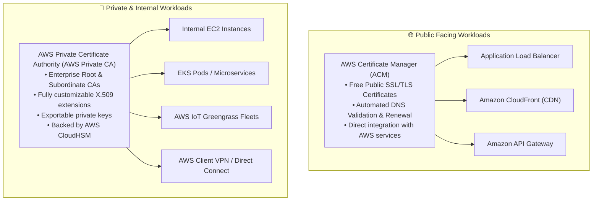

### 7.1 AWS Certificate Manager (ACM)
**AWS Certificate Manager (ACM)** is a fully managed service that simplifies the provisioning, management, and deployment of public and private SSL/TLS certificates for use with supported AWS services.

* **Key Capabilities**:
  * **Zero Cost for Public Certificates**: Public SSL/TLS certificates requested through ACM for use with AWS services are completely **free of charge**.
  * **Automated Renewal**: ACM automatically provisions and rotates public certificates before they expire, completely eliminating website downtime caused by forgotten certificate renewals.
  * **Seamless Native Integrations**: Certificates bind with a single click to:
    * **Elastic Load Balancing (ALB, NLB)**
    * **Amazon CloudFront**
    * **Amazon API Gateway**
    * **AWS Elastic Beanstalk**
    * **AWS CloudFormation**
  * **Domain Validation**: Supports automated validation via **DNS validation** (creating a designated CNAME record in Amazon Route 53) or **Email validation**.

> [!WARNING]
> **ACM Public Private Key Restriction**:  
> For security reasons, **private keys for public ACM certificates can never be exported or downloaded**. You cannot export an ACM public certificate to install it directly on an Amazon EC2 Apache/Nginx web server or an on-premises physical server. ACM certificates can only be terminated directly on managed endpoints like Application Load Balancers or CloudFront distributions.

### 7.2 AWS Private Certificate Authority (AWS Private CA)
**AWS Private CA** (formerly ACM Private CA) is an enterprise-grade, highly available, managed private CA service that enables organizations to establish and govern their own internal PKI hierarchies without the operational cost and complexity of building on-premises hardware security modules.

* **Key Capabilities**:
  * **Complete Hierarchy Management**: Create Root CAs and Subordinate CAs directly within AWS, or build subordinate CAs rooted in an existing on-premises enterprise root CA.
  * **Exportable Private Keys**: Unlike public ACM certificates, certificates minted via AWS Private CA **can export their private keys**, allowing them to be installed directly on EC2 operating systems, containers, mobile devices, VPN clients, and embedded IoT hardware.
  * **FIPS 140-2 Level 3 Compliance**: Private CA root and subordinate signing keys are stored and protected within dedicated AWS hardware security modules (HSMs).
  * **Custom Extensions & Validity**: Complete control over validity duration (hours to decades), subject naming, path length constraints, and specialized X.509 v3 extensions.

### 7.3 Comparative Architecture Matrix: ACM vs. AWS Private CA

| Architecture Dimension | AWS Certificate Manager (ACM) | AWS Private Certificate Authority (AWS Private CA) |
| :--- | :--- | :--- |
| **Target Workload** | Public-facing websites, public APIs, CloudFront CDNs | Internal microservices, VPC-internal portals, IoT devices, VPNs |
| **Certificate Type** | Public SSL/TLS Certificates (issued by Amazon Trust Services) | Private internal X.509 Certificates (custom private CA hierarchy) |
| **Trust Domain** | Globally trusted by all public browsers and devices | Trusted only within the organization and devices configured with CA root |
| **Private Key Export** | ❌ **Non-Exportable** (Locked inside AWS managed services) | ✅ **Exportable** (Can be downloaded and installed anywhere) |
| **Eligible Deployment Targets** | ALB, NLB, CloudFront, API Gateway | EC2 OS filesystems, Kubernetes pods, on-premises servers, IoT, VPNs |
| **Automated Renewal** | Fully automated by AWS (DNS CNAME check) | Automated when integrated through ACM; manual/scripted via API for exported keys |
| **Pricing Model** | **Free** for all public certificates deployed to AWS services | **Monthly base fee per CA** (~$400/month) + small fee per certificate issued |
| **Cryptographic Backing** | AWS managed secure infrastructure | FIPS 140-2 Level 3 Hardware Security Modules (HSMs) |

---

## 🛠️ 8. Hands-On Architectural Design: The Recommended Enterprise Pattern

When architecting scalable cloud security, the industry best practice is to combine **AWS Certificate Manager** with **Application Load Balancers** for perimeter traffic, while utilizing **AWS Private CA** for end-to-end internal transport encryption:

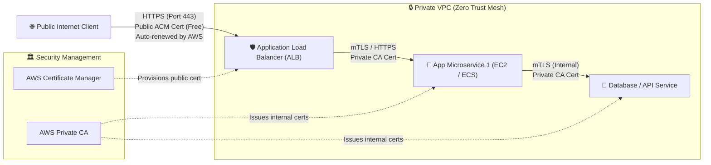

### Key Architectural Advantages:
1. **Perimeter Efficiency**: Public clients connect to the ALB using a free, publicly trusted ACM certificate that auto-renews without operational overhead.
2. **End-to-End Encryption in Transit**: Compliance mandates (e.g., PCI-DSS, HIPAA, FedRAMP) require encryption even behind load balancers. AWS Private CA easily mints and injects internal certificates into container tasks.
3. **Defense-in-Depth**: If an attacker breaches the perimeter network, they cannot eavesdrop on internal East-West traffic between microservices because all internal communication is encrypted and authenticated via mTLS.

---

## 🧠 9. Knowledge Check & Practice Assessment

Test your understanding of Public Key Infrastructure, digital certificates, and AWS certificate services with these scenario-based questions:

### Question 1
**An operations engineer receives an urgent browser security alert stating that a web application's certificate has an invalid Common Name and is not trusted. Upon inspection, the web server is hosting multiple subdomains including `portal.example.com` and `api.example.com`, but the certificate was issued only for `example.com`. Which X.509 v3 extension should be configured to resolve this issue?**
- A) Key Usage
- B) Subject Alternative Name (SAN)
- C) Basic Constraints
- D) CRL Distribution Points (CDP)

<details>
<summary>👉 Click to view Answer & Explanation</summary>

**Correct Answer: B**  
**Explanation**: The **Subject Alternative Name (SAN)** extension allows a single digital certificate to secure multiple domain names, subdomains (e.g., `portal.example.com`, `api.example.com`), and IP addresses. While older certificates relied solely on the Common Name (CN) field in the Subject, modern standards mandate SAN validation.
</details>

---

### Question 2
**Why is an enterprise Root Certificate Authority kept powered off and disconnected from the network (air-gapped) during normal daily operations?**
- A) To conserve compute resources and electrical power in corporate data centers.
- B) Because Root CAs cannot process cryptographic requests faster than 10 transactions per second.
- C) To protect the root private key from network-based cyberattacks, since compromise of the Root CA invalidates the entire PKI trust hierarchy.
- D) Because modern web browsers do not accept certificates signed directly by an online Root CA.

<details>
<summary>👉 Click to view Answer & Explanation</summary>

**Correct Answer: C**  
**Explanation**: If a Root CA's private key is compromised, every certificate in the entire organization or global hierarchy is untrusted, necessitating an expensive and catastrophic recovery process. By keeping the Root CA offline, organizations delegate daily issuance tasks to subordinate (intermediate) CAs; if an intermediate CA is compromised, only that branch is revoked while the Root CA remains secure.
</details>

---

### Question 3
**A security team observes significant latency spikes during client TLS handshakes. Investigation reveals that client browsers are pausing to make external HTTP requests to a public CA server to verify certificate validity. Which technology should the team enable on the web server to eliminate this latency and enhance user privacy?**
- A) Certificate Revocation Lists (CRL)
- B) Self-signed Certificate Fallback
- C) OCSP Stapling
- D) Extended Validation (EV) Pinning

<details>
<summary>👉 Click to view Answer & Explanation</summary>

**Correct Answer: C**  
**Explanation**: **OCSP Stapling** allows the web server to query the CA's OCSP responder in advance, cache the signed status response, and staple it directly to the TLS handshake delivered to the client. This eliminates the need for the client to make an independent network call to the CA, cutting handshake latency and preserving user privacy.
</details>

---

### Question 4
**A cloud architect wants to use AWS Certificate Manager (ACM) to request a public SSL/TLS certificate and install it directly onto an Apache web server running inside an Amazon EC2 instance. What will happen when the architect attempts to execute this plan?**
- A) ACM will generate the certificate, and the private key can be exported via the AWS CLI.
- B) The architect cannot export the private key for an ACM public certificate; it can only be deployed to integrated AWS services like Application Load Balancers or CloudFront.
- C) The architect must open an AWS Support ticket to download the PEM-encoded private key file.
- D) ACM will automatically install the certificate into Apache via an AWS Systems Manager Agent document.

<details>
<summary>👉 Click to view Answer & Explanation</summary>

**Correct Answer: B**  
**Explanation**: Private keys for public certificates requested through ACM are non-exportable by design. They cannot be downloaded or installed directly on EC2 operating systems. To use an ACM public certificate with an EC2 workload, you place an Application Load Balancer or CloudFront distribution in front of the EC2 instance and terminate TLS on the managed service. If the certificate must reside directly on the EC2 OS, AWS Private CA or Let's Encrypt must be used.
</details>

---

### Question 5
**What is the primary role of the Registration Authority (RA) in a Public Key Infrastructure?**
- A) To store root cryptographic keys inside tamper-proof hardware security modules.
- B) To answer real-time client status queries regarding revoked serial numbers.
- C) To verify and validate the identity and credentials of applicants before requesting that the CA issue a certificate.
- D) To physically install certificates on remote web servers and load balancers.

<details>
<summary>👉 Click to view Answer & Explanation</summary>

**Correct Answer: C**  
**Explanation**: The **Registration Authority (RA)** acts as the vetting and verification arm of the PKI. It validates that the applicant actually owns the domain or organization before forwarding an approved certificate request to the Certificate Authority (CA) for cryptographic signing.
</details>

---

## 📋 10. Module Summary & Quick Reference

### Core Concepts Recap Table

| Topic | Key Principle | Critical Takeaway |
| :--- | :--- | :--- |
| **PKI** | Verifiable Digital Trust | Solves the public key binding problem by mathematically associating keys with identities. |
| **X.509 Certificate** | Digital Passport | Contains Subject, Issuer, Public Key, Serial Number, Validity Period, and SAN extensions. |
| **Root vs. Intermediate CA** | Defense-in-Depth | Root CA stays offline and air-gapped; Intermediate CAs handle daily issuance online. |
| **CRL vs. OCSP** | Revocation Strategy | CRL downloads entire lists (slow/bulky); OCSP queries specific status (fast); OCSP Stapling provides zero-latency privacy. |
| **Self-Signed vs. CA-Signed** | Authenticity Guarantee | Self-signed lacks authenticity and triggers warnings; CA-signed establishes validated trust chains. |
| **ACM vs. Private CA** | AWS Cloud Alignment | ACM provides free, non-exportable public certs for ALBs/CloudFront; Private CA provides exportable certs for internal enterprise fleets. |

### Essential OpenSSL & AWS CLI Commands

```bash
# 1. Generate a new private key and CSR
openssl req -new -newkey rsa:2048 -nodes -keyout app.key -out app.csr

# 2. Inspect a CSR's contents (verify SAN and subject info)
openssl req -text -noout -verify -in app.csr

# 3. Inspect a local certificate file
openssl x509 -text -noout -in certificate.crt

# 4. Check an active server's live certificate chain over the network
openssl s_client -connect www.example.com:443 -servername www.example.com -showcerts

# 5. Request a public certificate using AWS ACM CLI (DNS validation)
aws acm request-certificate \
    --domain-name example.com \
    --subject-alternative-names www.example.com api.example.com \
    --validation-method DNS

# 6. List active certificates in an AWS Region
aws acm list-certificates --certificate-statuses ISSUED
```
