# 🎥 AWS Technical Demonstration: Securing Web Traffic with AWS Certificate Manager (ACM) and Application Load Balancer

> **Course**: AWS re/Start  
> **Module**: Security (M04 – Public Key Infrastructure & Certificate Management)  
> **Source Media**: `T08-Security/T08-0008-RSSCHAB_EN-US_Video_M04_ACM_Demo.mp4` (9 min 8 sec)  
> **Format**: Video Audio Transcription & Comprehensive Hands-On Lab Walkthrough  
> **Target Audience**: AWS re/Start Learners, Cloud Practitioners, Security Specialists, and Solutions Architects  

---

## 🎯 Demonstration Overview

In this comprehensive hands-on technical demonstration, the instructor walks through provisioning an SSL/TLS public certificate using **AWS Certificate Manager (ACM)** and attaching it to an **Application Load Balancer (ALB)** to transition an unencrypted web application running on Amazon EC2 from insecure HTTP to cryptographically secure HTTPS.

The lab addresses a fundamental enterprise security requirement: protecting data in transit across public networks. By configuring DNS domain validation via **Amazon Route 53**, creating an **Application Load Balancer**, attaching target groups, terminating TLS at the load balancer layer, and implementing an automatic **HTTP-to-HTTPS (301 Permanent Redirect)** rule, learners gain end-to-end operational knowledge of public key infrastructure (PKI) deployment within AWS.

```
┌────────────────────────────────────────────────────────────────────────────────────────┐
│                                 CORE LAB OBJECTIVE                                     │
│                                                                                        │
│  Insecure State : Client ──[ HTTP:80 (Cleartext) ]──> EC2 Web Server ("Not Secure")   │
│                                                                                        │
│  Target State   : Client ──[ HTTPS:443 (TLS/SSL) ]──> ALB ──[ HTTP:80 ]──> EC2        │
│                    │                                   │                               │
│                    └───────[ HTTP:80 (Redirect) ]──────┘ (301 Moved Permanently)       │
└────────────────────────────────────────────────────────────────────────────────────────┘
```

---

## 📌 Learning Objectives

By completing this tutorial and studying the architectural patterns demonstrated, you will be able to:

- [ ] **Explain PKI & Transport Layer Security (TLS)**: Articulate why unencrypted HTTP is vulnerable to eavesdropping and Man-in-the-Middle (MitM) attacks, and how TLS provides encryption, server authentication, and message integrity.
- [ ] **Request a Public Certificate in ACM**: Request a free, publicly trusted X.509 TLS certificate for a Fully Qualified Domain Name (FQDN) using the AWS Certificate Manager console.
- [ ] **Perform Automated DNS Validation via Route 53**: Generate and publish canonical name (CNAME) verification records in an Amazon Route 53 hosted zone to prove domain ownership.
- [ ] **Deploy an Application Load Balancer Architecture**: Configure a Target Group (`ACM-demo-tg`), register backend Amazon EC2 instances, and provision an internet-facing Application Load Balancer (`ACM-demo-alb`) across multiple Availability Zones.
- [ ] **Configure Route 53 Alias Records**: Map custom subdomains to the DNS name of the Application Load Balancer using Route 53 Alias (A) records without incurring additional query costs.
- [ ] **Implement TLS Termination**: Attach the ACM public certificate to an HTTPS (Port 443) listener on the ALB to offload cryptographic compute overhead from backend application servers.
- [ ] **Enforce Security Best Practices with HTTP-to-HTTPS Redirection**: Configure an HTTP (Port 80) listener rule that automatically issues an HTTP 301 Permanent Redirect to port 443, ensuring that all client connections are encrypted.
- [ ] **Verify Certificate Chains in Web Browsers**: Inspect the issued TLS certificate, valid date ranges, issuer details (Amazon Trust Services), and cryptographic ciphers from the client browser interface.

---

## 🏗️ Architectural Topology: Initial State vs. Target State

### 1. Initial State Architecture (Insecure Baseline)

In the initial environment, the client communicates directly with the Amazon EC2 instance using unencrypted HTTP over port 80. The web browser flags the connection as **"Not Secure"** because no SSL/TLS certificate is present, exposing session cookies, credentials, and payload data to packet interception.

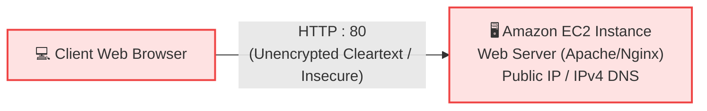

---

### 2. Target State Architecture (Enterprise TLS Termination & Automatic Redirect)

In the target architecture:
1. The domain `ACM.cloud-demo.link` is mapped via a **Route 53 Alias (A) Record** to the **Application Load Balancer (ALB)**.
2. The ALB holds the public TLS certificate issued by **AWS Certificate Manager (ACM)**.
3. Inbound HTTPS traffic on **Port 443** is decrypted at the ALB (**TLS Termination**) and forwarded over private HTTP on **Port 80** to the registered **Target Group** containing the EC2 instance.
4. Inbound cleartext HTTP traffic on **Port 80** hits an ALB listener rule that immediately returns an **HTTP 301 Moved Permanently** redirecting the client to HTTPS on Port 443.

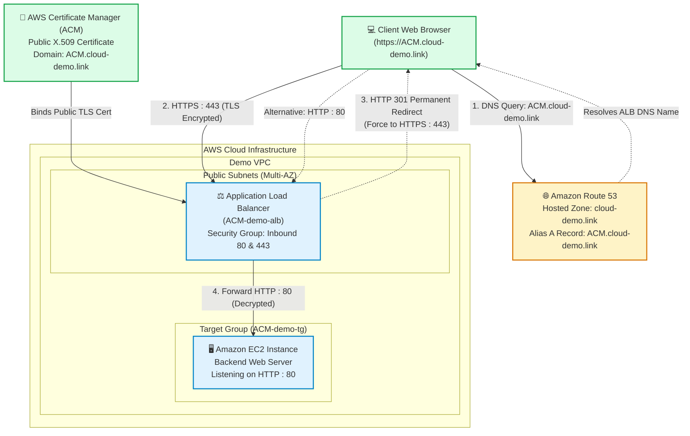

---

### 3. Architecture Comparison Matrix

| Evaluation Dimension | Initial State (Baseline) | Target State (Production Hardened) |
| :--- | :--- | :--- |
| **Transport Protocol** | Cleartext HTTP (`http://`) | Encrypted HTTPS (`https://`) |
| **Port Exposure** | Port 80 exposed directly to internet | Ports 80 & 443 managed by Load Balancer |
| **Encryption in Transit** | ❌ None (Data transmitted in plaintext) | ✅ Full TLS 1.2 / 1.3 cryptographic protection |
| **Server Identity Proof** | ❌ None (Subject to spoofing/MitM) | ✅ Verified by Amazon Trust Services CA |
| **Browser Indicator** | ⚠️ Red / Grey warning: *"Not Secure"* | 🔒 Secure padlock icon indicating valid TLS |
| **Certificate Location** | None (EC2 instance lacks SSL certificate) | Attached centrally to Application Load Balancer |
| **Cryptographic Overhead**| Zero (Unencrypted) | Handled by ALB dedicated hardware (**TLS Offloading**) |
| **EC2 Ingress Hardening** | Public EC2 instance directly accepts internet traffic | EC2 target can be placed in private subnets, accepting traffic only from ALB |
| **Scalability & Resiliency**| Single point of failure (standalone EC2) | High availability across multiple Availability Zones |

---

## 🔄 AWS Certificate Manager: DNS Validation Flow

AWS Certificate Manager requires proof of domain ownership before issuing a public certificate. ACM offers two validation methods:
1. **Email Validation**: Sends verification emails to WHOIS addresses and administrative mailbox aliases (`admin@`, `webmaster@`, etc.). Requires manual renewal action if emails expire.
2. **DNS Validation (Recommended & Demonstrated)**: ACM provides a unique `CNAME` record (Name and Value). You insert this record into the authoritative DNS service (Route 53). ACM detects the record and automatically issues and **renews** the certificate as long as the CNAME record remains active.

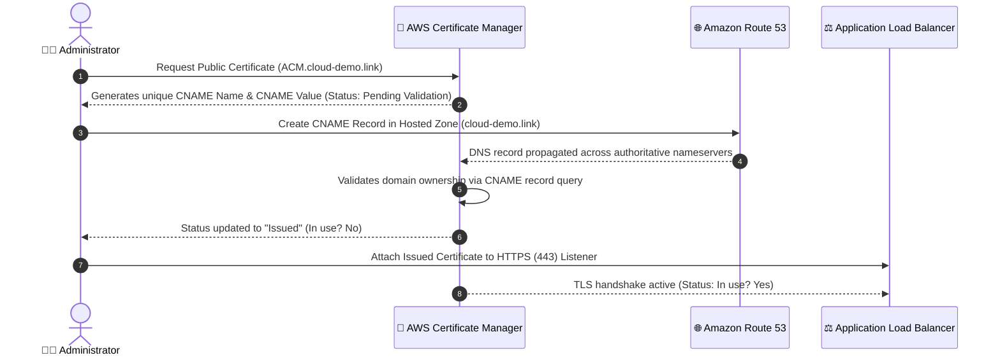

---

## 🛠️ Step-by-Step Hands-On Implementation Guide

### Phase 1: Environment Baseline & Initial State Inspection

Before requesting the certificate or provisioning the load balancer, inspect the existing standalone web server to observe the unencrypted state.

#### 1. Navigate to the Amazon EC2 Console
1. Open the **AWS Management Console** and search for **EC2**.
2. In the left navigation pane, select **Instances**.
3. Select the pre-configured instance hosting the demo web server.
4. In the **Details** pane at the bottom:
   - Locate the **Public IPv4 DNS** address (e.g., `ec2-xx-xx-xx-xx.compute-1.amazonaws.com`).
   - Copy the address to your clipboard.

#### 2. Test Direct HTTP Access
1. Open a new browser tab and navigate to:
   ```text
   http://<EC2-Public-IPv4-DNS>
   ```
2. **Observation**:
   - The demo web page loads successfully over HTTP port 80.
   - The browser address bar displays an explicit warning: **"Not Secure"** with an exclamation or crossed-out padlock icon.
   - Any sensitive payload transmitted between the client and this EC2 instance is vulnerable to packet sniffing on public networks.

> [!WARNING]
> **Why standalone EC2 instances without certificates fail security compliance:**
> Operating HTTP-only web applications exposes organizations to data leakage, session hijacking via cookie theft, and non-compliance with industry standards (PCI-DSS 4.0, HIPAA, SOC 2).

---

### Phase 2: Requesting a Public Certificate in AWS Certificate Manager

AWS Certificate Manager is an AWS service that allows you to provision, manage, and deploy public and private SSL/TLS certificates for use with AWS integrated services.

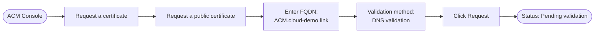

#### Step 1: Open ACM Console
1. In the AWS Management Console navigation bar, search for and open **AWS Certificate Manager** (or **Certificate Manager**).
2. Ensure you are in the same AWS Region where your Application Load Balancer will reside (e.g., **US West (Oregon) / `us-west-2`**).

#### Step 2: Request Public Certificate
1. On the ACM landing page, click **Request a certificate** (or **Request**).
2. Under **Certificate type**, select **Request a public certificate**. Click **Next**.
3. Under **Fully qualified domain name (FQDN)**:
   - Enter: `ACM.cloud-demo.link`
4. Under **Validation method**:
   - Select **DNS validation (recommended)**.
5. Under **Key algorithm**:
   - Leave the default **RSA 2048**.
6. Click **Request**.

#### Step 3: Examine Pending Validation State
1. Click into the certificate details by clicking the **Certificate ID** link.
2. Observe the following attributes:
   - **Status**: `Pending validation`
   - **In use?**: `No`
   - **Type**: `Amazon-issued`
   - **Associated resources**: `None`
3. Under the **Domains** table, ACM displays the DNS records required for verification:
   - **Domain name**: `ACM.cloud-demo.link`
   - **CNAME name**: `_xxxxxxxxxxxxxxxxxxxxxxxx.ACM.cloud-demo.link.`
   - **CNAME value**: `_yyyyyyyyyyyyyyyyyyyyyyyy.acm-validations.aws.`

| Parameter | Configuration Value | Rationale |
| :--- | :--- | :--- |
| **Certificate Type** | Public Certificate | Free X.509 certificate trusted by all major OSs and browsers |
| **Domain Name (FQDN)** | `ACM.cloud-demo.link` | Subdomain dedicated to the application service |
| **Validation Method** | DNS Validation | Enables automatic, zero-touch certificate renewal |
| **Key Algorithm** | RSA 2048 | Universal enterprise compatibility across TLS clients |

---

### Phase 3: Domain Ownership Validation via Amazon Route 53

To validate ownership of `ACM.cloud-demo.link`, you must publish the specified CNAME record in your authoritative DNS hosted zone.

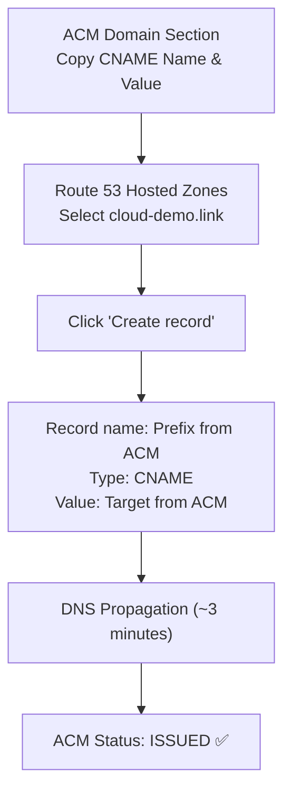

#### Step 1: Navigate to Amazon Route 53
1. In the console search bar, type and select **Route 53**.
2. In the navigation menu, select **Hosted zones**.
3. Click on the domain name hosted zone: **`cloud-demo.link`**.

#### Step 2: Create the Validation CNAME Record
1. Inside the hosted zone dashboard, click **Create record**.
2. Configure the record fields:
   - **Record name**: Paste the CNAME name provided by ACM.
     > [!IMPORTANT]
     > **Handling FQDN Suffix in Route 53**:  
     > The Route 53 console automatically appends your apex domain (`.cloud-demo.link`). If the CNAME name from ACM is `_abc123.ACM.cloud-demo.link`, enter only `_abc123.ACM` in the record name box.
   - **Record type**: Select **CNAME - Routes traffic to another domain name and to some AWS resources**.
   - **Value**: Paste the exact CNAME value copied from ACM (e.g., `_xyz789.acm-validations.aws.`).
   - **TTL (Seconds)**: Leave at default (300 seconds).
   - **Routing policy**: Simple routing.
3. Click **Create records**.

#### Step 3: Verify DNS Sync & Certificate Issuance
1. Route 53 displays the record with status **Pending** until DNS servers synchronize across AWS edge locations.
2. Wait approximately 2 to 3 minutes for global DNS propagation.
3. Once the record status in Route 53 indicates **IN SYNC**, return to the **AWS Certificate Manager** console.
4. Refresh the certificate view:
   - **Status**: Transitions from `Pending validation` to **`Issued`** ✅
   - **In use?**: Still shows **`No`** (because the certificate is not yet bound to any AWS resource).

> [!NOTE]
> **Why ACM Public Certificates Cannot be Downloaded**:
> AWS Certificate Manager protects private keys by design. The private key never leaves the AWS secure key store and cannot be downloaded to your local computer or directly installed into an Apache/Nginx configuration file on an EC2 instance. To use an ACM public certificate, you **must** terminate TLS at an integrated AWS service, such as an **Application Load Balancer (ALB)**, **Network Load Balancer (NLB)**, **Amazon CloudFront**, or **Amazon API Gateway**.

---

### Phase 4: Creating the Target Group (`ACM-demo-tg`)

Before creating an Application Load Balancer, you must define where the load balancer routes incoming client requests. A **Target Group** routes requests to registered targets (EC2 instances, IP addresses, or Lambda functions) and performs continuous health checks.

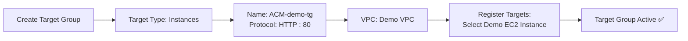

#### Step 1: Open Target Groups Console
1. Return to the **EC2 Console**.
2. Scroll down the left navigation pane to the **Load Balancing** section and select **Target Groups**.
3. Click **Create target group**.

#### Step 2: Configure Target Group Settings
1. **Choose a target type**: Select **Instances**.
2. **Target group name**: Enter `ACM-demo-tg`.
3. **Protocol**: Select **HTTP**.
4. **Port**: Enter `80`.
5. **IP address type**: Select **IPv4**.
6. **VPC**: Select the demo VPC where your EC2 instance resides.
7. **Protocol version**: Select **HTTP1**.
8. **Health checks**:
   - Health check protocol: `HTTP`
   - Health check path: `/`
9. Click **Next**.

#### Step 3: Register Targets
1. In the **Available instances** table, select the checkbox next to your demo web server EC2 instance.
2. Under **Ports for the selected instances**, ensure `80` is specified.
3. Click **Include as pending below**.
4. Verify the instance appears in the **Review targets** table.
5. Click **Create target group**.

| Target Group Parameter | Selected Value | Purpose / Notes |
| :--- | :--- | :--- |
| **Target Type** | Instances | Routes traffic directly to Amazon EC2 virtual machine instances |
| **Target Group Name** | `ACM-demo-tg` | Unique identifier for the target group |
| **Protocol / Port** | HTTP / 80 | Internal transport protocol between ALB and backend EC2 instance |
| **VPC** | Demo VPC | Isolates load-balanced compute resources |
| **Health Check Path** | `/` | Confirms the web server responds with HTTP 200 OK |

---

### Phase 5: Provisioning the Application Load Balancer (`ACM-demo-alb`)

Now provision an Application Load Balancer that acts as the single public entry point for your application.

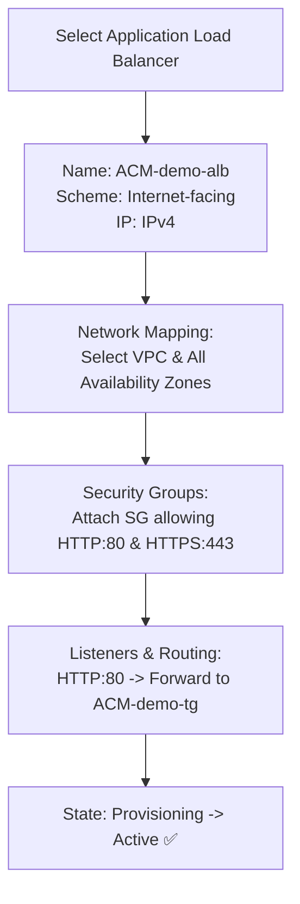

#### Step 1: Create Load Balancer
1. In the EC2 left navigation menu under **Load Balancing**, click **Load Balancers**.
2. Click **Create load balancer**.
3. Under **Application Load Balancer**, click **Create**.

#### Step 2: Basic Configuration
1. **Load balancer name**: Enter `ACM-demo-alb`.
2. **Scheme**: Select **Internet-facing** (allocates public IP addresses to route traffic from clients over the internet).
3. **IP address type**: Select **IPv4**.

#### Step 3: Network Mapping
1. **VPC**: Select your Demo VPC.
2. **Mappings (Availability Zones)**:
   - Select all available Availability Zones (e.g., `us-west-2a`, `us-west-2b`, `us-west-2c`).
   - For each Availability Zone, select the public subnet associated with external web traffic.
   > [!TIP]
   > An Application Load Balancer requires at least **two Availability Zones** to ensure high availability and regional fault tolerance.

#### Step 4: Security Groups
1. Under **Security groups**, locate the default security group and click the **X** to remove it.
2. Select the pre-created security group that allows inbound traffic on both **HTTP (Port 80)** and **HTTPS (Port 443)** from any IP address (`0.0.0.0/0`).

#### Step 5: Initial Listener Configuration
1. Under **Listeners and routing**:
   - **Protocol**: `HTTP`
   - **Port**: `80`
   - **Default action**: Select **Forward to** and choose **`ACM-demo-tg`**.
2. Click **Create load balancer**.
3. Click **View load balancer**.
4. Observe that the load balancer state starts as **Provisioning**. Wait 2 to 3 minutes, then click refresh until the state displays **Active** ✅.

| ALB Setting | Configured Value | Architectural Role |
| :--- | :--- | :--- |
| **Name** | `ACM-demo-alb` | Load balancer naming handle |
| **Scheme** | Internet-facing | Exposes public entry points to internet clients |
| **Network Subnets** | Multi-AZ Public Subnets | Ensures high availability across physical data center facilities |
| **Security Group** | Pre-configured Web SG | Inbound rules: TCP 80 (`0.0.0.0/0`) & TCP 443 (`0.0.0.0/0`) |
| **Initial Listener** | HTTP : 80 | Initial cleartext listener forwarding to target group |

---

### Phase 6: Mapping Custom Subdomain to ALB via Route 53 Alias Record

Instead of accessing the load balancer via its complex AWS-generated DNS name (e.g., `ACM-demo-alb-123456789.us-west-2.elb.amazonaws.com`), create an **Amazon Route 53 Alias Record** to map `ACM.cloud-demo.link` directly to the ALB.

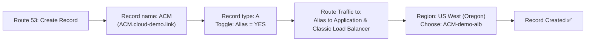

#### Step 1: Open Route 53 Hosted Zone
1. Navigate back to **Amazon Route 53** > **Hosted zones** > **`cloud-demo.link`**.
2. Click **Create record**.

#### Step 2: Configure Route 53 Alias Record
1. **Record name**: Enter `ACM` (forming the FQDN `ACM.cloud-demo.link`).
2. **Record type**: Keep as **A - Routes traffic to an IPv4 address and some AWS resources**.
3. **Alias**: Click the toggle switch to enable **Alias** (turns green).
4. **Route traffic to**:
   - Choose endpoint: **Alias to Application and Classic Load Balancer**.
   - Choose Region: **US West (Oregon)** (`us-west-2`).
   - Choose load balancer: Select **`ACM-demo-alb`**.
5. Click **Create records**.

#### Step 3: Test Intermediate Routing
1. Copy the full domain: `http://ACM.cloud-demo.link`.
2. Open a new tab in your browser and load the URL.
3. The web page loads through the load balancer, but:
   - Notice the browser connection is still **"Not Secure"** over HTTP.
   - If you manually type `https://ACM.cloud-demo.link`, the browser errors out with a connection refused / timeout because the load balancer does not yet have an active HTTPS listener on port 443.

> [!NOTE]
> **Why use Route 53 Alias records instead of standard CNAME records for the apex or subdomains?**  
> An Alias record is a Route 53-specific extension to DNS. Unlike standard CNAME records, Alias records can be created at the zone apex (`cloud-demo.link`), do not add extra recursive DNS query hops, automatically update when the ALB's underlying IP addresses change, and queries to AWS resource Alias records are **free of charge**.

---

### Phase 7: Configuring HTTPS Listener (Port 443) with ACM Certificate Attached

Now configure the ALB to accept secure HTTPS traffic by adding an HTTPS listener on port 443 and attaching the issued ACM certificate.

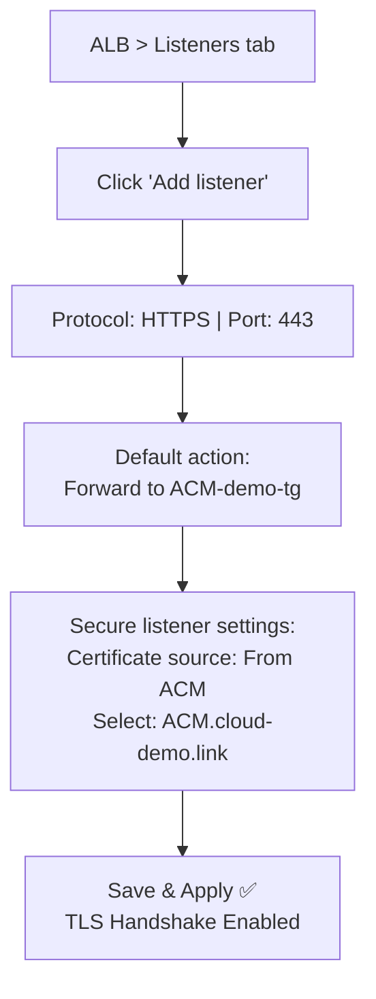

#### Step 1: Add HTTPS Listener
1. Return to the **EC2 Console** > **Load Balancers** > select **`ACM-demo-alb`**.
2. Select the **Listeners** tab.
3. Click **Add listener**.

#### Step 2: Define Listener Protocol and Action
1. Under **Listener details**:
   - **Protocol**: Select **HTTPS**.
   - **Port**: Enter `443`.
2. Under **Default actions**:
   - Select **Forward to**.
   - Target group: Choose **`ACM-demo-tg`**.

#### Step 3: Attach the ACM Certificate
1. Scroll down to **Secure listener settings**.
2. **Security policy**: Leave the default recommended policy (e.g., `ELBSecurityPolicy-2016-08` or `ELBSecurityPolicy-TLS13-1-2-2021-06`).
3. **Default SSL/TLS certificate**:
   - Certificate source: Select **From ACM**.
   - Certificate (from ACM): Select **`ACM.cloud-demo.link`**.
4. Click **Add** (or **Save**).

#### Step 4: Verify First HTTPS Connection
1. Return to your browser tab.
2. Enter:
   ```text
   https://ACM.cloud-demo.link
   ```
3. Press Enter and refresh.
4. **Result**:
   - The page loads securely over HTTPS!
   - The browser address bar displays a solid **padlock icon** 🔒.
   - Clicking the padlock reveals: **"Connection is secure"** and shows the certificate details.

---

### Phase 8: Enforcing Security: HTTP (Port 80) to HTTPS (Port 443) Automatic Redirect

Although HTTPS is operational, clients typing `ACM.cloud-demo.link` without an explicit `https://` prefix will default to unencrypted HTTP on port 80. To enforce encryption across all users, update the Port 80 listener to issue an automatic HTTP 301 Permanent Redirect.

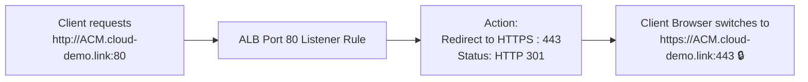

#### Step 1: Edit Port 80 Listener Rule
1. Under the **Listeners** tab of **`ACM-demo-alb`**:
2. Select the **HTTP : 80** listener.
3. Click **View/edit rules** (or select the listener and click **Edit listener**).
4. In the rules editor, click the **Edit (pencil)** icon next to the default rule.
5. In the action definition:
   - Remove the existing **Forward to `ACM-demo-tg`** action by clicking the trash can icon.
   - Click **Add action** and select **Redirect to...**
6. Configure the redirection parameters:
   - **Protocol**: `HTTPS`
   - **Port**: `443`
   - **Status code**: Select **301 - Permanently moved**.
7. Click the **Save / Update** button (checkmark icon) to commit the changes.

| Listener Configuration | Protocol | Port | Action | Target / Behavior |
| :--- | :---: | :---: | :--- | :--- |
| **Secure Listener** | HTTPS | 443 | Forward to | `ACM-demo-tg` (Terminates TLS, passes HTTP:80 to EC2) |
| **Insecure Listener (Redirect)** | HTTP | 80 | Redirect to URL | HTTPS : 443 (HTTP 301 Moved Permanently) |

---

## 🔍 Verification & Security Inspection

### 1. Verification Checklist

Execute the following verification tests to confirm the entire architecture is functional and securely configured:

- [x] **Test Insecure HTTP Request**: Type `http://ACM.cloud-demo.link` in your browser.
  - **Expected Outcome**: The browser URL automatically updates to `https://ACM.cloud-demo.link`. An HTTP 301 redirect response code is returned.
- [x] **Verify Padlock Icon**: Check that the browser URL bar displays a closed padlock icon without warnings.
- [x] **Inspect TLS Certificate Details**:
  - Click on the padlock icon in the browser address bar.
  - Click **Certificate is valid** (or **Show Certificate**).
  - Inspect the following fields:
    - **Common Name (CN)**: `ACM.cloud-demo.link`
    - **Issuer**: `Amazon`, `Amazon Trust Services`, or `Amazon RSA 2048 M01`
    - **Validity Period**: Valid from creation timestamp to 13 months forward (ACM public certificates have a 395-day validity period)
    - **Public Key Algorithm**: RSA (2048 bits)
    - **Signature Algorithm**: SHA-256 with RSA Encryption
- [x] **Verify ACM Certificate In-Use Status**:
  - Open **AWS Certificate Manager** console.
  - Locate `ACM.cloud-demo.link`.
  - Confirm the **In use?** field now states **`Yes`** and the associated resource lists the ARN of `ACM-demo-alb`.

---

## 🔐 Deep Dive: TLS Offloading, Zero-Touch Renewals & Security Group Hardening

### 1. TLS Termination (Offloading) vs. End-to-End Encryption

In this demonstration, TLS termination occurs at the Application Load Balancer:

```
[ Client ] ────────── HTTPS (Port 443) ──────────> [ ALB ] ────────── HTTP (Port 80) ──────────> [ EC2 Web Server ]
             Encrypted via ACM Public Cert                 Internal VPC / Private Subnet
```

#### Advantages of TLS Offloading at the ALB:
1. **Compute Efficiency**: Performing TLS asymmetric handshakes and symmetric cryptographic stream cipher processing is compute-intensive. Offloading this task to the AWS managed load balancing infrastructure frees EC2 CPU cycles for core application logic.
2. **Simplified Certificate Lifecycle**: You install and renew certificates in one centralized place (the ALB listener) rather than managing certificate files across dozens or hundreds of individual web server instances.
3. **Seamless Auto Scaling**: New EC2 instances launched by Auto Scaling groups immediately receive decrypted traffic without requiring custom certificate bootstrap scripts or baking private keys into AMIs.

> [!NOTE]
> **When is End-to-End Encryption Required?**  
> For highly regulated workloads (such as banking, healthcare/HIPAA, or PCI-DSS Level 1 compliance), internal network traffic between the ALB and backend instances must also be encrypted. In those architectures, the ALB initiates a new TLS connection over HTTPS (Port 443) to the EC2 instances using a self-signed or private certificate issued by **AWS Private CA**.

---

### 2. Automated Certificate Renewal Mechanics

One of the most powerful enterprise benefits of using ACM with Route 53 DNS validation is **automated zero-touch renewal**:

1. **Renewal Window**: Approximately 60 days before an ACM public certificate expires, ACM automatically queries the public DNS infrastructure for the validation CNAME record.
2. **Zero-Touch Renewal**: As long as the Route 53 CNAME record remains in the hosted zone and the certificate is actively associated with an AWS resource (e.g., the ALB), ACM automatically re-issues and re-binds the renewed certificate without requiring administrator action or causing application downtime.
3. **Contrast with Email Validation**: Email-validated certificates require a domain owner to locate validation emails and click verification links every year; failure to do so results in certificate expiration and major application outages.

---

### 3. Production Hardening: Security Group Layering

In a production environment, you should never allow direct internet access to the backend EC2 web server. Enforce strict **Security Group Chaining**:

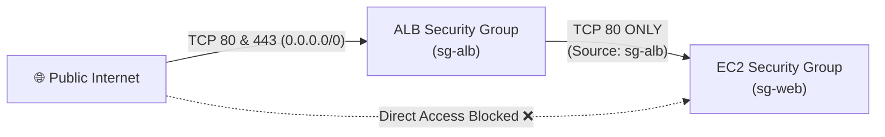

- **ALB Security Group (`sg-alb`)**:
  - Inbound: Allow Port 80 and Port 443 from `0.0.0.0/0`.
  - Outbound: Allow all traffic to VPC subnets.
- **EC2 Security Group (`sg-web`)**:
  - Inbound: Allow Port 80 **ONLY** with Source set to the ALB Security Group ID (`sg-alb`).
  - Inbound from `0.0.0.0/0` is completely removed!
  - This ensures no attacker can bypass the ALB, bypass WAF rules, or access the EC2 instance directly over cleartext HTTP.

---

## 📝 Complete Verbatim Audio Transcript

The following section contains the full verbatim spoken audio transcript extracted from the technical demonstration media file (`T08-0008-RSSCHAB_EN-US_Video_M04_ACM_Demo.mp4`).

<details>
<summary><b>Click to expand full verbatim audio transcript (9 min 8 sec)</b></summary>

> **Speaker**: AWS Technical Instructor  
> **Media Reference**: `T08-0008-RSSCHAB_EN-US_Video_M04_ACM_Demo.mp4`

```text
[00:00] Instructor: In this demo, we will be showing how to request a public certificate using Amazon Certificate Manager, otherwise known as ACM.

[00:10] Instructor: For the demo, we have a pre-configured Amazon EC2 instance running a web server that is not secure through HTTPS, but is accessible through HTTP.

[00:20] Instructor: This diagram shows our current environment with the client traffic being routed through HTTP and then getting to the Amazon EC2 instance, which is hosting the website, which is also through HTTP. This is where we will be requesting a public certificate so that we can change from HTTP on the client traffic to HTTPS.

[00:39] Instructor: Here you can see the final solution. We will create an application load balancer. We will request a public certificate through AWS Certificate Manager and apply that to the application load balancer, which will then route the client traffic through HTTPS.

[00:54] Instructor: We will start off by navigating into our EC2 instance that is hosting our web server. We will go ahead and copy and paste this public IPv4 DNS address into a new tab in our browser. And here we can see that the connection is not secure because there is no certificate associated with this EC2 instance.

[01:16] Instructor: Let's go ahead and request a public certificate. To do this, you'll navigate into the Amazon Certificate Manager console. You'll select request a certificate, request a public certificate, and here we'll enter in a fully qualified domain name. For this, we'll use ACM.cloud-demo.link. So then go ahead and select the request button to request our public certificate.

[01:45] Instructor: Here we can see that the status of the certificate is still pending validation. We won't get the certificate until we validate the domain. To do this, we need to create a CNAME record through Route 53.

[01:58] Instructor: Once in Route 53, we'll click Hosted Zones. Here we can see our domain, cloud-demo.link. We'll go ahead and click that. We'll select Create Record, to create a record.

[02:11] Instructor: For a record name, we'll go ahead and copy in the CNAME value from Certificate Manager. We'll paste that in here. We'll go ahead and take out our domain as it's already provided. For record type, we'll select CNAME. And then for value, we'll go back into Certificate Manager and we'll copy the CNAME value. Go back to Route 53 and paste in the value here. Then we'll create the record.

[02:40] Instructor: Now with DNS propagation, this will take some time to change from status pending. So we'll go ahead and pause the video here as we wait for the status to change.

[02:50] Instructor: After about three minutes now, we can see that our CNAME record is now in sync. Let's check the status of the certificate. Here we can see that it has been issued and that it is not yet in use.

[03:07] Instructor: In order to use it, we'll need to create an application load balancer, attach our EC2 instance that's hosting our web app on it, and then also attach the certificate that we created.

[03:19] Instructor: Before we create the load balancer, we'll need to create a target group, which is used for routing requests from the load balancer to the targets. So we'll go into the EC2 console and we'll go down to target groups, create target group. For target group name, we'll type in ACM-demo-tg. We'll leave the defaults here. We see our demo VPC is selected. Select next. And then to register targets, we'll select our EC2 instance, include as pending below, and then select create target group. Then this will create the target group that will associate to our load balancer.

[04:02] Instructor: Now we'll create the load balancer. Select load balancers, create load balancer, we'll choose application load balancer, and for the name, we'll type in ACM-demo-alb. Under network mapping, we'll select all available availability zones. For security groups, we'll go ahead and remove this default security group and add in a pre-created security group, which has access to HTTP and HTTPS. For listeners and routing, we'll leave the default HTTP port 80, and then the default action we will forward to the target group that we previously created. Scroll down and we'll create the load balancer.

[04:55] Instructor: I'll go ahead and click on view load balancer. And here we can see that the state of the load balancer is provisioning, and we will wait a few minutes for this to get set up.

[05:07] Instructor: Okay, we can now click refresh, and we see that the load balancer is now active. Now we'll need to create a new DNS record for a load balancer, and we'll go into Route 53 to do that.

[05:20] Instructor: We'll select create record. For record name, we'll just type in ACM. For record type, we'll leave it as an A record. We'll select alias, and then for route traffic, we'll choose alias to application and classic load balancer. Next, we'll select the region that we created the load balancer in, which is US West Oregon. And then for choose load balancer, we'll select the load balancer we just created. And then select create records to create the record.

[05:54] Instructor: And now here we have a new A record for a load balancer that we can copy the name and paste it into a new tab in our browser to navigate to our website. And this will route through the load balancer now.

[06:09] Instructor: Here we can see that our connection is still not secure. We'll go ahead and type in HTTPS just to make sure this is because we only added HTTP in our load balancer as a listener. So we'll need to go back into our load balancer and update for HTTPS.

[06:27] Instructor: We'll navigate back into the EC2 console and we'll select the listeners tab, add listener. For protocol, we'll select HTTPS. For the default action, we will forward to the target group we created earlier. Scroll down and here's where we'll select our certificate that was created earlier. And now we can see the new listener and rule.

[07:00] Instructor: We'll go ahead and test our connection here now. And after refreshing, we can now see that the connection is secure through HTTPS. Go ahead and click this. And here you can see more information on the SSL TLS certificate that we were able to create and use through ACM.

[07:23] Instructor: As a final measure, we'll want to update our HTTP port 80 listener rule on our load balancer and we'll want to redirect that to HTTPS. So we'll go back into the listeners tab and edit rules. And then we'll go ahead and click this pencil icon here. We'll delete the forward to target group rule and we'll redirect it to HTTPS. We'll enter in port 443 and then we'll update this rule.

[08:00] Instructor: Now this way, anytime that our website gets access to the load balancer, even if it is through HTTP, it'll get redirected as HTTPS. Like so.

[08:14] Instructor: And with that, we have successfully created a SSL TLS certificate with Amazon Certificate Manager and used it on an EC2 instance with a website behind the load balancer. Thanks for watching.
```

</details>

---

## 🔬 Self-Assessment & Review Questions

Test your comprehension of AWS Certificate Manager, Application Load Balancers, Route 53, and PKI security concepts:

### Question 1
**Why can an AWS administrator NOT download the private key of a public certificate generated by AWS Certificate Manager (ACM) to install it directly into an Nginx web server configuration on Amazon EC2?**
- A) ACM charges a licensing fee for exported private keys.
- B) By design, ACM manages and stores the private key within AWS managed hardware security modules (HSMs) and only permits deployment to integrated AWS services such as ALBs, CloudFront, and API Gateway.
- C) EC2 Linux instances do not support X.509 format certificates.
- D) Public certificates do not use private keys; only private certificates require them.

> [!TIP]
> **Correct Answer: B**  
> *Explanation*: ACM public certificates are free of charge, but AWS does not allow private key export. This design enforces strict security posture (the private key is never exposed to operating system compromises or human error) and ensures ACM can perform automated renewals natively on AWS front-end endpoints like Application Load Balancers, CloudFront distributions, and API Gateways.

---

### Question 2
**What is the primary benefit of choosing DNS Validation over Email Validation when requesting a public certificate in AWS Certificate Manager?**
- A) DNS validation does not require domain ownership.
- B) DNS validation issues the certificate instantly in under one second.
- C) As long as the DNS CNAME record remains present in Route 53 and the certificate is in use, ACM automatically renews the certificate without administrative intervention.
- D) DNS validation allows certificates to be exported to on-premises servers.

> [!TIP]
> **Correct Answer: C**  
> *Explanation*: ACM automatically handles renewal checks for DNS-validated certificates. Email validation sends manual approval links annually to domain contact mailboxes, which can lead to certificate expiration outages if the emails are overlooked or sent to obsolete mailboxes.

---

### Question 3
**When mapping a subdomain such as `ACM.cloud-demo.link` to an Application Load Balancer in Amazon Route 53, why is an Alias A Record preferred over a standard CNAME record?**
- A) CNAME records cannot resolve domain names with subdomains.
- B) Route 53 Alias records resolve directly to the ALB's internal IP addresses without incurring additional DNS recursive query charges, support apex domains, and dynamically follow ALB IP changes.
- C) CNAME records do not support HTTPS traffic.
- D) Alias records encrypt DNS requests over DNS-over-HTTPS (DoH).

> [!TIP]
> **Correct Answer: B**  
> *Explanation*: Route 53 Alias records recognize AWS resources natively. They respond directly with the resource's IP address (A record) instead of redirecting the resolver to another domain name (CNAME), improving latency and reducing query billing.

---

### Question 4
**In the demonstrated architecture, what is the exact function of the HTTP (Port 80) listener rule after the reconfiguration in Phase 8?**
- A) It drops all incoming cleartext HTTP packets to block unauthorized traffic.
- B) It responds with an HTTP 301 Permanent Redirect instruct the client browser to immediately reissue the request over HTTPS on port 443.
- C) It converts cleartext HTTP requests to HTTPS packets before forwarding them to the EC2 target group.
- D) It forwards cleartext HTTP traffic to a secondary EC2 backup server.

> [!TIP]
> **Correct Answer: B**  
> *Explanation*: The ALB listener rule acts as an HTTP redirector. When a client contacts `http://ACM.cloud-demo.link:80`, the ALB returns a `301 Moved Permanently` response containing the `https://` target URL. The client browser automatically follows the redirect and establishes a TLS handshake on port 443.

---

### Question 5
**Which security group inbound rule configuration represents best practice for the backend EC2 web server instance when deployed behind an Application Load Balancer?**
- A) Inbound Port 80 from `0.0.0.0/0`
- B) Inbound Port 443 from `0.0.0.0/0`
- C) Inbound Port 80 restricted to the Source Security Group ID of the Application Load Balancer (`sg-alb`)
- D) Inbound Port 22 and Port 80 from all VPC subnets

> [!TIP]
> **Correct Answer: C**  
> *Explanation*: Restricting the backend EC2 security group to only accept ingress traffic originating from the ALB security group ensures that clients cannot bypass the load balancer, cannot bypass WAF security checks, and cannot establish unencrypted direct connections.

---

## 📚 Key Technical Terms & Acronym Glossary

| Term / Acronym | Definition & Operational Context |
| :--- | :--- |
| **ACM** | **AWS Certificate Manager**: An AWS service that makes it easy to provision, manage, and deploy public and private SSL/TLS certificates for AWS services. |
| **ALB** | **Application Load Balancer**: A Layer 7 load balancer that routes HTTP/HTTPS traffic based on advanced request features (path, host, headers) and provides TLS offloading. |
| **TLS / SSL** | **Transport Layer Security / Secure Sockets Layer**: Cryptographic protocols designed to provide communications security over a computer network. |
| **FQDN** | **Fully Qualified Domain Name**: The complete domain name for a specific computer or host on the internet (e.g., `ACM.cloud-demo.link`). |
| **CNAME Record** | **Canonical Name Record**: A type of resource record in the Domain Name System (DNS) that maps an alias name to a true or canonical domain name. Used by ACM for DNS domain verification. |
| **Alias Record** | A Route 53-specific virtual record that provides a DNS interface to AWS resources (ALBs, CloudFront distributions, S3 website buckets) without CNAME query latency. |
| **Target Group** | A logical grouping of targets (EC2 instances, microservices, IP addresses) that receive traffic routed by an Elastic Load Balancer. |
| **TLS Termination** | The process of decrypting TLS/SSL encrypted traffic at the load balancer before forwarding the unencrypted payload to backend instances. |
| **HTTP 301 Redirect** | **Moved Permanently**: An HTTP response status code indicating that the requested resource has been definitively moved to the URL given in the Location header. |
| **CA** | **Certificate Authority**: A trusted entity that issues digital certificates verifying the identity of the certificate subject. |
