# 🛡️ Prevention: Identity & Access Management (IAM) Foundations & Enterprise Authentication

> **Course**: AWS re/Start  
> **Module**: Security (M04 – Prevention: Identity Management)  
> **Source Document**: `T08-Security/T08-0009-RSSECY_EN-US_SG_M04_PREVENTIONIDMGMT.pdf`  
> **Target Audience**: AWS re/Start Learners, Cloud Practitioners, Solutions Architects, and Security Specialists  

---

## 🎯 Module Overview

Identity is the new enterprise security perimeter. In traditional on-premises environments, security architectures relied heavily on physical perimeter security—firewalls, guarded server rooms, and isolated internal local area networks. However, in modern cloud, hybrid, and distributed work environments, workloads, microservices, mobile endpoints, and users are distributed globally across data centers and edge locations. Perimeter defense alone is no longer sufficient.

Within the **Security Lifecycle**, the **Prevention** phase acts as the primary defensive barrier. Preventing unauthorized access, privilege escalation, and lateral movement requires robust **Identity and Access Management (IAM)**. Identity management ensures that the right subjects (users, services, scheduled jobs, and devices) obtain the right access to the right resources, under the right conditions, at the exact time required—and nothing more.

This study guide examines the core principles of identity and access management:
1. Deconstructing the foundational **IAAA framework** (Identification, Authentication, Authorization, and Accounting).
2. Categorizing modern **Authentication Factors** (something you know, have, are, and somewhere you are).
3. Hardening enterprise access with **Multi-Factor Authentication (MFA)**, token algorithms, and anti-fatigue defenses.
4. Implementing centralized authentication through **Single Sign-On (SSO)** and **Federated Identity** protocols (SAML 2.0, OAuth 2.0, OIDC).
5. Architecting scalable, cloud-native identity solutions using AWS services: **AWS IAM**, **AWS IAM Identity Center** (formerly AWS SSO), **Amazon Cognito**, and **AWS Directory Service**.

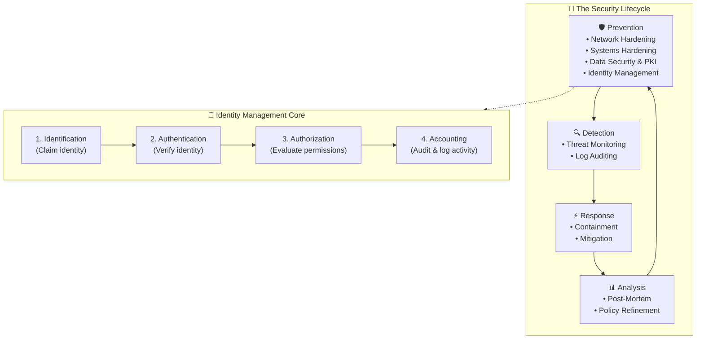

---

## 📌 Learning Objectives

By completing this module and reviewing these study materials, you will be able to:

- [ ] **Define Identity Management**: Articulate how identity management actively administers subjects, objects, and permissions to maintain secure, scalable access controls.
- [ ] **Distinguish the IAAA Core Principles**: Differentiate between **Identification**, **Authentication**, **Authorization**, and **Accounting**, illustrating each step using physical and cloud analogies.
- [ ] **Classify Authentication Factors**: Categorize authenticators across the four primary categories—*Something you know* (knowledge), *Something you have* (possession), *Something you are* (biometrics/inherence), and *Somewhere you are* (context/location).
- [ ] **Implement Multi-Factor Authentication (MFA)**: Describe how combining multiple distinct factors significantly elevates security posture, analyze Time-Based One-Time Password (TOTP) algorithms, and apply countermeasures against MFA push-fatigue attacks.
- [ ] **Evaluate Password Policies and Threat Vectors**: Analyze dictionary attacks, brute force attacks, and rainbow tables; design effective password policies and utilize enterprise password managers.
- [ ] **Protect Personally Identifiable Information (PII)**: Define PII, identify its role across authentication factors, and evaluate the compliance and security imperatives of safeguarding identity data.
- [ ] **Deconstruct Single Sign-On (SSO) & Federation**: Contrast traditional silod credentials with federated identity models; diagram token-based authentication workflows between Identity Providers (IdP) and Service Providers (SP).
- [ ] **Compare Identity Federation Standards**: Differentiate between **SAML 2.0**, **OAuth 2.0**, and **OpenID Connect (OIDC)** based on token architectures, protocols, and modern web/API use cases.
- [ ] **Master AWS Identity Services**:
  - Analyze the internal request evaluation mechanics of **AWS Identity and Access Management (IAM)** (Principals, Authentication, Context, Policies, and Actions).
  - Architect multi-account workforce access using **AWS IAM Identity Center** (formerly AWS Single Sign-On).
  - Select and deploy **Amazon Cognito** components (**User Pools** for customer directories and **Identity Pools** for temporary AWS resource access).
  - Evaluate **AWS Directory Service** deployment modes for integrating existing Microsoft Active Directory environments.

---

## 🛡️ 1. Identity Management within the Security Lifecycle

### 1.1 The Security Lifecycle Architecture

Information security is not a one-time project; it is an ongoing, adaptive operational lifecycle divided into four cyclical phases:

1. **Prevention**: The first line of defense. Preventive controls mitigate risks and stop security threats before they can compromise systems, networks, or data.
2. **Detection**: Monitoring, telemetry analysis, and alerting mechanisms that trigger when preventive controls fail or an anomaly occurs.
3. **Response**: Coordinated operational procedures executed to isolate, contain, neutralize, and remediate detected security threats.
4. **Analysis**: Post-incident investigations, root cause analyses, and forensic assessments that yield actionable lessons learned to reinforce the prevention phase.

Within the **Prevention Phase**, security engineers implement five foundational protective disciplines:
- **Network Hardening**: Demarcating network segments via VPCs, subnets, firewalls (Security Groups, Network ACLs, AWS WAF), and routing boundaries.
- **Systems Hardening**: Minimizing operating system attack surfaces, removing unnecessary software, applying security baselines, and automating patching.
- **Data Security**: Enforcing encryption at rest and in transit, data classification, and tokenization.
- **Public Key Infrastructure (PKI)**: Establishing cryptographic trust, managing asymmetric key pairs, and issuing digital X.509 certificates.
- **Identity Management**: Regulating who or what can access systems, data, and operational resources.

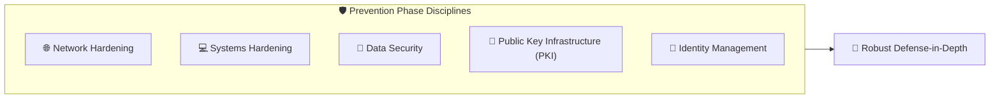

### 1.2 What is Identity Management?

> **Definition**: **Identity Management (IdM)** is the active, systematic administration of subjects (users, applications, processes, automated services), objects (servers, databases, storage volumes, network resources), and the relationships between them regarding access permissions.

Identity management ensures three fundamental operational objectives:
1. **Appropriate Access**: Identities receive access to the exact resources they require to fulfill their business role—nothing more and nothing less (enforcing the **Principle of Least Privilege**).
2. **Correct Level & Timing**: Permissions are restricted to the appropriate operational depth (e.g., read-only vs. read-write vs. administrative) and time window (e.g., just-in-time access).
3. **Enterprise Scalability**: As organizations grow from ten employees to hundreds of thousands of users and machines, identity management allows administrative teams to provision, govern, and revoke permissions efficiently using roles, groups, and automated directory synchronization without re-architecting security controls.

### 1.3 The Retail Store Analogy

To understand how identity management maps to real-world roles, duties, and access boundaries, consider a typical retail store operation:

| Employee Role | Primary Assigned Task | Authorized Physical & Logical Access | Applied Security Principle |
| :--- | :--- | :--- | :--- |
| **Cashier** | Receives payments, scans items, issues receipts, and balances the cash drawer. | Granted badge access strictly to the assigned cash register and checkout counter. Denied access to inventory stockrooms and back-office safes. | **Least Privilege**: Only the exact tools needed to conduct retail checkout transactions are accessible. |
| **Security Guard** | Protects facilities against theft, monitors surveillance cameras, and inspects entrances. | Granted physical badge access to public retail areas, front doors, back perimeter entrances, and guard rooms. Denied access to financial registers and payroll servers. | **Separation of Duties**: Operational security personnel do not handle commercial transactions or financial assets. |
| **Store Manager** | Supervises store personnel, reconciles revenue, approves returns, and conducts quality audits. | Granted master badge access to checkout registers, manager offices, inventory storage, and administrative systems. | **Role-Based Access Control (RBAC)**: Elevated supervisory access commensurate with organizational accountability and operational scope. |

> [!NOTE]
> In this analogy, the retail badge represents the physical authentication artifact, while the electronic door locks and register permissions represent the authorization layer evaluating the badge's role against access control lists (ACLs).

---

## 🔑 2. The IAAA Identity Framework

All robust identity systems enforce four distinct, sequential steps collectively referred to as **IAAA**: **Identification**, **Authentication**, **Authorization**, and **Accounting** (often abbreviated as **AAA**).

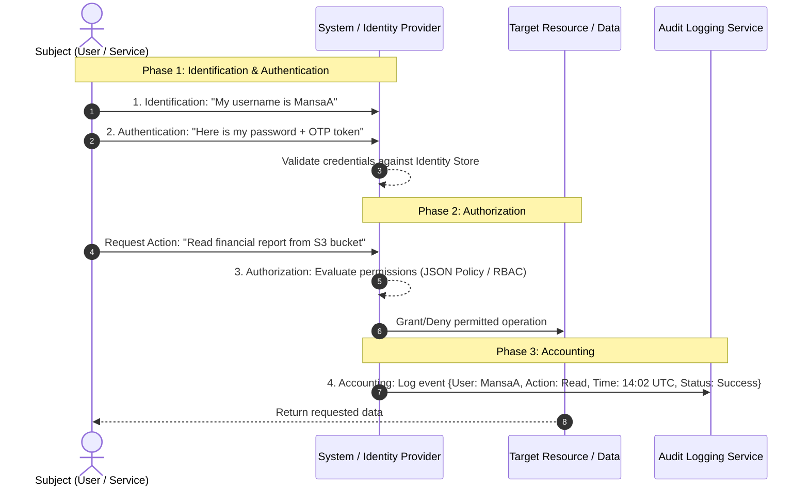

### 2.1 The Four Stages Deconstructed

#### 1. Identification (Who are you claiming to be?)
- **Concept**: The assertion of an identity by a subject. It is the public or semi-public claim of who you are before any proof is presented.
- **Mechanism**: Supplying a unique username, account ID, employee badge number, email address, or API Access Key ID.
- **Security Rule**: Identification alone provides zero assurance; claiming an identity does not prove ownership of that identity.

#### 2. Authentication (Can you prove who you claim to be?)
- **Concept**: The technical verification and validation of the claimed identity. The system challenges the subject to supply authenticating evidence.
- **Mechanism**: Providing one or more secret authentication factors (passwords, cryptographic private keys, biometric signatures, one-time passwords).
- **Security Rule**: Reliable authentication ensures that impostors cannot masquerade as valid principals.

#### 2. Authorization (What actions are you permitted to perform?)
- **Concept**: The process of determining the specific rights, privileges, and access permissions granted to an authenticated identity.
- **Mechanism**: Access Control Lists (ACLs), Role-Based Access Control (RBAC), Attribute-Based Access Control (ABAC), or declarative JSON policy documents (e.g., AWS IAM policies).
- **Security Rule**: Authentication must always precede authorization. Being authenticated confirms *who* you are, but does not inherently grant permission to *do* anything until authorization policies are evaluated.

#### 4. Accounting / Auditing (What did you do, and when?)
- **Concept**: Establishing non-repudiation and visibility by monitoring, capturing, and recording all actions, commands, configuration edits, logins, and logouts.
- **Mechanism**: Immutable audit log streams, system event loggers (e.g., AWS CloudTrail, syslog, Windows Event Viewer), and Security Information and Event Management (SIEM) systems.
- **Security Rule**: Without accounting, forensic analysis of security breaches is impossible, and organizations cannot achieve regulatory compliance or prove non-repudiation.

### 2.2 Analogies: Physical Facility Access vs. Cloud Infrastructure Login

| Stage | Physical Facility Access Analogy | Cloud Computing / AWS Login Scenario |
| :--- | :--- | :--- |
| **Identification** | A visitor arrives at the corporate security desk and states their name: *"I am Jordan Liu."* | A cloud engineer enters their username `liuj@enterprise.com` into the AWS Management Console sign-in screen. |
| **Authentication** | The receptionist inspects Jordan's government-issued driver's license, verifying that the photo matches the person standing at the counter. | The engineer inputs their 16-character master passphrase and enters a 6-digit TOTP code generated by a hardware YubiKey. |
| **Authorization** | The receptionist calls the company sponsor, validates the appointment schedule, and issues a visitor badge encoded strictly for the 2nd-floor conference room. | The AWS IAM evaluation engine evaluates the IAM Policies attached to Jordan's IAM Role, confirming permission to `s3:GetObject` on `prod-reports`, but explicitly denying `s3:DeleteBucket`. |
| **Accounting** | The receptionist logs Jordan's arrival time, badge ID number, host name, and departure time into the front desk visitor logbook. | AWS CloudTrail records an API event: `ConsoleLogin`, user identity ARN, source IP address, user agent, timestamp, and requested API action result (`success`). |

---

## 🔐 3. Authentication Factors & Multi-Factor Authentication (MFA)

Authentication mechanisms verify identity by challenging the subject to present evidence spanning one or more distinct **factors of authentication**.

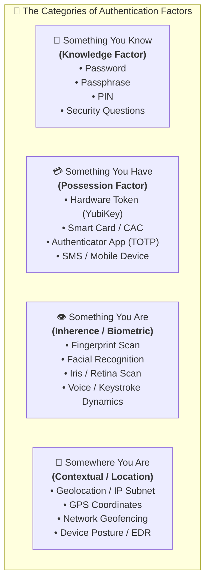

### 3.1 The Authentication Factor Categories

#### 1. Something You Know (Knowledge Factor)
- **Examples**: Alphanumeric passwords, complex passphrases (*"The sky is blue in November"*), Personal Identification Numbers (PINs), pre-shared secret keys.
- **Characteristics**: Simplest and cheapest factor to implement; universally supported across software platforms.
- **Vulnerabilities**: Easiest factor to compromise via phishing, social engineering, credential stuffing, keyloggers, dictionary attacks, and shoulder surfing.

#### 2. Something You Have (Possession Factor)
- **Examples**: Physical smart cards, Common Access Cards (CAC), USB security tokens (FIDO2 / WebAuthn hardware keys like YubiKey), RSA SecurID hardware authenticators, smartphone authenticator apps (e.g., Google Authenticator, AWS Virtual MFA), digital X.509 client certificates.
- **Characteristics**: Substantially more secure than knowledge alone. Requires physical possession or cryptographic registration of a physical artifact.
- **Vulnerabilities**: Hardware tokens can be stolen or physically misplaced; SMS-based verification codes are vulnerable to SIM-swapping and cellular network interception (SS7 attacks).

#### 3. Something You Are (Inherence / Biometric Factor)
- **Examples**: Fingerprint scanners, facial recognition cameras (Apple Face ID, Windows Hello), iris scanners, retinal scanners, hand geometry, voice recognition, dynamic signature analysis.
- **Characteristics**: Bound directly to the human biological substrate; impossible to "forget" at home. Provides strong convenience.
- **Biometric Performance Metrics**:
  - **False Acceptance Rate (FAR)**: The probability that an unauthorized impostor is incorrectly recognized as a legitimate user (Type II Error).
  - **False Rejection Rate (FRR)**: The probability that an authorized user is incorrectly rejected by the system (Type I Error).
  - **Crossover Error Rate (CER)**: The operating point where FAR equals FRR. Lower CER represents superior biometric accuracy.
- **Vulnerabilities**: Biometric signatures cannot be reset or changed if compromised (you cannot issue a new fingerprint like you issue a new password); facial recognition can struggle under varying lighting or angles without infrared depth sensing.

#### 4. Somewhere You Are & Contextual Attributes (Context Factor)
- **Examples**: Geolocation derived from GPS, corporate network IP subnet ranges, time-of-day restrictions, BGP routing origins, device compliance posture (e.g., disk encryption enabled, corporate certificate present).
- **Application**: Frequently utilized in **Adaptive Authentication** and **Zero Trust Architecture** to enforce step-up authentication when logins originate from unexpected foreign countries or untrusted IP addresses.

### 3.2 Multi-Factor Authentication (MFA)

> [!IMPORTANT]
> **True Multi-Factor Authentication** requires the simultaneous presentation of **two or more distinct categories** of authentication factors. Presenting two items from the *same* category (e.g., a password and a PIN) is **two-step authentication**, NOT multi-factor authentication, because both rely solely on *something you know*.

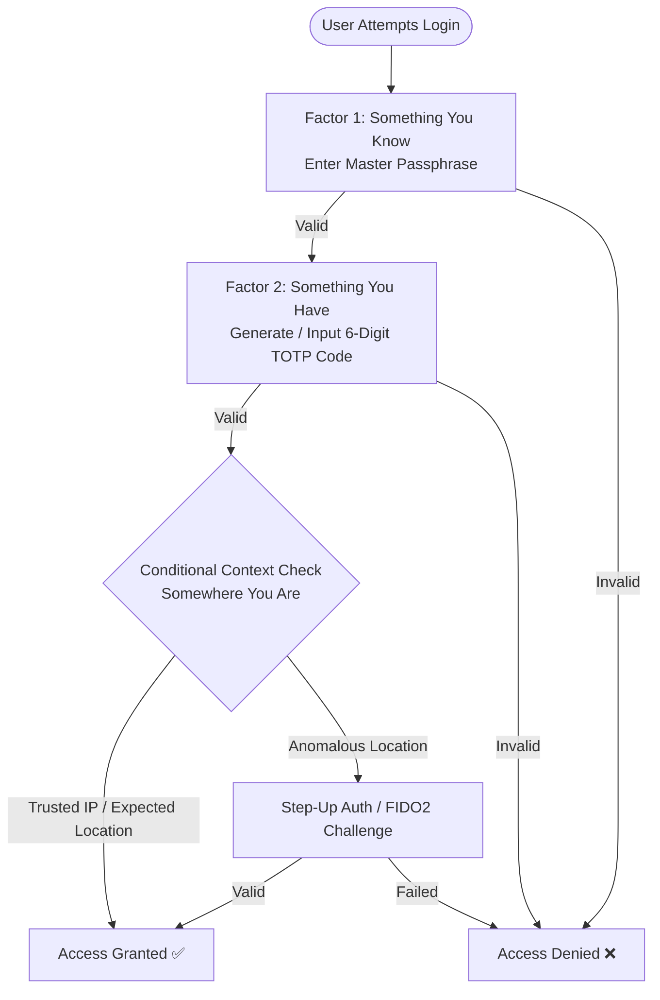

#### Security Benefits of MFA
- **Mitigates 99% of Credential Stuffing & Spraying Attacks**: Even if an attacker obtains an employee's exact plaintext password from a third-party breach database, they cannot authenticate without access to the physical second-factor device.
- **Prevents Masquerading**: Eliminates the catastrophic impact of leaked or guessed passwords.
- **Mandatory Compliance Mandate**: Required across major standards including PCI DSS, HIPAA, SOC 2, ISO 27001, and the AWS Foundational Security Best Practices benchmark.

#### Time-Based One-Time Password (TOTP) Algorithms (RFC 6238)
How do virtual MFA apps (like AWS Virtual MFA or Google Authenticator) work without continuous internet connectivity?
1. **Shared Secret Seed**: During MFA setup, the server and mobile authenticator exchange a shared secret key (typically encoded inside a scanned QR code).
2. **Current Unix Epoch Time**: Both the server and phone read the current UTC time divided into 30-second time steps ($T = \lfloor \frac{\text{CurrentTime} - T_0}{30} \rfloor$).
3. **HMAC-SHA Cryptography**: The authenticator computes an HMAC-SHA1 hash using the shared secret and time counter $T$.
4. **Dynamic Truncation**: The resulting 160-bit hash is dynamically truncated to produce a 6-digit numerical code valid for exactly 30 seconds.
5. **Validation with Drift Tolerance**: The server performs the identical calculation. Because time may drift slightly between device clocks, servers typically accept codes from the current time window, plus or minus one 30-second window ($\pm 1$ step).

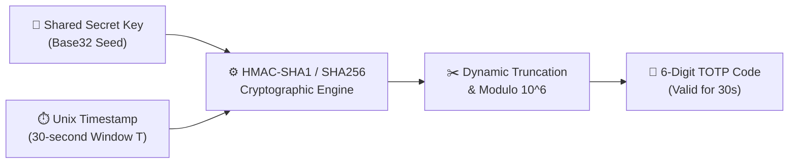

#### Modern Threat: MFA Fatigue Attacks & Push Bombing
In legacy mobile MFA systems that use simple push notifications (*"Tap Yes to approve login"*), attackers conduct **MFA Fatigue Attacks** (Push Bombing):
1. Attackers steal employee credentials via phishing.
2. The attacker triggers dozens of continuous push notification alerts to the victim's phone at 3:00 AM.
3. The frustrated, exhausted victim eventually taps "Approve" simply to silence the barrage of notifications, inadvertently granting the attacker full network access.

**Countermeasures & Prevention**:
- **Number Matching**: The login screen displays a random two-digit number (e.g., `47`); the user must physically type that exact number into their mobile authenticator app to approve the prompt.
- **FIDO2 / WebAuthn Cryptographic Keys (YubiKey)**: Hardware keys physically bind authentication to the specific browser domain (origin binding). Hardware keys cannot be phished or push-bombed because authentication requires cryptographic public-key attestation directly between the browser and the authenticating endpoint.
- **Rate Limiting & Lockout**: Enforcing automatic lockout after three unapproved push prompts.

---

## 🛡️ 4. Password Security, Attack Vectors & Defensive Controls

Despite the growth of passwordless technologies, passwords remain one of the most widely deployed authentication factors. Effective password management requires understanding attack mechanisms and enforcing defensive policies.

### 4.1 Common Password Attacks

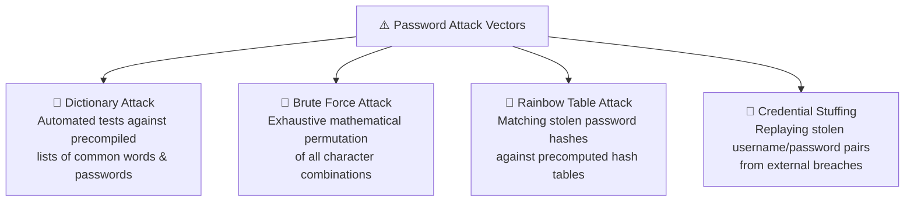

#### 1. Dictionary Attacks
- **Mechanism**: The attacker uses automated scripts to systematically test tens of thousands of common dictionary words, names, slang, and common character substitutions (e.g., `P@ssw0rd`, `Admin123`, `Welcome2024`).
- **Defenses**: Account lockout after consecutive failed attempts, rate limiting, and requiring non-dictionary passphrases.

#### 2. Brute Force Attacks
- **Mechanism**: Attackers systematically cycle through every possible combination of letters, numbers, and symbols until finding the correct password.
- **Mathematical Complexity**: An 8-character password using only lowercase letters ($26^8 \approx 2 \times 10^{11}$ combinations) can be cracked in minutes on modern GPUs. Conversely, a 16-character passphrase incorporating upper/lowercase, numbers, and symbols ($95^{16} \approx 4.4 \times 10^{31}$ combinations) requires billions of years to brute-force with current computing power.

#### 3. Rainbow Table Attacks & Hash Salting
- **Mechanism**: When an attacker breaches a user database, passwords are (or should be) stored as cryptographic hashes (e.g., SHA-256). A **rainbow table** is a precomputed lookup table containing millions of plaintext passwords and their corresponding cryptographic hash values. If the attacker finds a matching hash in the table, they instantly reverse the hash to recover the plaintext password.
- **Defense – Cryptographic Salt**:
  - A **salt** is a cryptographically strong, random string of bits generated uniquely for every single user account upon password creation.
  - The system combines the salt with the password before hashing: $\text{Hash} = \text{SHA256}(\text{Password} + \text{UniqueSalt})$.
  - Both the salt and the resulting hash are stored in the database.
  - **Effect**: Because every user's salt is completely unique, an attacker cannot use precomputed rainbow tables. They must calculate a new table for every individual user salt, making offline cracking economically and computationally infeasible.
  - Modern systems utilize memory-hard, computationally slow key derivation functions such as **bcrypt**, **PBKDF2**, or **Argon2id**.

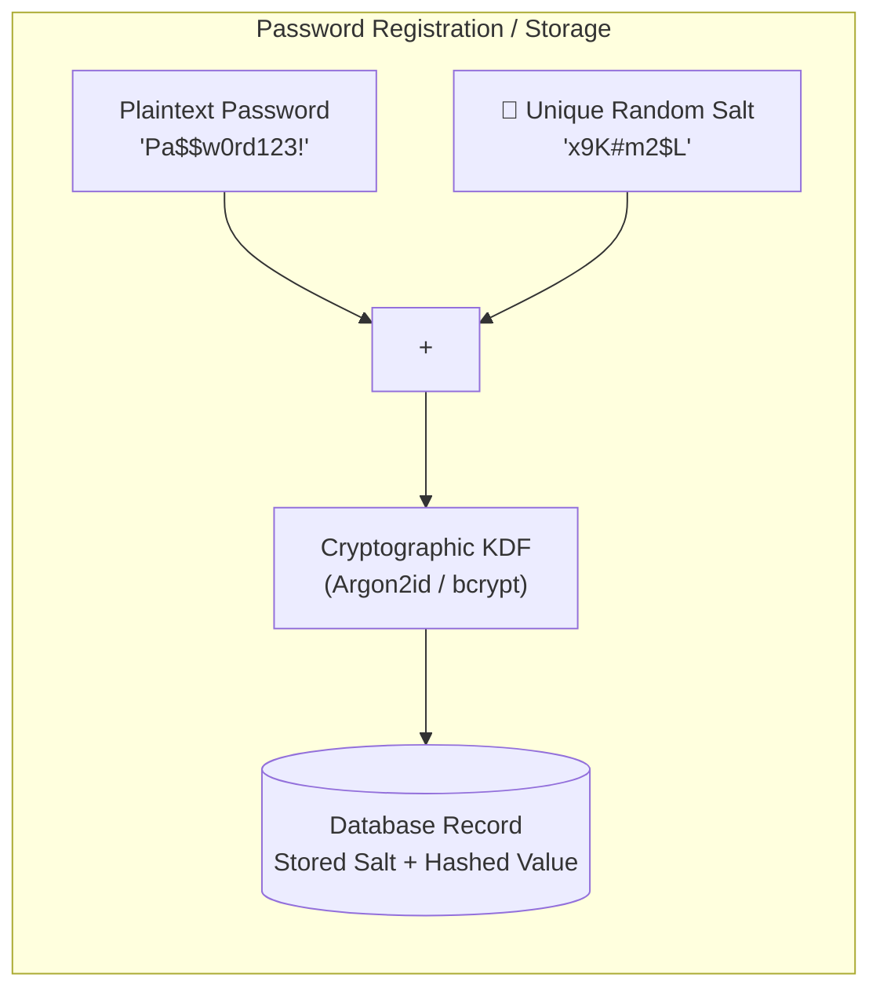

### 4.2 Designing Enterprise Password Policies

A strong password policy balances mathematical defense against human behavioral tendencies:

| Policy Parameter | Weak Policy (Vulnerable) | Strong Enterprise Policy | Architectural Rationale |
| :--- | :--- | :--- | :--- |
| **Minimum Length** | 6 – 8 characters | $\ge$ 12 to 16 characters | Length exponentially increases keyspace entropy more effectively than arbitrary symbol rules. |
| **Complexity Requirements** | None or simple lowercase | Uppercase, lowercase, numeric digits, and special symbols | Defeats simple dictionary matching and basic brute force patterns. |
| **Password Expiration / Age** | Never, or excessively frequent (every 14 days) | 60 – 90 days, or event-driven upon compromise | Excessively frequent expiration causes users to make predictable incremental edits (e.g., `Spring2024!`, `Summer2024!`). |
| **Password History** | None (reuse allowed) | Cannot reuse the last 10 to 24 previous passwords | Prevents users from alternating between two familiar passwords. |
| **Account Lockout Threshold** | Unlimited attempts | Lock account after 5 consecutive failed attempts for 15–30 minutes | Stops automated online brute-force and dictionary attacks immediately. |
| **Common Password Blacklists** | None | Prohibits known breached passwords (e.g., HaveIBeenPwned API validation) | Prevents users from choosing widely compromised corporate passwords. |

### 4.3 Password Managers & The Centralized Vault Model

Password managers eliminate the human cognitive limitation of having to memorize dozens of unique credentials:
- **Centralized Encrypted Vault**: Master vault is encrypted using military-grade encryption (**AES-256**) derived from a master passphrase using PBKDF2 or Argon2.
- **Zero-Knowledge Architecture**: The vendor never sees or stores the master passphrase or the decryption key; only the user can decrypt the vault locally on their endpoint device.
- **Credential Generation & Autofill**: Generates random 20+ character passwords for every independent service, directly mitigating credential stuffing across third-party websites.
- **Integrated Audit Engine**: Scans stored passwords against public data breach feeds and alerts users to weak or reused passwords.

### 4.4 Enterprise Anti-Pattern: Prohibition of Group / Shared Accounts

> [!CAUTION]
> **Never use generic or shared group accounts** (e.g., `admin`, `dev-team`, `Group1`). 

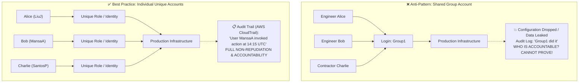

**Why shared accounts destroy enterprise security**:
1. **Total Loss of Non-Repudiation**: If `Group1` deletes an Amazon RDS database, the audit log only reflects `Group1`. There is no forensic mechanism to determine *which* human operator issued the command.
2. **Revocation Nightmare**: When one individual leaves the company, the shared password must be manually changed and redistributed to all remaining team members.
3. **MFA Impossibility**: True possession-based MFA cannot be effectively deployed when multiple individuals share a single login.

---

## 🪪 5. Personally Identifiable Information (PII) Governance

### 5.1 What is Personally Identifiable Information (PII)?

> **Definition**: **Personally Identifiable Information (PII)** is any representation of information that permits the identity of an individual to whom the information applies to be reasonably inferred by either direct or indirect means.

PII is classified into two primary tiers:
- **Direct Identifiers**: Data points that uniquely identify a person without additional context (e.g., Government identification numbers, Passport numbers, Social Security Numbers, Full Legal Name, Biometric records, Fingerprints).
- **Indirect / Quasi-Identifiers**: Data points that do not identify a person in isolation, but can be correlated with other public data to reveal an exact identity (e.g., Date of birth, Postal zip code, Gender, Job title, IP address, Vehicle registration).

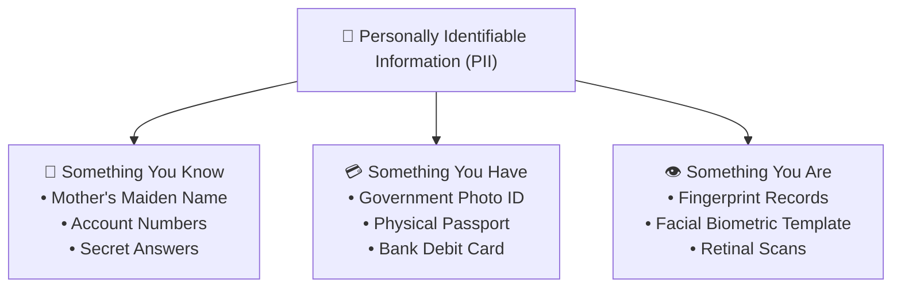

### 5.2 Why PII Security is Foundational to Prevention

Unlike passwords, which can be instantly reset and regenerated when compromised, **PII cannot be easily replaced**:
- If an employee's Social Security Number, date of birth, or biometric fingerprint scan is leaked in a data breach, that identifier is permanently exposed for the rest of their natural life.
- Regulatory frameworks impose massive financial penalties and legal sanctions for failing to safeguard PII:
  - **GDPR (General Data Protection Regulation)**: Fines up to 4% of global annual turnover or €20 million.
  - **HIPAA (Health Insurance Portability and Accountability Act)**: Mandatory penalties for compromised Protected Health Information (PHI).
  - **PCI DSS (Payment Card Industry Data Security Standard)**: Heavy operational fines and revocation of credit card processing privileges for exposed cardholder data.

---

## 🌐 6. Federated Identity & Single Sign-On (SSO)

In a traditional enterprise without unified identity management, every separate software application, server, and internal tool requires its own independent user account, local password, and directory entry.

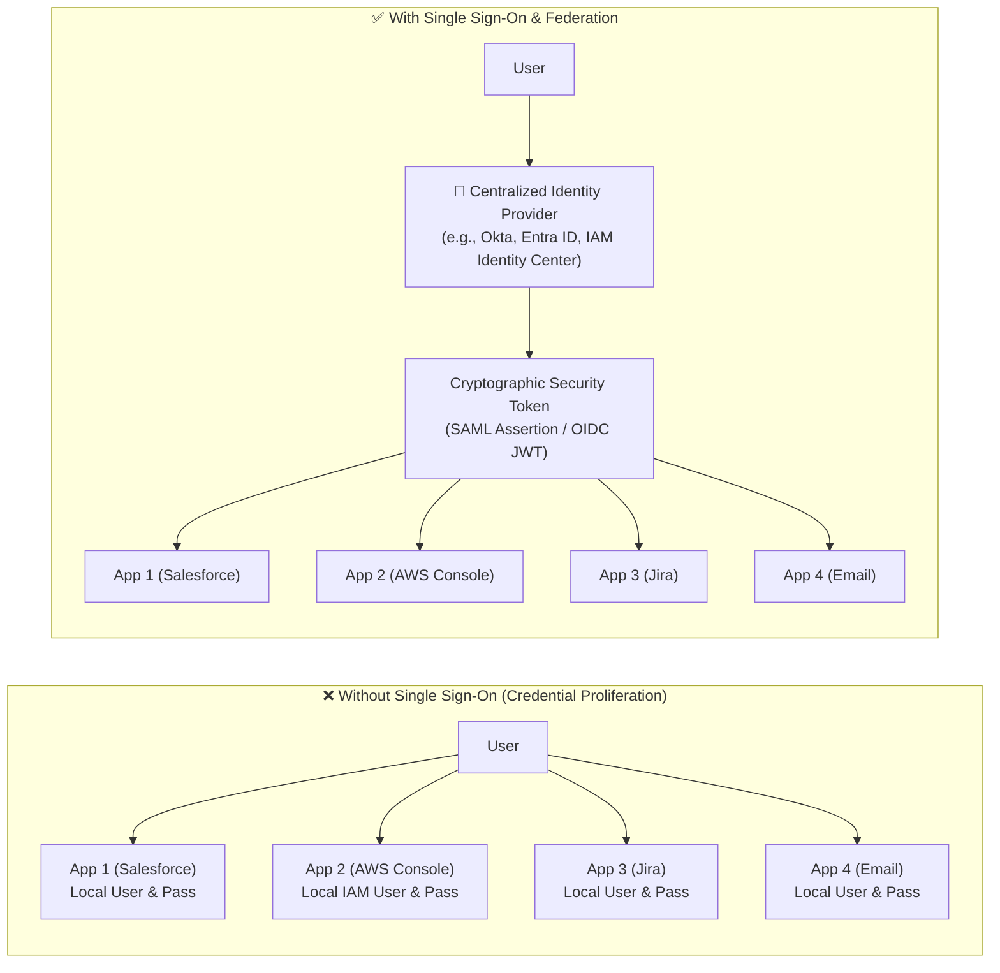

### 6.1 Single Sign-On (SSO) Core Mechanics

> **Single Sign-On (SSO)** is an access control architecture that enables a user to log in once with a single set of enterprise credentials and securely access multiple independent software applications and cloud environments without having to re-authenticate to each individual service.

**Key Characteristics of SSO**:
- Users authenticate only once at a central identity authority.
- Target applications trust the central identity authority via cryptographic public key certificates.
- Eliminates **password fatigue** (employees having to memorize dozens of complex passwords).
- Greatly simplifies administrative onboarding and offboarding: when an employee departs the organization, disabling their central account instantly revokes access to all enterprise SaaS applications and AWS environments.

### 6.2 Federated Identity Architecture

> **Federated Identity** is an identity management framework that extends SSO across disparate organizations, trust boundaries, domains, and cloud environments. It uses standard cryptographic tokens to establish trust between two primary entities: the **Identity Provider (IdP)** and the **Service Provider (SP)**.

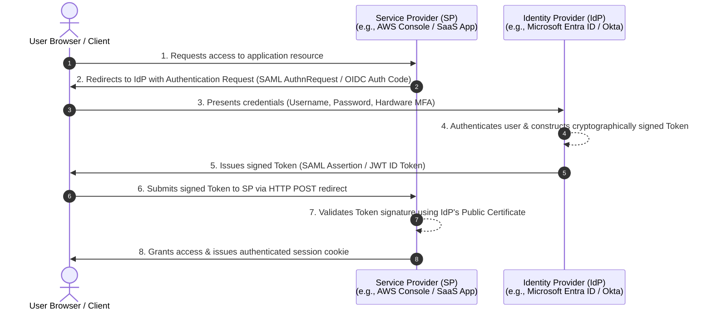

#### Core Components in Identity Federation:
1. **Subject / Principal**: The user or service requesting access.
2. **Identity Provider (IdP)**: The authoritative entity that holds the master user directory, authenticates the user, and issues cryptographically signed identity tokens (e.g., Microsoft Entra ID, Okta, Ping Identity, Google Workspace).
3. **Service Provider (SP) / Relying Party (RP)**: The target application or cloud environment that provides business services and relies on the IdP for authentication assertions (e.g., AWS Management Console, Salesforce, Workday, Zendesk).
4. **Trust Relationship**: Established out-of-band by exchanging metadata documents containing cryptographic public certificates and endpoint URLs.

### 6.3 Modern Identity Federation Protocols: SAML 2.0 vs. OAuth 2.0 vs. OpenID Connect (OIDC)

| Federation Protocol | Primary Architectural Purpose | Data Payload Format | Core Token / Assertion Type | Common Enterprise Use Case |
| :--- | :--- | :--- | :--- | :--- |
| **SAML 2.0** *(Security Assertion Markup Language)* | **Authentication & Enterprise SSO** across corporate browsers and legacy enterprise directories. | XML (Extensible Markup Language) | Cryptographically signed **SAML Assertion** containing user attributes and roles. | Corporate workforce access to AWS Management Console, corporate intranets, and enterprise SaaS apps. |
| **OAuth 2.0** *(Open Authorization Framework)* | **Authorization & Delegated Access** (granting third-party applications limited access to HTTP resources without sharing user passwords). | JSON (JavaScript Object Notation) | **Access Token** & **Refresh Token** (typically formatted as opaque strings or JWTs) scoped with permissions. | Permitting a mobile calendar app to read Google contacts via REST API on the user's behalf. |
| **OpenID Connect (OIDC)** | **Authentication Identity Layer** built on top of the OAuth 2.0 authorization framework. | JSON Web Tokens (JWT) | **ID Token** (contains verifiable user identity claims) alongside OAuth 2.0 Access Tokens. | Modern mobile apps, single-page web applications (React/Angular), and social logins (Login with Apple, Google). |

> [!NOTE]
> A simple rule of thumb:
> - **SAML 2.0** is for **Enterprise Authentication** (heavyweight XML, browser redirects).
> - **OAuth 2.0** is for **API Authorization** (delegating permissions to third parties).
> - **OpenID Connect (OIDC)** is for **Modern Web & Mobile Authentication** (lightweight JSON/JWT identity layer).

---

## ☁️ 7. AWS Identity Services Deep-Dive

AWS provides a comprehensive, interconnected suite of identity and access governance services tailored for workforce employees, server-to-server microservices, consumer mobile applications, and enterprise directories.

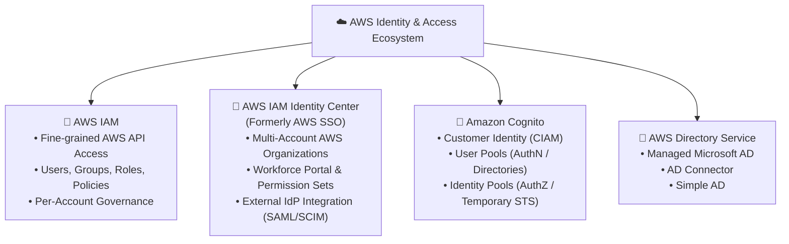

---

### 7.1 AWS Identity and Access Management (IAM)

AWS IAM is the core service that controls authentication and authorization for all requests made to AWS resources.

#### How IAM Evaluates API Requests
Every action performed against AWS—whether clicking a button in the AWS Management Console, running an AWS CLI command, or making an SDK call—is an HTTPS API request. IAM intercepts every request and processes it through a strict evaluation pipeline:

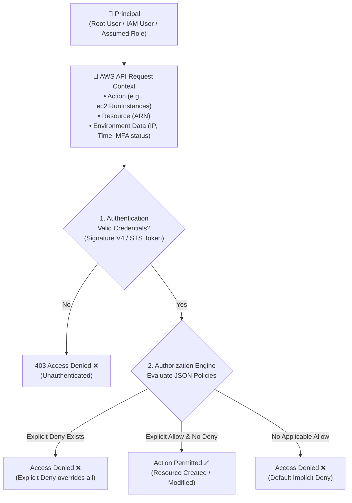

#### Anatomy of an AWS IAM Request
An AWS request contains the following telemetry data evaluated by IAM:
1. **Principal**: The human user, service, or federated entity initiating the request.
2. **Action**: The specific API operation requested (e.g., `s3:GetObject`, `dynamodb:PutItem`, `ec2:StartInstances`).
3. **Resources**: The specific AWS resource Amazon Resource Name (ARN) targeted by the action (e.g., `arn:aws:s3:::corporate-finance-bucket/*`).
4. **Environment Data**: Contextual runtime attributes including client IP address, user agent, current timestamp, SSL/TLS status, and whether MFA was used.
5. **Resource Data**: Attributes and tags attached to the targeted resource (e.g., tag `Environment = Production`).

#### Core IAM Building Blocks:
- **Root User**: The identity created when the AWS account is first established. Has absolute, unrestricted administrative control. *Best Practice*: Never use root for daily administrative tasks; lock away its access keys and require hardware MFA.
- **IAM Users**: Long-term identities representing specific people or automated applications within a single AWS account.
- **IAM Groups**: Collections of IAM users. Permissions applied to a group are inherited by all member users (users cannot be nested into sub-groups).
- **IAM Roles**: Identities that are not tied to a single user. Instead, roles are assumed dynamically by users, AWS services (such as EC2 instances or Lambda functions), or federated external identities to obtain **temporary security credentials** generated by AWS Security Token Service (AWS STS).
- **IAM Policies**: JSON documents defining permissions. Follows the principle: **Explicit Deny > Explicit Allow > Default Implicit Deny**.

```json
{
  "Version": "2012-10-17",
  "Statement": [
    {
      "Sid": "AllowS3ReadWithMFAOnly",
      "Effect": "Allow",
      "Action": [
        "s3:GetObject",
        "s3:ListBucket"
      ],
      "Resource": [
        "arn:aws:s3:::enterprise-data-vault",
        "arn:aws:s3:::enterprise-data-vault/*"
      ],
      "Condition": {
        "Bool": {
          "aws:MultiFactorAuthPresent": "true"
        }
      }
    }
  ]
}
```

---

### 7.2 AWS IAM Identity Center (Formerly AWS Single Sign-On / AWS SSO)

While standard AWS IAM manages permissions within a single AWS account, modern enterprises manage dozens or hundreds of AWS accounts orchestrated under **AWS Organizations**. Managing local IAM users in hundreds of separate accounts introduces severe operational overhead and security risk.

**AWS IAM Identity Center** solves this by providing a unified, centralized workforce authentication portal:

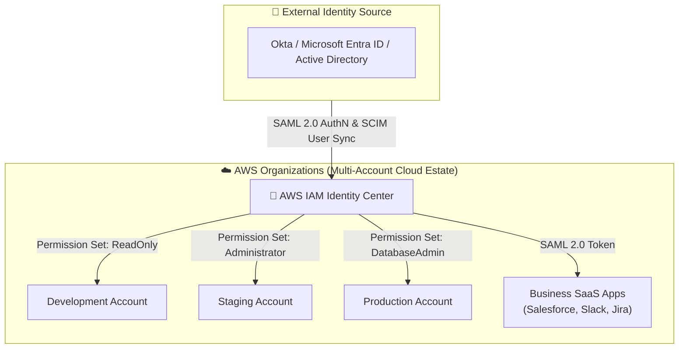

#### Common Features & Capabilities:
- **Centralized Multi-Account Governance**: Assign permissions across all member accounts in AWS Organizations from a single dashboard.
- **Permission Sets**: Centrally managed IAM policies mapped to specific users and groups across designated AWS accounts.
- **Seamless Directory Synchronization**: Integrates directly with on-premises Active Directory or cloud identity providers (Okta, Microsoft Entra ID) using standard **SAML 2.0** for authentication and **SCIM (System for Cross-domain Identity Management)** for automated user provisioning.
- **Built-in Application Portal**: Provides employees with a customizable web portal offering one-click access to assigned AWS accounts and third-party SaaS cloud applications (e.g., Salesforce, Microsoft 365, Box).
- **Compatibility with Existing IAM**: Works in tandem with existing IAM roles, users, and policies without breaking existing infrastructure deployments.

---

### 7.3 Amazon Cognito: Customer Identity and Access Management (CIAM)

Amazon Cognito provides identity management, authentication, and authorization tailored specifically for public-facing customer web and mobile applications (supporting millions of consumer users).

Amazon Cognito consists of two distinct, complementary sub-services:

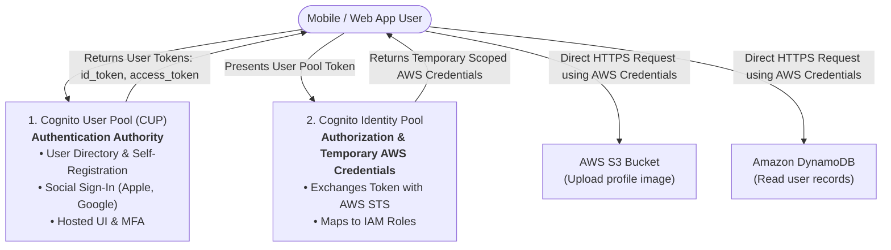

#### Detailed Comparison: User Pools vs. Identity Pools

| Architectural Dimension | Amazon Cognito User Pools (CUP) | Amazon Cognito Identity Pools (Federated Identities) |
| :--- | :--- | :--- |
| **Primary Focus** | **Authentication (AuthN)**: *"Who is the user?"* | **Authorization (AuthZ)**: *"What AWS resources can the user access?"* |
| **User Directory** | Acts as a complete user directory database storing user profiles, passwords, and custom attributes. | Does NOT store user directories; relies on external token providers or User Pools. |
| **Authentication Sources** | Built-in directory, Social IdPs (Google, Apple, Facebook, Amazon), SAML 2.0, OpenID Connect. | Cognito User Pools, OpenID Connect providers, SAML IdPs, and Developer-authenticated identities. |
| **Tokens Issued** | Issues **OpenID Connect JWT tokens** (`id_token`, `access_token`, and `refresh_token`). | Issues **temporary AWS credentials** (Access Key ID, Secret Access Key, Session Token) via AWS STS. |
| **Target Workload Access** | Used by application backends (e.g., Amazon API Gateway, AWS AppSync, ALB) to verify user identity. | Allows client mobile devices to call AWS services directly (e.g., Amazon S3, Amazon DynamoDB, AWS IoT). |
| **Guest / Anonymous Support** | Requires user registration and login. | Supports **unauthenticated guest access**, providing temporary scoped credentials to anonymous users. |

---

### 7.4 AWS Directory Service

For organizations with established Microsoft Windows infrastructure, **AWS Directory Service** provides multiple deployment options to connect or run Microsoft Active Directory in the AWS Cloud:

1. **AWS Managed Microsoft AD**: A fully managed, highly available Microsoft Active Directory running on actual Windows Server domain controllers in AWS. Supports Group Policy Objects (GPOs), Kerberos authentication, and two-way trust relationships with on-premises AD domains.
2. **AD Connector**: A lightweight directory gateway proxy that redirects directory requests directly to an existing on-premises Active Directory without caching credentials in the cloud.
3. **Simple AD**: A cost-effective, standalone directory powered by Samba 4, suitable for basic LDAP and Windows domain joining where full Microsoft AD features (like trusts) are not required.

---

## 📊 8. Identity & Access Comparison Matrices

### 8.1 Authentication Factor Comparison Matrix

| Factor Category | Mechanism Examples | Relative Implementation Cost | Primary Vulnerabilities | Mitigating Countermeasures |
| :--- | :--- | :--- | :--- | :--- |
| **Something You Know** *(Knowledge)* | Passwords, Passphrases, PINs | Very Low | Phishing, Brute Force, Dictionary Attacks, Rainbow Tables | Enforce $\ge 12$ character length, salt + hash with Argon2, lockout thresholds, deploy MFA. |
| **Something You Have** *(Possession)* | YubiKey (FIDO2), Smart Card, TOTP App, Push Prompt | Moderate | Physical theft, SIM-swapping (SMS), MFA Push Fatigue | Require FIDO2 WebAuthn keys, number-matching prompts, deprecate SMS OTP. |
| **Something You Are** *(Inherence)* | Fingerprint, Facial Recognition, Iris Scanner | High | Sensor spoofing, algorithmic bias, unchangeable if breached | Use infrared 3D depth sensors, liveness detection, combine with possession factor. |
| **Somewhere You Are** *(Context)* | Geofenced IP subnet, GPS telemetry, Device Posture | Moderate | IP spoofing, VPN masking | Combine contextual signals with device health checks and behavioral anomaly analytics. |

### 8.2 AWS Identity Services Decision Matrix

| Service | Primary Target Use Case | Identity Source / Directory | Access Output Delivered | Best When... |
| :--- | :--- | :--- | :--- | :--- |
| **AWS IAM** | Internal AWS service-to-service calls, compute instances (EC2/Lambda), and single-account administration. | Local to individual AWS Account. | Long-term IAM credentials or temporary STS credentials. | Assigning execution permissions to AWS resources or managing a single isolated account. |
| **AWS IAM Identity Center** | Enterprise workforce access across hundreds of multi-account AWS Organizations and SaaS applications. | Internal store, Active Directory, or Cloud IdP (Okta, Entra ID via SAML/SCIM). | Unified web portal session, temporary CLI STS credentials. | Managing enterprise employees who need single sign-on across multiple AWS accounts. |
| **Cognito User Pools** | Customer-facing consumer mobile and web applications needing registration, login, and social sign-in. | Managed Cognito User Directory. | Standard OIDC JWT Tokens (`id_token`, `access_token`). | Building a customer mobile app that needs modern sign-up, email verification, and social login. |
| **Cognito Identity Pools** | Granting consumer app users direct, temporary access to AWS services (e.g., S3 photo upload). | Federates User Pools, Social IdPs, SAML, or Guest identities. | Temporary AWS IAM Credentials (via AWS STS). | Mobile devices need to upload or read directly from S3/DynamoDB without backend proxy servers. |
| **AWS Directory Service** | Enterprise workloads requiring native Microsoft Active Directory domain joins, Kerberos, and GPOs. | Managed AWS Microsoft AD or on-premises AD via AD Connector. | Kerberos tickets, NTLM, and LDAP directory queries. | Running Windows-based workloads (e.g., Amazon FSx for Windows, Amazon WorkSpaces, legacy EC2). |

---

## 💡 9. Discussion Scenarios & Architectural Exercises

### Scenario A: Mitigating an MFA Push-Fatigue Campaign in an Enterprise
*Reflective Context*: An attacker acquires valid corporate credentials for several engineers via a spear-phishing campaign. At midnight, the attacker launches an automated script generating 50 consecutive mobile MFA push notifications to each engineer's mobile device. One engineer taps "Approve" to silence their phone, giving the attacker access to the corporate intranet.
- **Architectural Solution**:
  1. Deprecate simple "tap-to-approve" mobile push notifications immediately.
  2. Implement **Number Matching**: The login screen displays a unique two-digit code that the user must manually read from the screen and type into their authenticator app.
  3. Transition critical administrative access to **FIDO2 / WebAuthn Hardware Keys (YubiKeys)**, which are mathematically immune to push-bombing and phishing.
  4. Configure rate-limiting rules in the Identity Provider to automatically lock accounts after three consecutive unapproved push notifications.

### Scenario B: Deconstructing the Shared Account Anti-Pattern
*Reflective Context*: A development team of five engineers shares a single AWS IAM User named `ProductionDeployer` with administrative privileges to launch and terminate EC2 instances and modify RDS databases. One evening, an engineer accidentally executes a script that drops a critical production database table.
- **Root Cause & Forensic Breakdown**:
  - Because all five developers authenticated using the identical `ProductionDeployer` access key, the resulting AWS CloudTrail log displays `userIdentity.userName: "ProductionDeployer"`.
  - The security team cannot establish **Non-Repudiation**: It is impossible to identify which individual executed the command.
  - Furthermore, revoking access for one departing contractor requires changing the shared access key for all four remaining engineers, halting production pipelines.
- **Remediation**:
  - Immediately delete the shared IAM user.
  - Deploy **AWS IAM Identity Center** integrated with the corporate directory.
  - Issue every engineer their own unique corporate identity with individualized MFA.
  - Enforce least privilege by assigning distinct, role-based Permission Sets to each developer.

### Scenario C: Architecting Mobile App Authentication (Cognito Integration)
*Reflective Context*: A startup is building a cross-platform mobile fitness app where 500,000 public users can sign up, log workouts, and upload profile pictures directly to an Amazon S3 bucket. How should identity services be architected?
- **Recommended Architecture**:
  1. **Cognito User Pool (CUP)**: Manages customer self-registration, password recovery, email verification, and social sign-in (Login with Google and Apple). Issues JWT tokens upon successful authentication.
  2. **Cognito Identity Pool**: Receives the JWT token from the User Pool, validates it, and issues temporary AWS STS credentials mapped to an IAM Role.
  3. **IAM Scoped Policy**: The IAM Role permits `s3:PutObject` strictly to the path `arn:aws:s3:::fitness-app-profiles/${cognito-identity.amazonaws.com:sub}/*`, ensuring users can only upload files to their own personal subfolder.

---

## 🧠 10. Checkpoint Review & Comprehensive Knowledge Check

Test your understanding of the concepts covered in this module with the following review questions:

### Question 1: What are the three primary tasks of identity management?
> **Answer**:
> The three primary tasks of identity management are:
> 1. **Authentication**: Proving and verifying the identity of the user, system, or process.
> 2. **Authorization**: Determining the specific resources, services, and actions the authenticated entity is permitted to access.
> 3. **Accounting (Auditing)**: Tracking, recording, and logging all activity, access, and changes performed to maintain an immutable audit trail and support non-repudiation.

### Question 2: What are the three primary types of authentication factors? Give one real-world example of each.
> **Answer**:
> 1. **Something you know** *(Knowledge)*: A master password, passphrase, or personal identification number (PIN).
> 2. **Something you have** *(Possession)*: A physical smart card, hardware security key (FIDO2/YubiKey), or virtual TOTP authenticator application on a smartphone.
> 3. **Something you are** *(Inherence/Biometric)*: A fingerprint scan, facial recognition scan, or retinal/iris pattern.  
> *(Note: Modern frameworks also recognize a 4th contextual factor: **Somewhere you are** / location).*

### Question 3: Federated users are a form of single sign-on. True or False?
> **Answer**:
> **True**. Federated identity management is a specialized implementation of Single Sign-On (SSO) that operates across distinct organizations, security domains, and web identities using cryptographically signed security tokens (e.g., using your Google or corporate enterprise credentials to access third-party applications without re-authenticating).

### Question 4: How does a rainbow table attack operate, and what cryptographic defensive mechanism completely defeats it?
> **Answer**:
> - **How it operates**: A rainbow table attack matches stolen cryptographic password hashes against precomputed tables containing millions of plaintext passwords and their corresponding hash outputs, enabling instant offline reversal of hashes without brute-forcing.
> - **Defensive mechanism**: **Cryptographic Salt**. A unique, random bit sequence is generated per user and combined with their password prior to hashing ($\text{Hash} = \text{HashFunction}(\text{Password} + \text{Salt})$). Because every user's salt is completely unique, precomputed rainbow tables become useless, forcing an attacker to compute a dedicated table for every individual user hash.

### Question 5: In AWS Identity services, what is the precise architectural difference between an Amazon Cognito User Pool and an Amazon Cognito Identity Pool?
> **Answer**:
> - **Cognito User Pool (CUP)** handles **Authentication (AuthN)**. It acts as the user directory database for web and mobile apps, managing user sign-up, sign-in, MFA, and social identity federation, issuing OpenID Connect JSON Web Tokens (JWTs).
> - **Cognito Identity Pool** handles **Authorization (AuthZ)**. It takes the tokens issued by a User Pool (or external IdPs) and exchanges them with AWS STS for temporary, scoped **AWS IAM credentials**, allowing client apps to call AWS services (such as S3 or DynamoDB) directly.

### Question 6: Under AWS IAM, what is the evaluation outcome if a request is matched by both an "Explicit Allow" statement and an "Explicit Deny" statement in attached policies?
> **Answer**:
> The request is **Denied**. In AWS IAM policy evaluation, an **Explicit Deny always overrides any Explicit Allow**, regardless of the order or policy type in which the statements appear.

### Question 7: Why is relying on SMS-based text messages for MFA considered substantially less secure than using a FIDO2 hardware security key?
> **Answer**:
> SMS-based MFA is vulnerable to **SIM-swapping** (where attackers deceive mobile carriers into transferring a victim's phone number to an attacker-controlled SIM card), cellular SS7 protocol interception, and real-time reverse-proxy phishing attacks (where an attacker captures both the password and SMS code on a fake login page). In contrast, **FIDO2 / WebAuthn hardware keys** use origin-bound public key cryptography that cannot be intercepted by fake domains, cannot be SIM-swapped, and require physical user presence.

### Question 8: Explain the information logged in an AWS IAM request context during authorization evaluation.
> **Answer**:
> An AWS IAM request context includes:
> 1. **Principal**: The entity making the request (IAM user, role, or root user).
> 2. **Action**: The specific API operation attempted (e.g., `s3:PutObject`).
> 3. **Resource**: The target AWS object ARN (e.g., `arn:aws:s3:::my-bucket/file.txt`).
> 4. **Environment Data**: Contextual data such as source IP address, user agent, current timestamp, and MFA authentication status.
> 5. **Resource Data**: Resource tags and metadata that can be evaluated using policy conditions.

---

## 📌 11. Key Takeaways & Summary

- **Identity Management as the Cloud Perimeter**: Identity management actively administers subjects, objects, and permissions to guarantee that identities receive appropriate access to resources at the right level, at the right time, and in a scalable manner.
- **The IAAA Framework**:
  - **Identification**: Stating who you claim to be (username, badge number).
  - **Authentication**: Proving your claimed identity using authenticating factors (password, YubiKey).
  - **Authorization**: Evaluating permissions to determine permitted actions (IAM JSON policies, ACLs).
  - **Accounting**: Recording and auditing all operations to establish visibility and non-repudiation (AWS CloudTrail).
- **Authentication Factors**:
  - *Something you know* (passwords, PINs).
  - *Something you have* (smartcards, TOTP authenticator apps, FIDO2 hardware tokens).
  - *Something you are* (biometric fingerprints, facial geometry, iris scans).
  - *Somewhere you are* (geolocation, IP subnets, device compliance posture).
- **Multi-Factor Authentication (MFA)**:
  - Enforces two or more *different* factor categories.
  - TOTP algorithms (RFC 6238) combine a shared cryptographic secret with Unix epoch time intervals (30s windows) to calculate dynamic 6-digit verification codes.
  - Modern defenses against MFA Push Fatigue attacks include **number matching** and **FIDO2 origin-bound hardware tokens**.
- **Password Hardening**:
  - Password policies enforce minimum length ($\ge 12$), complexity, account lockout thresholds, and prohibited breached password lists.
  - Salting and memory-hard key derivation functions (bcrypt, Argon2) defeat rainbow table attacks.
  - Shared/group accounts are strictly prohibited because they destroy accountability and non-repudiation.
- **Federated SSO & Protocols**:
  - Eliminates credential proliferation and centralizes lifecycle management.
  - **SAML 2.0**: XML-based assertions for enterprise web browser SSO.
  - **OAuth 2.0**: Framework for delegated authorization and API access tokens.
  - **OpenID Connect (OIDC)**: Lightweight JSON/JWT identity layer built on OAuth 2.0 for modern mobile and web authentication.
- **AWS Identity Services**:
  - **AWS IAM**: Fine-grained access control within an individual account using users, groups, roles, and JSON policies.
  - **AWS IAM Identity Center (formerly AWS SSO)**: Centrally manages single sign-on access across multi-account AWS Organizations and SaaS applications with Permission Sets.
  - **Amazon Cognito**: Customer identity management for consumer applications—**User Pools** provide user directories and authentication; **Identity Pools** provide temporary AWS credentials for authorized access.
  - **AWS Directory Service**: Deploys managed Microsoft Active Directory, proxies existing on-premises AD via AD Connector, or provides lightweight Samba-based Simple AD.
