# 🔍 Security Lifecycle: Detection – Threat Monitoring, Intrusion Detection & Cloud-Native Security Intelligence

> **Course**: AWS re/Start  
> **Module**: Security (M04 – Security Lifecycle: Detection)  
> **Source Document**: `T08-Security/T08-0011-RSSECY_EN-US_SG_M04_DETECTION.pdf`  
> **Target Audience**: AWS re/Start Learners, Cloud Practitioners, Security Operations Engineers, and Systems Operations Associates  

---

## 🎯 Module Overview

In modern cybersecurity and cloud infrastructure operations, defensive strategies cannot assume that preventative barriers are impenetrable. As corporate networks expand into hybrid and multi-cloud architectures, sophisticated threat actors, zero-day vulnerabilities, insider threats, and subtle misconfigurations will inevitably bypass perimeter and host-level defenses. When preventative mechanisms fail, **Detection** serves as the vital second phase of the continuous **Security Lifecycle**.

The primary objective of the detection phase is to maintain continuous visibility across all computing tiers, identify anomalous behaviors and indicators of compromise (IoCs), and rapidly notify security personnel or trigger automated containment mechanisms before attackers can achieve their objectives. Detection bridges the critical gap between prevention and incident response, directly governing an organization's **Mean Time to Detect (MTTD)**.

This comprehensive guide examines traditional endpoint threat detection (antivirus, anti-malware, and Endpoint Detection and Response), perimeter and host intrusion detection systems (NIDS vs. HIDS, signature vs. anomaly baselines, IDS vs. IPS), and enterprise cloud-native threat intelligence using **Amazon GuardDuty**.

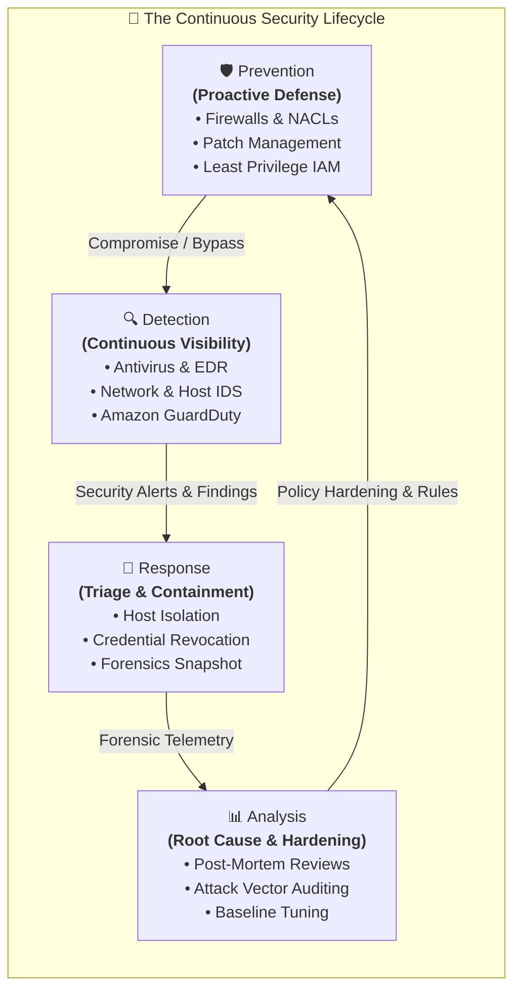

---

## 📌 Learning Objectives

By completing this module and thoroughly reviewing these study materials, you will be able to:

- [ ] **Contextualize Detection within the Security Lifecycle**:
  - [ ] Articulate why detection is essential when preventative controls fail.
  - [ ] Explain how detection supports the Defense-in-Depth model across the OSI layers.
  - [ ] Define critical operational security metrics: Mean Time to Detect (MTTD), Mean Time to Acknowledge (MTTA), Mean Time to Remediate (MTTR), and Dwell Time.
- [ ] **Analyze Endpoint Threat Vectors and Antivirus Technologies**:
  - [ ] Define malicious software (malware) and explain how it violates the CIA Triad (Confidentiality, Integrity, Availability).
  - [ ] Differentiate between major malware classifications: viruses, worms, bots/botnets, backdoors/trojans, rootkits, spyware, adware, and ransomware.
  - [ ] Identify primary malware delivery mechanisms: untrusted websites, removable storage media, and email phishing/attachments.
  - [ ] Describe the core capabilities of antivirus software: prevention, detection, and removal.
  - [ ] Compare detection methods: signature-based pattern matching, heuristic analysis, and dynamic behavioral monitoring.
  - [ ] Explain the evolution from legacy antivirus tools to modern Endpoint Detection and Response (EDR) and Extended Detection and Response (XDR) platforms.
- [ ] **Deconstruct Intrusion Detection Systems (IDS)**:
  - [ ] Define the core function of an Intrusion Detection System and its role in alert generation.
  - [ ] Contrast Network-based IDS (NIDS) and Host-based IDS (HIDS) regarding installation points, visibility scope, performance overhead, and encryption handling.
  - [ ] Differentiate between Signature-based IDS (known attack patterns) and Anomaly-based IDS (baseline deviation).
  - [ ] Compare passive Intrusion Detection Systems (IDS) with inline Intrusion Prevention Systems (IPS) in terms of traffic flow, blocking actions, and latency impact.
- [ ] **Master Cloud-Native Threat Detection with Amazon GuardDuty**:
  - [ ] Explain the architecture of Amazon GuardDuty as a continuous, intelligent, fully managed cloud threat detection service.
  - [ ] Detail the primary log data sources analyzed by GuardDuty: AWS CloudTrail event logs (management and S3 data events), Amazon VPC Flow Logs, and DNS query logs.
  - [ ] Understand additional threat detection layers: EKS audit logs, GuardDuty Runtime Monitoring, RDS Protection, and EBS volume malware scanning.
  - [ ] Explain how machine learning, behavioral profiling, and integrated threat intelligence feeds detect anomalies and malicious actors.
  - [ ] Deconstruct GuardDuty finding schema: finding types, resource IDs, severity scoring, last seen timestamps, and count aggregation.
  - [ ] Architect automated remediation pipelines utilizing Amazon EventBridge, AWS Lambda, and AWS Systems Manager.

---

## 🛡️ 1. Detection in the Security Lifecycle

### 1.1 The Role of Detection

In a zero-trust security paradigm, organizations must operate under the assumption that breaches will occur. Preventative controls—such as firewalls, security groups, patch baselines, and identity permissions—are designed to eliminate known vulnerabilities and block unauthorized transactions. However, prevention cannot stop every threat:
- **Zero-Day Exploits**: Vulnerabilities that are unknown to software vendors and lack available patches or signature definitions.
- **Insider Threats**: Legitimate users abusing granted privileges or exfiltrating confidential intellectual property.
- **Credential Compromise**: Valid user credentials harvested through phishing, social engineering, or credential stuffing.
- **Complex Misconfigurations**: Unintentionally exposed storage buckets, permissive IAM trust policies, or security group rules.

When prevention fails, **Detection** activates. Detection continuously gathers telemetry across systems, monitors active communications, compares events against established behavioral baselines, and generates actionable security alerts.

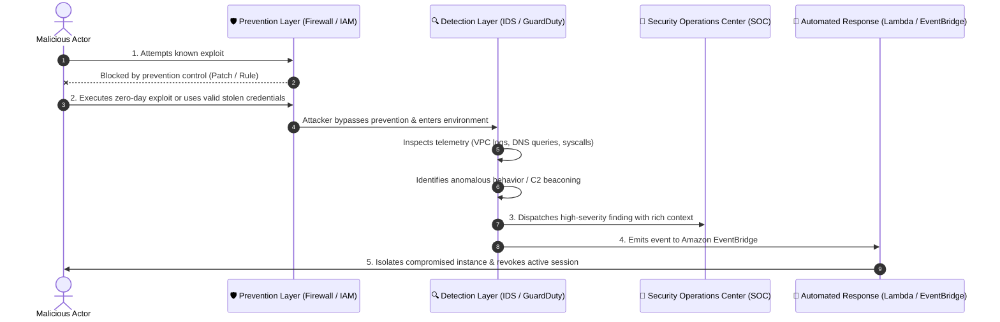

### 1.2 Defense-in-Depth: Positioning Detective Controls

The principle of **Defense-in-Depth** mandates that multiple independent security controls be layered across every stratum of the computing architecture. Detective controls must be positioned at each layer to eliminate blind spots:

| Architectural Layer | Preventative Control Example | Detective Control Example | Telemetry / Data Source |
| :--- | :--- | :--- | :--- |
| **Perimeter / Edge** | AWS WAF, AWS Shield, Network Firewalls | Perimeter NIDS, NetFlow analysis, edge request logging | AWS WAF Traffic Logs, CloudFront access logs |
| **Network / VPC** | Subnet NACLs, Security Groups, route tables | Network IDS (Suricata/Snort), VPC Flow Log analytics | VPC Flow Logs, DNS query logs |
| **Host / Compute** | OS hardening, CIS benchmarks, SSM Patch Manager | Host IDS (OSSEC, Wazuh), Antivirus, EDR agents | System logs (`/var/log/secure`, Event Viewer), process trees |
| **Application / Container**| Input sanitization, container immutability | Container runtime security, API request monitoring | EKS audit logs, application access logs, web server traces |
| **Data / Storage** | S3 bucket policies, KMS encryption, object locks | Storage access anomaly monitoring, Macie sensitive data scan | S3 CloudTrail Data Events, CloudWatch metric alarms |
| **Identity / IAM** | MFA enforcement, Least Privilege permission boundaries | IAM behavioral anomaly detection, impossible travel alerts | CloudTrail Management Events, IAM credential report |

### 1.3 Key Operational Metrics: MTTD, MTTA, MTTR, and Dwell Time

The performance of an organization's detective capabilities is measured through standardized metrics that directly determine the blast radius of a security compromise:

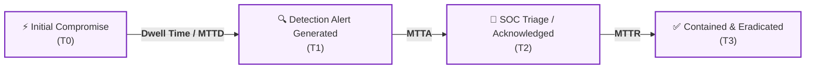

1. **Mean Time to Detect (MTTD)**:
   $$\text{MTTD} = \frac{\sum (\text{Timestamp of Detection} - \text{Timestamp of Initial Compromise})}{\text{Total Number of Incidents}}$$
   - Measures the average time elapsed from when an adversary breaches a system until security monitoring systems or analysts identify the intrusion.
   - **Industry Context**: Historic industry dwell times often averaged between 16 and 90 days. Modern automated cloud-native detection systems reduce MTTD to minutes or hours.
2. **Threat Dwell Time**:
   - The total duration an attacker remains undetected within a target environment, during which they conduct internal reconnaissance, lateral movement, privilege escalation, and data staging.
3. **Mean Time to Acknowledge (MTTA)**:
   - The average time taken by security personnel to acknowledge, triage, and initiate an investigation on a high-severity alert following automated generation.
4. **Mean Time to Remediate / Respond (MTTR)**:
   - The average time required to contain, neutralize, and fully restore systems to normal operations after an incident is confirmed.

> [!IMPORTANT]
> **The Golden Hour of Threat Detection**: Attackers typically require time after initial foothold acquisition to execute privilege escalation, map internal subnets, locate high-value databases, and begin exfiltration. Minimizing MTTD is critical: if an intrusion is detected within minutes, defenders can sever command-and-control (C2) channels and isolate hosts before sensitive data is lost or systems are encrypted by ransomware.

---

## 🦠 2. Antivirus Software & Endpoint Threat Detection

### 2.1 The Threat of Malware & the CIA Triad

**Malicious software (malware)** comprises any software code, script, or program intentionally engineered to infiltrate, disrupt, damage, or gain unauthorized access to computer systems, networks, or digital assets. Malware represents an active threat against all three pillars of the **CIA Triad**:

- **Confidentiality**: Malware captures keystrokes (keyloggers), dumps system memory containing cleartext tokens, steals database credentials, and exfiltrates proprietary records to external servers.
- **Integrity**: Malware alters critical operating system kernels, replaces system binaries, tampers with database transactions, injects unauthorized code into running processes, or falsifies audit logs.
- **Availability**: Malware floods network interfaces (DDoS bots), corrupts partition master boot records, crashes services via buffer overflows, or irreversibly encrypts operational storage volumes (ransomware).

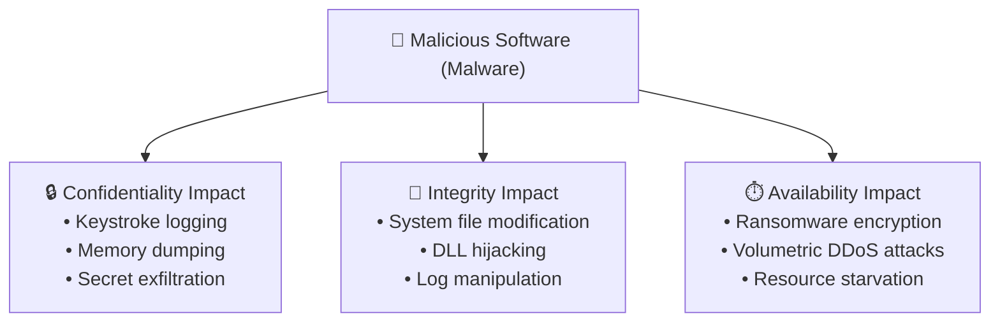

### 2.2 Deep Dive: Malware Taxonomy & Classifications

The curriculum highlights diverse malware variants that security analysts encounter across endpoints and server workloads:

| Malware Family | Operational Mechanism & Characteristics | Propagation Vector | Historical / Real-World Example | Primary Impact |
| :--- | :--- | :--- | :--- | :--- |
| **Viruses** | Malicious code fragments that insert copies of themselves into existing host programs or executable files (`.exe`, `.dll`, `.com`). Requires human action (running the host program) to execute and propagate. | Executable file transfers, email attachments, shared folders | *ILOVEYOU*, *CIH (Chernobyl)*, *EICAR Standard Test File* | File corruption, data erasure, system instability |
| **Worms** | Standalone, self-replicating programs that traverse networks autonomously by exploiting unpatched network vulnerabilities or application flaws without requiring host files or human intervention. | Network socket exploitation, open SMB/RPC ports, unpatched services | *MyDoom*, *Sobig*, *Stuxnet*, *Conficker* | Network congestion, high CPU utilization, remote access establishment |
| **Bots & Botnets** | Lightweight agents installed on compromised machines (zombies) that connect to a central Command and Control (C2) server, allowing an attacker to coordinate mass distributed actions. | Phishing lures, brute-force SSH/RDP logins, web application vulnerabilities | *Poison Ivy*, *Mirai Botnet*, *Necurs* | Distributed Denial of Service (DDoS), credential stuffing, spam propagation |
| **Backdoors & Trojans** | Disguised as legitimate, benign, or useful software (e.g., utility programs, screen savers) to trick users into installation. Once executed, it secretly opens remote administrative access listeners. | Social engineering downloads, untrusted software repositories, bundled freeware | *Sub7*, *GirlFriend*, *Zeus Banking Trojan*, *NetBus* | Covert remote shell access, data theft, credential interception |
| **Rootkits** | Highly privileged malware designed to cloak its presence and the presence of other malicious tools by replacing core operating system binaries, kernel modules, or API hooks. | Privilege escalation exploits, bootloader modification | *Hacker Defender*, *Stuxnet (kernel rootkit component)* | Deep system subversion, hidden processes and files, near-impossible detection by user-space tools |
| **Spyware** | Software that covertly collects sensitive user telemetry, browsing histories, keystrokes, application usage, or personal credentials without consent. | Bundled with freeware/shareware, deceptive web links | *Real-time Spy*, *FinFisher*, *Pegasus* | Privacy violation, corporate espionage, identity theft |
| **Adware** | Aggressively renders unsolicited advertisements, redirects browser searches, and captures behavioral advertising profiles. | Deceptive install wizards, browser extension bundles | *Fireball*, *DollarRevenue*, *Gator* | Browser hijacking, pop-up storms, desktop degradation |
| **Ransomware** | Cryptographically scrambles user documents, database files, and system drives with strong encryption (e.g., AES-256 + RSA-4096), demanding ransom payments (typically cryptocurrency) for decryption keys. | Phishing emails, exposed RDP ports, drive-by exploit kits, software supply chain | *WannaCry*, *LockBit*, *Ryuk*, *DarkSide* | Total operational paralysis, extortion, destructive loss of access |

### 2.3 Infection Vectors & Vectors of Transmission

Understanding how malicious software penetrates systems enables targeted preventative and detective controls:

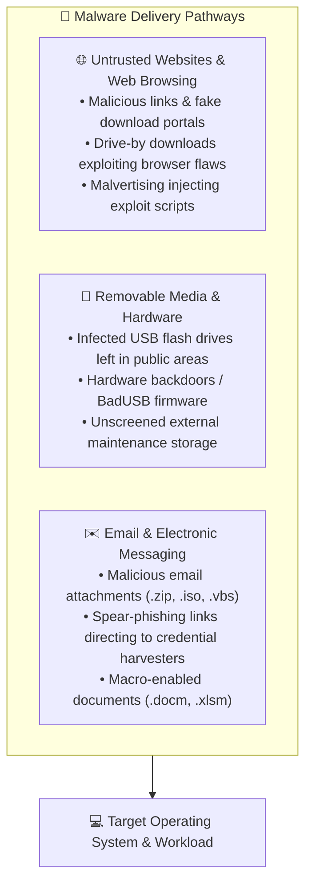

1. **Untrusted Websites & Drive-By Downloads**:
   - Attackers host malicious scripts or spoof corporate portals. Drive-by download techniques exploit unpatched browser or plugin vulnerabilities to execute code in memory simply by visiting the page, without user approval.
2. **Removable Storage Devices**:
   - Physical USB drives can bypass perimeter firewalls entirely. Techniques include autorun execution, modified firmware (BadUSB) mimicking human-interface keyboard hardware, and weaponized PDFs or executables.
3. **Phishing & Electronic Messaging**:
   - The predominant enterprise infection vector. Attackers disguise weaponized payloads within archive files (`.zip`, `.rar`, `.7z`), disk images (`.iso`), or Office documents with obfuscated VBA macros.

### 2.4 Antivirus Architecture: Prevention, Detection, and Removal

**Antivirus (AV) software** is a specialized defense and detection program engineered to safeguard operating systems and workloads across three core functions:

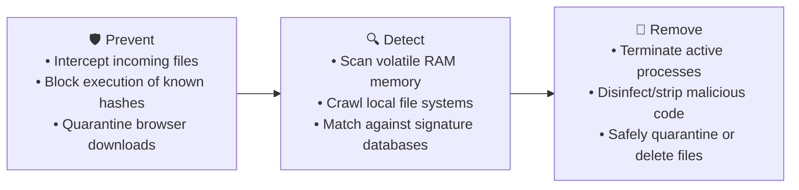

#### Core Components of Antivirus Architecture:
1. **Malware Definition Database (Signature Engine)**:
   - A structured repository maintained and continuously updated by the security vendor containing cryptographic hashes (MD5, SHA-256) and binary bytecode sequences characteristic of known malware strains.
2. **Memory & Real-Time On-Access Scanner**:
   - Hooks into the operating system kernel (e.g., Windows File System Minifilter Driver) to inspect files in volatile RAM and file streams whenever a file is created, opened, executed, or downloaded.
3. **On-Demand / Scheduled File System Scanner**:
   - Traverses secondary storage volumes (HDD, SSD, mounted network shares) examining every file, archive, and registry key against signature records.
4. **Quarantine & Disinfection Sandbox**:
   - When a match occurs, the AV software isolates the infected file into an encrypted, non-executable directory (quarantine), preventing further propagation while allowing security analysts to inspect or restore false positives.

```
       [ Antivirus Engine Architecture ]
       
    Incoming Files / Executables
                 │
                 ▼
     ┌───────────────────────┐
     │  Real-Time Interceptor │  (Kernel Minifilter)
     └───────────┬───────────┘
                 │
                 ▼
     ┌───────────────────────┐       ┌────────────────────────┐
     │ Signature & Hash Match │ <==== │  Malware Definition DB  │
     └───────────┬───────────┘       │  (Vendor Cloud Updates)│
                 │                   └────────────────────────┘
                 ├─── [Clean] ───────► Allow Execution
                 │
                 └─── [Threat Match]
                           │
                           ▼
              ┌────────────────────────┐
              │ Disinfect / Quarantine │
              │ or Delete Infected File│
              └────────────────────────┘
```

#### Real-World Antivirus Scan Workflow: The EICAR Standard Test
To safely validate whether an antivirus engine is actively monitoring, inspecting, and responding without deploying live malware, the security industry standardized the **EICAR (European Institute for Computer Antivirus Research)** test file.

The EICAR test string consists of standard ASCII characters:
```text
X5O!P%@AP[4\PZX54(P^)7CC)7}$EICAR-STANDARD-ANTIVIRUS-TEST-FILE!$H+H*
```

When saved as a file (`eicar.com` or compressed within `eicar.zip`):
1. **Scanning**: The AV scanner evaluates the folder or archive.
2. **Threat Detection**: The engine matches the ASCII pattern against its definition database and flags the threat (e.g., `EICAR_Test` or `Virus:DOS/EICAR_Test_File`).
3. **Notification & Remediation**: The AV software alerts the user, blocks file execution, and gives the option to quarantine or delete the object.

> [!TIP]
> **Best Practices for Endpoint Antivirus Operations**:
> - **Continuous Definition Updates**: Configure definition updates to run multiple times per day or leverage cloud-lookup telemetry.
> - **Frequent Full-System Scans**: Schedule deep scans during low-utilization windows.
> - **Inbound Communications Inspection**: Integrate AV plugins directly with email client gateways and web proxy inspection engines.
> - **Tamper Protection**: Lock down AV service settings with administrative passwords so users or rogue scripts cannot disable real-time protection.

### 2.5 Detection Methodologies: Signature vs. Heuristic vs. Behavioral

As malware authors began utilizing encryption, packers, and polymorphic code to alter file hashes with every compilation, antivirus technology evolved beyond static signatures:

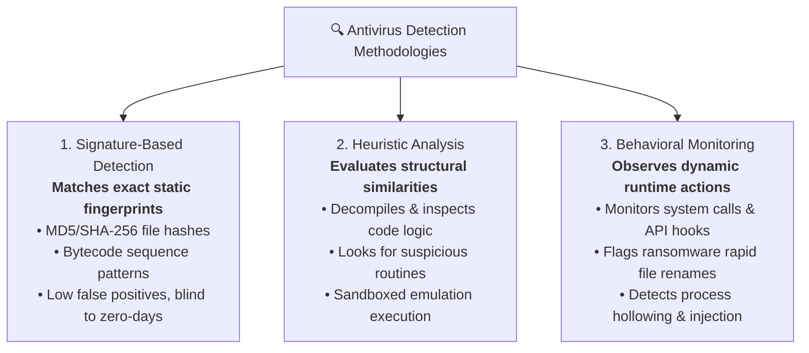

1. **Signature-Based Detection**:
   - Evaluates files for known cryptographic hashes or byte patterns.
   - **Advantage**: Extremely fast, low CPU consumption, virtually zero false positives for known threats.
   - **Limitation**: Ineffective against zero-day exploits, fileless malware residing in memory, or polymorphic malware that changes its binary hash on every download.
2. **Heuristic Analysis**:
   - Inspects the underlying assembly or source structure of unknown files for traits common to malicious tools (e.g., routines that modify boot sectors, unhook security APIs, or attempt self-replication).
   - Often executes suspect programs within an isolated, simulated CPU environment (sandbox emulation) for a few hundred milliseconds to observe execution intent.
   - **Advantage**: Capable of detecting brand-new variants of known malware families.
   - **Limitation**: Higher false-positive rate; can flag legitimate administrative utilities.
3. **Behavioral Monitoring (Dynamic Analysis)**:
   - Evaluates programs while they are actively running on the live host system, tracking runtime operations:
     - Rapid modification and encryption of user files in user directories (ransomware behavior).
     - Attempts to inject shellcode into core Windows services like `lsass.exe` or `svchost.exe`.
     - Creation of unauthorized persistence mechanisms in startup registry run keys or cron jobs.
   - **Advantage**: Flags active attacks regardless of whether the executable file is known or unknown.

### 2.6 Evolution: Legacy Antivirus vs. Modern EDR / XDR

Enterprise environments hosting cloud virtual machines (such as Amazon EC2) require capabilities that exceed standalone legacy antivirus:

| Attribute | 🛡️ Legacy Antivirus (AV) | 🔍 Endpoint Detection & Response (EDR) |
| :--- | :--- | :--- |
| **Primary Focus** | Preventing and cleaning known malware file infections | Detecting, investigating, hunting, and responding to advanced persistent threats (APTs) |
| **Detection Basis** | File-centric (signatures, known hashes, static heuristics) | Behavior-centric (process lineages, network telemetry, memory injections, user actions) |
| **Visibility Scope** | Local endpoint file system and memory only | Fleet-wide telemetry aggregated into central consoles for correlation |
| **Fileless Malware** | Often blind to living-off-the-land binaries (e.g., malicious PowerShell, WMI scripts) | Intercepts in-memory execution, script logging, and command-line arguments |
| **Response Actions** | Delete file, quarantine file | Isolate host from network, kill remote process trees, dump RAM for forensics, roll back ransomware changes |
| **Threat Hunting** | Not supported | Search across thousands of enterprise hosts for specific hashes, file modifications, or IP connections |

---

## 📡 3. Intrusion Detection Systems (IDS)

### 3.1 Intrusion Detection System Fundamentals

An **Intrusion Detection System (IDS)** is a dedicated hardware appliance, software daemon, or virtualized service that monitors network traffic and system environments to detect malicious activity, policy violations, and unauthorized access attempts.

Unlike preventative firewalls that simply filter packets based on predefined IP and port rules, an IDS performs deep analysis of traffic patterns, application payloads, and operating system events. When suspicious activity or policy non-compliance is identified, the IDS generates security alerts for security analysts and SIEM (Security Information and Event Management) platforms.

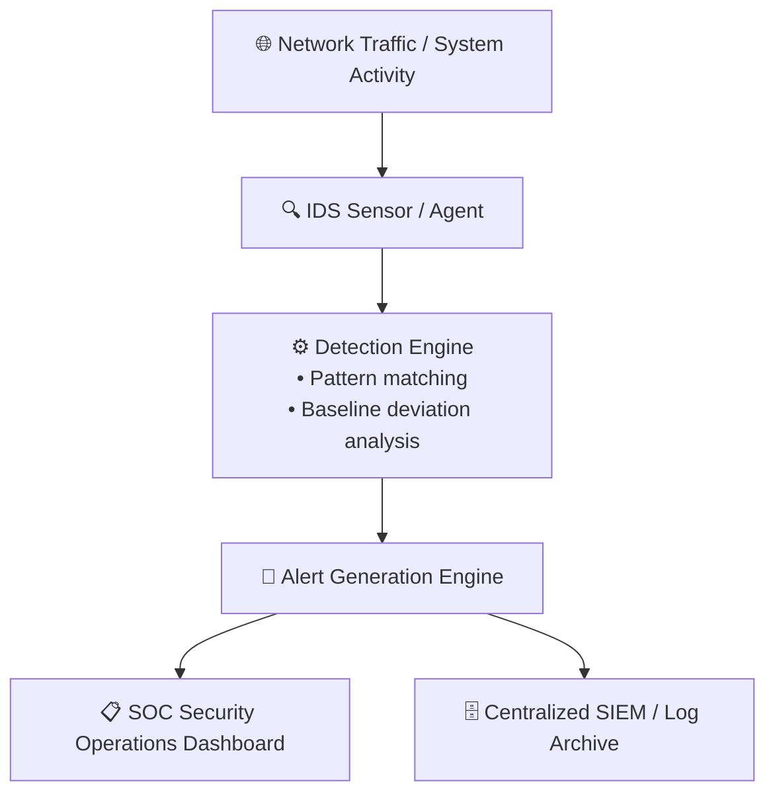

### 3.2 Architectural Placement: NIDS vs. HIDS

Intrusion detection systems are classified based on where the monitoring sensor is physically or logically deployed:

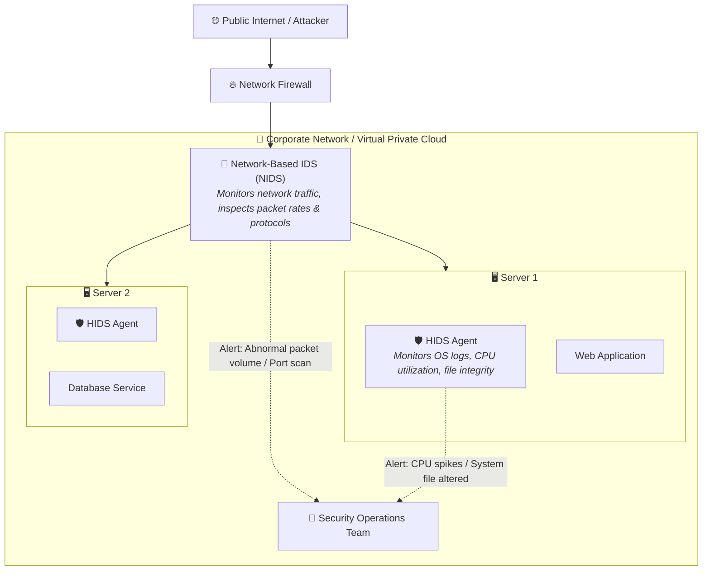

#### Network-Based IDS (NIDS):
- **Deployment**: Deployed at critical network aggregation points, such as behind the perimeter firewall, inside demilitarized zones (DMZs), or connected to a network TAP / SPAN (Switched Port Analyzer) mirror port.
- **Scope**: Inspects all raw packets traversing the monitored network segment. Evaluates packet headers, protocols (IP, TCP, UDP, ICMP, DNS, HTTP), packet rates, and unencrypted payload contents.
- **Example Use Case**: A remote attacker initiates a SYN flood or a brute-force port sweep against an enterprise subnet. The NIDS detects the abnormal packet volume exceeding defined rate thresholds and immediately raises an alert.

#### Host-Based IDS (HIDS):
- **Deployment**: Installed directly onto individual target hosts, servers, or virtual machines as a software agent or background daemon (e.g., OSSEC, Wazuh, Tripwire).
- **Scope**: Monitors local system telemetry: operating system audit logs, authentication attempts (`/var/log/auth.log`, Windows Security Event Logs), critical system file checksums (File Integrity Monitoring / FIM), active process creation, and host resource utilization (abnormal CPU/memory spikes).
- **Example Use Case**: An attacker manages to compromise a web server via an encrypted HTTPS connection. The NIDS cannot inspect the encrypted payload. However, once the attacker executes a local privilege escalation script that spikes CPU utilization to 100% and alters `/etc/passwd`, the local HIDS flags the anomalous CPU behavior and unauthorized file modification, triggering an alert.

#### Comprehensive Comparison: HIDS vs. NIDS

| Dimension | 📡 Network-Based IDS (NIDS) | 🖥️ Host-Based IDS (HIDS) |
| :--- | :--- | :--- |
| **Installation Point** | Dedicated physical appliances, inline taps, or VPC traffic mirrors | Installed directly onto operating system instances as an agent |
| **Visibility Scope** | Broad visibility across entire network segments and multi-host communications | Deep visibility into local host processes, files, and user sessions |
| **Encrypted Traffic Handling** | Blind to end-to-end encrypted packet payloads (e.g., TLS/HTTPS, SSH) | Fully inspects unencrypted data in memory and operating system events |
| **Performance Impact** | Zero performance overhead on target application servers | Consumes CPU, RAM, and disk I/O on the host operating system |
| **Hardware / OS Specificity**| OS-agnostic; evaluates standard network protocol standards | Dependent on OS compatibility (Windows, Linux, macOS) |
| **Detection Strengths** | Network scans, volumetric DoS attempts, spoofed packets, lateral movement | Local privilege escalation, file tampering, rogue local accounts, unauthorized root access |
| **Vulnerability to Tampering**| Isolated from compromised servers; cannot be disabled by a root-compromised host | If an attacker gains full kernel/root control, they may attempt to disable the HIDS agent |

> [!NOTE]
> **Complementary Synergy**: Enterprise security architectures rarely choose between HIDS and NIDS; they implement both. NIDS provides early perimeter and network-level warning signs of scanning and propagation, while HIDS delivers forensic visibility into host-level impacts that encrypted traffic hides from network sensors.

### 3.3 Detection Mechanisms: Signature-Based vs. Anomaly-Based IDS

Regardless of whether an IDS is host- or network-based, its detection engine identifies threats using one of two core mechanisms:

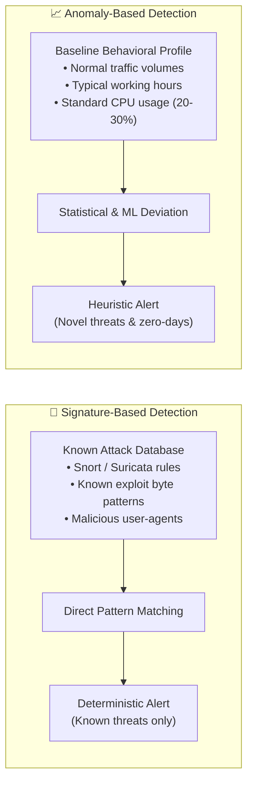

#### Detailed Comparison: Signature vs. Anomaly Detection

| Feature | 📝 Signature-Based IDS | 📈 Anomaly-Based IDS |
| :--- | :--- | :--- |
| **Detection Method** | Compares active packets/logs against a database of known exploit signatures | Compares current behavior against a learned statistical baseline of normal activity |
| **Zero-Day Exploits** | **Blind**: Cannot detect new attacks without an updated signature rule | **Effective**: Flags novel attacks because malicious behavior deviates from baseline |
| **False-Positive Rate** | **Very Low**: Fires alerts only when precise signature patterns match | **Higher**: Legitimate unusual events (e.g., flash sales, backups) trigger false alerts |
| **Administrative Burden** | Requires constant updating of signature files from vendors | Requires extensive training periods to establish reliable baselines without alert fatigue |
| **Resource Overhead** | Relatively low; optimized pattern-matching algorithms | High; requires ongoing computational power to calculate statistical deviations |

### 3.4 Operational Paradigm: IDS vs. IPS (Detection vs. Inline Prevention)

While both systems inspect network traffic, the distinction between an **Intrusion Detection System (IDS)** and an **Intrusion Prevention System (IPS)** centers on network placement and action capability:

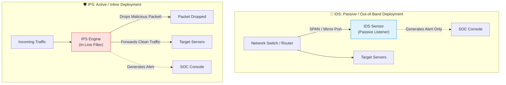

| Dimension | 📡 Intrusion Detection System (IDS) | 🛡️ Intrusion Prevention System (IPS) |
| :--- | :--- | :--- |
| **Network Placement** | **Out-of-band / Passive**: Connected to a SPAN/mirror port or TAP | **Inline**: Placed directly in the physical/logical traffic path |
| **Traffic Handling** | Copies traffic; does not sit between sender and receiver | Processes packets in real time; passes or drops packets |
| **Action Capability** | **Detection & Alerting only**: Cannot drop or block malicious packets directly | **Active Blocking**: Drops malicious packets, resets TCP connections (`TCP RST`), bans IPs |
| **Latency Impact** | **Zero latency**: Network traffic flows uninterrupted | **Adds latency**: Every packet must be inspected before forwarding |
| **Failure Mode** | **Fails Open**: If the IDS crashes, production traffic is completely unaffected | **Fails Open or Closed**: If the IPS crashes, it may halt all traffic (fail-closed) or allow uninspected packets (fail-open) |
| **Risk Profile** | Low operational risk; false positives cause alert fatigue, not service outages | Higher operational risk; a false positive can block legitimate customer transactions |

---

## ☁️ 4. Cloud-Native Threat Detection with Amazon GuardDuty

### 4.1 What is Amazon GuardDuty?

**Amazon GuardDuty** is an intelligent, fully managed cloud threat detection service that continuously monitors AWS accounts, compute workloads, container environments, and data stores for unauthorized and malicious activity.

When activated, GuardDuty requires **zero software agents, zero sensor appliances, and zero complex network configurations**. It operates entirely at the AWS infrastructure plane, analyzing high-volume log streams asynchronously without adding latency or degrading workload performance. GuardDuty applies machine learning (ML), statistical anomaly detection, and integrated threat intelligence to detect account compromises, data exfiltration attempts, and unauthorized infrastructure exploitation.

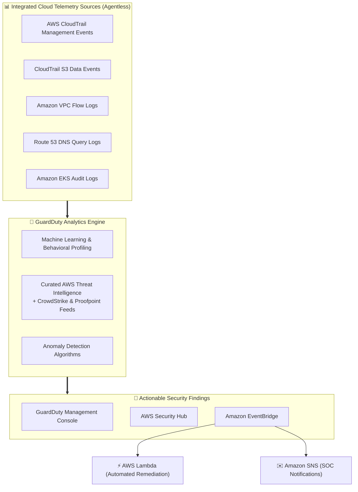

### 4.2 Architectural Design & Agentless Operation

Traditional on-premises intrusion detection systems require complex agent installations on every virtual host or cumbersome network traffic hair-pinning. Amazon GuardDuty eliminates these operational overheads:

- **Zero Host Impact**: GuardDuty does not install kernel modules or agents inside EC2 instances or container pods. Host CPU, RAM, and disk bandwidth remain 100% available for business applications.
- **Independent Log Ingestion**: GuardDuty pulls data directly from underlying AWS service fabrics (CloudTrail, VPC infrastructure, Route 53 resolvers).
- **Cost Independence**: GuardDuty processes VPC Flow Logs and DNS logs internally without requiring customers to enable VPC Flow Log delivery to Amazon CloudWatch Logs or S3, saving log ingestion and storage fees.

### 4.3 Foundational & Specialized Telemetry Sources

GuardDuty ingests and correlates multiple enterprise-grade data sources to construct a holistic timeline of cloud activity:

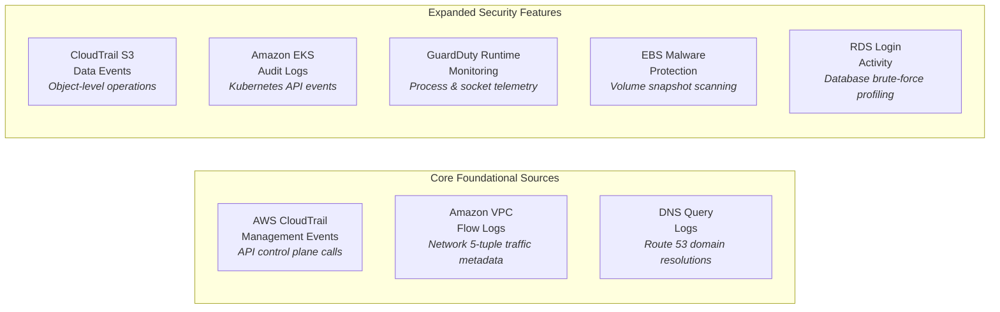

#### 1. AWS CloudTrail Management Events:
- **Scope**: Records all administrative and control-plane API calls executed across an AWS account (e.g., `CreateUser`, `AuthorizeSecurityGroupIngress`, `StopLogging`, `CreateAccessKey`).
- **Detection Insight**: Identifies unauthorized privilege escalation, disabling of security controls, suspicious console logins from unusual geolocations, and impossible travel velocity anomalies.

#### 2. Amazon VPC Flow Logs:
- **Scope**: Captures metadata regarding IP traffic entering and leaving network interfaces within your Amazon VPC (source IP, destination IP, source port, destination port, protocol, packet count, accept/reject action).
- **Detection Insight**: Identifies port scanning, denial-of-service traffic patterns, outbound connections to known Command and Control (C2) servers, and unauthorized traffic across private subnets.

#### 3. DNS Query Logs:
- **Scope**: Inspects queries processed through the internal Amazon Route 53 DNS resolver.
- **Detection Insight**: Flags infected EC2 instances attempting to connect to domains associated with malware distribution, cryptocurrency mining pools, or Domain Generation Algorithms (DGA) used by botnets.

#### 4. Expanded Protection Modules:
- **S3 Data Events**: Monitors object-level API calls (`GetObject`, `PutObject`, `DeleteObject`) to detect anomalous bulk data exfiltration or suspicious permission alterations.
- **EKS Audit Logs & Runtime Monitoring**: Evaluates Kubernetes control plane API interactions and node-level container runtime processes (file execution, container socket creation).
- **GuardDuty Malware Protection**: Automatically creates a temporary snapshot of Amazon EBS volumes attached to an instance flagged for suspicious activity, scanning the snapshot for trojans, worms, and crypto-miners without touching production instances.
- **RDS Protection**: Analyzes database login attempts to identify brute-force attacks and credential stuffing on Amazon Aurora and RDS databases.

### 4.4 Threat Intelligence & Machine Learning Profiling

GuardDuty applies a two-tiered analysis engine:

1. **Curated Threat Intelligence**:
   - Integrates continuously updated threat feeds compiled by the global **AWS Cybersecurity Team**, augmented with industry-leading feeds from commercial partners (**CrowdStrike** and **Proofpoint**).
   - Contains millions of verified malicious IP addresses, known Tor exit nodes, active botnet C2 servers, and crypto-mining domain pools.
2. **Machine Learning Behavioral Profiling**:
   - GuardDuty automatically builds baseline profiles of normal activity for every IAM identity, EC2 instance, and S3 bucket in your account over time.
   - Flags sudden deviations from baseline: an IAM user who usually operates in `us-east-1` suddenly creating infrastructure in `ap-southeast-1` at 3:00 AM, or an EC2 instance suddenly transferring gigabytes of data over non-standard ports.

### 4.5 GuardDuty Findings Anatomy & Severity Scoring

When GuardDuty identifies a security risk, it generates a structured **Security Finding**.

#### Finding Naming Convention
Finding types follow a standardized, predictable format:
$$\text{ThreatFamily}:\text{ResourceType}/\text{ThreatName}.\text{Subtype}!\text{Artifact}$$

- **ThreatFamily**: High-level attack category (e.g., `Recon`, `Backdoor`, `CryptoCurrency`, `Trojan`, `Stealth`, `UnauthorizedAccess`).
- **ResourceType**: AWS resource affected (e.g., `EC2`, `IAMUser`, `S3`, `Kubernetes`, `RDS`).
- **ThreatName**: Specific nature of the detected threat (e.g., `DenialOfService.Dns`, `TorIPCaller`, `MaliciousIPCaller`, `InstanceCredentialExfiltration`).
- **Subtype / Artifact**: Identifies the transport protocol or data source involved (e.g., `!DNS`, `OutsideAWS`).

#### Finding Schema Fields:
- **Finding Type**: Formatted string representing the specific threat pattern.
- **Resource ID**: Unique identifier of the targeted AWS asset (e.g., `i-0a1b2c3d4e5f67890`, `arn:aws:iam::123456789012:user/admin`).
- **Severity**: Numerical score from `0.1` to `10.0`, categorized into three operational levels:
  - **Low (0.1 - 3.9)**: Suspicious or non-standard activity; no immediate evidence of compromise (e.g., port scan originating from internet).
  - **Medium (4.0 - 6.9)**: Deviations from normal behavior indicating active reconnaissance or credential harvesting.
  - **High (7.0 - 10.0)**: Severe security compromise underway; resource actively enlisted in DoS attacks, communicating with C2 servers, or exfiltrating data.
- **Last Seen**: Timestamp indicating when the activity was most recently observed.
- **Count**: Number of times GuardDuty has aggregated activity matching this pattern into this single finding.
- **Actor / Action Details**: IP address, geolocation, Autonomous System Number (ASN), port numbers, and API call details used by the attacker.

#### Representative GuardDuty Finding JSON (Example: DNS Denial of Service)
```json
{
  "schemaVersion": "2.0",
  "accountId": "123456789012",
  "region": "us-east-1",
  "type": "Backdoor:EC2/DenialOfService.Dns",
  "id": "e9b1c2d3e4f5a6b7c8d9e0f1a2b3c4d5",
  "severity": 8.0,
  "createdAt": "2026-10-12T14:30:00.000Z",
  "updatedAt": "2026-10-12T14:45:12.000Z",
  "resource": {
    "resourceType": "Instance",
    "instanceDetails": {
      "instanceId": "i-0987654321fedcba0",
      "instanceType": "m5.large",
      "instanceState": "running",
      "networkInterfaces": [
        {
          "privateIpAddress": "10.0.1.45",
          "publicIp": "54.210.12.34"
        }
      ]
    }
  },
  "service": {
    "serviceName": "guardduty",
    "detectorId": "d1e2f3a4b5c6d7e8",
    "action": {
      "actionType": "DNS_REQUEST",
      "dnsRequestAction": {
        "domain": "malicious-c2-tunnel.example.com",
        "protocol": "UDP"
      }
    },
    "count": 1420,
    "eventFirstSeen": "2026-10-12T14:28:10.000Z",
    "eventLastSeen": "2026-10-12T14:45:12.000Z"
  }
}
```

### 4.6 Automated Remediation Architecture via EventBridge & Lambda

Detecting threats is only half the battle; stopping them requires automated response workflows. Amazon GuardDuty integrates natively with **Amazon EventBridge** to orchestrate immediate remediation:

```mermaid
sequenceDiagram
    autonumber
    participant GD as 🔍 Amazon GuardDuty
    participant EB as ⚡ Amazon EventBridge
    participant Lambda as 🚀 AWS Lambda Function
    participant EC2 as 💻 Compromised EC2 Instance
    participant SNS as ✉️ Amazon SNS / Security Operations

    GD->>GD: Detects High-Severity Finding (Severity >= 7.0)
    GD->>EB: Publishes Finding Event in JSON format
    EB->>EB: Matches Event Rule (detail.severity >= 7.0)
    par Parallel Response Actions
        EB->>Lambda: Invokes Quarantine Lambda Function
        EB->>SNS: Dispatches Critical Alert to SOC Slack/Email
    end
    Lambda->>EC2: 1. Removes all existing Security Groups
    Lambda->>EC2: 2. Attaches Isolated Quarantine Security Group (Zero In/Out)
    Lambda->>EC2: 3. Takes EBS Snapshot for Forensic Analysis
    SNS->>SNS: SOC analyst alerted; instance safely quarantined
```

#### Step-by-Step Incident Remediation Architecture:
1. **Detection**: GuardDuty flags an EC2 instance executing outbound DNS amplification attacks (`Backdoor:EC2/DenialOfService.Dns`, Severity `8.0`).
2. **Event Routing**: GuardDuty dispatches the JSON finding to the default **Amazon EventBridge** event bus within seconds.
3. **Rule Filtering**: An EventBridge rule filters for events where `source` is `aws.guardduty` and `detail.severity >= 7.0`.
4. **Automated Containment Execution**: EventBridge triggers an **AWS Lambda** containment function:
   - **Isolation**: The Lambda function updates the EC2 instance's security groups, replacing production security groups with an **Isolated Quarantine Security Group** that denies all inbound and outbound network traffic.
   - **Forensic Snapshot**: The function calls the EC2 API to take snapshot images of all attached EBS volumes for offline forensic disk analysis.
   - **Credential Invalidation**: If the finding indicates IAM instance credential exfiltration, Lambda attaches an explicit deny IAM policy to the instance profile role.
5. **Team Notification**: EventBridge simultaneously triggers **Amazon Simple Notification Service (SNS)**, sending urgent SMS/email notifications and webhook messages to the SOC incident response channel.

---

## ⚖️ 5. Comparative Architectural Analysis

To select and configure the right defensive controls, security engineers must understand the specific role and operational scope of each technology:

| Capability / Dimension | 🦠 Antivirus (AV) | 🔍 Endpoint Detection & Response (EDR) | 📡 Network IDS (NIDS) | 🖥️ Host IDS (HIDS) | ☁️ Amazon GuardDuty |
| :--- | :--- | :--- | :--- | :--- | :--- |
| **Primary Scope** | Local host file system and RAM | Fleet-wide endpoint behavior and process trees | Network wire / subnet packet streams | Local operating system logs and system files | Entire AWS cloud account infrastructure and workloads |
| **Data Analyzed** | File hashes, signatures, static heuristics | Process execution, memory injection, API calls, script commands | Raw packet headers, network 5-tuple, unencrypted payloads | Syslog, Windows Event Viewer, file hashes, resource metrics | CloudTrail logs, VPC Flow Logs, DNS query logs, EKS audit logs |
| **Deployment Mode** | Software agent installed on OS | Agent installed on OS with cloud management console | Hardware appliance, inline virtual tap, or SPAN mirror | Software agent / daemon installed on OS | **Agentless**: Managed directly at the AWS cloud service layer |
| **Action Capability** | Delete, quarantine, or disinfect infected files | Isolate host, kill process trees, isolate network interfaces | Generates network alerts (passive; does not drop packets) | Generates host alerts (passive; does not block modifications) | Generates cloud findings; triggers automated remediation via EventBridge |
| **Handling of Encrypted Traffic** | Fully inspects files decrypted on the host | Fully inspects runtime commands and process memory | **Blind** to encrypted TLS / HTTPS / SSH payloads | Fully inspects local host logs and file system modifications | Analyzes traffic metadata (IPs, ports, domains) regardless of encryption |
| **Best Used For** | Blocking known malware downloads on user desktops | Enterprise threat hunting and lateral movement containment | Perimeter network port scanning, volumetric DoS attacks | Detecting file tampering, privilege escalation, rootkits on servers | Detecting cloud account compromises, compromised instances, C2 beaconing |

---

## 🧠 6. Checkpoint Review & Comprehensive Knowledge Check

Reinforce your mastery of detection concepts and prepare for certification assessments with these review questions:

### Question 1: What are three core capabilities of antivirus software?
> **Answer**:
> The three fundamental capabilities of antivirus software are:
> 1. **Prevent**: Intercepting incoming communications, web downloads, and removable storage media to block malware from executing on the computer system.
> 2. **Detect**: Scanning volatile memory (RAM) and local file storage systems to uncover malicious code matching signature databases, heuristic rules, or behavioral anomalies.
> 3. **Remove**: Neutralizing detected threats by safely isolating infected files in an encrypted quarantine sandbox, disinfecting infected host executables, or permanently deleting malicious payloads.

---

### Question 2: What are two primary types of Intrusion Detection Systems based on installation point?
> **Answer**:
> The two primary types of intrusion detection systems are:
> 1. **Network-based Intrusion Detection System (NIDS)**: Deployed on the network infrastructure (such as behind firewalls or via network TAP/SPAN mirror ports) to monitor, inspect, and analyze network traffic traversing subnets for signs of malicious activity.
> 2. **Host-based Intrusion Detection System (HIDS)**: Installed directly on individual servers or computing hosts to monitor local system event logs, critical operating system files (File Integrity Monitoring), running processes, and resource utilization for unauthorized modifications.

---

### Question 3: Which AWS service provides continuous, intelligent threat detection across an AWS account and cloud workloads?
> **Answer**:
> **Amazon GuardDuty**. It continuously monitors AWS accounts and workloads by analyzing AWS CloudTrail event logs (management and S3 data events), Amazon VPC Flow Logs, and DNS query logs, utilizing machine learning and threat intelligence feeds to deliver actionable security findings.

---

### Question 4: How does an Intrusion Detection System (IDS) differ from an Intrusion Prevention System (IPS)?
> **Answer**:
> The distinction lies in **network placement and action capability**:
> - An **IDS** is a **passive, out-of-band** monitoring system. It receives copies of network traffic via a SPAN or mirror port, inspects packets, and **generates alerts** when suspicious activity is identified, but it cannot drop or alter packets inline.
> - An **IPS** is an **active, inline** security appliance placed directly in the network communication pathway. It inspects packets before forwarding them and possesses the authority to **actively block or drop** malicious packets, reset TCP sessions, and dynamically adjust firewall rules in real time.

---

### Question 5: Why is Amazon GuardDuty described as having "zero impact" on host compute performance and network latency?
> **Answer**:
> Amazon GuardDuty operates completely **agentless** at the AWS infrastructure plane. It does not install software agents or kernel drivers on EC2 instances or container hosts, meaning zero CPU, memory, or disk resources are consumed on customer workloads. Furthermore, GuardDuty ingests log data (such as VPC Flow Logs and DNS queries) asynchronously from internal AWS control planes rather than sitting inline in the customer network, resulting in zero added network latency.

---

### Question 6: Describe the components of a GuardDuty finding type string, using `Backdoor:EC2/DenialOfService.Dns` as an example.
> **Answer**:
> GuardDuty finding types adhere to the format `ThreatFamily:ResourceType/ThreatName.Subtype!Artifact`:
> - **ThreatFamily (`Backdoor`)**: Represents the high-level threat classification—in this case, indicating that the instance has been compromised and is acting as a backdoor or bot.
> - **ResourceType (`EC2`)**: Identifies the targeted AWS resource type (an Amazon EC2 virtual machine instance).
> - **ThreatName (`DenialOfService`)**: Describes the specific malicious activity detected—here, participation in a denial-of-service attack.
> - **Subtype (`.Dns`)**: Pinpoints the protocol or method employed—specifically, an attack utilizing malicious DNS request amplification or tunneling.

---

## 📌 7. Key Takeaways & Summary

- **Detection in the Lifecycle**:
  - Detection is the essential second phase of the Security Lifecycle, activating when preventative security controls fail.
  - Minimizing **Mean Time to Detect (MTTD)** drastically limits threat dwell time, preventing adversaries from establishing persistence, escalating privileges, or exfiltrating data.
- **Antivirus & Endpoint Protection**:
  - Malware violates the CIA triad (Confidentiality, Integrity, Availability) and encompasses viruses, worms, bots, backdoors, rootkits, spyware, adware, and ransomware.
  - Antivirus software **prevents, detects, and removes** malware using definition files containing known signatures, scanning volatile RAM and storage volumes.
  - Modern endpoint defense combines signature scanning, heuristic rule analysis, and behavioral monitoring, evolving into fleet-wide **Endpoint Detection and Response (EDR)** platforms.
- **Intrusion Detection Systems (IDS)**:
  - An IDS monitors networks and systems, generating alerts when suspicious activity is detected.
  - **NIDS** inspects network traffic across subnets; **HIDS** inspects local system logs, file integrity, and CPU utilization on individual servers.
  - **Signature-based IDS** matches known attack patterns with low false positives; **Anomaly-based IDS** flags deviations from learned behavioral baselines, detecting novel zero-day exploits.
  - **IDS vs. IPS**: IDS is passive and alerts; IPS is inline and actively blocks malicious traffic.
- **Amazon GuardDuty**:
  - GuardDuty delivers continuous, intelligent, agentless threat detection in the AWS Cloud.
  - Analyzes foundational data sources: **AWS CloudTrail management events**, **Amazon VPC Flow Logs**, and **DNS query logs**, alongside expanded sources like **S3 data events**, **EKS audit logs**, and **RDS logins**.
  - Applies machine learning, behavioral profiling, and curated AWS/partner threat intelligence feeds.
  - Formats actionable findings with severity scores (Low, Medium, High) and integrates with **Amazon EventBridge** and **AWS Lambda** to execute automated incident response playbooks.

---

## 🔗 Next Steps & Course Progression

Having mastered the foundational principles of threat detection, endpoint security, and cloud-native monitoring, explore the companion modules in the AWS re/Start Security curriculum:

- **Next Module (M04-12)**: [AWS CloudTrail Deep Dive](file:///work/tmp/aws-cf/T08-Security/T08-0012-RSSECY_EN-US_SG_M04_AWSCLOUDTRAIL.pdf) – In-depth audit logging, management vs. data events, and tamper-proof log validation.
- **Related Security Modules**:
  - [AWS Config](file:///work/tmp/aws-cf/T08-Security/T08-0013-RSSECY_EN-US_SG_M04_AWSCONFIG.pdf) – Continuous resource inventory, configuration compliance, and drift detection.
  - [Security Lifecycle: Response](file:///work/tmp/aws-cf/T08-Security/T08-0014-RSSECY_EN-US_SG_M04_RESPONSE.pdf) – Incident containment, automated playbooks, and disaster recovery.
  - [Security Lifecycle: Analysis](file:///work/tmp/aws-cf/T08-Security/T08-0015-RSSECY_EN-US_SG_M04_ANALYSIS.pdf) – Post-incident forensics, root cause analysis (RCA), and lessons learned.
  - [AWS Trusted Advisor](file:///work/tmp/aws-cf/T08-Security/T08-0016-RSSECY_EN-US_SG_M04_AWSTRUSTEDADVISOR.pdf) – Automated security, performance, and cost optimization checks.
