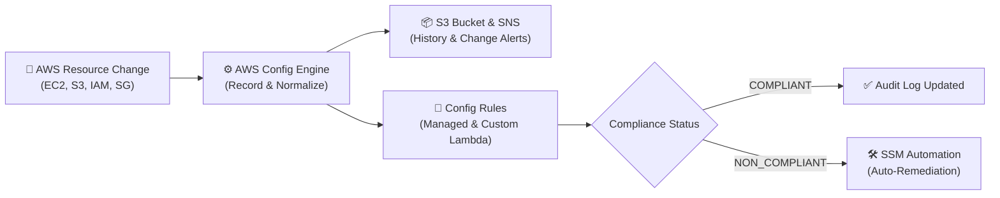
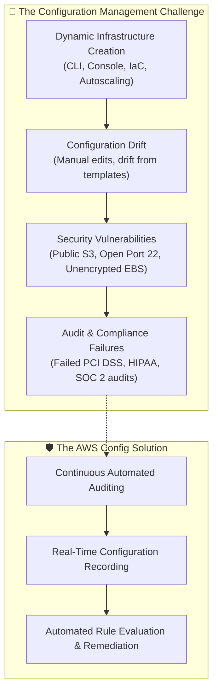
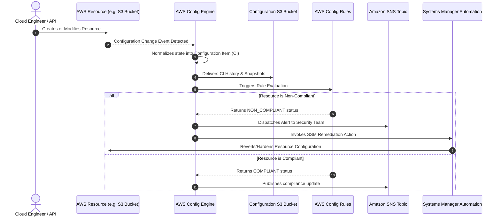
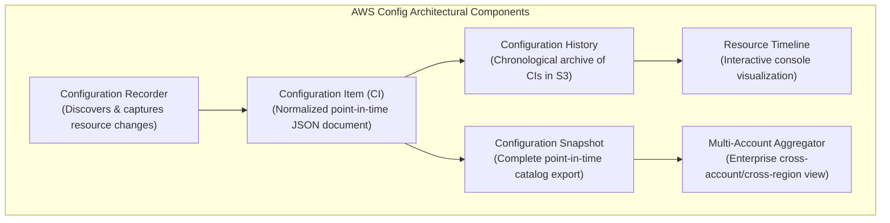
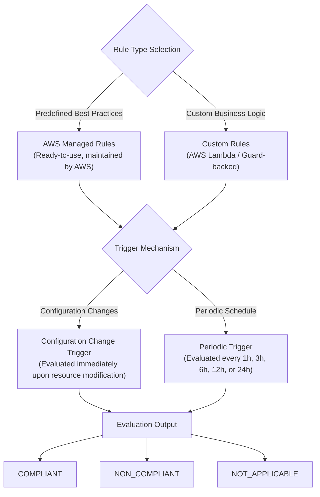
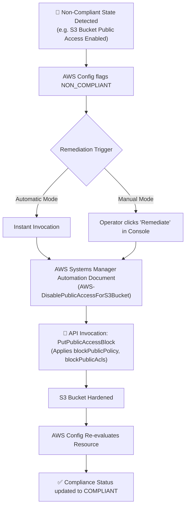
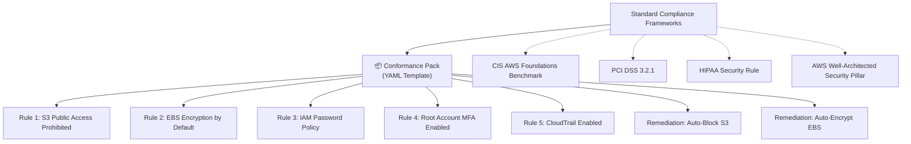
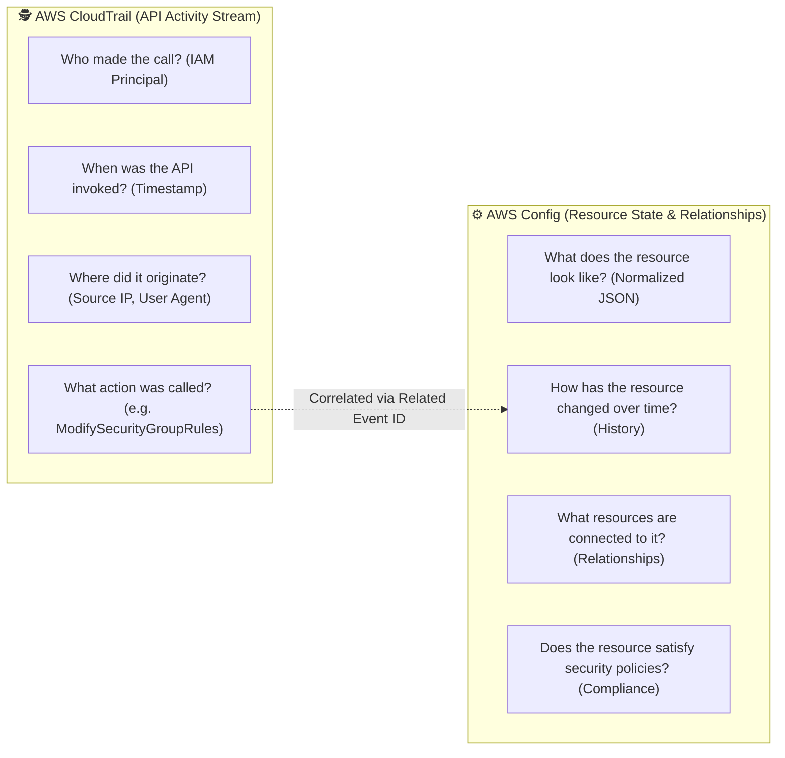

# ⚙️ AWS Config: Resource Inventory, Configuration History & Compliance Auditing

> **Course**: AWS re/Start  
> **Module**: Security (M04 – Detection & Governance: AWS Config)  
> **Source Document**: `T08-Security/T08-0013-RSSECY_EN-US_SG_M04_AWSCONFIG.pdf`  
> **Target Audience**: AWS re/Start Learners, Cloud Practitioners, Security Engineers, and Systems Operations Associates  

---

## 🎯 Module Overview

Modern enterprise cloud architectures scale dynamically, often provisioning hundreds or thousands of Amazon Elastic Compute Cloud (Amazon EC2) instances, Amazon Simple Storage Service (Amazon S3) buckets, Amazon Virtual Private Clouds (VPCs), and complex Identity and Access Management (IAM) role topologies across multiple regions. In such vast environments, managing configurations, preventing configuration drift, and continuously validating alignment with corporate security baselines represent immense operational challenges.

**AWS Config** delivers continuous asset discovery, configuration history tracking, relationship mapping, and automated compliance auditing. Rather than relying on periodic manual audits, AWS Config provides real-time visibility into how AWS resources are configured, how those configurations evolve over time, and whether they satisfy predetermined security rules.



---

## 📌 Learning Objectives

By completing this module and reviewing these study materials, you will be able to:

- [ ] **Define AWS Config Core Purpose**: Articulate how AWS Config discovers resources, tracks configuration history, and audits compliance.
- [ ] **Analyze the Configuration Management Challenge**: Explain why manual audits fail at scale and how automated configuration tracking overcomes configuration drift.
- [ ] **Deconstruct Core Config Architecture**: Understand the roles of **Configuration Items (CIs)**, **Configuration Recorder**, **Configuration History**, **Configuration Snapshots**, and the **Resource Timeline**.
- [ ] **Examine Configuration Item (CI) JSON Structure**: Parse and interpret the metadata, configuration payload, and relationship mappings contained within a CI.
- [ ] **Evaluate AWS Config Rules**: Differentiate between **AWS Managed Rules** and **Custom Rules** (Lambda-backed), and understand rule trigger mechanisms (Change-triggered vs. Periodic schedules).
- [ ] **Classify Compliance States**: Interpret `COMPLIANT`, `NON_COMPLIANT`, and `NOT_APPLICABLE` states across the AWS Management Console and API responses.
- [ ] **Architect Automated Remediation Workflows**: Implement **AWS Systems Manager (SSM) Automation Documents** triggered on rule violations to revert non-compliant infrastructure automatically.
- [ ] **Deploy Conformance Packs**: Package collections of Config rules and remediations to implement regulatory frameworks (CIS AWS Foundations, PCI DSS, HIPAA).
- [ ] **Differentiate AWS CloudTrail and AWS Config**: Distinguish API call tracking ("who did what and when") from resource state tracking ("what does the resource look like over time").

---

## 🏢 1. The Security Configuration Challenge in the Cloud

### 1.1 Scale, Velocity, and Configuration Drift

In traditional on-premises environments, provisioning hardware required weeks of procurement, manual cabling, and rigid change management boards. In AWS, resources are provisioned in seconds via the AWS Management Console, AWS Command Line Interface (AWS CLI), AWS SDKs, or Infrastructure as Code (IaC) templates like AWS CloudFormation and Terraform.

While cloud agility accelerates business innovation, it introduces significant governance challenges:
- **Massive Resource Density**: A single enterprise account may host thousands of EC2 instances, security groups, EBS volumes, and S3 buckets.
- **Configuration Drift**: Over time, manual interventions, emergency patches, or misconfigured automated pipelines cause resources to drift from their hardened baseline states.
- **Shadow Configurations**: Unauthorized port openings (e.g., exposing SSH port 22 to `0.0.0.0/0`), unencrypted storage volumes, or overly permissive IAM policies can occur silently without immediate runtime disruptions.



### 1.2 Enterprise Policy Examples

Organizations enforce specific organizational security baselines to prevent vulnerabilities. Examples include:

| Domain | Security Policy Requirement | Risk Mitigated |
| :--- | :--- | :--- |
| **Identity & Access Management** | All IAM user passwords must contain $\ge 14$ characters, uppercase, lowercase, numbers, symbols, expire every 90 days, and prevent reuse for 24 cycles. | Credential stuffing, brute-force attacks, and password decay. |
| **Object Storage** | All Amazon S3 buckets must prohibit public read/write access. | Data leakage, unauthorized exfiltration of corporate data. |
| **Compute / Network** | EC2 instances deployed in private subnets must not possess public IPv4 addresses. | Direct internet reachability and perimeter penetration. |
| **Data at Rest** | All Amazon Elastic Block Store (EBS) volumes must have encryption activated by default. | Physical drive compromise, regulatory non-compliance. |

> [!IMPORTANT]
> Without an automated auditing service, enforcing these policies across hundreds of accounts requires tedious, error-prone manual reviews that quickly fall behind fast-moving production deployments.

---

## ⚙️ 2. What is AWS Config?

**AWS Config** is a fully managed service that enables you to assess, audit, and evaluate the configurations of your AWS resources. AWS Config continuously monitors and records your AWS resource configurations and automates the evaluation of recorded configurations against desired configurations.

```
       ┌────────────────────────────────────────────────────────┐
       │                      AWS Config                        │
       │                                                        │
       │  ┌──────────────────┐            ┌──────────────────┐  │
       │  │ Resource         │            │ Configuration    │  │
       │  │ Inventory        │            │ History          │  │
       │  └──────────────────┘            └──────────────────┘  │
       │                                                        │
       │  ┌──────────────────┐            ┌──────────────────┐  │
       │  │ Compliance       │            │ Change           │  │
       │  │ Auditing         │            │ Notifications    │  │
       │  └──────────────────┘            └──────────────────┘  │
       └────────────────────────────────────────────────────────┘
```

### 2.1 The Four Primary Operational Pillars

1. **Compliance Auditing**:
   - Captures comprehensive historical records of every resource configuration.
   - Allows security auditors to inspect the exact configuration of any resource at any specific point in time (e.g., verifying that an S3 bucket was encrypted during an audit window).
2. **Security Analysis**:
   - Evaluates potential vulnerabilities by analyzing resource relationships and settings (e.g., examining which IAM policies were attached to an IAM role when a security anomaly occurred).
   - Verifies whether security group rules allowed ingress traffic from specific CIDR blocks at a designated timestamp.
3. **Change Management & Tracking**:
   - Detects resource creations, modifications, and deletions in near real time.
   - Provides notifications whenever configuration modifications occur, preventing undocumented changes.
4. **Operational Troubleshooting**:
   - Maps dependencies between AWS resources. If modifying an EC2 security group inadvertently severs connectivity to an Amazon RDS database, AWS Config relationships help engineers correlate the configuration change with the application outage.

---

## 🔄 3. How AWS Config Operates End-to-End

AWS Config operates via a continuous feedback loop consisting of detection, recording, storage, evaluation, notification, and remediation.



### 3.1 Step-by-Step Execution Lifecycle

1. **Change Ingestion**: A change occurs in an AWS resource (e.g., an S3 bucket policy is modified, or an EC2 instance type is resized).
2. **Recording & Normalization**: The AWS Config engine intercepts the change, queries the resource state, and normalizes the data into a standardized JSON structure called a **Configuration Item (CI)**.
3. **Durable Storage**: Normalized configuration items are saved into an Amazon S3 bucket designated for configuration history and snapshots.
4. **Rule Evaluation**: If AWS Config rules are scoped to that resource type, the rules engine evaluates the newly recorded state against defined compliance criteria.
5. **Notification**: AWS Config streams change notifications and compliance evaluation status transitions (`COMPLIANT` $\leftrightarrow$ `NON_COMPLIANT`) to an Amazon Simple Notification Service (Amazon SNS) topic.
6. **Visualization & Governance**: Engineers inspect current compliance and historical changes via the AWS Config Management Console or query them programmatically through AWS Config APIs (`GetResourceConfigHistory`, `SelectResourceConfig`).

---

## 🧩 4. Core AWS Config Architecture & Concepts

To configure and operate AWS Config effectively, you must understand its foundational building blocks:



### 4.1 Configuration Item (CI)

A **Configuration Item (CI)** is a normalized JSON document representing the state of an AWS resource at a specific point in time. It contains five primary sections:

1. **Metadata**: Resource identifier, Amazon Resource Name (ARN), resource version, account ID, region, and timestamp.
2. **Attributes**: Resource-specific configuration details (e.g., instance type, VPC ID, S3 bucket encryption settings).
3. **Relationships**: Direct associations with related AWS resources (e.g., an EC2 instance related to an ENI, a security group, or an attached EBS volume).
4. **Current Status**: Whether the resource was created, modified, or deleted.
5. **Tags**: Key-value pairs assigned to the resource.

#### Configuration Item JSON Schema Breakdown

```json
{
  "version": "1.3",
  "accountId": "123456789012",
  "configurationItemCaptureTime": "2026-10-12T14:32:00.123Z",
  "configurationItemStatus": "OK",
  "configurationStateId": "1697121120123",
  "configurationItemMD5Hash": "4f53c9e88d7f2a1b9c3d4e5f6a7b8c9d",
  "arn": "arn:aws:s3:::corporate-finance-records-2026",
  "resourceType": "AWS::S3::Bucket",
  "resourceId": "corporate-finance-records-2026",
  "resourceName": "corporate-finance-records-2026",
  "awsRegion": "us-east-1",
  "availabilityZone": "Not Applicable",
  "tags": {
    "Environment": "Production",
    "DataClassification": "Confidential"
  },
  "relatedEvents": [
    "c8a1b2c3-4d5e-6f7a-8b9c-0d1e2f3a4b5c"
  ],
  "relationships": [
    {
      "resourceType": "AWS::KMS::Key",
      "resourceId": "arn:aws:kms:us-east-1:123456789012:key/a1b2c3d4-e5f6-7890",
      "relationshipName": "EncryptedWith"
    }
  ],
  "configuration": {
    "name": "corporate-finance-records-2026",
    "owner": {
      "displayName": "cloud-admin",
      "id": "a98b7c6d5e4f3a2b1c"
    },
    "creationDate": "2026-01-15T08:00:00.000Z"
  },
  "supplementaryConfiguration": {
    "ServerSideEncryptionConfiguration": {
      "rules": [
        {
          "applyServerSideEncryptionByDefault": {
            "sseAlgorithm": "aws:kms",
            "kmsMasterKeyId": "arn:aws:kms:us-east-1:123456789012:key/a1b2c3d4-e5f6-7890"
          },
          "bucketKeyEnabled": true
        }
      ]
    },
    "PublicAccessBlockConfiguration": {
      "blockPublicAcls": true,
      "ignorePublicAcls": true,
      "blockPublicPolicy": true,
      "restrictPublicBuckets": true
    }
  }
}
```

> [!NOTE]
> Notice the `relatedEvents` array in the CI. AWS Config automatically correlates the configuration change with the corresponding **AWS CloudTrail Event ID**, enabling seamless one-click correlation between *what changed* and *who made the change*.

---

### 4.2 Configuration Recorder

The **Configuration Recorder** is the engine that detects and captures configuration changes for supported resources within a specific AWS Region:
- **Scope Options**:
  - Record all supported resources in the region (including newly added resource types automatically).
  - Record only specific resource types (e.g., monitor only `AWS::EC2::Instance` and `AWS::S3::Bucket`).
  - Include **Global Resources** (such as AWS IAM users, groups, roles, and customer managed policies).
- **Region Specificity**: Configuration Recorders operate on a per-region basis. To track global compliance, you must enable the recorder across all active regions. Global resources (IAM) should only be recorded in a single region (typically `us-east-1`) to avoid duplicate billing and recording.

---

### 4.3 Configuration History, Snapshots, and Streams

| Component | Definition | Destination | Typical Use Case |
| :--- | :--- | :--- | :--- |
| **Configuration History** | Chronological collection of CIs for a specific resource, capturing all recorded states over time. | Amazon S3 (written in periodic batches) | Historical compliance audits and forensic post-incident investigation. |
| **Configuration Snapshot** | Point-in-time point-in-space full export of all recorded resources and configurations. | Amazon S3 (delivered on-demand or via schedule) | Baseline verification, external auditing tools, migration planning. |
| **Configuration Stream** | Real-time continuous stream of CI generation and configuration changes. | Amazon SNS topic / Amazon EventBridge | Real-time security alerts, SIEM ingestion (Splunk, Datadog), automated event-driven actions. |

---

### 4.4 The Resource Timeline

The **Resource Timeline** is an interactive, visual interface in the AWS Config Console that allows administrators to traverse the historical evolution of a specific resource.

```
 Resource Timeline: Amazon EC2 Security Group (sg-01928374a)
 
 ┌─────────────┐       ┌─────────────┐       ┌─────────────┐       ┌─────────────┐
 │  Oct 10     │       │  Oct 11     │       │  Oct 12     │       │  Oct 12     │
 │  09:00 UTC  │       │  14:22 UTC  │       │  10:15 UTC  │       │  10:18 UTC  │
 ├─────────────┤       ├─────────────┤       ├─────────────┤       ├─────────────┤
 │ Created SG  │──────▶│ Ingress 443 │──────▶│ Ingress 22  │──────▶│ Ingress 22  │
 │ (Default)   │       │ Added       │       │ 0.0.0.0/0   │       │ REVOKED     │
 ├─────────────┤       ├─────────────┤       ├─────────────┤       ├─────────────┤
 │ COMPLIANT   │       │ COMPLIANT   │       │NON_COMPLIANT│       │ COMPLIANT   │
 └─────────────┘       └─────────────┘       └─────────────┘       └─────────────┘
                              │                     │                     │
                              ▼                     ▼                     ▼
                       CloudTrail API:       CloudTrail API:       SSM Automation:
                       AuthorizeIngress      AuthorizeIngress      AWS-RevokeSG
                       by Alice (Admin)      by Bob (Dev)          Auto-Remediate
```

By inspecting the timeline, an analyst can immediately identify:
1. When ingress port 22 was opened to `0.0.0.0/0`.
2. The exact CloudTrail event revealing that user "Bob" made the API call.
3. The Config rule evaluation transition from `COMPLIANT` to `NON_COMPLIANT`.
4. The automated remediation action executed minutes later to revoke the dangerous rule.

---

## 📏 5. AWS Config Rules

An **AWS Config Rule** represents your desired configuration for an AWS resource. AWS Config continuously tests recorded configurations against active rules to determine whether resources are compliant.



### 5.1 AWS Managed Rules vs. Custom Rules

```
                      AWS Config Rules
                             │
         ┌───────────────────┴───────────────────┐
         ▼                                       ▼
  AWS Managed Rules                       Custom Rules
  - Maintained by AWS                     - Built by Customer
  - Turnkey deployment                    - Author via AWS Lambda
  - Parameter customization               - Author via CloudFormation Guard
  - Zero code maintenance                 - Complex multi-resource checks
```

#### AWS Managed Rules
Pre-built, customizable rules developed and maintained by AWS based on cloud security best practices:
- **`iam-password-policy`**: Checks whether the AWS account password policy for IAM users meets specified complexity, length, reuse, and expiration requirements.
- **`s3-bucket-level-public-access-prohibited`**: Checks that Amazon S3 buckets do not allow public read or write access through bucket policies or ACLs.
- **`ec2-instance-no-public-ip`**: Checks whether EC2 instances have public IPv4 addresses assigned, ensuring instances in private subnets remain isolated.
- **`ec2-ebs-encryption-by-default`**: Verifies that EBS volume encryption is activated across the entire account and region by default.
- **`restricted-common-ports`**: Checks whether active security groups restrict incoming traffic on common high-risk ports (e.g., TCP port 22 for SSH, port 3389 for RDP).

#### Custom Rules
When managed rules do not address proprietary enterprise compliance requirements, teams author custom rules:
- **Lambda-Backed Custom Rules**: AWS Config invokes an AWS Lambda function passing the Configuration Item as a payload. The Lambda function evaluates custom logic and invokes the `PutEvaluations` API to record the compliance state.
- **Guard-Backed Custom Rules**: Written in policy-as-code format using CloudFormation Guard without managing Lambda functions directly.

### 5.2 Rule Evaluation Triggers

AWS Config evaluates rules based on two primary triggers:

1. **Configuration Change Trigger (Event-Driven)**:
   - Evaluated whenever a resource matching the rule's scope is created, updated, or deleted.
   - Provides near-instantaneous security feedback.
   - Example: Testing an S3 bucket for encryption immediately upon bucket creation or policy modification.
2. **Periodic Trigger (Schedule-Driven)**:
   - Evaluated at a predefined frequency (1 hour, 3 hours, 6 hours, 12 hours, or 24 hours).
   - Typically utilized for rules that audit account-wide configurations or external states not tied to individual resource mutations.
   - Example: Auditing whether IAM user access keys have remained unrotated for longer than 90 days.

### 5.3 Compliance Statuses

When AWS Config evaluates a resource against a rule, it assigns one of the following compliance states:
- **`COMPLIANT`**: The resource conforms fully to the requirements defined in the rule.
- **`NON_COMPLIANT`**: The resource violates one or more criteria of the rule.
- **`NOT_APPLICABLE`**: The rule does not apply to the resource (e.g., an S3 rule evaluating an EC2 instance).
- **`INSUFFICIENT_DATA`**: The rule was recently activated and has not yet evaluated the resource, or the resource was deleted prior to evaluation.

---

## 🛠️ 6. Automated Remediation with AWS Systems Manager (SSM)

Detecting a misconfiguration is only half the battle; responding quickly is vital to reducing threat exposure windows. AWS Config natively integrates with **AWS Systems Manager (SSM) Automation** to provide **Automated Remediation**.



### 6.1 Common Predefined Remediation Documents

AWS provides pre-packaged SSM Automation documents for common security remediation patterns:

| Remediation Document Name | Target Resource | Remediation Action Executed |
| :--- | :--- | :--- |
| `AWS-DisablePublicAccessForS3Bucket` | S3 Bucket | Invokes S3 API to activate all four S3 Block Public Access settings. |
| `AWS-RevokeSecurityGroupIngress` | EC2 Security Group | Removes ingress rules permitting CIDR `0.0.0.0/0` on sensitive ports (e.g., 22, 3389). |
| `AWS-EnableEBSDefaultEncryption` | AWS Account / Region | Enables default EBS volume encryption for all future volumes in the region. |
| `AWS-SetRequiredPasswordPolicy` | IAM Account Policy | Applies an enterprise-grade IAM password policy satisfying minimum complexity requirements. |
| `AWS-PublishSNSNotification` | SNS Topic | Publishes custom security incident alerts to security operations teams. |

### 6.2 Remediation Execution Parameters

When configuring a remediation action in AWS Config, you specify:
- **Target Document**: The SSM Automation runbook.
- **Execution Mode**: **Automatic** (fires immediately upon non-compliance) or **Manual** (requires administrator review and a console click).
- **Parameters**: Dynamic parameters mapped from the non-compliant resource (e.g., passing `{ "BucketName": "RESOURCE_ID" }`).
- **Retries & Error Handling**: Number of retry attempts (e.g., 5 retries spaced 60 seconds apart) in case of API throttling or permission issues.

---

## 📦 7. Conformance Packs & Multi-Account Governance

### 7.1 What is a Conformance Pack?

A **Conformance Pack** is a collection of AWS Config rules and remediation actions packaged together into a single template that can be deployed across an entire organization. Conformance packs simplify compliance management by providing pre-authored rule suites aligned with industry standards and regulatory frameworks.



#### Sample Conformance Pack YAML Definition (Snippet)
```yaml
AWSTemplateFormatVersion: '2010-09-09'
Description: 'Conformance Pack: Foundational Security Best Practices'
Resources:
  S3BucketPublicReadProhibited:
    Type: AWS::Config::ConfigRule
    Properties:
      ConfigRuleName: s3-bucket-public-read-prohibited
      Description: Checks that S3 buckets do not allow public read access.
      Source:
        Owner: AWS
        SourceIdentifier: S3_BUCKET_PUBLIC_READ_PROHIBITED
  
  RemediationForS3PublicRead:
    Type: AWS::Config::RemediationConfiguration
    Properties:
      ConfigRuleName: !Ref S3BucketPublicReadProhibited
      TargetId: AWS-DisablePublicAccessForS3Bucket
      TargetType: SSM_DOCUMENT
      Automatic: true
      Parameters:
        BucketName:
          ResourceValue:
            Value: RESOURCE_ID
```

### 7.2 Multi-Account, Multi-Region Aggregators

Enterprises operating multi-account AWS environments use **AWS Config Aggregators** to centralize compliance and inventory data:
- **Integration with AWS Organizations**: With a single click in the management account, an aggregator collects configuration and compliance data across all member accounts and all regions.
- **Centralized Security Dashboard**: The security operations center (SOC) monitors enterprise-wide compliance metrics without assuming IAM roles into individual child accounts.
- **Advanced Querying (AWS Config Query)**: Run SQL-based queries across your entire multi-account inventory using Amazon Athena syntax:
  ```sql
  SELECT
    accountId,
    resourceType,
    resourceId,
    configuration.instanceType
  WHERE
    resourceType = 'AWS::EC2::Instance'
    AND configuration.state.name = 'running'
  ```

---

## ⚖️ 8. AWS CloudTrail vs. AWS Config Comparison

A frequent point of confusion among cloud engineers is distinguishing the roles of **AWS CloudTrail** and **AWS Config**. While both services capture historical telemetry, they observe AWS environments from fundamentally different perspectives.



### 8.1 Detailed Comparison Matrix

| Architectural Dimension | AWS CloudTrail | AWS Config |
| :--- | :--- | :--- |
| **Core Question Answered** | *"Who did what, from where, and when?"* | *"What does the resource look like, how did it evolve, and is it compliant?"* |
| **Telemetry Type** | API call activity logs, authentication events, and SDK/CLI actions. | Point-in-time resource configuration states, attributes, and relationship graphs. |
| **Perspective** | **Action-oriented**: Records API mutations regardless of whether the target resource succeeded or failed. | **State-oriented**: Records the actual resulting configuration of the resource after mutation. |
| **Change Tracking** | Records the API request body and parameters submitted by the caller. | Normalizes the current state into a structured Configuration Item (CI). |
| **Relationship Mapping** | Does not map resource dependencies. | Maps direct relationships (e.g., EC2 $\leftrightarrow$ ENI $\leftrightarrow$ Security Group). |
| **Rule & Compliance Engine** | None (pure event logging; relies on CloudWatch/EventBridge for alerts). | Native rules engine evaluating resources against desired compliance policies. |
| **Automated Remediation** | Not natively supported. | Natively triggers AWS Systems Manager Automation runbooks upon non-compliance. |
| **Storage Destination** | CloudTrail Event History (90 days) & Amazon S3 bucket. | Amazon S3 bucket (History files, snapshots) & Amazon SNS topic. |

> [!TIP]
> **Better Together**: AWS CloudTrail and AWS Config are complementary. When AWS Config detects an unauthorized configuration change, it references the specific CloudTrail Event ID. The investigator can navigate directly from the Config Resource Timeline to the exact CloudTrail log entry to identify the responsible IAM user, their IP address, and the user agent used.

---

## 🧪 9. Deep-Dive Scenarios & Real-World Implementations

### Scenario A: Enforcing the IAM Account Password Policy

An enterprise mandates that all AWS accounts enforce a robust IAM password policy to prevent brute-force attacks and credential reuse.

```
                        IAM Password Policy Parameters
 ┌──────────────────────────────────────────────┬────────────────────────┐
 │ Setting Parameter                            │ Enforced Policy Value  │
 ├──────────────────────────────────────────────┼────────────────────────┤
 │ Minimum Password Length                      │ 14 characters          │
 │ Require At Least One Uppercase Letter        │ Yes (true)             │
 │ Require At Least One Lowercase Letter        │ Yes (true)             │
 │ Require At Least One Number                  │ Yes (true)             │
 │ Require At Least One Symbol                  │ Yes (true)             │
 │ Prevent Password Reuse                       │ Last 24 passwords      │
 │ Max Password Age (Expiration)                │ 90 days                │
 │ Allow Users to Change Own Password           │ Yes (true)             │
 └──────────────────────────────────────────────┴────────────────────────┘
```

#### Operational Workflow:
1. Security deploys the AWS Managed Rule: `iam-password-policy` with parameters:
   - `MinimumPasswordLength = 14`
   - `RequireUppercaseCharacters = true`
   - `RequireLowercaseCharacters = true`
   - `RequireNumbers = true`
   - `RequireSymbols = true`
   - `PasswordReusePrevention = 24`
   - `MaxPasswordAge = 90`
2. **Periodic Evaluation**: The rule triggers periodically.
3. If an administrator weakens the policy (e.g., lowering length to 8 characters), AWS Config detects the deviation, marks the account `NON_COMPLIANT`, sends an SNS notification, and triggers SSM Document `AWS-SetRequiredPasswordPolicy` to restore the 14-character standard.

---

### Scenario B: Remediation of an Accidentally Exposed Public S3 Bucket

A junior engineer creates an S3 bucket named `marketing-assets-internal-2026` and accidentally applies a bucket policy granting `Principal: "*"` read access.

```
 1. Engineer attaches public policy to S3 bucket
    │
    ▼
 2. AWS Config detects resource mutation (Change Trigger)
    │
    ▼
 3. Config records new CI with updated policy and supplementary configuration
    │
    ▼
 4. Rule 's3-bucket-level-public-access-prohibited' evaluates bucket -> NON_COMPLIANT
    │
    ▼
 5. Config publishes alert to SNS topic 'secops-alerts'
    │
    ▼
 6. Config triggers SSM Automation 'AWS-DisablePublicAccessForS3Bucket'
    │
    ▼
 7. SSM applies S3 Block Public Access to bucket
    │
    ▼
 8. Config re-evaluates bucket -> Status updated to COMPLIANT
```

Total elapsed time from public exposure to automated remediation: **under 3 minutes**.

---

## 🧠 10. Checkpoint Review & Comprehensive Knowledge Check

Test your understanding of AWS Config concepts with the following questions and answers:

### Question 1: What are three primary capabilities of AWS Config?
> **Answer**:
> 1. **Discover and inventory AWS resources**: Automatically discovers existing, newly created, and deleted AWS resources across the account.
> 2. **Track configuration history**: Records how a resource was configured at any given point in time, enabling granular historical change tracking.
> 3. **Notify and evaluate rule violations**: Continuously checks resource configurations against desired compliance rules and dispatches notifications via Amazon SNS whenever a rule is violated.

### Question 2: How does AWS Config contribute to enterprise cybersecurity posture?
> **Answer**:
> AWS Config helps enforce security policies and governance by automating continuous configuration auditing across your entire cloud footprint. It eliminates compliance blind spots caused by configuration drift, detects vulnerabilities (such as open security group ports or unencrypted storage), alerts security teams via Amazon SNS, provides historical data for forensic incident response, and can automatically execute remediation actions via AWS Systems Manager Automation to eliminate risks in near real time.

### Question 3: What is an example of a security-related AWS Config managed rule?
> **Answer**:
> Examples include:
> - **`iam-password-policy`**: Checks whether the account password policy for IAM users meets specified complexity, length, reuse, and expiration requirements.
> - **`s3-bucket-level-public-access-prohibited`**: Checks that S3 buckets do not allow public read or write access.
> - **`ec2-instance-no-public-ip`**: Checks whether EC2 instances have an associated public IP address.
> - **`ec2-ebs-encryption-by-default`**: Verifies that EBS encryption is enabled by default.

### Question 4: How does AWS Config correlate with AWS CloudTrail during a security investigation?
> **Answer**:
> When AWS Config records a change to a resource, the generated **Configuration Item (CI)** includes a `relatedEvents` field containing the **CloudTrail Event ID**. During an investigation, this allows security engineers to connect *what* the resource looked like before and after the change (Config) directly to *who* made the change, *when* it was executed, and *from which IP address* (CloudTrail).

### Question 5: What is the primary difference between a Configuration Change trigger and a Periodic trigger in AWS Config rules?
> **Answer**:
> - **Configuration Change Trigger**: Evaluated immediately in near real time whenever a targeted resource is created, modified, or deleted. Ideal for resource-specific controls (e.g., S3 encryption, EC2 public IPs).
> - **Periodic Trigger**: Evaluated on a recurring schedule (e.g., every 1, 3, 6, 12, or 24 hours). Ideal for account-wide or state-over-time controls (e.g., checking if IAM access keys have remained unrotated for over 90 days).

### Question 6: What is a Conformance Pack, and why is it valuable for compliance teams?
> **Answer**:
> A **Conformance Pack** is a packaged collection of AWS Config rules and automated remediation actions authored as a single YAML CloudFormation template. It enables organizations to deploy complete compliance frameworks (such as the CIS AWS Foundations Benchmark, PCI DSS, or HIPAA) across hundreds of AWS accounts and regions with a single operation, establishing a consistent compliance baseline.

---

## 📌 11. Key Takeaways & Summary

- **Continuous Assessment**: AWS Config moves organizations from periodic, manual audits to continuous, automated configuration monitoring and compliance auditing.
- **Resource Inventory & History**: AWS Config maintains an up-to-date catalog of all AWS resources, records detailed historical changes into Configuration Items (CIs), and saves history files in Amazon S3.
- **Relationship Mapping**: CIs capture dependencies between resources (e.g., EC2 instances, security groups, and attached EBS volumes), enabling root cause analysis during operational troubleshooting.
- **Managed & Custom Rules**:
  - AWS Managed Rules offer turn-key evaluation of common best practices (`iam-password-policy`, `s3-bucket-level-public-access-prohibited`).
  - Custom Rules empower teams to write tailored business compliance logic using AWS Lambda or CloudFormation Guard.
- **Evaluation Triggers**: Rules are evaluated either upon **configuration changes** (event-driven) or on **periodic schedules** (time-driven).
- **Automated Remediation**: Integrates with AWS Systems Manager (SSM) Automation documents to automatically revert non-compliant configurations (e.g., closing open ports, enforcing S3 private access) without human intervention.
- **Conformance Packs**: Package rules and remediations into deployable YAML templates representing industry compliance standards like CIS, PCI DSS, and HIPAA.
- **CloudTrail vs. Config Synergy**: CloudTrail answers *"who called what API and when?"*, while AWS Config answers *"what is the resource configuration state, how did it evolve, and is it compliant?"*.
