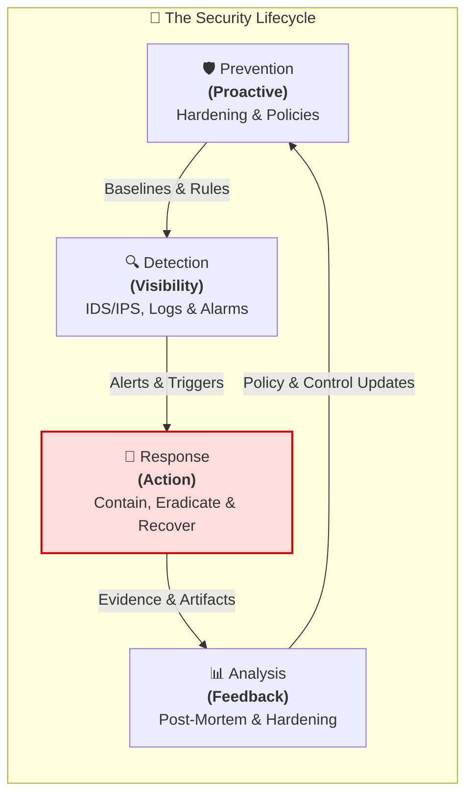
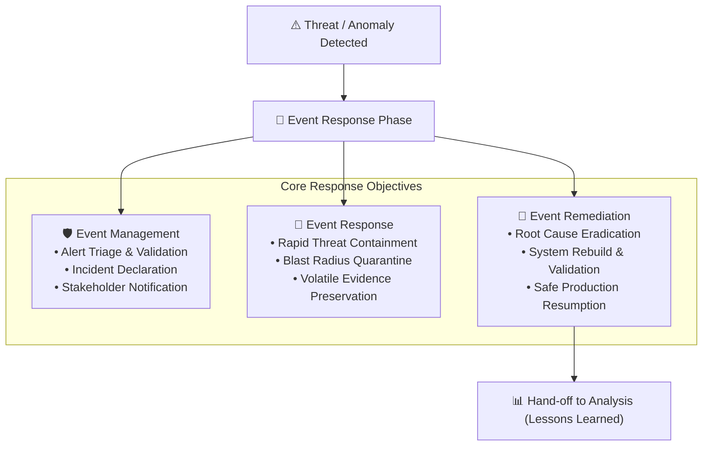
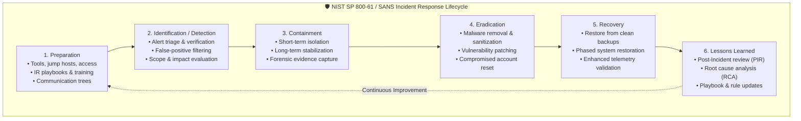
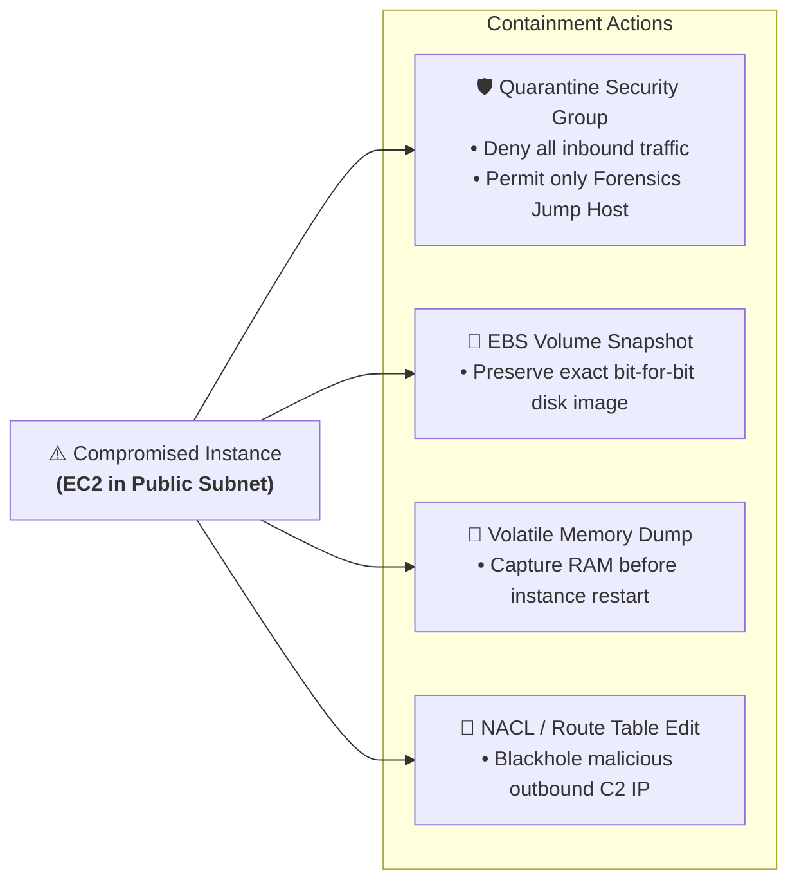
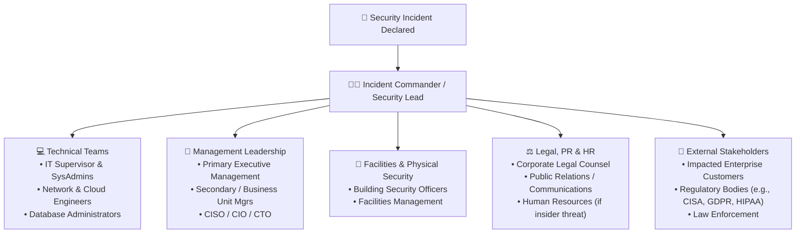
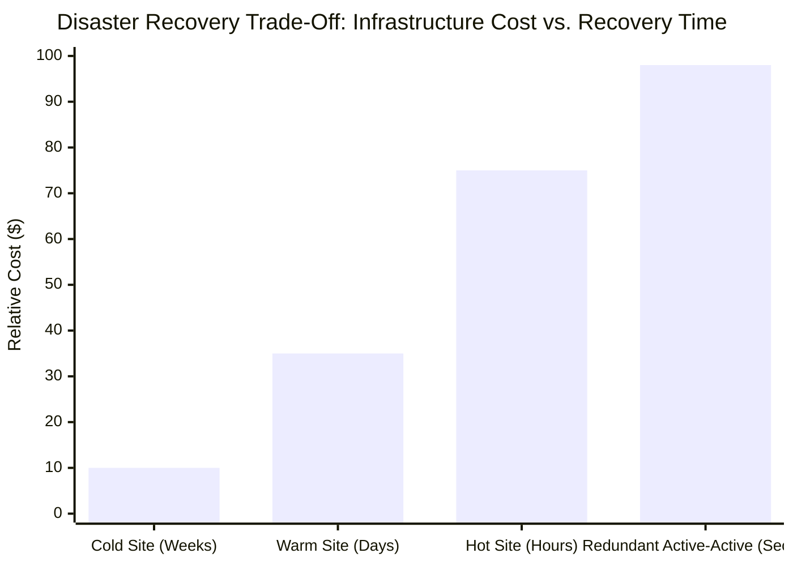
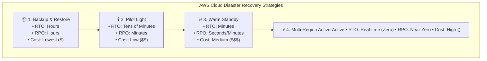

# 🚨 Security Lifecycle: Response – Incident Handling, Business Continuity & Disaster Recovery

> **Course**: AWS re/Start  
> **Module**: Security (M04 – Security Lifecycle: Response)  
> **Source Document**: `T08-Security/T08-0014-RSSECY_EN-US_SG_M04_RESPONSE.pdf`  
> **Target Audience**: AWS re/Start Learners, Cloud Practitioners, Security Engineers, and Systems Operations Associates  

---

## 🎯 Module Overview

In enterprise security and cloud operations, **Response** is the operational phase of the **Security Lifecycle** triggered when preventive controls fail or are bypassed, and detective controls alert the organization to a security incident or disaster. While prevention seeks to eliminate vulnerabilities and detection provides situational visibility into active anomalies, **Response** focuses on operational containment, eradication, and system restoration to minimize organizational harm.

Security incidents—such as distributed denial-of-service (DDoS) attacks, ransomware infections, compromised credentials, or physical data center outages—threaten the Confidentiality, Integrity, and Availability (CIA) of enterprise workloads. A well-orchestrated response prevents a localized security event from escalating into an enterprise-wide catastrophe.

This comprehensive guide covers the end-to-end incident response lifecycle modeled after **NIST SP 800-61** and the **SANS Institute**, explores the relationship between **Business Continuity Planning (BCP)** and **Disaster Recovery Planning (DRP)**, analyzes critical recovery metrics (**RPO**, **RTO**, **WRT**, **MTD**), compares cloud disaster recovery architectural tiers on AWS, and works through an end-to-end incident response operational simulation.



---

## 📌 Learning Objectives

By completing this module and engaging with these study materials, you will be able to:

- [ ] **Position Response within the Security Lifecycle**: Articulate the purpose of response in limiting breach radius, containing threats, and returning workloads to operational stability.
- [ ] **Execute the Incident Investigation & Response Process**:
  - [ ] Apply the 6-phase NIST SP 800-61 / SANS framework: *Preparation*, *Identification*, *Containment*, *Eradication*, *Recovery*, and *Lessons Learned*.
  - [ ] Distinguish short-term containment (network isolation, security group quarantines) from long-term containment (forensic imaging, patch staging).
  - [ ] Implement cloud-native containment actions, such as isolating Amazon EC2 instances and isolating VPC subnets.
- [ ] **Establish Incident Communication & Escalation Protocols**: Formulate stakeholder notification trees involving management, legal, PR, physical security, facilities, and customers.
- [ ] **Differentiate Business Continuity (BCP) and Disaster Recovery (DRP)**:
  - [ ] Distinguish proactive, organizational continuity management (BCP) from reactive, technical workload restoration (DRP).
  - [ ] Understand how Business Impact Analysis (BIA) and risk assessment govern continuity strategies.
  - [ ] Enforce the core security principle of disaster recovery: *Never lower the baseline of security controls or access restrictions during emergency operations*.
- [ ] **Evaluate Critical Recovery Objectives**:
  - [ ] Calculate and interpret **Recovery Point Objective (RPO)** and **Recovery Time Objective (RTO)**.
  - [ ] Analyze **Work Recovery Time (WRT)** and **Maximum Tolerable Downtime (MTD)** where $\text{MTD} = \text{RTO} + \text{WRT}$.
  - [ ] Evaluate the financial trade-off curve between downtime loss and disaster recovery infrastructure investment.
- [ ] **Architect AWS Disaster Recovery Strategies**:
  - [ ] Compare traditional recovery sites (Cold, Warm, Hot, Redundant).
  - [ ] Analyze the four cloud DR strategies: **Backup and Restore**, **Pilot Light**, **Warm Standby**, and **Multi-Region Active-Active**.
  - [ ] Select AWS services for disaster recovery: Amazon S3, S3 Glacier storage classes, AWS Backup, Amazon EBS snapshots, AWS Elastic Disaster Recovery (AWS DRS), and Amazon Route 53.
- [ ] **Execute Hands-On Incident Handling Procedures**: Complete an incident response simulation covering incident triage, asset valuation, containment execution, root cause eradication, and debrief auditing.

---

## 🚨 1. Event Response in the Security Lifecycle

### 1.1 The Role and Purpose of Response

Security is not a static state; it is an active operational discipline. Despite rigorous preventive controls, systems experience unforeseen hardware failures, zero-day vulnerabilities, administrative mistakes, or targeted adversary attacks.

When preventive defenses are breached and detective sensors trigger alerts:
1. **Response initiates immediately**: Mitigating damage and containing the impact.
2. **Operations continue safely**: Maintaining critical business services in a reduced or alternate capacity.
3. **Normal state is restored**: Returning systems to standard operations without compromising security controls.



### 1.2 The Real-World Highway Analogy: Incident Response in Action

Consider an everyday scenario that illustrates the natural progression of incident management:

> **The Scenario**: You are driving down a highway at highway speeds. Suddenly, you hear a loud pop and violent thumping, and the vehicle begins to pull sharply to the right.

| Real-World Step (Flat Tire Analogy) | Cybersecurity Incident Response Equivalent | Phase in Lifecycle |
| :--- | :--- | :--- |
| 1. Hear loud noise, feel car pull | Automated IDS/SIEM alert sounds; monitoring triggers | **Detection** |
| 2. Pull off the road to the shoulder | Triage alert, isolate system from main production network | **Containment (Short-Term)** |
| 3. Stop car and turn off ignition | Halt compromised process, sever network interface | **Containment** |
| 4. Inspect tire and observe blow-out | Triage damage, assess scope of compromise | **Identification** |
| 5. Call employer/family to notify delay | Trigger stakeholder communication matrix | **Notification / Escalation** |
| 6. Install spare tire (donut) | Failover to secondary node or run in reduced capacity (BCP) | **Business Continuity** |
| 7. Drive slowly to a professional garage | Safe system recovery, route traffic through scrubbed nodes | **Recovery** |
| 8. Replace tire and balance wheel | Eradicate underlying vulnerability, install verified build | **Eradication** |
| 9. Post-drive reflection: *Why did it blow?* | Post-incident review (PIR), root cause analysis (RCA) | **Lessons Learned (Analysis)** |

> [!NOTE]
> Incident response is not improvisation. Just as keeping a spare tire, jack, and roadside assistance number in your car constitutes preparation, enterprise incident response requires tested playbooks, designated response teams, and automated containment mechanisms.

---

## 🔄 2. The End-to-End Incident Response Lifecycle

Authoritative cybersecurity frameworks—such as **NIST Special Publication 800-61 Revision 2** (*Computer Security Incident Handling Guide*) and the **SANS Institute**—structure incident handling into a continuous multi-stage lifecycle.



### 2.1 Phase 1: Preparation

Preparation occurs **before** an incident takes place. An organization cannot design an incident response plan during an active breach.

Key Preparation elements include:
- **Computer Security Incident Response Team (CSIRT)**: Defining roles, alternates, and escalation authority.
- **Incident Playbooks**: Step-by-step guides for specific scenarios (ransomware, DDoS, unauthorized IAM access, compromised database).
- **Communication Plans**: Out-of-band communication channels (secure chat, alternative email, satellite phones) in case internal networks or corporate directories are compromised.
- **Pre-provisioned Cloud Jump Boxes & Forensic Tooling**: Dedicated AWS accounts (e.g., Security & Forensics VPCs) with snapshotting automation, memory dump collectors, and analysis suites.
- **Access Control & Telemetry**: Ensuring centralized, immutable audit logging (AWS CloudTrail saved to write-once S3 buckets with Object Lock).

### 2.2 Phase 2: Identification and Detection

Detection involves validating anomalies and determining whether an observed security event constitutes a genuine security incident.

- **Verifying Alerts & Filtering False Positives**: Automated Intrusion Detection Systems (IDS), Amazon GuardDuty, and AWS WAF produce high-volume telemetry. Responders must verify alerts before declaring an incident.
- **Scoping the Incident**:
  - What assets are impacted?
  - Which systems have communicating connections to the compromised asset?
  - What data classifications are involved (e.g., public vs. PII / financial records)?
- **Categorizing the Threat Type**:
  - Denial-of-Service (DoS / DDoS)
  - Ransomware or Malware execution
  - Unauthorized Access / Credential Compromise
  - Data exfiltration or intellectual property loss
  - Equipment hardware or facilities failure

### 2.3 Phase 3: Containment

The immediate goal of containment is **stopping the spread of the attack** and **limiting the blast radius** without destroying forensic evidence.



#### Containment Tactics: Short-Term vs. Long-Term
1. **Short-Term Containment**:
   - Disconnecting physical network cables or disassociating virtual Elastic Network Interfaces (ENIs).
   - Swapping the instance's Security Group to an **Isolation / Quarantine Security Group** that allows zero ingress/egress except for a forensic workstation.
   - Revoking temporary AWS IAM credentials (`aws iam attach-user-policy --policy-arn ...` or invalidating active session tokens).
   - Updating AWS WAF rules to block attacking IP CIDR blocks or bad user-agents at the CloudFront / ALB boundary.
2. **Long-Term Containment**:
   - Preserving volatile evidence: Taking live memory dumps before powering down or rebooting systems.
   - Taking point-in-time Amazon EBS volume snapshots for off-line digital forensics.
   - Deploying temporary clean patches or routing production traffic to secondary unaffected nodes.

> [!CAUTION]
> **Do not immediately power off or terminate an instance.** Powering down destroys volatile memory (RAM), which contains active network connections, injected in-memory DLLs, decrypter keys, and malware runtime artifacts essential for legal attribution and root-cause analysis.

### 2.4 Phase 4: Eradication

Once the threat is isolated, the security team removes the root cause of the incident:
- **Malware Removal & System Sanitization**: Deleting malicious scripts, cron jobs, registry keys, and rootkits. In cloud environments, the safest approach is often **terminating the compromised instance entirely** and rebuilding from a known-good Golden AMI or container image.
- **Vulnerability Remediation**: Patching software flaws (CVEs), closing exposed ports, and fixing misconfigured security groups or S3 bucket policies.
- **Credential Rotation**: Cycling all passwords, SSH key pairs, API tokens, and IAM secret keys that may have been exposed.

### 2.5 Phase 5: Recovery

Recovery involves returning systems to production safely and validating normal operational integrity:
- **Restoring from Known-Good Backups**: Restoring data verified prior to the breach timestamp.
- **Phased Rollout**: Bringing restored systems back online incrementally under increased monitoring.
- **Enhanced Telemetry & Verification**: Watching Amazon CloudWatch metrics, VPC Flow Logs, and AWS CloudTrail logs closely to verify that the adversary is not attempting re-entry.

### 2.6 Phase 6: Lessons Learned (Post-Incident Review)

The incident is not concluded until the organization documents what happened and implements defensive improvements:
- **Post-Mortem / Post-Incident Review (PIR)**: A blameless meeting bringing together technical teams, management, and stakeholders.
- **Key Questions Asked**:
  - *What exact sequence of events occurred, and when was each step detected?*
  - *How effectively did the response staff and playbooks perform?*
  - *What information was missing that would have accelerated containment?*
  - *What preventive or detective controls failed or were missing?*
- **Actionable Outputs**: Updating incident playbooks, adjusting detection rules in GuardDuty / SIEM, and filing architectural engineering requests to remediate underlying structural flaws.

---

## 👥 3. Incident Escalation & Stakeholder Communication Matrix

Effective incident response requires structured communication. When an incident is declared, responders must notify internal leadership and operational teams based on an established hierarchy.



### Contact Roster Elements
A production incident response communication plan maintains current contact details for:
- **IT Supervisor & Operations Leads**: Coordinates technical system actions and validates infrastructure status.
- **Primary & Secondary Management**: Authorizes emergency business actions, downtime approvals, or financial outlays.
- **Facilities & Physical Security**: Engaged if physical premises, data centers, access cards, or hardware tampering is suspected.
- **Legal Counsel & Regulatory Compliance Officers**: Guides breach notification obligations within mandatory statutory windows (e.g., GDPR 72-hour notification requirement).
- **Public Relations (PR) & Communications**: Ensures consistent, accurate customer communication without making premature legal disclosures.
- **Affected Customers & End Users**: Communicates operational status changes, expected maintenance windows, or necessary user actions (e.g., password resets).

---

## 🏛️ 4. Business Continuity (BCP) vs. Disaster Recovery (DRP)

Organizations frequently confuse **Business Continuity** with **Disaster Recovery**. While deeply intertwined, they serve distinct operational objectives and temporal scopes.

```mermaid
flowchart TD
    Disruption["💥 Disruptive Event (Outage, Cyberattack, Natural Disaster)"]
    
    subgraph BCP_Scope["🏢 Business Continuity Plan (BCP) – Operational Survival"]
        direction TB
        B1["Focus: Business operations, people, and customer commitments"]
        B2["Goal: Keep business functioning in a reduced or alternate capacity"]
        B3["Mechanism: Workarounds, alternate facilities, emergency staffing, manual processes"]
    end
    
    subgraph DRP_Scope["💻 Disaster Recovery Plan (DRP) – Technical Restoration"]
        direction TV
        D1["Focus: IT infrastructure, databases, servers, networks"]
        D2["Goal: Restore IT systems to normal operation as rapidly as possible"]
        D3["Mechanism: Backups, snapshot restoration, secondary cloud regions, automated failover"]
    end
    
    Disruption --> BCP_Scope
    Disruption --> DRP_Scope
```

### 4.1 Comparative Breakdown: BCP vs. DRP

| Dimension | Business Continuity Plan (BCP) | Disaster Recovery Plan (DRP) |
| :--- | :--- | :--- |
| **Primary Focus** | Whole business survival: employees, physical facilities, supply chains, customer operations. | Information Technology (IT) systems: servers, databases, networking, applications, storage. |
| **Core Objective** | Maintain mission-critical services at an acceptable minimum operating level during an outage. | Rapidly restore IT operations, recover lost data, and bring systems back to normal production state. |
| **Operational State** | Proactive governance and management framework outlining how the business functions in degraded mode. | Tactical, reactive operational playbook executed during and immediately following a disaster. |
| **Key Metrics** | Maximum Tolerable Downtime (MTD), business survival impact, minimum operational staff. | Recovery Point Objective (RPO), Recovery Time Objective (RTO), Work Recovery Time (WRT). |
| **Example Measures** | Relocating staff to secondary office; switching to paper invoicing; rerouting calls to alternate call center. | Restoring database from Amazon S3 snapshots; routing DNS traffic to standby AWS Region via Route 53. |
| **Scope of Activation** | Governs operational procedures throughout the duration of disruption. | Activated immediately upon technical failure; concludes when production systems pass acceptance testing. |

### 4.2 Business Impact Analysis (BIA) and Risk Assessment

Both BCP and DRP originate from a formal **Business Impact Analysis (BIA)**:
- **Identification of Critical Business Functions**: Pinpoints which business workflows generate revenue, satisfy legal mandates, or preserve life/safety.
- **Asset Classification**: Categorizes infrastructure into:
  - **Mission-Critical**: Systems whose disruption threatens immediate business survival (e.g., core transactional database, authentication gateway). Downtime tolerance: minutes to hours.
  - **Sensitive**: Essential for operations but tolerable for brief pauses (e.g., internal reporting, payroll processing). Downtime tolerance: 24 to 72 hours.
  - **Departmental / Non-Critical**: Internal productivity tools (e.g., internal wiki, development sandbox). Downtime tolerance: days to weeks.

### 4.3 Preserving Security Posture During Disasters

> [!IMPORTANT]
> **The Golden Rule of Disaster Recovery Security**:  
> *Never lower the baseline of security controls, authentication safeguards, or access restrictions during emergency operations.*

When under extreme stress to restore systems, engineers may be tempted to bypass Multi-Factor Authentication (MFA), disable firewall rules, or grant broad administrator privileges (`"Action": "*"`) to expedite recovery. Attackers actively exploit disasters and emergency transitions knowing defenses are disrupted. 

If full access controls cannot be applied to a restored resource, the resource **must not be connected to the network or made accessible to users** until compliant security controls are established.

---

## ⏱️ 5. Critical Continuity Metrics: RPO, RTO, WRT, and MTD

Disaster recovery planning relies on four quantitative metrics that define tolerable downtime and data loss.

```mermaid
flowchart LR
    subgraph Timeline["⏱️ Disaster Recovery Timeline"]
        direction LR
        LastBackup["💾 Last Successful Data Backup"]
        Disaster["💥 Disaster Event Occurs"]
        SysRestored["🖥️ Systems & Infrastructure Restored"]
        OpsNormal["✅ Normal Business Operations Resumed"]
    end

    LastBackup <-->|<b>RPO</b><br>(Data Loss Window)| Disaster
    Disaster <-->|<b>RTO</b><br>(Downtime Window)| SysRestored
    SysRestored <-->|<b>WRT</b><br>(Verification & Data Catch-up)| OpsNormal
    
    Disaster <-->|<b>MTD = RTO + WRT</b><br>(Maximum Tolerable Downtime)| OpsNormal
```

### 5.1 Definitions and Technical Implications

#### Recovery Point Objective (RPO)
- **Definition**: The maximum acceptable amount of time since the last data recovery point. It determines the maximum allowable **data loss** measured in time.
- **Focus**: Exclusively focused on the **data layer** (databases, file systems, object storage).
- **Guiding Question**: *How much data can the business afford to lose before irreparable harm occurs?*
- **Technical Determinant**: Frequency of backups or data replication cadence.
  - If database backups run every **24 hours**, the RPO is **24 hours** (up to 24 hours of committed transactions could be lost).
  - If database changes are replicated synchronously or near-continuously, the RPO can be **seconds or zero**.

#### Recovery Time Objective (RTO)
- **Definition**: The maximum acceptable delay between the interruption of service and the restoration of system infrastructure.
- **Focus**: Focused on the **infrastructure and application layers** (compute nodes, networks, middleware, DNS).
- **Guiding Question**: *How quickly must the technology infrastructure be powered on, provisioned, and connected?*
- **Technical Determinant**: Time required to provision servers, reconfigure networking, and load base software.

#### Work Recovery Time (WRT)
- **Definition**: The duration required after systems are technically online to test data integrity, replay unprocessed logs, synchronize state, and verify business operations before declaring production readiness.
- **Focus**: Verification, data reconciliation, user acceptance testing (UAT).

#### Maximum Tolerable Downtime (MTD)
- **Definition**: The total elapsed time from the initial disaster event until business operations are fully resumed, beyond which the business faces fatal consequences or irreversible damage.
- **Mathematical Formula**:
  $$\text{MTD} = \text{RTO} + \text{WRT}$$
- The sum of infrastructure recovery (RTO) and work verification (WRT) must never exceed the business's MTD.

---

## 💰 6. Cost Balancing & Recovery Site Strategies

There is an inverse relationship between recovery time and infrastructure expenditure: **the closer RTO and RPO approach zero, the higher the architectural cost and operational complexity**.



### 6.1 Traditional Physical DR Site Models

| Site Type | Description | RTO Range | Cost Profile | Operational Readiness |
| :--- | :--- | :--- | :--- | :--- |
| **Cold Site** | Bare physical facility with power, cooling, and network jacks, but no pre-installed compute, storage, or operational data. | Weeks | **$** (Lowest) | Hardware must be ordered, shipped, racked, cabled, and loaded with software and restored data. |
| **Warm Site** | Facility with pre-installed hardware and networking, but data is periodically restored and servers are kept idle or powered off. | Hours to Days | **$$** (Moderate) | Hardware is ready; requires restoring recent backups and testing before cutting over. |
| **Hot Site** | Fully mirrored data center with running servers, real-time data replication, and identical software stacks ready for near-instant failover. | Minutes to Hours | **$$$** (High) | Live systems running continuously; operational cutover occurs quickly. |
| **Redundant Site (Mirrored)** | Fully active duplicate facility operating in parallel with continuous real-time two-way data replication. | Near Zero | **$$$$** (Highest) | Zero downtime; traffic switches instantaneously across active-active endpoints. |

---

## ☁️ 7. AWS Cloud Disaster Recovery Strategies

Cloud computing fundamentally alters disaster recovery economics. Rather than purchasing duplicate physical data centers and paying for idle hardware, organizations leverage **elastic provisioning**, **Infrastructure as Code (IaC)**, and **automated snapshot replication**.

The official AWS Disaster Recovery guidance outlines four primary cloud recovery strategies:



### 7.1 Detailed Analysis of the 4 AWS DR Strategies

```mermaid
flowchart TB
    subgraph S1_Arch["1. Backup and Restore"]
        direction TB
        B_P["Primary Region: Compute & DB"] -->|Automated Snapshots / Backups| B_S["Amazon S3 / AWS Backup<br>(Replicated to DR Region)"]
        B_S -.->|On Disaster: Provision via IaC| B_R["DR Region: CloudFormation rebuilds stack"]
    end

    subgraph S2_Arch["2. Pilot Light"]
        direction TB
        PL_P["Primary Region: Full Compute Fleet + Active DB"] -->|Continuous Data Sync| PL_DB["DR Region: Standby Live DB Core"]
        PL_C["DR Region: AMIs / Templates Idle (Zero Compute Running)"]
        PL_DB -.->|On Disaster: Auto Scaling groups scale compute up| PL_Full["DR Region: Rapid Full Fleet Provisioning"]
    end

    subgraph S3_Arch["3. Warm Standby"]
        direction TB
        WS_P["Primary Region: 100% Capacity Fleet + Live DB"] -->|Continuous Replication| WS_S["DR Region: Scaled-down Fleet (e.g. 20-30%) + Live DB"]
        WS_S -.->|On Disaster: Route 53 shifts traffic & fleet auto-scales to 100%| WS_P2["DR Region: Full Scale Fleet"]
    end

    subgraph S4_Arch["4. Multi-Region Active-Active"]
        direction TB
        R53["Amazon Route 53 (Latency / Geolocation Routing)"]
        R53 --> AA_R1["Region A (100% Active Production Fleet)"]
        R53 --> AA_R2["Region B (100% Active Production Fleet)"]
        AA_R1 <-->|Bidirectional Real-Time Replication<br>(DynamoDB Global Tables / Aurora Global DB)| AA_R2
    end
```

#### 1. Backup and Restore
- **How It Works**: Workload data is backed up regularly and stored in Amazon S3 or managed via AWS Backup. Backups and Amazon EBS snapshots are replicated to a secondary AWS Region. No compute resources run in the recovery region during normal operations.
- **Disaster Response**: When disaster strikes, AWS CloudFormation or Terraform templates provision the VPC, subnets, EC2 instances, and databases, which are then populated from the latest backups.
- **RTO**: Hours.
- **RPO**: Hours (governed by backup interval).
- **Best Suited For**: Non-critical applications, dev/test environments, and cost-sensitive workloads.

#### 2. Pilot Light
- **How It Works**: The core critical data layer (the "pilot light" of a gas furnace) is kept running live in the recovery region with continuous data replication. Application servers and web tiers are not running; their configurations and AMIs are stored ready to launch.
- **Disaster Response**: During an outage, automation scripts deploy compute instances around the live database core, attach elastic IP addresses, and update DNS records.
- **RTO**: Tens of minutes.
- **RPO**: Minutes to seconds (due to continuous database replication).
- **Best Suited For**: Core business systems with moderate downtime tolerance.

#### 3. Warm Standby
- **How It Works**: A fully functional, scaled-down version of the complete production environment runs continuously in the secondary region (e.g., 2 small instances instead of 10 large instances). It can handle light traffic or background processing.
- **Disaster Response**: When the primary region fails, Amazon Route 53 shifts user traffic to the secondary region, and EC2 Auto Scaling immediately expands the instance fleet to handle 100% production load.
- **RTO**: Minutes.
- **RPO**: Seconds.
- **Best Suited For**: Mission-critical enterprise services requiring rapid cutover without paying for double full capacity.

#### 4. Multi-Region Active-Active
- **How It Works**: Full-capacity production environments operate simultaneously in two or more AWS Regions. User traffic is balanced across regions using Amazon Route 53 latency-based or weighted routing. Data stores utilize continuous bidirectional replication (e.g., Amazon DynamoDB Global Tables, Amazon Aurora Global Database).
- **Disaster Response**: If one region suffers a total disruption, Route 53 health checks automatically stop sending traffic to the unhealthy region. Zero provisioning or manual intervention is needed.
- **RTO**: Near zero / instantaneous.
- **RPO**: Near zero.
- **Best Suited For**: Mission-critical global applications where any outage incurs severe financial or safety penalties.

### 7.2 DR Strategy Comparison Matrix

| Strategy | RTO | RPO | Cost Factor | Operational Complexity | Key AWS Enabling Services |
| :--- | :--- | :--- | :--- | :--- | :--- |
| **Backup & Restore** | Hours | Hours | **$** (Lowest) | Low | AWS Backup, Amazon S3, S3 Glacier, Amazon EBS Snapshots, AWS CloudFormation |
| **Pilot Light** | 10s of Minutes | Minutes | **$$** (Low) | Medium | Amazon RDS Read Replicas, Amazon Aurora, Amazon EC2 AMIs, AWS CloudFormation |
| **Warm Standby** | Minutes | Seconds | **$$$** (Medium) | Medium-High | Amazon EC2 Auto Scaling, Route 53 Health Checks, RDS Multi-Region, ALB |
| **Multi-Region Active-Active** | Real-Time (Zero) | Near Zero | **$$$$** (High) | High | Amazon Route 53, Amazon DynamoDB Global Tables, Amazon Aurora Global Database, AWS Global Accelerator |

### 7.3 Supporting AWS Services for Disaster Recovery

- **Amazon Simple Storage Service (Amazon S3)**: Provides 99.999999999% (11 9s) of data durability. Offers multi-tier storage lifecycle management (S3 Standard, S3 Standard-IA, S3 Glacier Flexible Recovery, S3 Glacier Deep Archive) and Cross-Region Replication (CRR).
- **AWS Backup**: Centralized, policy-based backup service for automating snapshot schedules, retention policies, and cross-Region/cross-account backup copying across EC2, EBS, RDS, DynamoDB, EFS, and S3.
- **AWS Elastic Disaster Recovery (AWS DRS)**: Continuously replicates block-level data from physical, virtual, or cloud servers into a low-cost staging area in AWS, enabling fast recovery into native EC2 instances.
- **Amazon Route 53**: Highly available cloud DNS offering automatic health checks, DNS failover, latency routing, and geoproximity routing.

---

## 🛠️ 8. Hands-On Activity: Incident Response Simulation

### 8.1 Scenario Briefing

> **Enterprise Scenario**:  
> Your organization's primary data center has come under an aggressive **Denial of Service (DoS)** attack launched by an unidentified threat actor.
> 
> **Observed Symptoms**:
> - Network connectivity to the production **logistics database** is completely down, halting fulfillment and inventory tracking.
> - Voice over IP (VoIP) corporate voice communications are experiencing severe, intermittent packet loss and dropouts.
> - Executive management has received an extortion communication demanding financial payment in cryptocurrency to cease the attack.
>
> **Your Role**:  
> You are the IT Security Incident Response Leader coordinating operational measures to contain the attack, inventory affected assets, minimize ongoing business damage, safely restore systems, and recommend hardening controls.

---

### 8.2 Exercise 1: Identify the Incident & Triage

Responders complete an initial incident triage checklist to verify whether an event crosses the threshold into a declared security incident.

#### Incident Triage Checklist

```markdown
[x] 1. Has an event occurred that affects the company?
    -> YES: Logistics database is unreachable; enterprise voice channels are failing.

[x] 2. Will the event disrupt the confidentiality, availability, or integrity of company assets?
    -> YES: Availability of the logistics database and voice communication is severely compromised. 
       Integrity and confidentiality remain under active investigation.

[x] 3. Which type of incident has occurred?
    -> Type: Distributed Denial of Service (DoS/DDoS) combined with Cyber Extortion / Ransom Demands.

[x] 4. What is the assessed level of business impact?
    -> Impact Level: HIGH. Core supply chain logistics are halted, resulting in escalating financial loss every minute.

[x] 5. Do you believe that this company is experiencing an incident?
    -> YES: The operational threshold for a Major Security Incident is satisfied. Incident Recovery Plan initiated.
```

#### Incident Stakeholder Escalation Roster

| Role / Function | Contact Person / Group | Primary Communication Channel | Operational Responsibility in this Incident |
| :--- | :--- | :--- | :--- |
| **IT Supervisor** | Lead Systems Operations Mgr | Out-of-band Mobile / Signal | Directs network routing adjustments and firewall perimeter inspections. |
| **Primary Management** | Chief Information Security Officer (CISO) | Dedicated Incident Conference Bridge | Authorizes incident declaration, crisis team mobilization, and operational failovers. |
| **Secondary Management** | VP of Logistics & Operations | Dedicated Incident Conference Bridge | Coordinates warehouse operational workarounds and business continuity mode. |
| **Facilities Management** | Data Center Infrastructure Lead | Landline / Radio | Inspects physical edge routers, incoming telecom fiber trunks, and power telemetry. |
| **Physical Security** | Corporate Security Director | Secure Internal Radio | Enforces data center physical access lockdown; monitors physical access logs. |
| **Customer Relations / PR** | Corporate Communications Lead | External Encrypted Email | Manages external messaging and fulfillment notifications to corporate logistics clients. |
| **Legal Counsel** | General Counsel & Compliance Lead | Direct Mobile / Encrypted Phone | Evaluates extortion demands against legal prohibitions; liaises with law enforcement (FBI/CISA). |

---

### 8.3 Exercise 2: Determine Key Assets & Valuation

Placing an operational value on key assets allows the incident response team to prioritize defensive resources.

#### Incident Summary & Context
- **Date & Time of Incident**: October 12, 2026 – 08:42 UTC
- **Reporting Party**: Operations Center Shift Lead / Automated Network Monitoring
- **Detection Mechanism**: Automated network threshold alarm on boundary firewalls indicating 45 Gbps inbound SYN-flood and UDP amplification traffic; synthetic health check timeout on logistics database endpoint.
- **Affected System Identifiers**:
  - `DB-LOGISTICS-PROD-01` (10.100.4.50 / VIP 198.51.100.25)
  - `VOIP-SIP-GW-01` (10.100.2.10)
  - Core Edge Border Routers `RTR-EDGE-01` and `RTR-EDGE-02`

#### Qualitative Asset Classification

| Asset Name | Asset Role & Description | Qualitative Classification | Impact of Disruption |
| :--- | :--- | :--- | :--- |
| **Logistics Production Database (`DB-LOGISTICS-PROD-01`)** | Central relational database coordinating warehouse shipping, receiving, vehicle tracking, and customer orders. | **Mission-Critical** | Stoppage halts corporate revenue operations, triggers SLA breach penalties, and risks physical warehouse gridlock. |
| **Enterprise VoIP Gateway (`VOIP-SIP-GW-01`)** | Session Initiation Protocol (SIP) PBX handling corporate and customer service phone calls. | **Sensitive** | Degrades customer service and internal voice calls, but operations can temporarily fall back to cell phones. |
| **Public Customer Tracking Portal** | Web-facing portal allowing end customers to track package delivery statuses. | **Sensitive** | Causes customer frustration and reputational damage; does not halt backend package movement. |
| **Internal Development Sandbox** | Staging and test database environments for future feature testing. | **Departmental / Non-Critical** | Zero impact on revenue or live supply chain logistics. |

---

### 8.4 Exercise 3: Implement Incident Response Plan (Containment)

The incident handler documents specific isolation and containment actions taken against affected infrastructure:

#### Incident Handler Containment Report

| Affected System | Description & Configuration | Containment Action Taken | Date & Time of Isolation | Management Approval | Backup Availability & Status |
| :--- | :--- | :--- | :--- | :--- | :--- |
| **`DB-LOGISTICS-PROD-01`** | Primary PostgreSQL 15 Database<br>IP: `10.100.4.50`<br>OS: RHEL 9.2<br>VLAN: 40 (Secure DB) | Severed edge inbound routing to database VIP; isolated host to internal maintenance VLAN; blocked inbound traffic from border gateway. | Oct 12, 2026<br>09:05 UTC | CISO & VP Ops<br>Oct 12, 09:02 UTC | **Verified & Secured**<br>Full snapshot captured Oct 12, 06:00 UTC.<br>WAL logs archived to S3. |
| **`VOIP-SIP-GW-01`** | Asterisk / SIP Trunk Appliance<br>IP: `10.100.2.10`<br>Firmware: v4.8.1<br>Switch: `SW-CORE-02`, Port 18 | Rate-limited SIP UDP traffic at edge; rerouted inbound customer calls to cloud backup PBX (Amazon Connect). | Oct 12, 2026<br>09:12 UTC | IT Supervisor<br>Oct 12, 09:10 UTC | **Verified**<br>Configuration backup verified from daily cold repository. |
| **`RTR-EDGE-01` / `02`** | Cisco ASR 9000 Border Routers<br>IOS-XR 7.8 | Injected BGP Flowspec rules to drop malicious volumetric UDP traffic; engaged upstream ISP DDoS scrubbing center. | Oct 12, 2026<br>09:20 UTC | Network Director<br>Oct 12, 09:15 UTC | **Verified**<br>Router running configs archived daily in secure Git repo. |

---

### 8.5 Exercise 4: Specify Eradication & Preventive Controls

Once containment isolates the malicious traffic and preserves systems, the incident handler specifies root cause eradication and permanent preventive safeguards.

#### Incident Handler Eradication & Remediation Plan

```markdown
Report Completed By: Lead Incident Response Handler
Incident Case ID: IR-2026-1012-DOS
Manager In Charge: Director of Information Security
Root Cause Summary: Volumetric UDP reflection/amplification attack targeting edge IP addresses, 
saturating the physical WAN circuits and exhausting the state table on edge firewall appliances. 
Extortionist leveraged public DNS/NTP reflection vectors.
```

| Affected System | Eradication Solution | Actions to Prevent Reoccurrence |
| :--- | :--- | :--- |
| **Perimeter WAN & Edge Routers** | • Contracted upstream tier-1 carrier to engage upstream cloud-based DDoS scrubbing center.<br>• Filtered out all incoming open UDP reflection protocols (NTP, Chargen, DNS amplification). | • Onboard workloads to **AWS Shield Advanced** and **AWS CloudFront** to absorb Layer 3/4 volumetric attacks across AWS global edge locations.<br>• Implement automated route blackholing via BGP communities. |
| **`DB-LOGISTICS-PROD-01`** | • Validated database table integrity using cryptographic checksums.<br>• Re-established isolated replication to secondary cloud read replica.<br>• Reopened database connections strictly from authorized application tier subnets. | • Migrate on-premises database to **Amazon Aurora Multi-AZ** in a private VPC subnet with no public IP exposure.<br>• Deploy AWS Secrets Manager to enforce automatic credential rotation. |
| **Corporate VoIP System** | • Reset SIP trunk credentials.<br>• Migrated inbound toll-free routing permanently to cloud telephony provider. | • Transition corporate phone operations to **Amazon Connect** to eliminate single-point-of-failure physical on-premises telephony trunks. |
| **Extortion Threat Handling** | • Formally rejected ransom demands in accordance with organizational security policy and federal guidelines.<br>• Handed threat actor communications, wallet addresses, and packet captures to federal cyber division (CISA / FBI). | • Conduct annual tabletop exercises simulating cyber extortion scenarios.<br>• Enforce strict employee training on social engineering and phishing prevention. |

---

### 8.6 Activity Debrief & Audit Reflection

1. **What were the results of the inquiries?**
   - The attack was a distributed volumetric denial-of-service attack combined with extortion. 
   - No data exfiltration or integrity tampering occurred; the impact was restricted to service availability and transit bandwidth exhaustion.
   - Initial isolation of the database prevented opportunistic secondary intrusion attempts during the period of perimeter confusion.
2. **Did you identify gaps in the current environment?**
   - The organization lacked automated upstream DDoS scrubbing, creating an over-reliance on physical edge firewalls that were easily saturated.
   - Internal communications broke down when VoIP failed; responders lacked an officially designated out-of-band communication app (e.g., encrypted mobile channels).
3. **Were legal compliance or regulatory issues identified?**
   - Regulatory standards (e.g., PCI-DSS, SOC 2, ISO 27001) mandate documented, annually tested incident response plans and strict reporting timelines.
   - Paying extortion ransoms presents legal liabilities under federal sanctions regulations (e.g., OFAC advisories). Maintaining reliable backups and robust DRP makes payment unnecessary.

---

## 💡 Checkpoint Questions & Answers

### Question 1
**Which types of plans are used to minimize the impact of unplanned downtime?**
> **Answer**:  
> A **Business Continuity Plan (BCP)** and a **Disaster Recovery Plan (DRP)**.  
> - The **BCP** is a proactive management strategy that defines how business operations, personnel, and essential customer services continue operating in a reduced or alternate capacity during a disruption.
> - The **DRP** is a tactical technical strategy that details step-by-step procedures to recover, rebuild, and restore IT infrastructure, applications, and databases to normal operational status.

---

### Question 2
**What does Recovery Time Objective (RTO) represent, and how does it relate to cost?**
> **Answer**:  
> **Recovery Time Objective (RTO)** represents the maximum acceptable duration of time that a system can remain offline between service interruption and service restoration before business operations suffer unacceptable damage.  
> - **Cost Relationship**: The shorter the acceptable RTO, the more expensive the disaster recovery architecture becomes. Achieving near-zero RTO requires hot standby systems, automated multi-region failovers, and redundant active compute clusters, whereas longer RTOs (hours to days) can rely on low-cost cold backups and automated on-demand rebuilds.

---

### Question 3
**Which AWS service can be used to back up data across different tiers of speed and cost?**
> **Answer**:  
> **Amazon Simple Storage Service (Amazon S3)** is an object storage service that provides 99.999999999% (11 9s) of durability and offers multiple storage classes tailored to restoration speed and cost:
> - **S3 Standard**: Immediate, millisecond access for active operational backups.
> - **S3 Standard-Infrequent Access (S3 Standard-IA)**: Lower storage cost for data accessed less frequently but requiring millisecond retrieval.
> - **S3 Glacier Flexible Recovery**: Cost-effective archival storage with retrieval times ranging from minutes (Expedited) to hours.
> - **S3 Glacier Deep Archive**: The lowest-cost cloud storage tier designed for long-term compliance retention with retrieval times within 12 hours.
> 
> Additionally, **AWS Backup** provides a centralized, policy-based service to automate and manage backups across Amazon S3, EBS, RDS, DynamoDB, EFS, and EC2.

---

## 📌 Key Takeaways & Summary

- **Response is an Active Operational Discipline**: Planning, investigating, containing, eradicating, and remediating are the non-negotiable steps of the incident response lifecycle.
- **Incident Lifecycle Framework**: NIST SP 800-61 defines the six continuous phases: *Preparation*, *Identification*, *Containment*, *Eradication*, *Recovery*, and *Lessons Learned*.
- **BCP vs. DRP**: BCP focuses on keeping the *business running* in a reduced capacity; DRP focuses on *restoring IT systems* to normal operation.
- **Maintain Security During Crises**: Never lower access controls, disable authentication safeguards, or compromise security posture during a disaster recovery event.
- **Key Continuity Metrics**:
  - $\text{RPO}$ measures tolerable **data loss** (frequency of data backups).
  - $\text{RTO}$ measures tolerable **downtime** (speed of system restoration).
  - $\text{MTD} = \text{RTO} + \text{WRT}$ (total tolerable downtime before business failure).
- **AWS Cloud DR Continuum**: Organizations choose along a spectrum of cost versus recovery speed:
  $$\text{Backup \& Restore (\$)} \longrightarrow \text{Pilot Light (\$\$)} \longrightarrow \text{Warm Standby (\$\$\$)} \longrightarrow \text{Multi-Region Active-Active (\$\$\$\$)}$$
- **Cloud Agility**: AWS eliminates the need for expensive, idle physical cold/warm disaster recovery facilities through Infrastructure as Code (CloudFormation), managed backup automation (AWS Backup, Amazon S3), and elastic cross-region replication (Route 53, Aurora Global Database).
