# 🔍 Security Lifecycle: Analysis – Root Cause Analysis, Post-Incident Reviews, Security Testing & Telemetry Analytics

> **Course**: AWS re/Start  
> **Module**: Security (M04 – Security Lifecycle: Analysis)  
> **Source Document**: `T08-Security/T08-0015-RSSECY_EN-US_SG_M04_ANALYSIS.pdf`  
> **Target Audience**: AWS re/Start Learners, Cloud Practitioners, Security Analysts, and Systems Operations Associates  

---

## 🎯 Module Overview

In modern cloud computing and enterprise information security, **Security Analysis** represents the indispensable, introspective phase of the continuous **Security Lifecycle**. While *Prevention* builds defensive walls, *Detection* identifies active threats, and *Response* contains and mitigates immediate damage, **Analysis** completes the cycle. It transforms operational security incidents, routine telemetry, and simulated assessments into actionable organizational intelligence.

The fundamental premise of security analysis is simple yet vital: **every threat, near-miss, and security incident must yield a stronger, more resilient security architecture**. Without rigorous analysis, organizations remain trapped in a reactive posture—repeatedly responding to variations of the same underlying vulnerabilities and architectural weaknesses.

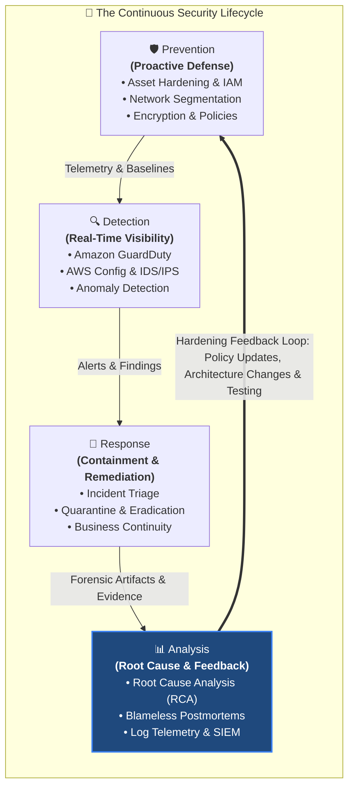

This guide explores the foundational tenets of security analysis, systematic **Root Cause Analysis (RCA)** methodologies (including the 5 Whys and Fishbone diagrams), **Post-Incident Reviews (PIR)** and blameless postmortems, comprehensive **Security Testing** frameworks (Vulnerability Assessments vs. Penetration Testing under AWS policies), and cloud-native **Monitoring, Logging, and SIEM architectures** using Amazon CloudWatch Logs Insights, Amazon Athena, and Amazon OpenSearch Service.

---

## 📌 Learning Objectives

By completing this module and engaging with these study materials, you will be able to:

- [ ] **Define Security Analysis and its Strategic Role**: Explain why security analysis is necessary and how it closes the feedback loop to reinforce the *Prevention* phase.
- [ ] **Apply the CIA Triad to Security Analysis**: Evaluate how security incidents compromise Confidentiality, Integrity, and Availability, and guide forensic discovery.
- [ ] **Execute Root Cause Analysis (RCA)**:
  - [ ] State the primary goal of RCA (**"How did the breach happen?"**).
  - [ ] Implement the four core stages of an RCA (issue description, baseline reconstruction, event correlation, and visual representation).
  - [ ] Apply the **5 Whys technique** to drill down from symptoms to underlying organizational and technical root causes.
  - [ ] Construct a **Fishbone (Ishikawa / Cause-and-Effect) diagram** categorizing causal factors across People, Process, Technology, Policy, Environment, and Monitoring.
- [ ] **Conduct Post-Incident Reviews (PIR) and Drive Continuous Security Improvement**:
  - [ ] Understand the psychological and cultural principles of blameless postmortems.
  - [ ] Structure an enterprise postmortem report including chronological timeline reconstruction, contributing factors, and trackable corrective actions.
  - [ ] Implement the continuous security feedback loop to harden the *Prevention* baseline after every security event.
- [ ] **Differentiate Security Testing & Assessment Methodologies**:
  - [ ] Compare **External Vulnerability Assessments**, **External Penetration Tests**, and **Internal Reviews of Applications and Platforms**.
  - [ ] Contrast automated **Vulnerability Scanning** against human-driven **Penetration Testing**.
  - [ ] Contrast **Black Box**, **White Box**, and **Gray Box** assessment postures based on information access and testing perspective.
- [ ] **Comply with the AWS Customer Support Penetration Testing Policy**:
  - [ ] Identify the 8 AWS user-permitted services eligible for authorized penetration testing without prior approval.
  - [ ] Identify strictly prohibited testing activities on AWS infrastructure (e.g., Denial of Service attacks, port flooding).
- [ ] **Formulate Comprehensive Monitoring and Logging Policies**:
  - [ ] Address key governance questions regarding what, how often, and who monitors system telemetry.
  - [ ] Define data retention guidelines across regulatory frameworks (HIPAA, PCI DSS, GDPR).
  - [ ] Ensure log integrity through centralized storage, access control, and time synchronization via NTP / Amazon Time Sync Service.
- [ ] **Architect Cloud-Native SIEM and Log Analytics Pipelines**:
  - [ ] Aggregate telemetry across AWS CloudTrail, Amazon VPC Flow Logs, and Amazon CloudWatch Logs into centralized Amazon S3 log archives.
  - [ ] Perform serverless log querying and threat hunting using **Amazon Athena**, **Amazon OpenSearch Service**, and **AWS CloudWatch Logs Insights**.
- [ ] **Evaluate Risk and Implement Risk Treatment Strategies**:
  - [ ] Apply the core risk definition: $Risk = Threat \times Vulnerability \times Impact$ alongside $Risk = Likelihood \times Impact$.
  - [ ] Execute the five basic steps of risk assessment (Identify threats, Identify vulnerabilities, Determine likelihood, Determine impact, Determine risk).
  - [ ] Apply the **Risk Response Decision Matrix** across **Avoidance**, **Transference**, **Mitigation**, and **Acceptance** with real-world cloud scenarios.
- [ ] **Track Key Security Metrics & KPIs**: Quantify security program health using both positive and negative metrics to justify investments and demonstrate risk reduction.

---

## 🔄 1. Security Analysis in the Lifecycle

### 1.1 Why Security Analysis is Necessary

In the security lifecycle, an incident does not terminate when an attacker is disconnected or an infected host is isolated. Terminating an incident at the *Response* phase leaves the vulnerability unpatched and the operational root cause unexamined, guaranteeing future recurrences.

The **Security Analysis** phase asks the deeper systemic questions:
- *How did the breach happen?*
- *What specific controls failed or were bypassed?*
- *Was the exposure caused by malicious intent, human error, or automated misconfiguration?*
- *What was the exact blast radius (number of users, systems, and data records affected)?*
- *How can the entire infrastructure be hardened so that this class of failure is permanently prevented?*

> [!NOTE]
> **The Flat Tire Analogy (from AWS Curriculum)**:  
> When a car suffers a flat tire, a driver cannot simply inflate it and continue driving. The driver must analyze the origin of the problem:
> - Did the tire puncture from a nail in the road? (Requires a patch or tire replacement).
> - Did the valve stem corrode and leak air slowly? (Requires a replacement valve).
> - Did the sidewall blow out due to chronic underinflation or curb impact? (Requires systemic maintenance changes).  
>
> In each case, the physical symptom is identical (a deflated tire), but the underlying cause dictates completely different remediation steps to prevent recurrence. Similarly, in cloud security, treating only the symptom (e.g., terminating a compromised EC2 instance) without analyzing the root cause (e.g., hardcoded IAM credentials exposed in a public code repository) leaves the door wide open for repeated attacks.

### 1.2 Closing the Feedback Loop into Prevention

The overarching objective of the analysis phase is to **strengthen existing security controls to better protect networks, cloud workloads, facilities, and organizations**.

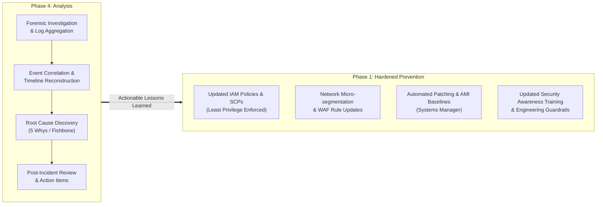

Key principles governing the analysis feedback loop include:
1. **Threats as Catalysts for Improvement**: Ensure that every threat, attempted intrusion, or policy violation yields a better security posture, **even if no breach occurred** (near-miss analysis).
2. **Balancing Protection vs. Business Impact**: Security controls cannot be implemented in a vacuum. Every defensive countermeasure introduces potential business impact (e.g., network latency, increased infrastructure cost, operational overhead, or developer friction). Analysis must evaluate risk versus usability to find the right balance for the business.
3. **Dedicated Testing Environments**: When validating security fixes or simulating attack vectors, engineers must conduct tests in dedicated, isolated environments (e.g., sandbox or staging AWS accounts) that mirror production architecture without risking live business transactions or customer data.

### 1.3 The CIA Triad in Security Analysis

During security analysis, forensic investigators and analysts categorize the impact of events against the three fundamental pillars of information security:

| CIA Pillar | Analysis Focus & Forensic Questions | Example Incident Manifestations |
| :--- | :--- | :--- |
| **Confidentiality** | • Was sensitive, proprietary, or personal identifiable information (PII) disclosed to unauthorized parties?<br>• Were cryptographic keys or access tokens leaked? | An Amazon S3 bucket containing customer financial statements had public read permissions enabled; access logs reveal external IP downloads. |
| **Integrity** | • Were records, configurations, or system files altered without authorization?<br>• Did unauthorized code run in production? | An attacker used compromised SSH keys to modify an EC2 production binary or inject fraudulent transaction records into an Amazon RDS database. |
| **Availability** | • Were systems, applications, or network services rendered inaccessible to authorized users?<br>• What was the financial and operational downtime? | A distributed denial-of-service (DDoS) flood exhausted application load balancer connections, rendering an e-commerce checkout workflow offline for 3 hours. |

---

## 🔍 2. Root Cause Analysis (RCA) Methodologies

**Root Cause Analysis (RCA)** is a structured problem-solving methodology designed to identify the fundamental, systemic origin of a security breach or operational failure. Rather than addressing surface-level symptoms, RCA seeks to determine *why* the failure occurred and eliminate the underlying mechanism.

> [!IMPORTANT]
> **Primary Goal of Root Cause Analysis**:  
> The ultimate objective of an RCA is to provide a clear, definitive, and forensically accurate answer to the central question:  
> **"How did the breach happen?"**  
> RCA is performed when a network or workload suffers an attack, or following authorized penetration testing. Instead of stopping at symptom containment (such as terminating an infected EC2 instance or rotating an exposed access key), RCA uncovers the root cause so that engineering teams can take permanent corrective actions to prevent the issue from ever happening again.

### 2.1 The Four Core Steps to Conduct an RCA

As established in the AWS curriculum, a rigorous RCA follows four sequential phases:

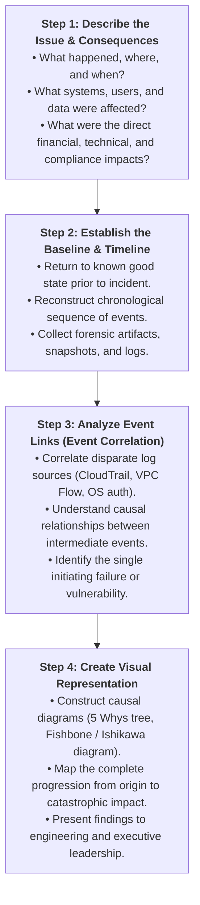

1. **Describe the Issue**: Formulate a factual, unambiguous problem statement detailing what occurred, which assets were impacted, where the intrusion surfaced, and what immediate consequences resulted.
2. **Establish the Baseline Situation**: Compare the compromised state against the pre-incident operational baseline. Examine authorized configuration changes, deployment manifests, and known operational patterns leading up to the anomalous activity.
3. **Analyze Events & Correlation**: Perform **event correlation** across multi-account log streams. By aligning timestamps across application logs, operating system authentication logs, API call records (AWS CloudTrail), and network connection records (Amazon VPC Flow Logs), analysts identify causal chains connecting individual anomalies.
4. **Create a Visual Representation**: Transform textual log data into intuitive diagrams (such as Ishikawa fishbone diagrams, timeline sequence charts, or causal flowcharts) that clearly communicate the progression from root cause to final incident.

---

### 2.2 The 5 Whys Technique

Developed originally by Sakichi Toyoda for manufacturing and widely adopted in site reliability engineering (SRE) and cloud security, the **5 Whys** is an iterative interrogative technique used to drill beneath symptoms to underlying root causes. By asking "Why?" five consecutive times (or as many times as necessary), each answer forms the basis of the next question.

#### Practical Cloud Security Incident Example: Public S3 Data Exfiltration

- **Problem Statement**: An external security researcher discovered a sensitive internal customer database backup publicly accessible on the internet via Amazon S3.
  1. *Why was the database backup accessible to the public?*  
     $\rightarrow$ The Amazon S3 bucket access control list (ACL) and bucket policy were configured with public read permissions.
  2. *Why was the S3 bucket created with public read permissions?*  
     $\rightarrow$ A developer ran a Terraform script that had `public-read` set as the bucket ACL during a midnight hotfix deployment.
  3. *Why did the developer configure the bucket with public read permissions?*  
     $\rightarrow$ The developer needed to quickly transfer files between two internal development environments and could not get cross-account IAM permissions working under time pressure.
  4. *Why did the deployment script successfully create a public S3 bucket in the production AWS account?*  
     $\rightarrow$ The production AWS account did not have **Amazon S3 Block Public Access** enabled at the account level, and the CI/CD pipeline lacked automated Infrastructure-as-Code (IaC) security linting.
  5. *Why was S3 Block Public Access not enforced across all accounts in the AWS Organization?*  
     $\rightarrow$ **Root Cause**: The cloud governance team had not implemented an AWS Organizations **Service Control Policy (SCP)** mandating S3 Block Public Access, and no automated configuration compliance guardrail (via AWS Config) was deployed to alert on public buckets.

> [!TIP]
> **Going Beyond Technical Symptoms**: Notice that the first "Why" stopped at a technical misconfiguration (`public-read`), but the fifth "Why" revealed a systemic governance and architectural gap (lack of automated IaC scanning, missing AWS Organizations SCPs, and missing AWS Config rules). Effective RCAs address systemic gaps.

---

### 2.3 The Fishbone (Ishikawa) Diagram

A **Fishbone Diagram** (also called an **Ishikawa Diagram** or **Cause-and-Effect Diagram**) provides a structured visual brainstorming framework to analyze all potential contributing factors that led to a security breach.

The diagram places the primary security failure at the "head" of the fish, while major causal categories branch out along the "spine" as fishbones:
- **People / Human Factors**: Skill gaps, fatigue, social engineering susceptibility, developer shortcuts.
- **Process & Procedures**: Change management flaws, missing peer code reviews, deficient incident response playbooks.
- **Technology & Infrastructure**: Missing security patches, unencrypted endpoints, misconfigured security groups, legacy software.
- **Governance & Policy**: Inadequate password policies, absence of Service Control Policies, undefined data classification.
- **Monitoring & Detection**: Unmonitored log streams, noisy alerting thresholds, disabled CloudTrail trails.
- **Environment**: Distributed remote workforce, unvetted third-party vendor integrations, rapid cloud migrations.

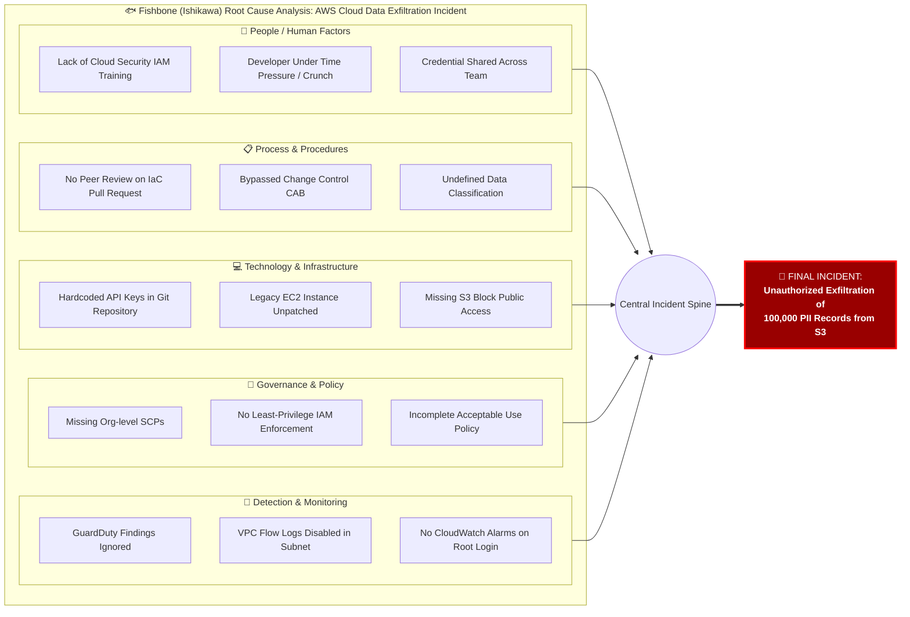

---

### 2.4 Timeline Reconstruction & Event Correlation

A critical output of root cause analysis is a millisecond-accurate, chronological **Timeline of Events**. Security analysts reconstruct this timeline using **event correlation**—linking events across network firewalls, host operating systems, database transactions, and cloud control-plane APIs.

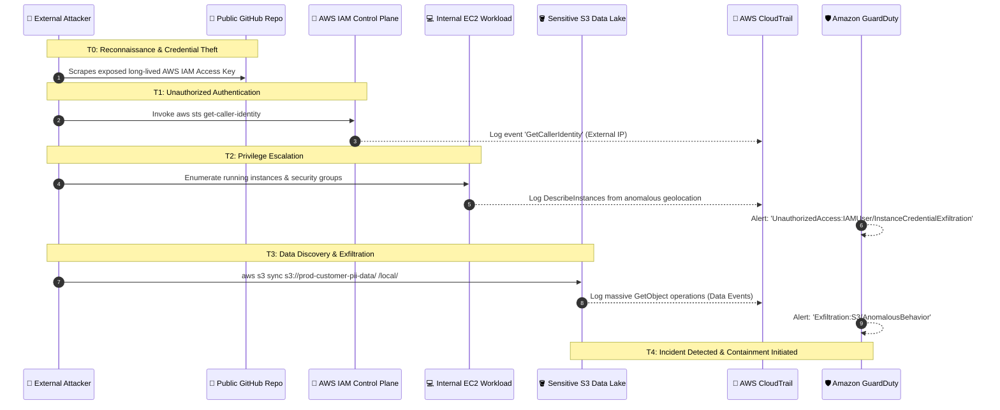

> [!IMPORTANT]
> **Clock Synchronization via NTP & Amazon Time Sync Service**:  
> Event correlation across distributed architectures is impossible without high-precision, synchronized system clocks. If server A's clock drifts by 3 minutes relative to database server B, investigators cannot establish cause and effect (did the database write precede or follow the unauthorized authentication?).  
> AWS automatically operates the **Amazon Time Sync Service**, accessible over Network Time Protocol (NTP) at `169.254.169.123` across all EC2 instances, providing microsecond-level synchronization with universal UTC atomic clocks.

---

## 📝 3. Post-Incident Review (PIR) & Blameless Postmortems

### 3.1 The Philosophy of the Blameless Postmortem

A **Post-Incident Review (PIR)** is the formal organizational evaluation conducted following the containment and recovery from a significant security event or system outage.

Modern cloud organizations (including Amazon, Google, and Etsy) conduct **blameless postmortems**. The foundational tenet of a blameless postmortem states:
- **Engineers work in good faith**: Team members do not deliberately introduce security flaws or cause outages. They make decisions based on the information, tools, and context available to them at that moment.
- **Focus on systemic vulnerabilities, not human scapegoats**: Blaming an individual ("Engineer X misconfigured the security group") creates a toxic culture of fear where employees hide mistakes, conceal security near-misses, and avoid taking initiative.
- **Uncover the "Second Story"**: The first, superficial story is human error. The second, systemic story investigates why the system allowed a single human keystroke to cause a catastrophic breach. (e.g., Why was there no guardrail, no automated validation, no peer review, or no rollback mechanism?).

### 3.2 Anatomy of an Enterprise Postmortem Report

A comprehensive, industry-standard postmortem report consists of six structured sections:

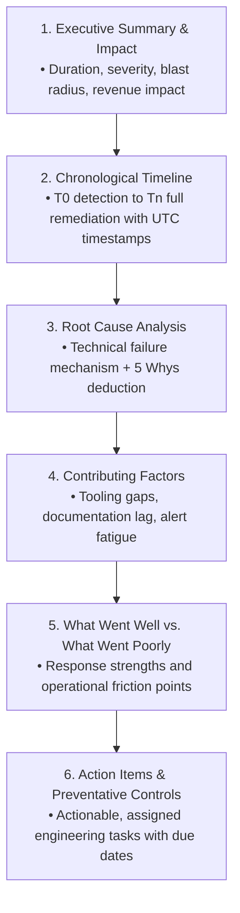

| Section | Key Content | Purpose |
| :--- | :--- | :--- |
| **1. Executive Summary** | High-level summary of the incident, start/end timestamps, total duration, severity classification (Sev 1–Sev 4), business impact (revenue lost, SLA penalties, customers affected). | Provides executive management and compliance auditors with clear, non-technical visibility into business impact. |
| **2. Chronological Timeline** | Detailed, UTC-synchronized breakdown of every milestone: Initial Vulnerability Introduced $\rightarrow$ Attack Commenced $\rightarrow$ First Alert Fired $\rightarrow$ Incident Responder Acknowledged $\rightarrow$ Containment Executed $\rightarrow$ Recovery Confirmed. | Identifies lag times in detection (MTTD) and resolution (MTTR). |
| **3. Root Cause Identification** | Exhaustive technical description of the underlying failure mechanism, supported by forensic evidence and 5 Whys breakdown. | Eliminates ambiguity regarding what specifically caused the incident. |
| **4. Contributing Factors** | Environmental and systemic factors that facilitated or exacerbated the incident (e.g., missing documentation, noisy alert channels, insufficient staging environments). | Identifies secondary weaknesses that compounded the initial failure. |
| **5. Response Evaluation** | Objective review of what worked effectively (e.g., automated PagerDuty paging, quick isolate command) versus what broke down (e.g., expired runbook credentials, missing contact numbers). | Evaluates the human and operational agility of the incident response team. |
| **6. Corrective Action Items** | Prioritized backlog of engineering tickets (Jira, GitHub Issues) assigned to named individuals with strict completion dates. | Directly modifies the *Prevention* and *Detection* phases to eliminate repeat occurrences. |

### 3.3 Corrective Actions (Preventative, Detective, Corrective)

Action items generated during a PIR must follow the **SMART** criteria (Specific, Measurable, Achievable, Relevant, Time-bound) and be categorized across the security lifecycle:

- **Preventative Action Items**: Eliminate the root cause entirely.  
  *Example*: "Implement AWS Service Control Policy (SCP) `DenyUnencryptedS3Buckets` across the entire AWS Organization by Oct 24 (Owner: Lead Cloud Architect)."
- **Detective Action Items**: Reduce the Mean Time to Detect (MTTD).  
  *Example*: "Enable Amazon GuardDuty S3 Protection across all production accounts and route alerts to PagerDuty with priority Sev-2 (Owner: SecOps Lead)."
- **Process / Corrective Action Items**: Improve operational velocity during future incidents.  
  *Example*: "Update the compromised credential incident response runbook to automate AWS STS session revocation via AWS Systems Manager Automation (Owner: SRE Lead)."

### 3.4 Continuous Security Improvement

Security is never static. As organizations innovate and deploy new cloud workloads, the threat landscape evolves alongside them. **Continuous Security Improvement** ensures that an organization’s security posture increases in maturity after every operational event:

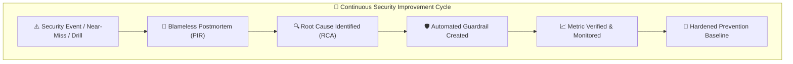

- **Treating Near-Misses with Equal Urgency**: Mature cloud organizations analyze blocked intrusion attempts, policy violations, and near-misses with the same rigor as successful breaches. A blocked attempt provides free intelligence on adversary behavior and exposed attack surfaces without the cost of data loss.
- **Automating Preventative Controls**: Rather than relying on human vigilance, postmortem corrective actions should prioritize automated guardrails—such as AWS Config auto-remediation rules, EventBridge automated responses, and CI/CD policy-as-code linters (e.g., cfn-lint, cfn_nag, Checkov).
- **Institutionalizing Knowledge**: Findings, postmortems, and root cause analyses must be maintained in accessible engineering wikis and architecture review boards, transforming single-team learnings into enterprise-wide best practices.

---

## 🧪 4. Types of Security Testing & Assessment

Security testing during the analysis phase provides proactive empirical evaluation—simulating adversarial techniques to discover vulnerabilities before malicious actors exploit them.

### 4.1 Categories of Security Testing

As outlined in the AWS curriculum, organizations leverage three primary testing types to mimic potential attacks and measure system resilience:

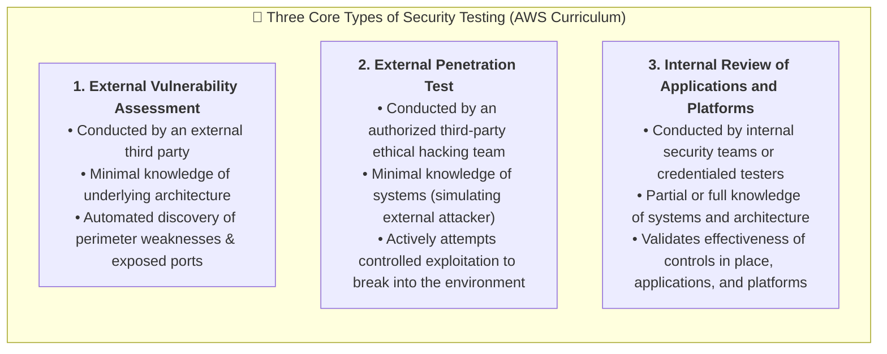

1. **External Vulnerability Assessment**:
   - **Operational Focus**: An external third party evaluates system vulnerabilities from outside the enterprise boundary with little to no prior knowledge of the underlying infrastructure and components.
   - **Methods & Scope**: Utilizes automated scanning tools to inventory public IP addresses, check open ports, evaluate TLS/SSL cipher suites, and match software banners against known CVE databases.
   - **Value**: Establishes a broad snapshot of external internet-facing exposure and low-hanging architectural defects.
2. **External Penetration Test**:
   - **Operational Focus**: An authorized third party with little prior knowledge of the system actively tries to break into the system in a controlled, non-disruptive manner.
   - **Methods & Scope**: Human ethical hackers simulate the tactics, techniques, and procedures (TTPs) of real-world threat actors. They actively chain exploits, attempt credential spraying, execute payload injections, and bypass web application firewalls (WAFs).
   - **Value**: Verifies whether perimeter defenses can withstand active human attacks and identifies real-world exploitability.
3. **Internal Review of Applications and Platforms**:
   - **Operational Focus**: A tester with partial or full internal knowledge of the systems validates the effectiveness of defensive controls across applications and host platforms for known susceptibilities.
   - **Key Review Dimensions**:
     - **Controls in Place**: Evaluates whether IAM least-privilege policies, security groups, Network Access Control Lists (NACLs), encryption baselines, and multi-factor authentication are functioning as designed.
     - **Applications and Platforms**: Performs static and dynamic code analysis (SAST/DAST), inspects database permissions, reviews container base images, examines operating system patch compliance, and tests internal microservice communication pathways.
   - **Value**: Uncovers deep architectural, logic, and configuration vulnerabilities that external perimeter tests cannot reach.

### 4.2 Vulnerability Scanning vs. Penetration Testing

The AWS security curriculum draws a strict distinction between automated **Vulnerability Assessments** and human-driven **Penetration Tests**:

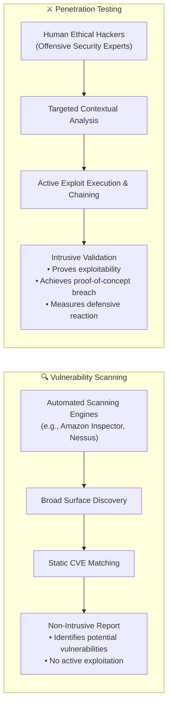

#### Comprehensive Comparison Matrix

| Evaluation Dimension | Vulnerability Scanning (Assessment) | Penetration Testing (Ethical Hacking) |
| :--- | :--- | :--- |
| **Core Objective** | Identify, catalog, and rank known software vulnerabilities, unpatched CVEs, and configuration flaws. | Simulate real-world adversarial attacks to bypass security controls, compromise systems, and exfiltrate data. |
| **Execution Mechanism** | Highly automated software tools (e.g., Amazon Inspector, Tenable Nessus, Qualys). | Skilled human security specialists (ethical hackers, red teams) utilizing manual exploit tools (Metasploit, Burp Suite). |
| **Intrusiveness & Risk** | **Non-intrusive / Low Risk**: Scans banners, service headers, and package databases without attempting exploitation. | **Intrusive / Moderate-to-High Risk**: Actively exploits vulnerabilities, executes memory payloads, and escalates privileges. |
| **Scope & Breadth** | **Broad & Exhaustive**: Scans thousands of IP addresses, ports, and packages across an entire cloud enterprise. | **Deep & Narrow**: Targets specific critical business workflows, web applications, or core API endpoints. |
| **Verification of Impact** | **Theoretical**: Identifies that a system appears vulnerable, but does not confirm if security controls (e.g., WAF) block the attack. | **Demonstrated**: Proves real-world exploitability through actual proof-of-concept (PoC) access and data extraction. |
| **Frequency of Execution** | Continuous, daily, or weekly in CI/CD pipelines and production accounts. | Periodic: Annually, bi-annually, or following major architectural releases. |
| **Deliverables** | Detailed inventory listing CVE IDs, CVSS severity scores, affected packages, and recommended patch versions. | Narrative executive report detailing attack chains, exploited paths, business impact, and remediation steps. |

---

### 4.3 Testing Approaches: Black Box, White Box, and Gray Box

Security assessments vary fundamentally based on the amount of institutional knowledge and access credentials provided to the testing team:

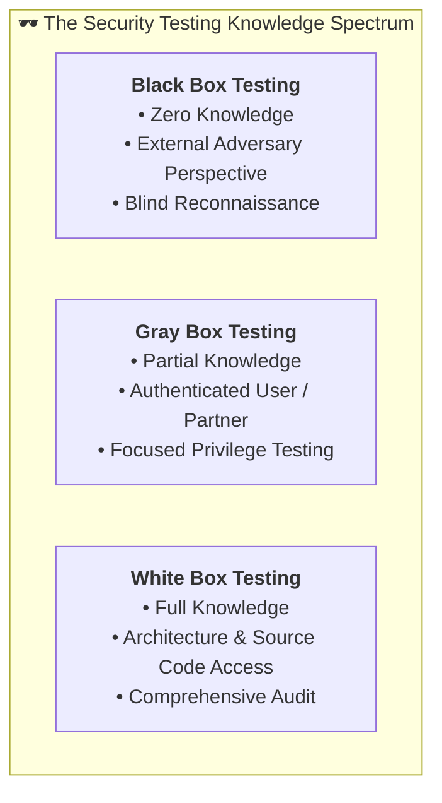

| Testing Methodology | Information Provided to Tester | Simulated Threat Actor | Advantages | Disadvantages |
| :--- | :--- | :--- | :--- | :--- |
| **Black Box Testing** | **Zero Knowledge**: Only public URLs, domain names, or IP ranges are provided. No credentials, source code, or architecture diagrams. | External malicious hacker, opportunistic internet scanner, script kiddie. | Provides an authentic simulation of what an external adversary can discover and compromise from the public internet. | Time-consuming blind reconnaissance; may fail to evaluate deep internal business logic or backend services behind WAFs. |
| **White Box Testing** (Clear Box / Glass Box) | **Full Knowledge**: Complete architectural diagrams, source code repositories, database schemas, and privileged credentials provided. | Malicious insider with high administrative privilege, rogue software developer. | Maximum thoroughness; enables static code analysis (SAST), deep logical audit, and discovery of latent vulnerabilities without needing blind exploitation. | Highly resource-intensive; testers can suffer from bias or focus on theoretical issues that external attackers could never reach. |
| **Gray Box Testing** | **Partial Knowledge**: Standard user or partner credentials provided, along with high-level application functional documentation. | Disgruntled employee, compromised standard contractor, privilege-escalating insider. | Most cost-effective and realistic balance; skips tedious external reconnaissance to focus directly on deep application logic, privilege escalation, and horizontal data isolation flaws. | May miss perimeter reconnaissance vectors; requires careful coordination of test account credentials. |

---

### 4.4 AWS Customer Support Penetration Testing Policy

In on-premises data centers, organizations can execute penetration tests without asking permission from infrastructure providers. In the public cloud, however, **AWS operates a shared multi-tenant physical infrastructure**. Unregulated customer testing could inadvertently disrupt physical host hypervisors, network switches, or adjacent tenant workloads.

To facilitate security analysis while protecting multi-tenant stability, AWS created the **AWS Customer Support Penetration Testing Policy**.

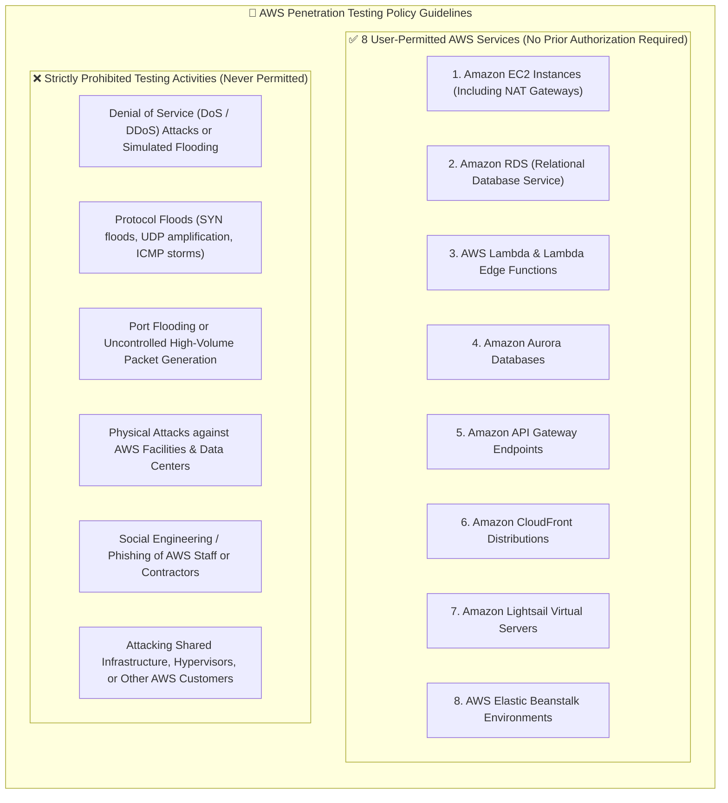

#### Key Rules of the AWS Penetration Testing Policy:
1. **No Prior Authorization Required for Permitted Services**: Customers may perform authorized security assessments and penetration tests against their own infrastructure hosted in the **8 user-permitted services** without notifying AWS or requesting prior approval.
2. **Strictly Prohibited Activities**:
   - **Denial of Service (DoS / DDoS)**: Customers are strictly forbidden from performing DoS or DDoS simulations against any AWS resource, as this threatens shared network infrastructure and transit gateways. (To test DDoS resilience, customers must utilize pre-approved testing through authorized **AWS DDoS Test Partners** under the AWS Shield Engagement program).
   - **Port Flooding & Protocol Attacks**: Packet exhaustion, SYN flood testing, and high-frequency port scanning that degrades infrastructure.
   - **Physical Facilities & Social Engineering**: Attempting to breach AWS data centers or social engineering AWS customer support personnel is strictly prohibited.
3. **Target Ownership Verification**: Customers are legally responsible for ensuring that all target IP addresses, endpoints, and domain names belong strictly to their own AWS account. Testing targets owned by other AWS accounts or third parties constitutes an unauthorized computer intrusion.

---

## 📊 5. Risk Assessment & Response Strategies

Security analysis requires a quantitative and qualitative understanding of **Risk** to prioritize remediation and allocate security engineering budgets effectively.

> [!NOTE]
> **Core Definition of Risk**:  
> In information security and enterprise risk governance, **Risk** is fundamentally defined as the product of threats, vulnerabilities, and the resulting business impact:  
> $$Risk = Threat \times Vulnerability \times Impact$$
> 
> Where:
> - **Threat**: Any external actor, agent, or circumstance with the capability to cause harm (e.g., cybercriminals, ransomware, accidental deletion, hardware failure).
> - **Vulnerability**: A flaw, gap, or weakness in a system's defense, design, implementation, or operation that exposes it to attack (e.g., unpatched software CVE, missing MFA, misconfigured security group).
> - **Impact**: The magnitude of damage, financial loss, operational interruption, or reputational impairment caused if the vulnerability is successfully exploited.
> 
> In operational risk management and probability modeling, this relationship is frequently evaluated as:  
> $$\text{Risk} = \text{Likelihood of Occurrence} \times \text{Impact of Realization}$$

### 5.1 The Five-Step Risk Assessment Lifecycle

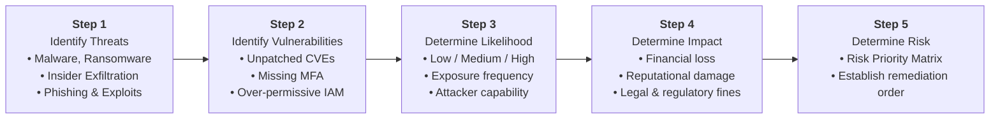

During a risk assessment, security leaders ask the core question: *"What are the most critical assets or critical business processes that need the most protection?"*

The five basic steps of a risk assessment are:
1. **Identify Threats**: Catalog potential threat actors, environmental hazards, and adversarial scenarios capable of targeting corporate resources.
2. **Identify Vulnerabilities**: Uncover weaknesses in technical architecture, software code, physical facilities, or operational policies through testing and audits.
3. **Determine Likelihood**: Evaluate how probable it is that a threat will encounter and exploit the identified vulnerability, factoring in existing controls, asset accessibility, and current threat intelligence.
4. **Determine Impact**: Quantify the overall blast radius if an exploit succeeds—direct financial loss, operational downtime, intellectual property theft, customer churn, and regulatory penalties (e.g., GDPR, PCI DSS fines).
5. **Determine Risk**: Combine likelihood and impact to calculate an overall risk rating, rank identified risks, and establish remediation priorities across the enterprise.

---

### 5.2 The Four Risk Response Strategies

Based on the results of the risk assessment, organizations decide which security response strategy to adopt for a particular asset or activity:

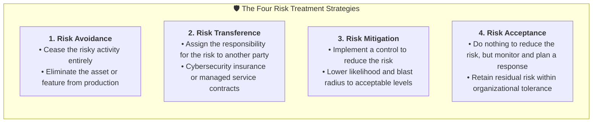

| Strategy | Definition | Cloud Security Implementation Example | Appropriate Use Scenario |
| :--- | :--- | :--- | :--- |
| **Risk Avoidance** | Stop doing the risky activity entirely or eliminate the vulnerable system/component. | Decommissioning a legacy, unpatchable Windows Server 2003 EC2 instance and replacing its workflow with a serverless AWS Lambda function. | When the cost and liability of remediating or insuring against the risk vastly outweighs the business value generated by the activity. |
| **Risk Transference** | Assign the responsibility or financial liability for the risk to another party. | Purchasing a comprehensive \$10M commercial cyber liability insurance policy; or subscribing to a 24/7 Managed Detection and Response (MDR) SOC partner. | When catastrophic financial losses can be contractually underwritten by third-party insurers or specialized service providers. |
| **Risk Mitigation** (Reduction) | Implement technical, administrative, or physical security controls to reduce the risk. | Implementing Multi-Factor Authentication (MFA), enforcing least-privilege IAM roles, deploying AWS WAF rules against SQL injection, and encrypting data with AWS KMS. | **The primary strategy** used for core business applications, sensitive data lakes, and revenue-generating infrastructure. |
| **Risk Acceptance** | Do nothing to reduce the risk, but monitor continuously and maintain an incident response plan. | Accepting that an internal non-production development sandbox might experience temporary downtime during weekend maintenance windows without multi-AZ failover. | When the cost of implementing protective controls exceeds the potential impact of the threat, or when the risk falls well within organizational risk appetite. |

---

### 5.3 Risk Response Decision Matrix

Security architects and risk officers use a **Risk Response Decision Matrix** mapping Likelihood against Impact to select the appropriate risk treatment strategy:

| Impact \ Likelihood | Low Likelihood | High Likelihood |
| :--- | :--- | :--- |
| **High Impact** (Severe / Catastrophic) | **Risk Transference**<br>• Unlikely to happen, but ruinous if it occurs.<br>• *Action*: Transfer financial liability via insurance, warranties, or third-party SLAs. | **Risk Avoidance**<br>• Highly likely to occur and catastrophic to business.<br>• *Action*: Terminate the risky activity, decommission the system, or re-architect completely. |
| **Low Impact** (Minor / Negligible) | **Risk Acceptance**<br>• Rare event with minimal business consequence.<br>• *Action*: Formally accept residual risk, monitor baseline, and maintain standard response playbook. | **Risk Mitigation**<br>• Frequent occurrence with manageable consequence.<br>• *Action*: Deploy automated controls, MFA, rate limiting, and patch baselines to reduce frequency. |

---

## 📡 6. Monitoring, Logging & SIEM Architecture for Security Analysis

Security analysis depends directly on high-fidelity, comprehensive telemetry. Telemetry is gathered through two complementary mechanisms: **Monitoring** (real-time observation of performance, operational health, and anomaly detection) and **Logging** (historical, immutable records of system transactions, API calls, and network traffic).

### 6.1 Monitoring as a Service (MaaS) & AWS Monitoring Services

**Monitoring as a Service (MaaS)** refers to cloud-hosted, scalable monitoring frameworks that eliminate the operational burden of deploying and maintaining dedicated on-premises monitoring hardware and storage.

- **Anytime, Anywhere Observability**: Deployed in the AWS Cloud, MaaS frameworks ingest metrics and logs globally across regions, on-premises data centers, and edge locations.
- **Automated Thresholds & Real-Time Alerting**: Monitors track metrics (e.g., error rates, 5xx server codes, CPU spikes) and instantly fire automated notifications (via Amazon SNS or PagerDuty) when configured thresholds are breached.

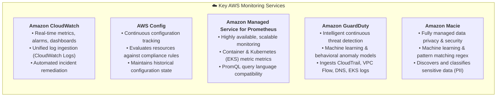

---

### 6.2 Designing Monitoring and Logging Policies

An enterprise cannot randomly collect logs without strategic governance. Organizations formalize telemetry management through explicit **Monitoring Policies** and **Logging Policies**.

#### Key Questions Addressed in a Monitoring Policy:
1. **What should be monitored?** Compute hosts, serverless functions, database query latencies, network interfaces, physical facilities (badge readers, surveillance cameras), and administrative actions.
2. **How closely should monitoring occur?** High-resolution metric sampling (1-second intervals for critical financial services) vs. standard 1-minute or 5-minute sampling intervals.
3. **How often should monitoring be reviewed?** Real-time automated algorithmic alerting vs. daily operations dashboard reviews and monthly executive audits.
4. **Who does the monitoring?** Internal dedicated Security Operations Center (SOC) analysts, DevOps site reliability engineers (SREs), or external Managed Security Service Providers (MSSPs).
5. **Do you outsource monitoring?** If outsourcing to an MSSP: What are the strict data retention terms? What access controls govern their monitoring tools? Is remote monitoring permitted across international borders?
6. **Who watches the watchers?** Independent security oversight, internal compliance auditors, and regulatory bodies ensuring monitoring personnel do not abuse monitoring privileges to spy on employees or customers.

#### Data Retention Policies

A **Data Retention Policy** dictates how long different categories of telemetry must be preserved before automated archival or cryptographic deletion.

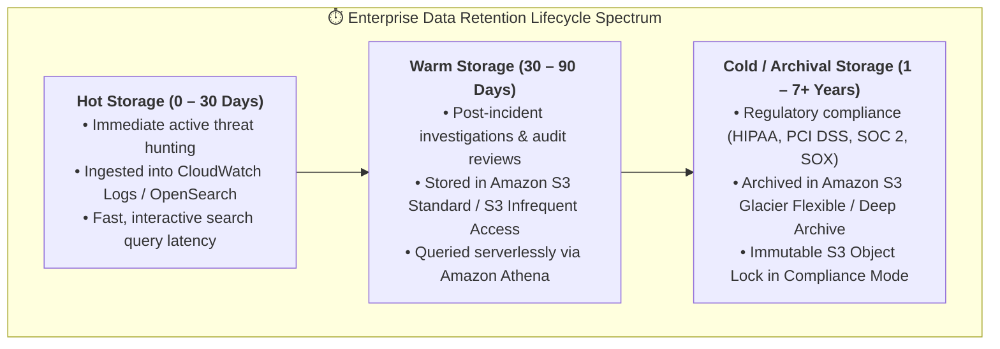

| Log / Data Category | Typical Retention Mandate | Governing Standards & Rationale |
| :--- | :--- | :--- |
| **Authentication & Access Logs** | 1 to 7 Years | PCI DSS Requirement 10.7 requires retaining audit logs for at least one year, with three months immediately available for analysis. |
| **AWS CloudTrail Management Events** | 90 Days (Free Event History) $\rightarrow$ 7+ Years (S3 Archive) | Essential for forensic reconstruction of any historical AWS control plane modification or account breach. |
| **Financial & Transaction Records** | 7 Years | IRS regulations and Sarbanes-Oxley (SOX) Act compliance mandates. |
| **Healthcare & Medical Data (EHR)** | 6 to 10+ Years (or life of patient) | Health Insurance Portability and Accountability Act (HIPAA) mandates. |
| **Facility Camera / CCTV Video** | 30 to 90 Days | Physical security perimeter validation balancing storage consumption costs against incident investigation windows. |
| **Employee Communications / Email** | 1 to 3 Years | Corporate legal hold discovery and Acceptable Use Policy (AUP) enforcement. |

#### Protection of Log Information (Log Integrity & Non-Repudiation)

If an attacker compromises an EC2 host, their immediate instinct is to clear local bash history and delete `/var/log/auth.log` to conceal their intrusion. To preserve forensic evidence:
- **Immediate Off-Host Forwarding**: Logs must be continuously streamed away from local compute instances into an isolated, centralized log aggregation bucket in real time via the **CloudWatch Unified Agent** or Amazon Kinesis.
- **Physical & Logical Access Isolation**: Security logs should reside in a separate, dedicated **Log Archive AWS Account** managed exclusively by the security team, inaccessible even to administrators of the workload account.
- **WORM Storage & S3 Object Lock**: Apply Write Once, Read Many (WORM) storage using **Amazon S3 Object Lock** in *Compliance Mode*. Once written, neither developers nor root account holders can alter or delete log records during the retention duration.
- **Timestamp Integrity via NTP**: Clocks across all logging endpoints must be tightly synchronized via the Amazon Time Sync Service (`169.254.169.123`) to ensure forensically valid event correlation.

---

### 6.3 Centralized Log Aggregation and SIEM Pipeline

A modern cloud **Security Information and Event Management (SIEM)** architecture centralizes, enriches, indexes, and queries disparate log streams from thousands of cloud resources and multi-account AWS Organizations.

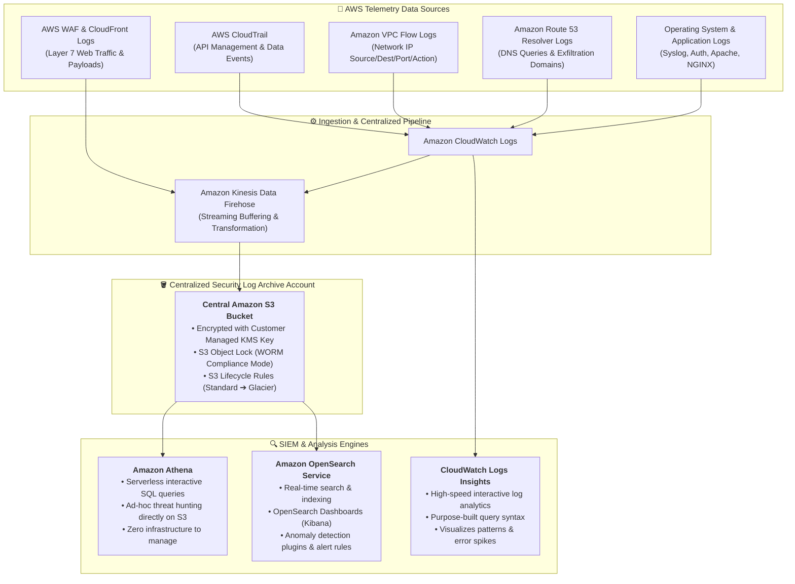

#### The Big Three AWS Log Analysis Engines Compared

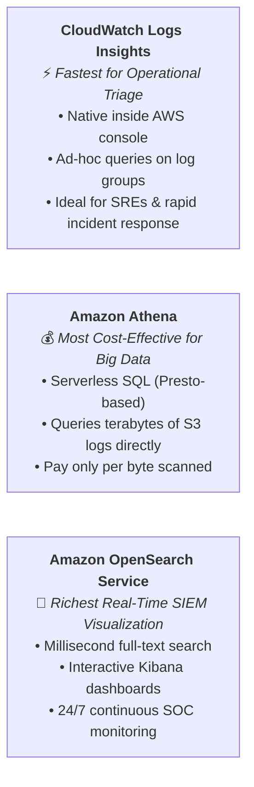

1. **AWS CloudWatch Logs Insights**:
   - **How it works**: Purpose-built interactive query engine directly within CloudWatch Logs.
   - **Syntax**: Uses a specialized query syntax (`fields`, `filter`, `stats`, `sort`, `limit`).
   - **Sample Query (Hunting Unauthorized IAM Actions)**:
     ```sql
     fields @timestamp, eventName, userIdentity.arn, sourceIPAddress, errorCode
     | filter errorCode = "AccessDenied" or errorCode = "UnauthorizedOperation"
     | stats count(*) as failureCount by userIdentity.arn, sourceIPAddress
     | sort failureCount desc
     | limit 20
     ```
2. **Amazon Athena**:
   - **How it works**: Serverless distributed query service based on Presto that runs ANSI SQL queries directly against raw partitioned Parquet, JSON, or CSV log files stored in Amazon S3.
   - **Cost Model**: Extremely cost-effective; pay only \$5.00 per terabyte of data scanned.
   - **Sample Query (Analyzing Top Rejected VPC Flow Log Connections)**:
     ```sql
     SELECT srcaddr, dstport, protocol, count(*) as rejected_packets
     FROM vpc_flow_logs
     WHERE action = 'REJECT'
       AND date = '2026-10-12'
     GROUP BY srcaddr, dstport, protocol
     ORDER BY rejected_packets DESC
     LIMIT 10;
     ```
3. **Amazon OpenSearch Service (formerly Elasticsearch)**:
   - **How it works**: Fully managed search and analytics cluster that ingests streaming logs in real time, indexing every field for sub-second full-text search.
   - **Visualization**: Paired with OpenSearch Dashboards (Kibana), providing interactive security dashboards displaying geographical map visualizations of attacking IPs, real-time error spikes, and automated anomaly alerts.

---

## 📈 7. Security Metrics & Performance Indicators

You cannot improve or manage what you do not measure. A critical component of security analysis is defining **metrics and key performance indicators (KPIs)** to evaluate the ongoing effectiveness of the enterprise security program and justify security expenditures to leadership.

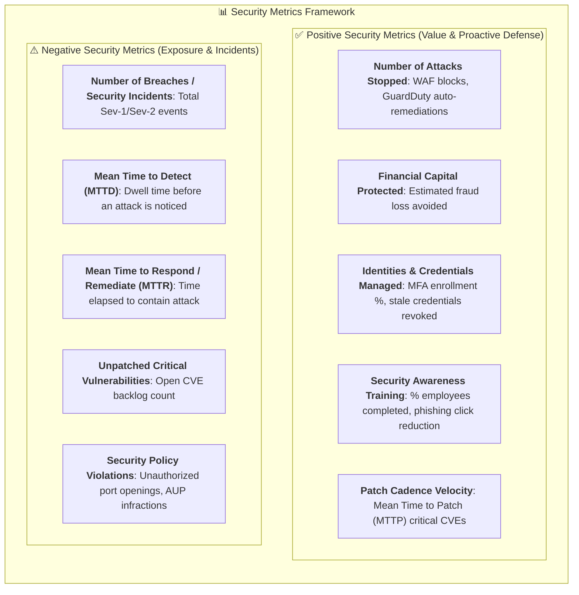

### Strategic Metrics Analysis: Positive vs. Negative Metrics

As highlighted in the AWS slides, security metrics are uniquely bidirectional:
- **Negative Metrics**: Focus on incidents and failures. While crucial for operational awareness, relying solely on negative metrics can distort reality. For example, if "reported breaches" drops to zero, does it mean the organization is completely secure, or does it mean detection controls are broken and attackers are lurking undiscovered (**dwell time**)?
- **Positive Metrics**: Quantify proactive governance, threat deflection, and organizational maturity. They demonstrate business value by proving how many malicious automated requests were dropped at the cloud edge (AWS WAF / Shield), how many unauthorized IAM sessions were revoked, and how rapidly developer teams remediate discovered vulnerabilities before production deployment.

---

## ❓ 8. Knowledge Check & Review Questions

Test your mastery of the concepts covered in this module with these scenario-based review questions:

---

### Question 1: What is the primary operational objective of the Analysis phase in the Security Lifecycle, and how does it connect to the Prevention phase?
> **Model Answer**:  
> The primary objective of the Analysis phase is to review the origin and circumstances of security incidents, near-misses, and control failures to determine weaknesses in the security posture. Rather than stopping at incident containment (the Response phase), Analysis seeks to identify the root cause of failures so that engineering teams can strengthen, update, and harden preventative controls (such as IAM policies, Service Control Policies, firewall rules, and automated patching baselines). This completes the continuous lifecycle feedback loop, ensuring that every detected threat yields an improved defense that prevents identical incidents from recurring in the future.

---

### Question 2: In a Root Cause Analysis (RCA), how does the 5 Whys technique help an investigator avoid stopping at superficial technical symptoms?
> **Model Answer**:  
> The 5 Whys technique enforces an iterative, interrogative discipline where the investigator asks "Why?" five consecutive times, with each answer forming the premise of the next question. In security investigations, initial answers almost always describe superficial technical symptoms (e.g., "The server crashed because a port was open" or "A bucket was leaked because an ACL was public"). By continuing to ask "Why?", the investigation moves past human error and superficial misconfigurations to uncover the systemic, organizational, and governance failures that allowed the condition to occur—such as missing peer reviews, absent Infrastructure-as-Code linting, missing Service Control Policies (SCPs), or inadequate automated compliance monitoring (AWS Config).

---

### Question 3: How does Vulnerability Scanning differ from Penetration Testing regarding scope, intrusiveness, and exploitation?
> **Model Answer**:  
> - **Vulnerability Scanning** is an automated, high-level, and non-intrusive evaluation that rapidly scans a broad inventory of systems, network ports, and software packages to identify known unpatched vulnerabilities (CVEs) and misconfigurations. It does not attempt to actively exploit weaknesses or penetrate systems.
> - **Penetration Testing** is an active, human-driven, and intrusive security assessment conducted by skilled ethical hackers. It focuses on a deeper, narrower scope and actively attempts to exploit vulnerabilities, bypass defensive controls (firewalls, WAFs), escalate user privileges, and pivot laterally through internal networks to confirm real-world exploitability and prove business impact.

---

### Question 4: Under the AWS Customer Support Penetration Testing Policy, what services are permitted for user-conducted testing without prior approval, and what activities are strictly prohibited?
> **Model Answer**:  
> Under the AWS Penetration Testing Policy:
> - **Permitted Services (No prior approval required)**: Customers can conduct authorized security assessments and penetration tests against their own infrastructure hosted across **8 specific AWS services**: Amazon EC2 instances, Amazon RDS, AWS Lambda (and Lambda@Edge), Amazon Aurora, Amazon API Gateway, Amazon CloudFront, Amazon Lightsail, and AWS Elastic Beanstalk.
> - **Strictly Prohibited Activities**: Customers are strictly forbidden from performing Denial of Service (DoS/DDoS) attacks, protocol floods (SYN floods, UDP reflection), port flooding, physical intrusion attacks against AWS data centers, social engineering of AWS staff, and any attacks targeting shared underlying hypervisors or infrastructure belonging to other AWS tenants.

---

### Question 5: Why is clock synchronization via NTP / Amazon Time Sync Service considered a critical prerequisite for security logging and event correlation?
> **Model Answer**:  
> In distributed, multi-account cloud environments, forensic investigators must reconstruct a millisecond-accurate timeline of events by correlating logs from diverse sources (such as AWS CloudTrail API calls, Amazon VPC Flow network packets, OS syslog records, and database transaction queries). If system clocks drift, it becomes impossible to determine the true causal sequence of events (e.g., whether an unauthorized authentication token was created before or after an administrative policy was altered). The Amazon Time Sync Service (`169.254.169.123`) provides microsecond-precision UTC time synchronization, ensuring event timestamps are consistent, legally defensible, and forensically accurate across all workloads.

---

### Question 6: What is a "Blameless Postmortem," and why is it preferred over traditional post-incident investigations that assign individual blame?
> **Model Answer**:  
> A blameless postmortem operates on the assumption that engineers work in good faith and make the best decisions possible with the information, tools, and training available to them at that moment. Instead of identifying human scapegoats, the review investigates the systemic, architectural, and procedural flaws that permitted human error to cause a catastrophic outage or security failure. Eliminating personal blame fosters psychological safety and transparency, encouraging teams to openly report vulnerabilities, discuss near-misses, and collaborate on robust automated guardrails that prevent future human errors from impacting production systems.

---

### Question 7: Compare Amazon Athena, Amazon OpenSearch Service, and AWS CloudWatch Logs Insights in terms of primary use case and analysis capability.
> **Model Answer**:  
> - **CloudWatch Logs Insights**: A lightweight, serverless interactive query engine designed for fast operational triage and log analysis directly within CloudWatch Logs groups. Ideal for DevOps engineers and SREs troubleshooting recent errors, spikes, or localized container/application anomalies.
> - **Amazon Athena**: An interactive, serverless SQL query engine based on Presto that runs ANSI SQL queries directly against massive raw log archives (VPC Flow Logs, CloudTrail) stored in Amazon S3. Highly cost-effective for historical threat hunting and large-scale big data audits because organizations pay only per terabyte of S3 data scanned, with zero cluster management overhead.
> - **Amazon OpenSearch Service**: A fully managed cluster engine providing real-time search, indexing, and visualization (via OpenSearch Dashboards / Kibana). Ideal for 24/7 Security Operations Centers (SOCs) that require millisecond full-text indexing, visual geo-mapping of attack traffic, and automated real-time alerting on anomalous log patterns.

---

### Question 8: How is Risk calculated in information security, what are the five basic steps of a risk assessment, and when is each of the four risk response strategies appropriate?
> **Model Answer**:  
> - **Risk Definition**: Risk is calculated as the product of threats, vulnerabilities, and impact: $$Risk = Threat \times Vulnerability \times Impact$$ (or probabilistically as $\text{Risk} = \text{Likelihood} \times \text{Impact}$).
> - **Five Basic Steps of Risk Assessment**:
>   1. *Identify threats* (catalog malicious actors, environmental events, malware).
>   2. *Identify vulnerabilities* (uncover software flaws, misconfigurations, process gaps).
>   3. *Determine likelihood* (evaluate exploit probability given existing controls).
>   4. *Determine impact* (estimate financial, operational, and regulatory damage).
>   5. *Determine risk* (rank risks using a likelihood/impact priority matrix).
> - **Four Risk Response Strategies**:
>   - **Risk Avoidance**: Stop the risky activity or decommission the system (used when the risk exceeds business value).
>   - **Risk Transference**: Assign responsibility or financial liability to a third party, such as cyber insurance or managed security service providers (used for low-likelihood, catastrophic-impact risks).
>   - **Risk Mitigation**: Implement technical/administrative controls (e.g., MFA, encryption, WAF) to reduce likelihood or impact (the primary strategy for operational workloads).
>   - **Risk Acceptance**: Acknowledge residual risk without additional controls while maintaining monitoring (used when remediation costs exceed potential losses, or risk is within tolerance).

---

## 📌 9. Key Takeaways & Summary

### Core Curriculum Takeaways (AWS re/Start Security Slide 29)
- **Primary Goal**: The overarching goal of security analysis is to **strengthen security controls to better protect your network, facilities, and organization**.
- **Three Pillar Activities**: **Testing**, **monitoring**, and **logging** are the foundational operational activities that support and power security analysis.
- **Monitoring Policy**: Defines all the governance details of **what**, **who**, **when**, and **how** monitoring is performed across on-premises and cloud environments.
- **Logging Policy**: Identifies precisely **what should be logged**, how long logs are retained, and **how logs are managed and protected** against tampering.

### Detailed Technical Summary
- **The Strategic Imperative of Analysis**: Security analysis completes the continuous Security Lifecycle by converting operational security telemetry, incident fallout, and testing assessments into architectural hardening that reinforces the *Prevention* phase.
- **The Flat Tire Principle**: Treating only the visible symptom of a security event guarantees recurrence; rigorous analysis must identify and eliminate the underlying root cause.
- **Root Cause Analysis (RCA) Process**:
  1. Accurately describe the issue, scope, and business consequences.
  2. Establish the operational baseline and reconstruct a chronological timeline.
  3. Correlate disparate events across cloud and host log sources to identify causal links.
  4. Build visual causal models using the **5 Whys** technique and **Fishbone (Ishikawa) diagrams** spanning People, Process, Technology, Policy, Environment, and Monitoring.
- **Blameless Culture & Postmortems**: Production postmortems focus on systemic vulnerabilities rather than human fault, outputting prioritized, time-bound SMART corrective action items across preventative, detective, and corrective domains.
- **Security Assessment Paradigms**:
  - *Vulnerability Scanning*: Automated, broad, and non-intrusive cataloging of known CVEs and configuration flaws.
  - *Penetration Testing*: Human-driven, targeted, and intrusive simulation of adversarial attacks to prove exploitability.
  - *Assessment Postures*: Black Box (zero knowledge), Gray Box (partial knowledge / credentialed user), and White Box (full source code and architectural knowledge).
- **AWS Penetration Testing Policy**:
  - Customers may test **8 permitted services** (EC2, RDS, Lambda, Aurora, API Gateway, CloudFront, Lightsail, Elastic Beanstalk) without prior notification to AWS.
  - Customers are strictly prohibited from launching DoS/DDoS attacks, protocol/port floods, physical data center attacks, or social engineering AWS personnel.
- **Risk Management Strategies**:
  - *Avoidance*: Eliminate the risky activity or decommission the system entirely.
  - *Transference*: Shift liability to third parties via insurance or managed services.
  - *Mitigation*: Deploy technical and administrative controls to reduce likelihood or impact (the core security strategy).
  - *Acceptance*: Acknowledge residual risk within acceptable organizational thresholds and maintain active monitoring.
- **Enterprise SIEM & Telemetry Analytics**:
  - Centralize telemetry into a dedicated, isolated Log Archive AWS account using **Amazon S3** with **Object Lock** (WORM compliance) and KMS encryption.
  - Query and hunt threats using the right tool for the job: **CloudWatch Logs Insights** for quick triage, **Amazon Athena** for serverless S3 SQL queries, and **Amazon OpenSearch Service** for real-time SOC visualizations.
- **Metrics Balance**: Effective security governance evaluates both negative metrics (incidents, MTTD, MTTR) and positive metrics (attacks stopped, MFA adoption, patch cadence, security awareness completion) to demonstrate business value and risk reduction.

---

## 🔗 10. Next Steps & Course Progression

Having mastered the principles of security analysis, root cause discovery, and log telemetry architectures, proceed to the subsequent governance, compliance, and best-practice modules in the AWS re/Start Security curriculum:

- **Next Module (M04-16)**: [AWS Trusted Advisor](file:///work/tmp/aws-cf/T08-Security/T08-0016-RSSECY_EN-US_SG_M04_AWSTRUSTEDADVISOR.pdf) – Automated cloud architectural review across security, fault tolerance, performance, and cost optimization.
- **Subsequent Modules**:
  - [AWS Security Best Practices](file:///work/tmp/aws-cf/T08-Security/T08-0017-RSSECY_EN-US_SG_M04_BESTPRACTICES.pdf) – Implementing the Well-Architected Security Pillar principles across cloud workloads.
  - [AWS Compliance Programs & Artifact](file:///work/tmp/aws-cf/T08-Security/T08-0018-RSSECY_EN-US_SG_M04_AWSCOMPLIANCE.pdf) – Regulatory compliance attestations, SOC reports, ISO certifications, and AWS Artifact.
  - [AWS Security Resources & Community](file:///work/tmp/aws-cf/T08-Security/T08-0019-RSSECY_EN-US_SG_M04_AWSSECURITYRESOURCES.pdf) – Incident response whitepapers, security bulletins, and security communities.
