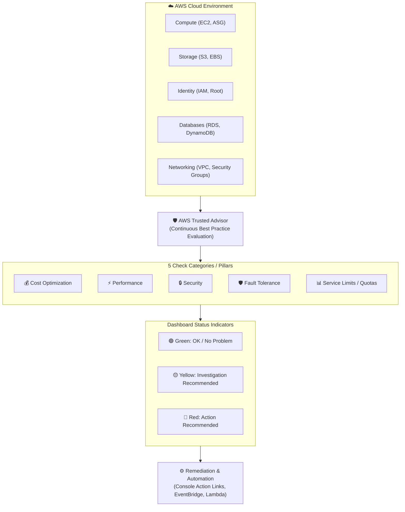
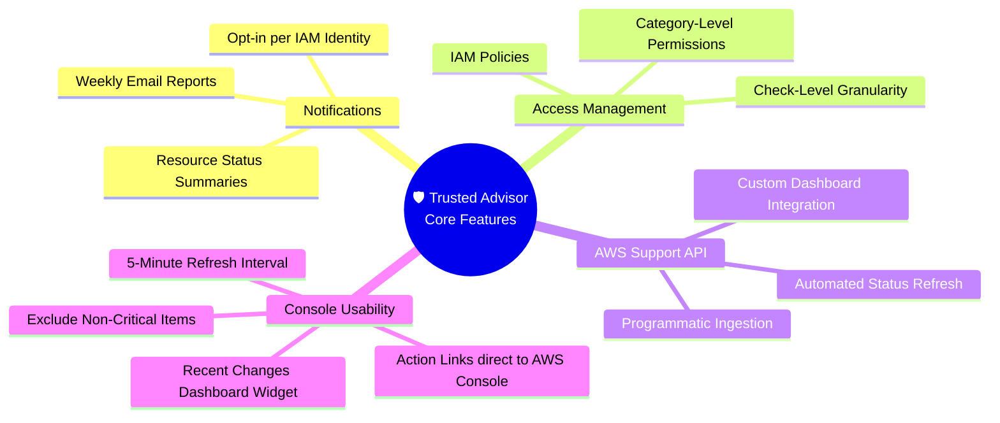
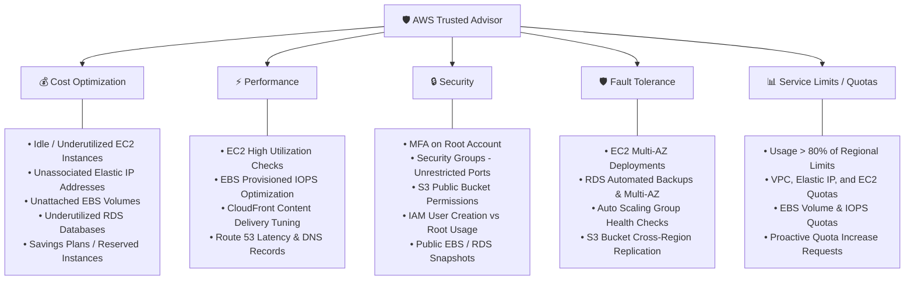
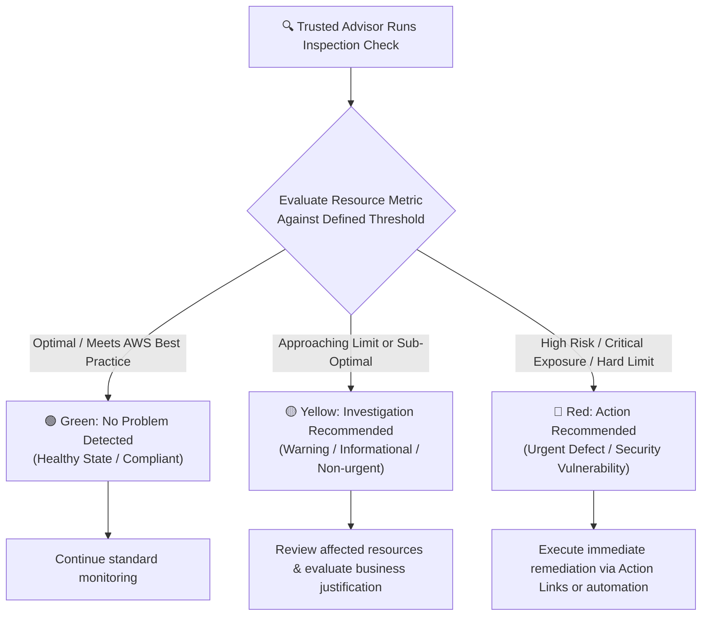
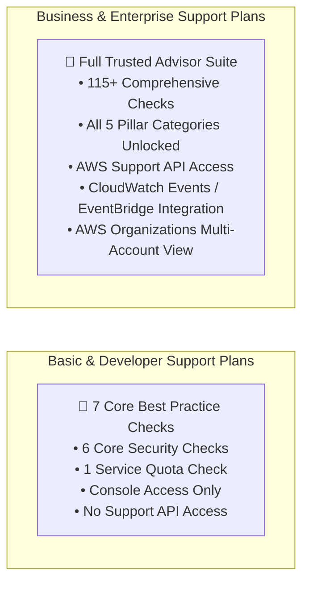
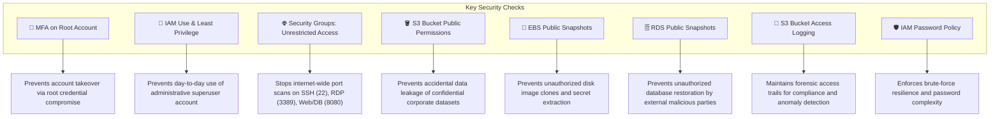
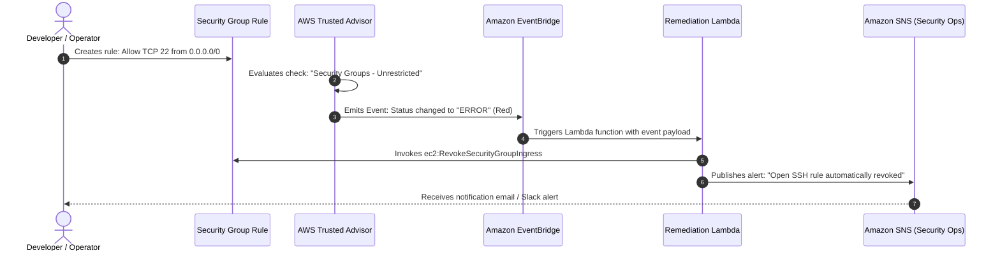

# 🛡️ AWS Trusted Advisor: Architecture Optimization, Security Checks & Automated Remediation

> **Course**: AWS re/Start  
> **Module**: Security (M04 – AWS Trusted Advisor)  
> **Source Document**: `T08-Security/T08-0016-RSSECY_EN-US_SG_M04_AWSTRUSTEDADVISOR.pdf`  
> **Target Audience**: AWS re/Start Learners, Cloud Practitioners, Security Specialists, and SysOps Administrators  

---

## 🎯 Module Overview

Operating workloads in the cloud requires continuous vigilance across architecture, cost management, system availability, and security posture. Rather than relying solely on periodic manual audits, cloud operators need automated, continuous, and expert-backed guidance.

**AWS Trusted Advisor** functions as a customized cloud consultant integrated directly into the AWS Management Console. By continuously scanning your AWS infrastructure, configurations, and consumption metrics against established AWS best practices, Trusted Advisor identifies opportunities to optimize costs, boost performance, fortify security defenses, enhance fault tolerance, and track service quotas.

This guide explores the foundational architecture, five core check categories, status evaluation methodology, tier differences between free and paid support plans, key security checks, real-world recommendation interpretation, and automated remediation patterns with AWS EventBridge and AWS Lambda.



---

## 📌 Learning Objectives

By completing this module and reviewing these study materials, you will be able to:

- [ ] **Define AWS Trusted Advisor**: Articulate its core mission as an automated online resource providing real-time guidance based on AWS best practices.
- [ ] **Explore the Five Pillar Categories**: Identify and differentiate the five check categories: Cost Optimization, Performance, Security, Fault Tolerance, and Service Limits.
- [ ] **Interpret Check Status Indicators**: Understand the operational significance of Green (No problem detected), Yellow (Investigation recommended), and Red (Action recommended) indicators.
- [ ] **Distinguish Support Plan Access**: Compare the 7 core checks available to all accounts (Basic & Developer Support) against full check catalogs (Business & Enterprise Support).
- [ ] **Analyze Key Security Checks**: Deeply examine core security checks including S3 Bucket Permissions, Security Groups with Specific Ports Unrestricted, IAM Use, MFA on Root Account, EBS Public Snapshots, and RDS Public Snapshots.
- [ ] **Navigate Console Features**: Utilize Action Links, 5-Minute Refresh, Recent Changes, Item Exclusions, and Email Notifications.
- [ ] **Interpret Real-World Recommendations**: Evaluate configuration alerts for Root MFA, IAM password policies, permissive security group rules, and S3 access logging.
- [ ] **Architect Automated Remediation**: Design event-driven response architectures using Amazon EventBridge and AWS Lambda to resolve Trusted Advisor findings automatically.

---

## 🧭 1. What is AWS Trusted Advisor?

### 1.1 Definition & Mission

**AWS Trusted Advisor** is an online management tool and continuous auditing engine that analyzes your AWS environment and provides real-time recommendations to help you align with AWS architectural and operational best practices.

Developed using data gathered from serving millions of AWS customers and architecting enterprise deployments, Trusted Advisor distills operational wisdom into automated inspection rules.

> [!NOTE]
> Trusted Advisor focuses on the **Operational Excellence**, **Security**, **Reliability**, **Performance Efficiency**, and **Cost Optimization** tenets of the **AWS Well-Architected Framework**, acting as an automated operational advisor directly embedded within your cloud environment.

### 1.2 Core Capabilities & Features

Trusted Advisor provides a comprehensive feature set to customize reports, integrate with enterprise workflows, and track infrastructure health:



| Feature | Operational Function | Implementation Detail |
| :--- | :--- | :--- |
| **Notifications** | Automated notification delivery | Delivers weekly email digests summarizing findings and resource changes. Users can opt-in and designate up to three email addresses. |
| **Access Management** | Fine-grained security control | Governed by AWS Identity and Access Management (IAM). Administrators can restrict access to specific categories (e.g., Security vs. Cost) or specific checks. |
| **AWS Support API** | Programmatic automation | Enables programmatic retrieval, filtering, and refreshing of check results using AWS SDKs or the AWS CLI (`aws support describe-trusted-advisor-checks`). |
| **Action Links** | Rapid operational remediation | Embedded hyperlinks next to affected resources in the dashboard that navigate directly to the relevant AWS service console for immediate remediation. |
| **Recent Changes** | Temporal audit tracking | Highlights checks that have experienced a status transition within the last 30 days at the top of the dashboard for quick situational awareness. |
| **Exclude Items** | Report customization & alert hygiene | Allows administrators to suppress/exclude specific resources from check results if the configuration is intentional or false-positive, maintaining clean dashboards. |
| **5-Minute Refresh** | Dynamic on-demand evaluation | Allows manual refresh of individual checks or an entire account (`Refresh All`). Checks become eligible for refresh 5 minutes after their previous scan. |

---

## 🏛️ 2. The Five Pillars / Categories of Trusted Advisor

AWS Trusted Advisor organizes its recommendations across five distinct categories. Each category tackles a critical dimension of cloud governance.



### 2.1 Category 1: Cost Optimization
Helps eliminate waste, eliminate idle capacity, and reduce your monthly AWS bill:
- **Idle Resources**: Identifies unassociated Elastic IP addresses, unattached EBS volumes, and idle Amazon RDS DB instances.
- **Underutilized Compute**: Scans for low-utilization Amazon EC2 instances (e.g., CPU utilization < 1% and network I/O < 5 MB for 14 consecutive days).
- **Commitment Opportunities**: Highlights opportunities to purchase Amazon EC2 Reserved Instances (RIs) or Savings Plans based on historical aggregate run rates.

### 2.2 Category 2: Performance
Improves responsiveness, efficiency, and infrastructure throughput:
- **Compute & Storage Tuning**: Examines overutilized EC2 instances that may be throttling workloads.
- **Storage Performance**: Evaluates Amazon EBS volume configurations to verify whether workloads would benefit from Provisioned IOPS SSD (`io1`/`io2`) or EBS-optimized instance types.
- **Edge Acceleration**: Checks Amazon CloudFront distributions for optimal caching headers and delivery configurations.

### 2.3 Category 3: Security
Examines security posture, credential hygiene, and network isolation:
- **Perimeter & Ingress**: Scans Amazon EC2 security groups for open rules allowing unrestricted ingress (`0.0.0.0/0`) on sensitive ports (SSH 22, RDP 3389, databases).
- **Access Control & Credentials**: Warns if Multi-Factor Authentication (MFA) is absent on the AWS root user, if no IAM users have been created, or if access keys have not been rotated.
- **Storage & Data Exposure**: Flags public Amazon S3 buckets, unrestricted S3 bucket policies, and public Amazon EBS or RDS database snapshots.

### 2.4 Category 4: Fault Tolerance
Hardens workloads against component failure, network interruption, and data loss:
- **Redundancy & Multi-AZ**: Warns when production Amazon RDS instances or EC2 workloads are deployed in a single Availability Zone without automated failover.
- **Backup Verification**: Validates the presence of recent EBS snapshots, automated RDS backups, and Amazon S3 cross-region replication (CRR).
- **Auto Scaling & Load Balancing**: Assesses whether Auto Scaling groups span multiple AZs and whether Elastic Load Balancers have registered healthy targets in each active subnet.

### 2.5 Category 5: Service Limits (Service Quotas)
Prevents operational outages caused by reaching account or regional quota caps:
- **Usage Thresholds**: Alerts you when resource consumption exceeds **80%** of an AWS service limit in a specific AWS Region.
- **Scope**: Monitors critical infrastructure limits such as EC2 On-Demand instances, VPCs per region, Internet Gateways, Elastic IP addresses, and EBS volume storage quotas.

---

## 🚦 3. Status Indicators & Evaluation Workflow

Trusted Advisor communicates findings using clear, universal color-coded status badges. Every check evaluates specific threshold rules and falls into one of three statuses:



### 3.1 Status Matrix

| Status Icon | Status Label | Meaning | Required Operational Response | Example Scenarios |
| :---: | :--- | :--- | :--- | :--- |
| 🟢 | **Green** | **No Problem Detected** | None. Resource adheres to AWS best practices. | MFA active on root; S3 buckets private; usage under 80% of quotas. |
| 🟡 | **Yellow** | **Investigation Recommended** | Review the affected resource. Determine whether the configuration is intentional or requires optimization. | IAM password policy missing complexity rules; S3 bucket access logging disabled; usage between 80% and 99% of service limit. |
| 🔴 | **Red** | **Action Recommended** | Immediate remediation required. Represents an active security vulnerability, imminent service limit failure, or significant financial waste. | Root account without MFA; security group open to world on Port 22; public RDS snapshot; service limit at 100%. |

### 3.2 Anatomy of a Trusted Advisor Check Card

When you expand a check in the Trusted Advisor Console, four distinct structural components are presented:

1. **Detailed Description**: A conceptual explanation of why the best practice matters and what negative consequences can emerge if ignored.
2. **Alert Criteria**: The exact numerical thresholds or logical conditions that trigger Green, Yellow, or Red statuses.
3. **Recommended Action**: Prescriptive, step-by-step instructions detailing how to remediate the finding.
4. **Additional Resources**: Direct hyperlinks to AWS documentation, architecture whitepapers, or relevant API references.
5. **Affected Resources Table**: A structured data table enumerating each affected resource (Resource ID, Name, Region, Status, Reason, and an **Exclude** toggle).

---

## ⚖️ 4. Free Core Checks vs. Full Trusted Advisor Checks

Access to the full catalog of AWS Trusted Advisor checks depends on your organization's **AWS Support Plan**.



### 4.1 Detailed Comparison Table

| Dimension | Basic & Developer Support | Business & Enterprise Support |
| :--- | :--- | :--- |
| **Cost** | Included with all AWS accounts at **$0 / no cost** | Included with Business / Enterprise Support plan fees |
| **Total Available Checks** | **7 Core Checks** | **115+ Checks** (continuously expanding catalog) |
| **Categories Available** | Core Security (6 checks) + Core Service Limits (1 check) | **All 5 Categories** (Cost, Performance, Security, Fault Tolerance, Service Limits) |
| **AWS Support API Access** | ❌ No API access (Console manual view only) | ✅ Full programmatic access (`DescribeTrustedAdvisorChecks`, etc.) |
| **EventBridge / CloudWatch Integration** | ❌ No automated event publishing | ✅ Real-time check change notifications via Amazon EventBridge |
| **Trusted Advisor Organizational View** | ❌ Not available | ✅ Aggregate dashboard across all member accounts in AWS Organizations |
| **Dedicated Technical Account Manager (TAM)** | ❌ No | ✅ TAM consultative review & custom optimization reviews (Enterprise) |

### 4.2 The 7 Free Core Checks Catalog

Every AWS customer—regardless of support tier—receives the following 7 core checks at no additional charge:

1. **IAM Use**: Checks for the existence of at least one IAM user to discourage daily use of the account root credentials.
2. **MFA on Root Account**: Verifies whether Multi-Factor Authentication is active on the root account.
3. **Security Groups – Specific Ports Unrestricted**: Detects security groups allowing global ingress (`0.0.0.0/0`) on specific restricted ports.
4. **Amazon S3 Bucket Permissions**: Identifies open S3 buckets granting global read/write access to everyone or any authenticated AWS user.
5. **Amazon EBS Public Snapshots**: Alerts when Amazon EBS volume snapshots are set to public permissions.
6. **Amazon RDS Public Snapshots**: Alerts when Amazon RDS database snapshots are publicly accessible to anyone on the internet.
7. **Service Limits (Core Check)**: Evaluates usage against regional limits for Amazon EC2 instances and VPC Elastic IP addresses.

---

## 🔒 5. Key Security Checks in AWS Trusted Advisor

Security is the foremost concern for cloud operators. Trusted Advisor's security checks provide an automated safety net against common misconfigurations.



### 5.1 Deep-Dive: Core Security Check Specifications

#### 1. MFA on the Root Account
- **Risk Rationale**: The AWS root user has unrestricted, irrevocable access to all resources and billing data in an AWS account. A password alone is vulnerable to phishing, credential stuffing, and keyloggers.
- **Alert Criteria**:
  - 🔴 **Red**: MFA is not enabled on the root account.
  - 🟢 **Green**: MFA is enabled on the root account.
- **Best Practice**: Activate hardware tokens (e.g., YubiKey) or virtual authenticator applications (e.g., AWS Virtual Authenticator, Google Authenticator) immediately upon account creation. Lock away the root user credentials and use IAM Identity Center or IAM roles for routine administration.

#### 2. Security Groups – Specific Ports Unrestricted
- **Risk Rationale**: A security group rule with source `0.0.0.0/0` (IPv4) or `::/0` (IPv6) exposes ports to the entire public internet. Attackers continuously run automated botnets scanning for open management ports.
- **Monitored Ports**:
  - Port 22 (SSH – Linux remote administration)
  - Port 23 (Telnet – unencrypted legacy shell)
  - Port 25 (SMTP – mail relay abuse)
  - Port 389 (LDAP directory services)
  - Port 445 (SMB file sharing)
  - Port 1433 (Microsoft SQL Server)
  - Port 1521 (Oracle Database)
  - Port 3306 (MySQL Database)
  - Port 3389 (RDP – Windows Remote Desktop)
  - Port 5432 (PostgreSQL Database)
  - Port 8080 / other web application proxy ports
- **Alert Criteria**:
  - 🔴 **Red**: Rule exists with source `0.0.0.0/0` or `::/0` for ports other than 80 (HTTP) or 443 (HTTPS).
  - 🟢 **Green**: All rules restrict traffic to specific CIDR blocks (e.g., `/32` or corporate VPC subnets).

#### 3. S3 Bucket Permissions
- **Risk Rationale**: Amazon S3 buckets containing proprietary databases, backup dumps, or sensitive user media can be exposed globally if misconfigured via Access Control Lists (ACLs) or bucket policies.
- **Alert Criteria**:
  - 🔴 **Red**: Bucket allows List or Upload/Delete permissions to "Everyone" or "Any Authenticated AWS User".
  - 🟡 **Yellow**: Bucket permissions allow read-only access to "Everyone".
  - 🟢 **Green**: Access is restricted strictly to authorized IAM principals and VPC endpoints.

#### 4. EBS & RDS Public Snapshots
- **Risk Rationale**: Volume and database snapshots contain point-in-time images of filesystems, operating systems, configuration secrets, and database tables. Setting snapshot permissions to "Public" allows any AWS account worldwide to clone and mount your disk or restore your database.
- **Alert Criteria**:
  - 🔴 **Red**: Any EBS or RDS snapshot is marked with `public` permissions.
  - 🟢 **Green**: All snapshots are marked `private` or shared explicitly with trusted AWS Account IDs.

---

## 🛠️ 6. Activity Walkthrough: Interpreting Recommendations

In enterprise environments, cloud engineers regularly analyze findings generated by Trusted Advisor. The following scenarios represent the practical review exercise from the curriculum.

### Scenario 1: Root Account Multi-Factor Authentication

```
Recommendation: MFA on the root account
Status: 🔴 Red (Action recommended)
Alert Criteria: MFA is not enabled on the root account.
```

- **What is the status?** 🔴 **Red (Action recommended)**.
- **What is the problem?** The account root user does not have multi-factor authentication (MFA) enabled, leaving the most privileged identity protected by only a single factor (email and static password).
- **Environment Details**: Account-level configuration; zero MFA devices are registered to the root user.
- **What is the best practice?** Protect the root user with MFA using a hardware key (FIDO/U2F) or virtual authenticator app. Once MFA is configured, store credentials securely in an enterprise vault and discontinue routine use of the root account.
- **Recommended Action**:
  1. Log into the AWS Management Console as the **Root User**.
  2. Navigate to **IAM Dashboard** $\rightarrow$ **Security Credentials**.
  3. Expand **Multi-Factor Authentication (MFA)** and choose **Assign MFA device**.
  4. Complete the device registration and verify the two consecutive time-based one-time passcodes (TOTP).

---

### Scenario 2: IAM Password Policy

```
Recommendation: IAM password policy
Status: 🟡 Yellow (Investigation recommended)
Alert Criteria: A password policy is enabled, but at least one content requirement is not enabled.
```

- **What is the status?** 🟡 **Yellow (Investigation recommended)**.
- **What is the problem?** A password policy exists for the AWS account, but it lacks essential complexity or content enforcement rules (e.g., uppercase, lowercase, numbers, or symbols).
- **Environment Details**: Account-wide IAM password configuration.
- **What is the best practice?** Enforce strong passwords across all IAM users to resist brute-force and dictionary attacks. Standard enterprise policies require:
  - Minimum length $\ge 14$ characters
  - At least one uppercase letter, one lowercase letter, one number, and one non-alphanumeric symbol
  - Password expiration (e.g., 90 days) and prevention of password reuse (e.g., last 5 passwords)
- **Recommended Action**:
  1. Navigate to **IAM Console** $\rightarrow$ **Account Settings**.
  2. Under **Password Policy**, select **Change**.
  3. Select all required content checkboxes: uppercase, lowercase, numbers, and symbols.
  4. Save changes. Note: Existing user passwords will remain valid until their next scheduled rotation.

---

### Scenario 3: Security Groups – Unrestricted Access

```
Recommendation: Security groups – unrestricted access
Status: 🔴 Red (Action recommended)
Details:
• Region: us-east-1 | Group: WebServerSG (sg-xxxxxxx1) | Protocol: tcp | Port: 22   | Source: 0.0.0.0/0
• Region: us-west-2 | Group: DatabaseServerSG (sg-xxxxxxx2) | Protocol: tcp | Port: 8080 | Source: 0.0.0.0/0
```

- **What is the status?** 🔴 **Red (Action recommended)** for both security groups.
- **What is the problem?**
  1. `WebServerSG` in `us-east-1` exposes **Port 22 (SSH)** to the entire internet (`0.0.0.0/0`), allowing brute-force password guessing and SSH exploitation.
  2. `DatabaseServerSG` in `us-west-2` exposes **Port 8080** to `0.0.0.0/0`, exposing a database administration or internal service proxy to the public internet.
- **Environment Details**:
  - `sg-xxxxxxx1` attached to instances in VPC `vpc-xxxxxxx1` (us-east-1)
  - `sg-xxxxxxx2` attached to instances in VPC `vpc-xxxxxxx2` (us-west-2)
- **What is the best practice?**
  - Administrative ports like SSH (22) should never be open to `0.0.0.0/0`. Access should be restricted to a specific administrator IP (`x.x.x.x/32`), a corporate VPN CIDR, or replaced with **AWS Systems Manager (SSM) Session Manager** (which requires zero open inbound ports).
  - Database ports should only accept traffic from designated application server security groups (security group reference rules).
- **Recommended Action**:
  1. Open the Amazon EC2 Console and select **Security Groups**.
  2. Edit inbound rules for `sg-xxxxxxx1`: delete the `0.0.0.0/0` rule on port 22; replace with `203.0.113.25/32` (or deploy SSM Session Manager).
  3. Edit inbound rules for `sg-xxxxxxx2`: delete the `0.0.0.0/0` rule on port 8080; restrict source to the application security group ID `sg-appwebxxxx`.

---

### Scenario 4: Amazon S3 Bucket Access Logging

```
Recommendation: S3 bucket logging
Status: 🟡 Yellow (Investigation recommended)
Details:
• Region: us-east-1 | Bucket Name: My-hello-world-bucket
• Target Name: None | Target Exists: No | Same Owner: No | Write Enabled: No
• Reason: Logging not enabled
```

- **What is the status?** 🟡 **Yellow (Investigation recommended)**.
- **What is the problem?** The S3 bucket `My-hello-world-bucket` does not have server access logging enabled.
- **Environment Details**: S3 bucket located in `us-east-1`; no target log delivery bucket is configured.
- **What is the best practice?** Enable S3 server access logging for business-critical and production data buckets. Access logs provide comprehensive records of every request, requester identity, timestamp, action type, and HTTP response code. This telemetry is vital for security audits, forensic investigations, and regulatory compliance.
- **Recommended Action**:
  1. Create a dedicated logging bucket (e.g., `audit-logs-production-us-east-1`).
  2. Configure bucket permissions to allow the S3 log delivery group write permissions.
  3. Navigate to `My-hello-world-bucket` in the Amazon S3 Console $\rightarrow$ **Properties** tab $\rightarrow$ **Server access logging**.
  4. Select **Edit**, choose **Enable**, and select the target logging bucket.

---

## 🤖 7. Automating Trusted Advisor & Auto-Remediation

While the AWS Management Console provides interactive dashboard reviews and Action Links, enterprise cloud governance requires **event-driven automation** to remediate security risks within seconds.

### 7.1 Architecture: Event-Driven Auto-Remediation

With Business or Enterprise Support, Trusted Advisor streams check status changes directly into **Amazon EventBridge** (formerly Amazon CloudWatch Events). When a check status transitions to 🔴 **Red** (e.g., an open security group rule), EventBridge evaluates an event pattern and immediately invokes an **AWS Lambda function** to revoke the open rule and send an alert via **Amazon SNS**.



### 7.2 EventBridge Event Pattern

The following event pattern matches any Trusted Advisor check status change that enters the `ERROR` (Red) status:

```json
{
  "source": ["aws.trustedadvisor"],
  "detail-type": ["Trusted Advisor Check Item Refresh Notification"],
  "detail": {
    "status": ["ERROR"],
    "check-name": ["Security Groups - Specific Ports Unrestricted"]
  }
}
```

### 7.3 Automated Remediation Code (AWS Lambda Python 3.12)

```python
import json
import boto3
import logging

logger = logging.getLogger()
logger.setLevel(logging.INFO)

ec2_client = boto3.client('ec2')
sns_client = boto3.client('sns')

SNS_TOPIC_ARN = "arn:aws:sns:us-east-1:123456789012:security-alerts-topic"

def lambda_handler(event, context):
    logger.info("Received Trusted Advisor event: %s", json.dumps(event))
    
    detail = event.get('detail', {})
    check_item = detail.get('check-item-detail', {})
    
    # Extract affected resource details
    region = check_item.get('Region')
    sg_id = check_item.get('Security Group ID')
    protocol = check_item.get('Protocol')
    port = int(check_item.get('Port', 0))
    ip_range = check_item.get('IP Range')
    
    logger.warning(f"Detected open port {port} on {sg_id} in {region} from {ip_range}")
    
    if ip_range == "0.0.0.0/0" and port in [22, 3389, 8080]:
        try:
            # Revoke the dangerous ingress rule
            ec2_regional = boto3.client('ec2', region_name=region)
            ec2_regional.revoke_security_group_ingress(
                GroupId=sg_id,
                IpProtocol=protocol.lower(),
                FromPort=port,
                ToPort=port,
                CidrIp=ip_range
            )
            logger.info(f"Successfully revoked rule on {sg_id}")
            
            # Publish security alert
            message = (
                f"🚨 AUTO-REMEDIATION ALERT: AWS Trusted Advisor detected an open security rule.\n\n"
                f"Resource: {sg_id}\n"
                f"Region: {region}\n"
                f"Port: {port} ({protocol})\n"
                f"Source: {ip_range}\n\n"
                f"Action Taken: Ingress rule was AUTOMATICALLY REVOKED by Lambda."
            )
            sns_client.publish(
                TopicArn=SNS_TOPIC_ARN,
                Subject="Trusted Advisor Auto-Remediation: Security Group Restructured",
                Message=message
            )
        except Exception as e:
            logger.error(f"Failed to auto-remediate {sg_id}: {str(e)}")
            raise e
            
    return {"statusCode": 200, "body": "Remediation complete"}
```

> [!TIP]
> When orchestrating multi-account organizations with **AWS Organizations**, use **Trusted Advisor Organizational View** to aggregate findings across hundreds of AWS accounts into a centralized security data lake or Amazon QuickSight dashboard.

---

## 📋 8. Key Takeaways & Exam Essentials

- **What It Is**: AWS Trusted Advisor is an online resource providing real-time guidance to provision resources following AWS best practices.
- **The 5 Pillars**:
  1. **Cost Optimization**: Idle resources, underutilized EC2 instances, unassociated Elastic IPs.
  2. **Performance**: Service limit headroom, provisioned IOPS throughput, CloudFront CDN settings.
  3. **Security**: Root MFA, unrestricted security group ports, public S3 buckets, public EBS/RDS snapshots.
  4. **Fault Tolerance**: Multi-AZ deployments, automated backups, health checks, cross-region replication.
  5. **Service Limits**: Warnings when usage exceeds 80% of regional service limits.
- **Check Status Indicators**:
  - 🟢 **Green**: No problem detected (Compliant).
  - 🟡 **Yellow**: Investigation recommended (Warning / optimization opportunity).
  - 🔴 **Red**: Action recommended (High risk, immediate attention needed).
- **Core Free Checks (All Accounts)**: 7 checks available at no cost (IAM Use, MFA on Root Account, Security Groups – Specific Ports Unrestricted, S3 Bucket Permissions, EBS Public Snapshots, RDS Public Snapshots, and Service Limits).
- **Full Catalog Access**: Requires **Business** or **Enterprise Support** plans (115+ checks, AWS Support API programmatic access, and Amazon EventBridge integration).
- **Action Links**: Embedded links in the console dashboard allow direct navigation to affected resources for immediate remediation.
- **5-Minute Refresh**: Checks can be refreshed individually or all at once, eligible 5 minutes after their last refresh.

---

## 🧠 9. Knowledge Check & Review Questions

Test your mastery of AWS Trusted Advisor concepts and practical scenarios.

### Question 1
**What are the five categories in which AWS Trusted Advisor provides checks?**

> **Answer**:
> 1. **Cost Optimization**
> 2. **Performance**
> 3. **Security**
> 4. **Fault Tolerance**
> 5. **Service Limits (Service Quotas)**

---

### Question 2
**What do the three status indicators in AWS Trusted Advisor signify?**

> **Answer**:
> - 🔴 **Red (Action recommended)**: High-priority risk or failure requiring immediate attention (e.g., exposed public snapshots or open management ports).
> - 🟡 **Yellow (Investigation recommended)**: Potential optimization or configuration warning (e.g., usage approaching 80% of service limit or missing password policy complexity).
> - 🟢 **Green (No problem detected)**: Resource adheres to AWS best practices.

---

### Question 3
**Which security checks are available to all AWS customers at no additional cost regardless of their support plan?**

> **Answer**:
> AWS provides **6 core security checks** (and 1 service limit check) for free:
> 1. AWS Identity and Access Management (IAM) use
> 2. Multi-Factor Authentication (MFA) on the root account
> 3. Security groups – Specific ports unrestricted (e.g., ports 22, 3389)
> 4. Amazon S3 bucket permissions
> 5. Amazon EBS public snapshots
> 6. Amazon RDS public snapshots

---

### Question 4 (Scenario Analysis)
**An auditor checks your AWS account and discovers that an Amazon EC2 security group has an inbound rule permitting TCP traffic on port 22 from `0.0.0.0/0`. What status will AWS Trusted Advisor display for this check, and what is the recommended remediation?**

> **Answer**:
> - **Status**: 🔴 **Red (Action recommended)** under the *Security Groups – Specific Ports Unrestricted* check.
> - **Remediation**: Remove the rule containing `0.0.0.0/0`. Restrict ingress access strictly to an authorized administrator IP address using `/32` CIDR notation (e.g., `203.0.113.50/32`) or implement AWS Systems Manager Session Manager to manage instances without exposing inbound ports.

---

### Question 5
**A company with a Basic Support plan wants to programmatically retrieve Trusted Advisor check results daily using the AWS CLI and trigger automated Slack alerts. Can they achieve this?**

> **Answer**:
> **No.** The AWS Support API and Amazon EventBridge integration for Trusted Advisor require a **Business** or **Enterprise Support** plan. Under Basic or Developer Support plans, customers only receive access to the 7 core checks through the AWS Management Console UI.

---

## 🔗 Related Resources & Deep Links

- [AWS Trusted Advisor User Guide](https://docs.aws.amazon.com/awssupport/latest/user/trusted-advisor.html)
- [AWS Trusted Advisor Best Practices Checklist](https://aws.amazon.com/premiumsupport/technology/trusted-advisor/best-practice-checklist/)
- [AWS Support Plans Comparison](https://aws.amazon.com/premiumsupport/plans/)
- [AWS Well-Architected Framework](https://aws.amazon.com/architecture/well-architected/)
- [Automating AWS Trusted Advisor with Amazon EventBridge](https://docs.aws.amazon.com/awssupport/latest/user/monitoring-trusted-advisor-eventbridge.html)
