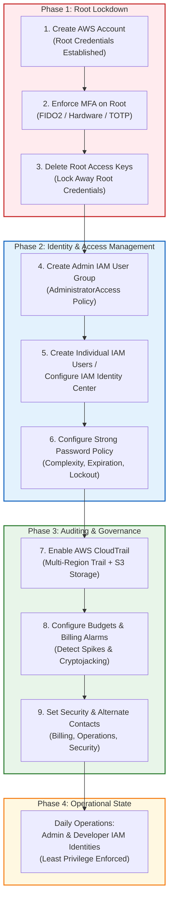
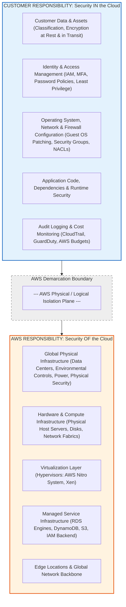
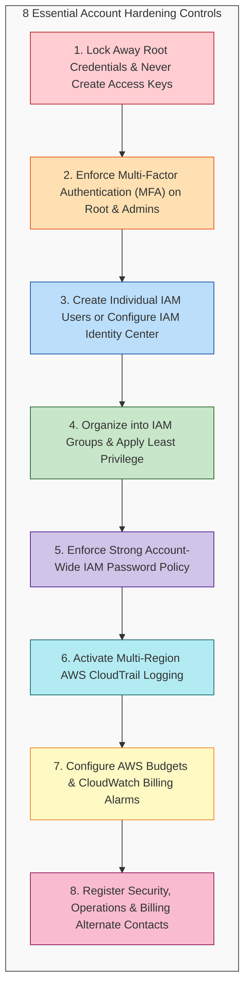
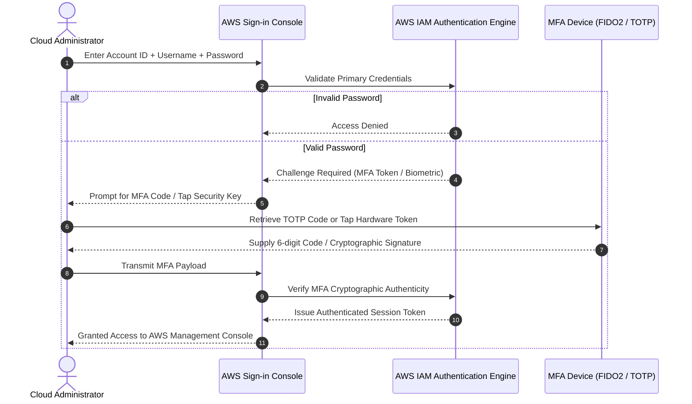
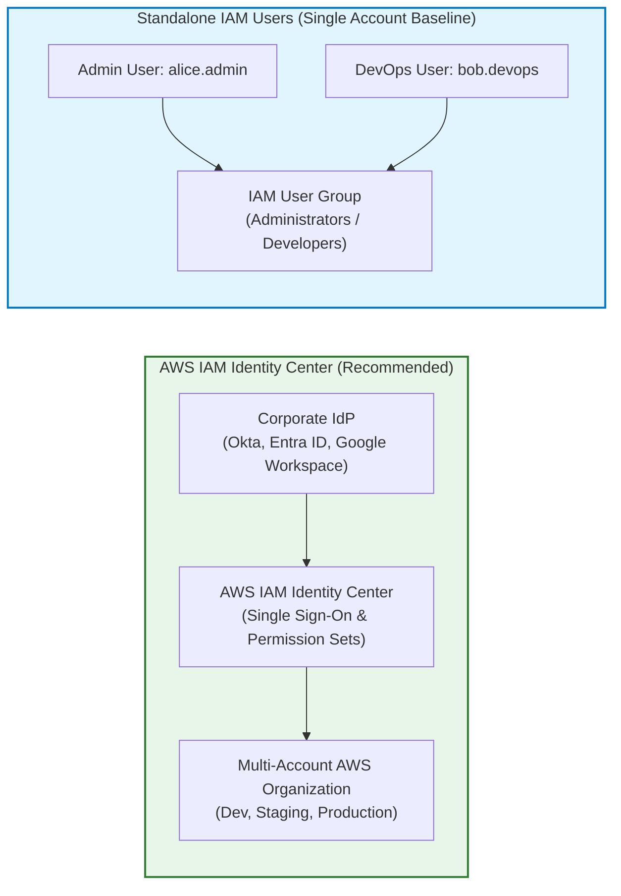
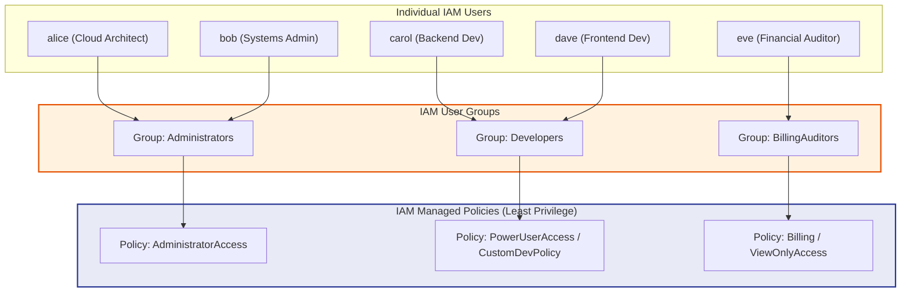
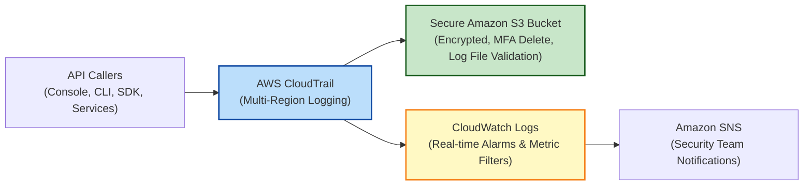
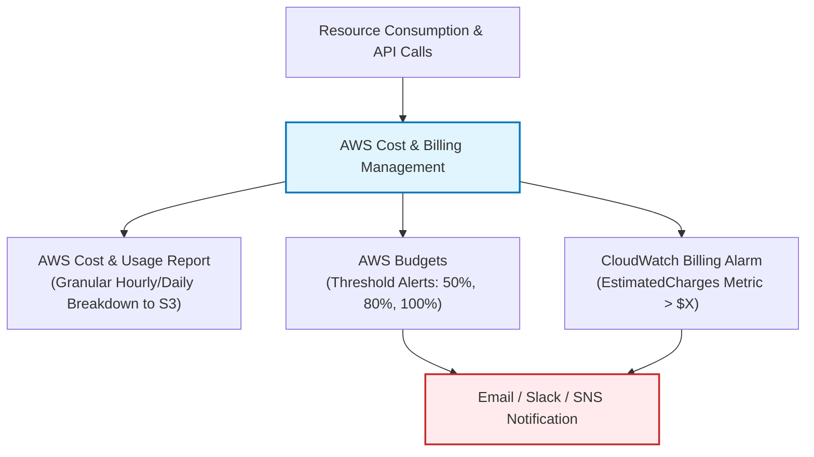
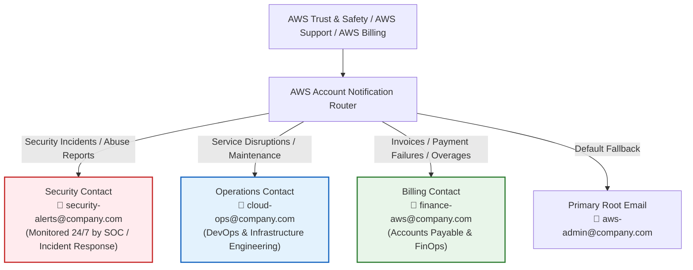

# 🛡️ AWS Account Security Best Practices: Initial Setup, Hardening & Governance

> **Course**: AWS re/Start  
> **Module**: Security (M04 – Security Best Practices for Creating an AWS Account)  
> **Source Document**: `T08-Security/T08-0017-RSSECY_EN-US_SG_M04_BESTPRACTICES.pdf`  
> **Target Audience**: Cloud Practitioners, Systems Operations Associates, Cloud Security Engineers, and AWS Administrators  

---

## 🎯 Module Overview

Establishing an Amazon Web Services (AWS) account is the foundational first step in building cloud infrastructure. However, the default state of a brand-new AWS account carries immense administrative power concentrated in a single identity: the **AWS account root user**. Without immediate security hardening, an AWS account is vulnerable to credential compromise, accidental misconfiguration, regulatory non-compliance, and catastrophic financial liabilities such as cryptojacking or unauthorized resource provisioning.

This guide details the end-to-end security hardening protocol required immediately upon creating an AWS account. It covers the **AWS Shared Responsibility Model**, the explicit delineation between root user and administrative roles, the deployment of **Multi-Factor Authentication (MFA)**, identity architecture using **IAM User Groups** and **IAM Identity Center**, audit logging via **AWS CloudTrail**, financial guardrails using **AWS Budgets & CloudWatch Billing Alarms**, and comprehensive governance contacts.



---

## 📌 Learning Objectives

By studying this guide and implementing the baseline configurations, you will be able to:

- [ ] **Define the Shared Responsibility Model**: Differentiate between AWS's responsibility for *security OF the cloud* and the customer's responsibility for *security IN the cloud*.
- [ ] **Protect the Account Root User**: Identify the risks of root credentials, enforce MFA on root, eliminate root access keys, and restrict root sign-in to rare break-glass operational tasks.
- [ ] **Enumerate Specific Root-Only Tasks**: Identify the exclusive operations in AWS that mandate root user authorization versus tasks appropriate for delegated IAM administrative users.
- [ ] **Deploy IAM Hierarchy & Least Privilege**: Build IAM User Groups, delegate administrative capabilities without direct policy attachment to individual users, and understand modern IAM Identity Center adoption.
- [ ] **Establish Enterprise Password Policies**: Enforce robust character complexity, expiration schedules, reuse prevention, and administrative lockouts across IAM credentials.
- [ ] **Activate Comprehensive CloudTrail Logging**: Deploy multi-Region AWS CloudTrail trails to capture an immutable audit log of API actions across the console, SDK, and CLI.
- [ ] **Establish Financial Anomaly Safeguards**: Configure AWS Budgets, Cost and Usage Reports (CUR), and Amazon CloudWatch billing metrics to alert on cost spikes and thwart malicious resource hijacking (cryptojacking).
- [ ] **Configure Alternate Account Contacts**: Maintain dedicated, monitored email distribution aliases for Security, Operations, and Billing in AWS Account Settings.

---

## ⚖️ 1. The AWS Shared Responsibility Model

Security and compliance are a shared effort between AWS and the customer. Understanding this operational boundary prevents catastrophic assumptions regarding default infrastructure protections.



### 1.1 Customer Responsibility: Security "IN" the Cloud
The customer retains complete sovereignty and accountability for:
- Selecting AWS services, configuring their architecture, and deploying workloads across chosen AWS Regions.
- Protecting the **confidentiality, integrity, and availability** of customer data (customer-side encryption, server-side encryption with KMS, data classifications).
- Configuring access controls, credential policies, MFA, IAM permissions, and user lifecycle governance.
- Maintaining operating system updates and patches on Infrastructure as a Service (IaaS) resources (e.g., Amazon EC2).
- Complying with industry regulations (HIPAA, PCI-DSS, GDPR, SOC 2) applicable to their enterprise and geographic jurisdiction.

### 1.2 AWS Responsibility: Security "OF" the Cloud
AWS manages and maintains the underlying foundation supporting cloud services:
- **Physical Security**: Securing physical server rooms, perimeter fencing, biometric access control, and 24/7 video surveillance.
- **Hardware & Network Infrastructure**: Provisioning and decommissioning compute blades, SAN storage disks, routers, switches, and redundant fiber cabling.
- **Virtualization & Hypervisor Layer**: Isolation across tenant boundaries provided by hypervisors (such as the hardware-enforced **AWS Nitro System**).
- **Core Managed Service Maintenance**: Patching the operating systems and database engines for managed platform services like Amazon RDS, Amazon DynamoDB, and Amazon S3.

> [!IMPORTANT]
> The division of responsibility varies depending on the service model:
> - **IaaS (e.g., EC2)**: Customer manages guest OS, patches, firewall rules, and runtime software.
> - **PaaS / Managed Services (e.g., RDS, ECS)**: AWS manages OS and DBMS patching; Customer manages database schema, user accounts, network firewalls, and encryption keys.
> - **SaaS / Serverless (e.g., S3, Lambda, DynamoDB)**: AWS manages infrastructure, execution environment, and underlying scaling; Customer manages bucket policies, IAM access, data encryption, and code execution logic.

---

## 👑 2. Demystifying the AWS Account Root User

When an AWS account is first registered, identity authentication is established via the root email address and password. The root user is the ultimate identity possessing complete, immutable, unrestricted administrative power over all resources and billing within that account.

### 2.1 The Inherent Danger of the Root User
The AWS account root user cannot be restricted by standard IAM policies or Service Control Policies (SCPs) within the local account:
- If a root user credential is compromised, attackers gain full ownership of the account, can provision massive GPU/compute clusters for illicit cryptocurrency mining, steal or delete intellectual property, or delete entire data backups and cloud infrastructure.
- **Principle of Least Privilege**: Root access violates least privilege. Daily administrative and developer duties should always be performed by identities with tightly scoped permissions.

### 2.2 Exclusive Tasks Requiring Root User Authentication
Although root user access must be locked away and avoided for standard administration, AWS designates a small subset of specific account management tasks that **exclusively require** signing in as the root user:

| Category | Specific Action / Operation | Description & Operational Significance |
| :--- | :--- | :--- |
| **Account Settings** | Change Account Name, Root Email, or Root Password | Updating core tenant identity metadata or primary email contact. |
| **Account Settings** | Manage Root User Access Keys | Creating, rotating, deactivating, or deleting programmatic root access keys (should be zero). |
| **Account Governance** | Close the AWS Account | Permanently terminating the AWS account and initiating data deletion. |
| **IAM Recovery** | Restore IAM User Admin Permissions | Emergency break-glass procedure if all IAM administrator policies are accidentally revoked or misconfigured. |
| **Support Management** | Change or Cancel AWS Support Plan | Modifying support tiers (Basic, Developer, Business, Enterprise) or terminating enterprise support. |
| **Billing Console Access** | Activate IAM Access to Billing | Granting IAM users and roles permission to access the AWS Billing and Cost Management console. |
| **Tax Invoices** | View Certain Regional Tax Invoices | Accessing specific non-EU value-added tax (VAT) invoices (e.g., AWS Inc. or AISPL invoices). |
| **Marketplace** | Register as a Seller | Establishing seller credentials in the Reserved Instance Marketplace. |
| **Amazon S3 Policies** | Fix Broken Bucket Policies with Invalid VPC/VPCE IDs | Editing or deleting an S3 bucket policy that inadvertently locks all IAM users out by referencing deleted VPC or VPC endpoint IDs. |
| **Amazon S3 Configuration** | Configure S3 MFA Delete | Enabling or disabling multi-factor authentication requirements for deleting S3 object versions. |

> [!NOTE]
> Routine account settings like updating general company contact information, configuring default billing currency, and enabling/disabling individual AWS Regions do **not** require root user credentials and can be delegated to IAM administrators.

---

## 📋 3. The 8 Mandatory AWS Account Security Best Practices

To safeguard enterprise cloud workloads from inception, engineers must implement these eight core best practices in sequential order.



---

### Practice 1: Lock Away AWS Root User Credentials

**Directive**: Stop using the AWS account root user immediately after completing the initial administrative bootstrap. Never generate long-term access keys (`aws_access_key_id` and `aws_secret_access_key`) for the root account.

#### Security Rationale
Root credentials represent complete account takeover capability. Unlike IAM credentials, root actions cannot be restricted by IAM policies within the account. Long-term access keys stored on local developer workstations or accidentally committed into public GitHub repositories lead to automated bot exploitation within minutes.

#### Operational Hardening Steps
1. Sign in to the AWS Management Console as the root user.
2. Navigate to **IAM Dashboard** $\rightarrow$ **Security Credentials** (under the account name dropdown).
3. Under **Access Keys**, inspect if any root access key exists:
   - If an access key exists, confirm it is not used in production pipelines, then select **Deactivate** and permanently **Delete**.
4. Generate a complex, randomized alphanumeric password (minimum 32+ characters) using an enterprise password vault (e.g., 1Password, Bitwarden, CyberArk).
5. Store the root password and recovery master keys in a secure corporate safe or dual-control password repository.
6. Restrict root logins to documented "break-glass" emergency disaster scenarios.

> [!CAUTION]
> **Zero Root Access Keys Policy**: There is virtually no valid modern operational use case for creating or maintaining root user programmatic access keys. If root access keys are detected during a security audit, they must be revoked immediately.

---

### Practice 2: Enable Multi-Factor Authentication (MFA) Immediately

**Directive**: Enforce Multi-Factor Authentication (MFA) on the root account and every administrative and console-enabled IAM identity.

#### Security Rationale
Passwords alone are vulnerable to credential stuffing, dictionary attacks, phishing, and local workstation keystroke logging. MFA introduces an indispensable second authentication factor combining:
- **Something you know**: Master account password.
- **Something you have**: Physical hardware security key (FIDO2/WebAuthn), hardware OTP token, or virtual authenticator app on a mobile device.

#### Supported MFA Formats in AWS
1. **FIDO2 / WebAuthn Hardware Security Keys (Recommended for Root)**:
   - Physical USB/NFC security keys (e.g., YubiKey).
   - Immune to modern browser-in-the-middle phishing attacks because authentication is cryptographically bound to the domain.
   - AWS supports registering up to **8 MFA devices** per user, enabling primary and backup physical key redundancy.
2. **Virtual Authenticator Apps (TOTP)**:
   - Software applications adhering to RFC 6238 Time-based One-Time Password (TOTP) standards (e.g., AWS Virtual MFA, Google Authenticator, Microsoft Authenticator, Authy).
3. **Hardware Key Fob / Display Cards**:
   - Dedicated physical fobs displaying a synchronized numeric code generated by a cryptographic seed.



#### Step-by-Step Root MFA Activation
1. Sign in as root $\rightarrow$ Open **IAM Console**.
2. Click **Add MFA** in the *Security Recommendations* panel.
3. Select **MFA device name** and choose **FIDO2 security key** or **Authenticator app**.
4. Scan the QR code or insert and tap your hardware security key.
5. Provide two consecutive TOTP codes (if using authenticator) or complete biometric touch verification (FIDO2).
6. Verify status displays **MFA: Assigned**.

---

### Practice 3: Create Individual IAM Users or Configure IAM Identity Center

**Directive**: Never share accounts. Create unique, individually identifiable IAM users or federate corporate credentials using **AWS IAM Identity Center** (successor to AWS Single Sign-On).

#### Security Rationale
Account sharing eliminates accountability and non-repudiation:
- When multiple administrators log in using a generic `admin` account or root, CloudTrail logs cannot establish who initiated a specific API call or terminated a critical production database.
- Individual identities ensure that personnel departures or role changes can be revoked immediately without resetting master passwords for the entire engineering organization.

#### Modern Approach: IAM Identity Center vs. Standalone IAM Users



- **IAM Identity Center (Recommended for Enterprise & Multi-Account)**:
  - Federates identities from corporate Identity Providers (IdP) via SAML 2.0 / SCIM (e.g., Microsoft Entra ID, Okta, Ping Identity).
  - Eliminates long-term IAM credentials by issuing short-term temporary STS tokens.
  - Centrally assigns **Permission Sets** across all accounts within an AWS Organization.
- **Standalone IAM Users (Appropriate for Single-Account Baselines & Learning)**:
  - Create distinct IAM users with the pattern `firstname.lastname`.
  - Provide AWS Management Console access with an auto-generated password requiring change on initial sign-in.
  - Disable programmatic access keys unless specifically needed for CLI development.

---

### Practice 4: Organize into IAM User Groups & Enforce Least Privilege

**Directive**: Never attach policies directly to individual IAM users. Instead, place users into **IAM User Groups** and attach managed policies to groups based on job responsibilities.



#### Why Direct Policy Attachment Is an Anti-Pattern
- **Permission Sprawl**: Attaching inline or managed policies directly to users makes tracking permissions impossible as teams scale.
- **Privilege Creep**: When employees change roles, their old permissions are rarely pruned, leaving users with excessive, unvetted access.
- **Audit Complexity**: Group-based access control provides transparent visibility into who holds administrative, read-only, or operator privileges.

#### Implementation Procedure: Creating the First Administrator Group
```bash
# 1. Create the IAM User Group
aws iam create-group --group-name Administrators

# 2. Attach the AWS-managed AdministratorAccess policy to the group
aws iam attach-group-policy \
    --group-name Administrators \
    --policy-arn arn:aws:iam::aws:policy/AdministratorAccess

# 3. Create an individual IAM user
aws iam create-user --user-name alice.admin

# 4. Add the individual user to the Administrators group
aws iam add-user-to-group \
    --group-name Administrators \
    --user-name alice.admin
```

---

### Practice 5: Configure a Strong Account-Wide Password Policy

**Directive**: Enforce an enterprise-grade password policy across all IAM users requiring length, complexity, regular rotation, and reuse restrictions.

#### Security Rationale
Weak or repeated passwords are the primary target of brute-force and dictionary attacks. A centralized password policy enforces baseline entropy across every user provisioned in the account.

#### Recommended Password Policy Parameters

| Parameter | Recommended Baseline | Description & Rationale |
| :--- | :--- | :--- |
| **Minimum Password Length** | $\ge 14\text{ characters}$ | Exponentially increases brute-force search space against modern cracking rigs. |
| **Require Uppercase Characters** | Enabled (`A-Z`) | Mandates character diversity. |
| **Require Lowercase Characters** | Enabled (`a-z`) | Mandates character diversity. |
| **Require Numbers** | Enabled (`0-9`) | Mandates numeric character inclusion. |
| **Require Non-Alphanumeric Symbols** | Enabled (`!@#$%^&*()_+-=[]{}\|'`) | Mandates special symbol inclusion. |
| **Allow Users to Change Password** | Enabled | Empowers users to rotate credentials independently. |
| **Password Expiration** | 90 Days | Limits the validity window of unmonitored credential compromises. |
| **Password Reuse Prevention** | Remember last 5 to 12 passwords | Prevents users from alternating between two similar passwords. |
| **Require Password Reset Upon First Login** | Enabled | Ensures the administrator who provisioned the account does not know the user's permanent password. |

#### Applying the Password Policy via AWS CLI
```bash
aws iam update-account-password-policy \
    --minimum-password-length 14 \
    --require-symbols \
    --require-numbers \
    --require-uppercase-characters \
    --require-lowercase-characters \
    --allow-users-to-change-password \
    --max-password-age 90 \
    --password-reuse-prevention 5
```

---

### Practice 6: Activate AWS CloudTrail Across All Regions

**Directive**: Enable AWS CloudTrail immediately across **all AWS Regions**, directing immutable API event logs to an encrypted, restricted Amazon S3 bucket.

#### Security Rationale
**AWS CloudTrail** is the primary audit log tool in AWS. It tracks and records every API call initiated via:
- The AWS Management Console
- The AWS Command Line Interface (AWS CLI)
- AWS Software Development Kits (SDKs) and automation libraries
- Third-party integrated SaaS platforms and services

CloudTrail records crucial metadata for every call: *who called the API*, *from what source IP address*, *at what exact timestamp*, *which parameters were sent*, and *what response or error code was returned*.



#### Critical CloudTrail Best Practices
1. **Apply to All Regions**:
   - Attackers frequently target unused or obscure AWS Regions (e.g., `ap-southeast-3` or `af-south-1`) to spin up illicit instances undetected. Multi-Region trails capture activity globally regardless of where it originates.
2. **Enable Log File Validation**:
   - Uses cryptographic SHA-256 hashing and digital signatures to generate digest files. Proves mathematically that audit logs have not been tampered with or deleted by an attacker.
3. **Protect the Target S3 Bucket**:
   - Apply bucket policies blocking public access (`Block Public Access` enabled).
   - Encrypt logs with AWS KMS.
   - Restrict read access strictly to security auditors and designated forensic teams.

#### CloudTrail Multi-Region Creation Example
```bash
# Create a secure multi-region trail
aws cloudtrail create-trail \
    --name enterprise-audit-trail \
    --s3-bucket-name mycompany-centralized-cloudtrail-logs \
    --is-multi-region-trail \
    --enable-log-file-validation

# Start logging
aws cloudtrail start-logging --name enterprise-audit-trail
```

---

### Practice 7: Configure AWS Budgets & CloudWatch Billing Alarms

**Directive**: Establish cost controls, AWS Cost and Usage Reports (CUR), and Amazon CloudWatch billing alarms to receive automated alerts when expenditures exceed expected thresholds.

#### Security Rationale
In cloud computing, **unexpected financial spikes are often the first indicator of a critical security breach**:
- When attackers compromise AWS credentials, their primary objective is often **cryptojacking**—provisioning high-throughput GPU clusters (e.g., `p3` or `g5` EC2 instances) to mine cryptocurrency.
- Without billing alarms, an organization may only discover a total account compromise weeks later when receiving a five- or six-figure credit card charge from AWS.



#### Dual-Layer Financial Defense Architecture
1. **CloudWatch Billing Alarms**:
   - Amazon CloudWatch tracks the `EstimatedCharges` metric in the `us-east-1` (N. Virginia) billing region.
   - Triggers an Amazon SNS email notification when total charges exceed a fixed safety baseline (e.g., $10 for a free-tier/learning account; $500 for a development team).
2. **AWS Budgets**:
   - Tracks actual and forecasted expenditures against monthly limits.
   - Sends proactive alerts at customized thresholds (e.g., 50%, 80%, and 100% of budgeted spend).
3. **AWS Cost and Usage Report (CUR)**:
   - Delivers comprehensive, itemized line items by service, resource ID, and tags to an S3 bucket for in-depth business intelligence and auditing.

---

### Practice 8: Register Security, Operations, and Billing Alternate Contacts

**Directive**: Configure explicit Alternate Contacts in the AWS Account Settings console for **Security**, **Operations**, and **Billing** using monitored organizational mailing lists rather than individual employee mailboxes.

#### Security Rationale
If AWS detects abusive activity originating from your account (such as spam distribution, port scanning, or malware hosting) or identifies that your root credentials have been leaked on a public website:
- AWS Trust & Safety sends urgent notifications to the designated **Security Contact**.
- If no alternate security contact is configured, notifications fall back to the primary root account email address—which may be monitored infrequently or belong to a senior executive who does not handle security incident response.
- Delays in responding to AWS Trust & Safety can result in automatic account suspension and workload termination.



#### Alternate Contact Recommendations
- **Avoid Individual Inboxes**: Never use `john.doe@company.com`. If John leaves the company or goes on vacation, critical alerts will be missed.
- **Use Monitored Distribution Lists**: Always use shared corporate group addresses (e.g., `security-ops@mycompany.com`, `billing@mycompany.com`).
- **Include Phone Numbers**: Provide 24/7 emergency response phone numbers with international dialing codes.

---

## 🛠️ Verification & Implementation Checklist

Use this comprehensive verification matrix to audit a newly created AWS account against enterprise security baselines:

| Step # | Best Practice Domain | Specific Hardening Action | Verification Method / CLI Command | Desired State | Status |
| :---: | :--- | :--- | :--- | :--- | :---: |
| **01** | **Root Account** | Remove root user access keys | `aws iam get-account-summary` $\rightarrow$ Check `AccountAccessKeysPresent` | `0` (Zero keys present) | - [ ] |
| **02** | **Root Account** | Enable hardware/FIDO2 MFA on root | `aws iam get-account-summary` $\rightarrow$ Check `AccountMFAEnabled` | `1` (Enabled) | - [ ] |
| **03** | **Access Delegation** | Create individual IAM Admin user | `aws iam list-users` | Named individual users created; no generic logins | - [ ] |
| **04** | **Group Governance** | Assign permissions via IAM User Groups | `aws iam list-groups` & `aws iam list-attached-group-policies` | Permissions bound to groups, not directly to users | - [ ] |
| **05** | **Authentication** | Enforce strict password policy | `aws iam get-account-password-policy` | Minimum 14 chars, complexity, expiration, history enforced | - [ ] |
| **06** | **Audit Logging** | Activate multi-Region AWS CloudTrail | `aws cloudtrail describe-trails` | `IsMultiRegionTrail: true`, `LogFileValidation: true` | - [ ] |
| **07** | **Log Security** | Restrict & encrypt CloudTrail S3 bucket | `aws s3api get-bucket-policy` & `get-public-access-block` | Public access blocked, SSE-KMS active, MFA Delete | - [ ] |
| **08** | **Financial Security** | Configure CloudWatch billing alarm | `aws cloudwatch describe-alarms --metric-name EstimatedCharges` | Active alarm routing alerts to SNS topic | - [ ] |
| **09** | **Cost Visibility** | Deploy AWS Budgets | `aws budgets describe-budgets --account-id <ACCOUNT_ID>` | Active budget with thresholds configured at 50/80/100% | - [ ] |
| **10** | **Governance** | Register Alternate Contacts | **Account Settings** Console $\rightarrow$ Alternate Contacts | Security, Operations, and Billing distribution emails populated | - [ ] |

---

## 💡 Real-World Scenarios & Architectural Insights

### Scenario A: The Accidental Git Commit & Cryptojacking Crisis
- **The Event**: A junior developer generates programmatic access keys for their AWS account and accidentally commits their `.env` file containing the credentials to a public GitHub repository.
- **The Attack**: Automated threat actor bots scan public GitHub commits within seconds, scrape the access keys, and execute automated API calls across all AWS Regions to provision maximum allowable GPU compute instances (`g4dn.metal`, `p3.16xlarge`) to mine Monero.
- **Why This Baseline Mitigates or Prevents the Crisis**:
  1. *Least Privilege & Group Scoping*: If the developer was in a restricted group without permissions to launch large instance families in unapproved regions, the API calls fail immediately.
  2. *CloudWatch Billing Alarms & AWS Budgets*: Triggers an emergency SMS and email alert to the security and operations teams within hours of the unexpected spend spike.
  3. *CloudTrail Logging*: The incident response team traces the exact compromised access key ID, client IP address, and timestamp in CloudTrail, allowing instant deactivation of the key and automated cleanup via AWS Systems Manager.

### Scenario B: The Orphaned Production Root Account
- **The Event**: A company founder sets up the corporate AWS account using their personal email address (`founder@gmail.com`) with no MFA and no alternate contacts configured. Three years later, after the founder departs the company, an infrastructure misconfiguration triggers an abuse complaint from AWS.
- **The Failure**: AWS attempts to notify `founder@gmail.com`. The current engineering staff receives no warning. AWS temporarily suspends the account due to lack of response, resulting in a total outage of the company's SaaS platform.
- **The Prevention**: By establishing an enterprise distribution alias (`aws-root@company.com`), configuring monitored Alternate Contacts for Security and Operations, and running daily administration under federated IAM identities, the organization maintains operational continuity independent of individual staffing changes.

---

## 🧠 Checkpoint Review & Comprehensive Knowledge Check

Test your understanding of the concepts covered in this module:

### Question 1: What is the single most critical best practice regarding the AWS account root user?
> **Answer**:
> Adhere strictly to the practice of **stopping the use of the root user for everyday tasks, including administrative tasks**. 
> - Use the root user only once to bootstrap your first IAM administrator user and group.
> - Immediately enable Multi-Factor Authentication (MFA) on the root user.
> - Delete all root user access keys.
> - Store the root password in a secure corporate password vault and reserve root sign-in exclusively for the small subset of tasks that require root credentials.

### Question 2: Which of the following operations CANNOT be performed by an IAM user with full AdministratorAccess and MUST be performed by the root user?
1. Creating a new Amazon S3 bucket.
2. Launching an Amazon EC2 instance in a new Region.
3. Closing the AWS account.
4. Attaching an IAM policy to an IAM group.

> **Answer**:
> **Option 3: Closing the AWS account.**  
> *Explanation*: Closing the account, changing the root user email/password, managing root access keys, registering as a Reserved Instance Marketplace seller, configuring S3 MFA Delete, and changing AWS Support plans require signing in with root user credentials. Standard administrative duties (creating buckets, instances, IAM policies) can and must be executed by delegated IAM administrators.

### Question 3: What is Multi-Factor Authentication (MFA), and why is it considered a mandatory security control?
> **Answer**:
> Multi-Factor Authentication (MFA) is an authentication method requiring users to provide two or more distinct verification factors before gaining access to a protected system:
> 1. Something you know (master password).
> 2. Something you have (hardware security key, authenticator app token).
> 
> *Significance*: MFA drastically reduces the risk of account compromise. Even if an attacker obtains an administrator's password via phishing, credential stuffing, or malware, they cannot authenticate without physical possession of the secondary MFA device.

### Question 4: How does activating AWS CloudTrail in "All Regions" enhance account security compared to single-region logging?
> **Answer**:
> Enabling CloudTrail across all Regions provides complete visibility into global account activity:
> - Threat actors who compromise credentials frequently launch unauthorized workloads in obscure, unused Regions (e.g., regions far from where the customer operates) hoping they will go unnoticed.
> - Multi-Region trails automatically detect API activity, resource creations, and suspicious access attempts in every region globally, ensuring there are no blind spots in the audit log.

### Question 5: Why are AWS CloudWatch billing alarms considered a vital *security* control rather than merely a financial tool?
> **Answer**:
> A sudden, unexpected surge in cloud consumption is often the earliest detectable symptom of an account compromise (such as unauthorized cryptomining or botnet deployment). By configuring billing alarms and budget alerts, organizations can detect unauthorized resource provisioning within hours, enabling security teams to isolate compromised credentials and terminate rogue instances before suffering catastrophic financial loss.

### Question 6: Under the AWS Shared Responsibility Model, identify who is responsible for each of the following:
1. *Upgrading the hypervisor software on physical server blades.*
2. *Configuring the password expiration policy for IAM users.*
3. *Replacing a failed physical hard drive inside an AWS data center.*
4. *Installing security patches on the operating system of an Amazon EC2 instance.*

> **Answer**:
> 1. **AWS** (Security *OF* the cloud – Virtualization/Hypervisor layer).
> 2. **Customer** (Security *IN* the cloud – IAM and Access Management).
> 3. **AWS** (Security *OF* the cloud – Physical infrastructure & hardware maintenance).
> 4. **Customer** (Security *IN* the cloud – Guest operating system configuration and maintenance on IaaS).

---

## 📌 Key Takeaways & Summary

- **Account Root User Power**: The root user is tied to the account creation email address and possesses unrestricted power. It cannot be scoped down by IAM policies. Never create access keys for root, enable MFA immediately, and lock the credentials away.
- **Exclusive Root Actions**: Root sign-in is required only for specific tenant operations: closing the account, changing root credentials/email, changing AWS Support tiers, activating IAM billing console access, configuring S3 MFA Delete, and editing S3 policies with broken VPC IDs.
- **IAM Identity Structure**:
  - Do not share accounts. Create individual IAM users or federate corporate identities via **AWS IAM Identity Center**.
  - Assign permissions to **IAM User Groups** using managed policies. Avoid attaching policies directly to individual users.
  - Adhere strictly to the **Principle of Least Privilege**.
- **Auditability via CloudTrail**: Activate **AWS CloudTrail** in all Regions immediately upon account creation. Direct logs to an encrypted S3 bucket with log file validation enabled to maintain an immutable forensic audit trail.
- **Cost & Security Integration**: Use **AWS Budgets** and **CloudWatch Billing Alarms** to detect cost anomalies early, preventing devastating financial impacts from compromised credentials and cryptojacking attacks.
- **Governance & Communication**: Populate **Alternate Contacts** (Security, Operations, Billing) with monitored organizational distribution lists to ensure timely incident response when contacted by AWS Trust & Safety.
- **Shared Responsibility Model**: AWS guarantees the security *of* the cloud (physical facilities, hardware, hypervisors, managed services); the customer retains full ownership and accountability for security *in* the cloud (data classification, encryption, IAM, guest OS patching, and network firewalls).
