# 🏛️ AWS Security Compliance Program: Governance, Standards & AWS Artifact

> **Course**: AWS re/Start  
> **Module**: Security (M04 – AWS Compliance Program)  
> **Source Document**: `T08-Security/T08-0018-RSSECY_EN-US_SG_M04_AWSCOMPLIANCE.pdf`  
> **Target Audience**: Cloud Practitioners, Security Engineers, Compliance Officers, Solutions Architects, and Systems Administrators  

---

## 🎯 Module Overview

In modern enterprise IT, information security cannot be treated solely as a technical discipline of firewalls, encryption algorithms, and access permissions. It is fundamentally bounded by legal statutes, regulatory obligations, industry frameworks, and contractual agreements. A failure in security compliance can lead to multi-million dollar regulatory fines, class-action lawsuits, criminal liability, cancellation of operating licenses, and irreversible reputational damage.

Migrating workloads to the Amazon Web Services (AWS) cloud fundamentally transforms how organizations approach compliance. Rather than building and auditing physical facilities, redundant power grids, environmental controls, and server hardware from scratch, enterprises inherit an audited, enterprise-grade control environment. Security and compliance become a **Shared Responsibility**: AWS manages and certifies the compliance *of* the cloud infrastructure, while customers maintain ownership, configuration governance, and control effectiveness *in* the cloud.

This guide provides an end-to-end examination of the **AWS Security Compliance Program**. It breaks down the foundational distinctions between regulatory and contractual obligations, details major international and regional compliance standards (such as **ISO/IEC 27001/27017/27018**, **SOC 1/2/3**, **PCI DSS**, **HIPAA/HITECH**, **FedRAMP**, and **GDPR**), examines the three pillars of the AWS Risk and Compliance Program, and explains how to leverage **AWS Artifact** for on-demand compliance reports and legal agreements.

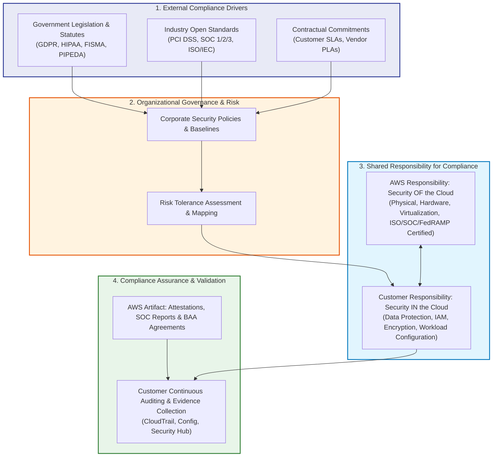

---

## 📌 Learning Objectives

By thoroughly studying this guide, you will be able to:

- [ ] **Analyze the Impact of Laws and Regulations on IT Security**: Explain how legislative mandates, industry baselines, and contractual requirements dictate technical security controls.
- [ ] **Distinguish Regulatory vs. Contractual Requirements**: Contrast legal mandates from statutory authorities against negotiated service contracts (SLAs and PLAs).
- [ ] **Evaluate Non-Compliance Penalties and Risk Profiles**: Categorize the financial, legal, operational, and reputational ramifications across mandatory laws, open standards, and industry best practices.
- [ ] **Identify Key Global and Regional Standards**: Explain the scope and mandates of ISO/IEC 27001/27017/27018, SOC reports (1, 2, and 3), PCI DSS, HIPAA/HITECH, FedRAMP, GDPR, and PIPEDA.
- [ ] **Recognize Standards Evolution Organizations**: Identify the roles of NIST, ISO, CIS, CSA, ENISA, IETF, IEEE, and COSO in developing security controls.
- [ ] **Articulate the AWS Shared Responsibility Model for Compliance**: Define control inheritance and delineate customer vs. AWS compliance boundaries.
- [ ] **Deconstruct the AWS Risk and Compliance Program**: Differentiate the three core pillars: Business Risk Management, Control Environment and Automation, and Certifications/Attestations.
- [ ] **Operate AWS Artifact**: Navigate AWS Artifact to retrieve SOC reports, ISO certifications, FedRAMP packages, and execute legally binding agreements such as the HIPAA Business Associate Addendum (BAA).
- [ ] **Implement Customer Governance Workflows**: Execute the four-step methodology to design, implement, map, and verify operating effectiveness of cloud compliance controls.

---

## ⚖️ 1. Security Compliance Fundamentals: Laws, Standards & Contracts

### 1.1 The Definition and Purpose of Security Compliance
**Security compliance** is the formal discipline of ensuring that an organization's administrative, physical, and technical security controls strictly adhere to applicable regulatory statutes, standards, and contractual commitments. 

While cybersecurity engineering focuses on building defenses against threat actors, vulnerabilities, and system failures, security compliance provides the **formal governance, proof of due diligence, and external assurance** that systems satisfy mandatory baselines.

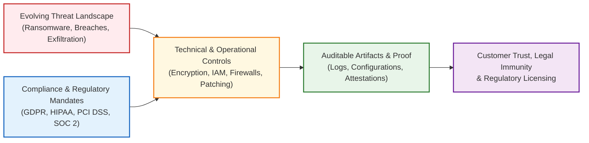

### 1.2 Regulatory Requirements vs. Contractual Commitments

Compliance requirements fall into two primary jurisdictions: **Regulatory** (imposed by external legal or industry governing bodies) and **Contractual** (negotiated between business entities).

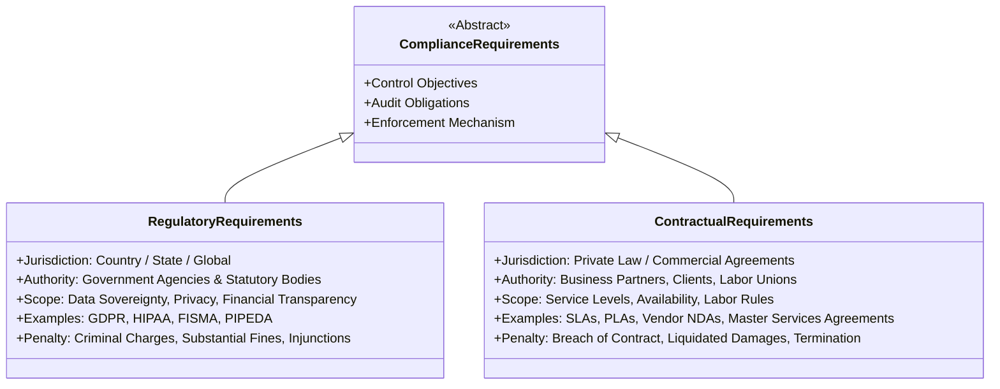

#### Detailed Breakdown of Requirements:

| Dimension | Regulatory Requirements | Contractual Requirements |
| :--- | :--- | :--- |
| **Originating Authority** | Government legislatures, federal agencies, and accredited industrial councils (e.g., US Congress, European Commission, PCI SSC). | Commercial entities, enterprise clients, trade partners, service providers, or labor organizations. |
| **Scope of Authority** | **Statutory**: Universal within a geographic border, economic market, or specific vertical industry. | **Privity of Contract**: Enforceable solely upon signing parties to the agreement. |
| **Primary Drivers** | Public safety, national defense, individual civil rights, economic stabilization, consumer protection. | Commercial uptime, service delivery reliability, quality of service, liability mitigation, intellectual property defense. |
| **Key Instruments** | Statutes, executive orders, statutory rules, regulatory codes, mandatory industry baselines. | **Service Level Agreements (SLAs)**, **Project Labor Agreements (PLAs)**, Master Service Agreements (MSAs), Data Processing Addenda (DPAs). |
| **Geographic Variation** | Varies widely across municipal, state, national, and supra-national borders (e.g., cross-border data transfer limitations). | Bound to agreed governing law and dispute arbitration venues defined in the contract. |
| **Enforcement Body** | Regulatory inspectors, federal prosecutors, privacy commissioners, civil courts, supervisory authorities. | Civil arbitration panels, commercial courts, contract dispute mediators. |

#### Understanding Key Contractual Instruments:
- **Service Level Agreement (SLA)**: A legally binding commitment between a service provider and a client specifying quantitative metrics such as service availability (e.g., 99.99% monthly uptime), incident response response times, mean time to recovery (MTTR), and corresponding financial service credits if obligations are missed.
- **Project Labor Agreement (PLA)**: A pre-hire collective bargaining agreement between contractors and labor organizations establishing employment terms, certifications, background check clearances, safety protocols, and labor disputes handling for large-scale engineering or infrastructure projects.

> [!NOTE]
> Because laws and regulations vary significantly between jurisdictions (such as the United States, European Union, and Asia-Pacific), enterprises operating globally must implement **company-wide security policies** that align with the most stringent regional mandates, while supporting regional exceptions for data localization.

---

### 1.3 Compliance Levels and Consequences of Non-Compliance

Security requirements carry different tiers of obligation depending on the issuing authority. Failure to establish and demonstrate compliance results in severe penalties:

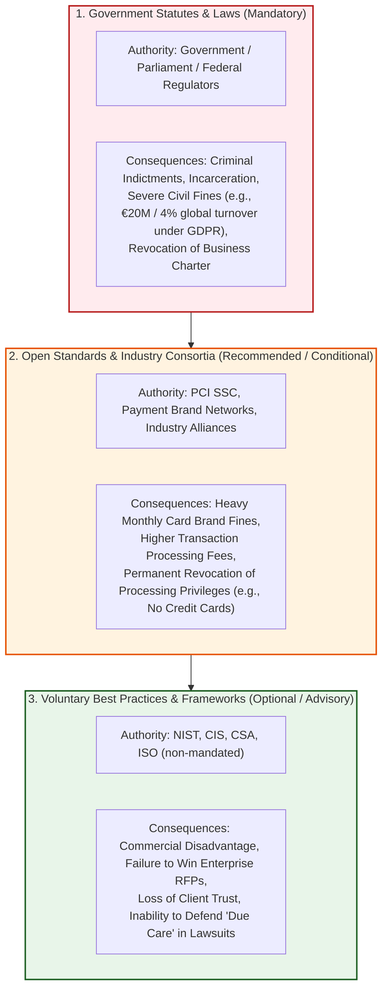

#### Comparative Matrix of Compliance Levels:

| Compliance Level | Issuing Authority | Degree of Obligation | Direct Penalties for Non-Compliance | Long-Term Commercial Impact |
| :--- | :--- | :--- | :--- | :--- |
| **Government & Statutory Laws** | Federal, state, and international legislative bodies (e.g., US HHS, EU DPAs). | **Mandatory**: Compulsory by law for all entities operating within scope. | Civil money penalties, statutory damages, consent decrees, criminal charges against corporate officers. | Forced closure of business units, debarment from federal contracting, massive equity valuation collapse. |
| **Industry Open Standards** | Industry consortiums and governing councils (e.g., PCI Security Standards Council). | **Conditional / Required**: Mandatory if participating in that commercial ecosystem. | Substantial escalating fines levied via acquiring banks ($5,000 to $100,000/month), increased merchant processing interchange fees. | Termination of merchant merchant accounts; absolute inability to accept electronic debit/credit card payments. |
| **Industry Best Practices** | Independent standards organizations (e.g., CIS benchmarks, NIST CSF, CSA CCM). | **Voluntary / Advisory**: Discretionary adoption based on risk posture. | No direct statutory fines; however, failure to adhere demonstrates negligence under tort law. | Disqualification during enterprise procurement vendor risk assessments, loss of competitive edge, higher cyber insurance premiums. |

> [!IMPORTANT]
> **Reporting is Essential**: In regulatory compliance, if an activity is not documented, it legally never occurred. Demonstrating compliance requires rigorous, immutable reporting, continuous log retention, and formal third-party audit attestations.

---

## 🌐 2. Standards Evolution Organizations

Modern cloud security frameworks do not originate in isolation; they are researched, published, and maintained by recognized global standards bodies and industry consortiums. These organizations continuously evolve control baselines to address emerging attack vectors such as zero-day exploits, distributed denial-of-service (DDoS) strikes, identity spoofing, and supply-chain compromises.

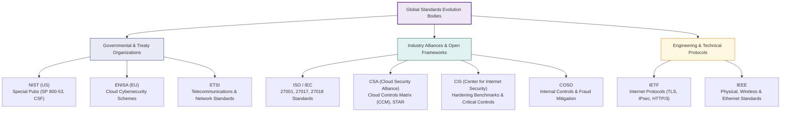

### Deep Dive into Key Standards Bodies:

1. **NIST (National Institute of Standards and Technology)**:
   - *Role*: A non-regulatory agency of the United States Department of Commerce.
   - *Key Publications*:
     - **NIST SP 800-53**: Security and Privacy Controls for Information Systems and Organizations (the cornerstone of federal compliance).
     - **NIST SP 800-145**: The definitive international definition of cloud computing (On-demand self-service, broad network access, resource pooling, rapid elasticity, measured service).
     - **NIST Cybersecurity Framework (CSF)**: Five/Six core functions: Govern, Identify, Protect, Detect, Respond, Recover.
2. **ISO/IEC (International Organization for Standardization / International Electrotechnical Commission)**:
   - *Role*: The world's largest independent, non-governmental international standard development organization representing 160+ countries.
   - *Key Cloud Standards*: ISO/IEC 27001 (ISMS), 27017 (Cloud Security), 27018 (Cloud Privacy).
3. **CSA (Cloud Security Alliance)**:
   - *Role*: Global non-profit dedicated to defining and raising awareness of best practices to ensure a secure cloud computing environment.
   - *Key Contributions*: **Cloud Controls Matrix (CCM)**, **Security Guidance for Critical Areas of Focus in Cloud Computing**, and the **CSA STAR (Security, Trust, Assurance and Registry)** certification program.
4. **CIS (Center for Internet Security)**:
   - *Role*: Community-driven non-profit publishing consensus-based, configuration-level security baselines.
   - *Key Contributions*: **CIS Benchmarks** (prescriptive hardening guides for OS, hypervisors, and cloud environments like the AWS Foundations Benchmark) and **CIS Critical Security Controls (Controls v8)**.
5. **ENISA (European Union Agency for Cybersecurity)**:
   - *Role*: Dedicated to achieving a high common level of cybersecurity across the European Union, publishing cloud certification schemes (EUCS) and threat landscapes.
6. **ETSI (European Telecommunications Standards Institute)**:
   - *Role*: Produces globally applicable standards for Information and Communications Technologies (ICT), including 5G, virtualization (NFV), and cryptographic algorithms.
7. **IETF (Internet Engineering Task Force)**:
   - *Role*: Open international community of network designers and operators that authors RFC specifications governing core internet protocols (TCP/IP, TLS 1.3, DNSSEC, HTTP/3).
8. **IEEE (Institute of Electrical and Electronics Engineers)**:
   - *Role*: Professional association publishing foundational hardware, wireless, and network link standards (IEEE 802.11 Wi-Fi, 802.3 Ethernet, 802.1AE MACsec).
9. **COSO (Committee of Sponsoring Organizations of the Treadway Commission)**:
   - *Role*: Dedicated to providing thought leadership through the development of comprehensive frameworks on enterprise risk management (ERM), internal control, and fraud deterrence. Foundational to corporate governance under **Sarbanes-Oxley (SOX)**.

---

## 📋 3. Key Global and Industry Compliance Standards & Frameworks

Enterprise cloud architectures must simultaneously conform to global, national, and industry-specific regulations. Below is a comprehensive architectural analysis of the primary frameworks impacting AWS workloads.

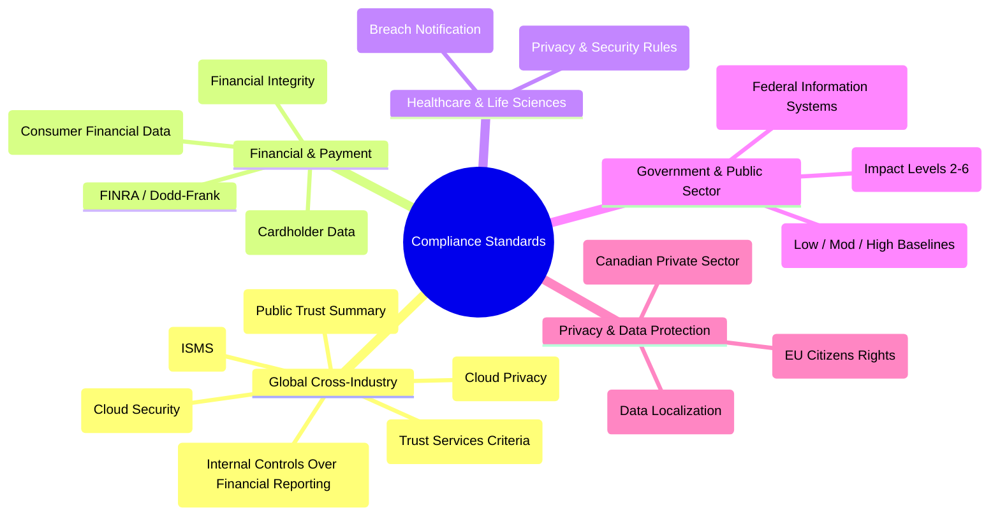

---

### 3.1 Global & Cross-Industry Standards: ISO/IEC and SOC Reports

#### ISO/IEC 27001, 27017, and 27018
The International Organization for Standardization (ISO) provides gold-standard independent certification for information security management:
- **ISO/IEC 27001:2022**: Focuses on establishing, implementing, maintaining, and continually improving an **Information Security Management System (ISMS)**. It outlines systematic risk assessment, asset management, access controls, physical security, and business continuity.
- **ISO/IEC 27017:2015**: A cloud-specific code of practice providing guidance on information security controls for cloud service providers (CSPs) and cloud service customers (CSCs). Adds specific controls for cloud shared roles, hypervisor monitoring, VM isolation, and cloud administrative credentials.
- **ISO/IEC 27018:2019**: The first international code of practice for **protecting Personally Identifiable Information (PII) in public clouds**. Forbids CSPs from using customer PII for advertising without express consent, mandates transparency in sub-processor engagements, and requires notifying customers promptly regarding government data disclosure requests.

#### SOC 1, SOC 2, and SOC 3 Reports (AICPA Framework)
Developed by the American Institute of Certified Public Accountants (AICPA), System and Organization Controls (SOC) reports provide third-party attestation of service organization controls:

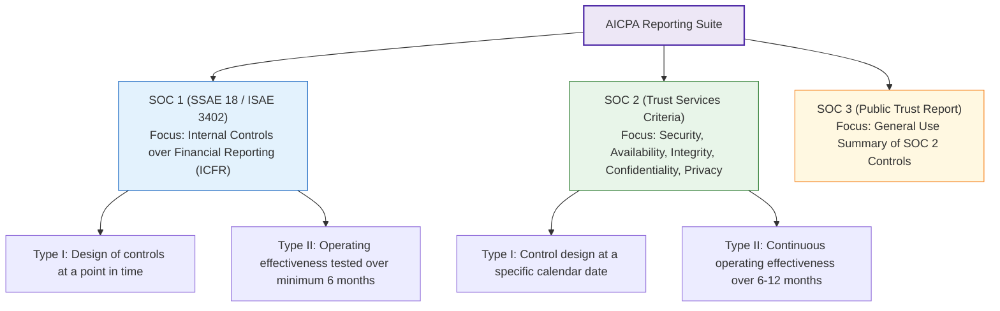

| Report Type | Purpose & Scope | Target Audience | Distribution Restrictions |
| :--- | :--- | :--- | :--- |
| **SOC 1 (Type I & II)** | Evaluates controls relevant to a user organization's **Internal Control over Financial Reporting (ICFR)**. | External financial auditors, corporate controllers, CFOs. | **Restricted Use**: Requires non-disclosure agreement (NDA) or customer authentication in AWS Artifact. |
| **SOC 2 (Type I & II)** | Evaluates technical controls across five **Trust Services Criteria (TSC)**: Security (Common Criteria), Availability, Processing Integrity, Confidentiality, and Privacy. | Security teams, compliance auditors, vendor risk assessors, CTOs/CISOs. | **Restricted / Confidential**: Contains sensitive architectural audit findings; available via AWS Artifact under NDA. |
| **SOC 3** | A high-level, public-facing summary version of the SOC 2 Type II assessment confirming that the organization met all Trust Services Criteria without revealing confidential architectural details. | Prospective customers, public stakeholders, general business community. | **Public Distribution**: Unrestricted; downloadable publicly without requiring an AWS account or NDA. |

> [!TIP]
> **Type I vs. Type II**:
> - **Type I Report**: The independent auditor reviews the documentation and validates that controls are **designed appropriately** as of a single snapshot date.
> - **Type II Report**: The auditor performs rigorous sampling to verify that controls **operated effectively over a historical audit period** (typically 6 to 12 months). Type II is widely mandated by enterprise enterprise risk assessors.

---

### 3.2 Payment Card Industry Data Security Standard (PCI DSS)

The **PCI DSS** is a globally mandated standard established by the major payment card brands (Visa, Mastercard, American Express, Discover, and JCB) and administered by the **PCI Security Standards Council (PCI SSC)**.

- **Objective**: Protect cardholder data (CHD) and sensitive authentication data (SAD) against theft, skimming, fraudulent processing, and credential leakage.
- **Scope**: Any entity that stores, processes, or transmits cardholder data, or that could impact the security of the **Cardholder Data Environment (CDE)**.
- **Primary Data Elements Protected**:
  - *Primary Account Number (PAN)*: The unique payment card number.
  - *Cardholder Name, Expiration Date, Service Code*.
  - *Sensitive Authentication Data (SAD)*: Full track data (magnetic stripe / chip), CAV2/CVC2/CVV2/CID card verification codes, and PINs/PIN blocks (SAD must *never* be stored after authorization, even encrypted).
- **Core Structural Requirements**: Organized into 6 control objectives containing 12 foundational technical requirements:
  1. Build and Maintain a Secure Network and Systems (Firewalls, No vendor-supplied default passwords).
  2. Protect Cardholder Data (Encryption at rest and in transit across public networks).
  3. Maintain a Vulnerability Management Program (Anti-malware, regular security patching).
  4. Implement Strong Access Control Measures (Need-to-know access, unique IDs, MFA).
  5. Regularly Monitor and Test Networks (CloudTrail audit tracking, file integrity monitoring, quarterly external vulnerability scans by ASVs).
  6. Maintain an Information Security Policy.

> [!IMPORTANT]
> **AWS PCI Level 1 Compliance**: AWS is certified as a **PCI DSS Level 1 Service Provider**—the highest level of security assessment. Customers who build payment applications on AWS can inherit the underlying infrastructure compliance via the **AWS PCI DSS Attestation of Compliance (AOC)** and **Responsibility Summary** available in AWS Artifact. However, customers remain 100% responsible for PCI DSS compliance of their own application code, database encryption, and IAM configuration.

---

### 3.3 Healthcare Compliance: HIPAA and HITECH

The **Health Insurance Portability and Accountability Act of 1996 (HIPAA)** is a United States federal statute that modernized healthcare transactions and established stringent standards for safeguarding **Protected Health Information (PHI)** and electronic PHI (**ePHI**).

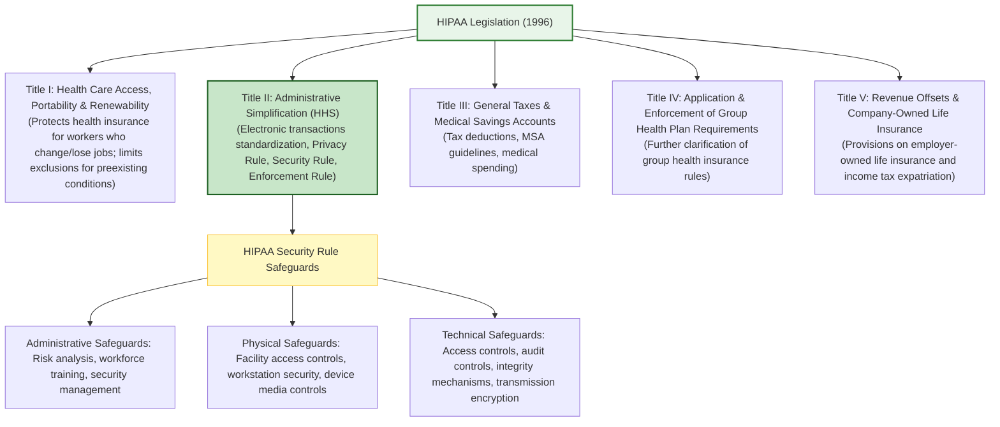

#### Key Components of Title II:
- **Privacy Rule**: Defines national standards for when protected health information can be disclosed and establishes patient rights over their health information. Prohibits healthcare personnel from disclosing patient identities over the phone to unauthorized family members.
- **Security Rule**: Mandates administrative, physical, and technical safeguards to protect electronic PHI (ePHI). Requires robust encryption for data at rest and in transit.
- **HITECH Act (Health Information Technology for Economic and Clinical Health Act of 2009)**:
  - Dramatically expanded HIPAA enforcement, introducing mandatory breach notification regulations requiring covered entities to report data breaches affecting 500+ individuals to the HHS and media.
  - Extended direct legal liability for HIPAA compliance to **Business Associates** (third-party service providers, including cloud vendors).

#### AWS and HIPAA: The Business Associate Addendum (BAA)
AWS is not a covered entity itself, but acts as a Business Associate when customers process, store, or transmit ePHI in the cloud. 
- Customers can execute an online **AWS Business Associate Addendum (BAA)** directly via **AWS Artifact Agreements**.
- Once executed, customers may use **HIPAA-eligible AWS services** (e.g., Amazon S3, Amazon EC2, Amazon RDS, AWS KMS) to process and store ePHI, provided they configure adequate encryption, logging, and access control.

---

### 3.4 Government and Defense Standards: FedRAMP & FISMA

#### FISMA (Federal Information Security Modernization Act)
A US federal law requiring federal agencies to develop, document, and implement an agency-wide program to provide information security for the operations and assets supporting the agency. FISMA relies on the **NIST SP 800-53** security control catalog and categorizes systems under **FIPS 199** into Low, Moderate, or High impact.

#### FedRAMP (Federal Risk and Authorization Management Program)
FedRAMP is a US government-wide program that standardizes the approach to security assessment, authorization, and continuous monitoring for cloud products and services:
- **"Do Once, Use Many Times"**: Once a Cloud Service Provider (CSP) achieves a FedRAMP Authorization through an accredited Third-Party Assessment Organization (3PAO), multiple federal agencies can leverage that authorization without re-auditing the CSP from scratch.
- **Baselines**:
  - *FedRAMP Low*: Non-sensitive public information.
  - *FedRAMP Moderate*: Approximately 80% of federal cloud applications; loss of data confidentiality/integrity would have a serious adverse effect.
  - *FedRAMP High*: Highly sensitive, non-classified federal data (e.g., law enforcement, healthcare, financial systems).
- **AWS FedRAMP Status**: AWS holds **FedRAMP High Authorizations** for services within the **AWS GovCloud (US)** Regions and **FedRAMP Moderate Authorizations** in standard commercial AWS US Regions.

---

### 3.5 Privacy and Data Protection Regulations: GDPR, PIPEDA & Global Laws

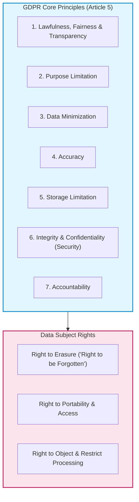

#### GDPR (General Data Protection Regulation - European Union)
Enacted in May 2018, the GDPR represents the world's strictest personal data privacy and security framework:
- **Extra-Territorial Reach**: Applies not only to businesses located in the EU, but to **any organization worldwide** that offers goods/services to EU residents or monitors their behavior.
- **Astronomical Penalties**:
  - *Lower Tier*: Up to €10 Million or 2% of total worldwide annual turnover of the preceding financial year.
  - *Upper Tier (Severe Violations)*: Up to **€20 Million or 4% of total worldwide annual turnover**, whichever is higher.
- **Core Principles (Article 5)**:
  1. *Lawfulness, Fairness, and Transparency*: Valid legal basis for processing; clear notice to subjects.
  2. *Purpose Limitation*: Collected solely for specified, explicit, and legitimate purposes.
  3. *Data Minimization*: Adequate, relevant, and limited to what is strictly necessary.
  4. *Accuracy*: Inaccurate data must be promptly erased or rectified.
  5. *Storage Limitation*: Retained in personally identifiable form no longer than necessary.
  6. *Integrity and Confidentiality*: Strong security, encryption, and protection against unauthorized access or loss.
  7. *Accountability*: The data controller must demonstrate proactive compliance.

#### PIPEDA (Personal Information Protection and Electronic Documents Act - Canada)
The Canadian federal private-sector privacy law governing how commercial organizations collect, use, and disclose personal information:
- **Broad Definition of Personal Information**: Any factual or subjective information, recorded or not, about an identifiable individual (e.g., age, name, ID numbers, income, blood type, disciplinary records, credit records, medical records).
- **Key Tenets & Provisions**:
  1. *Accountability*: Mandatory appointment of a **Chief Privacy Officer (CPO)** to supervise corporate compliance.
  2. *Identifying Purposes & Limiting Collection*: Explicitly specify the purpose prior to collection; collect only necessary data.
  3. *Informed Consent*: Consent must be obtained before or at time of collection; subjects can revoke consent.
  4. *Accuracy & Individual Access*: Individuals have the right to inspect, verify, and dispute the accuracy of their stored records.
  5. *Safeguards & Breach Notification*: Security controls must be proportionate to data sensitivity. Breaches of security safeguards posing a "real risk of significant harm" must be reported immediately to the **Privacy Commissioner of Canada** and affected individuals.

#### Russian Federal Law on Personal Data (Law No. 152-FZ)
- Enacted July 27, 2006, regulating the collection and processing of personal data within the Russian Federation.
- **Key Provisions**: Mandatory express subject consent, right of revocation, and strict requirements for cross-border data transfer (ensuring adequate protection in destination countries). It also includes data localization mandates requiring initial recording, systematization, and storage of Russian citizens' data to take place within databases located physically inside Russia.

#### Other Significant United States Regulatory Frameworks:
- **Sarbanes-Oxley Act (SOX - 2002)**: Protects investors by improving corporate disclosures and internal controls in public corporations. **Section 404** requires management and the independent auditor to attest to the adequacy of internal controls over financial reporting, requiring IT audit trails for all systems touching financial ledgers.
- **Gramm-Leach-Bliley Act (GLBA)**: Requires financial institutions to explain their information-sharing practices to customers and protect sensitive non-public personal financial information via the Safeguards Rule.
- **Dodd-Frank Wall Street Reform Act**: Mandated sweeping regulatory overhauls to stabilize financial markets, requiring comprehensive transaction logging, records retention, and real-time risk transparency.
- **Family Educational Rights and Privacy Act (FERPA)**: Protects the privacy of student educational records in US schools and universities receiving federal funding.
- **FINRA (Financial Industry Regulatory Authority)**: Regulates member brokerage firms and securities exchange markets, enforcing strict electronic record-keeping, audit logs, and communications retention (Rule 4511 / SEC 17a-4).

---

## 🤝 4. Compliance in the AWS Cloud Security Shared Responsibility Model

In traditional on-premises data centers, the customer is exclusively responsible for the entire stack: physical security, perimeter guards, cooling, power generators, raised floors, host hardware, firmware, hypervisors, networking cables, operating systems, and data encryption.

In the AWS Cloud, this burden is bifurcated through the **Shared Responsibility Model for Compliance**:

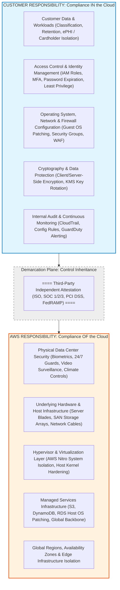

### 4.1 Control Inheritance and Time-to-Compliance
When deploying on AWS, customers **inherit** the compliance posture and physical security certifications established by AWS:
- **Inherited Controls**: Controls fully provided and operated by AWS. Customers do not need to audit or manage data center perimeter fences, biometric badges, backup generators, physical server decommissioning, or hypervisor memory scrubbers. Customers reference AWS's third-party audit reports (e.g., SOC 2, ISO 27001) as evidence for their own auditors.
- **Shared Controls**: Controls that apply to both the infrastructure and the customer workload, but at different operational layers.
  - *Patch Management*: AWS patches hypervisors and managed service host instances; customers patch their EC2 guest operating systems and application runtimes.
  - *Configuration Management*: AWS maintains configurations of network hardware; customers configure virtual networks (VPCs, subnets, route tables, security groups).
  - *Awareness & Training*: AWS trains AWS personnel; customers train their corporate employees.
- **Customer-Specific Controls**: Controls solely within the customer's purview based on their application architecture (e.g., classifying data, defining IAM least-privilege policies, activating S3 bucket encryption, enforcing customer MFA).

> [!TIP]
> **Drastic Cost & Time Reduction**: By inheriting AWS's pre-audited physical and infrastructural controls, organizations reduce their audit scope, preparation time, and third-party audit costs by up to **60–80%** compared to traditional data center audits.

---

## 🏗️ 5. The AWS Risk and Compliance Program: Three Pillars

The internal framework that enables AWS to maintain its global compliance posture across dozens of regions and millions of physical servers consists of three foundational components:

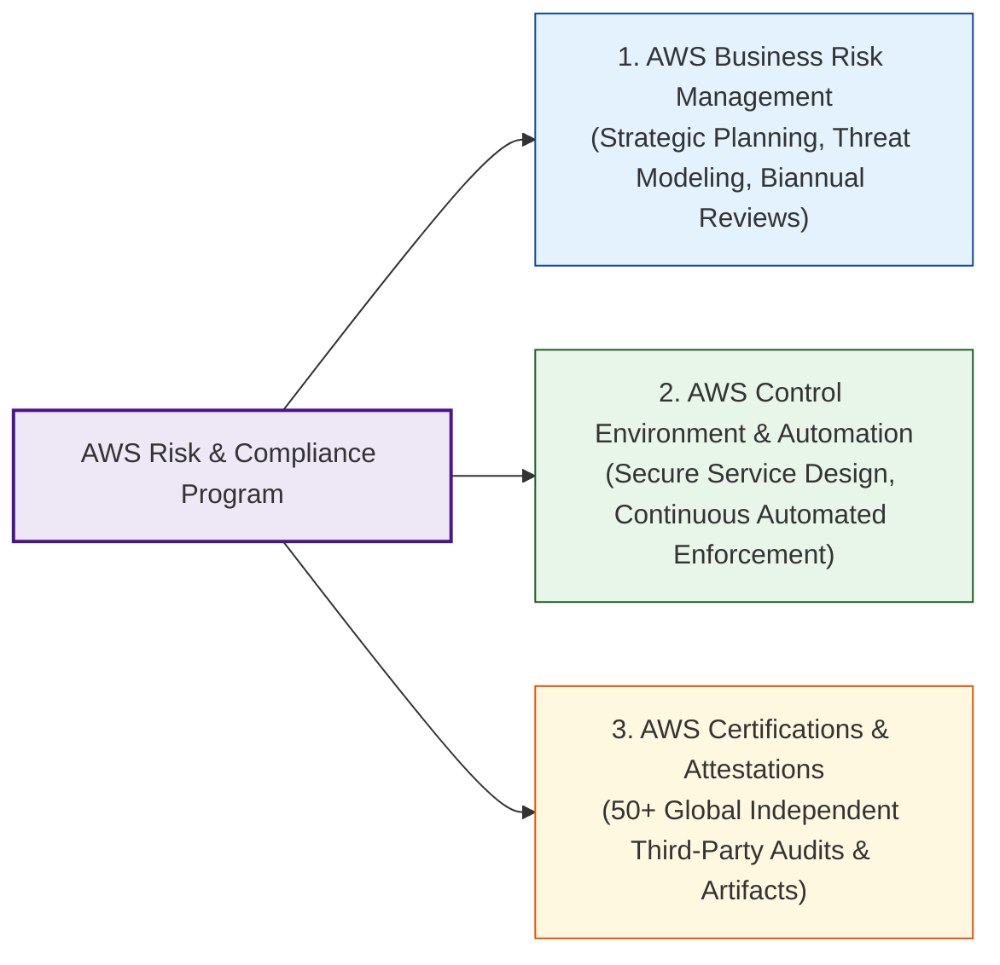

---

### 5.1 Pillar 1: AWS Business Risk Management
AWS leadership treats risk management as an ongoing executive discipline integrated into organizational planning:
- **Strategic Business Plan**: AWS management maintains a comprehensive strategic business plan incorporating formal risk identification and mitigation controls. This plan is **reevaluated at least biannually** (twice a year) to reflect changing threat vectors and geopolitical factors.
- **Risk Identification & Register**: Each functional area of AWS maintains an active register of known risks, assigning risk owners and concrete remediation timelines.
- **Application Security Reviews (AppSec)**: Before any new AWS service offering or feature is launched to the public, it undergoes rigorous application security reviews by internal security teams. These reviews assess data confidentiality, data integrity, service availability, cryptographic boundaries, and adherence to corporate security policies.
- **Continuous Vulnerability Management**: AWS security engineering regularly scans all public-facing service endpoint IP addresses for vulnerabilities. Identified defects are immediately prioritized for engineering remediation.
- **Independent External Assessments**: Outside, accredited security firms regularly perform external threat assessments and penetration tests against AWS infrastructure. Findings are escalated directly to executive leadership to validate underlying platform health.

> [!NOTE]
> **Customer Penetration Testing Policy**: AWS's internal vulnerability scans validate the infrastructure of the cloud. They do *not* replace a customer's obligation to test their own applications. Customers are permitted to conduct security assessments and penetration tests against their own AWS resources (e.g., EC2 instances, RDS databases, API Gateways) without prior authorization from AWS, provided they comply with the **AWS Customer Support Policy for Penetration Testing** and do not target AWS multi-tenant infrastructure.

---

### 5.2 Pillar 2: AWS Control Environment & Automation
AWS embeds security controls directly into the design, release, and operational management of every service:
- **Comprehensive Control Fabric**: The control environment integrates people, policies, processes, and control activities designed to secure the delivery of all AWS services.
- **Proactive Automation**: Repetitive manual human actions inherently introduce variances, misconfigurations, and human error. AWS leverages pervasive software automation to manage server provisioning, configuration drift, cryptographic key rotation, network segmentation, and patch orchestration. This eliminates process deviations and guarantees repeatable security baselines.
- **Integration of Industry Frameworks**: The AWS control framework continuously integrates leading cloud controls identified by industry organizations such as the **Cloud Security Alliance (CSA)**, **NIST**, and **ISO**. AWS actively monitors these bodies to discover emerging best practices and assist customers in structuring their own cloud controls.

---

### 5.3 Pillar 3: AWS Certifications, Attestations & Alignments
AWS participates in **over 50 distinct audit programs** spanning international standards, federal regulations, and industry frameworks. AWS communicates its compliance status through three distinct categories:

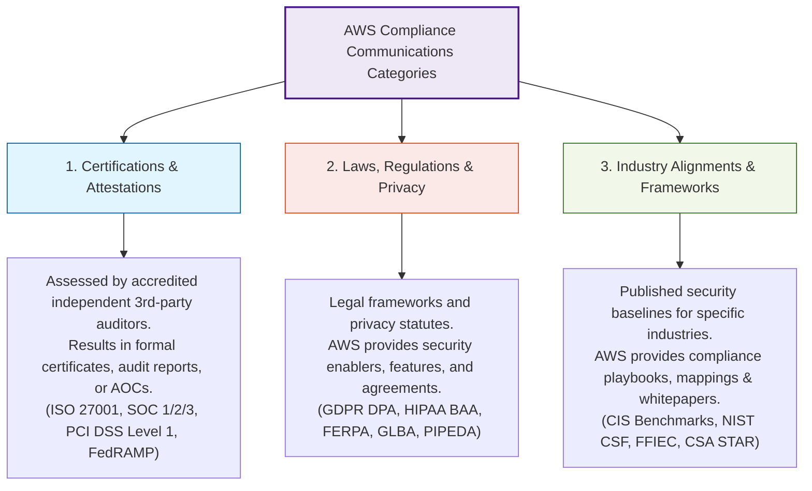

1. **Certifications & Attestations**: Formal assessments conducted by accredited third-party auditing firms resulting in official certifications, audit reports, or formal Attestations of Compliance (AOC). Examples include ISO 27001/27017/27018, SOC 1/2/3, and PCI DSS.
2. **Laws, Regulations & Privacy**: Statutory mandates where customers maintain ultimate legal responsibility, but AWS delivers architectural security features and legal agreements to facilitate compliance. Examples include the **AWS Data Processing Addendum (DPA)** for GDPR and the **Business Associate Addendum (BAA)** for HIPAA.
3. **Industry Alignments & Frameworks**: Industry-specific guidelines, reference architectures, mapping matrices, and technical whitepapers. Examples include mapping AWS controls to the NIST Cybersecurity Framework, FFIEC architecture books, and the CIS AWS Foundations Benchmark.

---

## 📂 6. AWS Artifact: Self-Service Compliance Portal

Enterprise compliance audits require continuous, verifiable evidence. Previously, obtaining third-party compliance reports required manual procurement processes, weeks of legal correspondence, and individual non-disclosure agreements.

**AWS Artifact** is a self-service compliance portal available at no additional charge in the AWS Management Console that provides on-demand access to AWS security and compliance reports and select online legal agreements.

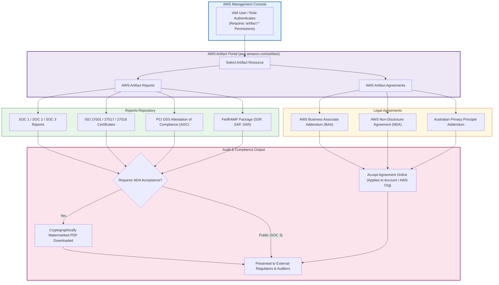

### 6.1 AWS Artifact Reports
**AWS Artifact Reports** serves as the definitive central repository of compliance documentation generated by independent third-party auditors.
- **Available Reports**:
  - AICPA SOC 1, SOC 2, and SOC 3 reports.
  - ISO/IEC 27001, 27017, and 27018 certificates and statement of applicability.
  - PCI DSS Attestation of Compliance (AOC) and Responsibility Summaries.
  - FedRAMP System Security Plan (SSP) and Security Assessment Reports (SAR).
  - Regional reports: German BSI C5, Spanish ENS, Singapore SS 584 (MTCS).
- **Watermarking & Security**: When a user downloads a confidential report, AWS dynamically generates a uniquely watermarked PDF containing the customer's account ID and timestamp, reminding recipients that the document is protected under confidentiality restrictions.

### 6.2 AWS Artifact Agreements
**AWS Artifact Agreements** allows organizations to review, accept, manage, and terminate legally binding agreements between their AWS account (or entire AWS Organization) and AWS:
- **Key Agreements Available**:
  - **Business Associate Addendum (BAA)**: Mandatory contract under HIPAA permitting healthcare companies to process and store ePHI in HIPAA-eligible AWS services.
  - **AWS Nondisclosure Agreement (NDA)**: Enables customers to review confidential AWS documentation without executing paper contracts.
- **Scope Options**:
  - *Account-Level Agreement*: Applies solely to the current AWS account.
  - *Organization-Level Agreement*: An authorized AWS Organizations Management Account administrator can accept an agreement on behalf of **all existing and future member accounts** across the enterprise in a single action.

### 6.3 Step-by-Step Guide: Accessing AWS Artifact

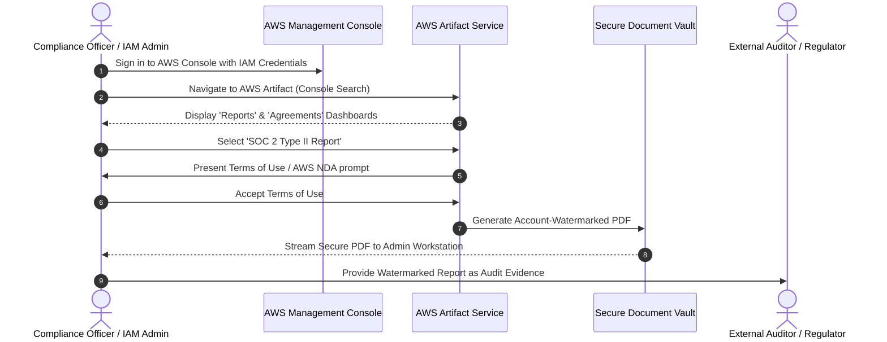

1. **Prerequisites & IAM Permissions**: To access Artifact, an IAM identity must possess explicit IAM permissions (e.g., policy actions `artifact:Get*`, `artifact:Download*`, `artifact:AcceptAgreement`).
2. **Accessing Reports**:
   - Open the AWS Management Console and search for **Artifact**.
   - Under the **Reports** tab, filter by standard name (e.g., "SOC", "PCI", "ISO").
   - Click the desired report title. Review the summary and click **Download report**.
   - If prompted, accept the non-disclosure terms. Save the account-watermarked PDF.
3. **Accepting an Agreement (e.g., HIPAA BAA)**:
   - In AWS Artifact, select the **Agreements** tab.
   - Choose **Business Associate Addendum (BAA)**.
   - Review the legal terms. Select **Accept BAA for this account** or **Accept BAA for this organization**.
   - The status updates immediately to **Active**, providing audit-ready legal validation.

---

## 🏛️ 7. Customer Compliance Governance Framework

AWS manages and validates the infrastructure, but customers are ultimately responsible for maintaining adequate governance over their entire cloud IT control environment. The following four-phase governance lifecycle guarantees an airtight, audit-ready compliance posture:

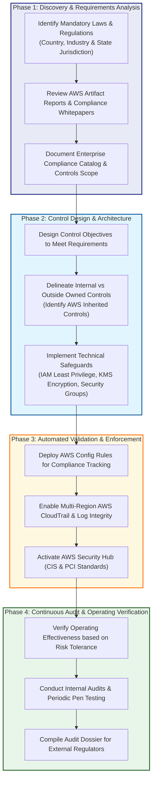

### The 4-Step Customer Implementation Methodology:

1. **Step 1: Understand Compliance Objectives and Scope**:
   - Review relevant statutory laws, industry regulations, and customer SLAs applicable to your business vertical.
   - Access **AWS Artifact** to study AWS's existing certifications and determine which infrastructure controls are fully inherited.
   - Formally document the regulatory boundary and identify which data types (e.g., PII, ePHI, cardholder data) reside in your AWS environment.
2. **Step 2: Design and Implement Control Objectives**:
   - Create enterprise cloud policies reflecting required baselines (e.g., mandatory encryption at rest using AWS KMS, compulsory MFA for all IAM users).
   - Design network topologies that isolate compliance-sensitive workloads (e.g., dedicated VPCs for PCI cardholder data environments).
   - Configure technical enforcement using AWS Organizations **Service Control Policies (SCPs)** to prevent insecure configurations (such as blocking public S3 buckets).
3. **Step 3: Identify and Document Controls Owned by Outside Parties**:
   - Clearly delineate controls owned by AWS (physical security, virtualization isolation) versus controls owned by third-party SaaS vendors.
   - Collect and archive AWS SOC 2 Type II reports and ISO 27001 certificates from AWS Artifact to bridge third-party audit requirements.
4. **Step 4: Verify Operating Effectiveness of Controls**:
   - Understand the level of validation required based on your organization's risk tolerance.
   - Implement continuous auditing using **AWS Config** to track configuration history and automatically flag non-compliant resources against regulatory frameworks (e.g., AWS Config Conformance Packs for PCI DSS or HIPAA).
   - Use **AWS Security Hub** to aggregate security findings and track compliance scores against the CIS AWS Foundations Benchmark and AWS Foundational Security Best Practices.
   - Maintain immutable, tamper-evident API logging across all AWS accounts via **AWS CloudTrail** with S3 Object Lock and CloudWatch Alarms.

---

## 📊 8. Comprehensive Framework Comparison Matrix

The table below contrasts the major compliance frameworks and illustrates how AWS supports each standard:

| Standard / Framework | Governing Body | Primary Focus & Domain | Mandatory or Voluntary | AWS Status & Support Capabilities |
| :--- | :--- | :--- | :--- | :--- |
| **ISO/IEC 27001** | ISO / IEC | Information Security Management System (ISMS) across all operations. | Voluntary (Mandated by many enterprise clients). | Certified across all AWS Regions; certificate downloadable in AWS Artifact. |
| **ISO/IEC 27017** | ISO / IEC | Cloud-specific security controls for cloud providers and customers. | Voluntary (Industry best practice). | AWS is certified; provides cloud security control alignment guidance. |
| **ISO/IEC 27018** | ISO / IEC | Protection of Personally Identifiable Information (PII) in public clouds. | Voluntary (Global privacy best practice). | AWS is certified; guarantees zero use of customer data for advertising. |
| **SOC 1 (SSAE 18)** | AICPA | Internal controls impacting financial reporting (ICFR). | Contractual / Commercial requirement for publicly traded firms. | AWS undergoes biannual audits; Type II report available in AWS Artifact under NDA. |
| **SOC 2 Type II** | AICPA | Technical controls: Security, Availability, Integrity, Confidentiality, Privacy. | Commercial baseline for B2B SaaS and enterprise vendors. | AWS issues comprehensive biannual Type II reports available via AWS Artifact. |
| **SOC 3** | AICPA | Public summary of SOC 2 security and availability controls. | Voluntary public assurance. | Publicly downloadable from AWS website without requiring AWS login or NDA. |
| **PCI DSS v4.0** | PCI SSC | Security of credit/debit card transactions and cardholder data (CDE). | Mandatory for all merchants and processors handling card data. | AWS is a certified **PCI DSS Level 1 Service Provider**; Attestation of Compliance (AOC) in Artifact. |
| **HIPAA / HITECH** | US HHS | Security and privacy of Protected Health Information (PHI / ePHI). | Mandatory for US Healthcare Covered Entities and Business Associates. | AWS offers execute-ready **Business Associate Addendum (BAA)** in Artifact Agreements. |
| **FedRAMP** | US GSA / FedRAMP PMO | Security assessment and continuous monitoring for US federal agencies. | Mandatory for cloud systems serving US federal government data. | AWS holds **FedRAMP High Authorization** in GovCloud and **FedRAMP Moderate** in commercial regions. |
| **GDPR** | European Union | Privacy, data subject rights, and security for EU residents' personal data. | Mandatory for any global entity processing personal data of EU residents. | AWS complies fully; offers an online **GDPR Data Processing Addendum (DPA)** with Standard Contractual Clauses. |
| **PIPEDA** | Office of the Privacy Commissioner of Canada | Collection, use, and disclosure of personal data by Canadian private sector. | Mandatory for Canadian commercial organizations. | AWS architectures support all 10 PIPEDA Fair Information Principles; Montreal and Calgary Regions enable data residency. |

---

## 💡 Review Questions & Checkpoints

Test your mastery of the AWS Security Compliance Program with these scenario-based review questions:

### Question 1: Fundamental Goal of Security Compliance
**Prompt**: What is the primary objective of security compliance within an enterprise cloud architecture?  
**Answer**:  
Security compliance ensures that an organization's administrative, technical, and physical security controls satisfy applicable **regulatory requirements** (statutory laws, federal standards) and **contractual obligations** (SLAs, PLAs, vendor agreements). It provides auditable evidence that systems maintain required confidentiality, integrity, availability, and privacy baselines.

---

### Question 2: Scope of PCI DSS
**Prompt**: What specific data and transactions does the Payment Card Industry Data Security Standard (PCI DSS) protect, and what is AWS's role under this framework?  
**Answer**:  
The PCI DSS protects payment card transactions, specifically safeguarding **Cardholder Data (CHD)**—including the Primary Account Number (PAN), cardholder name, expiration date, and service code—and **Sensitive Authentication Data (SAD)** like CVV/CVC codes and PINs. AWS is certified as a **PCI DSS Level 1 Service Provider**, meaning AWS infrastructure, physical security, and virtualization controls satisfy PCI requirements. Customers inherit this baseline but remain responsible for securing their own applications, databases, and network configurations in the cloud.

---

### Question 3: Core Purpose of the AWS Risk & Compliance Program
**Prompt**: What is the primary goal of the AWS Risk and Compliance Program from a customer's perspective?  
**Answer**:  
One primary goal of the AWS Risk and Compliance Program is to provide customers with **transparent, verified information about AWS's internal security controls**. This allows customers to incorporate AWS's audited controls into their own corporate governance frameworks and establish an end-to-end compliance model that satisfies external auditors.

---

### Question 4: Regulatory Penalties vs. Best Practices
**Prompt**: An enterprise fails to implement encryption on customer data. How do the consequences differ if this failure violates a mandatory government law (such as GDPR) versus an optional industry best practice (such as a CIS Benchmark)?  
**Answer**:  
- *Government Law Violation (e.g., GDPR)*: Results in compulsory legal enforcement, including civil litigation, court-ordered injunctions, criminal charges against corporate officers, and severe statutory fines (up to €20M or 4% of global annual turnover).
- *Best Practice Violation (e.g., CIS Benchmark)*: Does not trigger direct statutory fines, but can lead to commercial penalties, failing vendor security reviews, disqualification from enterprise contracts, higher cybersecurity insurance rates, and a demonstrated failure of "due care" in liability lawsuits.

---

### Question 5: Utilizing AWS Artifact for Healthcare (HIPAA) Compliance
**Prompt**: A hospital network wants to build a patient portal on AWS that will store electronic Protected Health Information (ePHI). What two actions must the hospital take in AWS Artifact before migrating patient data?  
**Answer**:  
1. **Accept the AWS Business Associate Addendum (BAA)**: Navigate to **AWS Artifact Agreements** and review and accept the BAA at either the account or organization level, which establishes the legal framework required by HIPAA for AWS to act as a Business Associate.
2. **Download Compliance Reports for Audit Dossier**: Access **AWS Artifact Reports** to download the latest **SOC 2 Type II** and **ISO 27001** reports to document that the underlying AWS infrastructure meets HIPAA administrative and physical safeguard requirements.

---

## 📌 Key Takeaways

- **Security Compliance Is a Business Enabler**: Compliance ensures technical controls meet mandatory legal rules and contractual commitments, protecting enterprises from severe regulatory fines, loss of merchant processing abilities, and reputational collapse.
- **Shared Responsibility Extends to Compliance**: In the AWS Cloud, compliance is shared. AWS manages the security and compliance *OF* the cloud (physical infrastructure, hypervisors, hardware). The customer is responsible for compliance *IN* the cloud (data classification, customer IAM, OS patching, encryption, firewall configuration).
- **Control Inheritance Drastically Reduces Audit Scope**: Customers inherit dozens of pre-audited global certifications (ISO 27001, SOC 1/2/3, PCI DSS Level 1, FedRAMP High), allowing them to focus resources on securing their own cloud workloads.
- **The AWS Risk and Compliance Program Rests on Three Pillars**:
  1. *AWS Business Risk Management*: Biannual executive risk re-evaluations, threat modeling, AppSec reviews, and independent external assessments.
  2. *AWS Control Environment & Automation*: Designing security into every service and leveraging automation to prevent human configuration errors.
  3. *AWS Certifications & Attestations*: Maintaining 50+ third-party audit programs and industry alignments.
- **AWS Artifact Is the Self-Service Gateway**: AWS Artifact provides instant, on-demand, free access to cryptographically watermarked compliance reports (SOC, ISO, FedRAMP) and legally binding agreements (HIPAA BAA, AWS NDA) across individual accounts or entire AWS Organizations.
- **Continuous Customer Governance Is Imperative**: Organizations must adopt a 4-phase governance cycle: understand objectives, design controls, identify inherited external controls, and continuously verify operational effectiveness using tools like AWS Config, AWS Security Hub, and AWS CloudTrail.
