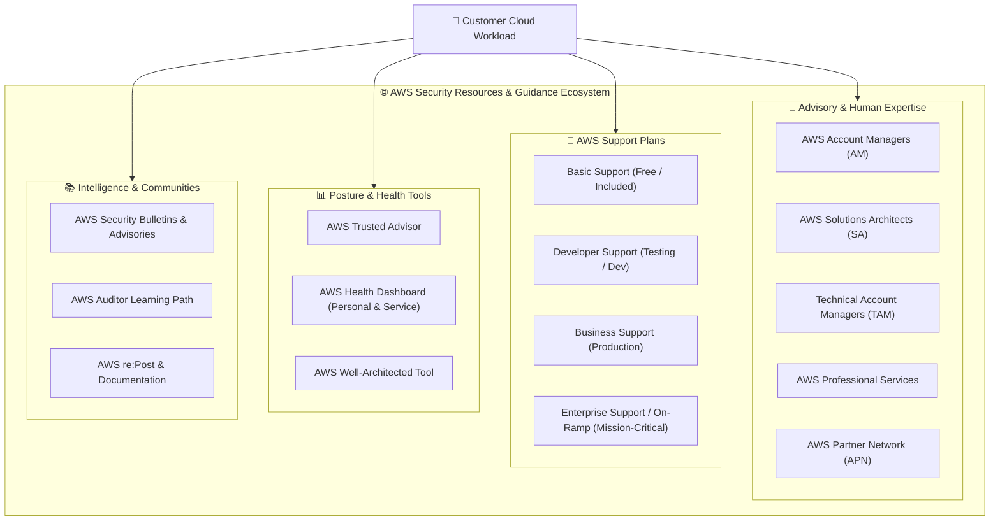
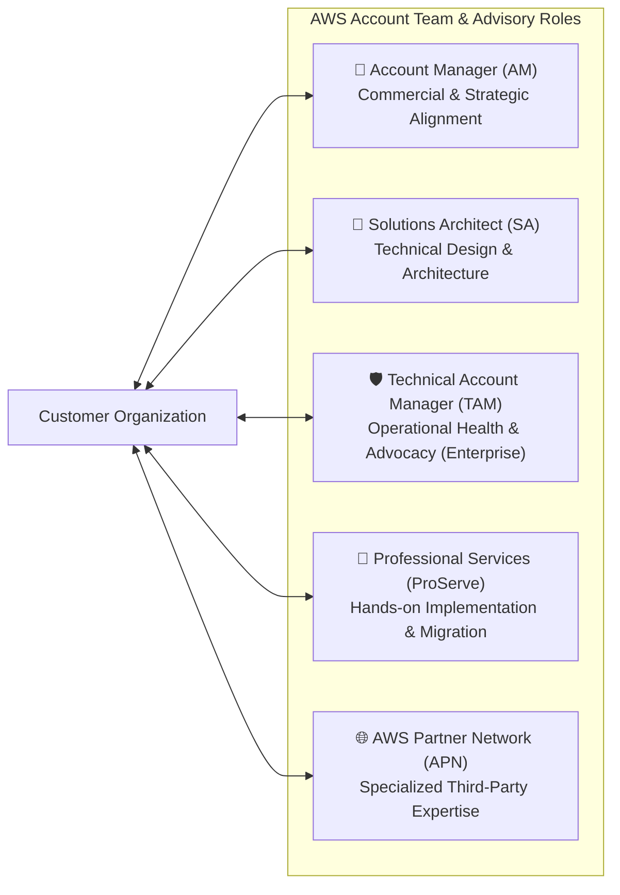
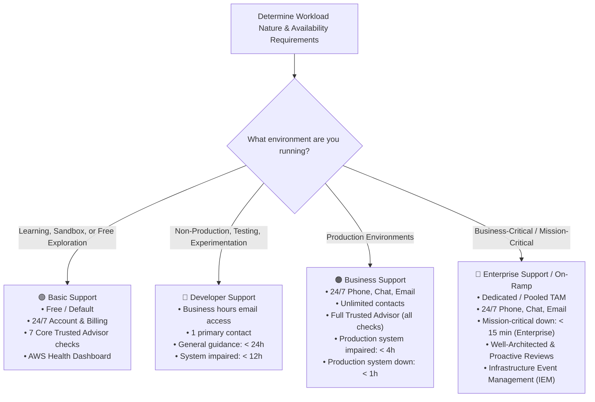
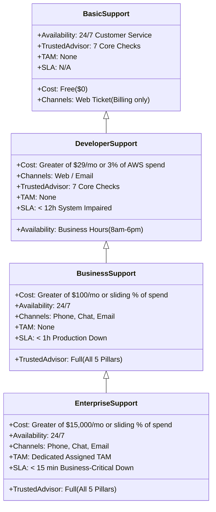
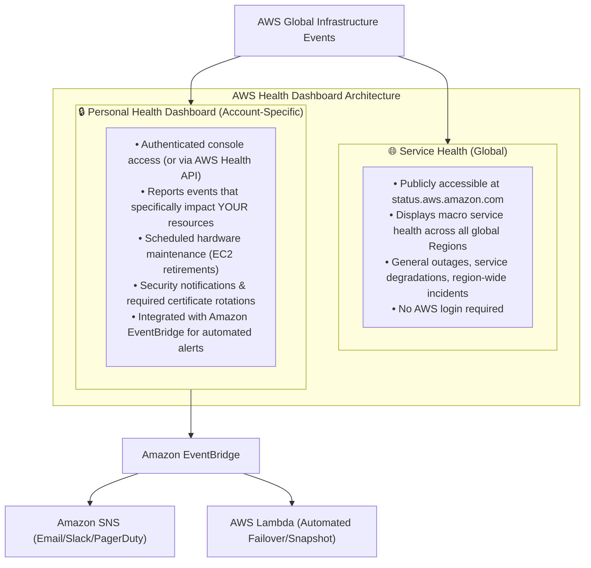
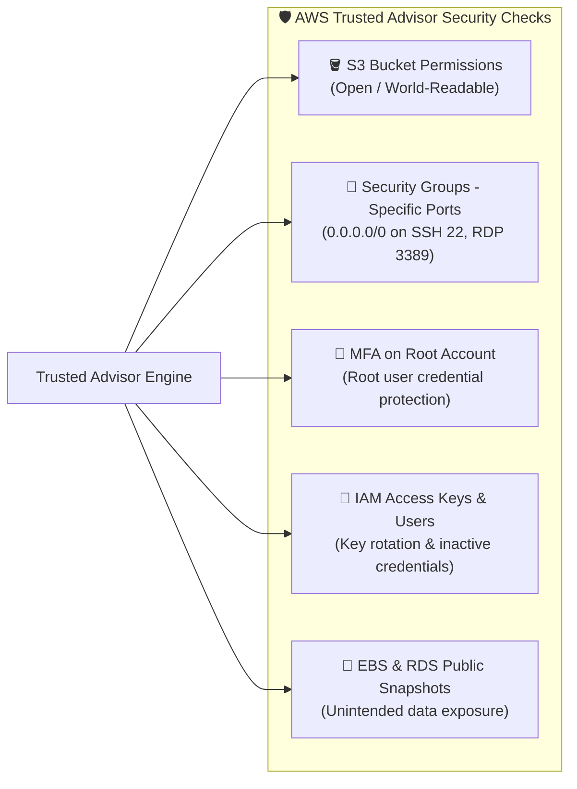
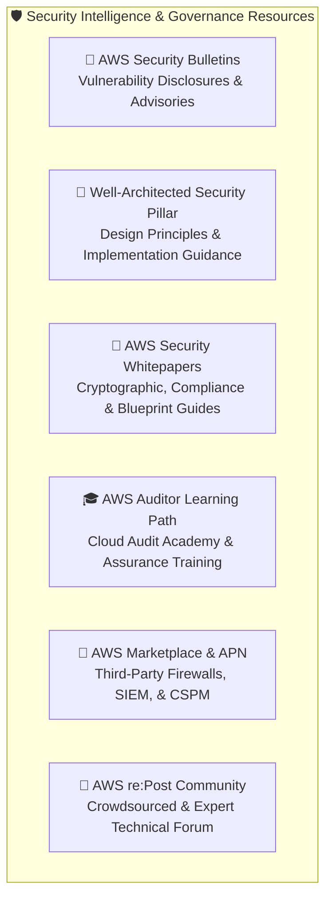
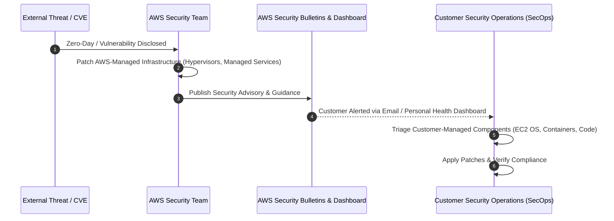
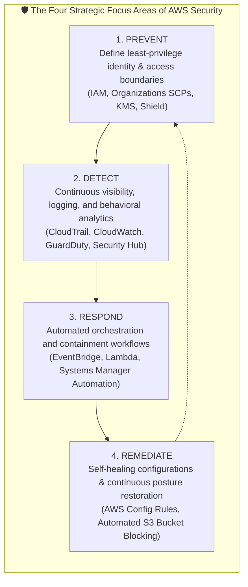

# 🛡️ AWS Security Resources: Support Plans, Guidance Ecosystem & Compliance Tools

> **Course**: AWS re/Start  
> **Module**: Security (M04 – AWS Security Resources)  
> **Source Document**: `T08-Security/T08-0019-RSSECY_EN-US_SG_M04_AWSSECURITYRESOURCES.pdf`  
> **Target Audience**: AWS re/Start Learners, Cloud Practitioners, Security Specialists, and Cloud Solutions Architects  

---

## 🎯 Module Overview

Securing workloads in the cloud is not a solitary effort. While the AWS Shared Responsibility Model establishes the division of obligations between AWS and the customer, navigating complex security architectures, achieving regulatory compliance, and rapidly remediating vulnerabilities requires access to expert guidance, specialized support tiers, and robust operational tooling.

Amazon Web Services (AWS) provides a multi-layered ecosystem of resources designed to assist organizations of all sizes—from individual developers to global enterprises running top-secret government workloads. These resources span human advisory teams (such as Solutions Architects and Technical Account Managers), structured AWS Support plans with guaranteed Service Level Agreements (SLAs), real-time operational posture tools (such as AWS Health Dashboard and AWS Trusted Advisor), proactive vulnerability advisories, and extensive partner ecosystems.

This comprehensive guide examines the full spectrum of AWS security resources, detailing account team structures, tier-by-tier support comparisons, real-time health and posture monitoring, security advisories, compliance learning paths, and strategic cloud defense benefits.



---

## 📌 Learning Objectives

By completing this module and reviewing these study materials, you will be able to:

- [ ] **Analyze the AWS Guidance Ecosystem**: Differentiate the roles and responsibilities of AWS Account Managers (AMs), Solutions Architects (SAs), Technical Account Managers (TAMs), and AWS Professional Services.
- [ ] **Evaluate AWS Support Plans**: Compare Basic, Developer, Business, Enterprise On-Ramp, and Enterprise Support plans across response times, SLAs, architectural reviews, tooling access, and pricing structures.
- [ ] **Differentiate AWS Health Dashboards**: Distinguish between the public Service Health Dashboard (global status) and the authenticated Personal Health Dashboard (account-specific events and alerts).
- [ ] **Leverage AWS Trusted Advisor for Security**: Articulate the role of Trusted Advisor in continuous security posture assessment, comparing core checks against full pillar evaluations.
- [ ] **Utilize Security Intelligence & Advisories**: Understand how to consume AWS Security Bulletins, report abuse and vulnerabilities, and navigate AWS penetration testing policies.
- [ ] **Navigate the AWS Partner Network (APN)**: Distinguish between APN Consulting Partners (System Integrators/MSPs) and APN Technology Partners (ISVs/SaaS vendors).
- [ ] **Explore Specialized Compliance Programs**: Identify how the AWS Auditor Learning Path and Cloud Audit Academy prepare compliance professionals to validate AWS security controls.
- [ ] **Synthesize Core AWS Security Benefits**: Explain the strategic advantages of cloud defense, including security at scale, automated remediation, and top-secret workload certifications.

---

## 1. 👥 AWS Guidance Ecosystem & Account Teams

When designing, migrating, or operating secure workloads on AWS, customers have direct access to expert guidance. AWS structures its human advisory resources into specialized roles that cater to commercial alignment, architectural design, ongoing operational health, and deep implementation consulting.



### 1.1 AWS Account Managers (AM)
The **AWS Account Manager** serves as the primary commercial and business point of contact:
- **Relationship Management**: Acts as the central liaison between the customer organization and AWS business units.
- **Commercial & Contract Alignment**: Assists with billing structures, Enterprise Discount Programs (EDP), Consolidated Billing setups, and Reserved Instance/Savings Plans strategy.
- **Resource Routing**: Identifies business requirements and connects customer leadership with technical specialists, AWS training consultants, and partner executives.

### 1.2 AWS Solutions Architects (SA)
The **AWS Solutions Architect** is a dedicated technical advisor focused on architectural excellence:
- **Architecture Reviews**: Evaluates customer system architectures against the **AWS Well-Architected Framework**, specifically evaluating the Security Pillar.
- **Proof-of-Concept Guidance**: Recommends cloud-native design patterns, reference architectures, and AWS best practices for identity federation, data encryption, and zero-trust networking.
- **Non-Billable Advisory**: SAs do not write production application code or manage day-to-day operations; their mission is consultative architectural guidance and technical enablement.

### 1.3 Technical Account Managers (TAM)
The **Technical Account Manager** is a senior technical advocate assigned exclusively to customers on **Enterprise Support** (dedicated TAM) and **Enterprise On-Ramp** (pooled TAM):
- **Operational Health**: Proactively monitors customer workload health, tracks support cases, coordinates root-cause analyses (RCAs), and leads regular operational reviews.
- **Security Posture Governance**: Reviews Trusted Advisor recommendations, guides compliance initiatives, and coordinates security reviews prior to high-profile launches.
- **Event Planning**: Orchestrates **AWS Infrastructure Event Management (IEM)** to prepare systems for peak traffic events (such as Prime Day or Black Friday), ensuring capacity and security protections are verified.
- **Concierge Support Escalation**: Serves as the primary operational escalation point for critical technical issues.

### 1.4 AWS Professional Services (AWS ProServe) & APN
When customers require hands-on implementation, migration execution, or custom engineering beyond consultative advice:
- **AWS Professional Services**: A global team of AWS experts who collaborate alongside customer teams and partners on formal consulting engagements. ProServe specializes in complex cloud transformations, automated governance frameworks, Landing Zone designs, and stringent regulatory compliance implementations (e.g., FedRAMP, HIPAA, PCI DSS).
- **AWS Partner Network (APN)**: A worldwide community of vetted third-party partners:
  - **APN Consulting Partners**: System integrators (SIs), strategic consultancies, and Managed Service Providers (MSPs) who architect, build, migrate, and operate customer workloads on AWS.
  - **APN Technology Partners**: Independent Software Vendors (ISVs) and Software-as-a-Service (SaaS) providers whose security software (e.g., next-generation firewalls, SIEM platforms, endpoint protection) runs natively on or integrates with AWS.

| Advisory Role | Primary Focus | Technical vs Commercial | Primary Support Plan Requirement |
| :--- | :--- | :--- | :--- |
| **Account Manager (AM)** | Contract, billing, organizational strategy, and resource connection | Commercial & Relationship | Included for all managed accounts |
| **Solutions Architect (SA)** | Architecture design, Well-Architected reviews, reference blueprints | Technical (Consultative) | Included for managed accounts |
| **Technical Account Manager (TAM)** | Operational health, proactive monitoring, incident escalation, IEM | Technical & Operational | Enterprise Support (Dedicated) / Enterprise On-Ramp (Pooled) |
| **AWS Professional Services** | Custom project delivery, security automation code, enterprise migrations | Technical (Implementation) | Billable Statement of Work (SOW) |
| **APN Consulting Partners** | Third-party managed services, hands-on development, staff augmentation | Technical & Operational | Contracted directly with Partner |

---

## 2. 🎫 AWS Support Plans: In-Depth Comparison

AWS offers four primary support tiers tailored to varying organizational needs: **Basic**, **Developer**, **Business**, and **Enterprise Support** (along with an intermediate **Enterprise On-Ramp** tier). Support plans apply at the AWS account level or across an entire AWS Organization via consolidated billing.



### 2.1 Basic Support Plan
- **Target Audience**: All AWS account holders; active by default at zero cost.
- **Scope & Access**:
  - 24/7 access to customer service, billing inquiries, and account-level support.
  - Access to AWS Documentation, technical whitepapers, and knowledge center articles.
  - Full access to the public AWS Service Health Dashboard and account-specific Personal Health Dashboard.
  - Access to the **7 core AWS Trusted Advisor checks** (cost, security, performance, fault tolerance, and service limits).
  - Access to community support via **AWS re:Post**.
- **Limitations**: No technical case creation; no access to Cloud Support Engineers for technical troubleshooting.

### 2.2 Developer Support Plan
- **Target Audience**: Developers, students, and organizations evaluating AWS or running non-production development, testing, and experimentation workloads.
- **Technical Support Channels**:
  - One primary contact can open an unlimited number of technical support cases.
  - Communication channel: **Email only** during standard local business hours (typically 8:00 AM to 6:00 PM customer local time, Monday through Friday).
- **Service Level Agreements (SLAs)**:
  - **General guidance**: < 24 business hours.
  - **System impaired**: < 12 business hours.
- **Tooling & Guidance**: Architectural building block guidance on how services fit together; core Trusted Advisor checks.

### 2.3 Business Support Plan
- **Target Audience**: Organizations running production workloads that demand 24/7 operational resilience.
- **Technical Support Channels**:
  - Unlimited registered contacts and unlimited technical support cases.
  - Communication channels: **24/7 phone, live chat, and web-based email** directly with Cloud Support Engineers.
- **Service Level Agreements (SLAs)**:
  - **General guidance**: < 24 hours.
  - **System impaired**: < 12 hours.
  - **Production system impaired**: < 4 hours.
  - **Production system down**: < 1 hour.
- **Tooling & Guidance**:
  - **Full AWS Trusted Advisor**: Access to all checks across all five categories, including real-time security alerts and service limit monitoring.
  - **Third-Party Software Support**: Troubleshooting assistance for common operating systems (Linux, Windows Server) and software stack components (Apache, Nginx, SQL Server, MySQL).
  - **AWS Support API**: Programmatic case creation, tracking, and Trusted Advisor automation.

### 2.4 Enterprise On-Ramp & Enterprise Support Plans
- **Target Audience**: Organizations running business-critical and mission-critical cloud deployments where outages directly result in catastrophic financial or reputational loss.
- **Key Enhancements (Enterprise Support)**:
  - **Dedicated Technical Account Manager (TAM)**: An assigned, senior AWS engineer intimately familiar with the customer's architecture and operational goals.
  - **Concierge Support Team**: Dedicated billing and operational specialists who handle complex enterprise billing, invoice consolidation, and license agreements.
  - **Sub-15 Minute Response Time**: Guaranteed < 15-minute response for business-critical system down scenarios, with immediate escalation to senior engineering.
  - **Infrastructure Event Management (IEM)**: Structured architectural readiness assessments and dedicated real-time support during high-traffic go-live events.
  - **Proactive Consultative Engagements**: Well-Architected Framework reviews, operational health reviews, disaster recovery drills, and security workshops.



### 2.5 Master Comparison Matrix: AWS Support Tiers

| Feature / Dimension | Basic Support | Developer Support | Business Support | Enterprise On-Ramp | Enterprise Support |
| :--- | :--- | :--- | :--- | :--- | :--- |
| **Recommended Use Case** | Account setup, exploration, sandboxes | Non-production testing and development | Production workloads | Business-critical enterprise workloads | Mission-critical enterprise operations |
| **Pricing Baseline** | Free ($0) | Starting at $29/mo (or 3% of AWS usage) | Starting at $100/mo (tiered % of usage) | Starting at $5,500/mo (tiered % of usage) | Starting at $15,000/mo (tiered % of usage) |
| **Technical Support Hours** | None (Customer service / billing only) | Business hours (local time) | 24/7/365 | 24/7/365 | 24/7/365 |
| **Access Channels** | Support ticketing for billing | Web / Email | Phone, Live Web Chat, Web Ticket | Phone, Live Web Chat, Web Ticket | Phone, Live Web Chat, Web Ticket |
| **Number of Contacts** | Unlimited (billing) | 1 primary contact | Unlimited contacts | Unlimited contacts | Unlimited contacts |
| **Response Times (SLAs)** | | | | | |
| • *General Guidance* | N/A | < 24 business hours | < 24 hours | < 24 hours | < 24 hours |
| • *System Impaired* | N/A | < 12 business hours | < 12 hours | < 12 hours | < 12 hours |
| • *Production System Impaired* | N/A | N/A | < 4 hours | < 4 hours | < 4 hours |
| • *Production System Down* | N/A | N/A | < 1 hour | < 1 hour | < 1 hour |
| • *Business-Critical Down* | N/A | N/A | N/A | < 30 minutes | **< 15 minutes** |
| **AWS Trusted Advisor** | 7 core checks | 7 core checks | **Full checks (all categories)** | **Full checks (all categories)** | **Full checks (all categories)** |
| **Technical Account Manager (TAM)** | None | None | None | Pooled TAM team | **Dedicated TAM** |
| **Concierge Support** | None | None | None | Concierge Support team | **Concierge Support team** |
| **Infrastructure Event Management** | None | None | Billable per event | 1 event included per year | **Included** |
| **AWS Support API Access** | No | No | Yes | Yes | Yes |

> [!IMPORTANT]
> **Production Down vs Business-Critical Outage SLAs**:  
> Notice that **Business Support** covers production system outages down to a **1-hour SLA**. However, the highest urgency tier—**Business-Critical or Mission-Critical Down (< 15 minutes)**—is strictly reserved for **Enterprise Support** (and < 30 minutes for Enterprise On-Ramp). In certification exams and operational planning, remember that a dedicated TAM and 15-minute response times require Enterprise Support.

---

## 3. 📊 Health, Posture & Continuous Monitoring Tools

To maintain security posture and ensure continuous availability, AWS provides automated monitoring tools that evaluate infrastructure status, identify security vulnerabilities, and monitor global cloud service availability.

### 3.1 AWS Health Dashboard: Personal vs Service Health

The **AWS Health Dashboard** is the single source of truth for visibility into AWS health events. It is composed of two distinct operational views:



#### 1. Service Health (Global AWS Status)
- **Scope**: Public, high-level operational status of all AWS services across all commercial and specialty regions worldwide.
- **Access**: Publicly accessible without logging into an AWS account at `https://health.aws.amazon.com/health/status`.
- **Use Case**: Quick verification if a macro-level outage or regional network disruption is affecting AWS infrastructure globally.

#### 2. Personal Health Dashboard (Account-Specific Health)
- **Scope**: Personalized, authenticated view of events and notifications that directly impact the specific AWS resources running within the customer's account.
- **Key Categories**:
  - **Open Issues**: Real-time service issues directly affecting EC2 instances, EBS volumes, or RDS databases in your account.
  - **Scheduled Changes**: Advanced notices of maintenance events, such as underlying hardware maintenance, EC2 instance retirements, or scheduled RDS database engine upgrades.
  - **Other Notifications**: Security notices, end-of-life runtime deprecations (e.g., Python/Node.js Lambda runtime deprecations), and API version retirements.
- **Automation Integration**: Emits events to **Amazon EventBridge**, enabling automated incident ticketing (e.g., Jira, ServiceNow), notifications (Slack, PagerDuty), or automated response scripts via **AWS Lambda**.

> [!NOTE]
> **API Access Requirement**: While the Personal Health Dashboard console is free for all tiers, programmatic access via the **AWS Health API** requires a **Business, Enterprise On-Ramp, or Enterprise Support plan**.

---

### 3.2 AWS Trusted Advisor in Continuous Security & Compliance

**AWS Trusted Advisor** functions as an automated cloud consultant, continuously evaluating your provisioned AWS environment against AWS best practices across five core categories:

1. **Cost Optimization** (e.g., idle resources, unattached EBS volumes, underutilized EC2 instances).
2. **Performance** (e.g., high utilization, DNS configuration, CloudFront content delivery).
3. **Security** (e.g., unprotected S3 buckets, unrestricted security groups, root MFA).
4. **Fault Tolerance** (e.g., multi-AZ deployments, auto-scaling configurations, automated backups).
5. **Service Limits (Service Quotas)** (e.g., usage approaching VPC, Elastic IP, or EC2 instance limits).



#### Core Security Checks vs Full Suite
- **Basic & Developer Plans**: Include core security checks at no charge:
  - *S3 Bucket Permissions*: Checks for public read/write permissions open to the internet.
  - *Security Groups - Specific Ports Unrestricted*: Checks for unrestricted access (`0.0.0.0/0`) on administrative ports such as SSH (port 22) and RDP (port 3389).
  - *MFA on Root Account*: Flags whether multi-factor authentication is configured for the account root user.
  - *IAM Access Key Rotation*: Identifies active access keys that have not been rotated within the past 90 days.
  - *RDS Public Snapshots*: Identifies database snapshots configured with public access.
- **Business & Enterprise Plans**: Unlock the **entire library of 100+ checks**, including:
  - CloudTrail logging coverage across all regions.
  - AWS KMS key rotation status.
  - AWS WAF rule attachment and configuration.
  - Detailed ELB security policies and SSL/TLS cipher suite evaluations.
  - Auto-remediation through Amazon EventBridge rules triggered by Trusted Advisor status changes.

---

## 4. 📚 Additional Security Resources, Communities & Frameworks

Beyond account teams and support plans, AWS provides authoritative publications, incident notification systems, architectural frameworks, and collaborative communities to ensure security posture resilience.



### 4.1 AWS Security Bulletins & Vulnerability Management

AWS maintains an active, public repository of security bulletins and advisories at `https://aws.amazon.com/security/security-bulletins/`.
- **Purpose**: Timely disclosure of security issues, software vulnerabilities, and threats affecting AWS infrastructure, services, or open-source dependencies (e.g., Log4j, OpenSSL, CPU hardware side-channel mitigations like Spectre/Meltdown).
- **Transparency**: Bulletins explain the scope of the vulnerability, AWS's internal patching status across managed services, and specific actions required by customers for unmanaged resources (such as patching guest operating systems in Amazon EC2).



#### Reporting Abuse, Vulnerabilities, and Penetration Testing
- **Reporting Vulnerabilities to AWS**: Security researchers who discover vulnerabilities within AWS services report them via the **AWS Vulnerability Disclosure Program** using PGP-encrypted email to `aws-security@amazon.com`.
- **Reporting AWS Abuse**: If an AWS resource (such as an EC2 instance or S3 bucket) is observed conducting malicious activity (e.g., port scanning, spamming, hosting phishing sites, copyright infringement), it can be reported immediately to the AWS Trust & Safety team via `abuse@amazonaws.com` or web form.
- **AWS Penetration Testing Policy**:
  - AWS permits customers to conduct security assessments and penetration tests against their own provisioned AWS resources for eight authorized services (Amazon EC2, NAT Gateways, ELB, Amazon RDS, Amazon Aurora, Amazon CloudFront, AWS Elastic Beanstalk, and AWS Lambda) **without prior AWS approval**.
  - **Prohibited Activities**: Customers are strictly prohibited from performing Distributed Denial of Service (DDoS) attacks, stress tests, port scanning against non-customer infrastructure, or attacks targeting the underlying physical infrastructure or shared virtualization hypervisors.

> [!CAUTION]
> **Penetration Testing Boundaries**:  
> Even though prior approval is no longer required for authorized services, conducting stress or denial-of-service tests without explicit prior authorization violates the AWS Acceptable Use Policy and can result in immediate account suspension.

---

### 4.2 AWS Well-Architected Tool & The Security Pillar

The **AWS Well-Architected Framework** provides formal architectural methodologies across six pillars: Operational Excellence, Security, Reliability, Performance Efficiency, Cost Optimization, and Sustainability.

The **Security Pillar** focuses on protecting information, systems, and assets while delivering business value through risk assessments and mitigation strategies. It outlines seven design principles:
1. **Implement a strong identity foundation**: Enforce least privilege, centralized identity federation, and multi-factor authentication.
2. **Enable traceability**: Log, monitor, and audit actions across all environments in real time using CloudTrail, CloudWatch, and VPC Flow Logs.
3. **Apply security at all layers**: Employ defense-in-depth across edge networks, VPC perimeters, compute instances, operating systems, and application code.
4. **Automate security best practices**: Implement infrastructure-as-code (IaC) guardrails and automated event-driven remediation.
5. **Protect data in transit and at rest**: Leverage encryption, key management (AWS KMS), tokenization, and strict access policies.
6. **Keep people away from data**: Reduce manual human access to live data storage through automated pipelines and administrative tooling.
7. **Prepare for security events**: Establish incident response plans, runbooks, and automated forensic isolation mechanisms.

The **AWS Well-Architected Tool** in the AWS Console allows teams to evaluate their production workloads against these principles, generating a formal risk assessment and prioritized improvement plan.

---

### 4.3 AWS Auditor Learning Path & Cloud Audit Academy

For professionals working in auditing, risk management, internal controls, and legal compliance, AWS created the **AWS Auditor Learning Path** and the **Cloud Audit Academy (CAA)**.
- **Purpose**: Bridges the knowledge gap between traditional IT auditing standards and modern cloud governance models.
- **Key Concepts Covered**:
  - Demonstrating continuous compliance using AWS Artifact (SOC 1/2/3, PCI DSS, ISO 27001 reports).
  - Leveraging AWS Config and AWS Audit Manager for evidence collection.
  - Auditing cloud identity, cryptographic controls, and network boundaries.
  - Understanding AWS shared assessment models to streamline external audit cycles.

---

### 4.4 AWS Partner Network (APN) & AWS Marketplace

Securing enterprise cloud architectures frequently involves integrating commercial off-the-shelf security tools and engaging specialized systems integrators:
- **AWS Marketplace**: A curated digital catalog of third-party software products that run natively on AWS. Customers can deploy preconfigured security appliances—such as Palo Alto VM-Series firewalls, Fortinet FortiGate, Trend Micro Cloud One, Splunk, Datadog, and CrowdStrike—with unified hourly or annual billing integrated into their AWS invoice.
- **APN Competency Partners**: AWS designates certified partners who demonstrate technical proficiency and proven customer success with the **AWS Security Competency**. These partners specialize in infrastructure protection, identity and access management, vulnerability assessment, compliance, and incident response.

---

### 4.5 AWS re:Post Community
- **What it is**: An AWS-managed, community-driven knowledge platform replacing the legacy AWS Forums.
- **Key Features**: Provides crowd-sourced and AWS-verified answers to technical architectural questions. Community questions that remain unanswered are automatically routed to internal AWS technical teams, ensuring high-quality, verified guidance regardless of whether a user has a paid support tier.

---

## 5. 🚀 Strategic Security Benefits of AWS

What distinguishes AWS security architecture from traditional on-premises enterprise data centers? AWS delivers enterprise-grade security engineered for the world's most demanding financial, healthcare, and national security institutions.



### 5.1 Certified for Top-Secret Workloads
AWS is the first commercial cloud service provider whose infrastructure and operations have been vetted and accredited to host **Top-Secret workloads** (such as the CIA and US Intelligence Community C2S / SC2S regions, and Department of Defense Impact Level 6 workloads). The identical underlying physical security, hypervisor isolation, and operational controls protect everyday commercial customer accounts across standard AWS commercial regions.

### 5.2 The Four Pillars of Strategic Cloud Defense

1. **Prevent (Access Control & Boundary Protection)**:
   - Enforce fine-grained identity boundaries using AWS IAM, Service Control Policies (SCPs), and AWS Secrets Manager.
   - Secure data in transit and at rest with AWS Key Management Service (KMS).
   - Mitigate network-layer and transport-layer DDoS attacks using AWS Shield.

2. **Detect (Continuous Visibility & Threat Detection)**:
   - Maintain comprehensive audit trails using AWS CloudTrail.
   - Detect anomalous behavioral patterns, unauthorized API calls, and compromised credentials with machine learning-powered **Amazon GuardDuty**.
   - Aggregate multi-account compliance findings using **AWS Security Hub**.

3. **Respond (Automated Incident Orchestration)**:
   - Decouple human reaction time from incident response speeds.
   - Utilize **Amazon EventBridge** to detect security anomalies instantly and route notifications to Security Operations Centers (SOCs).
   - Execute automated isolation scripts (e.g., detaching an infected EC2 instance from an Auto Scaling group and attaching an isolated quarantine security group).

4. **Remediate (Continuous Auto-Healing)**:
   - Automatically correct compliance deviations using **AWS Config Rules** paired with AWS Systems Manager Automation runbooks.
   - Example: If an S3 bucket policy is modified to permit public read access, AWS Config detects the compliance violation and invokes a Lambda function to immediately reinstate private bucket ACLs and apply S3 Block Public Access.

### 5.3 On-Premises Security vs AWS Cloud Security

| Security Dimension | Traditional On-Premises Data Center | AWS Cloud Environment |
| :--- | :--- | :--- |
| **Infrastructure Sizing & Scale** | Constrained by physical hardware procurement, racking, and cabling | Instantly scalable; global infrastructure with built-in perimeter DDoS shielding |
| **Compliance Auditing** | Manual, periodic inspections; extensive physical site audits | Automated, continuous compliance reports via AWS Artifact and AWS Config |
| **Patch Management** | Manual patching of hypervisors, firmware, switches, and cooling systems | AWS patches physical infrastructure, firmware, and hypervisors transparently |
| **Threat Detection Speed** | Disjointed log analysis across multiple fragmented appliances | Native, ML-driven threat detection (GuardDuty, Security Hub) across all API calls |
| **Remediation Speed** | Human-driven ticket resolution taking hours or days | Event-driven automated remediation in seconds via EventBridge and Lambda |
| **Capital Investment** | Massive upfront capital expense (CapEx) for physical security appliances | Pay-as-you-go operational model (OpEx) with zero hardware investment |

---

## 📝 Checkpoint Questions & Knowledge Check

Test your understanding of AWS security resources, support plans, and advisory ecosystems with the following scenario-based checkpoint questions.

### Question 1: Support Tier Selection
An organization is migrating its mission-critical online banking application to AWS. The leadership team requires 24/7 access to Cloud Support Engineers via phone, full access to all AWS Trusted Advisor checks, proactive architectural reviews, and an SLA guarantee of **less than 15 minutes** for business-critical outages. Which AWS Support plan is required?

- A) AWS Basic Support
- B) AWS Developer Support
- C) AWS Business Support
- D) AWS Enterprise Support

> [!TIP]
> **Correct Answer: D**  
> **Explanation**: While AWS Business Support provides 24/7 phone/chat/email support and full Trusted Advisor checks, its fastest SLA is 1 hour for production system outages. Only **AWS Enterprise Support** provides a guaranteed response time of **less than 15 minutes** for business-critical outages, along with a dedicated Technical Account Manager (TAM) and proactive Well-Architected reviews.

---

### Question 2: Health Dashboard Operational Distinctions
A systems administrator suspects that an underlying hardware failure in the AWS data center is degrading performance on three Amazon EC2 instances running in their account. Which dashboard should the administrator inspect to see specific maintenance alerts affecting these specific instances?

- A) Global AWS Service Health Dashboard (`status.aws.amazon.com`)
- B) AWS Personal Health Dashboard
- C) AWS Trusted Advisor Cost Optimization Tab
- D) AWS Well-Architected Tool

> [!TIP]
> **Correct Answer: B**  
> **Explanation**: The **Personal Health Dashboard** provides personalized, account-specific alerts and notifications regarding events directly affecting your provisioned resources (such as scheduled EC2 retirements or degraded hardware). The Service Health Dashboard only shows macro-level, region-wide service status across the entire AWS fleet.

---

### Question 3: Advisory Teams & Guidance Roles
An enterprise cloud customer wants continuous operational governance, root-cause analyses on closed support tickets, and an assigned, dedicated advocate within AWS who coordinates launch readiness reviews. Which AWS role performs this function?

- A) AWS Account Manager (AM)
- B) AWS Solutions Architect (SA)
- C) AWS Technical Account Manager (TAM)
- D) AWS Training and Certification Lead

> [!TIP]
> **Correct Answer: C**  
> **Explanation**: The **Technical Account Manager (TAM)** is a dedicated technical advocate assigned to Enterprise Support customers. TAMs monitor operational health, coordinate support escalations, facilitate post-incident reviews, and orchestrate Infrastructure Event Management. Account Managers handle commercial contracts, and Solutions Architects focus on high-level architecture designs.

---

### Question 4: Threat Intelligence & Reporting
Where should a cloud engineer go to review official AWS statements, root cause explanations, and remediation steps regarding newly discovered industry-wide vulnerabilities (such as Log4j or Spectre)?

- A) AWS Security Bulletins and Advisories
- B) AWS Artifact
- C) AWS Trusted Advisor Service Limits Tab
- D) AWS Cloud Audit Academy

> [!TIP]
> **Correct Answer: A**  
> **Explanation**: **AWS Security Bulletins and Advisories** provide official public disclosures of vulnerabilities, threats, and security advisories affecting AWS infrastructure, outlining what AWS has patched and what actions customers must take. AWS Artifact is for downloading compliance reports and certificates.

---

## 📌 Key Takeaways & Summary Reference Card

```
====================================================================================================
                             AWS SECURITY RESOURCES QUICK-REFERENCE SHEET
====================================================================================================

1. AWS ACCOUNT TEAMS
   • Account Manager (AM)       : Commercial lead, billing, contracts, business alignment.
   • Solutions Architect (SA)   : Technical consultant, architectural design, Well-Architected reviews.
   • Tech Account Mgr (TAM)     : Dedicated operational advocate, health reviews, IEM (Enterprise Support).
   • Professional Services      : Hands-on implementation, migration delivery, compliance blueprints.

2. AWS SUPPORT TIERS
   • Basic Support              : Free, 24/7 customer service, 7 core Trusted Advisor checks, Health Dashboard.
   • Developer Support          : Business hours email, testing/dev workloads, < 12h system impaired SLA.
   • Business Support           : 24/7 phone/chat/email, production workloads, full Trusted Advisor, < 1h prod down.
   • Enterprise On-Ramp         : 24/7 phone/chat/email, pooled TAM, < 30m business-critical down SLA.
   • Enterprise Support         : Dedicated TAM, concierge, < 15m business-critical down, IEM, proactive reviews.

3. POSTURE & HEALTH TOOLS
   • Service Health Dashboard   : Public, macro-level status of all AWS services across all regions.
   • Personal Health Dashboard  : Authenticated, account-specific alerts affecting your provisioned resources.
   • AWS Trusted Advisor        : Evaluates Cost, Performance, Security, Fault Tolerance, Service Limits.

4. THREAT INTEL & AUDIT
   • Security Bulletins         : Public disclosures of active CVEs, zero-days, and AWS patching status.
   • Vulnerability Reporting    : PGP encrypted email to aws-security@amazon.com.
   • Abuse Reporting            : Port scanning, spam, or malicious AWS activity to abuse@amazonaws.com.
   • Penetration Testing        : Permitted on 8 core user-controlled services without prior AWS notice.
   • Auditor Learning Path      : Cloud Audit Academy training for compliance and assurance professionals.

5. STRATEGIC DEFENSE
   • Four Pillars               : Prevent (IAM/KMS) -> Detect (CloudTrail/GuardDuty) -> Respond (EventBridge) -> Remediate (Config/Lambda).
   • Top-Secret Workloads       : Vetted and accredited for intelligence community top-secret workloads.
====================================================================================================
```
