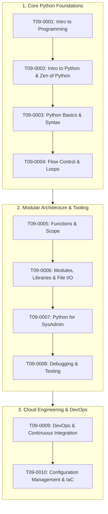

# Module T09: Python Programming & Automation

> **Course**: AWS re/Start  
> **Module ID**: `T09` / Module 05  
> **Total Documents**: 10 Comprehensive Study Guides  
> **Status**: Completed (100%)  

---

## Module Overview

The **Python Programming & Automation** module provides an end-to-end foundation in programming principles, Python 3 syntax, modular software architecture, system administration automation, testing/debugging strategies, and modern DevOps / CI/CD practices. Learners transition from foundational coding concepts to automating operational tasks in Linux and AWS cloud environments using Python scripts and the AWS SDK (`boto3`).

---

## Curriculum Roadmap



---

## Complete Document Index

| # | Code | Title & Description | Key Topics Covered | Study Guide |
|---|------|---------------------|--------------------|-------------|
| 01 | `T09-0001` | [Introduction to Programming](file:///work/tmp/aws-cf/T09-Python_Programming/T09-0001-RSPP_EN-US_SG_M05_PROGINTRO.md) | Programming concepts, Machine vs High-level code, IDE features, Programming lifecycle, Git & GitHub essentials | [Read Guide](file:///work/tmp/aws-cf/T09-Python_Programming/T09-0001-RSPP_EN-US_SG_M05_PROGINTRO.md) |
| 02 | `T09-0002` | [Introduction to Python](file:///work/tmp/aws-cf/T09-Python_Programming/T09-0002-PYTHNPROG_PYTHONINTRO_310_EN.md) | Python philosophy, The Zen of Python, Bytecode execution model (PVM), Python vs Bash scripting, AWS Lambda integration | [Read Guide](file:///work/tmp/aws-cf/T09-Python_Programming/T09-0002-PYTHNPROG_PYTHONINTRO_310_EN.md) |
| 03 | `T09-0003` | [Python Basics](file:///work/tmp/aws-cf/T09-Python_Programming/T09-0003-RSPP_EN-US_SG_M05_PYTHONBASICS.md) | Linux Python installation, PEP 8 syntax, Object references, Primitive data types, Operators, String formatting, Type casting | [Read Guide](file:///work/tmp/aws-cf/T09-Python_Programming/T09-0003-RSPP_EN-US_SG_M05_PYTHONBASICS.md) |
| 04 | `T09-0004` | [Flow Control](file:///work/tmp/aws-cf/T09-Python_Programming/T09-0004-RSPP_EN-US_SG_M05_FLOWCONTROL.md) | User input, Conditional branches (`if`/`elif`/`else`), Truthy/Falsy values, Loops (`while`, `for`, `range`), `break`/`continue`/`pass` | [Read Guide](file:///work/tmp/aws-cf/T09-Python_Programming/T09-0004-RSPP_EN-US_SG_M05_FLOWCONTROL.md) |
| 05 | `T09-0005` | [Functions](file:///work/tmp/aws-cf/T09-Python_Programming/T09-0005-RSPP_EN-US_SG_M05_FUNCTIONS.md) | DRY principle, Built-in vs User-defined, Positional & keyword args, Default arguments, `*args`/`**kwargs`, LEGB variable scope | [Read Guide](file:///work/tmp/aws-cf/T09-Python_Programming/T09-0005-RSPP_EN-US_SG_M05_FUNCTIONS.md) |
| 06 | `T09-0006` | [Modules and Libraries](file:///work/tmp/aws-cf/T09-Python_Programming/T09-0006-RSPP_EN-US_SG_M05_MODSLIBRARIES.md) | Module imports, Standard Library (`os`, `sys`, `json`, `datetime`), File I/O (`with open`), Robust `try-except-else-finally`, PyPI & `pip` | [Read Guide](file:///work/tmp/aws-cf/T09-Python_Programming/T09-0006-RSPP_EN-US_SG_M05_MODSLIBRARIES.md) |
| 07 | `T09-0007` | [Python for System Administration](file:///work/tmp/aws-cf/T09-Python_Programming/T09-0007-RSPP_EN-US_SG_M05_SYSADMINISTRATION.md) | Managing Linux users/groups with Python, Package management automation, `subprocess.run()` vs `os.system()`, Shell injection defense | [Read Guide](file:///work/tmp/aws-cf/T09-Python_Programming/T09-0007-RSPP_EN-US_SG_M05_SYSADMINISTRATION.md) |
| 08 | `T09-0008` | [Debugging and Testing](file:///work/tmp/aws-cf/T09-Python_Programming/T09-0008-RSPP_EN-US_SG_M05_DEBUGGINGTESTING.md) | Defect taxonomy, Interactive debugging (`pdb`, IDE breakpoints), Static analysis (`flake8`, `mypy`, `bandit`), Unit testing (`unittest`, `pytest`) | [Read Guide](file:///work/tmp/aws-cf/T09-Python_Programming/T09-0008-RSPP_EN-US_SG_M05_DEBUGGINGTESTING.md) |
| 09 | `T09-0009` | [DevOps and Continuous Integration](file:///work/tmp/aws-cf/T09-Python_Programming/T09-0009-RSPP_EN-US_SG_M05_DEVOPSCONTINTEGRATION.md) | DevOps philosophy, CALMS framework, Three Ways, CI vs CD, AWS Developer Tools (CodeCommit, CodeBuild, CodeDeploy, CodePipeline) | [Read Guide](file:///work/tmp/aws-cf/T09-Python_Programming/T09-0009-RSPP_EN-US_SG_M05_DEVOPSCONTINTEGRATION.md) |
| 10 | `T09-0010` | [Configuration Management](file:///work/tmp/aws-cf/T09-Python_Programming/T09-0010-PYTHNPROG_CONFIGURATIONMGMT_310_EN.md) | Project infrastructure, SCM four pillars, Idempotency, Declarative vs Imperative, Ansible vs Puppet/Chef, AWS Systems Manager (SSM) | [Read Guide](file:///work/tmp/aws-cf/T09-Python_Programming/T09-0010-PYTHNPROG_CONFIGURATIONMGMT_310_EN.md) |

---

## Python in Cloud Operations Quick Reference

```python
#!/usr/bin/env python3
"""
Sample AWS Cloud Operations Pattern: Idempotent Tagging & Audit
"""
import boto3
from botocore.exceptions import ClientError

def audit_ec2_instances(region: str = "us-east-1"):
    ec2 = boto3.client("ec2", region_name=region)
    try:
        response = ec2.describe_instances()
        for reservation in response.get("Reservations", []):
            for instance in reservation.get("Instances", []):
                instance_id = instance["InstanceId"]
                state = instance["State"]["Name"]
                tags = {t["Key"]: t["Value"] for t in instance.get("Tags", [])}
                print(f"Instance {instance_id} [{state}]: Env={tags.get('Environment', 'Untagged')}")
    except ClientError as e:
        print(f"AWS API Error: {e}")

if __name__ == "__main__":
    audit_ec2_instances()
```
