# 🐍 Introduction to Programming & Python Fundamentals

> **Course**: AWS re/Start  
> **Module**: Python Programming – M05 Introduction to Programming  
> **Source**: `T09-0001-RSPP_EN-US_SG_M05_PROGINTRO.pdf`  
> **Target Audience**: AWS re/Start Learners / Cloud Practitioners / Junior Developers  

---

## 🎯 Module Overview

Programming is the foundational discipline of authoring unambiguous, repeatable instructions that direct computer hardware and software systems to perform desired tasks. In modern cloud architecture, systems engineering, and DevOps, programming is the engine behind automation—enabling practitioners to eliminate manual toil, provision elastic cloud infrastructure, process massive datasets, and orchestrate complex distributed services with precision and velocity.

This module introduces core computer programming concepts, exploring the shift from low-level machine instructions to high-level expressive languages, the developer tooling ecosystem (including text editors and Integrated Development Environments), the iterative programming lifecycle, data representations in memory, composite structures, modular functions, control flow mechanics, and version control foundations using Git and GitHub.

---

### 📌 Learning Objectives

- [ ] **Define Programming & Programming Languages**: Understand how high-level code abstracts low-level hardware operations to communicate instructions to computers.
- [ ] **Analyze the Purpose of Programming & Automation**: Evaluate how programmatic automation eliminates human error, provides repeatability, accelerates operational speed, and scales cloud environments.
- [ ] **Differentiate Developer Tooling**: Contrast traditional text editors with feature-rich Integrated Development Environments (IDEs), highlighting capabilities like syntax highlighting, linting, debugging, and cloud integrations.
- [ ] **Master the Programming Lifecycle**: Trace the end-to-end software development cycle from problem specification and algorithm design through coding, debugging, testing, deployment, and ongoing maintenance.
- [ ] **Survey Programming Paradigms**: Contrast Imperative, Procedural, Object-Oriented (OOP), and Functional programming models.
- [ ] **Compare Execution Engines**: Differentiate compiled languages from interpreted languages, analyzing execution workflows, intermediate bytecode representations, and performance trade-offs.
- [ ] **Classify Primitive & Composite Data Types**: Explain how typed values are encoded as binary representations in system RAM, explore ASCII encoding, and design multi-field composite structures.
- [ ] **Examine Functions & Modular Architecture**: Understand functional encapsulation, parameter passing, return values, and data manipulation.
- [ ] **Navigate Flow Control & Execution Paths**: Predict and trace deterministic execution paths through conditionals (`if`/`elif`/`else`), multi-way branching (`switch`/`match`), and iterative loops (`for`/`while`).
- [ ] **Implement Core Version Control with Git & GitHub**: Articulate the critical need for version control, distinguish Git from GitHub, and execute foundational Git CLI workflows (repository initialization, staging, committing, and identity configuration).

---

## ⚙️ 1. What is Programming?

### Giving Precise Instructions to Computers
At its fundamental level, a computer is an electronic state machine composed of billions of transistors organized into Central Processing Units (CPUs), memory registers, and storage buses. A computer cannot intuit human intent, assume unspoken context, or tolerate ambiguity. 

**Programming** is the process of formulating a computing problem, designing an algorithmic solution, and expressing that solution as an unambiguous, deterministic sequence of instructions that a computer can parse, load into memory, and execute.

```
┌────────────────────────────────────────────────────────────────────────┐
│                        Fundamental Program Roles                       │
├────────────────────────────────────────────────────────────────────────┤
│  1. Perform Mathematical Calculations (arithmetic, analytics, stats)   │
│  2. Analyze & Transform Text (string parsing, regex, log extraction)   │
│  3. Read & Write Files (local disks, block storage, network mounts)    │
│  4. Accept Input & Produce Output (CLI args, GUI, REST APIs, displays) │
│  5. Manage Network Communications (HTTP sockets, RPC, message queues)  │
└────────────────────────────────────────────────────────────────────────┘
```

---

### The Evolution of Programming Languages

The history of software engineering is defined by abstraction—moving further away from raw silicon hardware towards human-readable syntactic expressions:

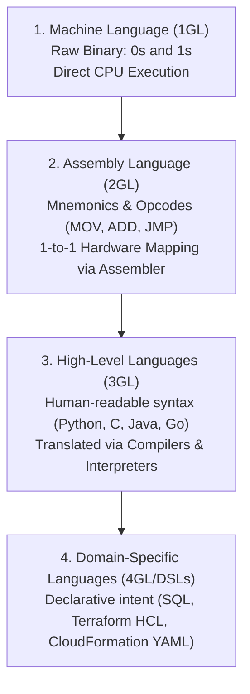

#### Language Tier Comparison:
| Tier / Level | Representation | Portability | Human Readability | Execution Speed |
| :--- | :--- | :--- | :--- | :--- |
| **Machine Language** | `10110000 01100001` (Binary opcodes) | Locked to specific CPU ISA (x86, ARM) | None (incomprehensible to humans without disassembly) | Native hardware execution speed |
| **Assembly Language** | `MOV AL, 61h; ADD EAX, EBX` | Machine-dependent architecture specific | Very Low (requires deep knowledge of CPU registers & stack) | Near-instantaneous (direct translation) |
| **High-Level Languages** | `total = price + tax` | Highly portable across operating systems & chipsets | High (approximates mathematical & English syntax) | Optimized through compiling or interpreted runtimes |

---

### Language Anatomy: Vocabulary, Grammar, and Punctuation

Much like human natural languages, programming languages are defined by strict formal grammars:

- **Vocabulary (Keywords & Identifiers)**:
  - *Keywords*: Reserved words with pre-allocated meanings defined by the language specification (e.g., in Python: `def`, `class`, `if`, `else`, `return`, `import`, `while`).
  - *Identifiers*: Custom tokens created by the developer to name variables, functions, classes, and modules (e.g., `user_age`, `calculate_total`).
- **Grammar (Syntax & Structure)**:
  - The formal structural rules governing how statements and expressions must be constructed. In Python, code blocks are delineated by clean indentation (whitespace) rather than curly braces `{}`.
- **Punctuation (Operators & Delimiters)**:
  - *Operators*: Symbols representing operations (`+`, `-`, `*`, `/`, `==`, `!=`, `%`).
  - *Delimiters*: Punctuation tokens grouping expressions, declaring blocks, or separating items (`:`, `,`, `( )`, `[ ]`, `{ }`).

> [!NOTE]
> Syntax errors occur when the written code violates the language's grammar rules. Unlike a human who can infer meaning from a misspelled sentence, an interpreter or compiler will immediately halt execution upon encountering a syntactic violation.

---

## 🚀 2. The Purpose of Programming: Automation

### Eliminating Human Toil in Modern Operations

In commercial computing and cloud administration, programming scripts and applications are primarily authored to implement **Automation**—the application of technology, software logic, and scripts to perform processes or procedures with minimal or zero human intervention.

Manual processes suffer from inherent operational liabilities known in Site Reliability Engineering (SRE) as **toil**:
- **Human Error**: Manual configuration via Graphical User Interfaces (GUIs) or ad-hoc shell commands is prone to typos, missed steps, and configuration drift.
- **Inconsistency**: Different engineers execute manual tasks in slightly different sequences, producing inconsistent environments.
- **Latent Velocity**: Manual provisioning takes minutes, hours, or days; programmatic deployment executes in milliseconds.
- **Unscalability**: Humans cannot manually deploy 5,000 EC2 instances or balance millions of real-time web requests.

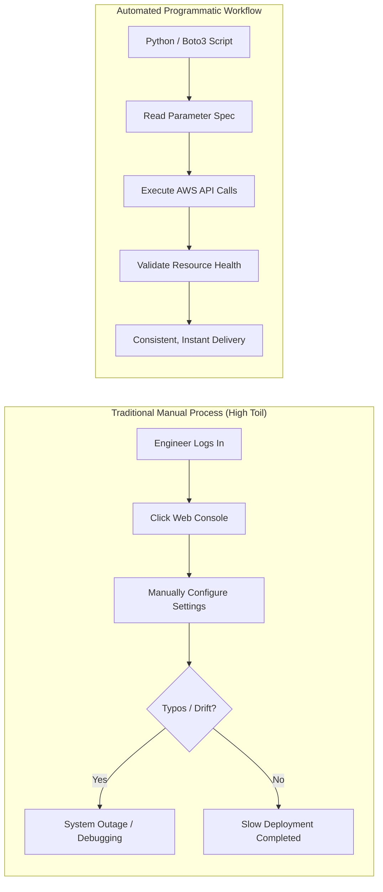

### Strategic Automation Considerations

The curriculum establishes four vital considerations before initiating programmatic automation:

1. **How much automation is needed to achieve your goals?**
   - Not every single one-time ad-hoc task warrants a complex enterprise software framework. Calibrate the investment in automation against the frequency and business impact of the task.
2. **Identify the proper processes to automate.**
   - Focus on repetitive, deterministic, high-frequency, and error-sensitive tasks: log rotation, daily database backups, user provisioning, cloud infrastructure scaling, and compliance auditing.
3. **Find the balance between over-automation and under-automation.**
   - Over-engineering automation for edge cases that occur once a year creates brittle codebases that cost more to maintain than the manual task itself.
4. **Don't automate a bad process.**
   - Automating a fundamentally flawed, redundant, or inefficient process merely accelerates the rate at which errors and waste are generated. Optimize and streamline the underlying workflow before writing code to automate it.

---

## 🛠️ 3. Integrated Development Environments (IDEs) vs. Text Editors

### Software is Written in Text Files

All program source code is fundamentally composed of plain, unformatted human-readable characters saved in standard text files:
- Source files carry language-specific extensions (e.g., `.py` for Python, `.js` for JavaScript, `.c` for C, `.java` for Java, `.go` for Go).
- Word processing applications (such as Microsoft Word, Apple Pages, or LibreOffice Writer) are **not** text editors; they embed binary formatting, fonts, page margins, and XML metadata that corrupt source code compilers and interpreters.

---

### The Evolution: Text Editors vs. IDEs

Developers write code using specialized tools ranging from lightweight text editors to full-featured Integrated Development Environments:

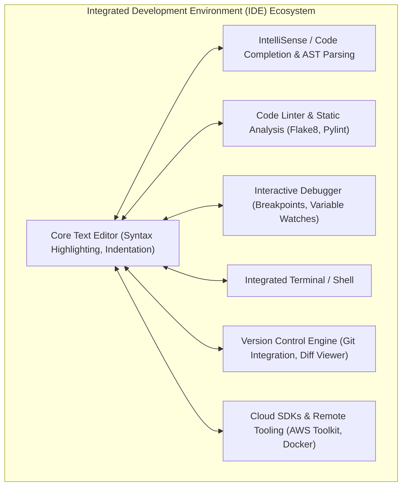

#### Core IDE Features Breakdown:
1. **Syntax Highlighting**: Color-codes reserved keywords, string literals, numeric values, variables, and comments to maximize visual readability and immediately surface syntax mistakes.
2. **Auto-Completion & IntelliSense**: Analyzes code context in real time to suggest variable names, method signatures, parameter types, and auto-import statements.
3. **Integrated Debugger**: Allows step-by-step code execution, setting conditional breakpoints, inspecting memory variables at runtime, and tracing call stacks without modifying source code.
4. **Integrated Terminal**: Provides direct access to system command shells (Bash, Zsh, PowerShell) inside the editing workspace, eliminating the need to toggle windows.
5. **Version Control Integration**: Visually exposes Git diffs, staged files, branch trees, commit author annotations (git blame), and conflict resolution editors.
6. **Linting & Static Analysis**: Flags stylistic violations (PEP 8), unused imports, unreachable code blocks, and subtle logic hazards before running the program.

#### Comparative Matrix of Developer Tools:
| Tool | Category | Target Languages | Strengths | Typical Cloud / DevOps Use Case |
| :--- | :--- | :--- | :--- | :--- |
| **VS Code** (Visual Studio Code) | Extensible Code Editor / Hybrid IDE | Polyglot (Python, JS, Go, Rust, C++) | Ultra-fast, lightweight, vast extension ecosystem, AWS Toolkit plugin | Industry standard for modern cloud development and scripting |
| **PyCharm** (JetBrains) | Dedicated Language IDE | Python focused | Unmatched deep Python code inspection, refactoring, virtualenv management | Enterprise Python web applications (Django, FastAPI) & data science |
| **AWS Cloud9** | Cloud-Native Browser IDE | Polyglot (Node.js, Python, PHP) | Pre-authenticated AWS CLI environment, zero local workstation setup, collaborative pair-programming | AWS re/Start labs, EC2-hosted dev environments, serverless development |
| **Sublime Text** | High-Performance Text Editor | Polyglot | Instantaneous launch times, low memory footprint | Quick file inspections, large log file reviews |
| **Vim / Vi** | Modal Terminal Editor | Polyglot | Universal presence on virtually every Linux/Unix server | Emergency on-instance patching, editing `/etc/` config files over SSH |
| **Nano** | Simple Terminal Editor | Plain text / Scripts | Low learning curve, displayed keyboard shortcuts | Quick editing in container environments or initial Linux server setups |

---

## 🔄 4. The Programming Lifecycle & Iterative Development

### The End-to-End Cycle of Programming

Software engineering is not merely typing syntax into a file; it is an engineering lifecycle that begins with abstract requirements and culminates in continuously maintained production code.

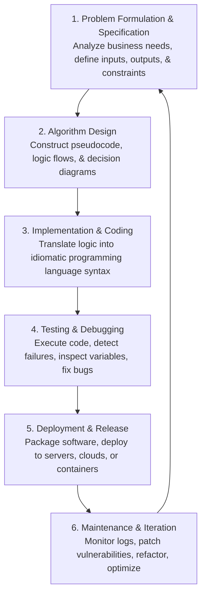

1. **Problem Formulation & Specification**:
   - Deconstruct a complex real-world problem into discrete computational requirements.
   - Define exact input parameters, expected return outputs, data formats, and boundary constraints.
2. **Algorithm Design**:
   - Devise step-by-step computational logic independent of any specific language.
   - Model execution flows using flowcharts and write clear **pseudocode** to validate assumptions before writing executable syntax.
3. **Implementation & Coding**:
   - Write clean, modular, and maintainable source code utilizing an appropriate programming language and text editor/IDE.
4. **Testing & Debugging**:
   - Execute software across diverse test cases (unit testing, edge-case testing, load testing).
   - Find exact failure lines, debug root causes, and patch issues.
5. **Deployment & Release**:
   - Containerize or distribute the software to target runtime environments (Linux servers, serverless AWS Lambda functions, Kubernetes clusters).
6. **Maintenance & Iteration**:
   - Analyze production metrics and cloud monitoring logs (e.g., Amazon CloudWatch), update dependencies, and optimize performance.

---

### The Iterative Development Principle: "Write a Little, Test it"

The curriculum highlights the foundational rule of effective software construction: **Software is written iteratively**.

```
    ┌──────────────────────┐
    │    Write a little    │
    └──────────┬───────────┘
               │
               ▼
    ┌──────────────────────┐
    │       Test it        │◄────────┐
    └──────────┬───────────┘         │
               │                     │
               ▼                     │
         Did it break?               │
          /         \                │
      [Yes]         [No]             │
        │             │              │
        ▼             ▼              │
 ┌─────────────┐ ┌────────────────┐  │
 │ Fix what    │ │ Write a little │──┘
 │ doesn't work│ │ more           │
 └─────────────┘ └────────────────┘
```

> [!IMPORTANT]
> **The Rookie Mistake vs. Professional Engineering Practice**:  
> Inexperienced programmers often write hundreds of lines of complex code before attempting to run the program once, resulting in dozens of interlocking errors that are nearly impossible to isolate.  
> **Best Practice**: Write small, testable units (3–10 lines or single functions). Run the script immediately. Verify standard outputs. Handle edge cases. Only advance to the next feature once current behavior is validated.

---

## 🧩 5. Programming Paradigms Overview

Programming paradigms represent distinct philosophical approaches and structural methodologies for conceptualizing and organizing computational logic:

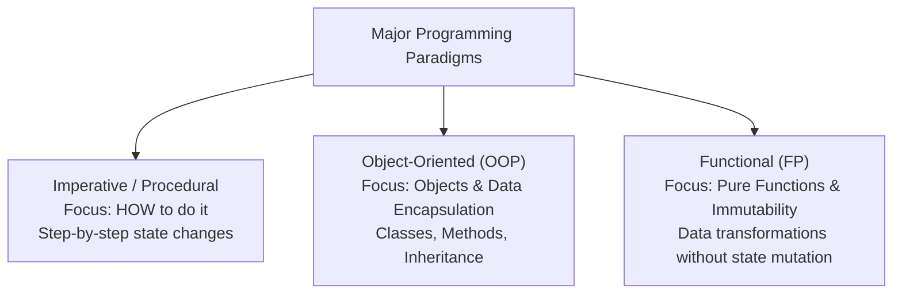

### 1. Imperative Programming
- **Concept**: Direct instructions detailing step-by-step state changes. The code acts as a direct recipe for the computer CPU.
- **Characteristics**: Heavy use of statements, variable mutation, and explicit loop structures.

### 2. Procedural Programming
- **Concept**: A subtype of imperative programming that structures logic into reusable blocks called procedures, subroutines, or functions.
- **Characteristics**: Encourages modular code reuse and sequential execution (e.g., C, Pascal, classic shell scripting).

### 3. Object-Oriented Programming (OOP)
- **Concept**: Organizes software design around **data objects** rather than functions and logic. An object bundles data properties (attributes) with behaviors (methods).
- **Core Pillars**:
  - *Encapsulation*: Hiding internal object state and requiring interaction through public methods.
  - *Inheritance*: Deriving new classes from existing classes to share attributes and behaviors.
  - *Polymorphism*: Ability of different classes to respond to the same interface or method call in their own specific way.
  - *Abstraction*: Exposing simple interfaces while concealing complex underlying implementations.
- **Prominent Languages**: Java, C++, C#, Python, Ruby.

### 4. Functional Programming (FP)
- **Concept**: Treats computation as the evaluation of mathematical functions, avoiding mutable state and side effects.
- **Core Characteristics**:
  - *First-Class & Higher-Order Functions*: Functions can be passed as arguments, returned by other functions, and assigned to variables.
  - *Immutability*: Data structures cannot be modified after creation; operations produce new data copies.
  - *Pure Functions*: A function given the same inputs will always produce the exact same output without side effects (no mutating global variables or modifying external state).
- **Prominent Languages**: Haskell, Lisp, Erlang, Elixir, Scala (with strong functional support in modern Python and JavaScript).

---

## ⚙️ 6. Compilers vs. Interpreters: Code Execution Engines

CPUs can only execute native machine binary instructions (opcodes). High-level programming languages require translation engines to convert human-readable source code into executable instructions.

```mermaid
flowchart TD
    subgraph Compilation_Model["Compiled Language Workflow (e.g., C/C++, Go)"]
        SourceC["Source Code (.c / .go)"] --> Compiler["Compiler Engine (gcc / clang)"]
        Compiler --> MachineBinary["Standalone Native Binary (ELF / .exe)"]
        MachineBinary --> CPU1["Hardware CPU Execution"]
    end

    subgraph Interpretation_Model["Interpreted Language Workflow (e.g., Python, Ruby)"]
        SourcePy["Source Code (.py)"] --> BytecodeGen["Interpreter / Bytecode Compiler"]
        BytecodeGen --> Bytecode["Intermediate Bytecode (.pyc)"]
        Bytecode --> VM["Virtual Machine Engine (Python PVM)"]
        VM --> CPU2["Hardware CPU Execution (Line-by-Line / JIT)"]
    end
```

### Detailed Comparison: Compilers vs. Interpreters

| Dimension | Compiled Languages (C, C++, Go, Rust) | Interpreted Languages (Python, Ruby, JavaScript) |
| :--- | :--- | :--- |
| **Translation Timing** | Ahead-of-Time (AOT): Complete source code is compiled before execution | Just-In-Time / Runtime: Translated dynamically during program execution |
| **Generated Artifact** | Standalone machine binary executable (`.exe`, ELF binary, Mach-O) | Intermediate bytecode (`.pyc`) executed by a software runtime engine |
| **Execution Performance** | Maximum execution speed; direct bare-metal hardware execution | Slower execution overhead due to intermediate runtime evaluation |
| **Portability** | Binary is platform-specific (a Linux x86 binary won't run on Windows ARM) | Highly portable; identical `.py` source file runs anywhere an interpreter is installed |
| **Error Discovery** | Syntax and type errors are caught early during compilation step | Syntax errors caught during startup; logic/type errors surfaced at runtime when line is reached |
| **Developer Feedback Loop** | Longer build/compile cycles for large projects | Rapid iteration; edit code and re-run immediately |

> [!NOTE]
> **Hybrid Models (Java & Python)**:  
> Languages like Java and Python utilize hybrid execution. Python source code (`.py`) is compiled into intermediate bytecode (`.pyc`), which is subsequently interpreted line-by-line by the Python Virtual Machine (PVM). Java compiles source code (`.java`) into bytecode (`.class`), which is executed and dynamically Just-In-Time (JIT) compiled into native machine code by the Java Virtual Machine (JVM).

---

## 💾 7. Data Representation & Data Types

### Memory Architecture: The Need for Data Typing

Inside computer hardware, Random Access Memory (RAM) consists of billions of microscopic capacitors and transistors representing binary states: `0` (low voltage / charge absent) or `1` (high voltage / charge present).

**In raw memory, everything consists strictly of 0s and 1s.**  
Without context, the byte sequence `0100 0001` is merely eight electrical switches. The computer hardware cannot know whether this represents:
- The integer number `65`
- The ASCII character `'A'`
- A fractional floating-point component
- An operational processor opcode

**Data typing** is the semantic classification of a data value that tells the operating system, compiler, and interpreter how to:
1. **Encode** a value into binary memory when saving.
2. **Decode** a value out of memory when retrieving.
3. **Allocate** the appropriate number of bytes in memory.
4. **Constrain** the legal operations permitted on that value (e.g., arithmetic addition vs. string concatenation).

```
   Raw Memory Bits        Data Type Tag        Decoded Human Meaning
 ┌─────────────────┐     ┌───────────────┐     ┌──────────────────────┐
 │    0000 0001    │ ──► │    Integer    │ ──► │  Numeric value: 1    │
 └─────────────────┘     └───────────────┘     └──────────────────────┘
 ┌─────────────────┐     ┌───────────────┐     ┌──────────────────────┐
 │    0000 0001    │ ──► │    Boolean    │ ──► │  Logical state: True │
 └─────────────────┘     └───────────────┘     └──────────────────────┘
 ┌─────────────────┐     ┌───────────────┐     ┌──────────────────────┐
 │    0100 0001    │ ──► │    Integer    │ ──► │  Numeric value: 65   │
 └─────────────────┘     └───────────────┘     └──────────────────────┘
 ┌─────────────────┐     ┌───────────────┐     ┌──────────────────────┐
 │    0100 0001    │ ──► │    String     │ ──► │  Character: 'A'      │
 └─────────────────┘     └───────────────┘     └──────────────────────┘
```

---

### Core Primitive Data Types

Primitive data types are the atomic building blocks built directly into a programming language without composite aggregation:

| Primitive Data Type | Description | Example Values | Common In-Memory Size |
| :--- | :--- | :--- | :--- |
| **Integer (`int`)** | Whole numbers without decimal fractions (positive, negative, zero) | `45`, `-10`, `0`, `2026` | 4 bytes (32-bit) or 8 bytes (64-bit) |
| **Long (`long`)** | High-precision integers exceeding standard integer allocation | `290578L`, `10082L` | 8 bytes (64-bit) or arbitrary precision (Python 3) |
| **Float (`float`)** | Floating-point real numbers containing decimal points | `1.02`, `3.14159`, `-0.005` | 4 bytes (single) or 8 bytes (double) |
| **Boolean (`bool`)** | Binary truth values representing logical states | `True`, `False` | 1 byte (or 1 bit logically) |
| **Character / String (`str`)** | Sequence of text characters encoded in ASCII or UTF-8 | `"My dog is on the bed."`, `"45"`, `'A'` | Variable length (1 byte per ASCII character) |

> [!CAUTION]
> Notice the crucial difference between the integer `45` and the string `"45"`. The integer `45` supports arithmetic calculations (`45 + 5 = 50`), whereas the string `"45"` is text. In Python, attempting to add `"45" + 5` produces a `TypeError: can only concatenate str (not "int") to str`.

---

### Hands-on Activity: ASCII Character Decoding

The **American Standard Code for Information Interchange (ASCII)** was established in 1963 to standardize the numeric representation of alphanumeric characters in computing systems.

#### Deciphering the Mystery Sequence from the Lesson:
The slide presents the following numeric ASCII byte sequence:
`72 – 97 – 118 – 101 – 32 – 121 – 111 – 117 – 32 – 115 – 101 – 101 – 110 – 32 – 109 – 121 – 32 – 99 – 97 – 114 – 32 – 107 – 101 – 121 – 115 – 63`

| ASCII Decimal Code | Decoded Character | ASCII Decimal Code | Decoded Character |
| :--- | :--- | :--- | :--- |
| **72** | `H` | **115** | `s` |
| **97** | `a` | **101** | `e` |
| **118** | `v` | **101** | `e` |
| **101** | `e` | **110** | `n` |
| **32** | *(Space)* | **32** | *(Space)* |
| **121** | `y` | **109** | `m` |
| **111** | `o` | **121** | `y` |
| **117** | `u` | **32** | *(Space)* |
| **32** | *(Space)* | **99** | `c` |
| **97** | `a` | **107** | `k` |
| **114** | `r` | **101** | `e` |
| **32** | *(Space)* | **121** | `y` |
| **115** | `s` | **63** | `?` |

**Decoded Sentence**: `"Have you seen my car keys?"`

---

### Variables & Variable Typing Approaches

A **variable** is a human-readable identifier (symbolic label) bound to a specific address location in computer memory. Rather than forcing programmers to reference memory by physical addresses (`0x7ffee4b28910`), variables allow us to store, update, and retrieve values using meaningful names (`user_age`, `total_price`).

#### Variable Assignment Across Programming Languages:
Nearly all programming languages utilize an assignment operator to store a value into a variable:
- **Python**: `isCoder = True`
- **VB.NET**: `daysOnJob = 1`
- **F#**: `daysOnJob <- 1`
- **Pascal**: `isCoder := true`

#### Static Explicit Typing vs. Dynamic Type Inference:
Languages differ significantly in when and how variables receive their data type assignments:

```
Static Explicit Typing (Java / C / Objective-C):
  int daysOnJob = 1;          // Compiler enforces that daysOnJob can ONLY hold integers.
  boolean isCoder = true;

Dynamic / Inferred Typing (Python / Swift / TypeScript):
  count = 10                  // Python infers 'int' at runtime based on the value 10.
  let isCoder = true          // TypeScript / Swift infers 'boolean' automatically.
```

| Typing Model | Examples | Mechanism | Advantages | Disadvantages |
| :--- | :--- | :--- | :--- | :--- |
| **Statically Typed** | Java, C++, C#, Go | Types declared explicitly and verified at compile-time | Prevents type mismatch bugs before runtime; optimal memory efficiency | More verbose syntax; slower initial development prototyping |
| **Dynamically Typed** | Python, JavaScript, Ruby | Types inferred automatically at runtime based on assigned values | Highly expressive, concise syntax, fast prototyping speed | Type mismatch errors can occur at runtime if not checked |

---

## 🏗️ 8. Composite Data Types

### Moving Beyond Primitives

While primitive data types hold a single atomic value (e.g., a number or a single string), real-world systems require modeling complex entities with multiple attributes.

A **Composite Data Type** aggregates multiple primitive and/or nested composite values into a single coherent data structure. All modern programming languages provide mechanisms to model composite types (e.g., classes, structs, dictionaries, objects, records).

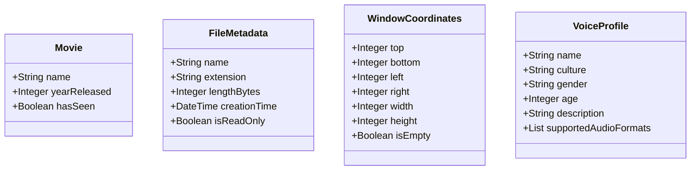

### Examples of Composite Data Types from the Curriculum

#### 1. Movie Record
Combines disparate primitives into a singular media representation:
- `name`: String (`"Interstellar"`)
- `yearReleased`: Integer (`2014`)
- `hasSeen`: Boolean (`True`)

#### 2. File System Object (File Properties)
Describes files on an operating system disk volume:
- `Name`: String (`"annual_report"`)
- `Extension`: String (`".pdf"`)
- `Length`: Integer (`1048576` bytes)
- `CreationTime`: Timestamp (`2026-10-12T14:30:00Z`)
- `IsReadOnly`: Boolean (`False`)

#### 3. Graphic Window / Bounding Box (Geometric Coordinates)
Encapsulates UI display coordinates:
- `Top`, `Bottom`, `Left`, `Right`: Integers
- `Width`, `Height`: Integers
- `Location`: Point structure
- `Size`: Dimension structure
- `IsEmpty`: Boolean

#### 4. Voice & Speech Synthesis Profile (e.g., Amazon Polly)
Models a synthetic voice configuration:
- `Name`: String (`"Joanna"`)
- `Culture`: String (`"en-US"`)
- `Gender`: String (`"Female"`)
- `Age`: Integer (`28`)
- `Description`: String (`"Standard US English Voice"`)
- `Supported_AudioFormats`: Collection (`["mp3", "ogg_vorbis", "pcm"]`)

---

## 📦 9. Collections

A **collection** is a specialized composite data structure designed to group multiple values together under a single variable name. Different collection types optimize for specific access patterns, memory layouts, and uniqueness constraints.

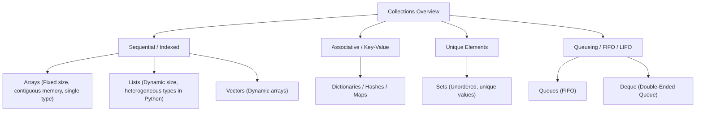

### 1. Traditional Arrays vs. Python Lists

#### Traditional Arrays (Low-Level Systems):
- **Homogeneous**: Every element must be of the exact same data type.
- **Fixed Size**: Memory is pre-allocated as a single contiguous block; size cannot be dynamically changed without allocating a new array.
- **Direct Memory Indexing**: Element addresses are calculated instantly via offset arithmetic (`base_address + index * element_size`).

#### Array Memory Slot Example (Ages):
| Slot (Index) | Data Type | Value | Memory Location |
| :--- | :--- | :--- | :--- |
| **0** | Integer | `87` | `0x1000` |
| **1** | Integer | `10` | `0x1004` |
| **2** | Integer | `2`  | `0x1008` |
| **3** | Integer | `46` | `0x100C` |
| **4** | Integer | `22` | `0x1010` |
| **5** | Integer | `19` | `0x1014` |
| **6** | Integer | `66` | `0x1018` |

> [!NOTE]
> **Zero-Based Indexing**: In virtually all modern programming languages (Python, C, JavaScript, Java), indexing begins at `0` rather than `1`. The index represents the offset distance from the beginning of the collection in memory.

---

#### Python Lists (High-Level Dynamic Collections):
A Python list is a versatile, dynamic array of references:
- **Heterogeneous**: Elements can be of completely different data types.
- **Ordered**: Maintains the exact insertion order of items.
- **Mutable**: Items can be inserted, appended, modified, and removed dynamically.
- **Allows Duplicates**: The same value can appear at multiple indices.

#### Heterogeneous Python List Example:
```python
user_profile = ["John", 55, True, "male", "Carlos", 22, "male"]
```

| Index | Stored Data Type | Stored Value | Attribute Meaning |
| :--- | :--- | :--- | :--- |
| **0** | String | `"John"` | First User Name |
| **1** | Integer | `55` | Age |
| **2** | Boolean | `True` | Active Account Status |
| **3** | String | `"male"` | Gender |
| **4** | String | `"Carlos"` | Second User Name |
| **5** | Integer | `22` | Age |
| **6** | String | `"male"` | Gender |

---

### Survey of Advanced Collection Types

| Collection Type | Core Mechanics | Ordering | Duplicates Allowed? | Common Cloud / DevOps Use Case |
| :--- | :--- | :--- | :--- | :--- |
| **Array** | Fixed size, contiguous memory, single type | Ordered | Yes | High-performance numeric computations, kernel buffers |
| **List** | Dynamic length, flexible indexing | Ordered | Yes | General-purpose scripting, processing lists of EC2 instance IDs |
| **Set** | Unordered collection of unique items | Unordered | **No** | Deduplicating IP addresses, calculating set intersections of IAM policies |
| **Queue** | First-In, First-Out (FIFO) buffer | Ordered | Yes | Task dispatchers, AWS SQS message processing queues |
| **Deque** | Double-ended queue (insert/remove at head or tail) | Ordered | Yes | Sliding window metrics, undo buffers, breadth-first search |
| **Dictionary / Hash / Map** | Key-Value pairs with $O(1)$ constant-time lookup | Key-based (ordered in Python 3.7+) | Unique Keys (Values can duplicate) | JSON parsing, configuration files, DynamoDB records, AWS API responses |

---

## ⚡ 10. Functions & Modular Architecture

### What is a Function?

A **function** is a self-contained, reusable block of code designed to perform a single, well-defined task. Functions represent the foundational building block of modular software design.

Instead of duplicating the same logic across a codebase, developers encapsulate instructions into a function and call it by name whenever needed.

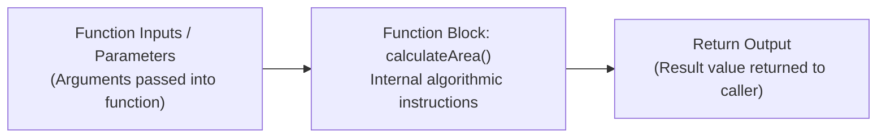

---

### Core Attributes & Patterns of Functions

The curriculum presents a progressive series of function capabilities:

#### 1. Functions Perform Standalone Actions (No Arguments, No Return)
Some functions simply execute a system command or state update without requiring parameters or returning a value:
```python
def clear_screen():
    # Clears the terminal screen
    print("\033[H\033[J")

clear_screen()
```

#### 2. Functions Return a Value to be Stored in a Variable
Functions can compute or retrieve data and return it to the caller:
```python
def calculate_pi():
    return 3.141592653589793

pi = calculate_pi()
```

#### 3. Functions Accept Input Arguments to Compute Dynamic Results
Functions can take one or more input parameters and return a computed output:
```python
def calculate_area(pi_val, radius):
    return pi_val * (radius ** 2)

circle_area = calculate_area(pi, 4)
```

#### 4. Passing and Returning Composite Data Structures
As application logic scales, passing dozens of individual arguments creates messy, fragile code signatures. Functions can instead accept and return composite objects:

**Anti-Pattern (Tightly Coupled Long Parameter List)**:
```python
def fly(lat, lon, spd, hdg, vspd, wspd, wdir):
    # Fragile: easy to mix up argument order!
    pass
```

**Clean Pattern (Accepting a Composite Object)**:
```python
# Encapsulating airplane state into a single composite structure
aircraft = {
    "latitude": 37.7749,
    "longitude": -122.4194,
    "speed": 450,
    "heading": 270,
    "verticalSpeed": 0,
    "windSpeed": 15,
    "windDirection": 180
}

def fly(aircraft_state):
    # Clear, clean, and extensible
    pass

fly(aircraft)
```

#### 5. Returning Composite Types and Processing Arrays of Objects
Functions can take an object and return a new projected composite object, or process an entire collection of objects:
```python
def predict_trajectory(aircraft_now, seconds_in_future):
    # Returns a new composite state object representing future position
    future_aircraft = aircraft_now.copy()
    future_aircraft["latitude"] += 0.05
    return future_aircraft

aircraft_future = predict_trajectory(aircraft, 60)

def detect_collisions(all_aircraft_list):
    # Accepts an array/list of composite aircraft objects and returns collision pairs
    pass
```

---

## 🔀 11. Following the Execution Path: Flow Control

### What is an Execution Path?

The **execution path** is the exact deterministic sequence of instructions that the CPU or interpreter follows when executing a program.

Under default conditions, code executes strictly in a linear **sequential path** (line 1, then line 2, then line 3). However, useful software must adapt dynamically to varying conditions:
- Branching based on an either-or decision (**conditionals**).
- Choosing among multiple possible states (**switches / pattern matching**).
- Repeating operations over a collection of items (**loops**).

> [!IMPORTANT]
> A programmer must be able to mentally trace and predict every possible execution path through their code:
> 1. **During initial design**: To ensure all edge cases and boundary conditions are handled.
> 2. **During debugging**: To track down unexpected execution paths caused by invalid inputs or logic errors.

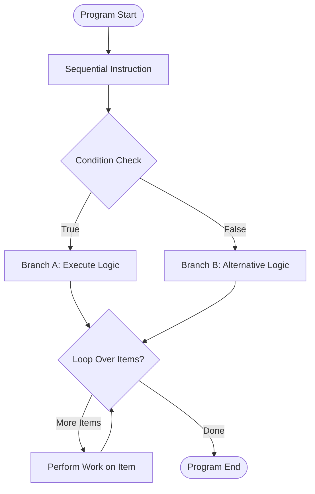

---

### Flow Control Mechanisms

#### 1. Conditionals (`if` / `elif` / `else`)
Conditionals allow the program to branch based on Boolean truth evaluations:

```python
# Guessing game conditional path
if guess > number:
    print("Too high!")
elif guess < number:
    print("Too low!")
else:
    print("Exactly right!")
```

```python
# Employee bonus calculation
if name == 'Juan':
    bonus = 300
else:
    bonus = salary * 0.1
```

#### 2. Multi-Way Branching (`switch` / `case`)
When checking a single variable against many potential discrete values, `switch` statements (or Python 3.10+ `match-case`) provide a cleaner alternative to cascading `if-elif` ladders:

```
// Conceptual Switch Statement
switch(sign):
    case "Stop":
        pressBrake()
    case "Merge":
        accelerate()
    case "Exit":
        decelerate()
    default:
        ignore()
```

#### 3. Loops (Iteration)
Loops execute a block of code repeatedly across every item in a collection or until a Boolean termination condition is reached:

```python
# For loop iterating across a collection
names = ["wei", "nikki", "akua"]
for name in names:
    new_name = name.capitalize()
    print(new_name)
```

```python
# Modifying composite objects across an employee roster
for employee in employees:
    employee["bonus"] = employee["salary"] * 0.1
```

---

## 🌿 12. Version Control Systems: Git & GitHub

### The Critical Need for Version Control

A **Version Control System (VCS)** is specialized software that tracks, records, and manages changes made to source code, documents, and configuration files over time.

Without version control, engineering teams face severe operational risks:
- Overwriting each other's work when collaborating on shared directories.
- Inability to revert broken production deployments to a known good state.
- Accidental permanent deletion of files.
- Lack of accountability regarding who made a change, when, and why.

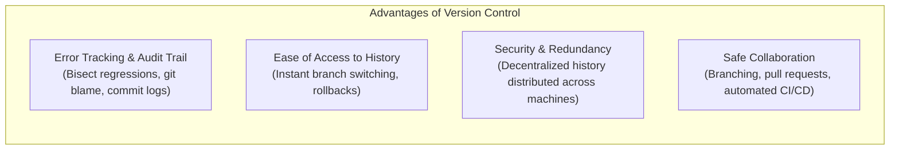

---

### Utilizing Cloud Infrastructure for Code Collaboration

Version control can be managed purely locally on a single developer workstation, but local version control remains vulnerable to hardware failures, laptop theft, or disk corruption.

By synchronizing local repositories with **cloud hosting infrastructure** (such as GitHub, GitLab, or AWS CodeCommit):
- Code changes are continuously backed up to resilient, multi-AZ cloud storage.
- Geographically distributed engineering teams collaborate concurrently on shared repositories without conflict.
- Cloud platforms provide code review tooling (Pull Requests), automated security vulnerability scanning, and CI/CD automation pipelines.

---

### Git vs. GitHub: Key Distinction

| Attribute | Git | GitHub |
| :--- | :--- | :--- |
| **What is it?** | A distributed command-line Version Control System (VCS) tool installed locally | A cloud-based platform and hosting service for Git repositories |
| **Where does it run?** | Locally on your computer or server | Hosted on cloud servers managed by GitHub / Microsoft |
| **Internet Required?** | **No**. Commits, branching, and logging run completely offline | **Yes**. Required to push, pull, fork, or open pull requests |
| **Primary Role** | Tracks file differences, creates commits, manages local branches | Centralized remote repository hosting, code reviews (PRs), issue tracking, CI/CD |
| **Interface** | Terminal command line interface (`git status`, `git commit`) or GUI clients | Web browser user interface, desktop client, GitHub CLI (`gh`), REST API |

---

### Step-by-Step Hands-on Git CLI Workflow

The curriculum provides a step-by-step terminal lab walkthrough demonstrating fundamental Git repository mechanics:

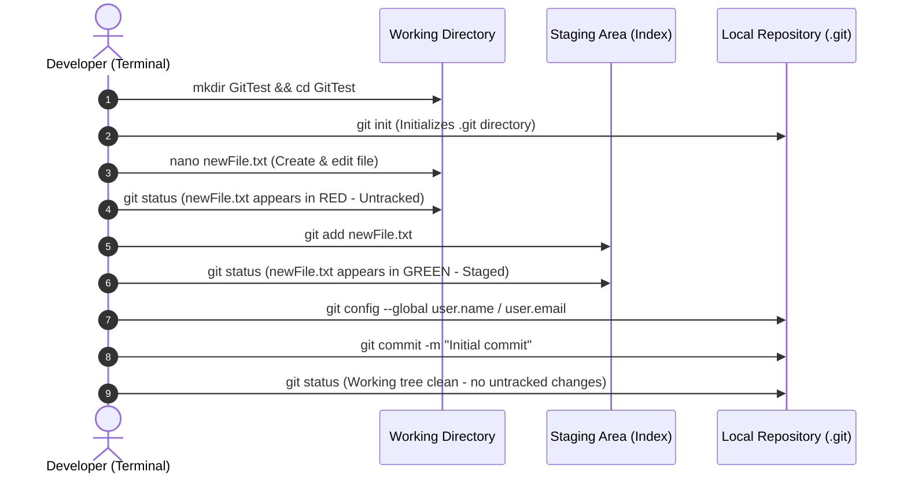

#### Detailed Command Reference:

1. **Initialize the Local Repository**:
   ```bash
   mkdir GitTest
   cd GitTest
   git init
   ```
   *Verification*: Verify the hidden repository directory exists:
   ```bash
   ls -ldF .*
   # Output displays the .git/ internal metadata directory
   ```

2. **Create and Inspect a New File**:
   ```bash
   touch newFile.txt
   nano newFile.txt
   # Enter text content, then press CTRL+X followed by 'Y' and Enter to save
   ```

3. **Check Working Tree Status**:
   ```bash
   git status
   ```
   *Output*: `newFile.txt` appears in **red text**, indicating that it is an untracked file residing solely in the working directory.

4. **Stage the File for Commit**:
   ```bash
   git add newFile.txt
   git status
   ```
   *Output*: `newFile.txt` transitions to **green text**, indicating that it is staged in the Git Index and ready to be committed.

5. **Configure Author Identity (First-Time Setup)**:
   If author identity has not been configured, Git halts the commit and requests author information. Set your global identity:
   ```bash
   git config --global user.name "Your Name"
   git config --global user.email "you@example.com"
   ```

6. **Commit the Snapshot**:
   ```bash
   git commit -m "Initial commit"
   ```

7. **Verify Clean Tree**:
   ```bash
   git status
   # Output: "nothing to commit, working tree clean"
   ```

---

## ❓ Checkpoint Review Questions & Detailed Answers

### Question 1: What is one of the key purposes of programming?
**Answer**:  
One of the primary purposes of programming is **automation**—the ability to eliminate manual human intervention from systems, tasks, and operational workflows. Programmatic automation ensures speed, precision, repeatability, and eliminates human error when managing environments and processing workloads.

### Question 2: Which types of files are used to store programming source code?
**Answer**:  
Programming source code is stored exclusively in **plain text files** carrying language-specific file extensions (such as `.py` for Python, `.js` for JavaScript, or `.java` for Java). Rich document formats produced by word processors (such as `.docx` or `.pages`) embed proprietary binary formatting tags that invalidate code parsing by compilers and interpreters.

### Question 3: What is an Integrated Development Environment (IDE)?
**Answer**:  
An **IDE** is a comprehensive software application suite that consolidates the essential tools required for software authoring into a unified graphical user interface. Standard features include a source code editor with syntax highlighting and auto-completion (IntelliSense), integrated debuggers, linting engines, build automation tools, an embedded command terminal, and native version control integration.

### Question 4: What data type is a whole number?
**Answer**:  
A whole number (positive, negative, or zero without a fractional decimal component) is stored as an **Integer** (`int`). For numbers requiring exceptionally high precision beyond standard 32-bit or 64-bit boundaries, languages may utilize a **Long** data type.

### Question 5: What is the purpose of functions in programming?
**Answer**:  
Functions enable developers to organize code into modular, reusable, and discrete sections that perform a specific task. By assigning a name to a function, the logic can be called repeatedly throughout the application, eliminating repetitive code, accepting dynamic input arguments, and returning calculated outputs to the rest of the program.

### Question 6: Name one popular version control tool.
**Answer**:  
**Git** (paired with remote hosting platforms such as **GitHub**). Other historical or alternative version control tools include Mercurial, Subversion (SVN), and GNU arch.

---

## 🧠 Key Takeaways & Core Concepts Summary

- **Programming as Automation**: Programming enables developers to express exact instructions to computers to automate repetitive, error-prone tasks and manage cloud infrastructure reliably.
- **Language Abstraction**: Programming languages provide structured grammar, vocabulary, and punctuation that abstract raw CPU binary execution into human-readable code.
- **IDEs Enhance Productivity**: While software is written in plain text files, IDEs (such as VS Code, PyCharm, and AWS Cloud9) boost developer velocity through syntax highlighting, intelligent code completion, integrated debugging, and version control tooling.
- **Iterative Development**: High-quality software is built through tight feedback loops: *write a small unit, test it immediately, fix any bugs, and repeat*.
- **Data Typing in Memory**: Everything in RAM is physically stored as binary `0`s and `1`s. Data typing instructs the runtime how many bytes to allocate and how to encode and decode values into human-meaningful data (integers, floats, strings, Booleans).
- **Composite Structures Model Real-World Entities**: Primitive data types combine into composite types (objects, structs, dictionaries) to encapsulate multi-attribute entities such as files, user profiles, and cloud resources.
- **Deterministic Flow Control**: Programmers govern program execution paths using conditionals (`if`/`elif`/`else`), multi-way switches (`match`/`switch`), and iterative loops (`for`/`while`).
- **Version Control is Essential**: Version control systems like Git provide error tracking, auditable project history, and safe collaboration. Synchronizing local Git repositories to cloud hosting platforms like GitHub safeguards code against hardware loss and powers modern cloud CI/CD delivery pipelines.
