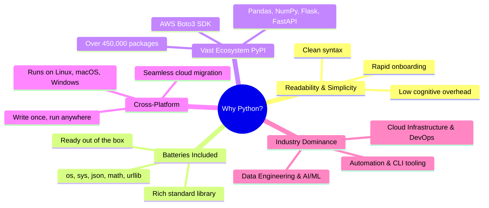
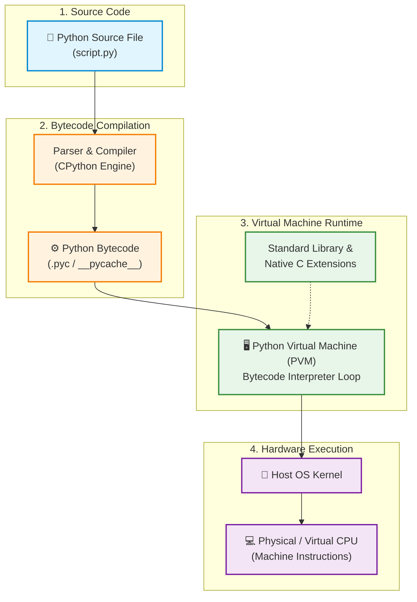
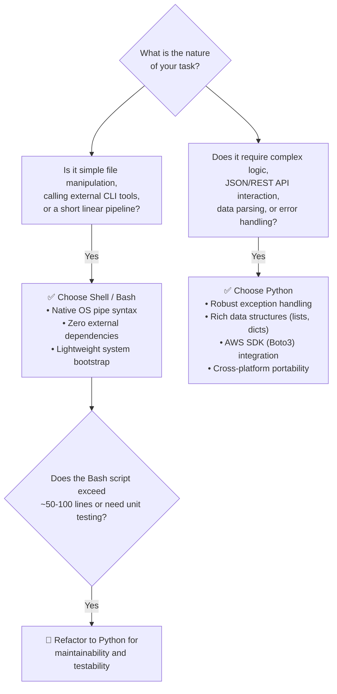
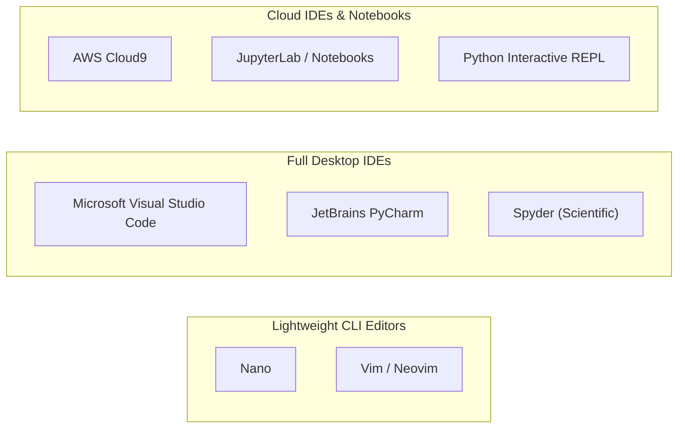
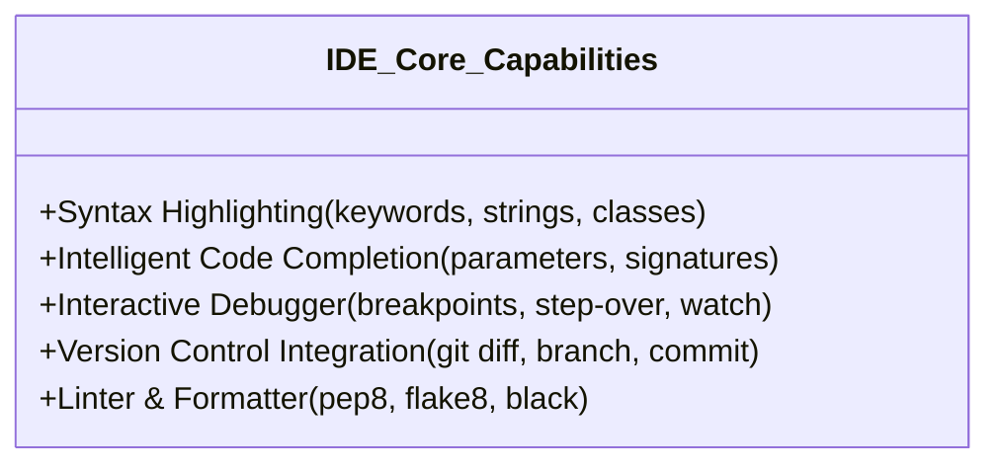
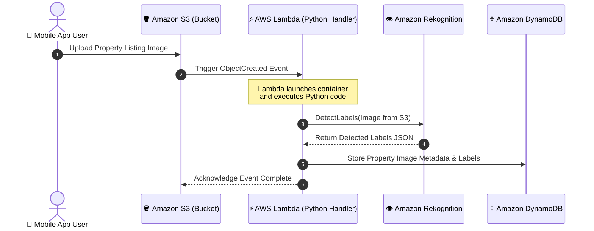

# 🐍 Introduction to Python: Fundamentals, Tooling, and Serverless Cloud Integration

> **Course**: AWS re/Start  
> **Module**: Python Programming (Module 05 / Introduction to Python)  
> **Source**: `T09-0002-PYTHNPROG_PYTHONINTRO_310_EN.pdf`  
> **Target Audience**: AWS re/Start Learners / Cloud & DevOps Practitioners  

---

## 🎯 Module Overview

Python is one of the most popular, versatile, and beginner-friendly programming languages in modern software engineering and cloud computing. From rapid automation scripts and DevOps configuration management to large-scale data engineering, machine learning pipelines, and cloud-native serverless functions, Python provides the foundation for scalable modern cloud solutions.

This module introduces the Python language, its philosophical foundations, execution architecture, development environments, and practical distinction from traditional Unix shell scripting. Additionally, it highlights Python's premier role in serverless computing with **AWS Lambda**.

### 📌 Learning Objectives
- [ ] **Explain what Python is**: Define Python's foundational characteristics, history, and multi-paradigm design.
- [ ] **Analyze "The Zen of Python"**: Understand how Python's design philosophy emphasizes readability, clarity, and developer productivity.
- [ ] **Understand the Python Execution Model**: Trace how source code (`.py`) compiles into bytecode (`.pyc`) executed by the Python Virtual Machine (PVM).
- [ ] **List Key Reasons for Using Python**: Identify why Python dominates Cloud Engineering, DevOps automation, Web Services, and AI/ML.
- [ ] **Compare Python vs. Shell Scripting (Bash)**: Contrast data structures, error handling, portability, and maintainability to know when to use each tool.
- [ ] **Evaluate Python Development Tools & IDEs**: Identify lightweight text editors, feature-rich desktop IDEs, interactive REPLs/notebooks, and Cloud IDEs (AWS Cloud9).
- [ ] **Examine AWS Lambda & Serverless Compute**: Understand event-driven execution, the Boto3 SDK, and why Python is a top choice for AWS serverless microservices.

---

## 📜 1. What Is Python? History and Philosophy

### 1.1 Origin & History
Python was conceived in the late 1980s by **Guido van Rossum** at the *Centrum Wiskunde & Informatica* (CWI) in the Netherlands as a successor to the ABC language. The first public release (version 0.9.0) was published in **February 1991**. 

Contrary to popular belief, Python was not named after the reptile; Guido van Rossum named it after the British surreal comedy troupe **Monty Python**, reflecting a desire for the language to be enjoyable and accessible.

```
       1989-1991                 2000                      2008                      Present
   Conception & v0.9.0         Python 2.0                Python 3.0                 Python 3.10+
  • Guido van Rossum       • List comprehensions     • Cleaned syntax          • Pattern matching
  • Named after Monty      • Garbage collector with  • Unicode by default      • Enhanced typing
    Python                   cycle detection         • Print as a function     • Performance boosts
```

### 1.2 Core Characteristics of Python
Python is categorized by four fundamental architectural properties:

1. **High-Level Language**:
   Python abstracts away low-level computer architecture details such as direct memory management, manual pointer manipulation, CPU register allocations, and OS-level system call interfaces.
2. **Interpreted & Bytecode-Executed**:
   Python code does not require explicit ahead-of-time compilation into native machine binary by the developer. It is compiled at runtime into bytecode and interpreted by a virtual machine.
3. **Dynamically Typed**:
   Variable types do not need explicit declarations ahead of time. Types are bound to values (objects) dynamically at runtime rather than fixed to variable names at compile time.
4. **Multi-Paradigm Support**:
   Python empowers developers to choose the paradigm best suited to their problem:
   - **Object-Oriented Programming (OOP)**: Everything in Python is an object, supporting classes, inheritance, encapsulation, and polymorphism.
   - **Procedural / Structural Programming**: Clean top-to-bottom step execution using routines, functions, and structured control flow.
   - **Functional Programming**: Functions as first-class citizens, lambda expressions, map/filter/reduce, and list comprehensions.

---

### 1.3 Design Philosophy: The Zen of Python

The guiding principles behind Python's syntax and standard library design were authored by Tim Peters in **PEP 20** (*The Zen of Python*). It can be displayed directly in any Python environment:

```python
import this
```

> **The Zen of Python (Selected Aphorisms)**:
> - *Beautiful is better than ugly.*
> - *Explicit is better than implicit.*
> - *Simple is better than complex.*
> - *Complex is better than complicated.*
> - *Readability counts.*
> - *Special cases aren't special enough to break the rules.*
> - *Errors should never pass silently, unless explicitly silenced.*
> - *There should be one-- and preferably only one --obvious way to do it.*

> [!NOTE]
> **Readability & PEP 8**: Python uses significant indentation (whitespace) instead of curly braces (`{}`) or `begin`/`end` blocks to define code scopes. **PEP 8** is the official style guide for Python code, standardizing 4-space indentation, naming conventions (`snake_case` for functions/variables, `PascalCase` for classes), and code structure.

---

## 🚀 2. Why Python? Key Advantages & Industry Ecosystem



### 2.1 Developer Productivity & Fast Exploratory Programming
Because Python does not require manual compilation and linking steps, developers can write code, run it immediately, and iteratively test logic. An integrated **Read-Eval-Print Loop (REPL)** allows developers to test expressions and explore API responses in real time.

### 2.2 "Batteries Included" Standard Library
Python comes bundled with a massive collection of built-in modules known as the standard library. Tasks that require external dependencies in other languages are natively supported in Python:
- **System & OS**: `os`, `sys`, `subprocess`, `pathlib`, `shutil`
- **Data Serialization**: `json`, `csv`, `xml`, `sqlite3`
- **Networking & Web**: `urllib`, `http.server`, `socket`, `ssl`
- **Date, Math & Concurrency**: `datetime`, `math`, `threading`, `asyncio`

### 2.3 Cross-Platform Portability
Python executes identically across **GNU/Linux**, **macOS**, and **Microsoft Windows**. A Python script written on a Windows workstation can run unchanged inside an Amazon Linux 2023 EC2 instance or an AWS Lambda execution environment.

### 2.4 Industry Dominance Across Key Sectors
- **Cloud Engineering & DevOps**: Provisioning infrastructure with AWS CDK, automating deployment workflows, parsing CloudWatch metrics, and writing custom Lambda handlers.
- **Data Science & Analytics**: Data manipulation with `pandas`, `numpy`, and data visualization with `matplotlib` and `seaborn`.
- **Machine Learning & Generative AI**: Industry standard for PyTorch, TensorFlow, Hugging Face Transformers, and LangChain.
- **Backend Web Development & APIs**: High-performance RESTful APIs and microservices using `FastAPI`, `Flask`, and `Django`.

---

## ⚙️ 3. Python Execution Model Under the Hood

To effectively troubleshoot and optimize Python applications, cloud practitioners must understand how Python source code executes on the underlying operating system.

### 3.1 The Execution Pipeline

When you execute `python script.py`, the following sequence takes place:



1. **Source Code (`.py`)**: Human-readable text file written by the programmer.
2. **Bytecode Compilation (`.pyc`)**: CPython compiles the Python statements into low-level, platform-independent intermediate instructions called **bytecode**. These are cached in the `__pycache__/` directory for faster subsequent startup times.
3. **Python Virtual Machine (PVM)**: The PVM is the runtime engine of Python. It reads the bytecode sequentially and translates each instruction into underlying native machine operations.
4. **Operating System & Hardware Execution**: The OS manages CPU scheduling and RAM allocation, executing the final machine instructions.

---

### 3.2 Interpreted vs. Ahead-Of-Time (AOT) Compiled Languages

| Feature | Interpreted / Bytecode (Python) | AOT Compiled (C, C++, Go, Rust) |
| :--- | :--- | :--- |
| **Compilation Phase** | Just-in-time / Bytecode compiled at launch | Ahead-of-time compiled directly to native binary |
| **Output File** | `.pyc` (intermediate bytecode) | Standalone binary executable (ELF, Mach-O, `.exe`) |
| **Execution Tool** | Requires Python runtime (`python3` + PVM) | Executes directly on the OS CPU without runtime |
| **Development Cycle** | Instant edit-and-run; rapid iteration | Edit $\rightarrow$ Compile $\rightarrow$ Link $\rightarrow$ Run cycle |
| **Execution Speed** | Moderate (interpreted loop overhead) | Maximum (direct hardware optimization) |
| **Portability** | High; same `.py` runs on any OS with Python | Binary must be cross-compiled for each target OS/CPU architecture |
| **Type Checking** | Dynamic (checked during execution) | Static (checked at compile time before execution) |

> [!TIP]
> **Python Implementations**: While **CPython** (written in C) is the standard reference implementation, others exist for specialized needs:
> - **PyPy**: Uses a Just-In-Time (JIT) compiler for dramatically faster numerical execution.
> - **Jython**: Runs Python code directly on the Java Virtual Machine (JVM).
> - **IronPython**: Designed for integration with Microsoft .NET CLR.

---

## ⚖️ 4. Shell Scripting (Bash) vs. Python

Cloud engineers frequently use both **Bash** (Bourne-Again Shell) and **Python**. Selecting the right tool for the task ensures maintainable, reliable automation.



### 4.1 In-Depth Comparison Matrix

| Comparison Dimension | Shell Scripting (Bash / Zsh) | Python (`python3`) |
| :--- | :--- | :--- |
| **Primary Design Target** | Operating system command execution, process orchestration, stream piping | General-purpose programming, application logic, data transformation |
| **Data Structures** | Strings, basic 1D arrays, associative arrays (Bash 4+). Nested data is difficult | Rich, native nested types: `dict`, `list`, `set`, `tuple`, custom objects |
| **Error Handling** | Exit codes (`$?`), `set -e`, `trap`. Error propagation is brittle | Robust structured exceptions (`try...except...finally`, custom exceptions) |
| **API & JSON Handling** | Requires external utilities (`curl`, `wget`, `jq`, `sed`, `awk`) | Native standard modules (`json`, `urllib.request`) and third-party `requests` |
| **Platform Portability** | GNU/Linux and macOS (Unix). Windows requires WSL or Git Bash | Universally portable across Linux, macOS, and Windows with zero changes |
| **Performance Profile** | Spawns multiple sub-processes per command (`fork`/`exec`), high sub-shell overhead | Runs in a single persistent runtime process; highly optimized internals |
| **Code Maintainability** | Difficult to read and maintain beyond ~100 lines | Clean readability, modular packages, docstrings, typing hints |
| **Testing & Tooling** | Basic shell linting (`shellcheck`), manual testing | Mature unit testing (`unittest`, `pytest`), automated linters (`flake8`, `black`) |
| **Cloud SDKs** | AWS CLI wrappers (`aws s3 cp ...`) | Native AWS SDK for Python (`boto3`) with typed responses and pagination |

---

### 4.2 Practical Code Comparison Examples

#### Example 1: Spawning an HTTP Web Server
- **Bash**: Requires external tools like `netcat` with complex loop wrappers or third-party web server installations (`nginx`/`apache`).
- **Python**: One clean built-in command:

```bash
# Start a local HTTP server serving current directory on port 8000
python3 -m http.server 8000
```

#### Example 2: Consuming a REST API and Parsing JSON
**Bash Approach** (Relies on external utilities):
```bash
#!/usr/bin/env bash
set -euo pipefail

# Requires curl and jq to be pre-installed on the host
USER_NAME=$(curl -s https://api.github.com/users/octocat | jq -r '.name')
echo "User Name: ${USER_NAME}"
```

**Python Approach** (Self-contained, robust error handling):
```python
#!/usr/bin/env python3
import json
import urllib.request
from urllib.error import URLError

url = "https://api.github.com/users/octocat"
req = urllib.request.Request(url, headers={"User-Agent": "PythonApp"})

try:
    with urllib.request.urlopen(req) as response:
        if response.status == 200:
            data = json.loads(response.read().decode())
            print(f"User Name: {data.get('name')}")
except URLError as err:
    print(f"Network error encountered: {err}")
```

> [!IMPORTANT]
> **Rule of Thumb for Cloud Engineers**:
> - Use **Bash** for ephemeral server initialization scripts (such as Amazon EC2 `user-data` launch scripts, provisioning apt/yum packages, and basic cron tasks).
> - Use **Python** as soon as you need to interact with AWS APIs, parse structured payloads (JSON/YAML), implement retry logic, or write maintainable automation tools.

---

## 🛠️ 5. Tools and Environments for Writing Python Code

Python code can be authored in simple command-line editors or advanced modern IDEs.



### 5.1 Editor & IDE Categories

#### 1. Command-Line Text Editors (Nano & Vim)
- **Nano**: A straightforward, modeless terminal editor ideal for quick configuration edits and beginners on remote EC2 instances.
- **Vim / Neovim**: A modal editor featuring powerful keyboard-driven navigation, syntax highlighting, and extensive plugin ecosystems. Essential for headless Linux server administration.

#### 2. Desktop Integrated Development Environments (IDEs)
- **Microsoft Visual Studio Code (VS Code)**: Highly modular, lightweight, and extensible. Equipped with the Python extension (Pylance), it provides IntelliSense, interactive debugging, and native Git integration.
- **JetBrains PyCharm**: A dedicated professional Python IDE offering deep code refactoring, test runners, database tools, and virtual environment management.
- **Spyder**: Tailored for data science and engineering, featuring interactive variable explorers and matplotlib plot viewers.

#### 3. Cloud IDEs (AWS Cloud9)
- **AWS Cloud9**: A cloud-based integrated development environment accessible directly via a web browser. Cloud9 comes pre-packaged with the AWS CLI, Python runtime, Git, terminal access, and direct AWS credentials, making it ideal for collaborative cloud development.

#### 4. Interactive Environments (REPL & Jupyter Notebooks)
- **Standard REPL (`python3`)**: Interactive command prompt for rapid experimentation.
- **IPython**: Enhanced interactive shell with syntax coloring, autocompletion, and magic commands.
- **Jupyter Notebooks**: Web-based interactive notebooks combining executable code cells, markdown documentation, mathematical formulas, and visualizations.

---

### 5.2 Core Capabilities of an Integrated Development Environment (IDE)



1. **Syntax Highlighting**:
   - Visual color-coding distinguishes keywords (`def`, `class`, `import`), variable names, strings, comments, and numbers, dramatically reducing syntax errors.
2. **Code Completion (IntelliSense)**:
   - Suggests available functions, classes, and variable names as you type.
   - Displays function signatures, parameter names, and docstring documentation directly inline.
3. **Interactive Debugger**:
   - **Breakpoints**: Pause code execution at specific lines.
   - **Step Through**: Step into, step over, or step out of functions line by line.
   - **Variable Inspection & Watch**: Inspect variable values in memory during runtime and test dynamic expressions while paused.
4. **Integrated Version Control**:
   - Built-in Git support to visualize diffs, stage files, commit code, and manage branches without leaving the editing window.

---

## ☁️ 6. Python in the Cloud & AWS Lambda

### 6.1 Serverless Compute and Event-Driven Architecture
In traditional computing architectures, applications run continuously on physical servers or Amazon EC2 virtual instances, requiring operating system patching, capacity provisioning, and 24/7 idle server costs.

**AWS Lambda** is an event-driven, serverless compute service that runs your code in response to events and automatically manages the underlying compute resources.



### 6.2 Key Benefits of AWS Lambda
- **Zero Server Management**: No operating systems to patch or infrastructure to administer.
- **Continuous Scaling**: Scales automatically from zero requests up to tens of thousands of concurrent executions.
- **Pay for Value**: You pay only for the compute time consumed (measured in milliseconds of execution and allocated memory). No charges when code is idle.
- **Built-In Fault Tolerance**: High availability across multiple Availability Zones in an AWS Region.

---

### 6.3 Why Python Is a Top Choice for AWS Lambda
1. **AWS SDK for Python (`Boto3`)**: Native, first-class AWS support with pre-installed Boto3 libraries in the default Lambda execution environment.
2. **Rapid Cold Starts**: Python's lightweight runtime initialises significantly faster than JVM (Java) or .NET runtimes, resulting in minimal cold-start latency.
3. **Concise Handlers**: Python's succinct syntax enables powerful event handlers written in just a few dozen lines of clean, readable code.

### 6.4 AWS Lambda Python Handler Implementation Example

The following example demonstrates an automated property image labeling function triggered by Amazon S3:

```python
"""
AWS Lambda Function: Automated Image Recognition Processor
Trigger: Amazon S3 (ObjectCreated:Put)
Services: AWS Lambda, Amazon S3, Amazon Rekognition
"""

import json
import urllib.parse
import boto3

# Initialize AWS Service Clients
s3_client = boto3.client("s3")
rekognition_client = boto3.client("rekognition")


def lambda_handler(event, context):
    """
    Main Lambda entry point executed upon trigger.
    
    :param event: AWS event dictionary containing trigger data
    :param context: Runtime information about invocation and execution limits
    :return: Response status and summary
    """
    try:
        # Extract bucket name and object key from the incoming S3 event payload
        record = event["Records"][0]
        bucket_name = record["s3"]["bucket"]["name"]
        image_key = urllib.parse.unquote_plus(
            record["s3"]["object"]["key"], encoding="utf-8"
        )

        print(f"Processing image '{image_key}' from bucket '{bucket_name}'...")

        # Call Amazon Rekognition to detect labels in the image
        response = rekognition_client.detect_labels(
            Image={"S3Object": {"Bucket": bucket_name, "Name": image_key}},
            MaxLabels=10,
            MinConfidence=80.0,
        )

        detected_labels = [label["Name"] for label in response.get("Labels", [])]
        print(f"Successfully detected labels: {detected_labels}")

        return {
            "statusCode": 200,
            "body": json.dumps(
                {
                    "message": "Image analyzed successfully",
                    "bucket": bucket_name,
                    "image": image_key,
                    "labels": detected_labels,
                }
            ),
        }

    except Exception as err:
        print(f"Error processing S3 image event: {err}")
        raise err
```

---

## 📝 7. Knowledge Check & Checkpoint Questions

Test your understanding of the concepts covered in this module.

### Checkpoint Questions & Answers

#### Question 1: Does Python use an interpreter or a compiler?
> **Answer**: Python uses **both**.  
> Python source code (`.py`) is first compiled into intermediate platform-independent **bytecode** (`.pyc`). Then, the **Python Virtual Machine (PVM)** interprets that bytecode line by line into native machine instructions during execution. Because this compilation happens automatically behind the scenes without requiring a manual linking step, Python is generally categorized as an **interpreted language**.

---

#### Question 2: What is a typical use case for shell scripting (Bash)?
> **Answer**: Shell scripting is ideal for:
> - Quick operating system administration and file system operations.
> - Glue scripts that pipe stdout/stdin between standard command-line tools (`grep`, `awk`, `find`, `tar`).
> - Lightweight host bootstrap scripts (e.g., EC2 `user-data` installation scripts for packages and services).
> - Automation of simple linear system maintenance tasks with minimal logic.

---

#### Question 3: True or False: Python is only a functional programming language.
> **Answer**: **False**.  
> Python is a **multi-paradigm** language. While it supports functional programming concepts (first-class functions, `lambda`, `map()`, `filter()`), it also natively supports **Object-Oriented Programming (OOP)** with classes and inheritance, as well as structured **Procedural Programming**.

---

#### Question 4: What does the acronym IDE stand for, and what are its primary benefits?
> **Answer**: **IDE** stands for **Integrated Development Environment**.  
> Its primary benefits include:
> - **Syntax Highlighting**: Visual color differentiation of keywords, variables, and comments.
> - **Intelligent Code Completion**: Context-aware autocompletion of methods, classes, and arguments.
> - **Interactive Debugging**: Breakpoints, line-by-line stepping, and runtime variable inspection.
> - **Integrated Version Control**: Seamless branch management, staging, and commits with Git.

---

#### Question 5: Name at least two different IDEs that you can use to write Python code.
> **Answer**:
> 1. **Visual Studio Code (VS Code)** (Microsoft)
> 2. **PyCharm** (JetBrains)
> *(Additional examples: AWS Cloud9, Spyder, Eclipse with PyDev, Vim/Neovim).*

---

#### Question 6: Why is Python preferred over Bash when building complex cloud automation workflows?
> **Answer**: Python provides:
> - Native support for complex nested data structures (`dict`, `list`).
> - Robust structured exception handling (`try...except`).
> - The comprehensive AWS SDK (`Boto3`) for object-oriented cloud API interactions.
> - Full cross-platform portability across Linux, Windows, and macOS.
> - Unit testing frameworks (`unittest`, `pytest`) for reliable CI/CD pipelines.

---

#### Question 7: How does AWS Lambda compute pricing differ from Amazon EC2?
> **Answer**:
> - **Amazon EC2**: You pay for the virtual server instance continuously for as long as it is running, regardless of whether it is processing traffic or sitting idle.
> - **AWS Lambda**: You pay **only for the compute time consumed** during the execution of your function (measured down to the millisecond) and the number of requests. You pay zero when your code is not running.

---

## 📌 8. Key Takeaways & Summary

- **Versatile General-Purpose Language**: Python is a free, open-source, dynamically typed, multi-paradigm language known for clean, readable syntax and high developer productivity.
- **The Python Execution Architecture**: Python combines ahead-of-time bytecode compilation with virtual machine interpretation (PVM), delivering cross-platform portability.
- **Right Tool for the Job**:
  - Use **Bash** for fast, linear OS tasks, pipe-based commands, and minimal host bootstrapping.
  - Use **Python** for complex logic, API integrations, data parsing, and production-grade automation.
- **Development Productivity**: Modern IDEs (VS Code, PyCharm, AWS Cloud9) accelerate development with syntax highlighting, autocomplete, live debugging, and version control.
- **Serverless Cloud Powerhouse**: Python is one of the premier languages for AWS Lambda due to minimal cold-start times, the robust `boto3` SDK, and clean event-driven handler architectures.
