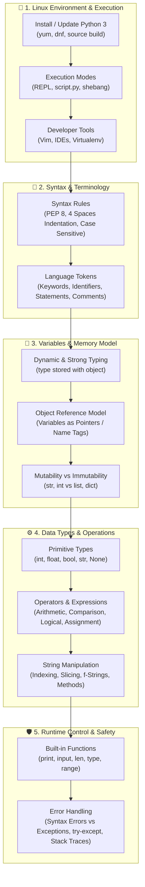
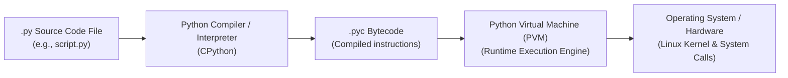
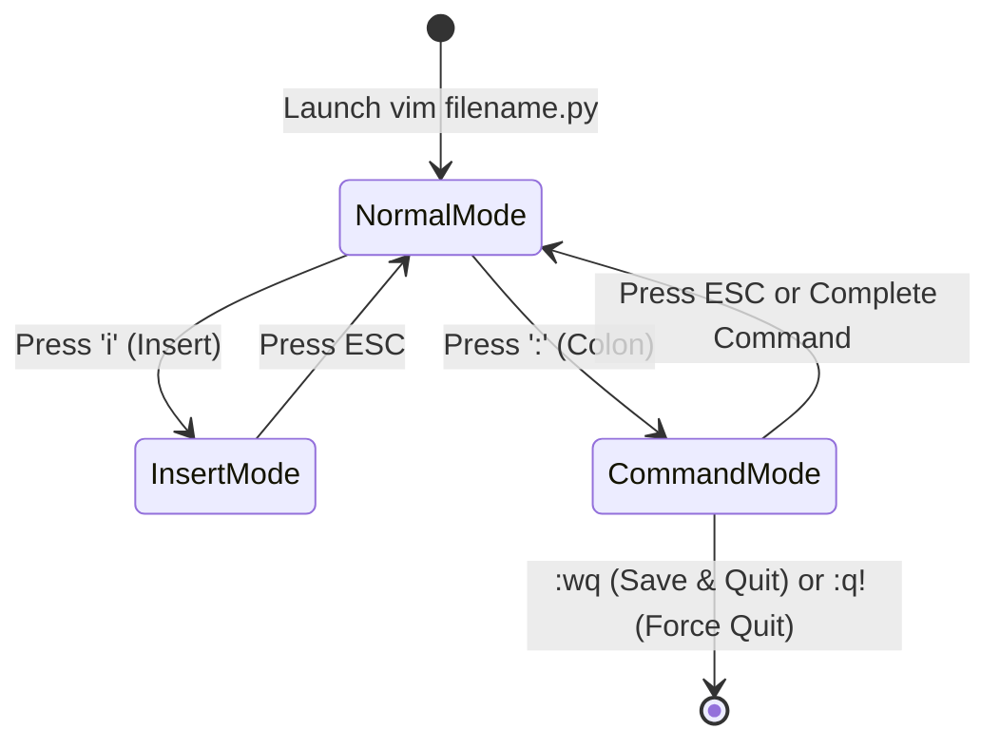
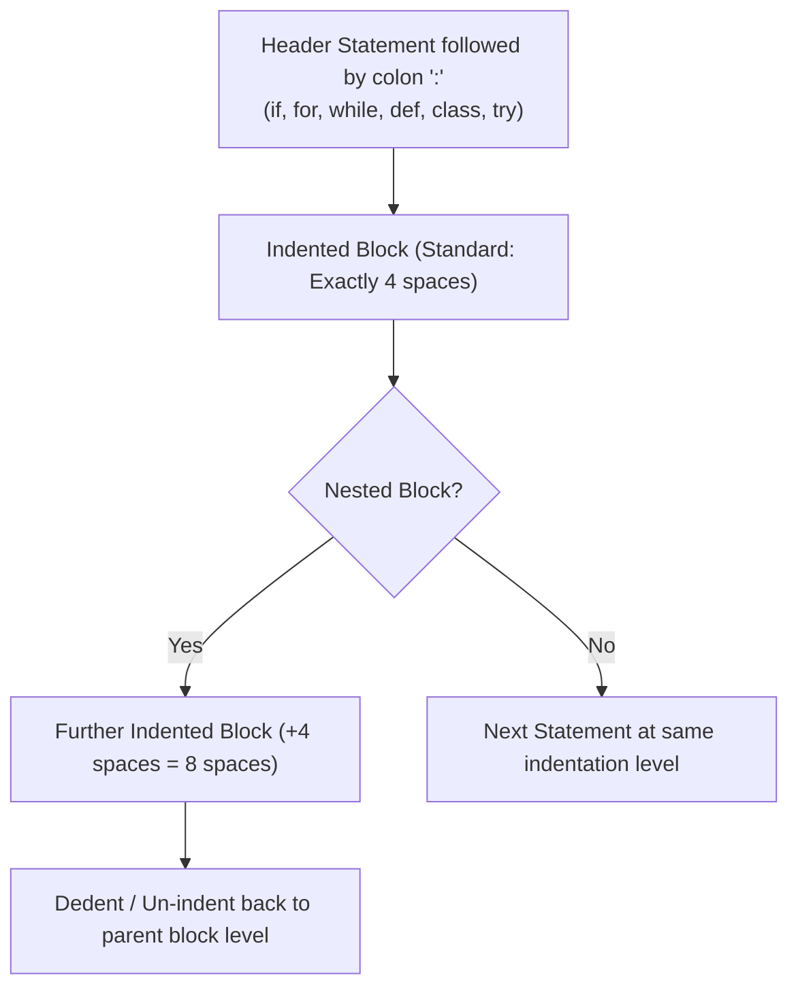
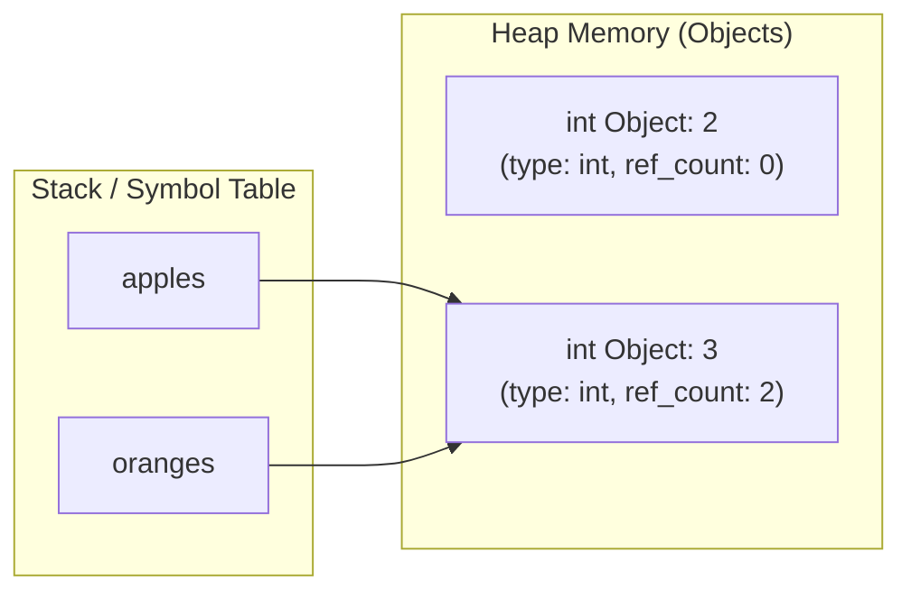
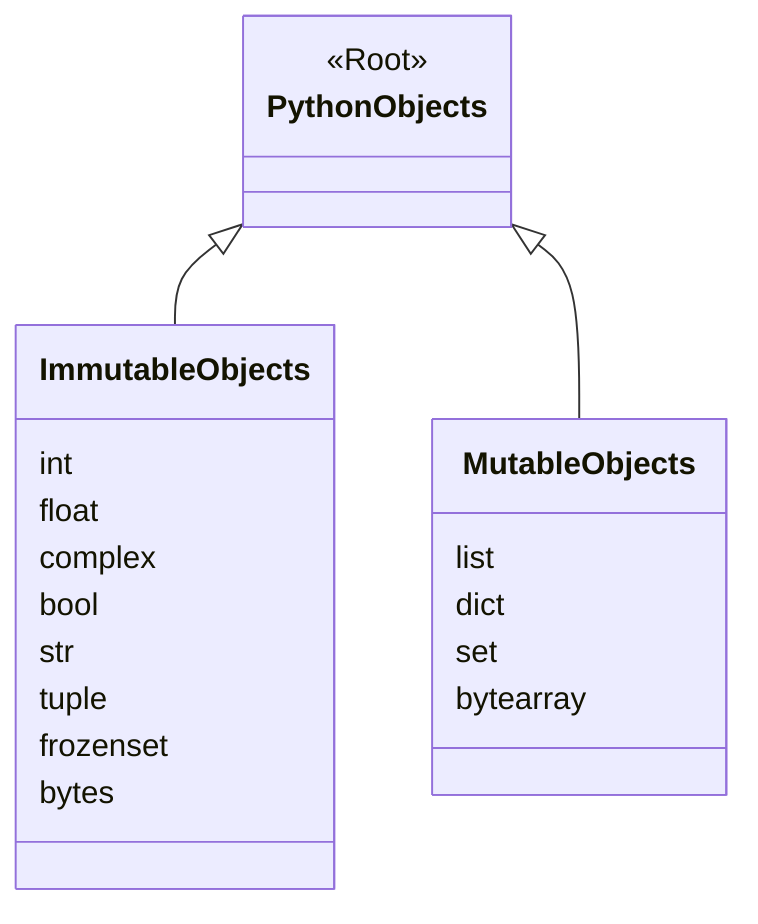
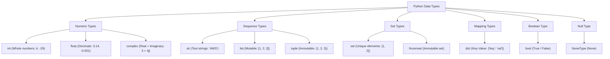
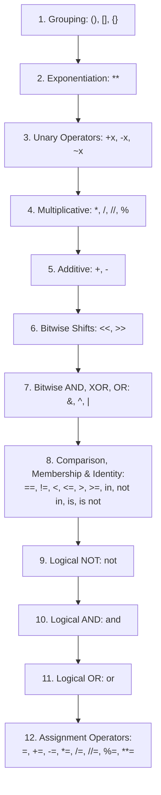
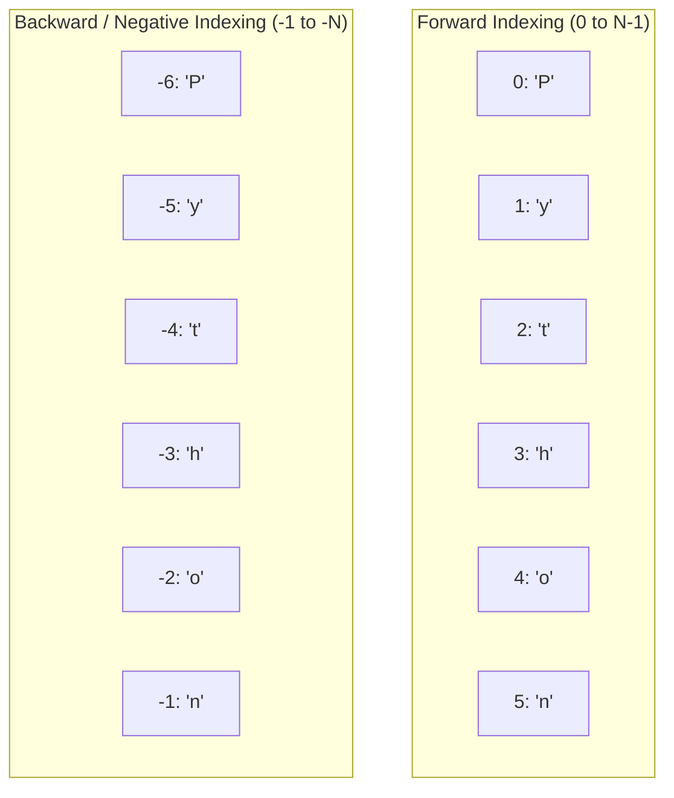
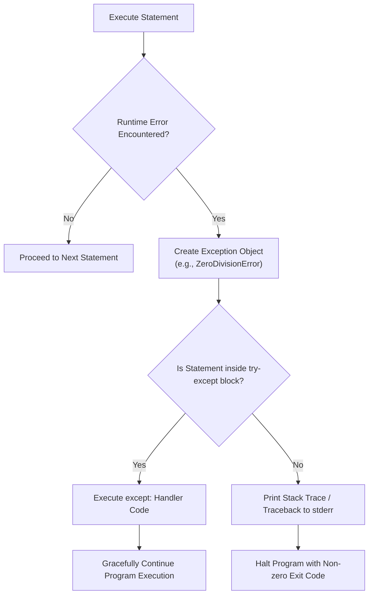

# 🐍 Module 05: Python Basics – Study Guide

> **Course**: AWS re/Start  
> **Module**: Python Programming (M05 – Python Basics)  
> **Source Document**: `T09-Python_Programming/T09-0003-RSPP_EN-US_SG_M05_PYTHONBASICS.pdf`  
> **Target Audience**: AWS re/Start Learners, Cloud Practitioners, DevOps Engineers, and Systems Operations Associates  

---

## 🎯 Module Overview

Python is one of the most popular, versatile, and readable programming languages in modern computing. In cloud administration, DevOps, site reliability engineering (SRE), and systems automation, Python serves as the foundational language for writing infrastructure automation scripts, interacting with cloud APIs (such as AWS SDK `boto3`), configuring server instances, and processing operational data.

This study guide establishes the core syntax, terminology, data types, execution mechanisms, and fundamental programming concepts necessary to write clean, idiomatic, and robust Python code on Linux systems.



---

## 📌 Learning Objectives

By completing this module and working through the accompanying code demonstrations, you will be able to:

- [ ] **Install and Configure Python on Linux**: Verify installed Python versions, install build dependencies, compile Python from source on enterprise Linux (CentOS/RHEL), and manage packages using standard package managers.
- [ ] **Execute Python Programs**: Run interactive sessions via the Python REPL, execute scripts via the CLI interpreter (`python3 script.py`), and configure executable scripts with shebang lines (`#!/usr/bin/env python3`) and execution permissions (`chmod +x`).
- [ ] **Master Python Syntax Rules & Terminology**: Apply PEP 8 formatting standards, indentation rules (4 spaces, no tabs), colon syntax (`:`), naming rules for identifiers, reserved keywords, and multi-line commenting practices.
- [ ] **Understand the Python Object & Memory Model**: Differentiate between variables and objects, explain dynamic and strong typing, track variable reassignment through pointer references, and distinguish between mutable and immutable data structures.
- [ ] **Utilize Fundamental Data Types**: Instantiate, evaluate, and manipulate integers (`int`), floating-point numbers (`float`), booleans (`bool`), text strings (`str`), and the null object (`NoneType`).
- [ ] **Evaluate Operators and Precedence**: Perform operations using arithmetic, relational/comparison, assignment, compound assignment, logical (Boolean), membership (`in`), and identity (`is`) operators according to formal operator precedence.
- [ ] **Manipulate and Format Strings**: Concatenate, repeat, slice, and transform strings using modern f-strings (`f"{var}"`), `str.format()`, escape characters, and core string methods.
- [ ] **Perform Type Conversion (Casting)**: Explicitly cast data types using `int()`, `float()`, `str()`, and `bool()`, and assess truth value testing (truthy vs. falsy).
- [ ] **Utilize Built-in Functions & Manage Exceptions**: Implement essential built-in functions (`print()`, `input()`, `len()`, `type()`, `id()`), diagnose runtime exceptions from stack traces, and implement structured error handling (`try-except`).

---

## 🐧 1. Installing and Running Python on Linux

Python is natively cross-platform and operates consistently across Microsoft Windows, macOS, and Linux. In enterprise cloud and Linux server environments, managing Python versions and knowing how to execute scripts directly from the terminal are vital systems administration skills.



### 1.1 Verifying Installed Python Versions

Most Linux distributions ship with Python pre-installed. However, enterprise systems (like legacy CentOS 7) historically defaulted to Python 2.7, which reached end-of-life (EOL) in January 2020. Modern cloud environments run Python 3 (such as Python 3.7 through 3.12+).

To check the installed versions on your system:

```bash
# Check system default Python (frequently points to Python 2 on older distributions)
python --version

# Check Python 3 version
python3 --version

# Check specific minor version installations
python3.7 -V
python3.11 -V
```

> [!WARNING]
> On Red Hat Enterprise Linux (RHEL), CentOS, and older systems, system maintenance utilities like `yum` rely on the system-default `/usr/bin/python`. Never overwrite or delete `/usr/bin/python` directly; always install modern Python versions alongside the system version (e.g., via `make altinstall` or specific package names).

---

### 1.2 Package Management: Installing via OS Repositories

On modern Linux distributions, Python 3 can be installed quickly using the distribution's package manager:

```bash
# Amazon Linux 2023 / Fedora / RHEL 8/9 / CentOS Stream
sudo dnf install python3 -y

# Amazon Linux 2 (using yum)
sudo yum install python3 -y

# Ubuntu / Debian
sudo apt update && sudo apt install python3 python3-pip -y
```

---

### 1.3 Compiling Python from Source (CentOS / RHEL Walkthrough)

When an enterprise distribution does not provide the desired Python version in its base repositories, compiling from source guarantees access to the exact runtime version needed.

#### Step-by-Step Source Build Procedure:

1. **Install Compiler Toolchain and Header Dependencies**:
   ```bash
   sudo yum install -y gcc openssl-devel bzip2-devel libffi-devel zlib-devel make wget
   ```
   *Explanation*: `gcc` is the GNU Compiler Collection; the development libraries provide headers for SSL encryption (`openssl-devel`), compression (`bzip2-devel`), and foreign function interfaces (`libffi-devel`).

2. **Navigate to the Source Directory and Download Source Archive**:
   ```bash
   cd /usr/src
   sudo wget https://www.python.org/ftp/python/3.7.2/Python-3.7.2.tgz
   ```

3. **Extract the Compressed Tarball**:
   ```bash
   sudo tar -xzf Python-3.7.2.tgz
   ```

4. **Configure the Build and Compile**:
   ```bash
   cd Python-3.7.2
   sudo ./configure --enable-optimizations
   sudo make altinstall
   ```
   > [!IMPORTANT]
   > Always use `make altinstall` instead of `make install`. `make altinstall` installs the binary as `/usr/local/bin/python3.7` without replacing the system default `/usr/bin/python` or `/usr/bin/python3`, preventing critical operating system tools from breaking.

5. **Clean Up Build Artifacts**:
   ```bash
   cd /usr/src
   sudo rm -f /usr/src/Python-3.7.2.tgz
   ```

6. **Verify the Installation**:
   ```bash
   python3.7 --version
   # Expected Output: Python 3.7.2
   ```

---

### 1.4 Modes of Executing Python Code

| Execution Method | Command Syntax | Use Case / Characteristics |
| :--- | :--- | :--- |
| **Interactive REPL** | `python3` | Interactive Read-Eval-Print Loop; ideal for rapid testing, inspecting APIs, and calculating expressions. Exit with `exit()` or `Ctrl+D`. |
| **Direct Script Execution** | `python3 script.py` | Invokes the Python interpreter to read, compile to bytecode, and execute the specified script file. |
| **Executable Script (Shebang)** | `./script.py` | Relies on the script's shebang line and executable file system permissions (`chmod +x`). |
| **Module Execution** | `python3 -m <module>` | Runs a library module as a standalone script (e.g., `python3 -m http.server 8000` or `python3 -m venv myenv`). |

#### Setting Up Executable Scripts with a Shebang (`#!`)

A **shebang** line is the first line in a Unix script that instructs the operating system loader which interpreter to use to parse the file.

```python
#!/usr/bin/env python3
# -*- coding: utf-8 -*-

print("This script runs directly from the terminal!")
```

To make the script executable in Linux:
```bash
# Add execution permission for the file owner and group
chmod +x script.py

# Run the script directly
./script.py
```

> [!TIP]
> Always use `#!/usr/bin/env python3` instead of hardcoding `#!/usr/bin/python3`. The `env` utility searches the user's current `$PATH`, allowing the script to execute cleanly within virtual environments (`venv`) or custom installation directories.

---

### 1.5 Terminal Text Editor Review: Vim Quick Reference

In headless Linux servers without a graphical interface, terminal editors such as **Vim** are standard for writing Python scripts.



- **Open or create a file**: `vim filename.py`
- **Enter Insert mode**: Press <kbd>i</kbd> (allows typing and editing code)
- **Return to Normal mode**: Press <kbd>ESC</kbd>
- **Save changes (Write)**: In Normal mode, type `:w` and press <kbd>Enter</kbd>
- **Quit Vim**: In Normal mode, type `:q` and press <kbd>Enter</kbd>
- **Save and Quit**: In Normal mode, type `:wq` or `:x` and press <kbd>Enter</kbd>
- **Discard changes and force quit**: In Normal mode, type `:q!` and press <kbd>Enter</kbd>

---

### 🧪 Hands-On Lab Demo 1: "Hello World" Script

Follow these steps to create, save, and execute your first standalone Python script:

1. Open your terminal and create a file named `helloworld.py` using Vim:
   ```bash
   vim helloworld.py
   ```
2. Press <kbd>i</kbd> to enter Insert mode.
3. Type the following code:
   ```python
   # Lab Demo: Hello World
   print("Hello World")
   ```
4. Press <kbd>ESC</kbd> to return to Normal mode.
5. Save and exit by typing `:wq` and pressing <kbd>Enter</kbd>.
6. Run the script using the Python 3 interpreter:
   ```bash
   python3 helloworld.py
   ```
7. **Observed Output**:
   ```text
   Hello World
   ```

---

## 📐 2. Basic Python Terminology & Syntax Rules

Python was designed by Guido van Rossum with an explicit emphasis on readability and simplicity, famously captured in *The Zen of Python* (`import this`): *"Readability counts"* and *"Explicit is better than implicit."*

### 2.1 Indentation and Code Blocks

Unlike languages such as C, C++, Java, or JavaScript that use curly braces `{}` to define code blocks, Python uses **indentation and whitespace** to group statements.



#### PEP 8 Indentation Rules:
- **Standard**: Always use **4 spaces per indentation level**.
- **No Tabs**: Do **not** mix tabs and spaces. Mixing tabs and spaces results in a `TabError: inconsistent use of tabs and spaces in indentation`.
- **Colon (`:`) Syntax**: Every statement introducing an indented block (such as `if`, `else`, `for`, `while`, `def`, `class`, `try`) must terminate with a colon (`:`).

```python
# Valid indentation:
total_score = 85
if total_score >= 70:
    print("Status: Passed")
    print("Congratulations!")
else:
    print("Status: Incomplete")
print("Evaluation Complete.")  # Outside the if-else block
```

---

### 2.2 Case Sensitivity

Python is strictly **case sensitive**. The case of letters differentiates identifiers, variables, keywords, and function names:

```python
name = "Alice"
Name = "Bob"
NAME = "Charlie"

print(name)  # Outputs: Alice
print(Name)  # Outputs: Bob
print(NAME)  # Outputs: Charlie

# Keywords must match exact casing:
# True  -> Valid boolean
# true  -> NameError: name 'true' is not defined
```

---

### 2.3 Identifiers & Naming Rules

An **identifier** is a user-defined name given to an entity such as a variable, function, class, module, or object.

#### Strict Syntactic Rules:
1. **Valid Characters**: An identifier can only contain ASCII letters (`a-z`, `A-Z`), digits (`0-9`), and underscores (`_`).
2. **Cannot Start with a Digit**: `variable_1` is valid; `1_variable` is a syntax error.
3. **No Special Characters**: Symbols such as `@`, `$`, `%`, `!`, `-`, `?`, or `#` cannot be used in identifiers.
4. **Cannot Be a Reserved Keyword**: Words reserved by Python (e.g., `class`, `def`, `for`, `global`) cannot be used as identifier names.
5. **Length**: Identifiers can be of arbitrary length.

```python
# Valid Identifiers
server_ip = "10.0.0.1"
instance2 = "t3.micro"
_private_key = "secret"
AWS_REGION = "us-east-1"

# Invalid Identifiers
# 2servers = "cluster"      -> SyntaxError: invalid decimal literal
# server-ip = "10.0.0.1"    -> SyntaxError: cannot assign to expression here
# user@domain = "test"      -> SyntaxError: invalid syntax
# class = "Networking"      -> SyntaxError: invalid syntax (keyword collision)
```

#### PEP 8 Naming Conventions:
- **Variables & Functions**: `snake_case` (e.g., `user_account`, `calculate_total()`)
- **Classes**: `PascalCase` / `CapWords` (e.g., `CloudInstance`, `DatabaseConnection`)
- **Constants**: `UPPER_SNAKE_CASE` (e.g., `MAX_RETRY_COUNT`, `DEFAULT_TIMEOUT`)
- **Internal / Private Attributes**: Leading underscore `_protected_member` or `__private_member`

---

### 2.4 Reserved Keywords

Python reserves a set of keywords for internal syntax and control structures. You cannot declare variables or functions with these names.

```python
# To view all keywords dynamically in Python:
import keyword
print(keyword.kwlist)
```

| Category | Keywords |
| :--- | :--- |
| **Boolean & Null** | `True`, `False`, `None` |
| **Logical Operators** | `and`, `or`, `not` |
| **Conditional Branching** | `if`, `elif`, `else` |
| **Iteration & Loops** | `for`, `while`, `break`, `continue`, `pass` |
| **Functions & Scope** | `def`, `return`, `lambda`, `global`, `nonlocal`, `yield` |
| **Classes & Objects** | `class` |
| **Modules & Namespaces** | `import`, `from`, `as` |
| **Exception Handling** | `try`, `except`, `finally`, `raise`, `assert` |
| **Context Management** | `with`, `as` |
| **Identity & Membership** | `is`, `in` |
| **Asynchronous Programming** | `async`, `await` |
| **Variable Deletion** | `del` |

---

### 2.5 Comments

Comments provide explanatory notes to developers and document code logic. The Python interpreter ignores comments during execution.

```python
# 1. Single-line comment: Explains the purpose of the line below
vpc_cidr = "192.168.0.0/16"

subnet_cidr = "192.168.1.0/24"  # 2. Inline comment: Explains this specific assignment

# 3. Multi-line explanatory comment block:
# Each line begins with a pound / hash sign (#).
# This configuration applies to the primary web server cluster
# located within the us-east-1a Availability Zone.

# 4. Docstrings (Documentation Strings):
# Multi-line strings enclosed in triple quotes (''' or """)
# Used as formal documentation for modules, classes, and functions.
def deploy_instance(instance_type):
    """
    Deploys a new EC2 virtual machine instance.
    
    Parameters:
        instance_type (str): The EC2 instance size (e.g., 't3.micro')
        
    Returns:
        bool: True if deployment succeeded, False otherwise.
    """
    return True
```

---

### 2.6 Statements vs. Expressions

- **Expression**: Any piece of code that evaluates to a value (e.g., `2 + 3`, `len("hello")`, `x > 10`).
- **Statement**: An executable unit of code that performs an action or controls program execution (e.g., assignment `x = 5`, condition `if x:`, loop `for i in range(5):`).

```python
apples = 2       # Statement 1: Assigns integer 2 to variable 'apples'
oranges = 3      # Statement 2: Assigns integer 3 to variable 'oranges'
apples = oranges  # Statement 3: Rebinds 'apples' to refer to what 'oranges' references

print(apples)    # Statement 4: Invokes print() function; outputs 3
```

---

## 🧠 3. Variables & the Python Memory Model

In many languages (like C, C++, or Java), a variable is a named memory location that is typed and holds a direct value. In Python, **variables are reference tags (pointers) bound to objects located in heap memory**.



### 3.1 Dynamic and Strong Typing

Python is both **dynamically typed** and **strongly typed**:

1. **Dynamically Typed**:
   - Variables do not have fixed types; **objects have types**.
   - You do not declare variable types explicitly (no `int x = 5;`).
   - A variable name can be bound to an integer, and later rebound to a string without error.
2. **Strongly Typed**:
   - Python strictly enforces type rules at runtime.
   - It does **not** automatically coerce incompatible types (e.g., adding an integer to a string raises a `TypeError` rather than converting implicitly).

```python
# Dynamic Typing: Rebinding to different types
x = 100            # x references an int object
print(type(x))     # <class 'int'>

x = "Server Alpha" # x now references a str object
print(type(x))     # <class 'str'>

# Strong Typing: Strict boundary enforcement
score = 95
message = "Your score is: "

# print(message + score)
# TypeError: can only concatenate str (not "int") to str

# Proper explicit type conversion:
print(message + str(score))  # Outputs: Your score is: 95
```

---

### 3.2 Object References and the `id()` Function

Every object created in Python has:
1. An **Identity** (an integer representing its memory address, retrieved via `id(obj)`).
2. A **Type** (retrieved via `type(obj)`).
3. A **Value** (the data contained).

```python
a = 42
b = a

print(id(a))  # e.g., 140707431282824
print(id(b))  # Exactly the same memory address as 'a'
print(a is b) # True: Both variables reference the identical object in memory
```

---

### 3.3 Mutability vs. Immutability

An object's **mutability** defines whether its state or contents can be altered in place after creation.



| Classification | Types | Behavior when Modified | Memory Implications |
| :--- | :--- | :--- | :--- |
| **Immutable** | `int`, `float`, `str`, `bool`, `tuple`, `frozenset`, `bytes` | **Cannot be changed in place**. Any operation that modifies the value creates an entirely **new object** in memory. | Safe for concurrent reads; can be used as dictionary keys (if hashable). |
| **Mutable** | `list`, `dict`, `set`, `bytearray` | **Can be changed in place**. Elements can be added, updated, or removed without altering the object's identity (`id()`). | Changes made through one variable reference are visible through all alias references. |

#### Demonstrating String Immutability:

```python
original = "AWS"
old_id = id(original)

# Attempting to modify by concatenation
original = original + " re/Start"
new_id = id(original)

print(original)           # Outputs: AWS re/Start
print(old_id == new_id)   # False: A brand new string object was created in memory!
```

---

### 🧪 Hands-On Lab Demo 2: Variables & Types

Create and run a script named `variables.py` to observe variable assignments and standard outputs:

```python
# variables.py
x = 33
y = 7.0
variable_challenge = "I love Python"

# Printing variables to the standard output
print("Value of x:", x, "| Type:", type(x))
print("Value of y:", y, "| Type:", type(y))
print("Value of variable_challenge:", variable_challenge, "| Type:", type(variable_challenge))
```

Run from the command line:
```bash
python3 variables.py
```
**Expected Output:**
```text
Value of x: 33 | Type: <class 'int'>
Value of y: 7.0 | Type: <class 'float'>
Value of variable_challenge: I love Python | Type: <class 'str'>
```

---

## 📦 4. Fundamental Data Types

Python comes with a rich collection of built-in data types.



### 4.1 Detailed Primitive Types

#### 1. Integer (`int`)
- Represents whole numbers of arbitrary precision (unlimited digits, constrained only by system memory).
- Supports negative numbers and positive numbers.
- Examples: `42`, `-15`, `0`, `1_000_000` (underscores can be used as visual separators for readability).

#### 2. Floating-Point Number (`float`)
- Represents real numbers containing a decimal point, implemented as IEEE 754 double-precision (64-bit).
- Supports scientific notation: `1.5e3` (1500.0) or `2.4e-2` (0.024).
- Examples: `3.14159`, `-0.001`, `7.0`.

#### 3. Boolean (`bool`)
- Subtype of integers representing logical truth states: `True` (evaluates as 1) and `False` (evaluates as 0).
- Capitalization is strictly enforced: `True` and `False` are valid; `true` or `false` raise a `NameError`.

#### 4. String (`str`)
- An immutable ordered sequence of Unicode code points.
- Delimited by single quotes (`'...'`), double quotes (`"..."`), or triple quotes (`'''...'''` / `"""..."""`).

#### 5. NoneType (`None`)
- A special singleton constant representing the absence of a value or null state.
- Commonly used as a default return value for functions that do not explicitly return anything, or as a placeholder default argument.

```python
result = None
if result is None:
    print("No response received from cloud endpoint.")
```

---

### 4.2 Type Inspection: `type()` vs. `isinstance()`

To inspect the type of an object, use `type()` or `isinstance()`:

```python
port = 8080

# Using type()
print(type(port))                  # <class 'int'>
print(type(port) == int)           # True

# Using isinstance() (Best Practice: supports inheritance checks)
print(isinstance(port, int))       # True
print(isinstance(port, (int, str))) # True (checks against a tuple of candidate types)
```

> [!TIP]
> In production code and cloud automation, prefer `isinstance(object, class_or_tuple)` over `type(object) == cls`, because `isinstance()` correctly handles subclasses and inheritance hierarchies.

---

## ⚙️ 5. Operations and Operators

Operators are special symbols and keywords that perform computations on operands.

### 5.1 Arithmetic Operators

Arithmetic operators execute mathematical calculations on numeric types (`int`, `float`, `complex`).

| Operator | Name | Description | Example | Result |
| :---: | :--- | :--- | :---: | :---: |
| `+` | Addition | Sum of operands | `10 + 5` | `15` |
| `-` | Subtraction | Difference between operands | `10 - 5` | `5` |
| `*` | Multiplication | Product of operands | `10 * 5` | `50` |
| `/` | True Division | Quotient as a floating-point number | `10 / 4` | `2.5` |
| `//` | Floor Division | Quotient rounded down to the nearest integer | `10 // 4` | `2` |
| `%` | Modulo | Remainder of division | `10 % 3` | `1` |
| `**` | Exponentiation | Base raised to the power of exponent | `2 ** 3` | `8` |

> [!NOTE]
> In Python 3, standard division `/` always returns a `float`, even when dividing evenly (e.g., `4 / 2` yields `2.0`). Use floor division `//` if you require an integer result.

---

### 5.2 Comparison (Relational) Operators

Comparison operators evaluate expressions and return a boolean (`True` or `False`).

| Operator | Description | Example | Result |
| :---: | :--- | :---: | :---: |
| `==` | Equal to (value equality) | `5 == 5` | `True` |
| `!=` | Not equal to | `5 != 3` | `True` |
| `<` | Less than | `3 < 7` | `True` |
| `>` | Greater than | `10 > 20` | `False` |
| `<=` | Less than or equal to | `5 <= 5` | `True` |
| `>=` | Greater than or equal to | `8 >= 12` | `False` |

---

### 5.3 Assignment and Compound Assignment Operators

Assignment operators bind values to variables. Compound assignment operators perform an operation and reassign the result to the left-hand operand.

| Operator | Expansion Syntax | Description | Example ($x = 10$) | New Value of $x$ |
| :---: | :---: | :--- | :---: | :---: |
| `=` | $x = y$ | Direct assignment | `x = 20` | `20` |
| `+=` | $x = x + y$ | Add and assign | `x += 5` | `15` |
| `-=` | $x = x - y$ | Subtract and assign | `x -= 3` | `7` |
| `*=` | $x = x * y$ | Multiply and assign | `x *= 2` | `20` |
| `/=` | $x = x / y$ | Divide and assign | `x /= 2` | `5.0` |
| `//=` | $x = x // y$ | Floor divide and assign | `x //= 3` | `3` |
| `%=` | $x = x \% y$ | Modulo and assign | `x %= 4` | `2` |
| `**=` | $x = x ** y$ | Power and assign | `x **= 2` | `100` |

---

### 5.4 Logical (Boolean) Operators

Logical operators combine boolean expressions and implement short-circuit evaluation.

| Operator | Description | Example | Result |
| :---: | :--- | :---: | :---: |
| `and` | Returns `True` if **both** operands evaluate to True | `(5 > 2) and (10 > 5)` | `True` |
| `or` | Returns `True` if **at least one** operand evaluates to True | `(5 < 2) or (10 > 5)` | `True` |
| `not` | Logical negation; inverts the boolean truth value | `not (5 > 2)` | `False` |

#### Short-Circuit Evaluation:
- In `A and B`, if `A` is `False`, Python immediately returns `A` without evaluating `B` (since the expression can never be True).
- In `A or B`, if `A` is `True`, Python immediately returns `A` without evaluating `B` (since the expression is already guaranteed True).

---

### 5.5 Identity Operators vs. Value Equality

Python provides identity operators (`is`, `is not`) alongside equality operators (`==`, `!=`).

- **`==` (Value Equality)**: Checks whether the values of two objects are equivalent.
- **`is` (Identity Equality)**: Checks whether two variables point to the **exact same memory address** (`id(a) == id(b)`).

```python
list1 = [1, 2, 3]
list2 = [1, 2, 3]
list3 = list1

print(list1 == list2)  # True: They contain identical elements
print(list1 is list2)  # False: They are distinct list objects allocated in heap memory
print(list1 is list3)  # True: list3 points to the exact same list instance in memory
```

> [!IMPORTANT]
> Always use `is` or `is not` when checking for `None` (e.g., `if response is None:`), because `None` is a singleton in Python.

---

### 5.6 Membership Operators

Membership operators validate whether an element exists within an iterable sequence (such as a string, list, tuple, dictionary, or set).

```python
allowed_roles = ["Admin", "DevOps", "Architect"]

print("DevOps" in allowed_roles)      # True
print("Auditor" in allowed_roles)     # False
print("Auditor" not in allowed_roles) # True

message = "Deployment to us-east-1 successful"
print("us-east-1" in message)        # True (substring check)
```

---

### 5.7 Comprehensive Operator Precedence

When multiple operators appear in a single expression, Python evaluates them according to operator precedence (from highest precedence to lowest).



| Precedence Order | Operator Syntax | Description / Category | Associativity |
| :---: | :--- | :--- | :---: |
| **1 (Highest)** | `(...)`, `[...]`, `{...}` | Parenthesized expressions, list literals, dictionary/set literals | Left-to-right |
| **2** | `**` | Exponentiation (Power) | **Right-to-left** |
| **3** | `+x`, `-x`, `~x` | Unary positive, unary negation, bitwise NOT | Right-to-left |
| **4** | `*`, `/`, `//`, `%` | Multiplication, division, floor division, modulo | Left-to-right |
| **5** | `+`, `-` | Addition, subtraction | Left-to-right |
| **6** | `<<`, `>>` | Bitwise shift left, bitwise shift right | Left-to-right |
| **7** | `&` | Bitwise AND | Left-to-right |
| **8** | `^` | Bitwise XOR | Left-to-right |
| **9** | `\|` | Bitwise OR | Left-to-right |
| **10** | `==`, `!=`, `<`, `<=`, `>`, `>=`, `is`, `is not`, `in`, `not in` | Comparisons, identity tests, and membership tests | Left-to-right (Chained) |
| **11** | `not` | Logical Boolean NOT | Right-to-left |
| **12** | `and` | Logical Boolean AND | Left-to-right |
| **13** | `or` | Logical Boolean OR | Left-to-right |
| **14 (Lowest)** | `=`, `+=`, `-=`, `*=`, `/=`, `%=`, `//=`, `**=`, etc. | Assignment and compound assignment | Right-to-left |

---

### 🧪 Hands-On Lab Demo 3: Basic Math & Combining Variables

Create and run `basicmath.py`:

```python
# basicmath.py
print("--- Direct Arithmetic ---")
print("1 + 1 =", 1 + 1)
print("100 / 33 =", 100 / 33)
print("2 ** 3 =", 2 ** 3)

print("\n--- Variable Assignments & Operations ---")
easy_math = 1 + 1
one_third = 100 / 33
powerful = 2 ** 3

print("easy_math:", easy_math)
print("one_third:", round(one_third, 4))
print("powerful:", powerful)

print("\n--- Algebraic Equivalence ---")
x = 2
y = 4
z = x + y

print("x + y =", x + y)
print("z =", z)
print("Does z == (x + y)?", z == (x + y))
```

Run via CLI:
```bash
python3 basicmath.py
```
**Expected Output:**
```text
--- Direct Arithmetic ---
1 + 1 = 2
100 / 33 = 3.0303030303030303
2 ** 3 = 8

--- Variable Assignments & Operations ---
easy_math: 2
one_third: 3.0303
powerful: 8

--- Algebraic Equivalence ---
x + y = 6
z = 6
Does z == (x + y)? True
```

---

## 🔤 6. String Operations, Slicing & Modern Formatting

Strings (`str`) represent textual data and are ordered, immutable sequences of characters.

### 6.1 String Delimiters

```python
# Single quotes
str_single = 'Cloud Practitioner'

# Double quotes (allows unescaped single quotes inside)
str_double = "I'm learning Python"

# Triple quotes (spans multiple lines and preserves whitespace/newlines)
str_multiline = """This multi-line string
preserves newlines,
    indentation,
and formatting."""
```

---

### 6.2 String Operations: Concatenation and Repetition

```python
greeting = "Hello"
target = "World"

# Concatenation (+)
# Note: Python does not automatically insert spaces between concatenated strings.
message = greeting + ", " + target + "!"
print(message)  # Hello, World!

# Repetition (*)
divider = "=" * 30
print(divider)  # ==============================
```

---

### 6.3 String Indexing and Slicing

Because strings are ordered sequences, individual characters and subsequences can be extracted using indices.



#### Syntax: `sequence[start:stop:step]`
- `start`: Initial index (inclusive, defaults to 0).
- `stop`: Termination index (exclusive, defaults to length of string).
- `step`: Stride / increment (defaults to 1).

```python
text = "Python"

# Indexing
print(text[0])   # 'P' (First character)
print(text[-1])  # 'n' (Last character)

# Slicing
print(text[0:4])   # 'Pyth' (indices 0, 1, 2, 3)
print(text[:2])    # 'Py' (from beginning up to index 2)
print(text[2:])    # 'thon' (from index 2 to end)
print(text[::2])   # 'Pto' (every second character)
print(text[::-1])  # 'nohtyP' (reversed string)
```

---

### 6.4 String Formatting Styles

Python has evolved through three primary string formatting paradigms:

```python
name = "EC2 Instance"
instance_id = "i-0a1b2c3d4e5f"
vcpus = 4
cost_per_hour = 0.192

# 1. Modern Standard: f-Strings (Formatted String Literals, Python 3.6+)
# Cleanest, fastest, supports direct inline expressions
f_str = f"Server {name} ({instance_id}) has {vcpus} vCPUs at ${cost_per_hour:.2f}/hr"
print(f_str)

# 2. str.format() Method (Python 3.0+)
format_str = "Server {} ({}) has {} vCPUs at ${:.2f}/hr".format(
    name, instance_id, vcpus, cost_per_hour
)
print(format_str)

# 3. Legacy %-Formatting (printf style, Python 2 heritage)
legacy_str = "Server %s (%s) has %d vCPUs at $%.2f/hr" % (
    name, instance_id, vcpus, cost_per_hour
)
print(legacy_str)
```

> [!TIP]
> In modern Python development, **always prefer f-strings**. They are evaluated at runtime, produce significantly more readable code, and perform faster than `%` or `.format()`.

---

### 6.5 Essential Built-in String Methods

Because strings are immutable, string methods return a **new string** rather than modifying the original in place.

| Method | Description | Example Code | Output |
| :--- | :--- | :--- | :--- |
| `.upper()` | Converts all characters to uppercase | `"aws".upper()` | `"AWS"` |
| `.lower()` | Converts all characters to lowercase | `"PYTHON".lower()` | `"python"` |
| `.strip()` | Removes leading and trailing whitespace | `"  ec2  ".strip()` | `"ec2"` |
| `.replace(old, new)` | Replaces occurrences of a substring | `"prod-server".replace("prod", "dev")` | `"dev-server"` |
| `.split(sep)` | Splits string into a list by delimiter | `"10.0.1.25".split(".")` | `['10', '0', '1', '25']` |
| `sep.join(list)` | Joins an iterable of strings with separator | `"-".join(["us", "east", "1"])` | `"us-east-1"` |
| `.startswith(sub)` | Checks prefix (returns bool) | `"ami-12345".startswith("ami-")` | `True` |
| `.endswith(sub)` | Checks suffix (returns bool) | `"backup.tar.gz".endswith(".gz")` | `True` |
| `.find(sub)` | Returns lowest index of substring (or -1) | `"cloud".find("ou")` | `2` |
| `.count(sub)` | Counts occurrences of substring | `"banana".count("a")` | `3` |

---

### 🧪 Hands-On Lab Demo 4: Fun with Strings

Create and run `funwithstrings.py`:

```python
# funwithstrings.py
first_str = "I love dogs"
second_str = " and cats"

# Concatenate strings into a new variable
newstr = first_str + second_str
print("Concatenated:", newstr)

# Demonstrate common string methods
print("Uppercase:", newstr.upper())
print("Lowercase:", newstr.lower())
print("Word count (split):", len(newstr.split()))
print("Replaced:", newstr.replace("dogs", "cloud computing"))
```

Run via CLI:
```bash
python3 funwithstrings.py
```
**Expected Output:**
```text
Concatenated: I love dogs and cats
Uppercase: I LOVE DOGS AND CATS
Lowercase: i love dogs and cats
Word count (split): 5
Replaced: I love cloud computing and cats
```

---

## 🔄 7. Type Conversion and Casting

Because Python is strongly typed, you frequently need to explicitly convert data between types—such as parsing user input or reading configuration files.

### 7.1 Explicit Type Casting Functions

```mermaid
flowchart LR
    Input["Input Data"] --> Cast{"Casting Function"}
    Cast -->|int()| ToInt["Integer (int)"]
    Cast -->|float()| ToFloat["Float (float)"]
    Cast -->|str()| ToStr["String (str)"]
    Cast -->|bool()| ToBool["Boolean (bool)"]
```

```python
# 1. str to int / float
port_str = "443"
port_num = int(port_str)       # 443 (int)

latency_str = "12.45"
latency_float = float(latency_str) # 12.45 (float)

# 2. Number to str
count = 100
status = "Total active instances: " + str(count)
print(status)  # "Total active instances: 100"

# 3. float to int (Truncates decimal portion towards zero)
pi = 3.999
truncated_pi = int(pi)
print(truncated_pi)  # 3 (Note: int() truncates, does not round)
```

> [!WARNING]
> Passing an invalid format to `int()` or `float()` triggers a runtime `ValueError`. For example, `int("abc")` or `int("12.5")` will raise `ValueError: invalid literal for int()`. To parse `"12.5"` as an integer, first convert to float: `int(float("12.5"))`.

---

### 7.2 Truth Value Testing (Truthy vs. Falsy)

In Python, any object can be tested for truth value inside an `if` condition or boolean context.

#### Inherently Falsy Values:
- Constants: `None`, `False`
- Numeric Zero: `0`, `0.0`, `0j`
- Empty Sequences & Collections: `""` (empty string), `[]` (empty list), `()` (empty tuple), `{}` (empty dict), `set()` (empty set), `range(0)`

#### Truthy Values:
- Any non-zero number (e.g., `1`, `-5`, `0.001`)
- Any non-empty sequence or collection (e.g., `" "`, `[0]`, `{"status": "ok"}`)

```python
# Idiomatic Pythonic collection checking
active_tasks = []

if not active_tasks:
    print("Queue is empty. No tasks to process.")
else:
    print(f"Processing {len(active_tasks)} tasks.")
```

---

## 🛠️ 8. Built-in Functions & Exception Handling Overview

### 8.1 Common Built-in Functions

Python provides a core library of built-in functions available globally without needing an `import` statement:

| Function | Signature / Usage | Purpose / Return Value |
| :--- | :--- | :--- |
| `print(*args, sep=' ', end='\n')` | `print("Hello", 42)` | Writes string representation of objects to standard output (`stdout`). |
| `input(prompt)` | `user_val = input("Enter region: ")` | Reads a line of text entered by the user from standard input (`stdin`) as a `str`. |
| `len(s)` | `len("us-east-1")` | Returns the number of items in a sequence or collection. |
| `type(obj)` | `type(42)` | Returns the class / type of the object. |
| `id(obj)` | `id(x)` | Returns the unique memory address identifier of an object. |
| `range(start, stop[, step])` | `range(1, 6)` | Generates an immutable sequence of integers. |
| `abs(x)` | `abs(-15)` | Returns the absolute value of a number (`15`). |
| `round(number[, ndigits])` | `round(3.14159, 2)` | Rounds a floating-point number to specified decimal places (`3.14`). |

---

### 8.2 Understanding Exceptions

An **exception** is a runtime error detected during program execution. If unhandled, an exception immediately halts script execution and prints a **Stack Trace** (or **Traceback**).



#### Anatomy of a Traceback (Stack Trace):
```text
Traceback (most recent call last):
  File "network_check.py", line 12, in <module>
    result = calculate_bandwidth(total_bytes, duration)
  File "network_check.py", line 5, in calculate_bandwidth
    return total_bytes / duration
ZeroDivisionError: division by zero
```
- **File & Line Number**: Pinpoints exactly where the error occurred (`network_check.py`, line 5).
- **Call Stack**: Shows the chain of function calls leading up to the failure.
- **Exception Class**: The specific type of error (`ZeroDivisionError`).
- **Error Description**: Detailed error message (`division by zero`).

---

### 8.3 Common Built-in Exception Classes

| Exception Class | Root Cause / Trigger Condition | Code Example |
| :--- | :--- | :--- |
| `ZeroDivisionError` | Second argument of division or modulo is zero. | `100 / 0` |
| `NameError` | Referencing a variable or function name that has not been defined in the current scope. | `print(unassigned_variable)` |
| `TypeError` | Operation or function applied to an object of inappropriate type. | `"AWS" + 2024` |
| `ValueError` | Function receives an argument with correct type but inappropriate value. | `int("cluster_one")` |
| `IndexError` | Attempting to access an index out of bounds in a sequence. | `items = [1, 2]; print(items[5])` |
| `KeyError` | Looking up a non-existent key in a dictionary. | `db = {"host": "localhost"}; print(db["port"])` |
| `FileNotFoundError` | Attempting to open or read a file path that does not exist on disk. | `open("missing_config.json")` |
| `IndentationError` | Malformed indentation (missing spaces, mixed tabs). | Incorrect spacing in `if` block. |

---

### 8.4 Basic Exception Handling: The `try-except` Construct

To build resilient scripts that do not crash when encountering unexpected inputs or network outages, use `try-except` blocks.

```python
# Basic try-except block
try:
    dividend = 100
    divisor = 0
    result = dividend / divisor
except ZeroDivisionError as error:
    print(f"Error intercepted gracefully: {error}")
    result = None

print("Program continues executing normally. Result:", result)
```

#### Complete Structured Error Handling (`try-except-else-finally`):

```python
try:
    file_handle = open("system_metrics.txt", "r")
    data = file_handle.read()
except FileNotFoundError:
    print("Warning: Configuration file not found. Falling back to defaults.")
except PermissionError:
    print("Error: Access denied. Insufficient filesystem permissions.")
else:
    # Runs ONLY if the try block succeeded without raising any exception
    print("Metrics loaded successfully. Data length:", len(data))
finally:
    # Runs ALWAYS, regardless of whether exceptions were raised or caught
    print("Cleanup hook: Finalizing system health checks.")
```

---

## 📊 9. Summary & Quick Reference

### Core Concepts Matrix

| Topic | Key Rule / Principle | Example |
| :--- | :--- | :--- |
| **Linux Execution** | Always specify Python 3; use `python3 script.py` or executable shebang. | `#!/usr/bin/env python3` |
| **Indentation** | Standard is 4 spaces; blocks begin with a colon (`:`). | `if ready:`<br>`    deploy()` |
| **Naming Identifiers** | Letters, numbers, underscores; cannot begin with a number; no keywords. | `server_count_1` (Valid)<br>`1_server` (Invalid) |
| **Typing** | Dynamic (variables point to objects) and Strong (no implicit type coercion). | `x = 5`<br>`x = "five"` |
| **Immutability** | Modifying `int`, `float`, or `str` generates a brand new object in memory. | `s = "a"; s += "b"` (creates new string) |
| **Operators** | Standard arithmetic, comparisons (`==`, `!=`), and boolean logic (`and`, `or`, `not`). | `(x >= 10) and (y < 5)` |
| **Precedence** | Parentheses `()` highest; assignment `=` lowest. | `res = (2 + 3) * 4` |
| **Strings** | 0-indexed, sliceable with `[start:stop:step]`; use f-strings for formatting. | `f"Value: {val:.2f}"` |
| **Exceptions** | Unhandled runtime errors cause stack traces; catch with `try-except`. | `try: ... except Exception:` |

---

## ❓ 10. Checkpoint Questions & Answers

### Question 1
**Does Python limit you from using specific characters when you declare a variable?**

> **Answer**:  
> Yes. Python variable identifiers can only contain alphanumeric characters (`a-z`, `A-Z`, `0-9`) and underscores (`_`). You cannot use special characters or symbols such as `!`, `@`, `#`, `$`, `%`, `^`, `&`, `*`, `-`, or `?`. Furthermore, identifiers cannot start with a digit, and cannot match reserved Python keywords (such as `for`, `class`, `def`, or `import`).

---

### Question 2
**How are functions called / invoked in Python?**

> **Answer**:  
> Functions are invoked by specifying the function name followed immediately by parentheses containing any required arguments: `function_name(arguments)`. For example, `print("Hello")` invokes the `print` function with the argument `"Hello"`. Without parentheses, referencing the function name simply returns a pointer to the function object itself.

---

### Question 3
**Which data type do you use to store the value `1.7`—an integer or a float?**

> **Answer**:  
> You use a **float** (`float`). In Python, integers (`int`) represent whole numbers (e.g., `1`, `42`, `-10`), while floating-point numbers (`float`) represent real numbers containing decimal points or scientific notation.

---

### Question 4
**What is the `+=` operator used for, and how does it evaluate?**

> **Answer**:  
> The `+=` operator is a **compound assignment operator** (addition assignment). It adds the right-hand value (rvalue) to the left-hand variable (lvalue) and assigns the resulting sum back to the left-hand variable.  
> For example:
> ```python
> x = 5
> x += 10  # Equivalent to: x = x + 10
> print(x) # Outputs: 15
> ```
> When applied to strings or lists, `+=` performs concatenation and in-place extension.

---

### Question 5
**What is the difference between `==` and `is` in Python?**

> **Answer**:  
> - `==` tests for **value equality**: it evaluates whether the data values contained inside two objects are equivalent.
> - `is` tests for **identity equality**: it evaluates whether two variables point to the **exact same memory address** in heap memory (`id(a) == id(b)`).
> 
> Example:
> ```python
> a = [1, 2, 3]
> b = [1, 2, 3]
> print(a == b)  # True (identical values)
> print(a is b)  # False (distinct objects in memory)
> ```

---

### Question 6
**Why is it recommended to use `make altinstall` rather than `make install` when compiling Python from source on an enterprise Linux system?**

> **Answer**:  
> On enterprise Linux distributions (such as RHEL, CentOS, or Amazon Linux), critical operating system tools and package managers (like `yum`) depend directly on the default system Python binary located at `/usr/bin/python`. Running `make install` overwrites the system default binary, which can break system utilities. Running `make altinstall` installs the compiled binary under a version-specific name (e.g., `/usr/local/bin/python3.7`), safely preserving the system's default Python environment.
