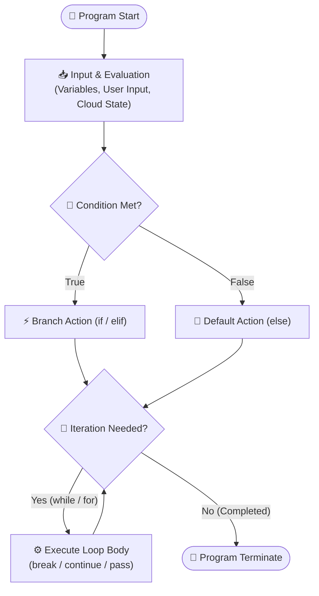
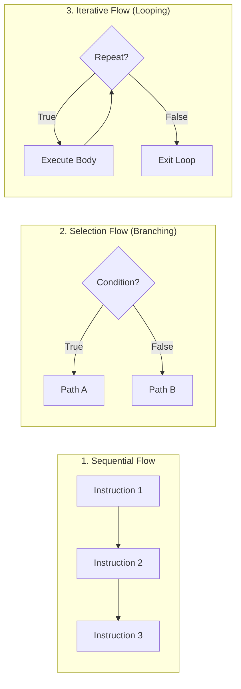
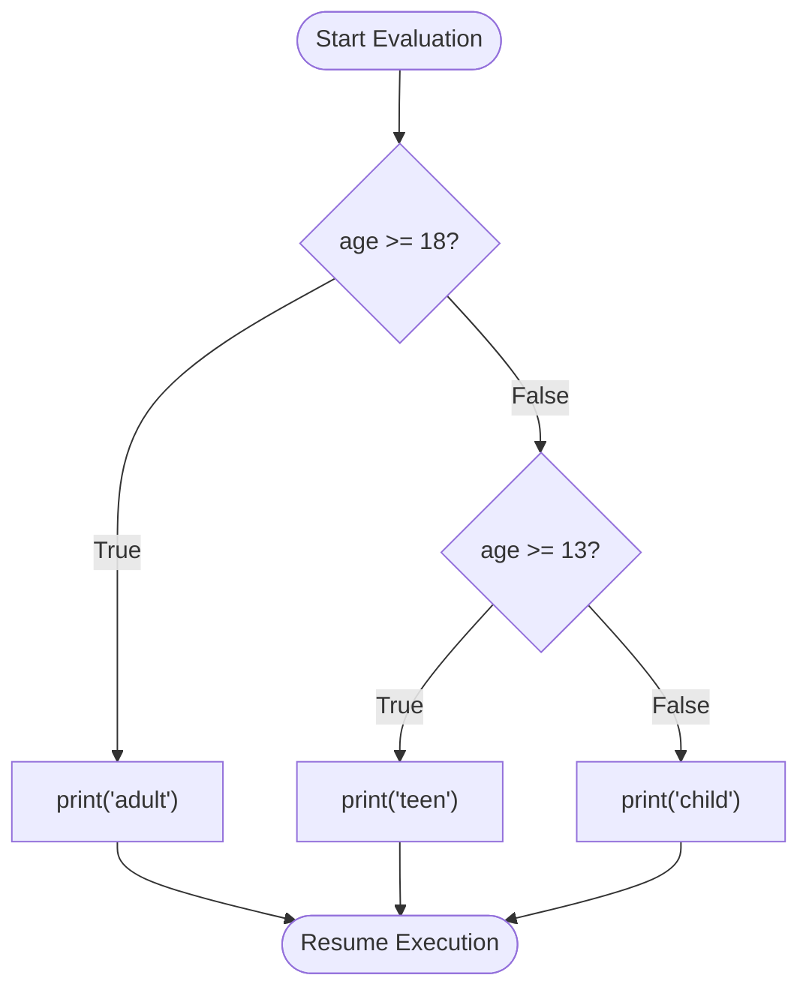
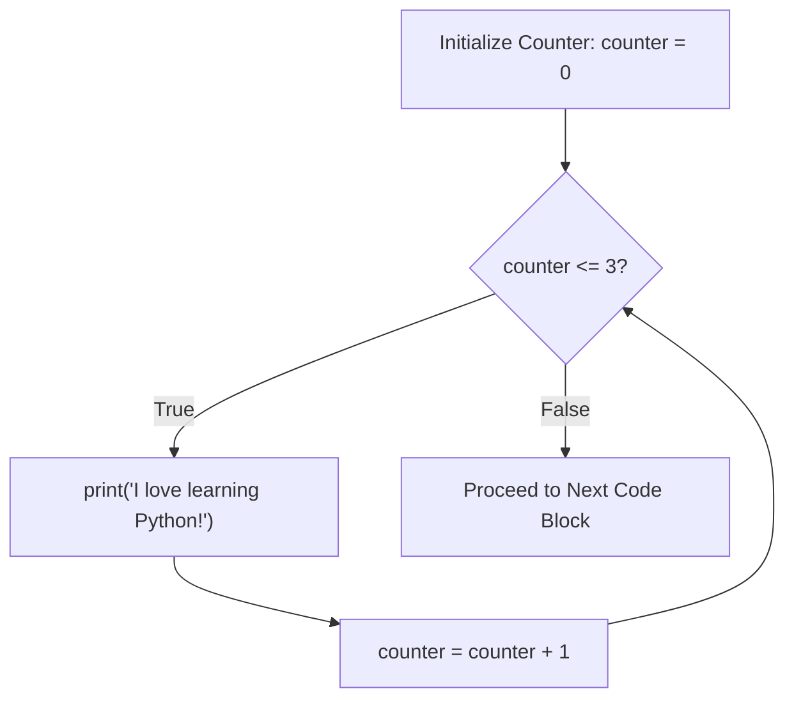
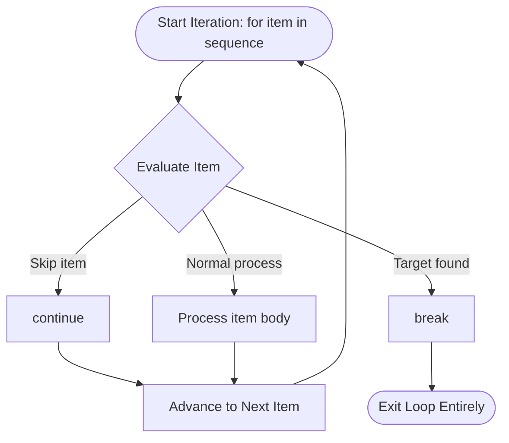

# 🔀 Python Programming: Flow Control & Logic Structures

> **Course**: AWS re/Start  
> **Module**: Python Programming (M05 – Flow Control)  
> **Source Document**: `T09-Python_Programming/T09-0004-RSPP_EN-US_SG_M05_FLOWCONTROL.pdf`  
> **Target Audience**: AWS re/Start Learners, Cloud Practitioners, and Junior DevOps Engineers  

---

## 🎯 Module Overview

In computer programming, instructions are by default executed sequentially from top to bottom, line by line. However, practical automation, cloud orchestration, and software development require programs to make dynamic decisions, respond to external events, process varying inputs, and repeat operations without duplicating code.

**Flow control** refers to the order in which individual statements, instructions, or function calls of an imperative program are executed or evaluated. By mastering flow control, you transform static, linear scripts into robust, adaptive programs capable of automating complex cloud infrastructure operations.

This study guide examines the core pillars of Python flow control:
- Dynamic user interaction via the `input()` function and type casting
- Conditional branching using `if`, `elif`, and `else` statements
- Python truth-value evaluation (truthy and falsy semantics)
- Definite and indefinite iteration using `for` and `while` loops
- Fine-grained loop manipulation with `break`, `continue`, `pass`, and the loop `else` clause
- Practical cloud automation scenarios using AWS-style workflows and SDK logic



---

## 📌 Learning Objectives

By completing this module and working through the associated exercises, you will be able to:

- [ ] **Define Flow Control**: Articulate how flow control governs the execution order of instructions in an imperative program.
- [ ] **Contrast Execution Paradigms**: Distinguish between sequential, branching (conditional), and iterative execution models.
- [ ] **Collect and Validate User Input**: Use the `input()` function, perform type conversion (`int()`, `float()`), and validate user entries.
- [ ] **Implement Decision Logic**: Write syntactically correct `if`, `if-else`, and multi-branch `if-elif-else` conditional ladders with proper indentation.
- [ ] **Evaluate Truthy and Falsy States**: Identify how Python evaluates primitives, strings, `None`, and empty collections in boolean contexts.
- [ ] **Utilize the Ternary Operator**: Write concise, single-line conditional assignments using Python conditional expressions.
- [ ] **Construct and Manage `while` Loops**: Implement condition-controlled loops, maintain iterative counters, and prevent infinite loops.
- [ ] **Iterate Over Sequences with `for` Loops**: Traverse lists, tuples, strings, and dictionaries, and generate numerical intervals with `range()`.
- [ ] **Control Loop Execution Flow**: Correctly apply `break`, `continue`, `pass`, and the loop `else` block to handle complex iteration logic.
- [ ] **Automate Cloud Infrastructure Operations**: Apply flow control constructs to poll AWS resource states (e.g., EC2/RDS readiness) and process collections of cloud assets.

---

## 🧭 1. Foundations of Flow Control

### Imperative Execution Models

Python is an imperative and object-oriented programming language. In an imperative paradigm, the programmer provides an explicit recipe of operations that alter program state.

The **Structured Programming Theorem** (Böhm-Jacopini theorem) states that any computable function can be implemented using only three fundamental control structures:

1. **Sequence**: Instructions run in strict sequential order from top to bottom.
2. **Selection (Branching)**: The program chooses between two or more execution paths depending on whether a boolean expression evaluates to `True` or `False`.
3. **Iteration (Repetition / Looping)**: A block of code executes repeatedly as long as a condition holds true or across every item in a sequence.



### Indentation and Code Blocks in Python

Unlike languages such as C, C++, Java, or Bash that rely on curly braces `{}` or keywords like `then...fi` to delimit blocks, Python enforces **syntactic indentation**:

- Indentation defines code blocks (suites).
- The standard PEP 8 convention is **4 spaces per indentation level** (never mix tabs and spaces).
- The header statement (`if`, `elif`, `else`, `while`, `for`, `def`) must terminate with a colon (`:`).
- Failure to indent correctly results in an `IndentationError`.

```python
# Valid block structure
region = "us-east-1"
if region == "us-east-1":
    print("Primary Region Selected")  # 4-space indentation
    status = "Active"
print("Configuration verified.")      # Executed sequentially outside the block
```

---

## 📥 2. User Input & Dynamic Interaction

Programs frequently require dynamic data supplied by human operators, automated CLI arguments, or standard input streams.

### The `input()` Function

The built-in `input()` function pauses execution, prints an optional prompt string to standard output, and waits for the user to type text and press **Enter**:

```python
response = input("What's your name? ")
print("Hello, " + response)
```

```text
What's your name? Jorge
Hello, Jorge
```

> [!IMPORTANT]
> **`input()` Always Returns a String (`str`)**  
> Regardless of what the user types (e.g., `42`, `True`, `3.14`), `input()` captures it as a string literal. Directly performing mathematical calculations on uncast input results in a `TypeError`.

### Type Casting User Input

To use numerical inputs in arithmetic operations or numerical comparison expressions, the string must be explicitly converted (type cast) using `int()` or `float()`:

```python
# Capturing an integer value
instance_count_str = input("How many EC2 instances do you want to launch? ")
instance_count = int(instance_count_str)

# Concise combined idiom
storage_gb = float(input("Enter desired EBS volume size in GB: "))
total_cost = storage_gb * 0.08
print(f"Estimated monthly storage cost: ${total_cost:.2f}")
```

### Robust Input Validation

In production automation, trusting raw user input can crash your application. Input validation ensures data adheres to required formats before processing:

```python
# Validating numeric input using a loop and str.isdigit()
while True:
    user_input = input("Enter port number (1-65535): ").strip()
    if user_input.isdigit():
        port = int(user_input)
        if 1 <= port <= 65535:
            print(f"Configuring firewall rule for port {port}...")
            break
        else:
            print("Error: Port must be between 1 and 65535.")
    else:
        print("Error: Please enter a valid integer.")
```

### Lab Walkthrough: `helloworld.py`

*(Derived from Presentation Slides 18 & 19)*

```python
# helloworld.py - Capturing user name and generating personalized greeting

# 1. Prompt the user for their name
name = input("What's your name? ")

# 2. Output the result using string concatenation
print("Hello " + name)

# Modern Python alternative: Formatted string literal (f-string)
print(f"Welcome to AWS re/Start Python Automation, {name.strip()}!")
```

**Expected Execution Output:**
```text
What's your name? Alice
Hello Alice
Welcome to AWS re/Start Python Automation, Alice!
```

---

## 🌿 3. Conditional Statements (Branching)

Conditionals allow a program to evaluate logical criteria and branch along different execution paths.

### Real-Life Parallels to Conditionals

*(Derived from Presentation Slide 4)*

| Real-Life Scenario | Logical Condition | Consequent Action | Alternative Action |
| :--- | :--- | :--- | :--- |
| **Retail Store Hours** | Time is between 09:00 and 21:00 | Store is open for customers | Store is closed |
| **Vehicle Fuel Warning** | Fuel level falls below 10% | Turn on the low fuel dashboard LED | Keep dashboard LED off |
| **Building Physical Security** | Employee badge is valid and scanned | Unlock access turnstile | Sound alarm; door remains locked |
| **Human Life Stages** | Age $\ge 18$; Age between 13 and 17 | Classify as adult; classify as teen | Classify as child |

---

### Comparison & Logical Operators

Conditions in Python evaluate expressions to a boolean (`True` or `False`):

| Category | Operator | Description | Example | Result |
| :--- | :---: | :--- | :--- | :--- |
| **Equality** | `==` | Evaluates if operands are equal | `5 == 5` | `True` |
| **Inequality** | `!=` | Evaluates if operands are not equal | `5 != 3` | `True` |
| **Relational** | `<` | Strictly less than | `10 < 20` | `True` |
| **Relational** | `<=` | Less than or equal to | `15 <= 15` | `True` |
| **Relational** | `>` | Strictly greater than | `25 > 30` | `False` |
| **Relational** | `>=` | Greater than or equal to | `40 >= 40` | `True` |
| **Logical** | `and` | Returns `True` if **both** operands are true | `(5 > 2) and (10 > 3)` | `True` |
| **Logical** | `or` | Returns `True` if **at least one** operand is true | `(5 > 10) or (10 > 3)` | `True` |
| **Logical** | `not` | Inverts the truth value of the operand | `not (5 == 5)` | `False` |

> [!TIP]
> **Short-Circuit Evaluation**  
> In an `and` expression, if the left-hand operand is `False`, Python immediately returns `False` without evaluating the right-hand operand. In an `or` expression, if the left-hand operand is `True`, Python immediately returns `True`. This is useful for guard checks: `if count > 0 and (total / count) > 10:`.

---

### Structure of Conditional Statements

#### 1. Single-Branch `if`
Executes code only when the specified condition evaluates to `True`.

```python
cpu_utilization = 88.5
if cpu_utilization > 80.0:
    print("Warning: CPU utilization exceeds threshold! Triggering CloudWatch alarm.")
```

#### 2. Dual-Branch `if-else`
Provides an alternative execution path when the primary condition evaluates to `False`.

```python
age = 21

if age > 18:
    print("adult")
else:
    print("child")
```

#### 3. Multi-Branch `if-elif-else` Ladder
Evaluates a sequence of mutually exclusive conditions from top to bottom. Once a condition evaluates to `True`, its associated block executes and Python exits the entire conditional statement.

```python
age = 16

if age >= 18:
    print("adult")
elif age >= 13:
    print("teen")
else:
    print("child")
```



> [!WARNING]
> **Condition Order Matters in `elif` Ladders**  
> Because Python evaluates conditions sequentially and executes only the first matching branch, general conditions must not precede more specific conditions. For example, testing `if score >= 50:` before `elif score >= 90:` will cause an A-grade student with 95 points to receive the first matching branch (`>= 50`).

---

### Nested Conditionals

Conditionals can be nested inside other conditional blocks to express hierarchical decision criteria:

```python
account_active = True
mfa_enabled = False

if account_active:
    if mfa_enabled:
        print("Access Granted: Authorized to assume AWS IAM Administrator role.")
    else:
        print("Access Denied: MFA token required before privilege escalation.")
else:
    print("Access Denied: Account is deactivated.")
```

> [!NOTE]
> Deeply nested conditionals (the "arrow anti-pattern") reduce code readability. In professional Python development, prefer combining conditions using logical operators (`and`/`or`) or utilizing guard clauses with early exits.

---

### The Python Ternary Operator (Conditional Expression)

Python supports a concise single-line ternary syntax for assigning values or returning results based on a condition:

$$\text{value\_if\_true} \quad \mathbf{if} \quad \text{condition} \quad \mathbf{else} \quad \text{value\_if\_false}$$

```python
instance_type = "t3.large"
is_production = True

# Standard if-else statement
if is_production:
    backup_retention_days = 30
else:
    backup_retention_days = 7

# Equivalent ternary conditional expression
backup_retention_days = 30 if is_production else 7
print(f"Backup policy set to {backup_retention_days} days.")
```

---

### Lab Walkthrough: `conditionals.py`

*(Derived from Presentation Slide 7)*

```python
# conditionals.py - Banana Inventory Classifier

# Define inventory count
bananas = 1

# Multi-branch conditional evaluation
if bananas >= 5:
    print("I have a large bunch of bananas")
elif bananas >= 1:
    print("I have a small bunch of bananas")
else:
    print("I don’t have any bananas")
```

**Expected Execution Output:**
```text
I have a small bunch of bananas
```

---

## ⚖️ 4. Truth Value Testing: Truthy & Falsy

In Python, every object can be tested for its truth value when passed to `bool()` or used inside an `if` or `while` statement.

### Falsy Values

The following values evaluate to `False` in a boolean context:

| Category | Falsy Representations | Explanation |
| :--- | :--- | :--- |
| **Built-in Constants** | `None`, `False` | Explicit absence of value or boolean false |
| **Numeric Zeros** | `0`, `0.0`, `0j`, `Decimal(0)` | Integer, float, or complex zero |
| **Empty Sequences** | `""` (empty string), `()` (empty tuple), `[]` (empty list), `range(0)` | Sequences containing zero elements |
| **Empty Mappings** | `{}` (empty dict) | Dictionaries containing zero key-value pairs |
| **Empty Sets** | `set()`, `frozenset()` | Sets containing zero members |

### Truthy Values

Any object not explicitly defined as falsy evaluates to `True`. This includes:
- Non-zero numbers (`1`, `-42`, `0.0001`, `3.14`)
- Non-empty strings (`"False"`, `" "`, `"0"`, `"hello"`)
- Non-empty containers (`[0]`, `[None]`, `{"status": False}`)

### Idiomatic Python: Leveraging Truthiness

Instead of writing explicit equality checks, idiomatic Python directly leverages truthiness:

```python
# Non-idiomatic
vpc_subnets = ["subnet-01", "subnet-02"]
if len(vpc_subnets) > 0:
    print("Subnets available for deployment.")

# Idiomatic Pythonic style
if vpc_subnets:
    print("Subnets available for deployment.")

# Checking for unassigned configuration
user_api_key = None
if not user_api_key:
    print("Error: AWS_ACCESS_KEY_ID not configured.")
```

---

## 🔁 5. Iteration & Loops

Loops automate repetitive execution, preventing code duplication and enabling processing over unbounded datasets.

Python provides two native loop types:
1. **`while` loop**: Condition-controlled loop (repeats as long as an expression evaluates to `True`).
2. **`for` loop**: Collection-controlled loop (traverses every element in an iterable object).

---

### The `while` Loop

The `while` loop repeatedly executes its block as long as its condition remains `True`.

#### Syntax & Evaluation
```python
while condition:
    # Code block to execute repeatedly
    # State modification statement (to prevent infinite looping)
```



#### Infinite Loops and Prevention
If the loop condition never becomes `False`, the program enters an **infinite loop**, consuming CPU cycles until interrupted or terminated:

```python
# ⚠️ CAUTION: Infinite Loop Example (counter is never updated)
# counter = 0
# while counter <= 3:
#     print("Stuck forever!")

# Correct implementation with counter mutation:
counter = 0
while counter <= 3:
    print("I love learning Python!")
    counter = counter + 1  # Or counter += 1
```

> [!CAUTION]
> **Terminating an Unintended Infinite Loop**  
> If a script enters an unintended infinite loop in your CLI or IDE terminal, press `Ctrl + C` (or `SIGINT`) to halt execution immediately.

---

### Lab Walkthrough: `while.py`

*(Derived from Presentation Slides 9 & 10)*

```python
# while.py - Iterative Counter Demonstration

counter = 0

while counter <= 3:
    print("I love learning Python!")
    counter = counter + 1

print(f"Loop completed. Final counter value: {counter}")
```

**Expected Execution Output:**
```text
I love learning Python!
I love learning Python!
I love learning Python!
I love learning Python!
Loop completed. Final counter value: 4
```

---

### Sequence & Mapping Fundamentals (Connecting to Loops)

Before exploring `for` loops, review the collection types introduced in slides 11, 12, 16, and 17.

#### Lists (`list`)
- Ordered, mutable collections of items.
- Items are enclosed in square brackets `[ ]` and separated by commas.
- Can store heterogeneous data types (integers, strings, floats, nested lists).
- Zero-indexed: elements are accessed via `my_list[index]`.

```python
# Demonstration: lists.py (Slides 11 & 12)
class_roster = ["Xiulan", "Kwaku", "Shirley"]
test_scores = [86, 93, 80]
empty_list = []
mixed_data = [1, "alice", 2, "bob"]

print(class_roster)
print(test_scores)
print("First student:", class_roster[0])
```

#### Dictionaries (`dict`)
- Unordered (insertion-ordered in Python 3.7+) mappings of `key: value` pairs.
- Enclosed in curly braces `{ }`.
- Keys must be immutable (strings, numbers, tuples); values can be any data type.
- Values are retrieved via key subscripting `dict[key]` or safe lookup `dict.get(key)`.

```python
# Demonstration: dictionary.py (Slides 16 & 17)
myDict = {}
myDict["one"] = 1
myDict["two"] = 2
myDict[3] = "three"
myDict["four"] = 4.4

print("Retrieved value for key 3:", myDict[3])

print("Full dictionary contents:")
for key, value in myDict.items():
    print(key, value)
```

---

### The `for` Loop

The `for` loop in Python iterates over the items of any iterable (such as a list, tuple, dictionary, set, or string) in sequence:

$$\mathbf{for} \quad \text{element} \quad \mathbf{in} \quad \text{iterable:}$$

```python
# Iterating over a list of numbers
for num in [1, 2, 3]:
    print(num)
```

```text
1
2
3
```

#### Real-Life Parallels to `for` Loops
*(Derived from Presentation Slide 13)*

- *For every egg in a recipe*: Add 2 cups of flour.
- *For every package on our delivery truck*: Add 2 kilograms to the load weight.
- *For every hamburger that is ordered*: Subtract 1 from the kitchen inventory.

#### The `range()` Function
When a loop needs to execute a specific number of times, `range()` generates an immutable arithmetic sequence of integers on demand:

- `range(stop)`: Produces values from `0` up to `stop - 1`.
- `range(start, stop)`: Produces values from `start` up to `stop - 1`.
- `range(start, stop, step)`: Increments by `step` (can be negative for countdowns).

```python
# Counting 0 to 4
for i in range(5):
    print(i, end=" ")  # Output: 0 1 2 3 4
print()

# Range with custom start, stop, and step
for port in range(8000, 8005):
    print(f"Checking port {port}...")

# Descending countdown
for countdown in range(3, 0, -1):
    print(f"Deploying in {countdown}...")
```

---

### Lab Walkthrough: `lists.py` with `for` Loops

*(Derived from Presentation Slide 15)*

```python
# lists.py - Iterating over student records

class_roster = ["Xiulan", "Kwaku", "Shirley"]
test_scores = [86, 93, 80]

print("--- Class Roster ---")
for student in class_roster:
    print(student)

print("\n--- Test Scores ---")
for score in test_scores:
    print(score)
```

**Expected Execution Output:**
```text
--- Class Roster ---
Xiulan
Kwaku
Shirley

--- Test Scores ---
86
93
80
```

---

## 🎛️ 6. Loop Control Statements & the Loop `else` Clause

Python provides keywords to alter the normal execution sequence of loops based on runtime conditions.

### `break`, `continue`, and `pass`

| Statement | Purpose | Behavior |
| :---: | :--- | :--- |
| **`break`** | Early loop termination | Immediately terminates the enclosing loop; execution resumes at the statement following the loop block. |
| **`continue`** | Skip remaining iteration | Skips the rest of the current iteration's code body and jumps immediately to the evaluation of the next iteration. |
| **`pass`** | Syntactic placeholder | Acts as a no-op (no operation). Used where a statement is syntactically required but no action is needed. |



#### Code Demonstration: `break` and `continue`
```python
target_server = "web-02"
servers = ["web-01", "db-primary", "web-02", "cache-redis", "web-03"]

for server in servers:
    if server.startswith("db"):
        print(f"Skipping database server: {server}")
        continue  # Skip to next iteration
        
    print(f"Inspecting web host: {server}")
    
    if server == target_server:
        print(f"Found target host {target_server}! Halting scan.")
        break  # Terminate entire loop
```

**Expected Execution Output:**
```text
Inspecting web host: web-01
Skipping database server: db-primary
Inspecting web host: web-02
Found target host web-02! Halting scan.
```

---

### The Unique Loop `else` Clause

Python supports an optional `else` block appended to `for` and `while` loops.

> [!IMPORTANT]
> **When Does Loop `else` Execute?**  
> The `else` clause in a loop executes **only if the loop terminates normally** (i.e., completes all iterations in a `for` loop, or the `while` condition becomes `False`). If the loop is terminated prematurely by a `break` statement, the `else` block is **skipped**.

This construct is useful for search algorithms where an action should occur only if an item was *not* found:

```python
target_id = "vol-0abc1234def567890"
attached_volumes = ["vol-01111111111111111", "vol-02222222222222222"]

for vol in attached_volumes:
    if vol == target_id:
        print(f"Volume {target_id} attached to instance.")
        break
else:
    # Executes only if loop completes without encountering a break
    print(f"Alert: Target volume {target_id} was NOT found attached to the instance!")
```

---

## ☁️ 7. Practical Cloud & DevOps Scenarios

### Scenario A: Polling AWS Resource Status with `while`

In cloud automation, creating resources such as Amazon Relational Database Service (Amazon RDS) instances, Amazon DynamoDB tables, or Amazon Elastic Compute Cloud (Amazon EC2) instances is asynchronous. The API request initiates creation, and the resource enters a transient state (such as `pending` or `creating`) before becoming `available`.

A standard automation pattern uses a `while` loop to poll the resource status until it is ready, incorporating maximum retry counters and simulated backoff sleep:

```python
import time

def simulate_aws_get_instance_status(poll_step):
    """Simulates AWS EC2 DescribeInstanceStatus API responses."""
    states = ["pending", "pending", "initializing", "running"]
    return states[min(poll_step, len(states) - 1)]

# Polling configuration
max_attempts = 6
attempt = 1
desired_state = "running"
current_state = "unknown"

print("Initiating EC2 Instance Launch Check: i-087a32bf143c7b91e")

while attempt <= max_attempts:
    current_state = simulate_aws_get_instance_status(attempt - 1)
    print(f"[Attempt {attempt}/{max_attempts}] Current state: '{current_state}'")
    
    if current_state == desired_state:
        print("✅ Instance is online, initialized, and accepting traffic.")
        break
        
    print("⏳ State is transient. Waiting 5 seconds before next polling interval...")
    time.sleep(1)  # In production: time.sleep(5)
    attempt += 1
else:
    print("❌ Timeout: Resource failed to reach 'running' state within allotted time.")
```

**Expected Execution Output:**
```text
Initiating EC2 Instance Launch Check: i-087a32bf143c7b91e
[Attempt 1/6] Current state: 'pending'
⏳ State is transient. Waiting 5 seconds before next polling interval...
[Attempt 2/6] Current state: 'pending'
⏳ State is transient. Waiting 5 seconds before next polling interval...
[Attempt 3/6] Current state: 'initializing'
⏳ State is transient. Waiting 5 seconds before next polling interval...
[Attempt 4/6] Current state: 'running'
✅ Instance is online, initialized, and accepting traffic.
```

---

### Scenario B: Auditing & Filtering EC2 Instances with `for`

DevOps engineers frequently query an AWS environment for all running instances, parse their metadata and tags, and enforce organizational tagging compliance or automate overnight shutdowns for development workloads.

```python
# Simulated response from boto3 client('ec2').describe_instances()
ec2_inventory = [
    {
        "InstanceId": "i-0a1b2c3d4e5f00001",
        "InstanceType": "t3.micro",
        "State": "running",
        "Tags": {"Environment": "Development", "Owner": "Xiulan"}
    },
    {
        "InstanceId": "i-0a1b2c3d4e5f00002",
        "InstanceType": "m5.large",
        "State": "running",
        "Tags": {"Environment": "Production", "Owner": "Kwaku"}
    },
    {
        "InstanceId": "i-0a1b2c3d4e5f00003",
        "InstanceType": "t3.small",
        "State": "stopped",
        "Tags": {"Environment": "Development", "Owner": "Shirley"}
    },
    {
        "InstanceId": "i-0a1b2c3d4e5f00004",
        "InstanceType": "c5.xlarge",
        "State": "running",
        "Tags": {"Owner": "Unknown"}  # Missing Environment Tag!
    }
]

print("=== AWS EC2 Non-Compliant & Cost-Audit Report ===")

for instance in ec2_inventory:
    inst_id = instance["InstanceId"]
    state = instance["State"]
    tags = instance.get("Tags", {})
    
    # 1. Skip instances that are already stopped
    if state != "running":
        continue
        
    # 2. Check for missing Environment compliance tag
    if "Environment" not in tags:
        print(f"⚠️ Tagging Violation: {inst_id} ({instance['InstanceType']}) has no 'Environment' tag!")
        continue
        
    # 3. Flag running Development instances for evening shutdown
    env = tags["Environment"]
    if env == "Development":
        print(f"🌙 Cost Optimization: Queuing {inst_id} (Owner: {tags['Owner']}) for scheduled shutdown.")
    elif env == "Production":
        print(f"🛡️ Production Protected: {inst_id} maintains high availability policy.")
```

**Expected Execution Output:**
```text
=== AWS EC2 Non-Compliant & Cost-Audit Report ===
🌙 Cost Optimization: Queuing i-0a1b2c3d4e5f00001 (Owner: Xiulan) for scheduled shutdown.
🛡️ Production Protected: i-0a1b2c3d4e5f00002 maintains high availability policy.
⚠️ Tagging Violation: i-0a1b2c3d4e5f00004 (c5.xlarge) has no 'Environment' tag!
```

---

## 📊 8. Summary Comparison Matrix

| Flow Construct | Primary Trigger / Condition | Evaluation Style | Infinite Loop Risk | Primary Cloud Use Case |
| :--- | :--- | :--- | :---: | :--- |
| **`if` / `elif` / `else`** | Boolean expression evaluation | Conditional branching | No | Rule validation, security check decision-making |
| **Ternary Operator** | Single conditional evaluation | Inline assignment expression | No | Configuration assignment, fallback defaults |
| **`while` Loop** | State condition evaluates to `True` | Indefinite repetition | **Yes** (if condition unchanged) | API polling, retry logic with backoff, daemon listeners |
| **`for` Loop** | Iteration over sequence / collection | Definite repetition | No (with finite iterables) | Batch processing AWS assets, scanning log files, audits |
| **`break`** | Encountered inside loop body | Immediate exit | N/A | Halting scan upon match, terminating loop on fatal error |
| **`continue`** | Encountered inside loop body | Skip to next iteration | N/A | Bypassing irrelevant files or non-matching cloud resources |
| **Loop `else`** | Loop finishes without `break` | Post-loop branch | N/A | Search completion verification, resource missing alarms |

---

## 📝 9. Key Takeaways & Summary

*(Synthesizing Slide 21 Key Takeaways)*

1. **Conditional Statements (`if`, `elif`, `else`)**:
   - An `if` statement evaluates a condition and runs its indented code block if the condition evaluates to `True`.
   - `elif` (short for *else if*) provides intermediate alternative branches that are only evaluated when preceding conditions are `False`.
   - `else` acts as the catch-all fallback block executed when none of the preceding criteria are met.
2. **Loops (`while` & `for`)**:
   - A `while` loop runs code repeatedly until a condition evaluates to `False`. It requires an updating counter or state mutation to prevent infinite loops.
   - A `for` loop reads as *"for each element in sequence, perform task"*, terminating automatically when the sequence ends.
3. **Core Collections in Iteration**:
   - A **list** is an ordered, mutable sequence denoted by `[ ]` that can contain mixed data types.
   - A **dictionary** is a key-value mapping denoted by `{ }`, where values are accessed using unique, immutable keys.
4. **User Input**:
   - The `input()` function prompts the user and captures entered data as a `str`, which must be explicitly type cast (e.g., using `int()`) when performing numerical calculations or comparisons.

---

## 🧠 10. Knowledge Check & Practice Exercises

### Section A: Curriculum Checkpoint Questions

*(Directly derived from Presentation Slide 20)*

#### Question 1
**Name two kinds of loops in Python.**

> **Answer**:  
> The two primary loop structures in Python are the **`for` loop** (used to iterate over a finite sequence or range) and the **`while` loop** (used to repeat execution as long as a condition remains true).

---

#### Question 2
**How do you select a specific element from a list of values?**

> **Answer**:  
> Specific elements in a list are selected using **bracket indexing** (`[]`) following the list identifier. Python uses zero-based indexing, meaning index `0` accesses the first element. For example, given `myList = ["first", "second", "third"]`, the expression `myList[2]` selects the third element (`"third"`).

---

#### Question 3
**What does `elif` stand for, and when is it evaluated?**

> **Answer**:  
> `elif` is short for **"else if"**. An `elif` statement is evaluated only if all preceding `if` and `elif` conditional statements within the same block evaluate to `False`. If the condition in the `elif` statement evaluates to `True`, its indented code block executes and the remainder of the conditional ladder is skipped.

---

### Section B: Practical Review Exercises

#### Exercise 1: S3 Bucket Name Policy Validator
Write a Python program that prompts the user for an Amazon S3 bucket name using `input()` and validates the following rules:
- Bucket name length must be between 3 and 63 characters.
- Must not contain uppercase letters.
- Must not contain spaces.

```python
bucket_name = input("Enter proposed S3 bucket name: ").strip()

if len(bucket_name) < 3 or len(bucket_name) > 63:
    print("❌ Invalid: S3 bucket name must be between 3 and 63 characters.")
elif not bucket_name.islower():
    print("❌ Invalid: S3 bucket name cannot contain uppercase characters.")
elif " " in bucket_name:
    print("❌ Invalid: S3 bucket name cannot contain spaces.")
else:
    print(f"✅ S3 bucket name '{bucket_name}' conforms to AWS naming conventions.")
```

---

#### Exercise 2: Port Security Scanner Simulation
Using a `for` loop and `range()`, write a script that checks a sequence of network ports (`20` to `25`). Print an alert if port `22` (SSH) or port `23` (Telnet) is encountered, skip port `21` (FTP), and acknowledge standard ports otherwise.

```python
print("Starting Port Security Assessment...")

for port in range(20, 26):
    if port == 21:
        print(f"Port {port} (FTP): Deprecated protocol. Skipped.")
        continue
    elif port == 22:
        print(f"🚨 Port {port} (SSH): Remote administrative access detected! Verify IP whitelist.")
    elif port == 23:
        print(f"🛑 Port {port} (Telnet): Insecure cleartext protocol! Block immediately.")
    else:
        print(f"Port {port}: Normal port scanned.")
```
