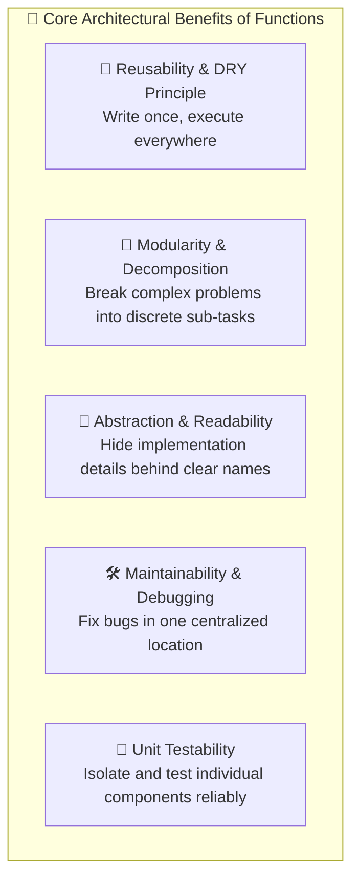
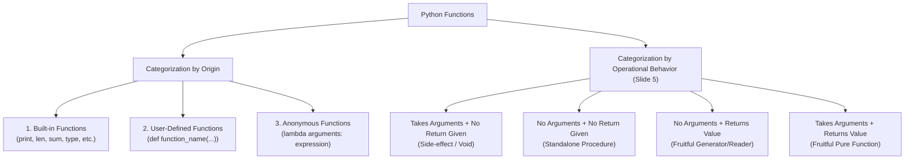
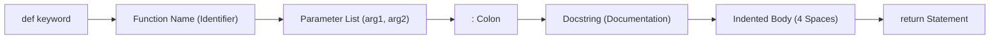
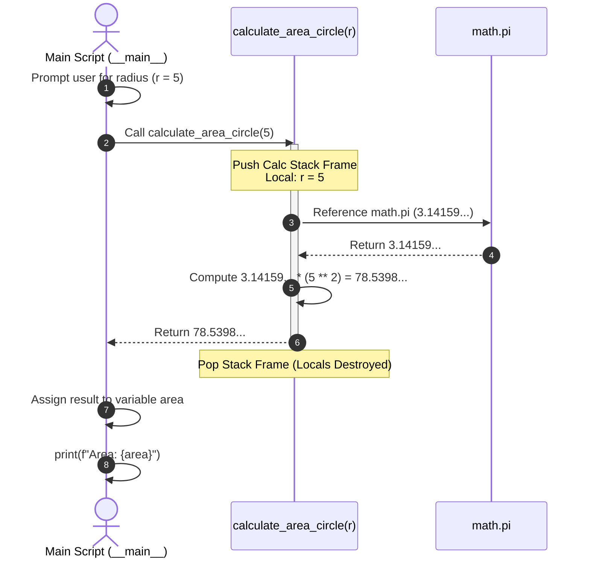
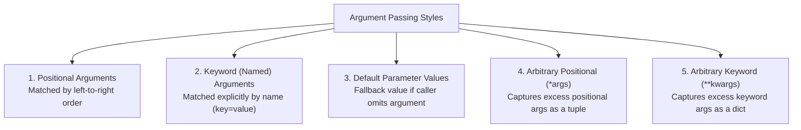
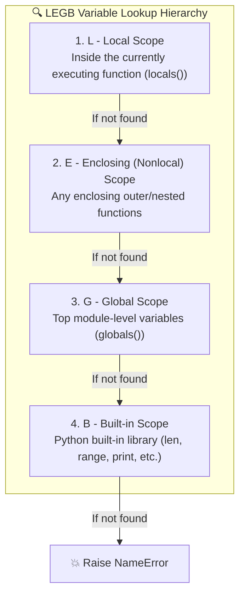
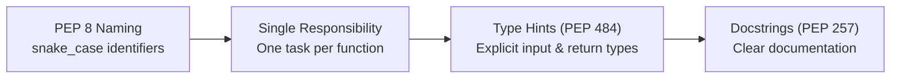

# 🐍 Module 05: Python Functions – Study Guide

> **Course**: AWS re/Start  
> **Module**: Python Programming (M05)  
> **Source Document**: `T09-0005-RSPP_EN-US_SG_M05_FUNCTIONS.pdf`  
> **Target Audience**: AWS re/Start Learners / Cloud Practitioners / Junior Developers / DevOps Engineers  

---

## 🎯 Module Overview

Welcome to **Python Functions**. In software development, systems administration, and cloud automation, writing linear script blocks that repeat code is error-prone, hard to debug, and impossible to scale. A **function** in Python is a named, organized, and reusable sequence of statements designed to perform a distinct, well-defined computation or action. 

Functions serve as the foundational building blocks of modular programming. They enable developers and DevOps engineers to translate complex computational problems into clear, logical mental models, enforce the **DRY (Don't Repeat Yourself)** principle, isolate errors, and build maintainable cloud automation tools.

Whether you are writing a quick one-line script to audit Amazon S3 bucket tags or deploying production-grade AWS Lambda serverless handlers that process streaming Amazon Kinesis events, mastering functions is essential to becoming an effective Python practitioner.

---

### 📌 Learning Objectives

- [ ] **Explain the Purpose and Core Benefits of Functions**: Articulate how functions promote code reusability, modularity, abstraction, maintainability, and the DRY principle.
- [ ] **Classify Python Function Types**: Categorize functions by origin (built-in vs. user-defined vs. anonymous/lambda) and operational behavior (fruitful vs. non-fruitful / void).
- [ ] **Deconstruct Function Anatomy and Syntax**: Define functions using the `def` keyword, configure parameters, structure docstrings, implement indented code blocks, and utilize single, multiple, or implicit return values.
- [ ] **Master Parameters and Argument Passing**: Distinguish between parameters and arguments; effectively implement positional arguments, keyword arguments, default parameters, and arbitrary variable-length arguments (`*args` and `**kwargs`).
- [ ] **Analyze Variable Scope and Lifetime via the LEGB Rule**: Map how Python resolves variable names across Local, Enclosing, Global, and Built-in scopes, and understand the architectural drawbacks of the `global` keyword.
- [ ] **Adopt Professional PEP 8 and Clean Code Best Practices**: Implement `snake_case` naming conventions, apply PEP 484 type hints, write structured docstrings, and uphold the Single Responsibility Principle (SRP).
- [ ] **Build Real-World Cloud Automation Solutions**: Construct production-ready Python functions to inspect AWS infrastructure, audit cloud resources, and process JSON payloads.

---

## ⚙️ 1. Purpose and Benefits of Functions

### What is a Function?
In Python, a **function** is a self-contained, named block of reusable code that takes inputs (arguments), executes a planned sequence of operations, and optionally returns one or more results to the caller. 

```python
# A simple, reusable function
def calculate_storage_cost(gigabytes: float, price_per_gb: float = 0.023) -> float:
    """Calculate the estimated monthly AWS S3 Standard storage cost."""
    return round(gigabytes * price_per_gb, 2)

# Invoking the function
monthly_cost = calculate_storage_cost(500.0)
print(f"Total Storage Cost: ${monthly_cost}")  # Output: Total Storage Cost: $11.5
```

### The Architectural Necessity for Functions

When developers write procedural scripts without functions, code tends to accumulate into massive, monolithic files. As requirements expand, developers often duplicate logic across multiple lines, resulting in "spaghetti code." Functions solve these structural challenges through several architectural benefits:



1. **DRY Principle (Don't Repeat Yourself)**:
   - Duplicating identical or near-identical lines of code across a codebase invites bugs. When business rules or APIs change, every copied instance must be manually updated. 
   - Encapsulating the logic in a function guarantees that updates occur in a single authoritative location.
2. **Modularity & Decomposition**:
   - Complex engineering workflows (e.g., pulling AWS CloudTrail logs, filtering unauthorized API calls, formatting an alert, and publishing to Amazon SNS) can be decomposed into small, focused subroutines.
3. **Abstraction & Mental Alignment**:
   - Callers only need to understand *what* a function does and its interface (parameters and return values), without having to track *how* the underlying implementation calculates the answer.
4. **Maintainability & Debuggability**:
   - Scoping logic inside functions isolates runtime errors. Stack traces clearly pinpoint the specific function and line where an exception occurred.
5. **Unit Testability**:
   - Standalone functions can be tested in isolation using testing frameworks such as `pytest` or `unittest`, feeding mock inputs and verifying outputs without spinning up the entire application.

---

### Comparison: Monolithic Procedural Code vs. Modular Functional Code

| Architectural Trait | Monolithic Procedural Script | Modular Functional Architecture |
| :--- | :--- | :--- |
| **Code Redundancy** | High; logic is copy-pasted across sections | Minimal; functions enforce strict code reuse |
| **Cognitive Load** | High; reading requires tracking global state | Low; functions define clear boundaries and contracts |
| **Bug Remediation** | Fragile; fixes must be applied to all clones | Robust; bug fixes apply globally across all call sites |
| **Testing** | Difficult; requires running the entire script | Simple; individual functions are unit-tested independently |
| **Collaboration** | Causes git merge conflicts in shared files | Clean; developers can work on distinct functions in parallel |

---

## 🗂️ 2. Function Classification and Types

Python functions can be categorized according to two distinct dimensions: **Origin** (how they are defined) and **Operational Behavior** (how they handle inputs and return values).



---

### 2.1 The Two-by-Two Behavioral Matrix

Slide 5 of the AWS curriculum classifies functions into four core operational patterns based on input parameters and return values:

```
+------------------------------------------+------------------------------------------+
| Takes argument or arguments,             | No argument taken,                       |
| no return given                          | no return given                          |
| (Performs an action using input data)    | (Performs a static, fixed routine)       |
+------------------------------------------+------------------------------------------+
| No argument taken,                       | Takes argument or arguments,             |
| returns something (fruitful)             | returns something (fruitful)             |
| (Generates/fetches data without inputs)  | (Transforms input data into an output)   |
+------------------------------------------+------------------------------------------+
```

#### 1. Takes Arguments, No Return Given (Non-Fruitful / Void)
This type consumes data to perform an action or trigger a side effect (such as writing to a log file, printing to stdout, or publishing a metric), without returning an explicit computational result to the caller.

```python
def log_aws_event(event_name: str, service: str) -> None:
    """Log an operational event to the console."""
    print(f"[AUDIT LOG] Service: {service.upper()} | Event: {event_name}")

# Function call
log_aws_event("CreateBucket", "S3")
# Output: [AUDIT LOG] Service: S3 | Event: CreateBucket
```

#### 2. No Arguments Taken, No Return Given (Non-Fruitful / Void)
This routine performs a static, fixed sequence of tasks that requires no input data and provides no resulting output.

```python
def print_banner() -> None:
    """Display the application startup banner."""
    print("=" * 45)
    print("      AWS RE/START CLOUD MONITOR v1.0       ")
    print("=" * 45)

print_banner()
```

#### 3. No Arguments Taken, Returns Something (Fruitful)
A **fruitful** function is one that produces and returns a usable value back to the caller. This variant generates or retrieves a value without needing external caller inputs.

```python
import platform

def get_system_os() -> str:
    """Retrieve the operating system platform name."""
    return platform.system()

current_os = get_system_os()
print(f"Running on: {current_os}")  # e.g., 'Linux' or 'Darwin'
```

#### 4. Takes Arguments, Returns Something (Fruitful)
The most common and mathematically pure pattern in programming. The function accepts inputs, executes a computation or transformation, and returns the result to the caller without unexpected side effects.

```python
def calculate_cidr_usable_hosts(prefix_length: int) -> int:
    """Calculate the number of usable IPv4 host addresses in standard networking."""
    if prefix_length >= 31:
        return 0
    total_addresses = 2 ** (32 - prefix_length)
    return total_addresses - 2  # Subtract network address and broadcast address

usable_hosts = calculate_cidr_usable_hosts(24)
print(f"Usable hosts in /24: {usable_hosts}")  # Output: 254
```

> [!NOTE]
> In Python, **all** functions return a value. If a function does not execute an explicit `return <value>` statement, Python automatically and implicitly returns the special singleton object `None`. Therefore, non-fruitful functions in Python actually return `None`.

---

### 2.2 Built-in Functions

Python includes a rich collection of **built-in functions** available directly in the global scope without requiring any `import` statement. These functions are written in optimized C (in CPython) and provide essential primitives for input/output, type inspection, math, and collection manipulation.

```python
# Common built-in functions in action
numbers = [10, 45, 2, 89, 34]

print(f"Count of elements: {len(numbers)}")       # len() -> 5
print(f"Sum of elements:   {sum(numbers)}")       # sum() -> 180
print(f"Maximum value:     {max(numbers)}")       # max() -> 89
print(f"Sorted ascending:  {sorted(numbers)}")    # sorted() -> [2, 10, 34, 45, 89]
print(f"Type inspection:   {type(numbers)}")      # type() -> <class 'list'>
```

#### Essential Python Built-in Functions Reference

| Function | Signature / Input | Description | Practical Cloud / DevOps Use Case |
| :--- | :--- | :--- | :--- |
| `print()` | `print(*objects, sep=' ', end='\n')` | Prints objects to the text stream or console | Emitting runtime log messages and debug output |
| `len()` | `len(s)` | Returns the length (number of items) of an object | Checking the number of EC2 instances returned from an API call |
| `type()` | `type(object)` | Returns the type object of an argument | Validating configuration data structures during JSON parsing |
| `sum()` | `sum(iterable, /, start=0)` | Sums `start` and the items of an iterable | Aggregating monthly cloud billing metrics or data usage |
| `sorted()` | `sorted(iterable, *, key=None, reverse=False)` | Returns a new sorted list from the items | Sorting AWS resources by creation timestamp or name tag |
| `range()` | `range(stop)` or `range(start, stop[, step])` | Generates an immutable sequence of numbers | Controlling retry loop iterations with exponential backoff |
| `int()` | `int(x=0)` | Converts a number or string to an integer | Converting user CLI inputs or environment variables into port numbers |
| `input()` | `input(prompt='')` | Reads a line of text from standard input | Prompting an administrator for confirmation before resource deletion |
| `open()` | `open(file, mode='r')` | Opens file and returns a corresponding stream | Reading configuration YAML/JSON files or writing audit logs |
| `dict()` | `dict(**kwargs)` | Constructs a dictionary key-value mapping | Building structured API request bodies or AWS tags |
| `help()` | `help([object])` | Invokes the built-in interactive help system | Inspecting function signatures and docstrings in the REPL |

---

### 2.3 User-Defined Functions

While built-ins cover fundamental primitives, developers write **user-defined functions** using the `def` keyword to encapsulate domain-specific business logic. User-defined functions give systems their unique behaviors and domain models.

```python
def is_valid_aws_region(region: str) -> bool:
    """Validate whether a string matches standard AWS region conventions."""
    valid_regions = {"us-east-1", "us-east-2", "us-west-1", "us-west-2", "eu-west-1"}
    return region.lower() in valid_regions

print(is_valid_aws_region("us-east-1"))  # True
print(is_valid_aws_region("moon-base-1")) # False
```

---

### 2.4 Anonymous (Lambda) Functions

A **lambda function** is a small, anonymous function defined inline without the `def` statement using the `lambda` keyword. 

#### Syntax
```python
lambda argument_1, argument_2, ... : expression
```

- **Single Expression**: Lambda functions are restricted to a single expression that is evaluated and implicitly returned. They cannot contain statements, assignments, loops, or docstrings.
- **Primary Use Case**: Passing short, throwaway callback functions to higher-order functions such as `sorted()`, `map()`, and `filter()`.

```python
# Sample list of AWS EC2 instance metadata dictionaries
instances = [
    {"id": "i-0a1b2c3d4e5f0001", "name": "web-prod-01", "cpu_utilization": 78.4},
    {"id": "i-0a1b2c3d4e5f0002", "name": "db-prod-01",  "cpu_utilization": 92.1},
    {"id": "i-0a1b2c3d4e5f0003", "name": "cache-redis", "cpu_utilization": 34.5},
]

# Sorting instances by cpu_utilization descending using a lambda function
sorted_by_cpu = sorted(instances, key=lambda inst: inst["cpu_utilization"], reverse=True)

for inst in sorted_by_cpu:
    print(f"{inst['name']}: {inst['cpu_utilization']}%")
# Output:
# db-prod-01: 92.1%
# web-prod-01: 78.4%
# cache-redis: 34.5%
```

#### Comparison: `def` vs. `lambda`

| Feature | Standard Function (`def`) | Lambda Function (`lambda`) |
| :--- | :--- | :--- |
| **Name** | Explicitly named identifier | Anonymous (unless manually assigned to a variable) |
| **Complexity** | Multiple statements, loops, conditional branches | Strictly limited to a single expression |
| **Docstrings & Typing** | Fully supported (`"""Docstring"""`, PEP 484 type hints) | Not supported |
| **Readability** | High; easy to read, debug, and trace in log files | Low if expressions become non-trivial |
| **Guideline** | Standard choice for reusable application logic | Best for quick, one-line keys in `sorted()`, `min()`, `max()` |

> [!TIP]
> PEP 8 explicitly discourages binding a lambda to an identifier (e.g., `f = lambda x: 2*x`). When you need a named function, always use `def f(x): return 2 * x`.

---

## 🔬 3. Anatomy and Syntax of a Function

A Python function definition adheres to a standardized grammatical structure:

```
def function_name(param1: type, param2: type = default) -> return_type:
    """
    Docstring: Multi-line description of the function's purpose.
    """
    # Function Body (Indented 4 spaces)
    statement_1
    statement_2
    return result_value
```



### 3.1 Step-by-Step Anatomical Components

1. **The `def` Keyword**:
   - Informs Python's parser that a function definition statement is beginning.
2. **The Function Name (Identifier)**:
   - Follows Python variable naming rules: must begin with a letter or underscore, followed by letters, digits, or underscores.
   - Per PEP 8, functions should always use `snake_case` (all lowercase words separated by underscores).
3. **The Parameter List `(...)`**:
   - Encased in parentheses. Specifies zero or more variable placeholders that will accept incoming arguments when called.
4. **The Terminating Colon (`:`)**:
   - Marks the end of the header line and introduces the indented block. Omitting the colon triggers a `SyntaxError`.
5. **The Docstring (`"""..."""`)**:
   - The first statement immediately following the header. Explains what the function does, its parameters, and return types. Python stores this in the `__doc__` attribute.
6. **The Function Body (Indentation)**:
   - All executable statements inside the function must be indented uniformly (PEP 8 mandates **4 spaces** per indentation level; do not mix tabs and spaces).
7. **The `return` Statement**:
   - Terminates function execution immediately and passes control back to the caller along with the resulting data value.

---

### 3.2 Anatomy Deep Dive: Return Statements

```python
# 1. Single Value Return
def convert_celsius_to_fahrenheit(celsius: float) -> float:
    return (celsius * 9/5) + 32

# 2. Multiple Values Return (Packed automatically into a Tuple)
def get_ip_and_port(endpoint: str) -> tuple[str, int]:
    """Parse an endpoint formatted as host:port."""
    host, port_str = endpoint.split(":")
    return host, int(port_str)  # Returns a tuple (host, port)

# 3. Early Return / Guard Clause
def validate_disk_space(available_gb: float, required_gb: float) -> bool:
    if available_gb < 0 or required_gb < 0:
        return False  # Early exit on invalid input
    return available_gb >= required_gb

# 4. Implicit None Return (No return statement)
def notify_slack(message: str) -> None:
    print(f"Posting to Slack: {message}")
    # No return statement -> Returns None implicitly
```

When returning multiple items (`return host, int(port_str)`), Python creates a single **tuple**. The caller can unpack this tuple in a single assignment:

```python
ip_address, port_number = get_ip_and_port("192.168.1.50:8080")
print(f"Connecting to IP {ip_address} on Port {port_number}")
```

---

### 3.3 Function Calling and the Call Stack Execution Flow

Defining a function does **not** execute its body. The code inside runs only when the function is **called** (invoked) by appending parentheses `()` containing any required arguments.

When a function is called:
1. Python suspends execution at the call site.
2. A new **stack frame** is pushed onto the **call stack**, allocating local variable memory.
3. Arguments are mapped to parameters.
4. Body statements execute.
5. The `return` statement evaluates, the stack frame is popped off the stack, and execution resumes at the call site.



---

## 🧩 4. Parameters and Arguments in Depth

Although often used interchangeably in casual conversation, computer science maintains a strict distinction between **parameters** and **arguments**:

- **Parameter**: The variable listed in the function definition header (the *placeholder* or *formal parameter*).
- **Argument**: The concrete value or data passed into the function when it is invoked (the *actual argument*).

```python
# 'account_id' and 'region' are PARAMETERS
def audit_aws_account(account_id: str, region: str):
    print(f"Auditing Account {account_id} in {region}")

# "123456789012" and "us-west-2" are ARGUMENTS
audit_aws_account("123456789012", "us-west-2")
```

---

### 4.1 Argument Passing Mechanisms

Python supports flexible patterns for supplying arguments to functions:



#### 1. Positional Arguments
Arguments are mapped to parameters based strictly on their physical left-to-right order.

```python
def configure_route53_record(domain: str, ip: str, record_type: str):
    print(f"Creating {record_type} record: {domain} -> {ip}")

# Order matters!
configure_route53_record("example.com", "10.0.0.1", "A")
# If swapped, logic fails or produces nonsensical mappings!
```

#### 2. Keyword (Named) Arguments
Arguments are passed in the format `parameter_name=value`. Order no longer matters because Python matches arguments directly by parameter name.

```python
# Order can be arbitrary when using keyword arguments
configure_route53_record(
    record_type="A",
    domain="api.example.com",
    ip="10.0.0.2"
)
```

> [!IMPORTANT]
> When mixing positional and keyword arguments in a function call, **all positional arguments must appear before any keyword arguments**. Violating this results in `SyntaxError: positional argument follows keyword argument`.

#### 3. Default Parameter Values
Parameters can define default fallback values using the assignment operator (`=`). If the caller provides an argument, the default is overridden; if omitted, the default is applied.

```python
def provision_ebs_volume(size_gb: int, volume_type: str = "gp3", encrypted: bool = True):
    print(f"Provisioning {size_gb}GB EBS volume | Type: {volume_type} | Encrypted: {encrypted}")

provision_ebs_volume(100)                         # Uses defaults: gp3, True
provision_ebs_volume(500, volume_type="io2")      # Overrides volume_type, uses default encrypted
provision_ebs_volume(50, "standard", False)       # Overrides all defaults
```

> [!CAUTION]
> **The Mutable Default Argument Gotcha**:  
> In Python, default parameter expressions are evaluated **once** when the function is defined, not each time it is executed. Using a mutable object (such as a `list` or `dict`) as a default parameter causes that single object to be shared across all invocations!
> 
> ```python
> # ❌ ANTI-PATTERN: Shared mutable list
> def append_tag(tag: str, tag_list=[]):
>     tag_list.append(tag)
>     return tag_list
> 
> print(append_tag("Environment:Prod"))  # ['Environment:Prod']
> print(append_tag("Owner:DevOps"))       # ['Environment:Prod', 'Owner:DevOps'] <- UNEXPECTED ACCUMULATION!
> 
> # ✅ BEST PRACTICE: Use None as default and initialize inside
> def append_tag_clean(tag: str, tag_list=None):
>     if tag_list is None:
>         tag_list = []
>     tag_list.append(tag)
>     return tag_list
> ```

---

### 4.2 Variable-Length Arguments: `*args` and `**kwargs`

Functions often need to accept an unpredictable number of inputs (e.g., aggregating metrics, accepting arbitrary command-line flags, or wrapping underlying APIs).

#### `*args` (Arbitrary Positional Arguments)
Prefixing a parameter with an asterisk (`*`) causes Python to gather all extra positional arguments into a single **tuple**.

```python
def calculate_average_latency(*latencies: float) -> float:
    """Calculate the average latency from an arbitrary number of ping probes."""
    if not latencies:
        return 0.0
    print(f"Collected latencies tuple: {latencies}")
    return sum(latencies) / len(latencies)

avg = calculate_average_latency(12.4, 15.1, 11.8, 14.0)
print(f"Average Latency: {avg:.2f} ms")  # Output: 13.32 ms
```

#### `**kwargs` (Arbitrary Keyword Arguments)
Prefixing a parameter with double asterisks (`**`) causes Python to gather all extra keyword arguments into a standard **dictionary**.

```python
def create_ec2_tags(resource_id: str, **tags) -> dict:
    """Format AWS resource tags into structured key-value pairs."""
    formatted_tags = []
    for key, value in tags.items():
        formatted_tags.append({"Key": key, "Value": str(value)})
    return {"ResourceId": resource_id, "Tags": formatted_tags}

tag_payload = create_ec2_tags(
    "i-0123456789abcdef0",
    Environment="Production",
    CostCenter="CC-90210",
    Application="PaymentGateway"
)
print(tag_payload)
```

#### Unpacking Operators (`*` and `**`)
The inverse operation is also supported. You can unpack an existing iterable into positional arguments using `*`, or unpack a dictionary into keyword arguments using `**`:

```python
# Unpacking a list into positional parameters
probe_data = [10.2, 11.5, 9.8]
print(calculate_average_latency(*probe_data))

# Unpacking a dict into keyword parameters
ebs_specs = {"size_gb": 250, "volume_type": "gp3", "encrypted": True}
provision_ebs_volume(**ebs_specs)
```

---

### 4.3 Parameter Definition Precedence Rule

When combining multiple parameter types in a single function header, Python enforces a strict syntax order:

$$\text{Standard Positional} \longrightarrow \text{Default Parameters} \longrightarrow \text{*args} \longrightarrow \text{Keyword-Only} \longrightarrow \text{**kwargs}$$

```python
def complex_dispatcher(service_name, timeout=30, *extra_args, notify=True, **custom_headers):
    pass
```

---

## 🌐 5. Scope and Lifetime of Variables

A variable’s **scope** determines where in the program its identifier is recognized and accessible. A variable’s **lifetime** defines the time duration during which the variable exists in computer memory.

### 5.1 Local vs. Global Scope

- **Local Variables**: Variables defined inside a function. They are created when the function starts executing and destroyed as soon as the function returns. They cannot be accessed from outside the function.
- **Global Variables**: Variables defined at the top level of a module or script. They exist as long as the Python program runs and are accessible anywhere in that file.

```python
global_app_version = "2.4.1"  # Global Scope

def check_deployment():
    cluster_id = "eks-prod-uswest2"  # Local Scope
    print(f"Version: {global_app_version}")  # Can read global variable
    print(f"Cluster: {cluster_id}")          # Can read local variable

check_deployment()
# print(cluster_id)  # ❌ NameError: name 'cluster_id' is not defined
```

---

### 5.2 The LEGB Rule: Python's Namespace Lookup Hierarchy

When Python encounters a variable name, it searches through up to four concentric scopes in strict order:



#### Demonstrating the LEGB Hierarchy in Action

```python
# B - Built-in: 'len' resides in the built-in scope
# G - Global Scope
region = "Global: us-east-1"

def outer_cloud_manager():
    # E - Enclosing Scope
    region = "Enclosing: us-west-2"
    
    def inner_instance_worker():
        # L - Local Scope
        region = "Local: eu-central-1"
        print(f"Worker sees: {region}")  # Resolves to Local: eu-central-1
        
    inner_instance_worker()
    print(f"Manager sees: {region}")     # Resolves to Enclosing: us-west-2

outer_cloud_manager()
print(f"Script root sees: {region}")     # Resolves to Global: us-east-1
```

---

### 5.3 The `global` Keyword (and Why to Avoid It)

In Python, reading a global variable inside a function is permitted. However, if you attempt to **assign** to a variable name inside a function, Python automatically treats it as a brand-new **local** variable, unless you explicitly declare it as `global`.

```python
counter = 0

def bad_increment():
    # counter = counter + 1  # ❌ UnboundLocalError: local variable 'counter' referenced before assignment
    global counter            # Tells Python to bind to module-level 'counter'
    counter += 1
```

#### Why `global` is a Software Engineering Anti-Pattern
While `global` is syntactically valid, relying on it creates serious architectural liabilities:
1. **Hidden Side Effects**: Functions that mutate global variables make code unpredictable because calling a function in one file can silently corrupt state elsewhere.
2. **Race Conditions in Multi-Threading**: Concurrent threads executing code that modifies shared globals without mutex locks cause intermittent data corruption.
3. **Breaks Unit Testing**: Tests cannot run independently or concurrently because tests pollute shared state.

> [!TIP]
> **Clean Alternative**: Instead of mutating globals, pass existing state into functions as arguments, and return updated state via `return`.
> 
> ```python
> # Clean functional approach:
> def pure_increment(current_count: int) -> int:
>     return current_count + 1
> 
> counter = 0
> counter = pure_increment(counter)  # Explicit, predictable, testable
> ```

---

## 📖 6. Source Slide Code Walkthroughs & Deep Dives

This section examines and expands upon the core demonstrations and code exercises introduced in the AWS re/Start Module 05 curriculum slides.

---

### 6.1 Slide 6: Example Function 1 Walkthrough

Slide 6 poses a series of reflective questions regarding function identification, calling, and return values:

```python
def demo():
    return "Demo Function Result"

# What happens here?
print(demo())
```

#### Analysis of Questions from Slide 6:
- **What is the identifier (name of this function)?**  
  The identifier is `demo`. It is declared directly after the `def` keyword.
- **What is the argument?**  
  There are **no parameters** declared in `def demo()`, and **no arguments** passed in `demo()`. In the outer statement `print(demo())`, the entire expression `demo()` acts as the argument supplied to the `print()` function.
- **What is it returning?**  
  It explicitly returns the string object `"Demo Function Result"`.
- **Is this function fruitful or non-fruitful?**  
  It is **fruitful** because it contains a `return` statement that produces and yields a data value to the caller.
- **What is happening on the print line?**  
  Two distinct operations occur in nested sequence:
  1. The inner function call `demo()` executes first, evaluating to `"Demo Function Result"`.
  2. The outer function `print(...)` receives this evaluated return value as its argument and writes it to standard output.
- **What output do you expect to be printed?**  
  `Demo Function Result`

---

### 6.2 Slide 7: Example Function 2 Walkthrough

Slide 7 explores parameterization and behavioral classification:

```python
def greet(user_name):
    print("Welcome to AWS re/Start, " + user_name)

greet("Alex")
```

#### Analysis of Questions from Slide 7:
- **Is this function fruitful or non-fruitful?**  
  It is **non-fruitful** (or void). It performs an input/output action (`print()`), but does not have an explicit `return` statement. If assigned to a variable (`result = greet("Alex")`), `result` evaluates to `None`.
- **When you run this function, what do you expect to happen?**  
  The console prints: `Welcome to AWS re/Start, Alex`.
- **What are the advantages of using an argument in a function?**  
  Arguments make the function dynamic and reusable. Without an argument, `greet()` would only ever greet a single hardcoded name. With an argument, the exact same logic can greet thousands of distinct users dynamically.

---

### 6.3 Slide 8: Organizing Code with Functions – `calculate_area_circle`

Slide 8 demonstrates how functions transform unorganized calculations into readable, modular programs.

#### Unorganized Procedural Approach
```python
# Difficult to read and repeat
r = int(input("Enter radius: "))
area = 3.14159 * (r ** 2)
print("The area is:", area)
```

#### Structured Functional Approach
```python
import math

def calculate_area_circle(radius: float) -> float:
    """Calculate and return the geometric area of a circle."""
    return math.pi * (radius ** 2)

# Main program flow
user_input = input("Enter radius: ")
r = int(user_input)
area = calculate_area_circle(r)
print("The area of the circle is:", area)
```

#### Step-by-Step Execution Sequence:
1. `input("Enter radius: ")` prompts the user and captures text input (e.g., `'5'`).
2. `int(...)` converts the string representation `'5'` into the numerical integer `5` and assigns it to variable `r`.
3. `calculate_area_circle(r)` is invoked with argument `r` (value `5`).
4. Inside the function, parameter `radius` receives `5`, evaluates `math.pi * (5 ** 2)` ($\approx 78.5398$), and returns this float value.
5. The returned float is assigned to variable `area`.
6. `print(...)` formats and displays the final result in the terminal console.

---

### 6.4 Slide 9: Demonstration – Function Evolution

Slide 9 demonstrates the progressive evolution of a function from a static procedure into a parameterized, reusable component.

```python
# --- STEP 1: Static function without arguments ---
def greet_user():
    print("Hello there!")

greet_user()  # Output: Hello there!

# --- STEP 2: Parameterized function with argument ---
def greet_user_personalized(name):
    print("Hello " + name)

greet_user_personalized("Sam")  # Output: Hello Sam
greet_user_personalized("Pat")  # Output: Hello Pat
```

#### Key Evolutionary Takeaway:
Adding parameters turns static scripts into generalized tools. The function body logic remains identical, but the execution dynamically adapts to whichever argument is supplied by the caller.

---

## 📐 7. Best Practices and Professional Standards

High-quality, production-ready Python adheres to community conventions established in PEP (Python Enhancement Proposals) standards.



### 7.1 PEP 8 Function Naming Conventions
- **Functions and Parameters**: Use lowercase words separated by underscores (`snake_case`). Examples: `get_s3_bucket()`, `calculate_bandwidth()`, `instance_id`.
- **Constants**: Use uppercase words separated by underscores (`SCREAMING_SNAKE_CASE`). Examples: `MAX_RETRIES`, `DEFAULT_AWS_REGION`.
- **Avoid Ambiguous Names**: Never use single-character names like `l`, `O`, or `I` that can be confused with numbers `1` or `0`.

---

### 7.2 Single Responsibility Principle (SRP)
A function should do **one thing**, do it well, and do it only. If a function's description requires the word "and" (e.g., `"This function downloads the logs, filters the errors, AND emails the admin"`), it should be refactored into three separate functions:

```python
# ❌ Anti-Pattern: Violating SRP
def process_and_alert_logs(log_file):
    # 1. Reads file
    # 2. Parses errors
    # 3. Sends emails
    pass

# ✅ Clean Architecture: Honoring SRP
def read_log_file(filepath: str) -> list[str]: ...
def filter_error_events(log_entries: list[str]) -> list[str]: ...
def send_sns_notification(topic_arn: str, message: str) -> None: ...
```

---

### 7.3 Type Hints (PEP 484)
Type hints document the expected types for function arguments and return values. While Python remains dynamically typed and does not enforce type hints at runtime, tools like `mypy` and IDEs use type annotations to catch bugs before code runs.

```python
from typing import Optional

def get_instance_tag(tags: list[dict[str, str]], key_name: str) -> Optional[str]:
    """Retrieve the value of a specific tag key from an AWS tags list."""
    for tag in tags:
        if tag.get("Key") == key_name:
            return tag.get("Value")
    return None
```

---

### 7.4 Best Practices Summary Table

| Category | Recommended Pattern (Do) | Anti-Pattern (Don't) |
| :--- | :--- | :--- |
| **Naming** | `def sync_database_records():` | `def SyncDB():` or `def do_stuff():` |
| **Length** | Short functions (typically 10–30 lines) | 200+ line monolithic functions |
| **Return Consistency** | Return consistent types across all exit branches | Return a `dict` on success and `False` on failure |
| **Default Arguments** | Use immutable defaults: `None`, `int`, `str`, `tuple` | Use mutable defaults: `list=[]`, `dict={}` |
| **Global State** | Pass parameters and return results explicitly | Mutate state via `global variable_name` |
| **Documentation** | Include concise PEP 257 docstrings for public APIs | Leave complex parameters undocumented |

---

## ☁️ 8. Practical DevOps and AWS Cloud Automation Scenarios

In cloud infrastructure engineering, functions are the standard units of execution for AWS Lambda, AWS Step Functions tasks, and Systems Manager automation scripts.

### Scenario 1: AWS EC2 Instance Inventory Inspector

The following production-style script defines a modular function that inspects a mock AWS EC2 API response, audits instance lifecycle states, and filters out non-compliant or unencrypted instances.

```python
from typing import Any

def audit_ec2_instances(
    reservations: list[dict[str, Any]], 
    required_environment: str = "Production"
) -> dict[str, Any]:
    """
    Audit EC2 instance data to verify running state and environment compliance.
    
    Parameters:
        reservations (list): AWS Boto3 describe_instances() response structure.
        required_environment (str): Target environment tag to validate.
        
    Returns:
        dict: Summary containing count of active, stopped, and non-compliant instances.
    """
    audit_summary = {
        "total_evaluated": 0,
        "running_count": 0,
        "stopped_count": 0,
        "flagged_instances": []
    }

    for reservation in reservations:
        for instance in reservation.get("Instances", []):
            audit_summary["total_evaluated"] += 1
            instance_id = instance.get("InstanceId", "Unknown")
            state = instance.get("State", {}).get("Name", "unknown")
            
            # Extract tags into a quick lookup dictionary
            tags = {t["Key"]: t["Value"] for t in instance.get("Tags", [])}
            
            if state == "running":
                audit_summary["running_count"] += 1
            elif state == "stopped":
                audit_summary["stopped_count"] += 1
                
            # Audit tag compliance
            if tags.get("Environment") != required_environment:
                audit_summary["flagged_instances"].append({
                    "InstanceId": instance_id,
                    "CurrentEnv": tags.get("Environment", "Missing"),
                    "Reason": f"Environment tag must be '{required_environment}'"
                })

    return audit_summary

# Simulating an AWS Boto3 EC2 response
mock_boto3_reservations = [
    {
        "Instances": [
            {
                "InstanceId": "i-098a7b6c5d4e3f211",
                "State": {"Name": "running"},
                "Tags": [{"Key": "Environment", "Value": "Production"}]
            },
            {
                "InstanceId": "i-012b3c4d5e6f7a899",
                "State": {"Name": "stopped"},
                "Tags": [{"Key": "Environment", "Value": "Staging"}]
            }
        ]
    }
]

# Run the audit function
report = audit_ec2_instances(mock_boto3_reservations, required_environment="Production")
print("AWS EC2 Audit Report:")
print(f"Total Evaluated: {report['total_evaluated']}")
print(f"Running:         {report['running_count']}")
print(f"Flagged Items:   {len(report['flagged_instances'])}")
for flagged in report["flagged_instances"]:
    print(f"  -> Alert: {flagged['InstanceId']} ({flagged['Reason']})")
```

---

### Scenario 2: Standardized CloudWatch / REST API JSON Formatter

Microservices and serverless functions (like AWS Lambda) need to format outbound HTTP API Gateway responses consistently. Encapsulating response construction in a helper function guarantees uniform headers and error codes.

```python
import json
from typing import Any

def format_api_gateway_response(
    status_code: int, 
    payload: Any, 
    cors_enabled: bool = True
) -> dict[str, Any]:
    """
    Construct a standardized AWS API Gateway HTTP proxy response dictionary.
    
    Parameters:
        status_code (int): HTTP status code (200, 400, 404, 500, etc.)
        payload (Any): Python data structure to serialize into JSON body.
        cors_enabled (bool): Whether to inject Cross-Origin Resource Sharing headers.
        
    Returns:
        dict: Formatted dictionary expected by AWS API Gateway.
    """
    headers = {
        "Content-Type": "application/json",
        "X-Cloud-Provider": "AWS",
    }
    
    if cors_enabled:
        headers["Access-Control-Allow-Origin"] = "*"
        headers["Access-Control-Allow-Methods"] = "GET, POST, PUT, DELETE, OPTIONS"

    return {
        "statusCode": status_code,
        "headers": headers,
        "body": json.dumps({"status": "success" if status_code < 400 else "error", "data": payload}),
        "isBase64Encoded": False
    }

# Example 1: Successful response
success_resp = format_api_gateway_response(200, {"bucket": "backup-corp-2026", "status": "synced"})
print("Success Response:\n", json.dumps(success_resp, indent=2))

# Example 2: Error response
error_resp = format_api_gateway_response(404, {"error_message": "S3 bucket not found"})
print("\nError Response:\n", json.dumps(error_resp, indent=2))
```

---

## ❓ 9. Checkpoint Questions and Review Exercises

This section includes both the official checkpoint questions from Slide 10 of the AWS curriculum and comprehensive self-assessment problems to reinforce your understanding.

### Official Curriculum Checkpoint Questions (Slide 10)

#### Question 1: What are arguments?
> **Answer**:  
> Function **arguments** are values passed into a function when it is invoked. Arguments enable functions to receive dynamic input data to process. For example, in a function call `set_color("red")`, the string `"red"` is the argument supplied to the parameter declared in the function header.

#### Question 2: True or False: All functions must return a value.
> **Answer**:  
> **False** (from a developer design standpoint).  
> Functions are not required to contain an explicit `return` statement; functions designed to perform actions (such as printing or writing to a file) are often non-fruitful.  
> *(Technical Insight: Under the hood, Python automatically returns `None` for any function without an explicit `return` statement.)*

#### Question 3: How do you call a function?
> **Answer**:  
> You call a function by writing its name (identifier) followed immediately by parentheses containing any necessary arguments separated by commas. If the function accepts no arguments, empty parentheses must still be supplied.  
> *Examples*: `set_color("red")`, `clear_screen()`.

#### Question 4: Why do you use functions?
> **Answer**:  
> Functions enable developers to organize code into logical, modular blocks, promote reusability so that statements do not have to be rewritten repeatedly (DRY principle), simplify debugging and maintenance, and make programs easier to read and test.

#### Question 5: Name one built-in function in Python.
> **Answer**:  
> Commonly used built-in functions include `print()`, `len()`, `sum()`, `range()`, `type()`, `open()`, `int()`, and `help()`.

---

### Advanced Self-Assessment Review Questions

#### Question 6: What is the difference between a formal parameter and an actual argument?
> **Answer**:  
> A **formal parameter** is the variable placeholder defined inside the function header declaration (e.g., `def create_user(username):`). An **actual argument** is the concrete value or variable passed into the function call during runtime (e.g., `create_user("jdoe")`).

#### Question 7: Explain the LEGB rule. If a local variable and a global variable share the same identifier name, which one takes precedence inside the function?
> **Answer**:  
> The **LEGB** rule dictates the namespace search hierarchy: **L**ocal $\rightarrow$ **E**nclosing $\rightarrow$ **G**lobal $\rightarrow$ **B**uilt-in.  
> If a local variable shares the same name as a global variable, the **local variable** takes precedence inside the function's scope. This is known as **variable shadowing**; the local variable hides access to the global variable within that function block.

#### Question 8: Why is using a mutable object (like a list `[]` or dictionary `{}`) as a default parameter considered a dangerous anti-pattern?
> **Answer**:  
> In Python, default parameter values are evaluated and instantiated only **once** when the function is defined, not anew each time the function is called. When a mutable default object is modified inside the function (such as via `.append()`), that mutation persists across subsequent invocations of the function, leading to unintended shared state and intermittent bugs.

#### Question 9: What is the difference between `*args` and `**kwargs`?
> **Answer**:  
> - `*args` captures an arbitrary number of **positional arguments** into a **tuple**.
> - `**kwargs` captures an arbitrary number of **keyword arguments** (key=value pairs) into a **dictionary**.

---

## 📌 10. Key Takeaways and Summary Reference

```
+--------------------------------------------------------------------------------------------------+
|                                    PYTHON FUNCTIONS CHEAT SHEET                                  |
+--------------------------------------------------------------------------------------------------+
| Definition Syntax  | def function_name(param1, param2=default):                                  |
|                    |     """Docstring explanation."""                                            |
|                    |     return result                                                           |
+--------------------+-----------------------------------------------------------------------------+
| Calling Syntax     | result = function_name(arg1, arg2)                                          |
+--------------------+-----------------------------------------------------------------------------+
| Return Values      | • Explicit: return value (or multiple: return val1, val2 as tuple)          |
|                    | • Implicit: Functions without return statement return None                  |
+--------------------+-----------------------------------------------------------------------------+
| Variable Scope     | LEGB: Local -> Enclosing -> Global -> Built-in                              |
+--------------------+-----------------------------------------------------------------------------+
| Built-ins          | print(), len(), sum(), range(), type(), int(), str(), dict(), input()       |
+--------------------+-----------------------------------------------------------------------------+
| Best Practices     | • Use snake_case for function names (PEP 8)                                 |
|                    | • Keep functions focused on a single task (Single Responsibility Principle) |
|                    | • Never use mutable defaults (def func(lst=None): if not lst: lst = [])    |
|                    | • Document functions with docstrings and type hints (PEP 484)               |
+--------------------------------------------------------------------------------------------------+
```

- **Reusability**: Functions eliminate duplicate code, enforcing the DRY principle across your codebase.
- **Organization**: Functions decompose complex cloud computing architectures into clear, modular procedures that mirror problem-solving logic.
- **Invocation**: Functions only execute when explicitly called by their identifier followed by parentheses `()`.
- **Standard Library**: Python includes dozens of powerful built-in functions; always leverage built-ins before reinventing existing utility logic.
