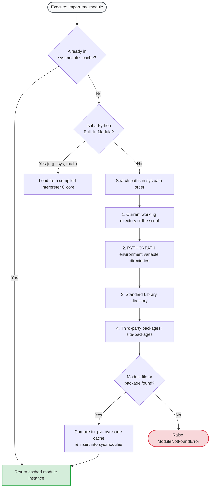
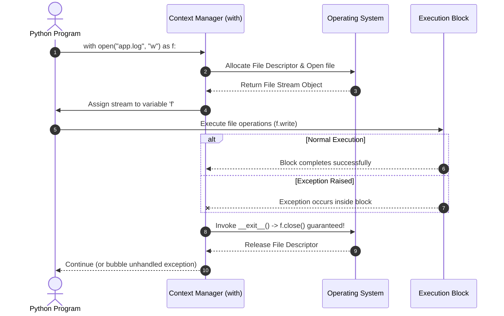
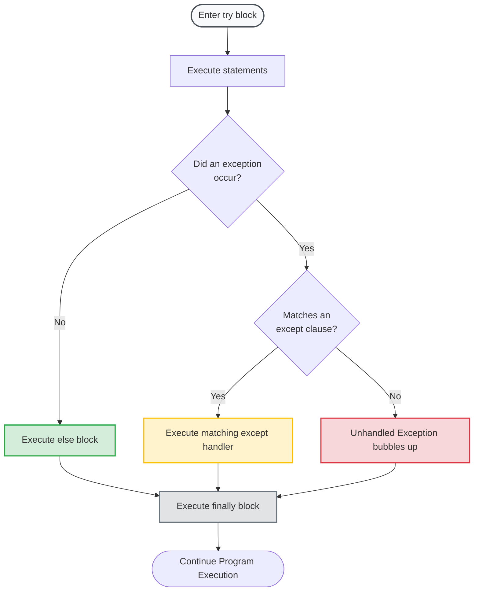
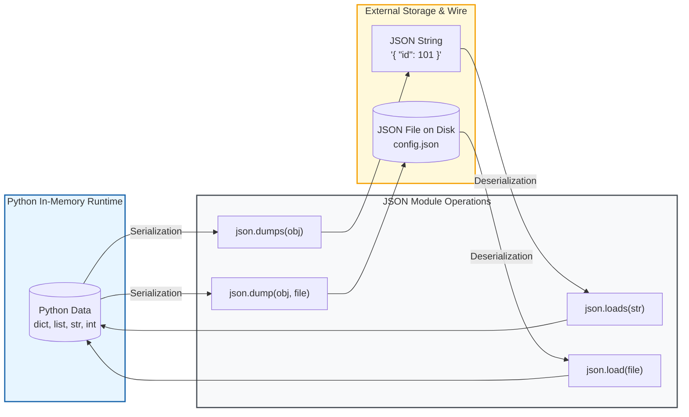
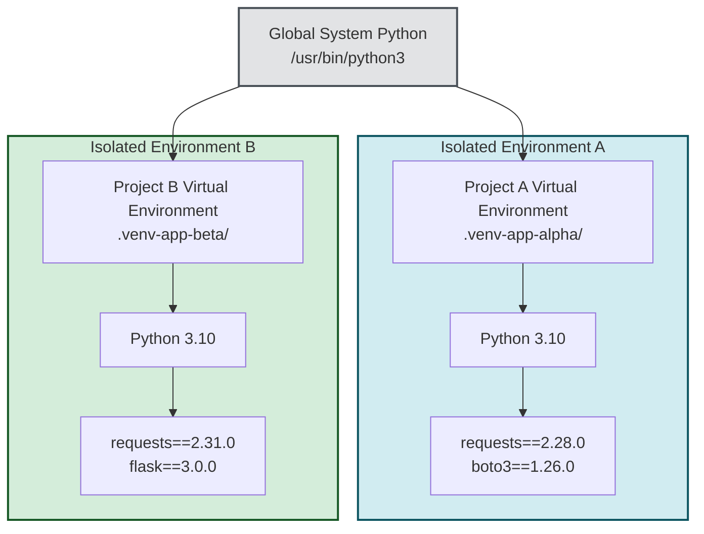

# 📦 Python Modules, Packages, File Handling, and Standard Libraries

> **Course**: AWS re/Start  
> **Module**: Python Programming (Module 05: Modules and Libraries)  
> **Source Document**: `T09-0006-RSPP_EN-US_SG_M05_MODSLIBRARIES.pdf`  
> **Target Audience**: AWS re/Start Learners / Cloud & DevOps Engineers  

---

## 🎯 Module Overview

In professional cloud computing and software engineering, applications are never written as monolithic, single-file scripts. Real-world solutions—from AWS Lambda automation handlers and CI/CD pipeline scripts to enterprise APIs—rely heavily on modular architectures, external packages, file persistence, and robust error management.

Python provides a modular design model and comes with a "batteries-included" standard library. This module introduces the hierarchical structure of Python code (functions, modules, packages, and libraries), the inner workings of module importation, direct filesystem operations, defensive exception handling, JSON serialization for cloud state interchange, and package management using `pip` and virtual environments.

### 📌 Learning Objectives
- [ ] **Explain the purpose and hierarchy of modularity**: Differentiate between functions, scripts, modules (`.py`), packages (`__init__.py`), and libraries.
- [ ] **Master module importing mechanisms**: Compare `import`, `from ... import`, aliasing (`as`), and recognize wildcard import anti-patterns (`from ... import *`).
- [ ] **Trace Python import resolution paths**: Understand how the Python interpreter searches namespaces, built-ins, `sys.path`, and `site-packages`.
- [ ] **Leverage the Python Standard Library**: Utilize core utility modules including `os`, `sys`, `pathlib`, `json`, `datetime`, `random`, `csv`, and `re`.
- [ ] **Perform safe file I/O operations**: Open, read, write, and append files using appropriate modes and enforce automated resource cleanup with context managers (`with open(...) as f:`).
- [ ] **Implement structured exception handling**: Build resilient fault-tolerant routines using `try`, `except`, `else`, `finally`, and custom `raise` statements.
- [ ] **Serialize and deserialize JSON data**: Convert Python structures to JSON strings/files and parse JSON payloads back into native data types (`dump`, `dumps`, `load`, `loads`).
- [ ] **Manage third-party packages and dependencies**: Use `pip`, the Python Package Index (PyPI), virtual environments (`venv`), and frozen dependency manifests (`requirements.txt`), culminating in the AWS SDK for Python (`boto3`).

---

## 🧩 1. Python Modules, Packages, and Libraries: The Modular Architecture

Software modularity breaks complex systems into smaller, independent, and reusable building blocks. In Python, modularity follows a clear hierarchical progression.

```
┌──────────────────────────────────────────────────────────┐
│                        LIBRARY                           │
│  (Collection of packages & modules, e.g., Boto3, NumPy)  │
│  ┌────────────────────────────────────────────────────┐  │
│  │                     PACKAGE                        │  │
│  │   (Directory with __init__.py containing modules)  │  │
│  │   ┌─────────────────────────────────────────────┐  │  │
│  │   │                  MODULE                     │  │  │
│  │   │       (Single .py file with code)           │  │  │
│  │   │   ┌──────────────────────────────────────┐  │  │  │
│  │   │   │             FUNCTION                 │  │  │  │
│  │   │   │    (Callable reusable code block)    │  │  │  │
│  │   │   └──────────────────────────────────────┘  │  │  │
│  │   └─────────────────────────────────────────────┘  │  │
│  └────────────────────────────────────────────────────┘  │
└──────────────────────────────────────────────────────────┘
```

### 1.1 Structural Definitions

| Entity | Definition | File System Representation | Primary Purpose |
| :--- | :--- | :--- | :--- |
| **Function** | A named block of executable statements designed to perform a single specific computation or action. | Defined inside a `.py` file (`def func():`) | Eliminates repetitive statements within a local script. |
| **Script** | A standalone Python file intended to be executed directly from top to bottom from the command line (`python script.py`). | Single file: `script.py` | Runs an entry-point process or automation routine. |
| **Module** | A Python file containing definitions (functions, classes, variables) and runnable statements designed to be imported into other files. | Single file: `module_name.py` | Shares logic and functions across multiple scripts. |
| **Package** | A directory containing one or more Python modules, grouped under a common namespace. | A directory containing `__init__.py` and sub-modules | Organizes large codebases into hierarchical namespaces. |
| **Library** | An umbrella term for a large collection of packages and modules that together provide comprehensive domain functionality. | Installed folder / repository (e.g., standard library, `requests`, `boto3`) | Supplies turnkey capabilities (HTTP handling, cloud SDKs, data analysis). |

> [!NOTE]
> **Analogous Example**: Saanvi does not need to invent the wheel when building a vehicle. Instead, she imports a pre-engineered wheel module from an automotive library to create something new—a complete cloud-connected car.

---

### 1.2 Creating and Using Custom Modules

Creating a module is as simple as creating a Python file with a `.py` extension.

#### Step 1: Create the Module (`cloud_math.py`)
```python
# cloud_math.py
"""Custom utility module providing basic arithmetic and cloud cost estimators."""

DEFAULT_REGION = "us-east-1"

def calculate_monthly_ec2_cost(hourly_rate: float, hours: int = 730) -> float:
    """Calculates estimated monthly cost for an EC2 instance."""
    return round(hourly_rate * hours, 2)

def calculate_data_transfer(gb_transferred: float, rate_per_gb: float = 0.09) -> float:
    """Calculates egress data transfer fees."""
    return round(gb_transferred * rate_per_gb, 2)

# Guarding execution so it can act as both module and test script
if __name__ == "__main__":
    print("Testing cloud_math module:")
    print("Default monthly cost ($0.0416/hr):", calculate_monthly_ec2_cost(0.0416))
```

#### Step 2: Import the Module (`main.py`)
```python
# main.py
import cloud_math

t3_micro_hourly = 0.0104
monthly_total = cloud_math.calculate_monthly_ec2_cost(t3_micro_hourly)

print(f"EC2 t3.micro Monthly Cost ({cloud_math.DEFAULT_REGION}): ${monthly_total}")
```

> [!TIP]
> **The `if __name__ == "__main__":` idiom**: When a Python file is run directly, its internal `__name__` attribute is set to `"__main__"`. When imported as a module, `__name__` is set to the module's file name (e.g., `"cloud_math"`). Using this guard allows modules to include standalone unit tests without executing those tests when imported elsewhere.

---

## 📥 2. Importing Modules & Namespace Mechanics

Importing is how Python brings functions, classes, and constants from external files or libraries into your active workspace.

### 2.1 Import Syntax Variations

#### 1. Whole Module Import: `import module`
```python
import math

# Access contents using dot-notation
radius = 5.0
circumference = 2 * math.pi * radius
square_root = math.sqrt(64)
```
- **Pros**: Explicit and clean; avoids name collision because all identifiers remain under the `math.` namespace.
- **Cons**: Requires typing the module prefix each time.

#### 2. Specific Symbol Import: `from module import item`
```python
from math import pi, sqrt

# Access directly without the module prefix
area = pi * (4 ** 2)
result = sqrt(144)
```
- **Pros**: Cleaner local code when calling specific mathematical routines frequently.
- **Cons**: Can overwrite (shadow) locally defined variables or functions with the same name.

#### 3. Module Aliasing: `import module as alias`
```python
import datetime as dt
import numpy as np

now = dt.datetime.now()
```
- **Pros**: Shortens long module names and standardizes conventions across engineering teams.

#### 4. Specific Symbol Aliasing: `from module import item as alias`
```python
from math import factorial as fact

print(fact(5))  # 120
```

#### 5. Wildcard Import (Anti-Pattern): `from module import *`
```python
# AVOID THIS PATTERN IN PRODUCTION CODE
from math import *
```
> [!CAUTION]
> **Why Wildcard Imports are Harmful**:
> 1. **Namespace Pollution**: Injects dozens or hundreds of unknown names into your local scope.
> 2. **Silent Shadowing**: If another module or your local code defines a function with the same name (e.g., `sin`, `cos`, or `log`), the wildcard import silently overwrites it without warning.
> 3. **Poor Readability & Tooling**: Static analysis tools, linters (Flake8, Pylint), and human readers cannot easily tell which module provided which function.

---

### 2.2 Module Import Resolution Path

When an `import` statement is executed, the Python interpreter follows a strict search order. If the module is not found after searching all locations, Python raises a `ModuleNotFoundError`.



---

### 2.3 Guided Demonstration: Exploring the `math` Module

This lab demonstrates importing the built-in mathematical library, performing transformations, and testing error handling.

```python
#!/usr/bin/env python3
"""Demonstration: Working with the Python math module."""

import math

# Initial test variables
absolute_input = -5.999
floor_input = 198.42

# math.fabs(x): Returns the absolute value of x as a float
result_abs = math.fabs(absolute_input)

# math.floor(x): Returns the largest integer <= x
result_floor = math.floor(floor_input)

print(f"{result_abs} is the absolute value of {absolute_input}")
print(f"{result_floor} is the floor of {floor_input}")

# Extra Challenge: What happens when passing invalid types to math.floor?
try:
    math.floor("invalid_string_number")
except TypeError as error:
    print(f"\n[Handled Error] math.floor requires a numeric type: {error}")
```

**Expected Output**:
```text
5.999 is the absolute value of -5.999
198 is the floor of 198.42

[Handled Error] math.floor requires a numeric type: must be real number, not str
```

---

## 🧰 3. Python Standard Library Highlights

Python’s standard library provides immediate access to system-level functionality without installing third-party tools.

| Module | Core Purpose | Typical Cloud & DevOps Use Cases |
| :--- | :--- | :--- |
| `os` | Operating system interfaces | Querying environment variables (`os.getenv`), managing folders, running subshell commands. |
| `sys` | Interpreter variables and runtime controls | CLI argument parsing (`sys.argv`), script exit statuses (`sys.exit`), examining `sys.path`. |
| `pathlib` | Modern object-oriented filesystem paths | Safe cross-platform file path resolution, checking file existence (`Path.exists()`). |
| `json` | JSON serialization and parsing | Interacting with AWS API JSON payloads, REST APIs, config state files. |
| `datetime` | Date and time manipulation | Generating CloudWatch timestamps, calculating token expirations, log rotations. |
| `random` | Pseudo-random number generation | Generating jitter for exponential backoff, test data generation, sampling. |
| `csv` | Reading and writing tabular comma-separated values | Exporting billing reports, importing user lists for batch provisioning. |
| `re` | Regular expression pattern matching | Parsing IP addresses, validating email formats, extracting log data. |

---

### 3.1 Deep Dive: The `os` Module

The `os` module provides portable functions for interacting with the host operating system.

#### Key Functions by Category

```
                ┌────────────────────────────────────────────────────────┐
                │                       os Module                        │
                └───────────────────────────┬────────────────────────────┘
                                            │
        ┌──────────────────────────┬────────┴─────────────────┬──────────────────────────┐
        │                          │                          │                          │
┌───────▼────────┐        ┌────────▼───────┐         ┌────────▼───────┐        ┌─────────▼────────┐
│  Host & User   │        │   Directory    │         │  Filesystem    │        │ Subshell Command │
├────────────────┤        ├────────────────┤         ├────────────────┤        ├──────────────────┤
│ os.getlogin()  │        │ os.getcwd()    │         │ os.chmod()     │        │ os.system()      │
│ os.getenv()    │        │ os.listdir()   │         │ os.chown()     │        │                  │
│ os.uname()     │        │ os.mkdir()     │         │ os.remove()    │        │                  │
│ os.environ     │        │ os.rmdir()     │         │ os.rename()    │        │                  │
└────────────────┘        └────────────────┘         └────────────────┘        └──────────────────┘
```

#### Code Demonstration: Exploring Host and File Operations
```python
import os

# 1. Host user and environment information
current_dir = os.getcwd()
print(f"Current Working Directory: {current_dir}")

# Querying environment variables (vital for 12-factor cloud apps)
aws_region = os.getenv("AWS_DEFAULT_REGION", "us-east-1")
print(f"Target AWS Region: {aws_region}")

# 2. Directory manipulation
test_folder = "test_cloud_dir"
if not os.path.exists(test_folder):
    os.mkdir(test_folder)
    print(f"Created directory: '{test_folder}'")

# List current directory entries
dir_contents = os.listdir(".")
print(f"Directory items count: {len(dir_contents)}")

# Clean up
if os.path.exists(test_folder):
    os.rmdir(test_folder)
    print(f"Removed directory: '{test_folder}'")

# 3. Executing subshell commands
exit_code = os.system("whoami")
print(f"Subshell command exit code: {exit_code}")
```

> [!WARNING]
> While `os.system()` allows quick shell commands, modern Python best practice for running external processes is to use the `subprocess` module (`subprocess.run()`), which prevents command-injection vulnerabilities and captures standard output and error streams cleanly.

---

## 📂 4. File Handling in Python

Files are the fundamental medium for persistent storage on local operating systems and network filesystems.

### 4.1 The `open()` Function and File Modes

Python interacts with files using the built-in `open()` function:

$$\text{file\_handle} = \text{open}(\text{file\_path}, \text{mode})$$

| Mode | Name | File Must Exist? | Truncates File? | File Pointer Position | Notes |
| :---: | :--- | :---: | :---: | :---: | :--- |
| `'r'` | **Read** (default) | **Yes** (raises `FileNotFoundError`) | No | Beginning | Read-only mode. |
| `'w'` | **Write** | No (creates new) | **Yes** (wipes all existing content!) | Beginning | Overwrite mode. |
| `'a'` | **Append** | No (creates new) | No | End | Appends new data to the bottom. |
| `'r+'` | **Read + Write** | **Yes** | No | Beginning | Does not truncate initially. |
| `'w+'` | **Write + Read** | No (creates new) | **Yes** | Beginning | Overwrites existing content. |
| `'a+'` | **Append + Read** | No (creates new) | No | End | Reads and appends. |
| `'b'` | **Binary Mode** | N/A | N/A | N/A | Added to any mode (`'rb'`, `'wb'`) for binary data (images, `.zip`, `.pyc`). |

---

### 4.2 Reading and Writing Methods

```python
# --- Reading Methods ---
with open("system.log", "r") as f:
    entire_text = f.read()          # Reads entire file into a single string
    
with open("system.log", "r") as f:
    single_line = f.readline()      # Reads one line including trailing newline (\n)
    
with open("system.log", "r") as f:
    all_lines = f.readlines()       # Reads all lines into a Python list of strings

# Efficient line-by-line streaming (Memory safe for multi-GB log files)
with open("system.log", "r") as f:
    for line in f:
        if "ERROR" in line:
            print(f"Found error entry: {line.strip()}")

# --- Writing Methods ---
with open("output.txt", "w") as f:
    f.write("Line 1: Cloud instance initialized\n")      # Writes single string
    
lines_to_add = ["Server: NGINX\n", "Status: Active\n"]
with open("output.txt", "a") as f:
    f.writelines(lines_to_add)                           # Writes list of strings
```

---

### 4.3 Context Managers (`with open(...) as f:`)

In low-level programming, when a file is opened, an operating system file descriptor is allocated. If the file is not explicitly closed via `.close()`, memory and file descriptor leaks occur.



> [!IMPORTANT]
> **Why Context Managers are Mandatory in Modern Code**:
> The `with` statement guarantees that the file handle is closed as soon as the block terminates—**even if an unhandled exception or crash occurs inside the block**. Never rely on manual `f.close()` statements alone.

---

## 🛡️ 5. Robust Exception Handling & Defensive Programming

In production environments, runtime errors are inevitable: network connections drop, configurations contain invalid values, and files are missing or locked. Exception handling allows a program to gracefully intercept and handle errors rather than crashing abruptly.

### 5.1 Anatomy of a Complete Exception Block

A production-grade Python exception structure uses four interconnected keywords:

```python
try:
    # 1. Risky code that may trigger an error
    number = int(input("Enter server port (1-65535): "))
    result = 100 / number
except ValueError as err:
    # 2. Handles specific ValueError (e.g. non-integer entered)
    print(f"[Error] Invalid numeric input: {err}")
except ZeroDivisionError as err:
    # 2b. Handles specific arithmetic zero division
    print(f"[Error] Port number cannot be zero: {err}")
except Exception as unexpected:
    # 2c. Catch-all fallback for other unpredicted errors
    print(f"[Fatal] Unexpected exception occurred: {unexpected}")
else:
    # 3. Runs ONLY if NO exception was raised in the try block
    print(f"[Success] Port configuration verified: {number}")
finally:
    # 4. ALWAYS runs, regardless of whether an error occurred or was caught
    print("[Clean-up] Port validation sequence completed.")
```



---

### 5.2 Common Standard Exceptions in Cloud Engineering

| Exception Class | Trigger Condition | Example Cloud Scenario |
| :--- | :--- | :--- |
| `FileNotFoundError` | An attempt to open or remove a non-existent file path. | Missing config file or SSL certificate path. |
| `PermissionError` | Operation attempted without sufficient OS permissions. | Trying to write to `/etc/` or bind to port 80 without root. |
| `ValueError` | A function receives an argument of correct type but invalid value. | Passing `"abc"` to `int()`. |
| `KeyError` | Attempting to access a non-existent key in a Python dictionary. | Missing key in an AWS CloudWatch JSON event payload. |
| `IndexError` | Attempting to index a list past its length. | Parsing `sys.argv[1]` when no command-line flag was passed. |
| `ZeroDivisionError` | Dividing a number by zero. | Calculating average latency over zero requests. |
| `TypeError` | Performing an operation on an incompatible data type. | Adding an integer to a string (`5 + "10"`). |

---

### 5.3 Raising Exceptions Manually (`raise`)

Developers can enforce business logic and signal invalid states using the `raise` keyword:

```python
def configure_instance_pool(desired_instances: int):
    if desired_instances < 1:
        raise ValueError("Instance pool capacity must be at least 1.")
    if desired_instances > 100:
        raise ValueError("Exceeded maximum safety threshold of 100 instances.")
    
    print(f"Allocating {desired_instances} instances...")

try:
    configure_instance_pool(0)
except ValueError as error:
    print(f"Validation Failure: {error}")
```

---

## 🔄 6. Structured Data Interchange with JSON

**JSON** (JavaScript Object Notation) is an open, human-readable data serialization standard widely used in web development, REST APIs, microservices, and AWS cloud architectures.

### 6.1 Serialization vs. Deserialization

- **Serialization (Encoding)**: Converting in-memory Python objects (`dict`, `list`, numbers) into a JSON-formatted string or byte stream for storage or network transport.
- **Deserialization (Decoding)**: Parsing a JSON formatted string or file back into native in-memory Python data types.



---

### 6.2 The Four Core Functions: The "s" Suffix Rule

Remembering when to use which function is straightforward:
- Functions **without** `s` (`dump`, `load`) work directly with **File Streams**.
- Functions **with** `s` (`dumps`, `loads`) work directly with **Strings**.

| Function | Direction | Source / Destination | Signature Syntax |
| :--- | :--- | :--- | :--- |
| `json.dumps()` | Python $\rightarrow$ JSON | Generates a JSON **string** | `json_str = json.dumps(python_obj, indent=2)` |
| `json.dump()` | Python $\rightarrow$ JSON | Writes to an open **file** | `json.dump(python_obj, file_handler, indent=2)` |
| `json.loads()` | JSON $\rightarrow$ Python | Parses from a JSON **string** | `python_obj = json.loads(json_str)` |
| `json.load()` | JSON $\rightarrow$ Python | Reads from an open **file** | `python_obj = json.load(file_handler)` |

---

### 6.3 Type Mapping: Python $\longleftrightarrow$ JSON

The `json` module automatically maps data types during translation:

| Python Data Type | JSON Equivalent | Notes |
| :--- | :--- | :--- |
| `dict` | **Object** (`{}`) | JSON keys are always coerced to strings. |
| `list`, `tuple` | **Array** (`[]`) | Tuples deserialize back as Python lists. |
| `str` | **String** (`""`) | JSON requires double quotes (`"`). |
| `int`, `float` | **Number** (`10`, `3.14`) | Retains integer vs float precision. |
| `True` / `False` | **Boolean** (`true` / `false`) | Note lowercase in JSON. |
| `None` | **null** (`null`) | Represents empty/null reference. |

---

### 6.4 Guided Demonstration: User State Persistence (`helloworld.py`)

This demonstration from the curriculum creates a stateful CLI program that remembers the user’s name across independent script executions by combining file handlers, `json.load`/`json.dump`, and `try/except`.

```python
#!/usr/bin/env python3
"""Demonstration: Persistent User Recognition using JSON and Exception Handling."""

import json

filename = "userName.json"
name = ""

# Step 1: Attempt to load prior history from state file
try:
    with open(filename, "r") as file_read:
        name = json.load(file_read)
except (FileNotFoundError, IOError):
    print("Welcome! First-time login detected.")

# Step 2: Greet existing user or prompt new user
if name != "":
    print(f"Welcome back, {name}!")
else:
    name = input("Hello! What's your name? ")
    print(f"Welcome, {name}!")

# Step 3: Persist current state back to disk
try:
    with open(filename, "w") as file_write:
        json.dump(name, file_write)
        print("[System] State successfully saved to disk.")
except IOError as err:
    print(f"[System Error] Problem writing to the history file: {err}")
```

---

## 📦 7. Third-Party Packages, Pip, and Environment Management

While the standard library is rich, complex modern workloads require third-party libraries developed by the global open-source community.

### 7.1 What is PyPI and `pip`?

- **PyPI (Python Package Index)**: The official public repository hosting over 450,000 community-maintained Python packages (`https://pypi.org`).
- **`pip` (Package Installer for Python)**: The standard command-line utility used to find, install, update, and remove third-party libraries from PyPI.

> [!NOTE]
> Like `apt` or `yum`/`dnf` manage operating system binaries on Linux, `pip` manages software packages inside the Python ecosystem. Crucially, `pip` is executed from your operating system shell, **not** inside the Python REPL.

#### Essential `pip` Commands
```bash
# Display package details (version, summary, location, dependencies)
pip show requests

# Download and install a package
pip install requests

# Upgrade an existing package to the latest version
pip install --upgrade requests

# List all packages installed in the active environment
pip list

# Uninstall a package
pip uninstall requests -y
```

---

### 7.2 Virtual Environments (`venv`): Preventing Dependency Conflicts

Installing packages globally using `sudo pip install` is dangerous:
- Project A may require `urllib3==1.26.5`.
- Project B may require `urllib3==2.0.0`.
- Upgrading a global package can break OS management utilities that depend on system Python.

**Virtual Environments** create isolated directory trees containing their own Python interpreter and dedicated `site-packages` directory.



#### Complete Virtual Environment Workflow
```bash
# 1. Create a virtual environment directory named .venv
python3 -m venv .venv

# 2. Activate the virtual environment
# On Linux/macOS:
source .venv/bin/activate
# On Windows (PowerShell):
# .venv\Scripts\Activate.ps1

# (Notice your terminal prompt changes to indicate active environment: (.venv) $)

# 3. Install project dependencies into the isolated environment
pip install requests boto3

# 4. Freeze exact installed versions into a manifest
pip freeze > requirements.txt

# 5. Replicating the environment on another server/CI/CD pipeline
pip install -r requirements.txt

# 6. Deactivate when finished
deactivate
```

---

### 7.3 Connecting to the Cloud: The AWS SDK for Python (`boto3`)

The premier Python library for cloud engineering is **Boto3**, the official AWS Software Development Kit (SDK) for Python. Boto3 allows developers to create, configure, and manage AWS services using idiomatic Python code.

```python
import boto3

# Initialize an AWS S3 client
s3_client = boto3.client('s3')

# List all S3 buckets in the AWS account
response = s3_client.list_buckets()

print("Available S3 Buckets:")
for bucket in response.get('Buckets', []):
    print(f" - {bucket['Name']}")
```

---

## 🧠 8. Knowledge Check & Review

Test your understanding of modules, file handling, exceptions, and packaging.

### Question 1
**What is the architectural relationship between a function, a module, and a library?**
> **Answer**: A **function** is an individual block of executable code designed for a specific task. A **module** is a separate Python file (`.py`) that organizes multiple related functions, classes, and variables. A **library** is an umbrella collection composed of multiple modules and packages providing comprehensive domain capabilities.

---

### Question 2
**What is the purpose of file handlers and context managers in Python?**
> **Answer**: File handlers provide a communication channel between Python code and the host operating system filesystem to open, read, write, and append data. Context managers (`with open(...) as f:`) ensure that allocated system file descriptors are automatically and safely closed when code execution leaves the block, even if unexpected exceptions occur.

---

### Question 3
**Can Python be used to execute system commands directly on the host operating system?**
> **Answer**: Yes. Functions such as `os.system()` from the `os` module or functions in the `subprocess` module (`subprocess.run()`) execute command strings in a host operating system subshell.

---

### Question 4
**What purpose do exceptions serve in Python application design?**
> **Answer**: Exceptions represent runtime error events. Rather than allowing an unexpected error to abruptly crash an application, Python raises an exception object. By using `try/except` blocks, developers intercept and handle errors gracefully, log warnings, clean up resources, and maintain application stability.

---

### Question 5
**True or False: When used, the JSON library automatically restores serialized data to native Python data types.**
> **Answer**: **True**. When `json.loads()` or `json.load()` parses JSON formatted strings or files, JSON numbers become Python integers/floats, arrays become Python lists, objects become Python dictionaries, and booleans/nulls map directly to `True`, `False`, and `None`.

---

### Question 6
**What is `pip` and why is it essential to Python development?**
> **Answer**: `pip` is the standard package manager for Python. It allows developers to search, download, install, update, and manage third-party libraries and dependencies from the Python Package Index (PyPI). Without `pip`, developers would have to manually locate source code, compile C extensions, and configure library search paths.

---

### Question 7
**Why should wildcard imports (`from math import *`) be avoided?**
> **Answer**: Wildcard imports pollute the local namespace with all symbols from the foreign module. This causes silent name shadowing (accidental overwriting of existing variables or functions), degrades code readability, and prevents static code analysis tools and IDEs from reliably tracking symbol origins.

---

## 📝 9. Key Takeaways & Summary

- **Modularity Boosts Reliability**: Dividing programs into functions, modules, and packages promotes code reuse, simplifies maintenance, and reduces bugs.
- **Search Path Resolution**: Python searches the `sys.modules` cache, built-in C libraries, the local script directory, `PYTHONPATH`, and installed `site-packages`.
- **Resource Safety with Context Managers**: Always manage file I/O using `with open(...) as f:` to guarantee proper cleanup of operating system file handles.
- **Defensive Error Handling**: Use `try/except/else/finally` with explicit exception types (`FileNotFoundError`, `ValueError`, `KeyError`) to build robust cloud automation scripts.
- **Data Interchange via JSON**: Use `json.dumps()`/`json.loads()` for in-memory strings and `json.dump()`/`json.load()` for disk files to transfer state between microservices and AWS APIs.
- **Dependency Isolation**: Use `pip` in combination with virtual environments (`venv`) and `requirements.txt` manifests to ensure clean, reproducible application deployments across development, staging, and production environments.
