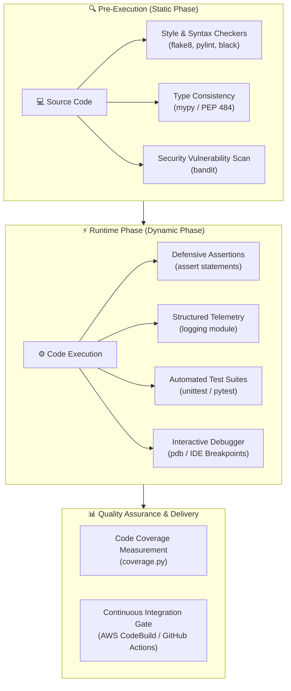
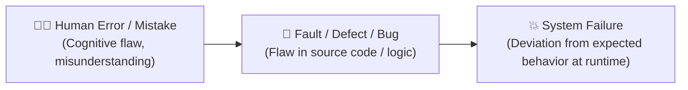
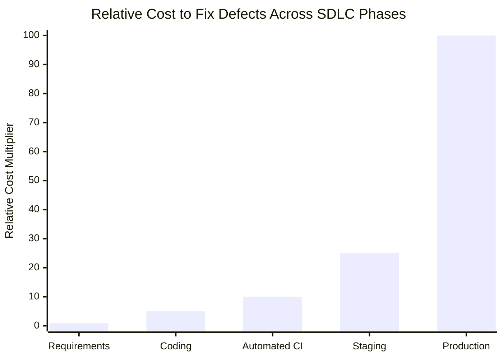
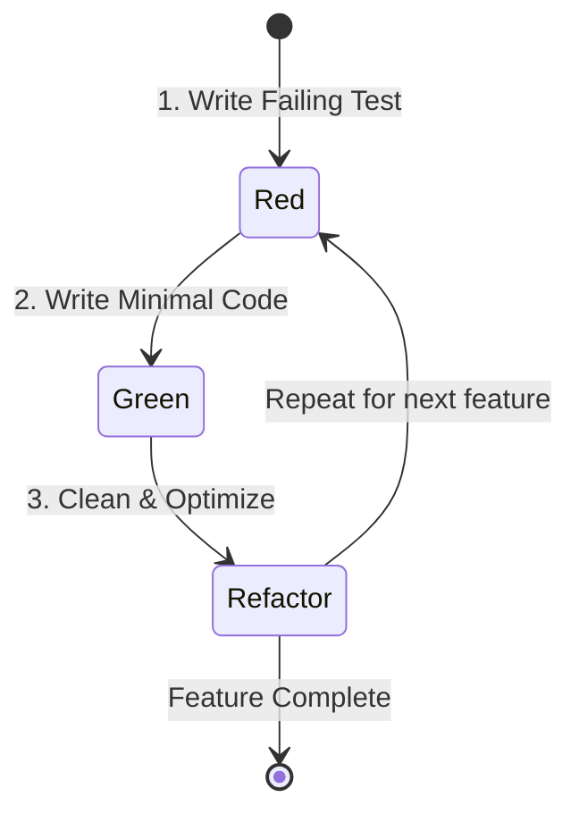
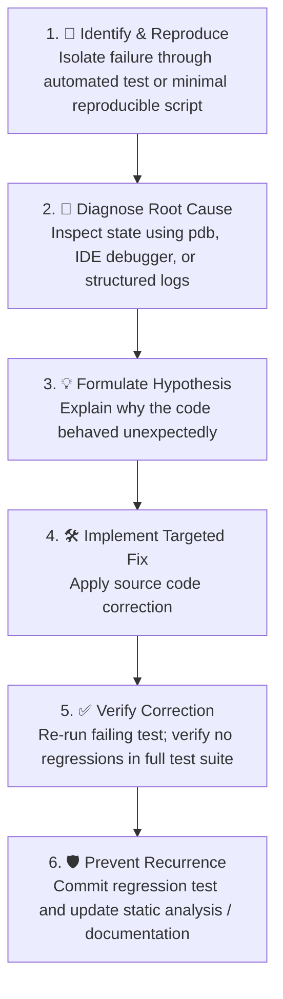
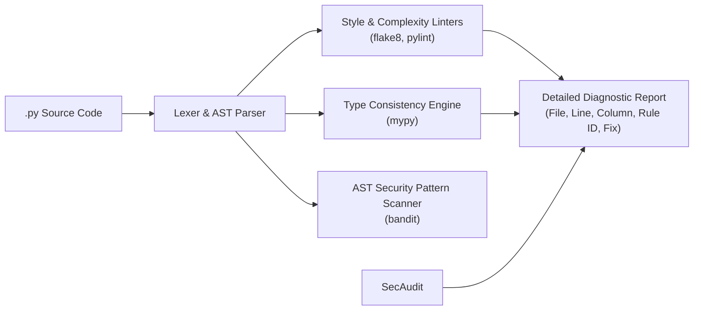
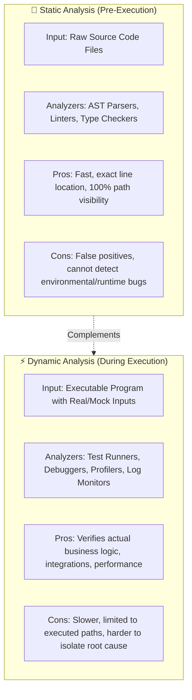
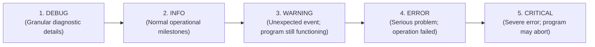
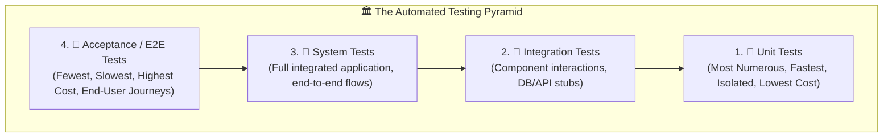
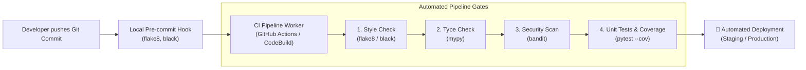

# 🐞 Python Programming: Debugging & Software Testing

> **Course**: AWS re/Start  
> **Module**: Python Programming (M05 – Debugging and Testing)  
> **Source Document**: `T09-Python_Programming/T09-0008-RSPP_EN-US_SG_M05_DEBUGGINGTESTING.pdf`  
> **Target Audience**: AWS re/Start Learners, Cloud Practitioners, and Junior DevOps Engineers  

---

## 🎯 Module Overview

In modern software development and cloud operations, code quality, reliability, and security are non-negotiable requirements. Cloud systems—such as serverless AWS Lambda functions, microservices running in Amazon Elastic Container Service (Amazon ECS), or automation scripts provisioning AWS CloudFormation stacks—must execute predictably and withstand edge cases without catastrophic failures.

Writing code is only the initial step of the software development lifecycle (SDLC). A significant portion of an engineer's time is dedicated to **debugging** (diagnosing and rectifying unintended behaviors) and **testing** (systematically verifying that code fulfills functional and non-functional requirements).

This module delivers a comprehensive examination of software defect analysis, static analysis tooling, dynamic runtime evaluation, interactive debugging techniques, structured logging, automated unit testing frameworks, and continuous integration (CI) quality gates.



---

## 📌 Learning Objectives

By completing this module and working through the practical demonstrations, you will be able to:

- [ ] **Explain the Purpose of Debugging and Testing**: Differentiate defects, bugs, errors, and failures, and evaluate the economic impact of defect escape across the SDLC.
- [ ] **Understand Test-Driven Development (TDD)**: Trace the Red-Green-Refactor cycle and understand how automated tests drive modular code design.
- [ ] **Master Interactive Debugging with `pdb`**: Utilize Python's standard debugger to set programmatic breakpoints (`breakpoint()`), step through instructions, inspect system state, and examine stack frames.
- [ ] **Leverage IDE Debugging Environments**: Navigate graphical debuggers in Visual Studio Code, PyCharm, and AWS Cloud9, configuring watch expressions, call stacks, and conditional breakpoints.
- [ ] **Perform Static Analysis on Python Code**: Understand how to detect syntax flaws, stylistic divergence, and code complexity without running code using tools like `flake8`, `pylint`, `black`, and `isort`.
- [ ] **Enforce Type Safety with `mypy`**: Implement PEP 484 type annotations and statically identify type mismatch bugs before runtime.
- [ ] **Conduct Static Security Audits with `bandit`**: Identify common security flaws such as hardcoded AWS credentials, weak cryptographic hashes, and shell injection vulnerabilities.
- [ ] **Execute Dynamic Analysis**: Analyze runtime behaviors, apply defensive assertions (`assert`), and distinguish between assertion usage and exception handling.
- [ ] **Implement Production Logging**: Configure Python's standard `logging` library with appropriate log levels, handlers, and formats to capture diagnostic telemetry.
- [ ] **Structure the Testing Pyramid**: Contrast Unit, Integration, System, and Acceptance testing levels using real-world architectural analogies.
- [ ] **Author Automated Test Suites**: Write isolated, repeatable unit tests using `unittest` and modern `pytest`, applying test fixtures and parametrization.
- [ ] **Measure Code Coverage**: Gauge test suite thoroughness using `coverage.py` and interpret coverage reports.
- [ ] **Integrate Quality Gates into CI/CD Pipelines**: Incorporate automated linting, security scanning, and test suites into deployment pipelines.

---

## 🧭 1. Purpose of Debugging and Testing Code

### 1.1 Defining Defects, Bugs, Errors, and Failures

In software engineering, terminology regarding faults is precise and standardized (e.g., IEEE Standard 610.12):



- **Error (Mistake)**: A human action that produces an incorrect result (e.g., an engineer misunderstands an AWS API requirement or miscalculates an array index).
- **Fault / Defect / Bug**: An imperfection or flaw in a software work product (source code, configuration, or documentation) that causes the software to fail to perform its required function.
- **Failure**: An event in which a system or component does not perform a required function within specified limits (e.g., a customer receives an HTTP 500 Internal Server Error when attempting to check out).

> [!NOTE]
> A bug in the code remains a latent **defect** until the specific code path is executed with inputs that trigger an observable **failure**. Testing is the deliberate search for failures to uncover latent defects before users encounter them.

---

### 1.2 The Economics of Software Quality

The cost of resolving a software defect grows exponentially the further it travels down the Software Development Lifecycle (SDLC). This phenomenon, known as the **Boehm Curve**, emphasizes why early detection through static analysis and unit testing is vital for operational and financial efficiency.

| SDLC Phase | Detection Method | Relative Cost Factor | Impact & Blast Radius |
| :--- | :--- | :---: | :--- |
| **Requirements / Design** | Peer review, threat modeling | **$1\times$** | Resolved in documentation before code is written. |
| **Coding / Implementation** | Static linters, `mypy`, IDE checks, `pdb` | **$5\times$** | Detected within seconds; fixed immediately by the developer. |
| **Automated Testing / CI** | Unit tests (`pytest`), `bandit`, CI builds | **$10\times$** | Blocked before merge; developer notified within minutes. |
| **Staging / Integration** | Integration tests, automated smoke tests | **$15\times - 30\times$** | Requires environment rollback, team context switching. |
| **Production Deployment** | CloudWatch alarms, end-user error reports | **$100\times - 640\times$+** | Data corruption, SLA violations, brand reputation damage, emergency incident response. |



---

### 1.3 Test-Driven Development (TDD) Overview

**Test-Driven Development (TDD)** is an iterative software development methodology where automated tests are authored *before* the production code is written. TDD follows the strict **Red-Green-Refactor** cycle:



1. **Red**: Write a small, automated unit test that specifies a desired behavior or edge case. Run the test suite and confirm that the new test fails (because the functionality does not yet exist).
2. **Green**: Write the bare minimum amount of production code required to make the test pass. Do not write premature optimizations or extra features.
3. **Refactor**: Review and clean up the implementation. Eliminate duplicated code, adhere to PEP 8 standards, extract functions, and optimize data structures—while keeping the test suite running to ensure no regressions are introduced.

#### Benefits of TDD for Cloud Automation
- **Prevents Over-Engineering**: Developers implement only the logic required to satisfy verified specifications.
- **Guaranteed Test Coverage**: Code written under TDD is inherently testable, decoupling dependencies and avoiding monolithic designs.
- **Fearless Refactoring**: When updating legacy cloud scripts or upgrading AWS SDK libraries (`boto3`), comprehensive tests guarantee that changes do not break existing business logic.

---

### 1.4 The High-Level Debugging Lifecycle

Debugging is the systematic process of finding the root cause of a defect and repairing it.



---

## 🛠️ 2. Interactive Debugging in Python

### 2.1 The Built-in `pdb` Module

Python includes a complete, interactive source-code debugger called **`pdb`** as part of its standard library. It supports setting conditional breakpoints, single-stepping through source lines, inspecting stack frames, and evaluating arbitrary Python code in the current context.

#### Invoking `pdb`

There are three primary ways to invoke the Python debugger:

1. **Post-Mortem / Script Launch Mode (CLI)**:
   Launch an entire script under `pdb` control from the command line:
   ```bash
   python -m pdb process_data.py
   ```
   The debugger stops before executing the first line of the file and presents the `(Pdb)` prompt.

2. **Programmatic Breakpoints with `breakpoint()` (Python 3.7+)**:
   Insert the built-in function `breakpoint()` anywhere in your code where execution should pause:
   ```python
   def calculate_storage_cost(gb_stored, rate_per_gb):
       breakpoint()  # Drops directly into interactive pdb here
       total = gb_stored * rate_per_gb
       return total
   ```

3. **Legacy Programmatic Breakpoints**:
   In older codebases or specific environments:
   ```python
   import pdb; pdb.set_trace()
   ```

> [!TIP]
> The modern `breakpoint()` built-in respects the `PYTHONBREAKPOINT` environment variable. Setting `PYTHONBREAKPOINT=0` disables all breakpoints during production execution without modifying source files.

---

### 2.2 Essential `pdb` Command Reference

When paused at the `(Pdb)` interactive prompt, the following commands control execution:

| Command | Short Alias | Syntax | Operational Description |
| :--- | :---: | :--- | :--- |
| **`help`** | `h` | `h [command]` | Displays help documentation for commands. |
| **`list`** | `l` | `l [first, last]` | Lists 11 lines of source code around the current line. |
| **`next`** | `n` | `n` | Executes the current line and stops at the next line in the current function (**Step Over**). |
| **`step`** | `s` | `s` | Executes the current line, stepping *into* any called function (**Step Into**). |
| **`continue`** | `c` | `c` | Resumes normal execution until the next breakpoint or unhandled exception. |
| **`print`** | `p` | `p <expression>` | Evaluates and prints the value of an expression or variable in the current frame. |
| **`pp`** | `pp` | `pp <expression>` | Pretty-prints the value of an expression using the `pprint` module. |
| **`break`** | `b` | `b [lineno \| func [, cond]]` | Sets a breakpoint at a given line or function, optionally with a condition. |
| **`clear`** | `cl` | `cl [bpnumber ...]` | Clears specified breakpoints, or all breakpoints if none specified. |
| **`return`** | `r` | `r` | Continues execution until the current function returns (**Step Out**). |
| **`where`** | `w` | `w` | Prints a stack trace showing the current call stack with the current line indicated. |
| **`up`** | `u` | `u` | Moves the current stack frame one level up (toward the caller). |
| **`down`** | `d` | `d` | Moves the current stack frame one level down (toward the callee). |
| **`quit`** | `q` | `q` | Immediately aborts program execution and exits the debugger. |

---

### 2.3 Interactive `pdb` Walkthrough Scenario

Consider a script that calculates AWS CloudWatch log ingest pricing with a logic bug:

```python
# log_pricing_buggy.py
def calculate_discount(volume_gb):
    if volume_gb > 10000:
        discount = 0.20
    elif volume_gb > 5000:
        discount = 0.10
    else:
        discount = 0.05
    return discount

def calculate_monthly_bill(volume_gb, rate_per_gb=0.50):
    discount = calculate_discount(volume_gb)
    # BUG: Discount is added instead of subtracted
    effective_rate = rate_per_gb * (1 + discount) 
    total = volume_gb * effective_rate
    return round(total, 2)

if __name__ == "__main__":
    gb = 6000
    breakpoint()  # Interactive inspection point
    bill = calculate_monthly_bill(gb)
    print(f"Monthly bill for {gb} GB: ${bill}")
```

#### Step-by-Step Terminal Execution Session:

```text
$ python log_pricing_buggy.py
> /work/tmp/aws-cf/log_pricing_buggy.py(20)<module>()
-> bill = calculate_monthly_bill(gb)
(Pdb) l
 15     if __name__ == "__main__":
 16         gb = 6000
 17         breakpoint()
 18  ->     bill = calculate_monthly_bill(gb)
 19         print(f"Monthly bill for {gb} GB: ${bill}")
(Pdb) p gb
6000
(Pdb) s
--Call--
> /work/tmp/aws-cf/log_pricing_buggy.py(10)calculate_monthly_bill()
-> def calculate_monthly_bill(volume_gb, rate_per_gb=0.50):
(Pdb) n
> /work/tmp/aws-cf/log_pricing_buggy.py(11)calculate_monthly_bill()
-> discount = calculate_discount(volume_gb)
(Pdb) n
> /work/tmp/aws-cf/log_pricing_buggy.py(13)calculate_monthly_bill()
-> effective_rate = rate_per_gb * (1 + discount)
(Pdb) p discount
0.1
(Pdb) p rate_per_gb
0.5
(Pdb) n
> /work/tmp/aws-cf/log_pricing_buggy.py(14)calculate_monthly_bill()
-> total = volume_gb * effective_rate
(Pdb) p effective_rate
0.55
```

> [!CAUTION]
> Inspection reveals `effective_rate` evaluated to `0.55` instead of `0.45`! The operator `(1 + discount)` increased the customer's rate instead of applying a discount. We diagnosed the root cause in minutes without guessing.

To exit `pdb`, enter `q` (quit):
```text
(Pdb) q
```

---

### 2.4 Graphical IDE Debuggers

Modern Integrated Development Environments provide visual wrappers around debugging engines, eliminating the need to memorize CLI flags.

```
┌────────────────────────────────────────────────────────────────────────┐
│                        IDE Debugging Capabilities                      │
├────────────────────────────────────────────────────────────────────────┤
│  🔴 Breakpoints: Red dots clicked in gutter; trigger execution pauses │
│  🟡 Conditional Breakpoints: Trigger only when `counter > 100 == True` │
│  🟣 Logpoints: Print diagnostic messages to console without stopping   │
│  👁️ Watch Expressions: Continuously evaluate custom expressions       │
│  📚 Call Stack Window: Visual trace of frames from main to inner call   │
│  🎛️ Step Controls: [Continue ▷] [Over ↷] [Into ⇲] [Out ⇱] [Stop ⏹]   │
└────────────────────────────────────────────────────────────────────────┘
```

#### Comparison of Primary IDE Debuggers:

1. **Visual Studio Code (VS Code)**:
   - Configured via `.vscode/launch.json`.
   - Supports Python debugging through the Microsoft Python extension (using `debugpy`).
   - Feature-rich variables pane (Local, Global, Special variables) and inline variable value overlays.
2. **PyCharm**:
   - Built-in Cython-accelerated debugger for high performance.
   - Smart Step Into (allows choosing which nested function call to enter on a complex line).
   - Evaluate Expression dialog supporting multiline Python snippets.
3. **AWS Cloud9**:
   - Cloud-native browser IDE hosted directly on an Amazon EC2 instance.
   - Built-in visual debugger supporting Python step execution.
   - Directly integrated with AWS IAM credentials and AWS Lambda local invoke debugging via AWS SAM CLI.

---

## 🔬 3. Static Analysis on Python Code

### 3.1 What is Static Analysis?

**Static analysis** is the automated examination of computer software source code **without executing the program**. The analyzer parses the source text into an Abstract Syntax Tree (AST), validates token patterns against predefined syntactic rules, checks structural integrity, and checks compliance with style guides and security guidelines.

#### Characteristics of Static Analysis:
- Runs continuously during development (in text editors, Git pre-commit hooks, and CI pipelines).
- Can analyze code modules independently without needing mock runtime environments or live databases.
- Identifies syntax errors, type mismatches, variable shadowing, dead code, and known vulnerability patterns.



---

### 3.2 Advantages and Disadvantages of Static Analysis

*(Directly derived and expanded from Slide 8)*

| Category | Factors & Rationale |
| :--- | :--- |
| **Advantages** | • **Precise Localization**: Pinpoints the exact line number, column, and rule violated.<br>• **Fast Turnaround**: Runs in milliseconds locally before code execution.<br>• **Reduces Downstream Defect Costs**: Catches bugs early before integration.<br>• **High Code Consistency**: Enforces team-wide standards across thousands of files. |
| **Disadvantages** | • **False Positives & False Negatives**: May flag harmless code or miss dynamic runtime errors.<br>• **No Execution Validation**: Cannot verify runtime logic, timing issues, or third-party API payloads.<br>• **False Sense of Security**: Passing static analysis does not prove code correctness.<br>• **Configuration Maintenance**: Requires tuning rule sets and exception lists. |

---

### 3.3 Python Linters, Style Checkers, and Formatters

Python's dynamic nature allows high flexibility, but without static tooling, codebases can suffer from formatting drift, variable naming inconsistencies, and antipatterns.

#### 1. `flake8`
A lightweight, fast static analyzer that unifies three core tools:
- **PyFlakes**: Analyzes ASTs for logic errors (unused imports, undefined variables).
- **pycodestyle**: Checks compliance with **PEP 8** (Python style conventions).
- **McCabe**: Measures code cyclomatic complexity (identifying overly nested functions).

```bash
# Install and run flake8
pip install flake8
flake8 --max-line-length=88 --statistics app.py
```

Sample output:
```text
app.py:12:1: E302 expected 2 blank lines, found 1
app.py:18:5: F841 local variable 'temp_res' is assigned to but never used
app.py:25:80: E501 line too long (89 > 88 characters)
```

#### 2. `pylint`
A deep static analysis tool that enforces coding standards, checks for code smells, detects duplicated code, and provides a numerical code rating out of 10.0.

```bash
pip install pylint
pylint my_script.py
```

#### 3. `black`
Known as *"The Uncompromising Code Formatter"*, `black` parses Python code into an AST and reformats it deterministically into a uniform, readable style. It removes all debates over indentation, string quotation marks, and line breaks.

```bash
pip install black
black --line-length 88 my_script.py
```

#### 4. `isort`
Automatically organizes and sorts Python `import` statements alphabetically and grouped into:
1. Standard library imports
2. Related third-party imports
3. Local application/library specific imports

```bash
pip install isort
isort my_script.py
```

---

### 3.4 Static Type Checking with `mypy` and PEP 484

While Python is dynamically typed, **PEP 484** introduced optional **type hints**. Static type checkers like **`mypy`** evaluate these annotations before runtime to prevent `TypeError` exceptions.

```python
# untyped_example.py (Vulnerable to subtle runtime type failures)
def fetch_instance_ips(instances):
    return [i["PublicIp"] for i in instances if "PublicIp" in i]

# typed_example.py (Explicit, safe, and self-documenting)
from typing import List, Dict, Optional

def fetch_instance_ips_typed(instances: List[Dict[str, str]]) -> List[str]:
    ips: List[str] = []
    for instance in instances:
        ip: Optional[str] = instance.get("PublicIp")
        if ip is not None:
            ips.append(ip)
    return ips
```

Running `mypy`:
```bash
$ mypy typed_example.py
Success: no issues found in 1 source file
```

If an invalid type is passed:
```python
fetch_instance_ips_typed("invalid_string_argument")
```
`mypy` reports:
```text
typed_example.py:16: error: Argument 1 to "fetch_instance_ips_typed" has incompatible type "str"; expected "List[Dict[str, str]]"
Found 1 error in 1 file (checked 1 source file)
```

---

### 3.5 Security Static Analysis with `bandit`

**Bandit** is a dedicated static analysis tool designed to find common security issues in Python code. It scans the AST against security rule plugins.

In cloud and DevOps environments, Bandit checks for critical vulnerabilities:
- **Hardcoded AWS Credentials / Tokens**: Prevents accidental leakage of IAM access keys into GitHub.
- **SQL Injection**: Detects string formatting used within SQL query strings.
- **Insecure Cryptography**: Flags obsolete algorithms like MD5 or SHA1 used for sensitive operations.
- **Shell Injection**: Detects `subprocess` or `os.system` invocations with `shell=True`.

```bash
pip install bandit
bandit -r src/
```

Sample Bandit violation:
```text
>> Issue: [B105:hardcoded_password_string] Possible hardcoded password: 'AKIAPOK7EXAMPLEKEY'
   Severity: Low   Confidence: Medium
   Location: ./cloud_deploy.py:14
13 AWS_ACCESS_KEY_ID = "AKIAPOK7EXAMPLEKEY"
```

---

### 3.6 Demonstration: Static Debugging Walkthrough

*(Directly derived from Presentation Slide 9)*

#### The Original Buggy Code:
```python
# debug.py (Slide 9 Example)
var = "Double Value"
sumvalue = var + 4
def dosomething(valuetocheck):
if valuetocheck > 4:
print("Bad indent")
```

#### Static Error Analysis:
When running Python or a static linter on `debug.py`, the interpreter immediately halts before executing the body:

1. **SyntaxError (Indentation)**:
   ```text
     File "debug.py", line 4
       if valuetocheck > 4:
       ^
   IndentationError: expected an indented block after function definition on line 3
   ```
2. **TypeError (Type Mismatch)**:
   Even if indented, line 2 attempts to concatenate a `str` and an `int`:
   `TypeError: can only concatenate str (not "int") to str`.

#### Corrected Static Code:
```python
# debug_corrected.py
def dosomething(valuetocheck: int) -> None:
    """Evaluate an integer value and print status."""
    if valuetocheck > 4:
        print("Value is greater than 4")
    else:
        print("Value is 4 or less")

if __name__ == "__main__":
    # Corrected string handling and explicit integer operations
    var = "Double Value"
    numeric_suffix = 4
    combined_label = f"{var}_{numeric_suffix}"
    print(f"Generated Label: {combined_label}")
    
    dosomething(numeric_suffix)
```

---

## ⚡ 4. Dynamic Analysis and Runtime Verification

### 4.1 What is Dynamic Analysis?

**Dynamic analysis** is the evaluation of software by **executing programs in a runtime environment** (e.g., local developer machine, staging environment, or test sandbox) and inspecting runtime behaviors, memory states, return values, and operational metrics.

#### Characteristics of Dynamic Analysis:
- Evaluates the software under real execution conditions with live or simulated inputs.
- Inspects variables, call stacks, network interactions, and database connections.
- Utilizes runtime assertions, logging output, unit tests, and interactive debuggers.

---

### 4.2 Advantages and Disadvantages of Dynamic Analysis

*(Directly derived and expanded from Slide 11)*

| Category | Factors & Rationale |
| :--- | :--- |
| **Advantages** | • **Identifies Runtime Issues**: Detects environmental failures, memory leaks, concurrency race conditions, and network timeouts.<br>• **Works with Black-Box Systems**: Can evaluate compiled binaries or third-party services where source code is unavailable.<br>• **Validates Static Findings**: Confirms whether a warning from static analysis is a real defect or a false positive.<br>• **Universal Application**: Applicable to any running executable regardless of source language. |
| **Disadvantages** | • **Incomplete Code Coverage**: Only tests execution paths triggered by the specific test cases run.<br>• **Isolation Difficulty**: When a runtime failure occurs, pinpointing the exact offending line can require deep log analysis.<br>• **Resource Intensive**: Requires functional runtime environments, compute resources, dependencies, and test databases. |

---

### 4.3 Static vs. Dynamic Analysis Comparison



---

### 4.4 Assertions and Defensive Programming

*(Directly derived from Slide 12 & Slide 16)*

An **assertion** is a sanity check in code that tests whether a specific boolean condition remains `True`. If the condition evaluates to `False`, Python immediately halts execution by raising an **`AssertionError`**.

#### The `assert` Statement Syntax:
```python
assert <condition>, "<optional diagnostic error message>"
```

#### Practical Examples:
```python
# Slide 12 Example (Corrected for intentional logic)
def log_user_age(age: int) -> None:
    # Ensure age is a positive, non-zero number
    assert age > 0, f"Invalid age supplied: {age}. Age must be greater than 0."
    print(f"User age logged: {age}")

# Executing valid age
log_user_age(25)  # Output: User age logged: 25

# Executing invalid age
# log_user_age(-5)  # Raises: AssertionError: Invalid age supplied: -5. Age must be greater than 0.
```

#### Best Practices: Assertions vs. Exceptions

> [!IMPORTANT]
> **Never use `assert` to validate user input or security checks in production applications!**  
> Running Python with optimization flags (e.g., `python -O script.py`) disables all `assert` statements globally.

```python
# ❌ INCORRECT: Security check using assert (bypassable with python -O)
def transfer_funds(account_id: str, amount: float):
    assert amount > 0, "Transfer amount must be positive"  # Skipped if run with -O!
    process_withdrawal(account_id, amount)

# ✅ CORRECT: Explicit exception handling for input validation
def transfer_funds_safe(account_id: str, amount: float):
    if amount <= 0:
        raise ValueError(f"Transfer amount must be positive. Received: {amount}")
    process_withdrawal(account_id, amount)
```

| Use Case | Recommended Tool | Rationale |
| :--- | :--- | :--- |
| **Internal invariants** (logic that should never happen if code is bug-free) | `assert` | Documents developer assumptions; caught during test execution. |
| **External input validation** (user data, API request payloads) | `raise ValueError` / `TypeError` | Guaranteed execution; cannot be disabled by `-O` flags. |
| **Operational failures** (network timeout, database unreachable) | Custom Exceptions (`ConnectionError`) | Allows callers to catch, retry, or handle gracefully. |

---

### 4.5 Application Logging for Dynamic Monitoring

*(Directly derived from Slides 13, 14, and 15)*

Logging is the programmatic recording of events, state changes, errors, and operational telemetry to a persistent storage destination (e.g., local files, stdout/stderr, Amazon CloudWatch Logs).

```
┌────────────────────────────────────────────────────────────────────────┐
│                        Why Log Monitoring Matters                      │
├────────────────────────────────────────────────────────────────────────┤
│  1. Continuous Diagnostics: Monitor behavior in remote environments     │
│  2. Historical Traceability: Reconstruct incidents post-failure        │
│  3. Performance Insights: Measure latency, throughput, and anomalies   │
│  4. Compliance & Audit: Maintain verifiable records of critical actions │
└────────────────────────────────────────────────────────────────────────┘
```

#### The Five Standard Python Log Levels:



#### What Information Should Be Logged?
*(From Slide 14)*
When designing robust log messages, include:
- **Timestamp**: Precise ISO 8601 UTC timestamp (`%(asctime)s`).
- **Location**: Originating module, file name, and line number (`%(module)s:%(lineno)d`).
- **Severity Level**: Log level (`%(levelname)s`).
- **Context & Arguments**: User IDs, request IDs, resource identifiers (e.g., EC2 Instance ID, S3 bucket name).
- **Stack Traces on Exceptions**: Pass `exc_info=True` or use `logging.exception()` when catching exceptions to preserve the full call stack trace.

#### Complete Python Logging Implementation:

```python
# cloud_logger.py
import logging
import sys

# Configure global logger
logging.basicConfig(
    filename="application.log",
    filemode="a",
    level=logging.DEBUG,
    format="%(asctime)s [%(levelname)s] (%(name)s:%(lineno)d) - %(message)s",
    datefmt="%Y-%m-%d %H:%M:%S",
)

logger = logging.getLogger("AWSAutomation")

def deploy_s3_bucket(bucket_name: str) -> bool:
    logger.info("Attempting to provision bucket: %s", bucket_name)
    try:
        if not bucket_name.islower():
            raise ValueError(f"Bucket name '{bucket_name}' contains uppercase letters.")
        logger.debug("Validation succeeded for bucket: %s", bucket_name)
        # Simulated API call
        logger.info("Successfully provisioned bucket: %s", bucket_name)
        return True
    except Exception as exc:
        logger.error("Failed to provision bucket '%s': %s", bucket_name, exc, exc_info=True)
        return False

if __name__ == "__main__":
    deploy_s3_bucket("my-valid-bucket-101")
    deploy_s3_bucket("INVALID_BUCKET_NAME")
```

---

### 4.6 Demonstration: Dynamic Debugging Walkthrough

*(Directly derived from Presentation Slide 16)*

#### Scenario Requirements:
Prompt the user for a numeric input, validate that the input is an integer greater than 0, and confirm branching conditions dynamically.

```python
# dynamic_debug_demo.py
def check_value(value_to_check: int) -> None:
    """Validate dynamic conditions using assertions."""
    # Ensure value is an integer type
    assert isinstance(value_to_check, int), "You must enter an integer number."
    # Ensure value is positive and greater than zero
    assert value_to_check > 0, "Value entered must be strictly greater than 0"
    
    if value_to_check > 4:
        print(f"✅ Success: {value_to_check} is greater than 4.")
    else:
        print(f"ℹ️ Value {value_to_check} is between 1 and 4.")

def main():
    try:
        user_input = input("Enter a positive whole number greater than 0: ")
        # Convert string input to integer
        parsed_value = int(user_input)
        check_value(parsed_value)
    except ValueError:
        print("❌ Error: Invalid input format. Please supply a valid integer.")
    except AssertionError as err:
        print(f"🛑 Validation Assertion Failed: {err}")

if __name__ == "__main__":
    main()
```

---

## 🏛️ 5. Software Testing Foundations & The Test Pyramid

### 5.1 Why Software Testing is Necessary

*(Directly derived from Slide 18)*

Testing is the systematic execution of software under controlled conditions to verify that:
1. The software satisfies its specified requirements.
2. The software handles edge cases, corrupted inputs, and resource constraints gracefully.
3. Code modifications and new features do not introduce regressions into existing features.
4. Cloud infrastructure costs, latency targets, and compliance requirements are maintained.

---

### 5.2 The Testing Pyramid

The **Testing Pyramid** (conceived by Mike Cohn and Martin Fowler) models the proportional distribution of tests in a healthy, maintainable automated test suite:



#### Detailed Breakdown of Testing Levels:

*(Directly derived from Slides 19, 20, 21, 22, and 23)*

| Level | Granularity & Scope | Real-World Pen Analogy *(Slides 21–22)* | Primary Responsibility | Execution Speed |
| :--- | :--- | :--- | :--- | :---: |
| **Unit Testing** | Verifies the smallest testable units (individual functions, classes, methods) in isolation. | Testing the individual ballpoint tip, spring, ink cartridge, and plastic barrel separately. | Software Developers | Milliseconds |
| **Integration Testing** | Verifies combined units to evaluate interactions, contracts, and data exchanges. | Screwing the cartridge into the barrel and ensuring the spring engages smoothly with the clicker. | Developers / Automated CI | Seconds |
| **System Testing** | Evaluates the completely assembled, end-to-end system against specifications. | Assembling the finished pen and testing if it writes without leaking, fits standard pen holders, and uses the correct ink color. | QA Engineers / Dedicated Testers | Minutes |
| **Acceptance Testing (UAT)** | Formalized evaluation against user needs, business acceptance criteria, and SLAs. | Distributing pens to end customers to verify comfort, smudge resistance, and commercial satisfaction. | Product Owners / End-Users / Stakeholders | Hours / Days |

---

## 🧪 6. Automated Unit Testing in Python

### 6.1 The Built-in `unittest` Framework

Python includes **`unittest`** (historically known as PyUnit, modeled after JUnit) in the standard library.

#### Core Architectural Concepts:
- **`TestCase`**: The base class used to create new test cases (`unittest.TestCase`).
- **Test Methods**: Any method whose name starts with `test_` is automatically discovered and run by the test runner.
- **Test Fixtures**: Methods that prepare the test environment before each test (`setUp()`) and clean up afterward (`tearDown()`). Class-level fixtures (`setUpClass()`, `tearDownClass()`) run once per test class.
- **Assertions**: Specific methods for asserting expected outcomes (`assertEqual`, `assertTrue`, `assertRaises`).

#### Common `unittest.TestCase` Assertion Methods:

| Assertion Method | Checks | Equivalent Python Expression |
| :--- | :--- | :--- |
| `assertEqual(a, b)` | Equality | `a == b` |
| `assertNotEqual(a, b)` | Inequality | `a != b` |
| `assertTrue(x)` | Truth value | `bool(x) is True` |
| `assertFalse(x)` | False value | `bool(x) is False` |
| `assertIs(a, b)` | Object identity | `a is b` |
| `assertIsNot(a, b)` | Object non-identity | `a is not b` |
| `assertIsNone(x)` | None identity | `x is None` |
| `assertIsNotNone(x)` | Non-None identity | `x is not None` |
| `assertIn(a, b)` | Membership | `a in b` |
| `assertRaises(exc, callable, *args)` | Exception raised | `try: callable(*args) except exc: pass` |

#### Complete `unittest` Example:

```python
# test_s3_calculator.py
import unittest

def calculate_storage_tier(gb_used: int) -> str:
    """Classify S3 storage utilization into pricing tiers."""
    if gb_used < 0:
        raise ValueError("Storage usage cannot be negative.")
    if gb_used <= 50:
        return "Standard-Tier-1"
    elif gb_used <= 500:
        return "Standard-Tier-2"
    else:
        return "Standard-Tier-3"

class TestS3StorageCalculator(unittest.TestCase):

    def setUp(self):
        """Executed before every individual test method."""
        self.default_allowance = 50

    def tearDown(self):
        """Executed after every individual test method."""
        pass

    def test_tier_one_boundary(self):
        self.assertEqual(calculate_storage_tier(0), "Standard-Tier-1")
        self.assertEqual(calculate_storage_tier(self.default_allowance), "Standard-Tier-1")

    def test_tier_two_boundary(self):
        self.assertEqual(calculate_storage_tier(51), "Standard-Tier-2")
        self.assertEqual(calculate_storage_tier(500), "Standard-Tier-2")

    def test_tier_three_high_volume(self):
        self.assertEqual(calculate_storage_tier(501), "Standard-Tier-3")
        self.assertEqual(calculate_storage_tier(10000), "Standard-Tier-3")

    def test_negative_input_raises_exception(self):
        """Verify that negative numbers raise a ValueError."""
        with self.assertRaises(ValueError):
            calculate_storage_tier(-1)

if __name__ == "__main__":
    unittest.main()
```

To run `unittest` from the command line:
```bash
python -m unittest test_s3_calculator.py -v
```

---

### 6.2 Modern Testing with `pytest`

**`pytest`** is the de facto standard testing framework in modern Python projects. It eliminates boilerplate code, allows writing regular Python `assert` statements, and provides advanced features like **fixtures** and **parameterized testing**.

#### Key Advantages of `pytest`:
1. **No Boilerplate Classes**: Tests are simple standalone functions prefixed with `test_`.
2. **Native Assertions**: Plain `assert a == b` statements with automatic introspection that details exact mismatches.
3. **Powerful Fixtures (`@pytest.fixture`)**: Modular, reusable setup and teardown dependencies injected as function arguments.
4. **Parametrized Testing (`@pytest.mark.parametrize`)**: Run the same test logic across multiple input/output permutations with minimal code.

#### Complete `pytest` Example with Fixtures and Parametrization:

```python
# test_iam_policy.py
import pytest

def validate_iam_role_name(role_name: str) -> bool:
    """Validate AWS IAM role name conventions."""
    if not isinstance(role_name, str):
        raise TypeError("Role name must be a string")
    if len(role_name) < 1 or len(role_name) > 64:
        return False
    # Allowed characters: alphanumeric and +=,.@-
    allowed = set("abcdefghijklmnopqrstuvwxyzABCDEFGHIJKLMNOPQRSTUVWXYZ0123456789+=,.@-")
    return all(char in allowed for char in role_name)

# 1. Parametrized Test for multiple inputs
@pytest.mark.parametrize(
    "role_name,expected_result",
    [
        ("AppEngine-ExecutionRole", True),
        ("DevOps_Lambda_Role@AWS", True),
        ("", False),                           # Too short
        ("A" * 65, False),                     # Exceeds 64 characters
        ("Invalid Role With Spaces", False),  # Contains spaces
        ("Invalid$Symbol", False),            # Contains forbidden character '$'
    ]
)
def test_validate_iam_role_name(role_name, expected_result):
    assert validate_iam_role_name(role_name) == expected_result

# 2. Test Exception Raising
def test_validate_role_invalid_type():
    with pytest.raises(TypeError):
        validate_iam_role_name(12345)
```

Running `pytest`:
```bash
pip install pytest
pytest -v test_iam_policy.py
```

---

### 6.3 Code Coverage Measurement with `coverage.py`

**Code coverage** is a metric measuring the percentage of source code lines and execution branches executed during a test run. It identifies untested pathways and dead code.

```bash
# Install coverage tool
pip install coverage

# Run pytest through coverage
coverage run -m pytest

# View tabular terminal report
coverage report -m
```

Sample Coverage Report:
```text
Name                  Stmts   Miss  Cover   Missing
---------------------------------------------------
iam_validator.py         12      0   100%
pricing_engine.py        28      3    89%   14-16
---------------------------------------------------
TOTAL                    40      3    92%
```

To generate an interactive HTML report:
```bash
coverage html
# Opens htmlcov/index.html with interactive color-coded line views
```

> [!WARNING]
> High test coverage (e.g., 100%) does not guarantee absence of bugs! Coverage proves that lines were executed, but does not prove that assertions verified all edge cases or that requirements were correctly implemented.

---

## 🚀 7. Integration with CI/CD Pipelines

*(Directly derived from Slide 25: Continuous Integration)*

**Continuous Integration (CI)** is a software engineering practice where members of a team integrate their work frequently, with each integration verified by an automated build, static analysis checks, and automated tests to detect integration errors as quickly as possible.



### 7.1 GitHub Actions CI Workflow Example (`.github/workflows/ci.yml`)

```yaml
name: Python Quality & Test Suite

on: [push, pull_request]

jobs:
  test:
    runs-on: ubuntu-latest
    strategy:
      matrix:
        python-version: ["3.10", "3.11", "3.12"]

    steps:
      - name: Check out repository
        uses: actions/checkout@v4

      - name: Set up Python ${{ matrix.python-version }}
        uses: actions/setup-python@v5
        with:
          python-version: ${{ matrix.python-version }}

      - name: Install Dependencies
        run: |
          python -m pip install --upgrade pip
          pip install flake8 mypy bandit pytest pytest-cov

      - name: Lint with flake8
        run: flake8 src/ tests/ --max-line-length=88

      - name: Static Type Check with mypy
        run: mypy src/

      - name: Security Audit with bandit
        run: bandit -r src/

      - name: Run Unit Tests with Coverage
        run: pytest --cov=src --cov-fail-under=85 tests/
```

### 7.2 AWS CodeBuild Specification (`buildspec.yml`)

For AWS-native continuous integration using **AWS CodeBuild** and **AWS CodePipeline**:

```yaml
version: 0.2

phases:
  install:
    runtime-versions:
      python: 3.11
    commands:
      - pip install -r requirements-dev.txt
  pre_build:
    commands:
      - echo "Running static analysis and security checks..."
      - flake8 .
      - bandit -r . -ll
  build:
    commands:
      - echo "Executing automated pytest test suite..."
      - pytest --junitxml=reports/test-results.xml tests/
reports:
  pytest-reports:
    files:
      - "reports/test-results.xml"
    file-format: "JUNITXML"
```

---

## 📊 8. Summary Comparison Matrices

### 8.1 Static Analysis vs. Dynamic Analysis Matrix

| Feature | Static Analysis | Dynamic Analysis |
| :--- | :--- | :--- |
| **Execution State** | Code is **not** executed (analyzes text/AST). | Code is actively executed in runtime/interpreter. |
| **Tooling Examples** | `flake8`, `pylint`, `black`, `mypy`, `bandit` | `pdb`, `unittest`, `pytest`, `logging`, APM profilers |
| **Speed** | Extremely fast (milliseconds to seconds). | Slower (requires setup, imports, execution, fixtures). |
| **Code Visibility** | 100% of visible lines analyzed regardless of inputs. | Only exercises code branches triggered by test inputs. |
| **Primary Defects Found** | Syntax flaws, PEP 8 styling, type errors, hardcoded keys. | Logic errors, memory leaks, performance bottlenecks, race conditions. |
| **Environment Needs** | Zero runtime dependencies (requires only AST parser). | Full environment (Python runtime, modules, external services). |

---

### 8.2 Software Testing Levels Matrix

| Level | Primary Focus | Test Environment | Typical Tooling | Execution Frequency |
| :--- | :--- | :--- | :--- | :--- |
| **Unit Test** | Isolated functions, classes, and algorithmic logic. | Local host, mocked dependencies. | `unittest`, `pytest` | Every code change / commit |
| **Integration Test** | Inter-module contracts, DB queries, API calls. | Ephemeral containers, local test databases. | `pytest`, `testcontainers`, Moto (AWS mock) | Every Pull Request |
| **System Test** | Complete application behavior against specs. | Staging environment, cloud sandbox. | Postman, Cypress, Robot Framework | Nightly / Release candidate |
| **Acceptance Test** | End-to-end business workflows and SLA criteria. | Production mirror, staging. | Selenium, Cucumber, Behave | Pre-production signoff |

---

### 8.3 Python Testing & Quality Tooling Ecosystem

| Tool | Category | Primary Function | Standard Command |
| :--- | :--- | :--- | :--- |
| **`pdb`** | Interactive Debugger | Step through code, inspect frames and variables. | `python -m pdb script.py` |
| **`flake8`** | Linter / Style Checker | Detect syntax errors and PEP 8 style violations. | `flake8 .` |
| **`pylint`** | Code Quality Analyzer | Comprehensive code smell detection and scoring. | `pylint module.py` |
| **`black`** | Code Formatter | Deterministic, automatic code layout formatting. | `black .` |
| **`isort`** | Import Sorter | Organize and categorize Python `import` statements. | `isort .` |
| **`mypy`** | Static Type Checker | Detect type contract mismatches prior to execution. | `mypy src/` |
| **`bandit`** | Security Scanner | Scan AST for known security flaws and leaked keys. | `bandit -r src/` |
| **`unittest`** | Testing Framework | Built-in test case runner with xUnit architecture. | `python -m unittest discover` |
| **`pytest`** | Testing Framework | Modern, fixture-driven testing framework. | `pytest -v` |
| **`coverage.py`**| Coverage Analyzer | Measure and report executed code lines during tests. | `coverage run -m pytest` |

---

## 📝 9. Key Takeaways & Summary

*(Synthesizing Presentation Slide 25 Key Takeaways)*

1. **Continuous Integration & Quality Gates**:
   Modern software engineering combines automated style checks, security analysis, and multi-tier test suites within CI/CD pipelines to guarantee software quality before deployment.
2. **Runtime Telemetry via Logging**:
   Diagnostic logging captures runtime behavior, exception context, and historical records when software operates in production, far exceeding the utility of basic `print()` statements.
3. **Static vs. Dynamic Debugging**:
   - **Static analysis** reviews code before execution to catch syntax, style, type, and security defects early.
   - **Dynamic analysis** evaluates the running application using debuggers (`pdb`, IDEs), assertions, and test suites.
4. **The Testing Hierarchy**:
   Robust systems adhere to the Testing Pyramid:
   - **Unit tests**: Fast, isolated tests verifying individual functions.
   - **Integration tests**: Verify that individual components interact properly.
   - **System tests**: Verify the complete application against functional specifications.
   - **Acceptance tests**: Verify that software satisfies business needs and user expectations.

---

## 🧠 10. Knowledge Check & Practice Exercises

### Section A: Curriculum Checkpoint Questions

*(Directly derived from Presentation Slide 24)*

#### Question 1
**What is the purpose of debugging?**

> **Answer**:  
> The purpose of debugging is to systematically identify, isolate, and fix defects (bugs) in software code. Debugging enables developers to verify an application's internal logic, inspect runtime state, and ensure that the program behaves according to specifications under all execution paths.

---

#### Question 2
**Why should you learn to use PDB?**

> **Answer**:  
> `pdb` (the Python Debugger) is Python's built-in interactive debugger. Learning `pdb` allows developers to pause execution, step line-by-line through code, inspect and alter variable values in real time, and view call stacks. Because `pdb` is part of the standard library, it is universally available in all Python environments—including headless cloud servers, remote EC2 instances, and container shells where graphical IDEs cannot run.

---

#### Question 3
**Which type of testing, static or dynamic, is better for smaller programs?**

> **Answer**:  
> For smaller programs, **static analysis** is usually faster and more direct because logic errors, syntax flaws, and type mismatches can be quickly identified across a small codebase without the overhead of configuring mock data, test harnesses, or runtime environments. However, in professional production applications, both static and dynamic analysis are complementary and essential.

---

#### Question 4
**What is the difference between unit tests and integration tests?**

> **Answer**:  
> - **Unit tests** verify the smallest isolated components of an application (individual functions or methods) independently from other modules, often mocking external dependencies.
> - **Integration tests** verify how combined units interact with one another as a cohesive group (such as testing whether a database adapter correctly formats and persists data produced by a business logic module).

---

### Section B: Practical Review Exercises

#### Exercise 1: Interactive Debugging with `pdb`
A cloud script contains a calculation error when generating EC2 auto-scaling group instance limits. Use `breakpoint()` to inspect variable state during execution.

```python
# asg_calculator.py
def calculate_asg_capacity(current_load: int, baseline_instances: int) -> dict:
    # Intended logic:
    # If load > 80%, add 2 instances. If load < 20%, subtract 1 instance (min 1).
    desired = baseline_instances
    if current_load > 80:
        desired = desired + 2
    elif current_load < 20:
        desired = desired - 1  # Potential bug if desired drops to 0!

    breakpoint()  # <-- Set breakpoint here to inspect values

    min_capacity = max(1, desired - 1)
    max_capacity = desired * 2
    return {
        "min": min_capacity,
        "desired": desired,
        "max": max_capacity
    }

if __name__ == "__main__":
    # Test with baseline 1 and low load
    result = calculate_asg_capacity(current_load=10, baseline_instances=1)
    print(f"ASG Capacity Configuration: {result}")
```

**Task**: Run the script. At the `(Pdb)` prompt, use `p desired` and `p min_capacity` to observe state, then use `c` to resume.

---

#### Exercise 2: Implementing a Unit Test Suite with `pytest`
Write a function that validates AWS S3 bucket names according to AWS specifications:
1. Bucket names must be between 3 and 63 characters long.
2. Bucket names can consist only of lowercase letters, numbers, dots (`.`), and hyphens (`-`).
3. Bucket names must begin and end with a letter or number.

Write a complete `pytest` test suite with `@pytest.mark.parametrize` to verify valid names, invalid lengths, uppercase characters, and invalid starting/ending punctuation.

```python
# test_s3_validator.py
import re
import pytest

def is_valid_s3_bucket_name(name: str) -> bool:
    """Validate S3 bucket name against AWS conventions."""
    if not isinstance(name, str):
        return False
    if len(name) < 3 or len(name) > 63:
        return False
    # Pattern: Starts and ends with lowercase alnum; contains only lowercase alnum, dots, hyphens
    pattern = r"^[a-z0-9][a-z0-9.-]{1,61}[a-z0-9]$"
    return bool(re.match(pattern, name))

@pytest.mark.parametrize(
    "bucket_name,expected_validity",
    [
        ("my-valid-s3-bucket-123", True),
        ("data.backup.aws-2026", True),
        ("ab", False),                                  # Too short (< 3)
        ("a" * 64, False),                             # Too long (> 63)
        ("My-Bucket-With-Uppercase", False),            # Contains uppercase
        ("-invalid-starting-hyphen", False),            # Invalid prefix
        ("invalid-ending-dot.", False),                # Invalid suffix
        ("invalid_bucket_with_underscores", False),    # Underscores not allowed
    ]
)
def test_s3_bucket_validation(bucket_name, expected_validity):
    assert is_valid_s3_bucket_name(bucket_name) == expected_validity
```

---

#### Exercise 3: Security & Style Audit with `flake8` and `bandit`
Review the following code snippet and identify three distinct issues: one style issue, one typing/logic issue, and one critical security vulnerability.

```python
# vulnerable_script.py
import os
import subprocess

AWS_SECRET_KEY = "wJalrXUtnFEMI/K7MDENG/bPxRfiCYEXAMPLEKEY"

def backup_data(folder_name):
  cmd = "tar -czf backup.tar.gz " + folder_name
  subprocess.run(cmd, shell=True)
```

**Audit Findings**:
1. **Security Vulnerability (`Bandit B105` & `B602`)**:
   - `AWS_SECRET_KEY` is hardcoded directly in source text.
   - `subprocess.run(..., shell=True)` combined with string concatenation enables shell injection attacks.
2. **Style Issue (`flake8 E111` & `E302`)**:
   - Indentation uses 2 spaces instead of standard 4 spaces (PEP 8).
   - Only 1 blank line between imports and top-level definitions instead of 2.
3. **Logic / Typing Issue**:
   - Missing type annotations (`folder_name: str -> None`).
   - Function does not validate if `folder_name` exists before attempting archiving.
