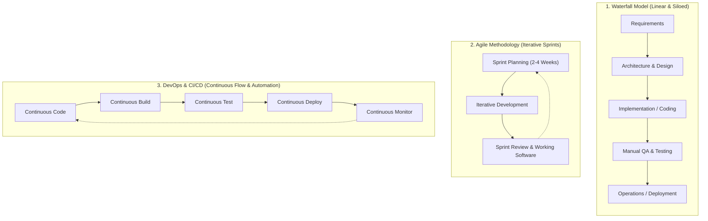
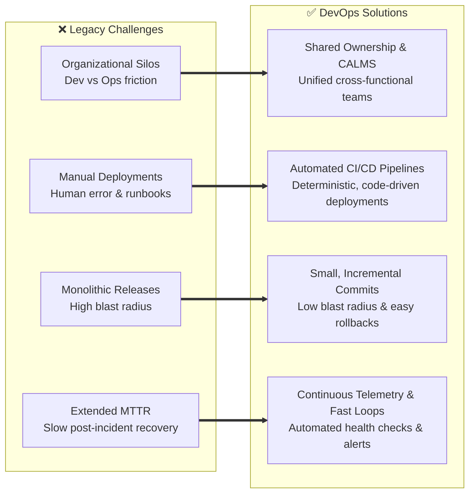
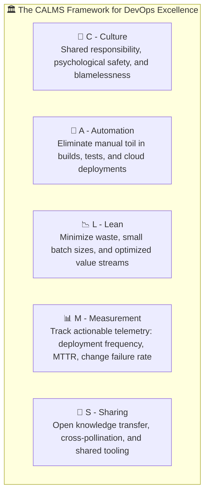
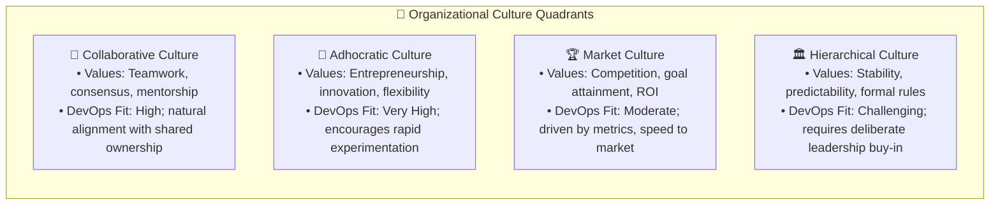
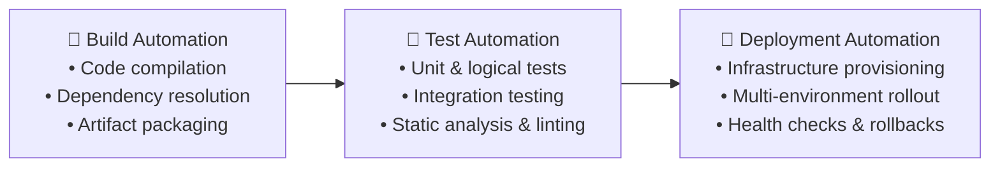
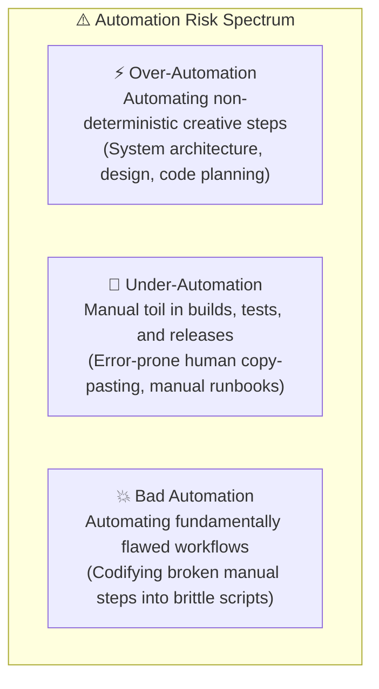
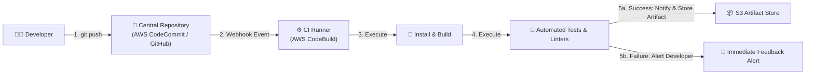
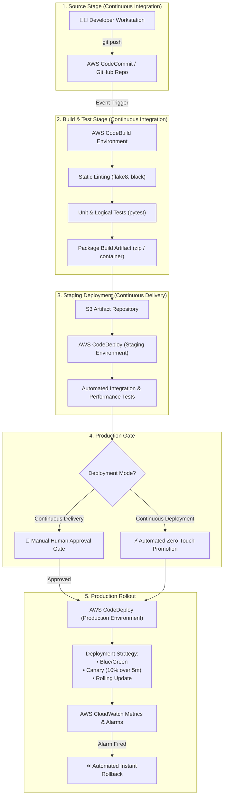
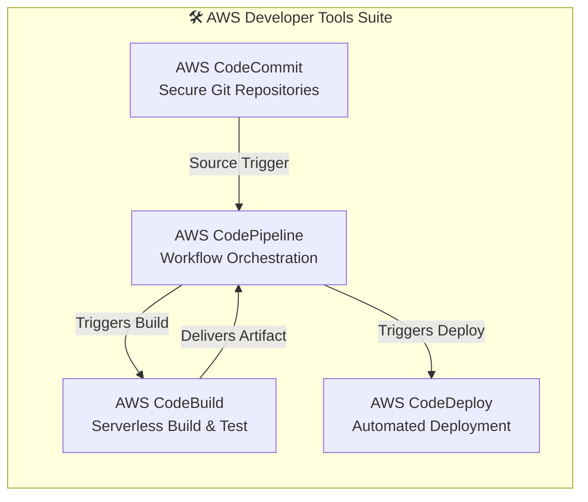
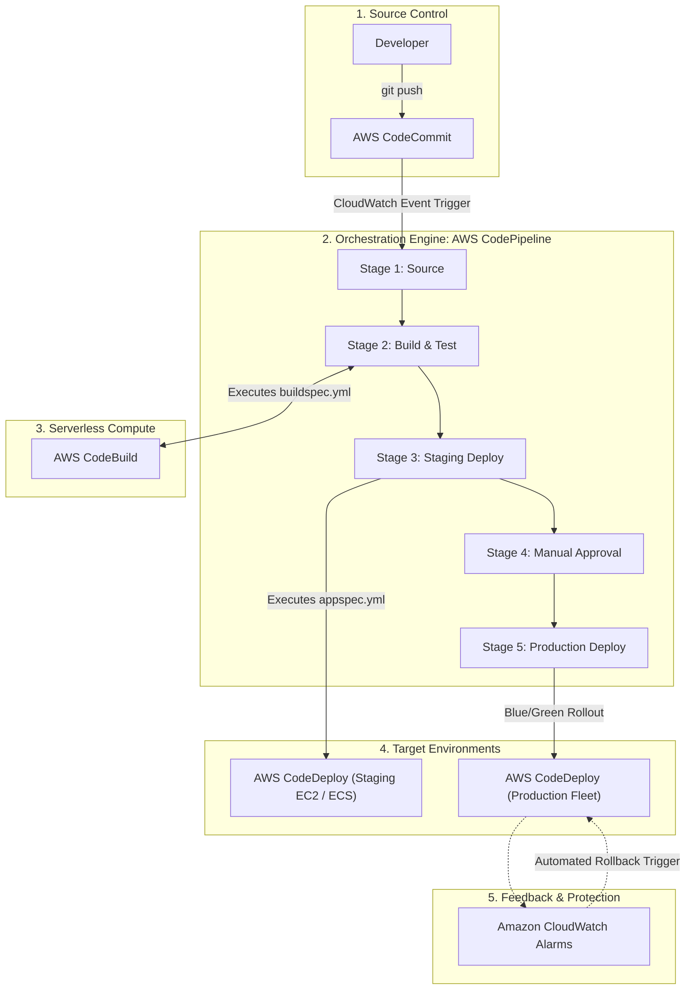

# 🚀 DevOps and Continuous Integration – Study Guide

> **Course**: AWS re/Start  
> **Module**: Python Programming (M05) – DevOps and Continuous Integration  
> **Source Document**: `T09-0009-RSPP_EN-US_SG_M05_DEVOPSCONTINTEGRATION.pdf`  
> **Target Audience**: AWS re/Start Learners / Cloud Practitioners / Junior Developers / DevOps Engineers  

---

## 🎯 Module Overview

In modern cloud computing and enterprise software engineering, writing clean code is only the first step of delivering business value. Applications must be built, tested, integrated, secured, packaged, and deployed into reliable, production-ready cloud environments. Historically, software delivery was plagued by organizational friction: development teams wrote code in isolation and threw it "over the wall" to operations teams, resulting in lengthy deployment cycles, high defect rates, manual testing bottlenecks, and fragile production environments.

**DevOps and Continuous Integration (CI)** fundamentally revolutionize this dynamic. DevOps combines cultural philosophies, engineering practices, and modern automation tools to unify software development (**Dev**), quality assurance (**QA**), and IT operations (**Ops**). By breaking down organizational silos and establishing automated **CI/CD pipelines**, teams can deliver high-quality software features, security updates, and bug fixes rapidly, reliably, and at scale.

Python plays an indispensable role throughout this lifecycle. As the ubiquitous language of scripting, automation, systems administration, and cloud orchestration, Python empowers DevOps practitioners to author automated test suites, build validation scripts, infrastructure automation hooks, and custom pipeline stages using the AWS SDK for Python (`boto3`).

---

### 📌 Learning Objectives

- [ ] **Define DevOps & Core Principles**: Understand DevOps as a cultural philosophy, set of operational practices, and tooling framework unifying software development and IT operations.
- [ ] **Analyze the Evolution from Waterfall to Agile and DevOps**: Contrast legacy linear development models with iterative agile workflows and automated, continuous DevOps delivery models.
- [ ] **Identify the Core Goals & Challenges Solved by DevOps**: Articulate how DevOps achieves speed, rapid delivery, reliability, scale, improved collaboration, and integrated security (DevSecOps) while eliminating manual toil and reducing Mean Time to Resolution (MTTR).
- [ ] **Examine the DevOps Culture & The CALMS Framework**: Deconstruct the CALMS model (**C**ulture, **A**utomation, **L**ean, **M**easurement, **S**haring), Gene Kim's Three Ways, and evaluate organizational culture archetypes (Collaborative, Adhocratic, Market, Hierarchical).
- [ ] **Evaluate Automation Strategies & Avoid Common Pitfalls**: Master the three core automation pillars (build, test, deployment) and diagnose the risks of over-automation, under-automation, and bad automation.
- [ ] **Master Continuous Integration (CI)**: Detail the purpose, mechanics, and best practices of CI, including early and frequent commits, automated regression testing, and fast developer feedback loops.
- [ ] **Distinguish Continuous Delivery from Continuous Deployment**: Differentiate automated release pipelines with manual production approval gates from fully automated, zero-touch deployment to live production environments.
- [ ] **Explore the AWS Developer Tools Ecosystem**: Examine the architecture and responsibilities of AWS CodeCommit, AWS CodeBuild, AWS CodeDeploy (blue/green and canary release strategies), and AWS CodePipeline.
- [ ] **Apply Python within the CI/CD Pipeline**: Write automated test suites, linting routines, and pipeline orchestration scripts leveraging Python and `boto3`.

---

## ⚙️ 1. Understanding DevOps: Core Definition, Philosophy, and Evolution

### 1.1 What is DevOps?

**DevOps** is a software engineering cultural philosophy, collection of practices, and suite of automated tools designed to unify **Software Development (Dev)** and **IT Software Operations (Ops)**, with deep integration of **Quality Assurance (QA)** and **Security (DevSecOps)** throughout the entire application lifecycle.

```
                  ┌────────────────────────────────────────┐
                  │                 DevOps                 │
                  │   The Intersection of Three Domains    │
                  └────────────────────────────────────────┘
                                     │
           ┌─────────────────────────┼─────────────────────────┐
           ▼                         ▼                         ▼
   ┌───────────────┐         ┌───────────────┐         ┌───────────────┐
   │  Development  │         │   Operations  │         │    Quality    │
   │     (Dev)     │         │     (Ops)     │         │Assurance (QA) │
   ├───────────────┤         ├───────────────┤         ├───────────────┤
   │ • Plan        │         │ • Release     │         │ • Unit Tests  │
   │ • Code        │         │ • Deploy      │         │ • Integration │
   │ • Build       │         │ • Operate     │         │ • Code Review │
   │ • Refactor    │         │ • Monitor     │         │ • Linting/Sec │
   └───────────────┘         └───────────────┘         └───────────────┘
```

The defining characteristic of the DevOps movement is advocating for **automation and continuous monitoring** across every phase of software construction and systems engineering:
1. **Source Code Integration & Version Control**: Merging contributions into shared trunk branches.
2. **Automated Testing & Static Analysis**: Validating code logic, performance, and compliance.
3. **Packaging & Releasing**: Creating immutable artifacts (binaries, wheel packages, Docker containers).
4. **Deployment & Provisioning**: Deploying workloads onto cloud environments (EC2, ECS, EKS, Lambda).
5. **Infrastructure Management & Monitoring**: Treating infrastructure as code (IaC) and tracking telemetry (metrics, logs, traces).

> [!NOTE]
> DevOps is not a standalone job title or a single software package. It is an organizational capability. Merely installing CI/CD tools without adopting a collaborative culture and automated testing will not achieve DevOps velocity.

---

### 1.2 The Evolution of Software Delivery: Waterfall vs. Agile vs. DevOps

To understand why DevOps emerged, we must analyze the historical evolution of software delivery methodologies:



#### Comparison Matrix: Waterfall vs. Agile vs. DevOps

| Dimension | Waterfall Model | Agile Methodology | DevOps & Continuous Delivery |
| :--- | :--- | :--- | :--- |
| **Delivery Cycle** | Months to years per release | 2 to 4-week iterative sprints | Hours, minutes, or continuous multiple times per day |
| **Release Batch Size** | Massive, monolithic releases | Medium feature-set increments | Micro, small, incremental changes |
| **Organizational Silos** | Rigid boundaries: Dev, QA, Ops separated | Cross-functional Dev and QA; Ops often left external | Dev, QA, Ops, and Security share end-to-end accountability |
| **Testing Paradigm** | Manual, end-of-lifecycle testing phase | Sprint-level unit & integration testing | Automated continuous testing triggered on every git commit |
| **Deployment Risk** | Very high; massive rollback complexity | Moderate; releases bundled at sprint ends | Minimal; small delta changes easily audited or rolled back |
| **Customer Feedback** | Delayed until project completion | At the end of every sprint cycle | Near-instantaneous through production telemetry and fast releases |

---

### 1.3 Key Goals of DevOps

Organizations adopt DevOps to achieve six core business and technical objectives:

```
┌────────────────────────────────────────────────────────────────────────┐
│                        Primary Goals of DevOps                         │
├────────────────────────────────────────────────────────────────────────┤
│  1. Speed: Accelerate the velocity of feature innovation and bug fixes │
│  2. Rapid Delivery: Increase release frequency to outpace competitors  │
│  3. Reliability: Ensure uptime, resilience, and quality through tests  │
│  4. Scale: Manage infrastructure and application changes uniformly     │
│  5. Improved Collaboration: Foster shared ownership and communication  │
│  6. Security (DevSecOps): Integrate compliance and security early (SAST│
└────────────────────────────────────────────────────────────────────────┘
```

1. **Speed & Velocity**: Accelerating innovation so teams can adapt rapidly to changing market conditions and user needs.
2. **Rapid Delivery**: Decreasing cycle time from initial concept to production software running in the cloud.
3. **Reliability & Quality**: Guaranteeing application availability and defect prevention through automated build validation, regression testing, and real-time monitoring.
4. **Scale & Manageability**: Operating distributed infrastructure and complex microservices consistently without linear human staffing overhead.
5. **Improved Collaboration**: Eliminating cross-departmental friction by uniting developers, QA specialists, and system operators under shared metrics and incentives.
6. **Integrated Security (DevSecOps)**: "Shifting left" on security by incorporating automated vulnerability scanning, policy-as-code, and compliance audits directly into the build pipeline.

---

### 1.4 Challenges Solved by DevOps

Legacy software development paradigms suffer from predictable points of failure. DevOps directly resolves these friction points:



1. **Breaking Down Organizational Silos**:
   - *Traditional Problem*: Developers were rewarded for shipping features quickly; operations teams were rewarded for maintaining production stability. This created opposing incentives: Dev pushed change, while Ops resisted change.
   - *DevOps Solution*: Unified objectives where both teams share accountability for application stability and rapid feature delivery.
2. **Eliminating Manual Deployment Friction**:
   - *Traditional Problem*: Deployment involved fragile, multi-page human runbooks executed manually over weekends. Typos and misconfigurations regularly led to catastrophic outages.
   - *DevOps Solution*: Automated, repeatable deployment scripts that execute consistently across development, staging, and production environments.
3. **Decreasing Blast Radius via Frequent, Incremental Releases**:
   - *Traditional Problem*: Accumulating six months of software changes into a single massive release made root-cause analysis nearly impossible when defects occurred.
   - *DevOps Solution*: Deploying small code increments multiple times a day isolates problems to specific commits, making rollbacks instantaneous.
4. **Reducing Mean Time to Resolution (MTTR)**:
   - *Traditional Problem*: When production broke, triage took hours or days of finger-pointing between developers and operations engineers.
   - *DevOps Solution*: Automated alerts, centralized logging, and automated rollback strategies restore operational health within minutes.

---

## 🏛️ 2. The DevOps Culture & Organizational Dynamics

### 2.1 The CALMS Framework

DevOps is more than tooling; it is a holistic operating model. The **CALMS framework** (coined by Jez Humble, John Willis, and Damon Edwards) serves as the industry standard benchmark for evaluating DevOps maturity:



| Pillar | Focus Area | Cloud & Engineering Implementation |
| :--- | :--- | :--- |
| **Culture** | People, collaboration, shared responsibility | Breaking down silos between Dev, QA, and Ops; shared on-call rotations; blameless postmortems. |
| **Automation** | Elimination of manual repetitive toil | Automated CI/CD pipelines, automated testing, Infrastructure as Code (CloudFormation, Terraform). |
| **Lean** | Continuous flow and waste reduction | Limiting Work In Progress (WIP), releasing in small batches, shortening cycle times. |
| **Measurement** | Data-driven decision making | Tracking DORA metrics: Deployment Frequency, Lead Time for Changes, MTTR, Change Failure Rate. |
| **Sharing** | Transparency and cross-team learning | Shared Git repositories, open internal documentation, reusable code libraries, post-incident retrospectives. |

---

### 2.2 The Three Ways of DevOps (Flow, Feedback, and Experimentation)

Documented by Gene Kim, Kevin Behr, and George Spafford in *The Phoenix Project* and *The DevOps Handbook*, the **Three Ways** outline the foundational behavioral principles:

```
┌────────────────────────────────────────────────────────────────────────┐
│                        The Three Ways of DevOps                        │
├────────────────────────────────────────────────────────────────────────┤
│  First Way:  Systems Thinking & Fast Flow (Left-to-Right)              │
│  Second Way: Amplify Feedback Loops (Right-to-Left)                    │
│  Third Way:  Culture of Continual Experimentation & Learning           │
└────────────────────────────────────────────────────────────────────────┘
```

1. **The First Way: Systems Thinking & Fast Flow (Left-to-Right)**:
   - Maximize the flow of work from Development (left) through Operations to the customer (right).
   - Eliminate bottlenecks, decrease batch sizes, prevent defects from passing downstream, and optimize global performance rather than local silos.
2. **The Second Way: Amplify Feedback Loops (Right-to-Left)**:
   - Create rapid, bidirectional feedback loops from Operations and customers back into Development.
   - Problems are detected and corrected immediately at their source, preventing cascading systemic failures.
3. **The Third Way: Culture of Continual Experimentation & Learning**:
   - Foster an organizational environment that rewards risk-taking, experimentation, and learning from failure.
   - Dedicate time to master practices through repetition and deliberate practice—the prerequisite to engineering proficiency.

---

### 2.3 Stakeholders & Organizational Culture Archetypes

A DevOps transformation fundamentally alters how teams collaborate. As highlighted in enterprise organizational theory, corporate culture can either accelerate or actively impede technical innovation. 

Organizations generally align with four primary cultural archetypes:



#### Detailed Culture Breakdown:

1. **Collaborative Culture (Clan)**:
   - *Core Philosophy*: Emphasizes long-term human development, teamwork, open communication, and shared success.
   - *Impact on DevOps*: Highly conducive to DevOps adoption. Engineers readily assist one another across functional boundaries and share operational responsibilities.
2. **Adhocratic Culture (Innovator)**:
   - *Core Philosophy*: Prioritizes entrepreneurship, creativity, flexibility, and rapid adaptation to dynamic external environments.
   - *Impact on DevOps*: Excellent fit for rapid CI/CD adoption, canary releases, and experimental cloud architecture. Failure is treated as a learning opportunity.
3. **Market Culture (Competitor)**:
   - *Core Philosophy*: Focuses relentlessly on winning against external competitors, achieving measurable milestones, increasing market share, and maximizing Return on Investment (ROI).
   - *Impact on DevOps*: Embraces DevOps primarily through the lens of productivity gains, speed-to-market metrics, and cost optimization.
4. **Hierarchical Culture (Bureaucracy)**:
   - *Core Philosophy*: Prizes standardized processes, formal command structures, rigorous compliance, predictability, and efficiency.
   - *Impact on DevOps*: Often presents the greatest inertia to DevOps transformations due to rigid change control boards (CABs) and risk-aversion. Overcoming this requires codifying compliance checks directly into automated pipelines.

---

### 2.4 Psychological Safety and Blameless Postmortems

A foundational tenet of modern engineering culture is **psychological safety**—the shared belief that team members will not be humiliated, punished, or blamed for speaking up, making honest mistakes, or reporting defects.

When a production outage occurs:
- **Blame Culture**: Identifies an individual ("Engineer X pushed bad code at 3:00 PM") and institutes punitive measures. *Consequence*: Engineers hide errors, avoid risky releases, and slow down deployment velocity.
- **Blameless Postmortem Culture**: Assumes that well-intentioned engineers made reasonable decisions based on the information and tooling available at the time. The focus shifts to system design:
  - *Why did our automated CI tests fail to catch this regression?*
  - *Why did our deployment pipeline permit a broken build into production?*
  - *What automated guardrail or Canary check can we implement so this failure mode cannot recur?*

> [!IMPORTANT]
> Blameless culture does not mean lack of accountability. It means holding people accountable for participating in thorough retrospectives, improving automation guardrails, and hardening systems against future human errors.

---

## 🤖 3. Automation in DevOps: Strategy, Pillars, and Pitfalls

### 3.1 The Imperative for Automation: Creative Efficiency

In traditional IT operations, engineers spent significant portions of their workdays on repetitive, deterministic tasks: copying compiled zip files to remote servers via SCP, manually restarting service daemons, verifying log files line-by-line, and filling out change request tickets.

The overarching goal of automation is **creative efficiency**. Automation delegates deterministic, repeatable, and error-prone mechanical tasks to machines, freeing human engineers to focus on high-value creative activities: architectural design, user experience optimization, performance profiling, and strategic innovation.

---

### 3.2 The Three Core Pillars of Automation

Modern DevOps automation rests upon three foundational pillars:



1. **Build Automation**:
   - The practice of automatically fetching source code, resolving external libraries, checking syntax, compiling source code (if applicable), and assembling production artifacts (e.g., Python wheels, Docker images, AWS Lambda zip packages).
   - Tools: Make, setuptools, poetry, AWS CodeBuild, Gradle, Maven.
2. **Test Automation (Logical & Regression Tests)**:
   - Automatically running comprehensive suites of software tests on every modification to verify that the code behaves precisely as intended.
   - Covers unit tests, integration tests, contract tests, security scans (SAST/DAST), and performance benchmarks.
   - Tools: `pytest`, `unittest`, SonarQube, AWS CodeBuild.
3. **Deployment Automation**:
   - Transitioning software artifacts into operational environments (testing, staging, production) across cloud infrastructure without manual human intervention.
   - Enforces declarative zero-downtime deployment patterns (rolling deployments, blue/green deployments, canary deployments).
   - Tools: AWS CodeDeploy, Terraform, AWS CloudFormation, Helm.

---

### 3.3 The Three Automation Risks & Anti-Patterns

While automation is essential, poorly planned automation can introduce severe organizational and technical hazards. Teams must navigate three primary risks:

```
┌────────────────────────────────────────────────────────────────────────┐
│                        The Three Automation Risks                      │
├────────────────────────────────────────────────────────────────────────┤
│  1. Over-Automation:  Automating creative or variable processes        │
│  2. Under-Automation: Avoiding automation due to fear or inertia       │
│  3. Bad Automation:   Automating broken, fragile, or flawed processes  │
└────────────────────────────────────────────────────────────────────────┘
```



#### Detailed Breakdown & Mitigations:

| Risk Category | Definition & Symptoms | Real-World Example | Recommended Solution |
| :--- | :--- | :--- | :--- |
| **Over-Automation** | Automating steps that require deep human contextual analysis, creative thinking, or varied decision-making on every execution. | Attempting to generate software architecture diagrams or business requirement specifications via rigid scripts without human review. | Restrict automation to deterministic, repeatable mechanical tasks. Preserve human oversight for analysis, planning, and design. |
| **Under-Automation** | Avoiding automation due to fear of losing control, lack of skills, or the belief that manual inspections catch more bugs. | Manually uploading Lambda packages via the AWS Management Console; manually running tests on local developer laptops before releases. | Automate builds, test execution, and cloud deployments into standardized CI/CD pipelines. Eliminate manual toil. |
| **Bad Automation** | Automating a flawed, inefficient, or broken underlying process without refactoring it first. | Writing a script that automates an erratic, flaky deployment process with hardcoded passwords and unhandled race conditions. | Step back to the planning stage. Streamline and simplify the process manually first, verify its reliability, then automate it cleanly. |

> [!CAUTION]
> Bill Gates' Rule of Automation: *"The first rule of any technology used in a business is that automation applied to an efficient operation will magnify the efficiency. The second is that automation applied to an inefficient operation will magnify the inefficiency."*

---

## 🔄 4. Continuous Integration (CI): Principles and Architecture

### 4.1 What is Continuous Integration?

**Continuous Integration (CI)** is a software development engineering practice where developers frequently commit code modifications to a centralized shared repository (often multiple times per day). Each commit triggers an automated, isolated build and testing sequence to verify integration health immediately.

In the words of AWS curriculum:
> *"CI is the automation of making your code available to your teammates. It generally includes build automation and quality assurance automation."*



---

### 4.2 Core Tenets of Continuous Integration

To implement CI effectively, engineering teams commit to specific disciplines:

1. **Commit Early and Often**: Developers avoid long-lived branches lasting weeks. Instead, they merge small, discrete changes into the trunk or main branch daily.
2. **Single Source of Truth**: All source code, configuration files, test scripts, and build definitions reside in a unified version control repository.
3. **Automated, Deterministic Builds**: A newly spawned runner or container can build the entire software artifact from scratch using automated commands without manual tweaking.
4. **Comprehensive Automated Test Execution**: Every commit executes unit tests, integration tests, and static linting checks.
5. **Immediate Failure Notification (Fast Feedback Loops)**: If a build breaks or a test fails, the system immediately notifies the committer. Fixing the broken build takes precedence over writing new features.

---

### 4.3 The Two Primary Purposes of CI

According to the AWS re/Start curriculum, Continuous Integration addresses two indispensable operational requirements:

```
┌────────────────────────────────────────────────────────────────────────┐
│                      The Two Core Purposes of CI                       │
├────────────────────────────────────────────────────────────────────────┤
│  1. Verifying System Compatibility:                                    │
│     Ensuring that your new code integrates seamlessly with existing    │
│     code written by your teammates without introducing regressions.    │
│                                                                        │
│  2. Ensuring Maintainability & Readability:                           │
│     Enforcing uniform formatting, clean documentation, and code        │
│     standards so future developers can maintain and extend the code.   │
└────────────────────────────────────────────────────────────────────────┘
```

#### Purpose 1: Ensuring Compatibility with Upstream Code
In distributed development teams, multiple engineers write code simultaneously. Without CI, developers work in isolation for weeks. When they finally attempt to merge their branches, they experience catastrophic **"Merge Hell"**—hundreds of conflicting code files, broken API contracts, and incompatible dependencies. CI eliminates this problem by integrating changes every few hours, discovering merge conflicts and logic regressions when they are tiny and easy to fix.

#### Purpose 2: Ensuring Readability and Code Standards for Successors
Software spends 90% of its lifecycle in maintenance. CI automates code linters (such as `flake8`, `pylint`, and `black` for Python) and documentation checks. This guarantees that all committed code adheres to organizational style guidelines, PEP 8 standards, and structural conventions, ensuring that subsequent engineers can easily comprehend, refactor, and build upon the work.

---

## 🚀 5. Continuous Delivery (CD) vs. Continuous Deployment (CD)

### 5.1 Continuous Delivery Defined

**Continuous Delivery (CD)** is the natural extension of Continuous Integration. While CI focuses on building and validating code, Continuous Delivery automates the entire software release process up to the staging and pre-production environments.

In Continuous Delivery:
- Every code change that passes automated CI tests is automatically packaged and deployed to testing and staging environments.
- The software artifact is continuously kept in an **always-releasable state**.
- However, promotion into the live production environment requires an explicit **manual approval gate** (e.g., a technical lead, QA manager, or release engineer clicks an "Approve" button in AWS CodePipeline).

---

### 5.2 Continuous Deployment Defined

**Continuous Deployment (CD)** takes automation one step further by eliminating the manual approval gate entirely. 

In Continuous Deployment:
- Every commit that successfully passes the automated validation and testing pipeline is deployed directly into the live production environment automatically—zero human intervention required.
- Releases occur continuously throughout the business day.
- This requires exceptionally mature automated test suites, canary deployment strategies, automated health checks, and automated rollback capabilities.

---

### 5.3 Detailed Comparison Table: CI vs. Continuous Delivery vs. Continuous Deployment

| Capability | Continuous Integration (CI) | Continuous Delivery (CD) | Continuous Deployment (CD) |
| :--- | :--- | :--- | :--- |
| **Primary Scope** | Build, integrate, and test code | Package and prepare release artifacts for production | Automatically release software directly to live production |
| **Pipeline Trigger** | Code commit / Pull Request merge | Successful CI pipeline completion | Successful staging validation |
| **Automated Stages** | Checkout, Compile, Unit Test, Lint | Build, Test, Integration Test, Deploy to Staging | Build, Test, Deploy to Staging, Deploy to Production |
| **Production Gate** | N/A (Does not deploy to production) | **Manual Human Approval** (Click-to-deploy) | **Fully Automated** (Zero human intervention) |
| **Deployment Frequency** | Many builds per day per developer | On-demand or scheduled business releases | Multiple production releases per day automatically |
| **Prerequisites** | Git repository, automated test suites | Reliable staging environment, end-to-end integration tests | 99.9%+ test confidence, automated rollbacks, robust telemetry |

---

### 5.4 End-to-End CI/CD Pipeline Lifecycle Flowchart

The following diagram illustrates the complete transition of code from a developer's workstation through CI, Continuous Delivery, and Continuous Deployment into production:



---

## ☁️ 6. AWS Developer Tools Ecosystem

Amazon Web Services provides a comprehensive suite of cloud-native developer tools designed specifically to implement high-performance CI/CD pipelines without the burden of managing build servers or deployment infrastructure.



---

### 6.1 AWS CodeCommit

**AWS CodeCommit** is a fully managed, highly scalable, and secure source control service that hosts private Git repositories.

- **Key Capabilities**:
  - Eliminates the need to operate custom Git servers or worry about scaling hardware storage.
  - Automatically encrypts code repositories in transit (HTTPS/SSH) and at rest using **AWS Key Management Service (AWS KMS)**.
  - Integrates natively with **AWS Identity and Access Management (IAM)**, enabling granular branch-level and repository-level permissions.
  - Native integration with Amazon EventBridge and SNS to trigger CI/CD pipelines on commit events.

---

### 6.2 AWS CodeBuild

**AWS CodeBuild** is a fully managed, serverless continuous integration service that compiles source code, runs automated tests, and produces software packages ready for deployment.

- **Key Capabilities**:
  - **Serverless & Elastic**: Scales automatically to run concurrent builds in isolated, disposable Docker containers; no build server patching or provisioning.
  - **Pay-Per-Minute**: Charges solely for compute resources consumed during build execution.
  - **Customizable Environments**: Pre-configured environments for Python, Node.js, Java, Go, Ruby, Docker, or custom base container images.
- **The `buildspec.yml` Specification File**:
  CodeBuild is governed by a declarative YAML file located at the root of the source repository named `buildspec.yml`:

```yaml
version: 0.2

phases:
  install:
    runtime-versions:
      python: 3.11
    commands:
      - echo "Installing system dependencies and Python packages..."
      - pip install --upgrade pip
      - pip install -r requirements.txt
      - pip install pytest pytest-cov flake8
  pre_build:
    commands:
      - echo "Executing static analysis and linting..."
      - flake8 . --count --select=E9,F63,F7,F82 --show-source --statistics
      - flake8 . --count --exit-zero --max-complexity=10 --max-line-length=88 --statistics
  build:
    commands:
      - echo "Running automated test suites with code coverage..."
      - pytest --cov=app tests/
  post_build:
    commands:
      - echo "Build and testing completed successfully on $(date)"
      - python setup.py bdist_wheel

artifacts:
  files:
    - dist/*.whl
    - appspec.yml
    - scripts/*
  name: BuildArtifact-$(date +%Y-%m-%d)
```

---

### 6.3 AWS CodeDeploy

**AWS CodeDeploy** is a fully managed deployment service that automates software deployments to a variety of compute services, including Amazon EC2 instances, on-premises servers, Amazon ECS containers, and serverless AWS Lambda functions.

- **Key Capabilities**:
  - **Zero-Downtime Deployments**: Automates sophisticated deployment patterns to maintain application availability during upgrades.
  - **Automated Rollback Protection**: Automatically rolls back to the previous healthy deployment if Amazon CloudWatch alarms trigger or instance health checks fail.
  - **Centralized Deployment Control**: Tracks deployment status, progress, and historical audit trails across server fleets.

#### Deployment Strategies:

```
┌────────────────────────────────────────────────────────────────────────┐
│                        Deployment Strategies                           │
├────────────────────────────────────────────────────────────────────────┤
│  1. In-Place (Rolling) Deployment:                                     │
│     Instances are updated incrementally. Capacity is temporarily       │
│     reduced during the rollout.                                        │
│                                                                        │
│  2. Blue/Green Deployment:                                             │
│     A duplicate environment (Green) is provisioned with new code.      │
│     Traffic is shifted from the old environment (Blue) once verified.  │
│                                                                        │
│  3. Canary Deployment:                                                 │
│     A tiny fraction of traffic (e.g., 10%) is routed to the new        │
│     version for 5-15 minutes. If healthy, the remainder is shifted.    │
└────────────────────────────────────────────────────────────────────────┘
```

- **The `appspec.yml` Configuration File**:
  CodeDeploy utilizes an Application Specification file (`appspec.yml`) that details file destination mappings and lifecycle hook scripts:

```yaml
version: 0.0
os: linux
files:
  - source: /
    destination: /var/www/python_app
hooks:
  BeforeInstall:
    - location: scripts/install_dependencies.sh
      timeout: 300
      runas: root
  AfterInstall:
    - location: scripts/configure_application.sh
      timeout: 180
      runas: root
  ApplicationStart:
    - location: scripts/start_service.sh
      timeout: 60
      runas: root
  ValidateService:
    - location: scripts/validate_health.py
      timeout: 60
      runas: root
```

---

### 6.4 AWS CodePipeline

**AWS CodePipeline** is a fully managed continuous delivery service that models, visualizes, and automates all steps required to release software.

- **Workflow Orchestration**: CodePipeline connects CodeCommit, CodeBuild, CodeDeploy, third-party tools (GitHub, Jenkins, Datadog), and manual approval steps into a unified automated workflow.
- **Pipeline Architecture**:
  1. **Source Stage**: Listens for changes in AWS CodeCommit, Amazon S3, or GitHub; produces the initial artifact bundle.
  2. **Build Stage**: Dispatches source code to AWS CodeBuild for compilation, linting, and automated unit testing.
  3. **Testing Stage**: Runs end-to-end integration tests, load tests, or security scans.
  4. **Approval Stage**: (Optional for Continuous Delivery) Halts execution awaiting manual sign-off via IAM permissions or SNS notifications.
  5. **Deploy Stage**: Invokes AWS CodeDeploy to update staging and production environments.

---

### 6.5 Architectural Integration of AWS Developer Tools

The following diagram illustrates how the complete AWS Developer Tools ecosystem integrates to build an end-to-end, resilient automated CI/CD pipeline:



---

## 🐍 7. Python's Critical Role in CI/CD & DevOps Engineering

### 7.1 Why Python is the DevOps Lingua Franca

Python is universally recognized as one of the most effective and widely adopted programming languages in DevOps engineering and cloud architecture for several key reasons:

1. **Expressive, Readable Syntax**: Python's clean syntax allows teams to write and maintain complex automation scripts quickly without excessive boilerplate code.
2. **Rich Standard Library ("Batteries Included")**: Built-in modules for operating system operations (`os`, `sys`, `pathlib`), subprocess execution (`subprocess`), JSON parsing (`json`), and HTTP communications (`urllib`).
3. **World-Class Testing Ecosystem**: Robust testing frameworks like `pytest` and `unittest` enable comprehensive test automation with mock objects, fixtures, and parameterized cases.
4. **AWS SDK for Python (`boto3`)**: The official, feature-complete AWS SDK provides programmatic control over every AWS service, allowing Python scripts to automate cloud deployments, inspect resources, and orchestrate pipeline executions.

---

### 7.2 Practical Python in CI/CD: Automated Validation Script

In continuous integration, Python scripts frequently act as test runners, quality gates, and health check validators. Below is a production-grade Python script designed to execute pre-commit linting and automated unit tests before allowing code to merge:

```python
#!/usr/bin/env python3
"""
ci_validator.py - Automated CI Quality Gate Validator
Executes code linting, static type checking, and automated unit tests.
Returns exit code 0 on success, or non-zero on failure to halt the CI runner.
"""

import subprocess
import sys
from typing import List, Tuple


def execute_step(description: str, command: List[str]) -> bool:
    """Execute a single shell command in the CI environment and stream output."""
    print(f"\n{'=' * 60}")
    print(f"▶ RUNNING: {description}")
    print(f"  Command: {' '.join(command)}")
    print(f"{'=' * 60}")

    result = subprocess.run(command, capture_output=False, text=True)

    if result.returncode == 0:
        print(f"✅ PASSED: {description}")
        return True
    else:
        print(f"❌ FAILED: {description} (Exit Code: {result.returncode})")
        return False


def run_pipeline() -> int:
    """Run all automated checks in order."""
    stages: List[Tuple[str, List[str]]] = [
        (
            "Syntax & Style Enforcement (flake8)",
            ["flake8", "--max-line-length=88", "--exclude=.git,__pycache__", "."],
        ),
        (
            "Security Vulnerability Scan (bandit)",
            ["bandit", "-r", "src/", "-ll"],
        ),
        (
            "Unit & Regression Test Suite (pytest)",
            ["pytest", "-v", "--cov=src", "--cov-report=term-missing", "tests/"],
        ),
    ]

    for description, command in stages:
        success = execute_step(description, command)
        if not success:
            print("\n🚨 Pipeline halted: Quality gate failure detected!")
            return 1

    print("\n🎉 All CI Quality Gates Passed! Artifact is ready for packaging.")
    return 0


if __name__ == "__main__":
    sys.exit(run_pipeline())
```

---

### 7.3 Triggering and Monitoring AWS CodePipeline via `boto3`

DevOps engineers frequently write Python scripts to programmatically start and monitor AWS CodePipeline workflows, enabling custom ChatOps integrations (e.g., triggering deployments via Slack bots) or cross-account deployment triggers:

```python
#!/usr/bin/env python3
"""
trigger_pipeline.py - Programmatically trigger and monitor an AWS CodePipeline execution.
Demonstrates Boto3 integration in modern cloud CI/CD automation.
"""

import time
import boto3
from botocore.exceptions import ClientError


def trigger_aws_pipeline(pipeline_name: str, region_name: str = "us-east-1") -> str:
    """Start execution of an AWS CodePipeline and return its execution ID."""
    client = boto3.client("codepipeline", region_name=region_name)

    try:
        print(f"🚀 Triggering pipeline: {pipeline_name}...")
        response = client.start_pipeline_execution(name=pipeline_name)
        execution_id = response.get("pipelineExecutionId")
        print(f"✅ Execution started successfully! ID: {execution_id}")
        return execution_id
    except ClientError as error:
        print(f"❌ Failed to start pipeline: {error}")
        raise


def wait_for_pipeline_completion(
    pipeline_name: str, execution_id: str, region_name: str = "us-east-1"
) -> bool:
    """Poll pipeline execution status until completion."""
    client = boto3.client("codepipeline", region_name=region_name)

    terminal_statuses = ["Succeeded", "Failed", "Stopped"]

    while True:
        try:
            status_response = client.get_pipeline_execution(
                pipelineName=pipeline_name, pipelineExecutionId=execution_id
            )
            status = status_response["pipelineExecution"]["status"]
            print(f"⏳ Current Pipeline Status: {status}...")

            if status in terminal_statuses:
                if status == "Succeeded":
                    print("🎉 Deployment Pipeline completed successfully!")
                    return True
                else:
                    print(f"❌ Pipeline execution terminated with status: {status}")
                    return False

            time.sleep(15)  # Poll every 15 seconds
        except ClientError as error:
            print(f"⚠️ Error querying pipeline status: {error}")
            time.sleep(15)


if __name__ == "__main__":
    PIPELINE = "Ecommerce-Production-Deployment-Pipeline"
    try:
        exec_id = trigger_aws_pipeline(PIPELINE)
        success = wait_for_pipeline_completion(PIPELINE, exec_id)
        if not success:
            exit(1)
    except Exception as e:
        print(f"Fatal error: {e}")
        exit(1)
```

---

## ❓ 8. Checkpoint Review Questions & Detailed Answers

### Question 1: DevOps is the bridge between what areas of software development?
**Answer**:  
DevOps bridges the gaps between **traditional IT operations (Ops)**, **software development (Dev)**, and **quality assurance (QA)**. By aligning these previously isolated teams through shared culture, automation, and continuous feedback loops, organizations deliver features faster and maintain higher system stability.

---

### Question 2: What are the three risks associated with automation in DevOps?
**Answer**:  
The three primary risks of automation are:
1. **Over-automation**: Automating tasks that require creative contextual thinking, flexible human consideration, or unique problem solving (e.g., architecture planning, user experience design, and software modeling).
2. **Under-automation**: Avoiding automation due to inertia, skepticism, or fear of losing granular oversight. This leaves repetitive tasks like builds, testing, and deployments vulnerable to human error and manual delay.
3. **Bad automation**: Automating broken, inefficient, or poorly planned manual processes without resolving their underlying flaws first. Automating a bad process simply accelerates and magnifies its failure modes.

---

### Question 3: What is the primary difference between Continuous Delivery and Continuous Deployment?
**Answer**:  
Both practices automate the build, test, and staging deployment phases. However, they differ at the **production release stage**:
- In **Continuous Delivery**, code is continuously maintained in a deployable state, but moving the artifact into live production requires an explicit **manual human approval gate**.
- In **Continuous Deployment**, there is **no manual gate**; every commit that passes all automated tests and staging validations is deployed directly and automatically to the live production environment.

---

### Question 4: What are the two main purposes of Continuous Integration (CI)?
**Answer**:  
According to AWS foundational curriculum, CI fulfills two critical goals:
1. **Verifying Code Compatibility**: Ensuring that newly committed code integrates cleanly with changes already submitted by other teammates, catching merge conflicts and regressions early.
2. **Ensuring Readability and Maintainability**: Guaranteeing that the codebase remains clean, well-formatted, lint-free, and legible for all developers who will maintain and extend the code in the future.

---

### Question 5: Which AWS Developer Tool is serverless, charges only for build time, and executes automated tests defined in a `buildspec.yml` file?
**Answer**:  
**AWS CodeBuild**. It spins up isolated, disposable containerized environments on demand to compile code, run test suites, execute linters, and package deployment artifacts without requiring the user to provision or maintain persistent build servers.

---

### Question 6: What is the CALMS framework, and what do its letters represent?
**Answer**:  
The **CALMS framework** is an industry standard conceptual model used to evaluate and guide an organization's DevOps adoption and maturity. The acronym stands for:
- **C**ulture: Shared ownership, psychological safety, and blameless collaboration.
- **A**utomation: Eliminating manual toil in builds, testing, and deployments.
- **L**ean: Reducing waste, minimizing work-in-progress, and delivering in small batches.
- **M**easurement: Tracking telemetry and data-driven metrics (e.g., deployment frequency, MTTR).
- **S**haring: Open knowledge transfer, shared repositories, and cross-team communication.

---

### Question 7: How do blue/green deployments and canary deployments help mitigate production deployment risks?
**Answer**:  
- **Blue/Green Deployment**: Maintains two identical production environments. The existing version runs on "Blue", while the new version is deployed to "Green". Once Green passes verification, network traffic is instantly shifted to Green. If any issue arises, traffic immediately shifts back to Blue with near-zero downtime.
- **Canary Deployment**: Gradually routes a small percentage of user traffic (e.g., 5% to 10%) to the new release while monitoring health metrics. If no errors or latency spikes occur, the remaining traffic is rolled over; if errors occur, traffic instantly reverts back, isolating the blast radius to a tiny subset of users.

---

## 🧠 9. Key Takeaways & Core Concepts Summary

- **DevOps Unifies Dev and Ops**: DevOps is an integrated cultural movement, set of operational practices, and automated tooling suite combining software development, quality assurance, and IT operations into a collaborative, high-velocity team.
- **Culture Drives Success (CALMS)**: Successful DevOps transformations rely on **Culture**, **Automation**, **Lean** processes, **Measurement**, and **Sharing**. Organizations thrive when they foster psychological safety and conduct blameless postmortems.
- **Automation Requires Balance**: Automation should target deterministic, repetitive tasks (builds, tests, deployments). Teams must avoid **over-automation** (automating creative design), **under-automation** (relying on manual toil), and **bad automation** (automating broken workflows).
- **Continuous Integration (CI) Prevents Merge Hell**: Developers commit small changes frequently. Automated builds and tests run on every commit to verify that new code is compatible with the existing codebase and adheres to readability and formatting standards.
- **Continuous Delivery vs. Deployment**: Continuous Delivery ensures software is always deployable and ready for production, awaiting a manual approval gate. Continuous Deployment automates production releases end-to-end with zero human intervention.
- **AWS Native DevOps Tooling**:
  - **AWS CodeCommit**: Managed, secure Git repositories with IAM integration.
  - **AWS CodeBuild**: Serverless, scalable build and testing runner configured via `buildspec.yml`.
  - **AWS CodeDeploy**: Resilient deployment manager supporting rolling, canary, and blue/green patterns via `appspec.yml`.
  - **AWS CodePipeline**: End-to-end workflow orchestrator connecting source, build, test, and deployment stages.
- **Python Powers DevOps**: Python serves as the primary automation engine across the CI/CD lifecycle—enabling developers to build custom linting scripts, unit test runners (`pytest`), and cloud deployment automations via the AWS SDK for Python (`boto3`).
