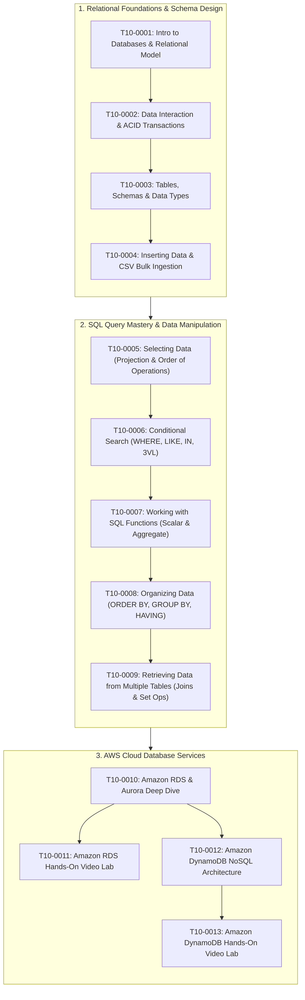

# Module T10: Database Fundamentals & AWS Managed Databases

> **Course**: AWS re/Start  
> **Module ID**: `T10` / Module 06  
> **Total Documents**: 13 Comprehensive Study Guides (11 Slide Deck Guides + 2 Hands-On Video Demonstration Tutorials)  
> **Status**: Completed (100%)  

---

## Module Overview

The **Database Fundamentals & AWS Managed Databases** module delivers a comprehensive education in relational database principles, SQL syntax and query architecture, transaction management, and cloud-native managed databases on AWS. Learners advance through hands-on SQL operations (DDL, DML, TCL, queries, aggregations, joins, and set operations) before exploring enterprise cloud data solutions using **Amazon Relational Database Service (Amazon RDS)** and serverless NoSQL with **Amazon DynamoDB**.

---

## Curriculum Roadmap



---

## Complete Document Index

| # | Code | Title & Description | Key Concepts Covered | Study Guide |
|---|------|---------------------|----------------------|-------------|
| 01 | `T10-0001` | [Introduction to Databases](file:///work/tmp/aws-cf/T10-Database/T10-0001-RSDB_EN-US_SG_M06_DATABASESINTRO.md) | Data vs Info, Relational model (Codd), Tables, Rows, Primary/Foreign keys, World database schema | [Read Guide](file:///work/tmp/aws-cf/T10-Database/T10-0001-RSDB_EN-US_SG_M06_DATABASESINTRO.md) |
| 02 | `T10-0002` | [Data Interaction & Database Transactions](file:///work/tmp/aws-cf/T10-Database/T10-0002-RSDB_EN-US_SG_M06_DBINTERACTIONTRANSACTION.md) | Multi-user concurrency, CRUD operations, ACID properties (Atomicity, Consistency, Isolation, Durability), TCL (`COMMIT`, `ROLLBACK`) | [Read Guide](file:///work/tmp/aws-cf/T10-Database/T10-0002-RSDB_EN-US_SG_M06_DBINTERACTIONTRANSACTION.md) |
| 03 | `T10-0003` | [Creating Tables & Data Types](file:///work/tmp/aws-cf/T10-Database/T10-0003-RSDB_EN-US_SG_M06_TABLESANDDATATYPES.md) | SQL sub-languages (DDL, DML, DCL, TCL), MySQL data types (Numeric, Character, Temporal, Binary), Constraints (`PK`, `FK`, `NOT NULL`, `UNIQUE`) | [Read Guide](file:///work/tmp/aws-cf/T10-Database/T10-0003-RSDB_EN-US_SG_M06_TABLESANDDATATYPES.md) |
| 04 | `T10-0004` | [Inserting Data into a Database](file:///work/tmp/aws-cf/T10-Database/T10-0004-RSDB_EN-US_SG_M06_INSERTINGDATA.md) | `INSERT INTO` syntax, Batch multi-row inserts, CSV structure and data validation, `LOAD DATA INFILE`, Three-valued logic with `NULL` | [Read Guide](file:///work/tmp/aws-cf/T10-Database/T10-0004-RSDB_EN-US_SG_M06_INSERTINGDATA.md) |
| 05 | `T10-0005` | [Selecting Data from a Database](file:///work/tmp/aws-cf/T10-Database/T10-0005-RSDB_EN-US_SG_M06_SELECTINGDATA.md) | Projection vs Selection, `SELECT *` anti-pattern, Logical query processing order (`FROM` -> `WHERE` -> `SELECT`), Column/Table aliases | [Read Guide](file:///work/tmp/aws-cf/T10-Database/T10-0005-RSDB_EN-US_SG_M06_SELECTINGDATA.md) |
| 06 | `T10-0006` | [Performing a Conditional Search](file:///work/tmp/aws-cf/T10-Database/T10-0006-RSDB_EN-US_SG_M06_CONDITIONALSEARCH.md) | `WHERE` clause mechanics, Comparison operators, Logical operators (`AND`, `OR`, `NOT`), `BETWEEN`, `IN`, Pattern matching with `LIKE`, `IS NULL` | [Read Guide](file:///work/tmp/aws-cf/T10-Database/T10-0006-RSDB_EN-US_SG_M06_CONDITIONALSEARCH.md) |
| 07 | `T10-0007` | [Working with SQL Functions](file:///work/tmp/aws-cf/T10-Database/T10-0007-DBAS_WORKINGWITHFUNCTIONS_EN.md) | Scalar vs Aggregate functions, `COUNT`, `SUM`, `AVG`, `MIN`, `MAX`, String functions, Date/Time functions, Control flow (`IF`, `CASE WHEN`) | [Read Guide](file:///work/tmp/aws-cf/T10-Database/T10-0007-DBAS_WORKINGWITHFUNCTIONS_EN.md) |
| 08 | `T10-0008` | [Organizing Data (Sorting & Grouping)](file:///work/tmp/aws-cf/T10-Database/T10-0008-RSDB_EN-US_SG_M06_ORGANIZINGDATA.md) | `ORDER BY` (ASC/DESC), `GROUP BY` rules and `ONLY_FULL_GROUP_BY`, `HAVING` vs `WHERE` execution phase comparison, 7-clause SQL pipeline | [Read Guide](file:///work/tmp/aws-cf/T10-Database/T10-0008-RSDB_EN-US_SG_M06_ORGANIZINGDATA.md) |
| 09 | `T10-0009` | [Retrieving Data from Multiple Tables](file:///work/tmp/aws-cf/T10-Database/T10-0009-RSDB_EN-US_SG_M06_RETRIEVINGDATA.md) | Set operators (`UNION`, `UNION ALL`, `INTERSECT`, `EXCEPT`), Joins (`INNER`, `LEFT`, `RIGHT`, `FULL OUTER`, `CROSS`), `ON` vs `USING` | [Read Guide](file:///work/tmp/aws-cf/T10-Database/T10-0009-RSDB_EN-US_SG_M06_RETRIEVINGDATA.md) |
| 10 | `T10-0010` | [Amazon Relational Database Service (RDS)](file:///work/tmp/aws-cf/T10-Database/T10-0010-RSDB_EN-US_SG_M06_AMAZONRDS.md) | Managed RDBMS, 6 supported engines (Aurora, MySQL, MariaDB, Postgres, Oracle, SQL Server), Multi-AZ HA vs Read Replicas, Backups & PITR, Aurora deep dive | [Read Guide](file:///work/tmp/aws-cf/T10-Database/T10-0010-RSDB_EN-US_SG_M06_AMAZONRDS.md) |
| 11 | `T10-0011` | [Amazon RDS Hands-On Video Demonstration](file:///work/tmp/aws-cf/T10-Database/T10-0011-RSSCHAB_EN-US_Video_M06_RDS_Demo.md) | End-to-end hands-on walkthrough: Creating MySQL RDS instance in Lab VPC, EC2 Linux client connection via CLI, table creation, data verification | [Read Guide](file:///work/tmp/aws-cf/T10-Database/T10-0011-RSSCHAB_EN-US_Video_M06_RDS_Demo.md) |
| 12 | `T10-0012` | [Amazon DynamoDB](file:///work/tmp/aws-cf/T10-Database/T10-0012-RSDB_EN-US_SG_M06_DYNAMODB.md) | RDBMS vs NoSQL comparison, DynamoDB serverless architecture, Partition keys vs Sort keys, Secondary indexes (LSI vs GSI), Consistency, Capacity modes | [Read Guide](file:///work/tmp/aws-cf/T10-Database/T10-0012-RSDB_EN-US_SG_M06_DYNAMODB.md) |
| 13 | `T10-0013` | [Amazon DynamoDB Video Demonstration](file:///work/tmp/aws-cf/T10-Database/T10-0013-RSSCHAB_EN-US_Video_M06_Dynamodb_Demo.md) | Hands-on walkthrough: Creating `ProductCatalog` table, Partition key definition, inserting heterogeneous semi-structured JSON items, Query vs Scan | [Read Guide](file:///work/tmp/aws-cf/T10-Database/T10-0013-RSSCHAB_EN-US_Video_M06_Dynamodb_Demo.md) |

---

## SQL Execution Pipeline Reference

```
Logical Execution Order:
1. FROM          -- Identify source tables and perform joins
2. WHERE         -- Filter individual rows
3. GROUP BY      -- Aggregate rows into summary buckets
4. HAVING        -- Filter aggregated groups
5. SELECT        -- Project specified columns, evaluate expressions & scalar functions
6. DISTINCT      -- Eliminate duplicate projected rows
7. ORDER BY      -- Sort the final result set
8. LIMIT         -- Restrict total number of returned rows
```
