# 🗄️ Database Fundamentals: Introduction to Databases & The Relational Model

> **Course**: AWS re/Start  
> **Module**: Database Fundamentals (M06 – Introduction to Databases)  
> **Source Document**: `T10-Database/T10-0001-RSDB_EN-US_SG_M06_DATABASESINTRO.pdf`  
> **Target Audience**: AWS re/Start Learners, Cloud Practitioners, and Systems Operations Associates  

---

## 🎯 Module Overview

Data is the lifeblood of modern enterprise applications, cloud architectures, and digital services. From global e-commerce transactions to mobile telemetry and streaming media, applications rely on robust backend systems to capture, organize, protect, and retrieve data efficiently and reliably.

This module introduces the fundamental concepts of database systems, contrasting raw data with actionable information, exploring why traditional flat files and spreadsheets fail under modern production demands, and dissecting the mathematical principles of the **Relational Model** formulated by Dr. E.F. Codd. Learners will explore tables, rows, columns, primary and foreign key constraints, entity relationships, the declarative power of **Structured Query Language (SQL)**, nonrelational (**NoSQL**) data alternatives, and the operational advantages of cloud-based **Database as a Service (DBaaS)** platforms such as **Amazon RDS**, **Amazon Aurora**, and **Amazon DynamoDB**.

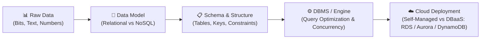

---

## 📌 Learning Objectives

By completing this module and working through these study notes, you will be able to:

- [ ] **Differentiate Data, Information, and Knowledge**: Explain how raw facts are transformed into structured context and actionable insight via the DIKW hierarchy.
- [ ] **Define Database and DBMS**: Explain the technical definition of a database and differentiate between single-user DBMS, multi-user enterprise DBMS, and managed cloud Database as a Service (DBaaS).
- [ ] **Analyze Why Flat Files Fail at Scale**: Identify critical limitations of spreadsheets and CSV files in multi-user concurrent environments, covering locking, data anomalies, lack of referential integrity, and indexing performance.
- [ ] **Understand the Relational Model (E.F. Codd)**: Map mathematical relational theory to concrete database implementations: Relations (Tables), Tuples (Rows/Records), Attributes (Columns/Fields), Domains (Data Types), and Schemas.
- [ ] **Master Primary and Foreign Keys**: Define primary keys (PK), candidate keys, composite keys, and foreign keys (FK) to enforce entity and referential integrity.
- [ ] **Classify Database Relationships**: Model and diagram One-to-One (1:1), One-to-Many (1:N), and Many-to-Many (M:N) relationships using Entity Relationship (ER) diagrams.
- [ ] **Analyze the "World" Sample Database**: Walk through standard schema tables (`country`, `city`, `countrylanguage`), tracing real-world relational linkages.
- [ ] **Understand the Declarative Paradigm of SQL**: Explain how SQL queries describe *what* data to retrieve rather than *how* to retrieve it, and identify common ANSI SQL dialects (MySQL, PostgreSQL, Oracle, Microsoft SQL Server).
- [ ] **Contrast Relational (SQL) and Nonrelational (NoSQL) Systems**: Compare schema flexibility, vertical vs. horizontal scaling, ACID transaction guarantees, and optimal application workloads.
- [ ] **Evaluate Cloud Database Services**: Compare on-premises database management against AWS managed offerings, specifically Amazon RDS, Amazon Aurora, and Amazon DynamoDB.

---

## 📊 1. Core Data Concepts: Data vs. Information vs. Knowledge

### 1.1 What is Data?

At its simplest, **data** refers to unorganized, raw facts, symbols, figures, signals, and measurements collected from observations, sensors, user inputs, or transactional events. 

- **Unprocessed Nature**: In isolation, raw data lacks contextual meaning, subjective intent, and interpretive relevance.
- **Data Formats**: Data manifests in multiple digital formats:
  - **Numeric values**: `1024`, `3.14159`, `-42`
  - **Text / Strings**: `"Mumbai"`, `"AFG"`, `"True"`
  - **Temporal stamps**: `2026-10-13T01:43:00Z`
  - **Binary objects**: Images (JPEG, PNG), audio recordings, video streams, compiled bytecodes.

### 1.2 The DIKW Hierarchy (Data, Information, Knowledge, Wisdom)

To generate business and operational value, data must transition through successive stages of contextualization and evaluation. This progression is formalized as the **DIKW Pyramid**:

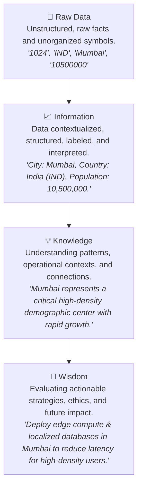

| Layer | Definition | Example in Database Context |
| :--- | :--- | :--- |
| **Data** | Unstructured, isolated facts, symbols, numbers, or strings without context. | `"Mumbai"`, `"IND"`, `10500000` |
| **Information** | Data organized, classified, and given contextual meaning through labels and schemas. | Row in `city` table: Name = Mumbai, CountryCode = IND, Population = 10,500,000 |
| **Knowledge** | Synthesized information identifying trends, cause-and-effect patterns, and practical rules. | Identifying that cities in District "Maharashtra" have rapid urban migration requiring scaled cloud capacity. |
| **Wisdom** | Higher-level evaluation and decision-making applying knowledge toward strategic long-term outcomes. | Provisioning multi-AZ AWS infrastructure in the `ap-south-1` (Mumbai) Region to support mission-critical low-latency banking workloads. |

> [!NOTE]
> Databases provide the architectural foundation for converting raw **Data** into structured **Information** by enforcing schema definitions, data types, and logical relationships.

---

## 🗄️ 2. What is a Database?

### 2.1 Technical Definition

A **database** is an organized, structured collection of logically related data stored electronically in a computer system or cloud storage infrastructure. 

Key characteristics include:
1. **Structural Organization**: Rather than existing as loose text files, data is structured into files or entities known as **tables** (in relational models) or **collections / documents** (in nonrelational models).
2. **Logical Access**: Provides standardized, programmatic mechanisms to access, create, read, update, and delete (CRUD) data efficiently.
3. **Data Independence**: Decouples the physical storage layout on disk from the logical representation used by software applications and end users.
4. **Backend Architecture**: Modern data-driven websites, mobile apps, enterprise ERP/CRM platforms, and financial systems all depend on backend databases to persist operational state.

### 2.2 Core Components of a Database System

Every complete database deployment consists of five primary components:

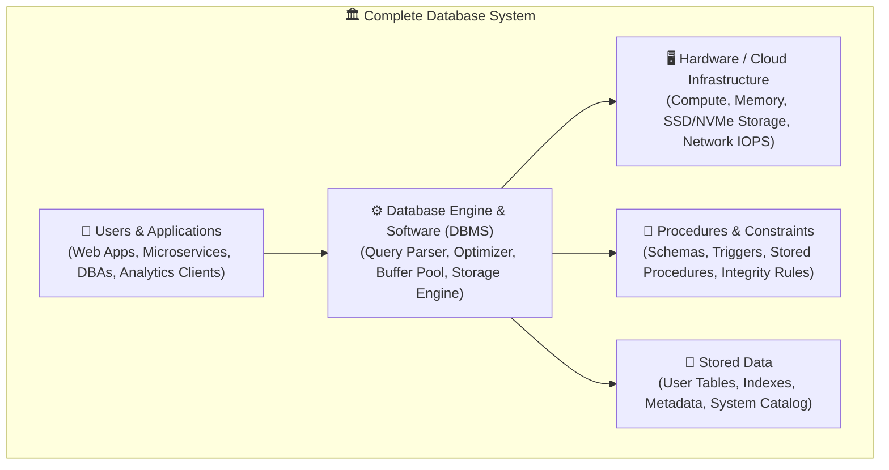

1. **Hardware / Infrastructure**: The physical or virtual computing resources—CPUs, RAM, solid-state storage (EBS volumes), and networking interfaces—that host the database.
2. **Software (The DBMS Engine)**: The software layer that manages memory caching, disk I/O, transaction logs, locking, query optimization, and client connections.
3. **Data**: The actual payload of persisted records, metadata, index structures (B-Trees, Hash indices), and transaction logs (Write-Ahead Logs / redo logs).
4. **Procedures & Rules**: Schemas, constraints, foreign key cascades, triggers, and validation logic that govern how data enters and leaves the system.
5. **Users & Client Applications**: The programmatic services, APIs, and administrators issuing queries via connection pools and standardized drivers (JDBC, ODBC).

---

## 📑 3. Flat Files vs. Databases: Why Spreadsheets Fail at Scale

Organizations often start tracking data using spreadsheets (e.g., Microsoft Excel, Google Sheets) or flat files (CSV, TSV, flat JSON files). While flat files are intuitive and lightweight for personal use, they inevitably break down when supporting concurrent multi-user enterprise applications.

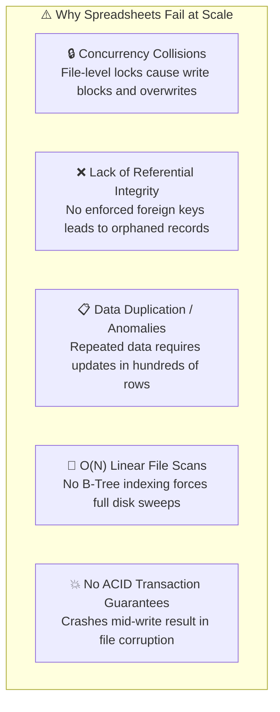

### 3.1 Detailed Architectural Comparison

| Dimension | Flat Files / Spreadsheets (CSV, Excel) | Database Management Systems (RDBMS) |
| :--- | :--- | :--- |
| **Concurrency & Multi-User Access** | **Single-user or file-level lock**. If two users write simultaneously, one overwrites the other (lost update problem) or the file locks completely. | **Granular concurrency control**. Row-level and page-level locking; Multi-Version Concurrency Control (MVCC) allows thousands of concurrent reads and writes without blocking. |
| **Data Integrity & Type Safety** | **Weak or optional**. A user can accidentally type `"twenty"` or `"N/A"` into a numeric salary or date column; spreadsheets allow arbitrary input. | **Enforced domain constraints**. Strict typing (`INT`, `VARCHAR(50)`, `DATE`) guarantees that invalid data is rejected at the engine level. |
| **Referential Integrity** | **None**. Deleting a customer record leaves orphaned orders with no warning or automatic cleanup. | **Strict foreign keys**. Engine enforces parent-child integrity (`ON DELETE RESTRICT`, `CASCADE`), preventing orphaned records. |
| **Data Redundancy & Anomalies** | **High duplication**. Customer name and address are retyped across every purchase row. Updating an address requires changing thousands of rows (update anomaly). | **Normalized schema**. Customer information is stored once in a `customer` table and referenced by unique ID in `orders` table. |
| **Query Performance & Indexing** | **Linear scanning ($O(N)$)**. To find one record in a 10,000,000-row CSV file, the application must read and parse every single byte from disk into RAM. | **Indexed lookups ($O(\log N)$)**. B-Tree and Hash indexes locate records in milliseconds without scanning the full table. |
| **Storage & Memory Limits** | **Hard file limits**. Spreadsheets crash or become unresponsive when exceeding 1,000,000 rows; entire file must fit in workstation RAM. | **Massive scale**. Can manage terabytes or petabytes of data, streaming blocks from disk to buffer pool as needed. |
| **Security & Access Control** | **All-or-nothing access**. Anyone with file access can view or delete every column and row. | **Fine-grained role-based access**. Column-level, row-level, and table-level permissions can be granted per user or application role. |
| **Transactions & Durability** | **No crash recovery**. Power loss or application crash while saving can corrupt the entire file permanently. | **ACID compliant**. Write-ahead logging (WAL) guarantees transactions are atomic and durable across power outages and crashes. |

> [!CAUTION]
> Relying on spreadsheets or shared CSV files as application backends introduces severe data corruption risks, race conditions, and compliance failures in production environments.

---

## 📐 4. The Relational Model (Dr. E.F. Codd)

### 4.1 Historical Context and Theoretical Foundation

In 1970, **Dr. Edgar F. Codd**, an English computer scientist and mathematician working at IBM Research, published a seminal paper titled:
> *"A Relational Model of Data for Large Shared Data Banks"* (Communications of the ACM, June 1970).

Prior to Codd's paper, databases relied on **hierarchical** (tree-structured) or **network** (graph-like pointer navigation) models (such as IBM IMS and CODASYL). These legacy models tightly coupled the logical data structure with physical disk pointers. If a programmer wanted to query data, they had to write procedural code that navigated pointer trees step by step. If the physical disk storage layout changed, every single application query had to be rewritten.

Codd proposed a revolutionary paradigm based on **mathematical set theory** and **first-order predicate logic**—specifically **relational algebra**:
- Data is represented purely as **relations** (mathematical sets of n-tuples).
- Users query data declaratively without knowing how the bytes are laid out on physical storage.
- Physical storage optimizations can occur independently of the logical query interface.

### 4.2 Mathematical vs. Relational Database Terminology

The relational model has formal mathematical definitions alongside familiar database terminology:

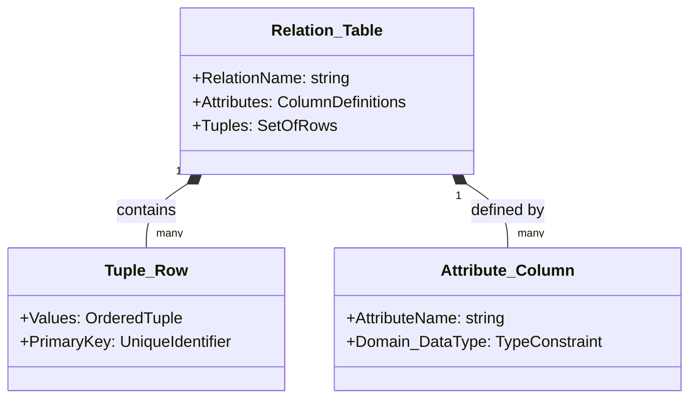

| Mathematical / Formal Term | Relational Database Term | Common Everyday Term | Definition |
| :--- | :--- | :--- | :--- |
| **Relation** | **Table** | Spreadsheet / File | A two-dimensional structure representing a collection of objects of the same entity type. |
| **Tuple** | **Row** | Record | A single ordered sequence of attribute values representing one unique instance of the entity. |
| **Attribute** | **Column** | Field / Property | A named property or characteristic shared by all tuples in the relation. |
| **Domain** | **Data Type & Constraints** | Allowed Values | The pool of permissible values for an attribute (e.g., integers, dates, strings of fixed length). |
| **Degree (Arity)** | **Column Count** | Number of Fields | The number of attributes (columns) that compose the table. |
| **Cardinality** | **Row Count** | Number of Records | The total number of tuples (rows) currently stored in the table. |

### 4.3 Database Schemas

A **database schema** is the formal blueprint and structural definition of the database system. It describes the design rules, data structures, and relationships before any operational data is inserted.

A complete relational schema encompasses:
1. **Entity / Table Definitions**: The names of all tables representing business objects (e.g., `customers`, `orders`, `products`).
2. **Attributes & Data Domains**: The name and data type for each column (e.g., `CustomerID INT`, `Email VARCHAR(255)`).
3. **Structural Constraints**:
   - **NOT NULL**: Ensures an attribute cannot be left blank.
   - **UNIQUE**: Prevents duplicate values across rows.
   - **CHECK**: Validates specific business rules (e.g., `CHECK (Price > 0)`).
   - **DEFAULT**: Specifies fallback values when omitted during insertion.
4. **Relationship Rules**: Defining how tables interconnect via Primary and Foreign Keys.

---

## 🔑 5. Relational Database Structure: Keys and Relationships

The true power of relational databases lies in their ability to establish clear mathematical and logical links across separate tables without duplicating data.

### 5.1 The Taxonomy of Keys

Keys are attributes or groups of attributes used to identify rows, enforce integrity, and connect relations:

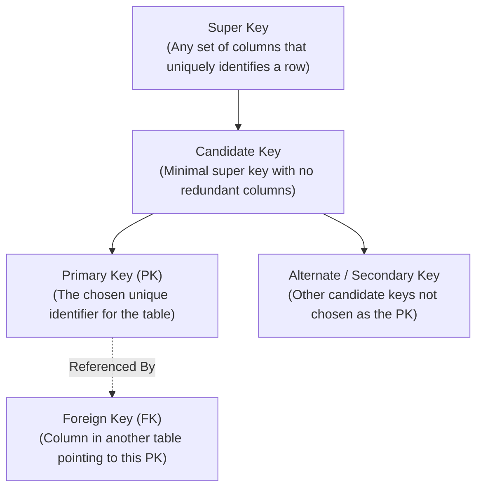

#### 1. Primary Key (PK)
A column (or set of columns) chosen by the database designer to uniquely and unequivocally identify each row in a table.
- **Entity Integrity Constraint**: A Primary Key value must be **strictly unique** across all rows and **cannot contain NULL** (`NOT NULL`).
- **Types of Primary Keys**:
  - **Natural Key**: An existing business attribute that is inherently unique (e.g., ISO Country Code `"ARG"`, Social Security Number, ISBN).
  - **Surrogate Key**: An artificially generated unique identifier with no intrinsic business meaning (e.g., auto-incrementing integer `ID = 1024` or UUID `a4e1...`).

#### 2. Composite Key
A primary key made up of **two or more columns** combined together to ensure uniqueness when no single column is unique on its own.
- *Example*: In an enrollment table connecting students and courses, `StudentID` repeats and `CourseID` repeats, but the combination `(StudentID, CourseID)` is unique.

#### 3. Foreign Key (FK)
A column (or group of columns) in one table that references the Primary Key of another table.
- **Referential Integrity Constraint**: Any value entered in the Foreign Key column **must already exist** in the referenced parent table's Primary Key column, or be `NULL` (if nulls are allowed).
- Prevents "orphaned" child rows from existing in the database.

---

### 5.2 Types of Relational Cardinality

Tables relate to one another through three distinct patterns of cardinality:

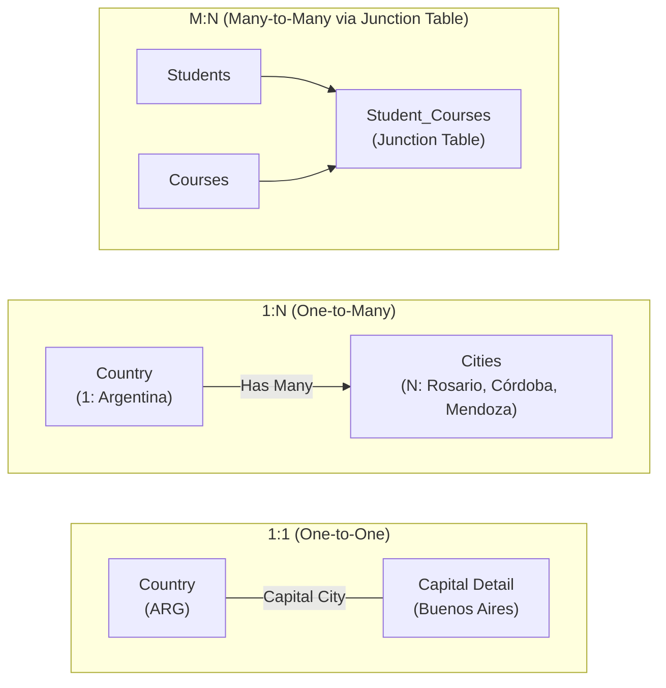

#### 1. One-to-One Relationship (1:1)
- **Concept**: A single record in Table A is related to at most one record in Table B, and vice versa.
- **Implementation**: The Primary Key of Table A is placed as a Foreign Key in Table B and marked with a `UNIQUE` constraint.
- **Use Case**: Separating highly sensitive data (e.g., storing confidential user tax info in a separate table from general profile data) or decomposing rarely queried large text columns to improve cache performance.

#### 2. One-to-Many Relationship (1:N)
- **Concept**: A single record in Table A can relate to multiple records in Table B, but each record in Table B relates to exactly one record in Table A.
- **Implementation**: The Primary Key of the "One" (parent) table is stored as a Foreign Key in the "Many" (child) table.
- **Use Case**: One Country has many Cities; one Customer places many Orders; one Department employs many Employees.

#### 3. Many-to-Many Relationship (M:N)
- **Concept**: Multiple records in Table A can relate to multiple records in Table B, and vice versa.
- **Implementation**: Cannot be represented directly with a single foreign key. It requires an intermediate **Junction Table** (also known as an associative table, bridge table, or linking table) that contains two foreign keys pointing to the primary keys of both participating tables.
- **Use Case**: Books and Authors (one book can have multiple authors; one author can write multiple books); Students and Classes; Products and Orders.

---

## 🗺️ 6. Comprehensive Walkthrough: The "World" Sample Database

To ground these theoretical concepts, the curriculum uses the classic **World** sample database. This database models nations, their administrative cities, and official languages spoken across global populations.

### 6.1 Entity-Relationship (ER) Diagram

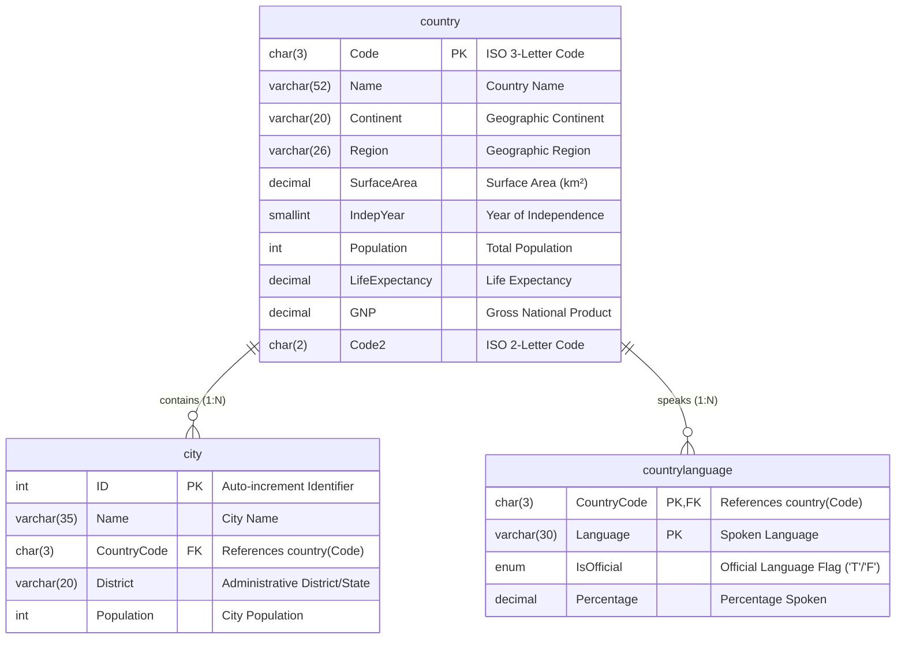

### 6.2 Table Breakdown and Data Samples

#### 1. The `country` Table (Parent Entity)
- **Primary Key**: `Code` (Natural key: 3-character ISO code, e.g., `"ARG"`, `"AUS"`, `"IND"`).
- **Attributes**: `Name`, `Continent`, `Region`, `Population`, `SurfaceArea`, etc.

| Code (PK) | Name | Continent | Region | Population |
| :--- | :--- | :--- | :--- | :--- |
| `ARG` | Argentina | South America | South America | 37,032,000 |
| `AUS` | Australia | Oceania | Australia and New Zealand | 18,886,000 |
| `BEN` | Benin | Africa | Western Africa | 6,097,000 |
| `BLZ` | Belize | North America | Central America | 241,000 |
| `BWA` | Botswana | Africa | Southern Africa | 1,622,000 |
| `IND` | India | Asia | Southern Asia | 1,013,662,000 |

#### 2. The `city` Table (Child Entity to `country`)
- **Primary Key**: `ID` (Surrogate key: auto-incrementing integer).
- **Foreign Key**: `CountryCode` (References `country.Code`).
- **Attributes**: `Name`, `District`, `Population`.

| ID (PK) | Name | CountryCode (FK) | District | Population |
| :--- | :--- | :--- | :--- | :--- |
| `2` | Qandahar | `AFG` | Qandahar | 237,500 |
| `5` | Amsterdam | `NLD` | Noord-Holland | 731,200 |
| `65` | Abu Dhabi | `ARE` | Abu Dhabi | 398,695 |
| `246` | Belford Roxo | `BRA` | Rio de Janeiro | 466,294 |
| `456` | London | `GBR` | Greater London | 7,285,000 |
| `1024` | Mumbai (Bombay) | `IND` | Maharashtra | 10,500,000 |

#### 3. The `countrylanguage` Table (Child Entity / Associative Relationship)
- **Primary Key**: Composite Key `(CountryCode, Language)`.
- **Foreign Key**: `CountryCode` (References `country.Code`).
- **Attributes**: `IsOfficial`, `Percentage`.

| CountryCode (PK, FK) | Language (PK) | IsOfficial | Percentage |
| :--- | :--- | :--- | :--- |
| `ARG` | Spanish | T | 96.8% |
| `IND` | Hindi | T | 39.9% |
| `IND` | Bengali | F | 8.2% |
| `IND` | Telugu | F | 7.8% |
| `BLZ` | English | T | 50.8% |

### 6.3 Relational Linkage in Action

How do these tables communicate?
When an application queries: *"Find the population and continent for the city of Mumbai"*, the database engine executes a **relational join**:

```sql
SELECT 
    city.Name AS CityName,
    city.Population AS CityPopulation,
    country.Name AS CountryName,
    country.Continent
FROM city
JOIN country ON city.CountryCode = country.Code
WHERE city.Name = 'Mumbai (Bombay)';
```

The database matches `city.CountryCode` (`'IND'`) against `country.Code` (`'IND'`). Because `country.Code` is indexed as a Primary Key, the database locates the record in microseconds without scanning unrelated countries.

---

## 💻 7. Introduction to Structured Query Language (SQL)

### 7.1 The Declarative Nature of SQL

**Structured Query Language (SQL)** is the domain-specific language designed for managing and manipulating data held in a relational database management system (RDBMS).

Unlike imperative programming languages (such as Python, C++, or Java), where the developer writes algorithmic steps explicitly dictating **HOW** to iterate over memory and files:
- SQL is **declarative**: The user specifies **WHAT** result set is desired, leaving the RDBMS query optimizer to calculate the most efficient execution plan (indexes to use, join algorithms like Hash Join or Nested Loop, memory buffers to allocate).

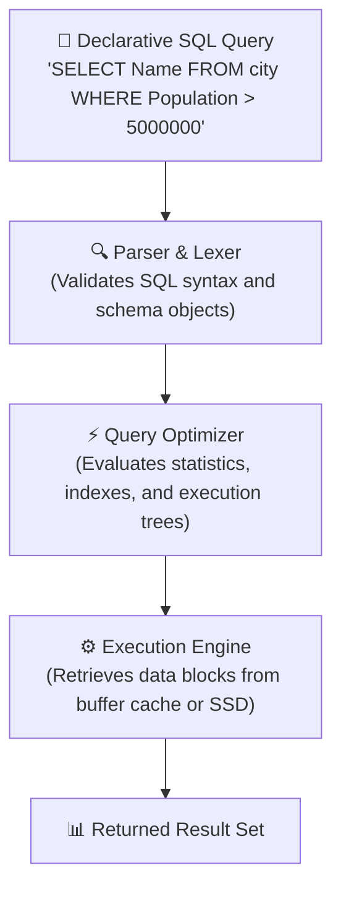

### 7.2 Sublanguages of SQL

SQL is divided into distinct operational subcategories:

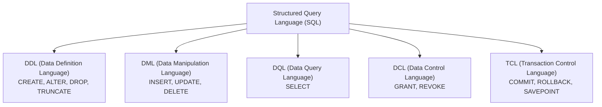

1. **DQL (Data Query Language)**:
   - Used to retrieve stored data without altering table states.
   - Primary statement: `SELECT`.
2. **DML (Data Manipulation Language)**:
   - Used to modify the contents of existing tables.
   - Core statements: `INSERT`, `UPDATE`, `DELETE`.
3. **DDL (Data Definition Language)**:
   - Used to define and alter database structure, schemas, tables, and indexes.
   - Core statements: `CREATE`, `ALTER`, `DROP`, `TRUNCATE`.
4. **DCL (Data Control Language)**:
   - Used by administrators to control security and user permissions.
   - Core statements: `GRANT`, `REVOKE`.
5. **TCL (Transaction Control Language)**:
   - Used to manage logical units of work ensuring ACID compliance.
   - Core statements: `COMMIT`, `ROLLBACK`, `SAVEPOINT`.

### 7.3 Standard SQL Dialects

Although the **American National Standards Institute (ANSI)** and the **International Organization for Standardization (ISO)** publish formal SQL standards (e.g., SQL-92, SQL:1999, SQL:2016), commercial and open-source database engines implement engine-specific dialects with proprietary extensions:

| Dialect / Engine | Open Source / Proprietary | Key Strengths & Unique Features |
| :--- | :--- | :--- |
| **MySQL** | Open Source (Oracle-backed) | Ubiquitous web standard (LAMP stack), high read throughput, default engine in WordPress and CMSs. |
| **PostgreSQL** | Open Source (Independent) | Enterprise-grade object-relational database, rich support for JSONB, GIS spatial data (PostGIS), custom functions. |
| **Amazon Aurora** | AWS Cloud-Native Proprietary | Drop-in compatible with MySQL and PostgreSQL, disaggregated cloud storage, up to 5x MySQL performance. |
| **Microsoft SQL Server (T-SQL)** | Proprietary (Microsoft) | Deep integration with Windows enterprise tooling, Active Directory, Transact-SQL procedural extensions. |
| **Oracle Database (PL/SQL)** | Proprietary (Oracle) | Massive enterprise scale, mission-critical financial systems, advanced clustering (Oracle RAC). |
| **SQLite** | Open Source (Public Domain) | Serverless, zero-configuration, embedded self-contained engine used inside mobile apps (iOS/Android) and browsers. |

---

## 🔄 8. Relational (SQL) vs. Nonrelational (NoSQL) Databases

While relational databases remain the bedrock of structured transactional systems, modern web-scale applications frequently encounter workloads requiring unstructured formats, horizontal scalability, and low latency. This led to the emergence of **Nonrelational (NoSQL)** databases.

### 8.1 What is NoSQL?

**NoSQL** stands for **"Not Only SQL"**. Nonrelational databases do not require rigid table structures with fixed column schemas. Instead, they store data using flexible data models optimized for rapid iteration and massive horizontal scale.

#### JSON Document Representation
In a document-oriented NoSQL database like **Amazon DynamoDB** or **MongoDB**, our earlier city record can be stored as a single, self-contained JSON document:

```json
[
  {
    "ID": 1024,
    "Name": "Mumbai (Bombay)",
    "CountryCode": "IND",
    "District": "Maharashtra",
    "Population": 10500000,
    "Coordinates": {
      "Latitude": 19.0760,
      "Longitude": 72.8777
    },
    "Languages": ["Hindi", "Marathi", "English"]
  }
]
```

Notice that hierarchical, nested attributes (`Coordinates`, `Languages` array) are stored directly within the item without needing foreign keys or multiple joined tables.

---

### 8.2 Comprehensive Architectural Comparison

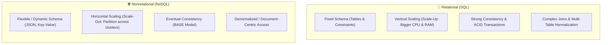

| Architectural Dimension | Relational Databases (SQL) | Nonrelational Databases (NoSQL) |
| :--- | :--- | :--- |
| **Data Structure** | Structured tables with rigid rows (records) and columns (attributes). | Key-Value pairs, JSON documents, Wide-column stores, or Graph nodes/edges. |
| **Schema Design** | **Fixed Schema**. Predefined during design; schema changes (`ALTER TABLE`) can lock tables. | **Dynamic / Flexible Schema**. Different items in the same collection can have entirely different fields. |
| **Scaling Strategy** | **Vertical Scaling (Scale-Up)**. Increase compute capacity of a single server (more vCPUs, RAM, SSD IOPS). | **Horizontal Scaling (Scale-Out)**. Distribute and partition data across dozens or hundreds of commodity servers. |
| **Consistency Model** | **Strong Consistency (ACID)**: Atomicity, Consistency, Isolation, Durability guaranteed. | **Eventual Consistency (BASE)**: Basically Available, Soft state, Eventual consistency prioritized for ultra-low latency. |
| **Query Complexity** | Excellent at complex multi-table `JOIN` operations, groupings, and nested aggregations. | Highly optimized for simple single-key reads and writes; complex joins are discouraged or unsupported. |
| **Ideal Workloads** | E-commerce checkouts, financial ledgers, CRM/ERP systems, relational reporting. | Real-time gaming leaderboards, IoT sensor telemetry, user session stores, high-traffic mobile feeds. |

---

## ⚙️ 9. Database Management Systems (DBMS) & Cloud Architectures

### 9.1 What is a DBMS?

A **Database Management System (DBMS)** is specialized software that provides an administrative and programmatic interface between end users, applications, and the physical database files stored on disk.

Core responsibilities of a DBMS include:
1. **Creation**: Defining schemas, tables, and internal storage structures.
2. **Data Manipulation**: Inserting, retrieving, updating, and deleting records (CRUD).
3. **Data Security & Isolation**: Authenticating users and restricting access via privileges.
4. **Data Concurrency**: Managing simultaneous multi-user access without corruption or lost updates.
5. **Backup & Crash Recovery**: Maintaining transaction logs to recover data following hardware or power crashes.

#### Single-User vs. Multi-User Systems
- **Single-User DBMS**: Designed for desktop environments where only one individual accesses the database at any moment (e.g., Microsoft Access, SQLite in mobile apps).
- **Multi-User DBMS**: Enterprise engines designed to process thousands of concurrent client connections simultaneously with sophisticated lock managers and transaction pools (e.g., MySQL, PostgreSQL, Oracle, Microsoft SQL Server).

---

### 9.2 Infrastructure Paradigms: On-Premises vs. Cloud (DBaaS)

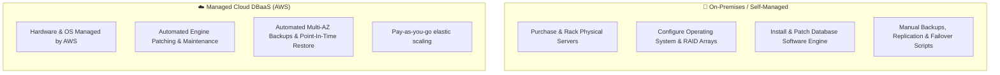

#### On-Premises Data Center
The organization owns, leases, and operates physical server hardware, network routers, and uninterruptible power supplies (UPS). 
- **Operational Burden**: Database administrators (DBAs) and systems engineers spend extensive time ordering hardware, replacing failed disks, patching host operating systems, and configuring complex replication setups.
- **Capital Expenditure (CapEx)**: Large upfront purchases with fixed, non-elastic capacity.

#### Database as a Service (DBaaS) in the Cloud
A cloud provider (such as Amazon Web Services) hosts the database infrastructure within its global virtualized data centers.
- **Operational Shift**: Cloud providers handle underlying physical hardware provisioning, operating system maintenance, hypervisor patching, automated backups, and disk failure replacements.
- **Operational Expenditure (OpEx)**: Organizations pay only for the exact compute, memory, and storage resources consumed, spinning up or terminating instances dynamically.

---

### 9.3 AWS Cloud Database Solutions

AWS provides specialized, managed database engines designed for various operational models:

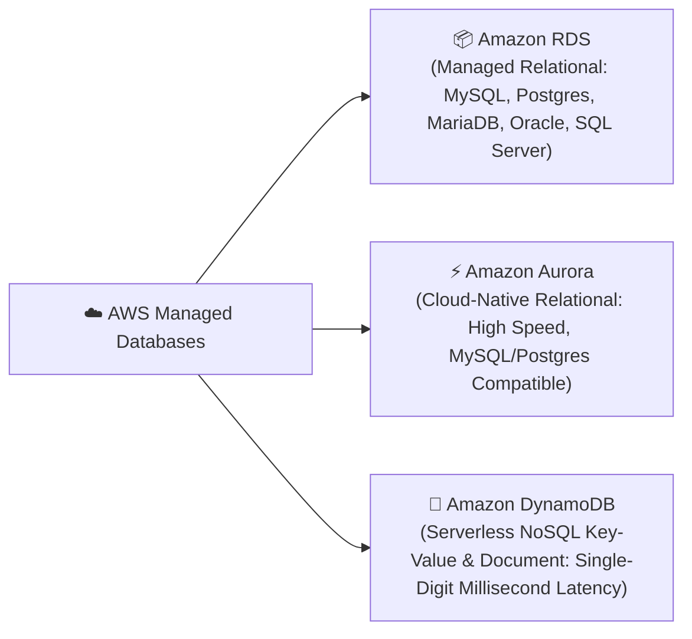

#### 1. Amazon Relational Database Service (Amazon RDS)
- **Description**: A fully managed web service that simplifies the setup, operation, and scaling of traditional relational database engines in the AWS Cloud.
- **Supported Engines**: MySQL, PostgreSQL, MariaDB, Oracle, and Microsoft SQL Server.
- **Key Features**:
  - **Automated Patching & Maintenance**: Keeps operating systems and DB engines up to date.
  - **Multi-AZ Deployments**: Provides synchronous standby replication in a separate Availability Zone for automated high-availability failover.
  - **Read Replicas**: Allows offloading read-heavy analytics and reporting queries across asynchronous replicas.
  - **Automated Backups**: Continuous point-in-time recovery up to 35 days.

#### 2. Amazon Aurora
- **Description**: A modern, cloud-native relational database engine built specifically for the AWS Cloud, fully managed as part of Amazon RDS.
- **Compatibility**: Drop-in compatible with standard **MySQL** and **PostgreSQL**.
- **Performance & Scale**: Delivers up to **5x the throughput of standard MySQL** and **3x the throughput of standard PostgreSQL** on identical hardware.
- **Architecture**: Separates compute from storage. Aurora replicates data 6 ways across 3 Availability Zones, automatically healing storage blocks in the background and supporting up to 15 low-latency read replicas.

#### 3. Amazon DynamoDB
- **Description**: A fully managed, serverless NoSQL database service delivering seamless single-digit millisecond latency at any scale.
- **Data Models**: Key-value pairs and JSON document structures.
- **Operational Model**: Fully serverless—no servers or instances to provision, patch, or manage.
- **Automatic Partitioning**: Automatically scales throughput and storage by partitioning data across clusters of SSD-backed storage hosts to meet provisioned or on-demand traffic.

---

## 🧠 10. Checkpoint Review & Comprehensive Knowledge Check

Test your understanding of the core concepts presented in this module with the following review questions:

### Question 1: What is the primary difference between raw data and information?
> **Answer**:
> **Data** consists of unorganized, raw facts, numbers, strings, or symbols without inherent context (e.g., `1024`, `"Mumbai"`). **Information** is data that has been structured, processed, contextualized, and categorized (e.g., recognizing that `1024` is the unique city ID for `"Mumbai"`, located in India with a population of 10.5 million).

### Question 2: Which type of database is commonly referred to as a SQL database, and who originated its mathematical model?
> **Answer**:
> A **Relational Database** is commonly referred to as a SQL database. Its underlying mathematical framework—the **Relational Model**—was formulated by IBM mathematician **Dr. Edgar F. Codd** in 1970, based on relational algebra and set theory.

### Question 3: What is the purpose of a Database Management System (DBMS)?
> **Answer**:
> A **DBMS** is a software system (or cloud service) that provides programmatic and administrative functionality to create, configure, query, update, protect, and manage databases. It abstracts physical storage layout from client applications while managing concurrency, security, and crash recovery.

### Question 4: Name the primary components defined within a relational database schema.
> **Answer**:
> A database schema defines:
> 1. **Tables (Relations)** representing business entities.
> 2. **Columns (Attributes)** representing entity characteristics.
> 3. **Data Domains (Types)** restricting allowed values (integers, strings, dates).
> 4. **Keys**: Primary Keys (uniqueness) and Foreign Keys (referential linkage).
> 5. **Constraints**: Integrity rules such as `NOT NULL`, `UNIQUE`, and `CHECK`.

### Question 5: Why do flat files and spreadsheets fail when utilized as backend systems for high-traffic multi-user applications?
> **Answer**:
> Spreadsheets fail due to:
> - **Concurrency Collisions**: File-level locks prevent simultaneous multi-user writes, leading to race conditions and lost updates.
> - **Lack of Integrity Enforcement**: No strict foreign key validation or domain checking, leading to corrupt or orphaned data.
> - **Linear Search Performance ($O(N)$)**: Lacking B-Tree indexes, every query forces a full sequential scan of the entire file.
> - **Redundancy & Update Anomalies**: Repeated data requires updates across thousands of rows.
> - **No ACID Durability**: Application crashes mid-write can corrupt the entire file.

### Question 6: In the "World" sample database, how is the relationship between the `country` table and the `city` table established and enforced?
> **Answer**:
> The relationship is established as a **One-to-Many (1:N)** relationship:
> - The `country` table defines a Primary Key column named `Code` (e.g., `'ARG'`).
> - The `city` table defines a Foreign Key column named `CountryCode` (e.g., `'ARG'`).
> - Referential integrity guarantees that no city record can be inserted with a `CountryCode` that does not already exist in the `country` table's `Code` column.

### Question 7: Contrast vertical scaling (scale-up) with horizontal scaling (scale-out) in the context of relational vs. nonrelational databases.
> **Answer**:
> - **Vertical Scaling (Scale-Up)**: Adding more compute, RAM, or storage bandwidth to a single existing server. Relational databases traditionally scale vertically because maintaining strict ACID transactions and multi-table joins across distributed nodes is computationally expensive.
> - **Horizontal Scaling (Scale-Out)**: Adding more server nodes to a distributed cluster and partitioning (sharding) data across them. Nonrelational (NoSQL) databases are architected from the ground up to scale horizontally because independent documents or key-value items can easily be distributed across nodes.

### Question 8: What operational advantages does a managed Database as a Service (DBaaS) like Amazon RDS provide over hosting a database on an on-premises physical server?
> **Answer**:
> - Eliminates server procurement, hardware racking, and power/cooling costs (converts CapEx to OpEx).
> - Automates routine database maintenance, including OS patching, database engine updates, and storage volume provisioning.
> - Provides automated high availability via Multi-AZ synchronous replication without manual scripting.
> - Offers turnkey point-in-time automated backups and simplified storage auto-scaling.

---

## 📌 11. Key Takeaways & Summary

- **Data vs. Information**: Data is raw, unprocessed facts and figures; information is data processed, structured, and contextualized to deliver meaning.
- **The Relational Model**: Developed by Dr. E.F. Codd in 1970, it organizes data into mathematical relations (tables) composed of tuples (rows) and attributes (columns).
- **Relational Integrity**:
  - **Entity Integrity**: Enforced by Primary Keys (must be unique and `NOT NULL`).
  - **Referential Integrity**: Enforced by Foreign Keys (child references must match existing parent primary keys).
- **Cardinality**: Relational schemas link entities using One-to-One (1:1), One-to-Many (1:N), and Many-to-Many (M:N, requiring a junction table) relationships.
- **SQL (Structured Query Language)**: A declarative language where developers describe *what* data to retrieve or manipulate, delegating the execution strategy to the DBMS query optimizer.
- **Relational (SQL) vs. Nonrelational (NoSQL)**:
  - Relational databases emphasize fixed schemas, strong consistency (ACID), complex multi-table joins, and vertical scaling.
  - Nonrelational databases emphasize flexible dynamic schemas (JSON, Key-Value), eventual consistency, horizontal scale-out, and high-throughput low-latency access.
- **Database Management System (DBMS)**: Software that handles database storage, indexing, concurrency control, user security, and transaction reliability.
- **Cloud Database as a Service (DBaaS)**: Replaces complex on-premises server management with managed cloud services. On AWS, **Amazon RDS** provides managed relational engines, **Amazon Aurora** delivers cloud-native enterprise relational throughput, and **Amazon DynamoDB** provides serverless, single-digit millisecond NoSQL scalability.
