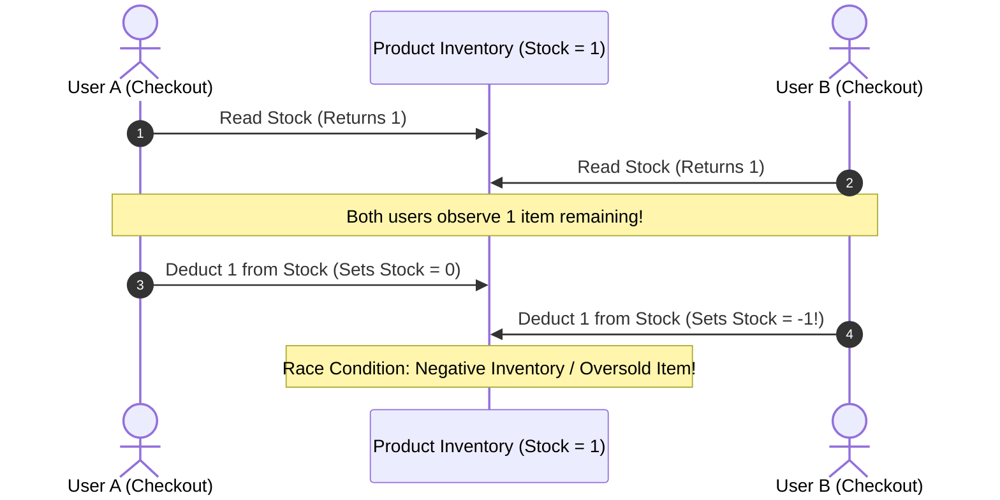
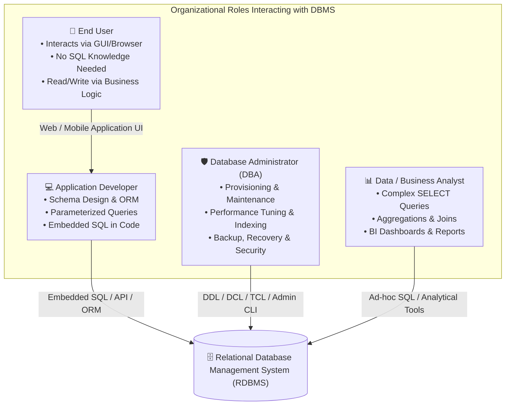
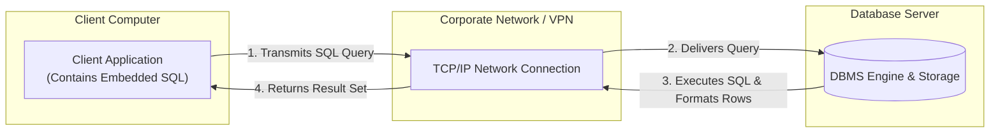
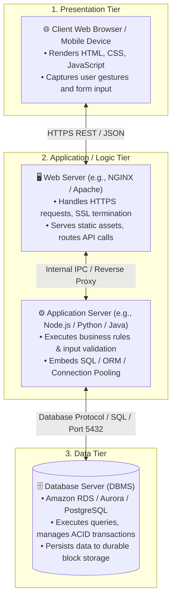
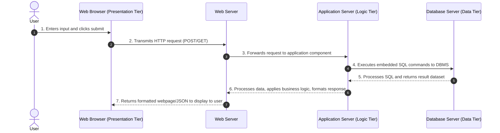
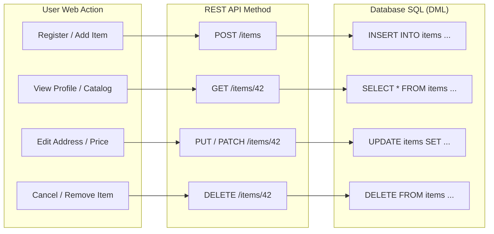
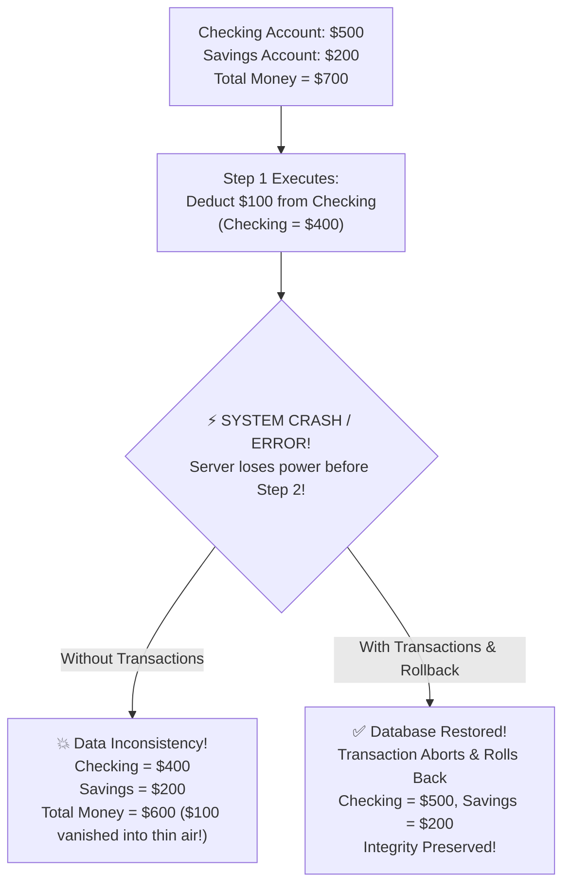
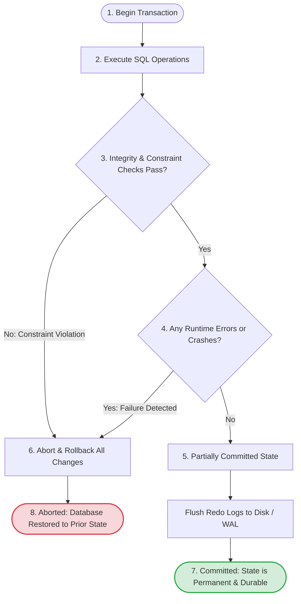
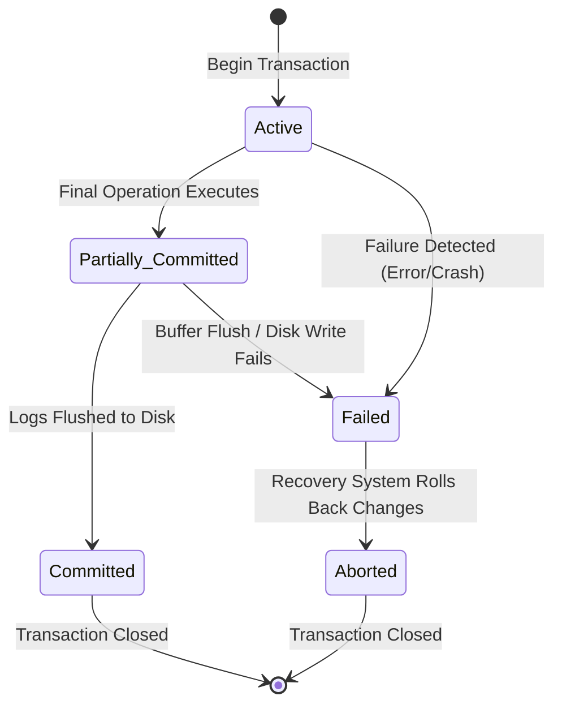

# 💾 Database Interaction and Transactions

> **Course**: AWS re/Start  
> **Module**: Database Fundamentals – M06 Data Interaction and Database Transaction  
> **Source Document**: `T10-0002-RSDB_EN-US_SG_M06_DBINTERACTIONTRANSACTION.pdf`  
> **Target Audience**: AWS re/Start Learners / Cloud Practitioners / Junior Developers & DBAs  

---

## 🎯 Module Overview

In modern cloud computing and enterprise software systems, databases rarely exist as isolated islands accessed by a single user. Instead, they serve as centralized, high-throughput engines that simultaneously support hundreds, thousands, or even millions of concurrent interactions across diverse applications, analytical workflows, and administrative consoles.

This module explores the mechanics of **database interaction** and the foundational principles of **database transactions**. We examine how distinct stakeholder roles—application developers, database administrators (DBAs), data analysts, and end users—interact with relational database management systems (RDBMS). We contrast architectural models (client-server vs. three-tier web architectures) and map foundational CRUD operations to application interfaces and HTTP protocols. Finally, we dissect transactions as logical units of work, analyze the four cornerstone **ACID** properties (Atomicity, Consistency, Isolation, and Durability), trace the formal transaction lifecycle, and implement transactional control using Transaction Control Language (TCL) statements in SQL.

---

### 📌 Learning Objectives

- [ ] **Analyze Multi-User Concurrency & Data Sharing**: Explain the necessity of sharing data across modern applications, understand race conditions, and evaluate concurrency control techniques.
- [ ] **Identify Stakeholder Roles & Interaction Patterns**: Differentiate the operational responsibilities and query tooling utilized by Application Developers, Database Administrators, Data Analysts, and End Users.
- [ ] **Contrast Database Interaction Models**: Compare two-tier client-server architectures with three-tier web application architectures, detailing the end-to-end traversal of a user request across presentation, logic, and data tiers.
- [ ] **Map CRUD Operations to Application Protocols**: Correlate Create, Read, Update, and Delete operations with standard SQL statements (DML) and RESTful HTTP methods.
- [ ] **Define Database Transactions**: Articulate why a transaction represents an indivisible logical unit of work using real-world scenarios such as banking fund transfers.
- [ ] **Evaluate ACID Properties**: Deconstruct Atomicity, Consistency, Isolation, and Durability, including transaction isolation levels and Write-Ahead Logging (WAL) durability mechanics.
- [ ] **Trace Transaction States**: Diagram and explain the transitions between Active, Partially Committed, Committed, Failed, and Aborted states.
- [ ] **Implement Transaction Control Language (TCL)**: Write robust SQL scripts using `BEGIN` / `START TRANSACTION`, `COMMIT`, `ROLLBACK`, and `SAVEPOINT` to guarantee data integrity during failures.

---

## 👥 1. Multi-User Access, Concurrency & Data Sharing

### The Imperative for Data Sharing
In traditional legacy computing, files were often locked by a single application or user. In contrast, modern relational databases are engineered from the ground up for **shared multi-user access**. Organizations centralize their mission-critical business data into databases so that multiple users, services, and microservices can query, update, and analyze information concurrently without data duplication or stale copies.

```
┌────────────────────────────────────────────────────────────────────────┐
│                        Shared Data Architecture                        │
├────────────────────────────────────────────────────────────────────────┤
│  • Microservices reading catalog data simultaneously                  │
│  • Web clients placing e-commerce orders concurrently                  │
│  • BI dashboards aggregating operational telemetry in real time        │
│  • Background batch jobs updating billing records                      │
└────────────────────────────────────────────────────────────────────────┘
```

Without a centralized DBMS, managing simultaneous access would result in inconsistent records, data overwrite conflicts, and system crashes.

---

### The Concurrency Challenge: Race Conditions and Data Anomalies
When multiple clients attempt to modify the same rows at the exact same moment, unpredictable race conditions occur unless strictly managed by the DBMS:



Modern database engines protect against these concurrency anomalies:
1. **Lost Updates**: Two transactions read the same record and compute new values; the second write overwrites the first write without incorporating its changes.
2. **Dirty Reads**: Transaction A updates a row but has not yet committed; Transaction B reads the uncommitted row. If Transaction A subsequently rolls back, Transaction B has acted on phantom, invalid data.
3. **Non-Repeatable (Fuzzy) Reads**: Transaction A reads a row. Transaction B modifies or deletes that row and commits. Transaction A re-reads the row and observes different values within the same session.
4. **Phantom Reads**: Transaction A reads a range of rows matching a predicate. Transaction B inserts new rows matching that criteria and commits. When Transaction A re-queries, new "phantom" rows appear.

---

### Concurrency Control: Locking Strategies
To allow high concurrency while preserving data integrity, database engines employ concurrency control mechanisms:

- **Shared Locks (Read Locks / S-Locks)**: Multiple transactions can hold shared locks on a row or table simultaneously to perform read operations (`SELECT`). No transaction can write to the data while an S-lock is active.
- **Exclusive Locks (Write Locks / X-Locks)**: Only one transaction can hold an exclusive lock on a resource (`INSERT`, `UPDATE`, `DELETE`). All other reads and writes are blocked until the lock is released.
- **Two-Phase Locking (2PL)**: Guarantees serializability by ensuring a transaction acquires all necessary locks during its growing phase and releases them during its shrinking phase, preventing deadlock cascades.
- **Multi-Version Concurrency Control (MVCC)**: Instead of locking rows for reads, the DBMS maintains snapshots of data across points in time. Readers do not block writers, and writers do not block readers.

> [!NOTE]
> Modern cloud databases like Amazon Aurora and Amazon RDS utilize optimized MVCC engines to achieve tens of thousands of concurrent read and write operations per second with minimal lock contention.

---

## 🛠️ 2. Stakeholder Roles & Database Interaction

Individuals interact with relational databases in fundamentally different ways based on their technical specialization, operational duties, and organizational objectives.



---

### 1. Application Developers
Application developers design, write, test, and maintain the software components that populate, query, and mutate database records to satisfy business requirements.
- **Responsibilities**:
  - Developing data access layers (DAL) and business logic components.
  - Designing entity-relationship schemas in collaboration with DBAs.
  - Implementing **Object-Relational Mapping (ORM)** frameworks (e.g., Hibernate, SQLAlchemy, Entity Framework, Prisma) to translate programming objects into relational tables.
  - Ensuring application security by employing **parameterized queries** and prepared statements to eliminate SQL Injection (SQLi) vulnerabilities.
  - Managing database connection pooling to optimize network socket reuse.
- **Interaction Style**: Primarily programmatic via embedded SQL, SDKs (such as AWS SDK / Boto3), JDBC/ODBC drivers, or ORM APIs. Developers rarely issue direct manual queries in production environments.

### 2. Database Administrators (DBAs)
Database administrators are the custodians of the database infrastructure. They ensure that the database system is accessible, secure, high-performing, and resilient to disasters.
- **Responsibilities**:
  - **Provisioning & Architecture**: Sizing compute, memory, and storage for database clusters (e.g., configuring Amazon RDS Multi-AZ deployments).
  - **Performance Tuning**: Monitoring slow query logs, analyzing query execution plans (`EXPLAIN`), establishing optimal indexes (B-tree, Hash, GIN), and vacuuming dead tuples.
  - **High Availability & Replication**: Setting up read replicas, active-passive failover mechanisms, and cross-region replication.
  - **Backup & Disaster Recovery**: Defining Recovery Point Objectives (RPO) and Recovery Time Objectives (RTO), automating snapshot lifecycle policies, and testing point-in-time recovery (PITR).
  - **Security & Compliance**: Managing Role-Based Access Control (RBAC), auditing connection logs, configuring encryption at rest (AWS KMS) and in transit (TLS/SSL).
- **Interaction Style**: DBAs possess comprehensive SQL proficiency across Data Definition Language (DDL), Data Manipulation Language (DML), Data Control Language (DCL), and Transaction Control Language (TCL). They interact via database administrative shells (e.g., `psql`, `mysql`, AWS Management Console).

### 3. Data Analysts & Business Intelligence (BI) Analysts
Data analysts extract meaningful business intelligence, detect trends, and generate strategic insights from operational databases and data warehouses.
- **Responsibilities**:
  - Querying structured datasets to answer business questions (e.g., monthly recurring revenue, customer churn rates).
  - Cleaning, transforming, and filtering raw records.
  - Building data visualizations and automated executive dashboards using BI tooling (e.g., Amazon QuickSight, Tableau, Power BI).
- **Interaction Style**: Analysts have high SQL proficiency but primarily execute read-only queries utilizing the `SELECT` statement, multi-table `JOIN` operations, aggregate functions (`SUM`, `AVG`, `COUNT`), `GROUP BY`, and window functions. They generally lack permissions to modify schemas or mutate operational records (`DROP`, `DELETE`, `UPDATE`).

### 4. End Users
End users are employees, customers, or clients who utilize the system to accomplish day-to-day business or personal tasks (e.g., checking a bank balance, submitting an expense report, ordering groceries).
- **Responsibilities**:
  - Consuming reports and viewing user interface screens.
  - Entering form inputs, searching catalogs, and clicking action buttons.
- **Interaction Style**: Indirect and abstracted. End users interact exclusively through web browsers, desktop software, or mobile applications. They do not need to know SQL syntax, table schemas, or underlying database engines. The application translates their UI actions into safe database queries behind the scenes.

---

### Stakeholder Roles & Database Interaction Matrix

| Attribute | Application Developer | Database Administrator (DBA) | Data Analyst | End User |
| :--- | :--- | :--- | :--- | :--- |
| **Primary Goal** | Build functional applications | Ensure uptime, speed, and security | Generate insights and reporting | Accomplish business/daily tasks |
| **Direct SQL Skill Required?** | Yes (Intermediate to Advanced) | Yes (Expert / Comprehensive) | Yes (Advanced Read/DQL) | No (Completely Abstracted) |
| **Primary SQL Categories Used** | DML (`SELECT`, `INSERT`, `UPDATE`), TCL | DDL, DCL, DML, TCL, Admin utilities | DQL (`SELECT`, `JOIN`, Aggregates) | None (N/A) |
| **Access Point** | Application Code, ORM, Test CLI | Admin Shell, Monitoring Consoles | BI Tools, SQL Query Editor | Web Browser, Mobile App |
| **Production Access Level** | Staging / Automated CI/CD pipelines | Full Administrative Access | Read-Only Replicas / Data Warehouses | No Direct DB Access |

---

## 🏛️ 3. Database Interaction Models & Architecture

How does an interaction travel from a user's finger on a keyboard to the physical magnetic or solid-state disk of a database server? Software architectures typically employ one of two primary interaction models: the **Two-Tier Client-Server Model** or the **Three-Tier Web Application Model**.

---

### Model 1: Two-Tier Client-Server Architecture

In the classic client-server model, the user interacts directly with a client application installed locally on their computer (a "thick" or "fat" client).



#### Workflow Mechanics:
1. **Request Initiation**: The user performs an action in the desktop application (e.g., entering an employee ID and pressing Search).
2. **SQL Generation & Transmission**: The desktop application formats a raw SQL statement (`SELECT * FROM employees WHERE id = 101;`) and transmits it across the local network over a dedicated database port (e.g., port 3306 for MySQL, 5432 for PostgreSQL).
3. **DBMS Processing**: The DBMS authenticates the client connection, parses and executes the SQL query, and serializes the result set.
4. **Response Delivery**: The DBMS returns the raw data rows across the network back to the client application, which formats and renders the data on the user's screen.

#### Characteristics & Limitations:
- **Tight Coupling**: Every client machine requires a direct database driver (ODBC/JDBC) and network route to the database.
- **Security Vulnerability**: Database credentials and query structures are distributed across client devices, making them vulnerable to reverse engineering.
- **Maintenance Nightmare**: Updating business logic or schema queries requires patching the software on every individual client computer.

---

### Model 2: Three-Tier Web Application Architecture

To overcome the security, scalability, and maintenance bottlenecks of the two-tier model, modern cloud architectures decouple systems into **three distinct tiers**: the **Presentation Tier**, the **Application (Logic) Tier**, and the **Data Tier**.



---

### The 7-Step Sequence of a Three-Tier Web Interaction

The source curriculum defines the standard seven-step sequence that occurs when an end user accesses a database via a three-tier web application:



1. **Step 1 (Client Input)**: The user interacts with a webpage running inside a web browser on their client device (laptop, phone, tablet). The webpage captures user inputs (such as search parameters or registration form fields) and sends an HTTP/HTTPS request.
2. **Step 2 (Web Server Reception)**: The web server (e.g., Amazon EC2 running NGINX or AWS Elastic Beanstalk) receives the HTTP request, performs initial routing, and forwards the payload to the application server for processing.
3. **Step 3 (Application Component Processing)**: The web application component running on the application server receives the request. This component contains business logic and the embedded SQL commands or ORM models needed to satisfy the request. It issues the SQL statements across a private subnet to the database server.
4. **Step 4 (DBMS Execution)**: The DBMS running on the database server receives and processes the SQL commands against the database storage engine.
5. **Step 5 (DBMS Result Return)**: The DBMS returns the raw query result set (rows, column headers, execution status) back to the application server.
6. **Step 6 (Application Server Formatting)**: The application server processes the raw data, validates business rules, transforms data structures, and formats the output into an HTML template or JSON payload, which it sends to the web server.
7. **Step 7 (Client Display)**: The web server delivers the response back to the client device, where the web browser renders the formatted webpage containing the database results for the user.

---

### Architectural Model Comparison

| Feature | Two-Tier Client-Server | Three-Tier Web Application |
| :--- | :--- | :--- |
| **Tiers** | Client + Database Server | Presentation + Logic/App + Data Tier |
| **Where SQL Resides** | Embedded in client software on user device | Centralized on secure application servers |
| **Security** | Low (DB port exposed to clients, credentials on client) | High (Database isolated in private VPC subnets) |
| **Scalability** | Poor (Direct connection per client exhausts DB pool) | Superior (Connection pooling, auto-scaling web/app fleets) |
| **Maintenance** | High (Client software must be upgraded everywhere) | Low (Zero client updates; update code on app servers) |
| **User Experience** | Requires dedicated software installation | Accessible via any standard web browser |

---

### Embedded SQL in Application Code
In both architectures, applications rely on **embedded SQL**—SQL queries written directly within high-level programming code (such as Python, Java, C#, or Go). 

Embedding SQL within application code delivers three major advantages:
1. **Abstraction**: End users never need to understand relational schemas, table joins, data types, or query syntax.
2. **Input Sanitization & Parameterization**: Application code can sanitize user inputs and utilize parameterized queries to prevent SQL injection attacks.
3. **Business Validation**: The application layer can enforce complex business policies (e.g., verifying a user's subscription tier or age restriction) before ever communicating with the database.

#### Example: Parameterized Embedded SQL (Python & PostgreSQL)
```python
import psycopg2

def transfer_funds(connection, sender_id, recipient_id, amount):
    """
    Safely executes a fund transfer using parameterized SQL
    to prevent SQL injection vulnerabilities.
    """
    cursor = connection.cursor()
    try:
        # Start transaction boundary
        cursor.execute("START TRANSACTION;")
        
        # Deduct balance from sender (parameterized %s prevents SQL injection)
        cursor.execute(
            "UPDATE accounts SET balance = balance - %s WHERE account_id = %s;",
            (amount, sender_id)
        )
        
        # Add balance to recipient
        cursor.execute(
            "UPDATE accounts SET balance = balance + %s WHERE account_id = %s;",
            (amount, recipient_id)
        )
        
        # Commit changes permanently
        cursor.execute("COMMIT;")
        print(f"Successfully transferred ${amount} from {sender_id} to {recipient_id}")
        
    except Exception as error:
        # Abort and roll back on any error
        cursor.execute("ROLLBACK;")
        print(f"Transaction failed: {error}. Rolled back all changes.")
    finally:
        cursor.close()
```

---

## 🔄 4. CRUD Operations & Modern Application Workflows

Every interaction with persistent data in a software system maps to one of four fundamental primitives: **CRUD** (**C**reate, **R**ead, **U**pdate, **D**elete). In modern cloud architectures, CRUD operations bridge user actions, RESTful API endpoints, and SQL Data Manipulation Language (DML) commands.



---

### CRUD Operation Mapping Reference

| CRUD Primitive | Meaning | SQL Command | RESTful HTTP Method | Typical Application Action |
| :--- | :--- | :--- | :--- | :--- |
| **Create** | Adds new records to a table | `INSERT` | `POST` | User registers an account, posts a comment, or creates a support ticket |
| **Read** | Retrieves existing data without altering state | `SELECT` | `GET` | User views product details, searches order history, or views a dashboard |
| **Update** | Modifies existing attributes of stored records | `UPDATE` | `PUT` (full replace) / `PATCH` (partial edit) | User updates their delivery address, changes password, or updates item quantity |
| **Delete** | Removes records permanently from a table | `DELETE` | `DELETE` | User cancels a reservation, removes an item from cart, or deletes an account |

> [!TIP]
> In production architectures, "Soft Deletes" are often preferred over hard SQL `DELETE` commands. A soft delete updates an `is_active` or `deleted_at` timestamp column (`UPDATE accounts SET is_active = FALSE WHERE id = 10;`), preserving historical audit trails while filtering out deleted records from user queries.

---

## 💳 5. Database Transactions & The ACID Principles

### What is a Transaction?
A **database transaction** is a collection of database operations (queries, updates, inserts, deletes) that are executed as a single, indivisible **logical unit of work**.

At the database engine level, a transaction follows a strict rule: **all of its operations must succeed together, or no change is made to the database at all.** It is an absolute **all-or-nothing** modification.

---

### The Classic Banking Transfer Dilemma
Consider a customer transferring **$100** from their checking account to their savings account. In a relational database, account balances are stored in rows within an `accounts` table:

```
Step 1: Reduce balance of checking account (Account #101) by $100.
Step 2: Increase balance of savings account (Account #102) by $100.
```

Now imagine the system crashes, loses power, or suffers a network partition immediately after Step 1 finishes:



Without transaction controls, the system enters an illegal, corrupted state where customer money disappears. With transactional boundaries, the database detects the incomplete execution and automatically **rolls back** Step 1, returning the database to its pristine pre-transaction state.

---

### The ACID Properties

To guarantee that transactions maintain absolute data integrity under all operating conditions, relational databases adhere to four standard properties known by the acronym **ACID**:

```
 ┌────────────────────────────────────────────────────────────────────────┐
 │                        The ACID Framework                              │
 ├────────────────────────────────────────────────────────────────────────┤
 │  A ── Atomicity    : All operations succeed, or all fail (No partials) │
 │  C ── Consistency  : Invariants, constraints, and schemas are upheld   │
 │  I ── Isolation    : Concurrent transactions do not collide or leak    │
 │  D ── Durability   : Committed changes survive crashes and reboots     │
 └────────────────────────────────────────────────────────────────────────┘
```

---

#### 1. Atomicity ("All or Nothing")
- **Definition**: Ensures that all changes within the transaction block are executed successfully all at once, or not at all.
- **Mechanism**: The database tracks intermediate modifications in memory or undo logs. If an unexpected error, constraint violation, or crash occurs before completion, the database executes an automatic **rollback**, undoing every preceding change in that transaction.
- **Guarantee**: The database will never reflect a partially completed transaction.

#### 2. Consistency (Preserving Integrity & Invariants)
- **Definition**: Ensures that a transaction transitions the database from one valid state to another valid state, never violating defined schema constraints or business rules.
- **Mechanism**: During transaction execution, the DBMS continuously enforces:
  - **Entity Integrity**: Primary keys must remain unique and non-null.
  - **Referential Integrity**: Foreign keys must reference valid existing primary keys.
  - **Domain Constraints**: Data types, string lengths, and `NOT NULL` rules must be satisfied.
  - **Check Constraints**: Custom logical rules (e.g., `CHECK (balance >= 0)`) cannot be violated.
- **Guarantee**: If a transaction attempts an operation that would violate any rule, the entire transaction is rejected and rolled back.

#### 3. Isolation (Independent Concurrent Execution)
- **Definition**: Ensures that multiple transactions executing concurrently occur in total isolation from one another. No transaction should observe the uncommitted, in-progress intermediate state of another transaction.
- **Mechanism**: Enforced through row-level locking, table locking, or Multi-Version Concurrency Control (MVCC).
- **Transaction Isolation Levels (ANSI SQL Standard)**:
  Database engines permit configuring isolation levels to balance data correctness against high-throughput performance:

| Isolation Level | Dirty Reads Allowed? | Non-Repeatable Reads Allowed? | Phantom Reads Allowed? | Performance Impact |
| :--- | :---: | :---: | :---: | :--- |
| **Read Uncommitted** | ⚠️ Yes | ⚠️ Yes | ⚠️ Yes | Fastest / Minimal Locking |
| **Read Committed** | ❌ No | ⚠️ Yes | ⚠️ Yes | High (Default in PostgreSQL, Oracle) |
| **Repeatable Read** | ❌ No | ❌ No | ⚠️ Yes (Engine-dependent) | Moderate (Default in MySQL InnoDB) |
| **Serializable** | ❌ No | ❌ No | ❌ No | Slowest / Strict Serial Order |

#### 4. Durability (Permanent Persistence)
- **Definition**: Guarantees that once a transaction receives a successful commit confirmation, its changes are permanent and will not be lost, even in the event of an immediate system crash, power failure, or operating system reboot.
- **Mechanism**: Modern relational engines use **Write-Ahead Logging (WAL)** or redo logs. Before database pages in memory are written to storage disks, the transaction's changes and commit log record are sequentially flushed to non-volatile disk. Upon reboot after a crash, the database recovery subsystem replays the WAL logs to reconstruct committed states and undo uncommitted operations.

---

### ACID Compliance Lifecycle Flowchart



---

## 📈 6. Status & Lifecycle of a Transaction

From inception to completion, a database transaction transitions through a well-defined sequence of operational states managed by the database recovery subsystem.



---

### Detailed Transaction States

1. **Active State**:
   - The initial state of every transaction upon creation.
   - The transaction remains in the active state while its SQL statements (`INSERT`, `UPDATE`, `DELETE`, `SELECT`) are actively being parsed, checked, and executed in memory.
2. **Partially Committed State**:
   - The transaction enters this state immediately after the final statement has executed, but before all data buffers and transaction logs are confirmed to be permanently written to persistent disk storage.
3. **Failed State**:
   - A transaction enters the failed state if normal execution can no longer proceed due to hardware errors, network partitions, deadlocks, syntax errors, or integrity check failures (e.g., negative balance check).
4. **Aborted State**:
   - Once a transaction enters the failed state, the database recovery engine steps in and initiates a rollback.
   - The aborted state occurs when the database finishes rolling back all partial changes, successfully restoring the database to the exact state it was in prior to the transaction's start.
   - Once aborted, the application can choose to restart the transaction or notify the user.
5. **Committed State**:
   - When all operations within the transaction have completed successfully, all constraints have passed, and the commit record is durably flushed to the transaction log on disk.
   - The changes are now permanent, visible to subsequent queries, and guaranteed to survive system failures.
6. **End / Terminated**:
   - The transaction has concluded its lifecycle and released all held locks and system resources.

---

## 💻 7. Transaction Control Language (TCL) in Practice

In SQL, transactions are managed using **Transaction Control Language (TCL)** commands. TCL statements allow developers and DBAs to demarcate the exact boundaries of a logical unit of work.

### Core TCL Commands

| Command | Purpose | Standard Syntax |
| :--- | :--- | :--- |
| `BEGIN` / `START TRANSACTION` | Explicitly opens a new transaction boundary | `START TRANSACTION;` |
| `COMMIT` | Finalizes the transaction, making all changes durable and permanent | `COMMIT;` |
| `ROLLBACK` | Discards all changes made within the current transaction and restores prior state | `ROLLBACK;` |
| `SAVEPOINT` | Establishes an intermediate bookmark within a transaction for partial rollbacks | `SAVEPOINT savepoint_name;` |
| `ROLLBACK TO` | Rolls back changes up to a specific savepoint without aborting the entire transaction | `ROLLBACK TO savepoint_name;` |
| `RELEASE SAVEPOINT` | Removes an established savepoint, freeing internal transaction memory | `RELEASE SAVEPOINT savepoint_name;` |

---

### End-to-End Walkthrough: Banking Transfer Scenario

Here is an end-to-end, fully annotated SQL script demonstrating transactional boundaries, error handling, and constraint validation for a bank transfer of $100 from Account A (Checking) to Account B (Savings).

```sql
-- Step 1: Create a sandbox accounts table with an integrity check
CREATE TABLE bank_accounts (
    account_id INT PRIMARY KEY,
    account_holder VARCHAR(50) NOT NULL,
    account_type VARCHAR(20) NOT NULL,
    balance DECIMAL(10, 2) NOT NULL CHECK (balance >= 0.00) -- Consistency rule!
);

-- Seed initial test accounts
INSERT INTO bank_accounts (account_id, account_holder, account_type, balance)
VALUES 
    (101, 'Alice Smith', 'Checking', 500.00),
    (102, 'Alice Smith', 'Savings',  200.00);

-- Display baseline balances
SELECT * FROM bank_accounts;

-- ====================================================================
-- SCENARIO A: A Successful Fund Transfer ($100 from 101 to 102)
-- ====================================================================

-- 1. Begin the transaction boundary (Enters ACTIVE state)
START TRANSACTION;

-- 2. Deduct $100.00 from Alice's Checking account
UPDATE bank_accounts
SET balance = balance - 100.00
WHERE account_id = 101;

-- 3. Add $100.00 to Alice's Savings account
UPDATE bank_accounts
SET balance = balance + 100.00
WHERE account_id = 102;

-- 4. Verify balances within this isolated transaction view
-- (Checking = 400.00, Savings = 300.00)

-- 5. Commit the transaction (Transitions: PARTIALLY COMMITTED -> COMMITTED)
COMMIT;

-- Both accounts now permanently reflect the changes!
```

---

### Handling Failures & Partial Rollbacks with `SAVEPOINT`

Savepoints allow developers to establish checkpoints within a long transaction, permitting partial rollbacks without throwing away the entire unit of work:

```sql
-- ====================================================================
-- SCENARIO B: E-Commerce Order with Savepoints
-- ====================================================================

START TRANSACTION;

-- Step 1: Create Order Header
INSERT INTO orders (order_id, customer_id, total_amount)
VALUES (9001, 45, 150.00);

-- Step 2: Establish a Savepoint after creating order
SAVEPOINT order_created;

-- Step 3: Attempt to apply an experimental promo discount
UPDATE orders 
SET total_amount = total_amount - 200.00 -- Would create negative total!
WHERE order_id = 9001;

-- Suppose validation logic detects invalid negative order total:
-- Instead of aborting the whole order, rollback ONLY to the savepoint!
ROLLBACK TO order_created;

-- The order header (order_id 9001) is preserved, but the invalid discount was undone!

-- Step 4: Apply correct standard discount
UPDATE orders 
SET total_amount = total_amount - 15.00
WHERE order_id = 9001;

-- Step 5: Finalize and commit
COMMIT;
```

> [!IMPORTANT]
> In transactional databases, DDL statements (`CREATE TABLE`, `DROP TABLE`, `ALTER TABLE`) in engines like MySQL trigger an **implicit commit**, immediately committing any active transaction before executing. In contrast, engines like PostgreSQL support fully transactional DDL, allowing schema alterations to be rolled back inside a transaction block.

---

## 📝 8. Key Takeaways & Summary

- **Multi-User Data Sharing**: Relational databases provide a centralized repository enabling hundreds of concurrent users and services to access the same datasets without duplication or stale reads.
- **Four Primary Database Roles**:
  - **Application Developers**: Embed SQL in software code, configure ORMs, sanitize inputs, and prevent SQL injection.
  - **Database Administrators (DBAs)**: Administer schemas, optimize query plans, manage replication, implement backups, and enforce security policies.
  - **Data Analysts**: Query operational and analytical tables using complex `SELECT` queries, aggregates, and joins to produce reports.
  - **End Users**: Access data indirectly through graphical web and mobile applications with zero SQL knowledge required.
- **Architectural Interaction Models**:
  - **Two-Tier (Client-Server)**: Client application connects directly across the network to the database server.
  - **Three-Tier (Web Application)**: Separates Presentation Tier (browser), Logic Tier (web/app servers), and Data Tier (database server). This model maximizes security, scalability, and code maintenance.
- **CRUD Operations**: Underpin all data persistence and directly map to SQL DML commands (`INSERT`, `SELECT`, `UPDATE`, `DELETE`) and HTTP verbs (`POST`, `GET`, `PUT`/`PATCH`, `DELETE`).
- **Database Transactions**: A transaction is an indivisible, all-or-nothing logical unit of work. Either all operations succeed and commit, or all fail and roll back.
- **The ACID Properties**:
  - **Atomicity**: Changes complete all at once or not at all.
  - **Consistency**: All schema rules, domain constraints, and business invariants are strictly preserved.
  - **Isolation**: Concurrent transactions execute without cross-transaction interference.
  - **Durability**: Committed updates survive power failures and system crashes via Write-Ahead Logging (WAL).
- **Transaction States**: Active $\rightarrow$ Partially Committed $\rightarrow$ Committed (or Failed $\rightarrow$ Aborted).
- **TCL Commands**: Controlled using `START TRANSACTION` / `BEGIN`, `COMMIT`, `ROLLBACK`, and `SAVEPOINT`.

---

## ❓ 9. Review Questions & Knowledge Checks

### Official Module Checkpoint Questions

#### Question 1
**What are two different roles mentioned in this module that interact with databases?**

> **Answer**:
> The primary roles mentioned are:
> 1. **Application Developer** (creates applications that embed SQL and interact with the database according to functional requirements)
> 2. **Database Administrator (DBA)** (manages all database components, designs schemas, tunes performance, and enforces security)
> *(Other valid roles: Data Analyst, End User)*

---

#### Question 2
**What are the different transaction states?**

> **Answer**:
> From start to finish, the states of a transaction are:
> 1. **Active state**: The initial state when the transaction's operations are actively running.
> 2. **Partially committed state**: The state reached after the final operation has executed, but before durable disk writes are confirmed.
> 3. **Failed state**: The state entered when normal execution stops or database recovery/integrity checks fail.
> 4. **Aborted state**: The state reached after the failed transaction has completely rolled back to its original pre-execution state.
> 5. **Committed state**: The state reached when all operations have executed successfully and changes are permanently recorded.

---

#### Question 3
**What are two primary models for database interaction?**

> **Answer**:
> The two primary interaction models are:
> 1. **Client-Server model** (two-tier architecture where a client application sends SQL directly over the network to the DBMS on a database server)
> 2. **Three-tier web application model** (presentation tier in a web browser, application tier on web/application servers executing business logic and embedded SQL, and data tier on the database server)

---

### Technical Deep-Dive & Scenario-Based Questions

#### Question 4
*A banking customer initiates a transfer of $500 between accounts. The database executes the deduction from the checking account, but a sudden hardware failure cuts server power before the savings account can be credited. What ACID property ensures the customer's $500 is not lost, and how does the database resolve the situation upon rebooting?*

> **Answer**:
> **Atomicity** ensures that the transfer is treated as an indivisible "all-or-nothing" unit of work. Upon rebooting, the database recovery subsystem scans the **Write-Ahead Log (WAL)**. Because it finds an uncommitted transaction with a recorded deduction but no corresponding `COMMIT` log entry, the engine automatically triggers an **undo / rollback** procedure. The deduction is reversed, restoring the checking account to its original balance and guaranteeing consistency.

---

#### Question 5
*Why is the Three-Tier Web Application model substantially more secure than the Two-Tier Client-Server model for enterprise e-commerce systems?*

> **Answer**:
> In the two-tier model, client devices connect directly to the database over the network, requiring database ports (e.g., 3306 or 5432) to be publicly reachable or exposed across client subnets, and embedding database credentials within client software. In contrast, the three-tier model isolates the database in a secure, private VPC subnet with no direct internet access. Only authorized application servers in the logic tier can communicate with the DBMS. Furthermore, application servers validate inputs, sanitize parameters, and enforce authentication and business logic before any SQL statement reaches the data tier.

---

#### Question 6
*Explain the difference between a `ROLLBACK` and a `ROLLBACK TO SAVEPOINT` statement.*

> **Answer**:
> A standard `ROLLBACK` statement aborts the entire transaction, undoing all operations executed since the transaction was initiated with `BEGIN` / `START TRANSACTION`, and concludes the transaction in an Aborted state. In contrast, `ROLLBACK TO <savepoint_name>` undoes only the specific statements executed *after* that named savepoint was created. The transaction remains in an **Active** state, allowing subsequent valid SQL operations to execute and eventually commit.
