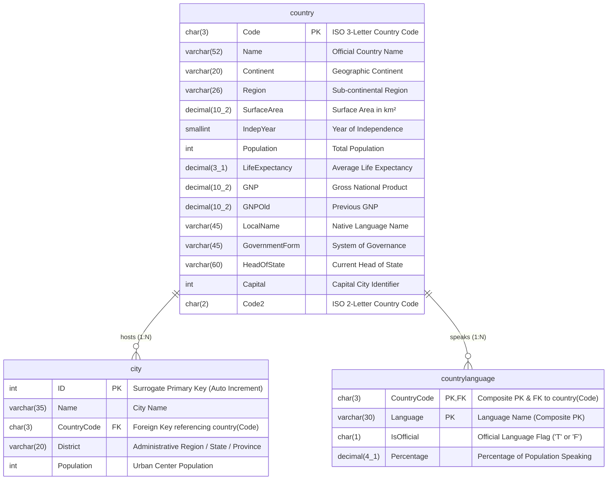
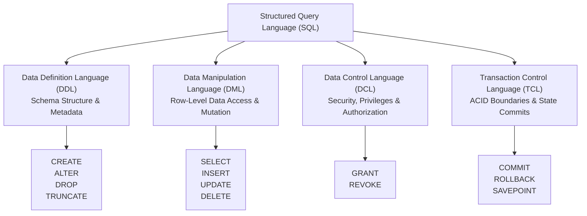
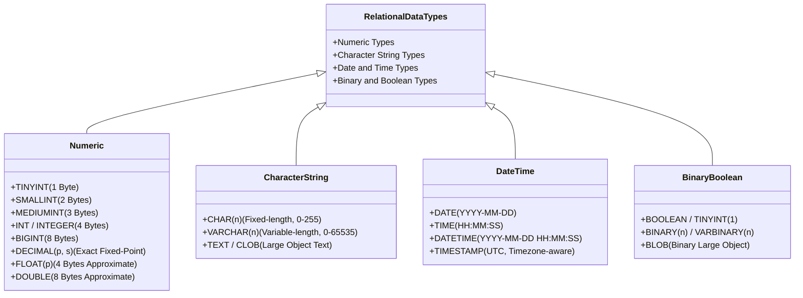
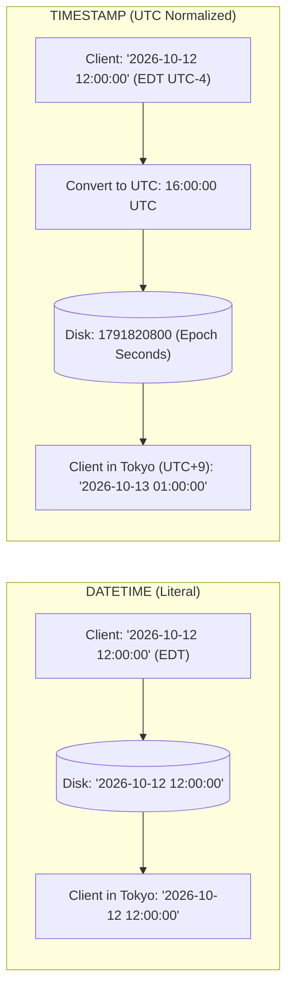
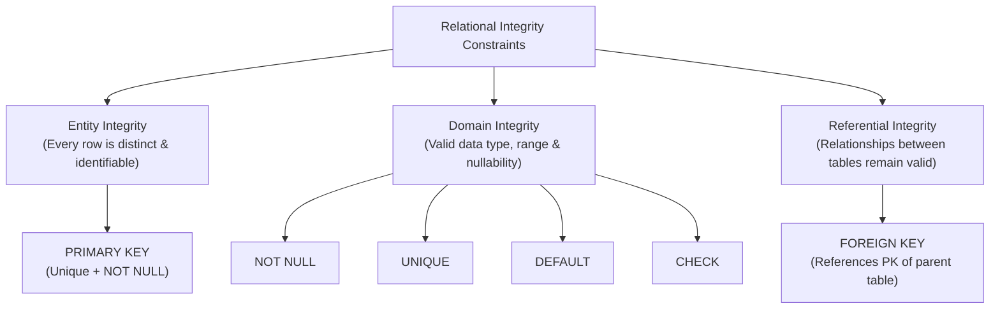
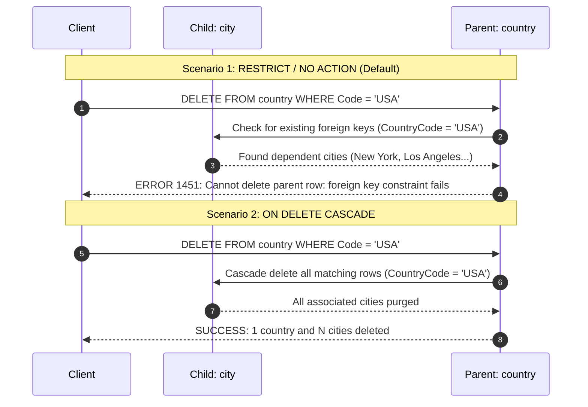

# 🗄️ Creating Tables and Learning Different Data Types

> **Course**: AWS re/Start  
> **Module**: Database Fundamentals – M06 Creating Tables and Learning Different Data Types  
> **Source Document**: `T10-0003-RSDB_EN-US_SG_M06_TABLESANDDATATYPES.pdf`  
> **Target Audience**: AWS re/Start Learners / Cloud Practitioners / Database Administrators  

---

## 🎯 Module Overview

In relational database management systems (RDBMS), designing and implementing physical database schemas is the critical bridge between abstract data models and reliable, performant data persistence. Tables serve as the fundamental structural containers of structured data, organizing records into typed columns governed by strict schema definitions.

This module delivers a comprehensive technical exploration of table creation and schema architecture in relational databases. You will examine the complete taxonomy of Structured Query Language (SQL) sub-languages—spanning Data Definition Language (**DDL**), Data Manipulation Language (**DML**), Data Control Language (**DCL**), and Transaction Control Language (**TCL**). You will dissect ANSI SQL and MySQL data types across numeric, character string, date/time, and binary/Boolean domains, learning exact byte storage allocations and precision trade-offs. Furthermore, you will master database constraints—including Primary Keys, Surrogate vs. Natural keys, `AUTO_INCREMENT`, Foreign Keys with cascading referential integrity actions, `NOT NULL`, `UNIQUE`, `DEFAULT`, and `CHECK`. Finally, you will implement production-grade `CREATE TABLE` scripts for the canonical **World Database** schema (`country`, `city`, and `countrylanguage`).

---

### 📌 Learning Objectives

- [ ] **Analyze Relational Database Anatomy**: Define how relational databases organize information into schemas, tables, fields (attributes), and records (tuples).
- [ ] **Classify SQL Sub-languages**: Distinguish between DDL (`CREATE`, `ALTER`, `DROP`, `TRUNCATE`), DML (`SELECT`, `INSERT`, `UPDATE`, `DELETE`), DCL (`GRANT`, `REVOKE`), and TCL (`COMMIT`, `ROLLBACK`, `SAVEPOINT`).
- [ ] **Apply SQL Syntax and Naming Rules**: Differentiate identifiers from reserved keywords, and evaluate DBMS-specific identifier case sensitivity conventions across MySQL, Oracle, PostgreSQL, and Microsoft SQL Server.
- [ ] **Evaluate Relational Data Types**:
  - Differentiate fixed-length `CHAR(n)` from variable-length `VARCHAR(n)` and large-object `TEXT`/`CLOB` storage.
  - Select optimal integer types (`TINYINT`, `SMALLINT`, `MEDIUMINT`, `INT`/`INTEGER`, `BIGINT`) to prevent storage over-allocation.
  - Contrast exact fixed-point `DECIMAL(p, s)`/`NUMERIC` with approximate floating-point `FLOAT(p)` and `DOUBLE`/`REAL`.
  - Contrast temporal data types (`DATE`, `TIME`, `DATETIME`, `TIMESTAMP`) regarding timezone awareness, byte size, and epoch boundaries.
  - Understand binary and boolean implementations (`BLOB`, `BOOLEAN`/`TINYINT(1)`).
- [ ] **Implement Integrity Constraints**:
  - Enforce entity integrity via Primary Keys (PKs), comparing natural keys against auto-incrementing surrogate keys.
  - Enforce referential integrity via Foreign Keys (FKs) with cascading lifecycle rules (`ON DELETE CASCADE`, `ON UPDATE CASCADE`, `RESTRICT`, `SET NULL`).
  - Configure column-level domain constraints (`NOT NULL`, `UNIQUE`, `DEFAULT`, and `CHECK`).
- [ ] **Author DDL Schema Scripts**: Write fully constrained, normalized `CREATE TABLE` and `DROP TABLE` statements for the standard World database tables (`country`, `city`, `countrylanguage`).

---

## 🏗️ 1. Anatomy of a Relational Database

A **relational database** is a structured collection of data items with predefined relationships organized according to the relational model formulated by Edgar F. Codd. Data is structured mathematically into relation sets, presented to users and applications as two-dimensional tabular structures.

```
┌────────────────────────────────────────────────────────────────────────┐
│                        Relational Model Anatomy                        │
├────────────────────────────────────────────────────────────────────────┤
│  • Database (Schema): Logical namespace containing related tables      │
│  • Table (Relation): Collection of related information about an entity │
│  • Column / Field (Attribute): Single typed property of an entity       │
│  • Row / Record (Tuple): Single discrete instance of an entity         │
│  • Domain: The allowable set of valid values defined by data types     │
└────────────────────────────────────────────────────────────────────────┘
```

### The World Database Architecture
Throughout this course, the canonical **World Database** models global geographical, municipal, and demographic data. It consists of three core tables:
1. `country`: Details global sovereign states, territories, governance forms, economic statistics, and surface areas.
2. `city`: Details major metropolitan areas, district jurisdictions, and populations tied to sovereign nations.
3. `countrylanguage`: Details languages spoken within sovereign nations, official recognition flags, and percentage usage.



---

## 📜 2. SQL Architecture & Sub-language Taxonomy

**Structured Query Language (SQL)** (pronounced either *"SEE-kwell"* or *"S-Q-L"*) is the ANSI/ISO standard declarative language for defining, querying, manipulating, securing, and orchestrating relational database management systems. Unlike procedural programming languages (e.g., C, Python, Java) that dictate *how* to calculate results step-by-step, SQL specifies *what* data structure or dataset the engine must assemble, leaving optimization and query plan execution to the RDBMS query optimizer.

SQL statements are divided into four primary sub-languages:



### 1. Data Definition Language (DDL)
DDL statements define, modify, and delete the physical database structure, schema metadata, and storage objects (databases, tables, columns, indexes, views, and integrity constraints). DDL operations are executed primarily by database administrators (DBAs) and systems engineers. In most RDBMS engines (including MySQL), DDL operations implicitly commit active transactions.

- `CREATE`: Creates a new database, table, index, view, or stored procedure.
- `ALTER`: Modifies the structure of an existing object (e.g., adding/dropping a column or foreign key).
- `DROP`: Permanently removes an entire database object and its metadata from disk.
- `TRUNCATE`: Rapidly drops and re-creates a table, wiping all rows while preserving the schema structure and column definitions. It operates substantially faster than an unconstrained `DELETE` because it deallocates data pages without logging individual row deletions.

### 2. Data Manipulation Language (DML)
DML statements interact with data stored within existing relational tables. DML enables data analysts, software engineers, and applications to retrieve, insert, update, and remove table records.

- `SELECT`: Retrieves records matching specified projection, filtering, joining, and aggregation criteria.
  > [!NOTE]
  > Technically, `SELECT` is a read-only query operation (often termed Data Query Language, or DQL), but ANSI standards classify it under DML because queries can transform, calculate, and format data prior to presentation.
- `INSERT`: Adds one or more new records into a table.
- `UPDATE`: Modifies attribute values of existing records meeting a search filter.
- `DELETE`: Removes specific records matching a `WHERE` condition from a table.

### 3. Data Control Language (DCL)
DCL statements regulate access security, rights, and privileges across database objects. DCL enforces the principle of least privilege by specifying which database users or roles can execute specific DDL and DML operations.

- `GRANT`: Bestows specific privileges (e.g., `SELECT`, `INSERT`, `ALL PRIVILEGES`) on database objects to a designated user or security role.
- `REVOKE`: Withdraws previously assigned privileges from a user or role.

```sql
-- DCL Example: Granting read-only access to a reporting analyst
GRANT SELECT ON world.city TO 'analyst_user'@'localhost';

-- DCL Example: Revoking data mutation privileges
REVOKE INSERT, UPDATE, DELETE ON world.* FROM 'contractor_user'@'%';
```

### 4. Transaction Control Language (TCL)
TCL statements manage the execution of DML statements within transactional boundaries, guaranteeing the **ACID** properties of relational databases (Atomicity, Consistency, Isolation, and Durability).

- `COMMIT`: Persists all modifications executed during the current transaction permanently to non-volatile disk storage.
- `ROLLBACK`: Aborts the active transaction, reverting all uncommitted DML mutations back to the state at the beginning of the transaction or the most recent savepoint.
- `SAVEPOINT`: Establishes an intermediate bookmark within a transaction, allowing partial rollback without undoing earlier operations.

```sql
-- TCL Example: Safe multi-step financial transaction
START TRANSACTION;
UPDATE accounts SET balance = balance - 500 WHERE account_id = 101;
SAVEPOINT debit_complete;

UPDATE accounts SET balance = balance + 500 WHERE account_id = 202;
-- If an error occurs here:
-- ROLLBACK TO debit_complete;
COMMIT;
```

### SQL Sub-language Comparison Matrix

| Sub-Language | Acronym | Primary Purpose | Key Commands | Primary Users | Implicit Transaction Commit? |
| :--- | :--- | :--- | :--- | :--- | :--- |
| **Data Definition Language** | **DDL** | Schema & structure management | `CREATE`, `ALTER`, `DROP`, `TRUNCATE` | DBAs, Cloud Architects, Developers | **Yes** (in MySQL/Oracle) |
| **Data Manipulation Language** | **DML** | Data insertion, querying, and updating | `SELECT`, `INSERT`, `UPDATE`, `DELETE` | Software Engineers, Analysts, Users | **No** (requires explicit or autocommit) |
| **Data Control Language** | **DCL** | Security, roles, and authorization | `GRANT`, `REVOKE` | Security Admins, DBAs | **Yes** (generally persists immediately) |
| **Transaction Control Language** | **TCL** | ACID transactional boundaries | `COMMIT`, `ROLLBACK`, `SAVEPOINT` | Application Developers, DBAs | Manages commit lifecycle |

---

## 🔤 3. SQL Syntax Rules, Identifiers & Case Sensitivity Conventions

Writing clean, maintainable, and portable SQL requires adhering to standard syntax conventions, distinguishing between identifiers and keywords, and understanding how different database management systems interpret casing.

### Identifiers vs. Reserved Keywords

- **Reserved Keywords**: Standard tokens defined by SQL specifications that dictate operations, constraints, and data types (e.g., `SELECT`, `FROM`, `WHERE`, `CREATE`, `TABLE`, `INT`, `PRIMARY KEY`).
- **Identifiers**: User-defined names assigned to database objects such as databases, tables, columns, indexes, views, and constraints (e.g., `city`, `countrycode`, `population`).

```sql
-- POOR PRACTICE: Chaotic casing, confusing identifiers, syntax fragility
create Table CITY (
    id INTEGER NoT nULL PRImARY_KEY,
    name varchar(20) DEFAULT NULL,,
    Countrycode varchar(25) NOT NULL,
    districT INTEGER NOT NULL
);

-- RECOMMENDED PRACTICE: Uppercase keywords, lowercase snake_case identifiers, clean indentation
CREATE TABLE city (
    id           INTEGER      NOT NULL PRIMARY KEY,
    name         VARCHAR(20)  DEFAULT NULL,
    country_code VARCHAR(25)  NOT NULL,
    district     INTEGER      NOT NULL
);
```

> [!IMPORTANT]
> Never use SQL reserved keywords as identifiers. If an object must match a reserved keyword (e.g., a column named `order` or `group`), it must be explicitly escaped using engine-specific delimiter syntax (backticks `` `order` `` in MySQL; double quotes `"order"` in PostgreSQL, Oracle, and ANSI SQL; square brackets `[order]` in SQL Server).

### DBMS Case Sensitivity and Normalization Rules

Different RDBMS engines enforce varying case sensitivity behaviors based on engine architecture and operating system file systems:

| DBMS Engine | Default Identifier Handling | Case Sensitivity Behavior | Quoting Mechanism to Force Case |
| :--- | :--- | :--- | :--- |
| **MySQL (Linux / Unix)** | Preserves case as written; case sensitive for table names because Linux file systems are case sensitive. | **Case-Sensitive** for database & table names; column names are case-insensitive. Controlled by `lower_case_table_names`. | Enclose in backticks: `` `City` `` |
| **MySQL (Windows / macOS)** | Case-insensitive because underlying file systems (NTFS / APFS) are case-insensitive by default. | **Case-Insensitive** | Enclose in backticks: `` `City` `` |
| **Oracle Database** | Automatically converts all unquoted identifiers to **UPPERCASE**. | **Case-Insensitive** in queries unless enclosed in double quotes during creation. | Enclose in double quotes: `"City"` |
| **IBM Db2** | Automatically converts unquoted identifiers to **UPPERCASE**. | **Case-Insensitive** in queries unless double-quoted. | Enclose in double quotes: `"City"` |
| **PostgreSQL** | Automatically converts all unquoted identifiers to **lowercase**. | **Case-Insensitive** in queries unless double-quoted. | Enclose in double quotes: `"City"` |
| **Microsoft SQL Server** | Governed by the database/instance **Collation** setting (e.g., `SQL_Latin1_General_CP1_CI_AS` where `CI` = Case Insensitive, `CS` = Case Sensitive). | **Case-Insensitive by default** | Enclose in square brackets: `[City]` |

### Schema & Object Naming Best Practices

1. **Descriptive & Explicit**: Names should unambiguously reflect the real-world business entity (e.g., `customer_invoices` rather than `tbl_ci_01`).
2. **Singular vs. Plural Consistency**: Select a convention across the organization and maintain it strictly. (Modern industry convention favors singular nouns like `country`, `city`, `user`, or uniform plural nouns `countries`, `cities`, `users`).
3. **Delimiter Format**: Use `snake_case` (e.g., `order_item_details`) for cross-platform portability. CamelCase (e.g., `orderItemDetails`) often requires quoted escaping across case-folding engines.
4. **Reserved Symbol Avoidance**: Avoid non-alphanumeric symbols (`#`, `@`, `$`, `-`, spaces) in identifiers.

---

## 💾 4. Relational Database Data Types in MySQL/ANSI SQL

In relational architecture, every table column is constrained to a specific **data type**. Data types define:
1. The domain of allowable values (integers, strings, dates, floating-point numbers).
2. The exact physical storage format and byte allocation on disk and in memory.
3. The valid operations and functions that can be performed on the values (e.g., arithmetic addition vs. string concatenation).



---

### A. Numeric Data Types

Numeric types represent numbers, divided into **Exact Numeric** (integers and fixed-point decimals) and **Approximate Numeric** (floating-point numbers).

#### 1. Integer Types (Exact Numeric)
Integers store whole numbers without fractional components. Selecting the smallest integer size capable of accommodating the domain avoids storage bloat and maximizes memory cache efficiency.

| SQL Data Type | Storage Size | Signed Range (Default) | Unsigned Range (`UNSIGNED`) | Typical Use Cases |
| :--- | :--- | :--- | :--- | :--- |
| `TINYINT` | 1 Byte (8 bits) | $-128$ to $127$ | $0$ to $255$ | Status codes, booleans (`TINYINT(1)`), small counters |
| `SMALLINT` | 2 Bytes (16 bits) | $-32,768$ to $32,767$ | $0$ to $65,535$ | Independence years (`IndepYear`), postal zone codes |
| `MEDIUMINT` | 3 Bytes (24 bits) | $-8,388,608$ to $8,388,607$ | $0$ to $16,777,215$ | Regional entity IDs, medium-scale counters |
| `INT` / `INTEGER` | 4 Bytes (32 bits) | $-2,147,483,648$ to $2,147,483,647$ | $0$ to $4,294,967,295$ | Standard primary keys (`city.ID`), populations |
| `BIGINT` | 8 Bytes (64 bits) | $-2^{63}$ to $2^{63}-1$ ($\approx \pm 9.22 \times 10^{18}$) | $0$ to $2^{64}-1$ ($\approx 1.84 \times 10^{19}$) | High-throughput logging, global transaction IDs |

#### 2. Fixed-Point Exact Decimals: `DECIMAL(p, s)` / `NUMERIC(p, s)`
`DECIMAL` (or `NUMERIC`) stores exact numeric values where precision is paramount, such as monetary balances, financial balances, and geographic measurements.
- **Precision ($p$)**: Total number of significant digits (both before and after the decimal point). Maximum precision in MySQL is 65.
- **Scale ($s$)**: Number of digits to the right of the decimal point. Cannot exceed precision ($s \le p$).

```sql
-- Example: DECIMAL(10, 2)
-- Total digits: 10
-- Decimal places: 2
-- Maximum value: 99999999.99
-- Minimum value: -99999999.99
```

> [!CAUTION]
> Never store currency or financial balances in `FLOAT` or `DOUBLE`. Binary floating-point representation causes cumulative rounding errors due to IEEE 754 precision limits (e.g., $0.1 + 0.2 \ne 0.3$). Always use `DECIMAL(p, s)`.

#### 3. Approximate Floating-Point Numbers: `FLOAT(p)`, `DOUBLE`, `REAL`
Floating-point numbers represent real numbers with dynamic decimal point locations according to IEEE 754 standards. They provide rapid processing speed and vast numeric ranges at the expense of exact precision.
- `FLOAT`: Single precision (4 bytes), accurate up to $\approx 7$ decimal places.
- `DOUBLE` / `REAL`: Double precision (8 bytes), accurate up to $\approx 15$ decimal places.
- *Use cases*: Scientific computations, statistical models, physics simulations, metrics where micro-rounding discrepancies are acceptable.

---

### B. Character String Data Types

Character data types store alphanumeric text, strings, and unstructured text documents.

| Data Type | Character Length Capacity | Storage Overhead | Trailing Space Behavior | Best For |
| :--- | :--- | :--- | :--- | :--- |
| `CHAR(n)` | Fixed length ($1 \le n \le 255$ chars) | Always consumes $n \times \text{bytes per char}$ | Padded with trailing spaces on disk; spaces stripped upon retrieval | Consistent-length codes: ISO codes (`CHAR(3)` for `country.Code`), MD5 hashes (`CHAR(32)`), UUIDs |
| `VARCHAR(n)` | Variable length ($1 \le n \le 65,535$ chars) | Consumes actual text length $L$ plus 1 or 2 prefix bytes | Preserves trailing spaces (in modern MySQL/SQL standard) | Variable-length text: User names (`VARCHAR(50)`), email addresses, street names |
| `TEXT` / `CLOB` | Up to $65,535$ chars (Standard `TEXT`), up to 4 GB (`LONGTEXT`) | 2-byte prefix + off-page storage pointers | Stored outside primary index row pages when wide | Long descriptions, blog posts, HTML bodies, JSON documents |

#### Storage Mechanics: `CHAR` vs. `VARCHAR`

```
Storing 'USA' (3 chars, latin1):
CHAR(10):    ['U']['S']['A'][' '][' '][' '][' '][' '][' '][' ']  --> Exactly 10 bytes allocated on disk
VARCHAR(10): [0x03]['U']['S']['A']                              --> Exactly 4 bytes (1 length byte + 3 chars)

Storing 'BRAZIL' (6 chars, latin1):
CHAR(10):    ['B']['R']['A']['Z']['I']['L'][' '][' '][' '][' ']  --> Exactly 10 bytes allocated on disk
VARCHAR(10): [0x06]['B']['R']['A']['Z']['I']['L']              --> Exactly 7 bytes (1 length byte + 6 chars)
```

> [!TIP]
> If values in a column have fixed length (such as a 2-letter state code `CHAR(2)` or an ISO country code `CHAR(3)`), use `CHAR`. `CHAR` eliminates the variable-length prefix byte overhead and mitigates row fragmentation caused by frequent updates that expand string lengths.

---

### C. Date and Time Data Types

Temporal data types represent dates, time of day, and combined timestamps.

| Data Type | Syntax Format | Byte Storage | Permissible Range | Time Zone Awareness |
| :--- | :--- | :--- | :--- | :--- |
| `DATE` | `YYYY-MM-DD` | 3 Bytes | `1000-01-01` to `9999-12-31` | **No** (pure calendar date) |
| `TIME` | `HH:MM:SS` | 3 Bytes | `-838:59:59` to `838:59:59` | **No** (time of day or elapsed duration) |
| `DATETIME` | `YYYY-MM-DD HH:MM:SS` | 5–8 Bytes | `1000-01-01 00:00:00` to `9999-12-31 23:59:59` | **No** (exact literal representation stored as-is) |
| `TIMESTAMP` | `YYYY-MM-DD HH:MM:SS` | 4 Bytes | `1970-01-01 00:00:01` UTC to `2038-01-19 03:14:07` UTC | **Yes** (converted from client timezone to UTC on write, converted back on read) |

#### Deep Comparison: `DATETIME` vs. `TIMESTAMP`



- **Use `DATETIME`** for fixed historical or future scheduled events where local time must not shift based on server or client timezones (e.g., flight departures, hotel reservations, birthdays).
- **Use `TIMESTAMP`** for audit logs, record creation (`created_at`), and mutation timestamps (`updated_at`), where precise global chronological ordering across distributed timezones is required.

---

### D. Binary and Boolean Data Types

- **`BOOLEAN` / `BOOL`**: In standard SQL, a Boolean represents `TRUE`, `FALSE`, or `UNKNOWN` (`NULL`). In MySQL, `BOOLEAN` is an alias for `TINYINT(1)`, where `0` evaluates to `FALSE` and any non-zero value (typically `1`) evaluates to `TRUE`.
- **`BLOB` (Binary Large Object)**: Stores uninterpreted raw binary streams (e.g., image thumbnails, encrypted payloads, compiled binaries, PDF files). Subtypes include `TINYBLOB`, `BLOB` (up to 64 KB), `MEDIUMBLOB` (up to 16 MB), and `LONGBLOB` (up to 4 GB).

---

## 🔒 5. Table Constraints & Integrity Rules

Relational databases maintain high data fidelity through **integrity constraints**. Constraints define declarative rules enforced by the RDBMS engine upon every `INSERT`, `UPDATE`, and `DELETE` operation.



---

### 1. Primary Key (`PRIMARY KEY`)
A **Primary Key (PK)** is a column or minimal set of columns that uniquely identifies each individual record in a table.
- **Entity Integrity**: Under relational theory, no table can have duplicate records, and no component of a primary key may contain a `NULL` value.
- **Natural Key vs. Surrogate Key**:
  - *Natural Key*: An inherent attribute of the real-world entity that is globally unique (e.g., ISO 3166-1 alpha-3 code `country.Code` = `'USA'`, `'FRA'`, `'JPN'`).
  - *Surrogate Key*: An artificial, system-generated identifier with no intrinsic business meaning (e.g., integer ID `city.ID` with `AUTO_INCREMENT`).
- **Composite (Compound) Primary Key**: A primary key comprised of two or more columns combined (e.g., `countrylanguage` where `(CountryCode, Language)` together form the unique identifier).

---

### 2. Foreign Key (`FOREIGN KEY`) & Referential Integrity
A **Foreign Key (FK)** is a column or set of columns in a child table that references the primary key (or a unique key) of a parent table.

**Referential Integrity** guarantees that the database never contains orphan child records:
$$\forall \, \text{non-NULL } fk \in \text{ChildTable}, \, \exists \, pk \in \text{ParentTable} \text{ such that } fk = pk$$

#### Referential Cascading Actions

When a parent row referenced by a foreign key is modified or deleted, the RDBMS enforces declarative cascading behaviors:

| Action Clause | Behavior on Parent Row Deletion (`ON DELETE`) / Update (`ON UPDATE`) | Best Use Case |
| :--- | :--- | :--- |
| **`RESTRICT`** / **`NO ACTION`** *(Default)* | Rejects and aborts the deletion/update with an error if dependent child records exist. | Preventing accidental deletion of countries that still have registered cities. |
| **`CASCADE`** | Automatically deletes or updates all matching child rows when the parent row is deleted/updated. | Parent-child dependent entities (e.g., deleting an invoice automatically deletes all line items). |
| **`SET NULL`** | Automatically sets the foreign key column in dependent child rows to `NULL` (requires column to be nullable). | Reassigning employees when a department or team is dissolved. |
| **`SET DEFAULT`** | Sets the child foreign key column to its declared default value. | Fallback routing to a default placeholder record. |



---

### 3. Additional Column Constraints

- **`NOT NULL`**: Forbids missing or undefined values. The column must receive an explicit value during insertion.
- **`UNIQUE`**: Guarantees that all values stored within a column (or group of columns) are distinct across all rows. Unlike a primary key, a table may contain multiple `UNIQUE` constraints, and `UNIQUE` columns may accept `NULL` values (in SQL, `NULL != NULL`).
- **`DEFAULT value`**: Automatically assigns a predefined default value to a column when an `INSERT` statement omits that field.
- **`CHECK (condition)`**: Enforces domain integrity by validating that values satisfy a boolean expression prior to commit (e.g., `CHECK (Population >= 0)` or `CHECK (Percentage BETWEEN 0.0 AND 100.0)`).

---

## 🛠️ 6. Table DDL Operations & The World Database Implementation

### Syntax of `CREATE TABLE`

The general syntax for creating a table incorporates column definitions, data types, constraints, and table options:

```sql
CREATE TABLE [IF NOT EXISTS] table_name (
    column_1 data_type [column_constraints],
    column_2 data_type [column_constraints],
    ...,
    [table_constraints]
) ENGINE = InnoDB DEFAULT CHARSET = utf8mb4;
```

> [!NOTE]
> The `IF NOT EXISTS` clause prevents fatal SQL execution errors if an existing table matches the specified identifier.

---

### Production Implementation: The World Database

Below is the complete, production-grade ANSI/MySQL DDL implementation of the **World Database**, ordered correctly to satisfy foreign key dependencies (parent table `country` created before child tables `city` and `countrylanguage`).

```sql
-- ============================================================================
-- 1. Create Parent Table: country
-- ============================================================================
CREATE TABLE IF NOT EXISTS country (
    Code           CHAR(3)        NOT NULL DEFAULT '',
    Name           VARCHAR(52)    NOT NULL DEFAULT '',
    Continent      VARCHAR(20)    NOT NULL DEFAULT 'Asia',
    Region         VARCHAR(26)    NOT NULL DEFAULT '',
    SurfaceArea    DECIMAL(10,2)  NOT NULL DEFAULT 0.00,
    IndepYear      SMALLINT       DEFAULT NULL,
    Population     INT            NOT NULL DEFAULT 0,
    LifeExpectancy DECIMAL(3,1)   DEFAULT NULL,
    GNP            DECIMAL(10,2)  DEFAULT NULL,
    GNPOld         DECIMAL(10,2)  DEFAULT NULL,
    LocalName      VARCHAR(45)    NOT NULL DEFAULT '',
    GovernmentForm VARCHAR(45)    NOT NULL DEFAULT '',
    HeadOfState    VARCHAR(60)    DEFAULT NULL,
    Capital        INT            DEFAULT NULL,
    Code2          CHAR(2)        NOT NULL DEFAULT '',
    -- Primary Key Constraint
    CONSTRAINT pk_country PRIMARY KEY (Code),
    -- Domain Check Constraints
    CONSTRAINT chk_country_population CHECK (Population >= 0),
    CONSTRAINT chk_country_surface CHECK (SurfaceArea >= 0.00)
) ENGINE = InnoDB DEFAULT CHARSET = utf8mb4 COLLATE = utf8mb4_unicode_ci;

-- ============================================================================
-- 2. Create Child Table: city
-- ============================================================================
CREATE TABLE IF NOT EXISTS city (
    ID          INT          NOT NULL AUTO_INCREMENT,
    Name        VARCHAR(35)  NOT NULL DEFAULT '',
    CountryCode CHAR(3)      NOT NULL DEFAULT '',
    District    VARCHAR(20)  NOT NULL DEFAULT '',
    Population  INT          NOT NULL DEFAULT 0,
    -- Primary Key Constraint
    CONSTRAINT pk_city PRIMARY KEY (ID),
    -- Foreign Key Constraint to country(Code)
    CONSTRAINT fk_city_country FOREIGN KEY (CountryCode)
        REFERENCES country (Code)
        ON DELETE RESTRICT
        ON UPDATE CASCADE,
    -- Domain Check Constraint
    CONSTRAINT chk_city_population CHECK (Population >= 0)
) ENGINE = InnoDB DEFAULT CHARSET = utf8mb4 COLLATE = utf8mb4_unicode_ci;

-- ============================================================================
-- 3. Create Child Table: countrylanguage
-- ============================================================================
CREATE TABLE IF NOT EXISTS countrylanguage (
    CountryCode CHAR(3)       NOT NULL DEFAULT '',
    Language    VARCHAR(30)   NOT NULL DEFAULT '',
    IsOfficial  CHAR(1)       NOT NULL DEFAULT 'F',
    Percentage  DECIMAL(4,1)  NOT NULL DEFAULT 0.0,
    -- Composite Primary Key (CountryCode + Language)
    CONSTRAINT pk_countrylanguage PRIMARY KEY (CountryCode, Language),
    -- Foreign Key Constraint referencing country(Code)
    CONSTRAINT fk_countrylanguage_country FOREIGN KEY (CountryCode)
        REFERENCES country (Code)
        ON DELETE CASCADE
        ON UPDATE CASCADE,
    -- Domain Check Constraints
    CONSTRAINT chk_countrylanguage_isofficial CHECK (IsOfficial IN ('T', 'F')),
    CONSTRAINT chk_countrylanguage_percentage CHECK (Percentage BETWEEN 0.0 AND 100.0)
) ENGINE = InnoDB DEFAULT CHARSET = utf8mb4 COLLATE = utf8mb4_unicode_ci;
```

---

### Removing and Modifying Tables

#### 1. The `DROP TABLE` Statement
To permanently remove one or more tables and all associated records, use `DROP TABLE`:

```sql
DROP TABLE [IF EXISTS] table_name1 [, table_name2] ...;
```

> [!CAUTION]
> If foreign key constraints link two tables, attempting to drop the parent table (`country`) before dropping the child tables (`city`, `countrylanguage`) will trigger a foreign key violation error. Tables must either be dropped in reverse dependency order:
> ```sql
> DROP TABLE IF EXISTS countrylanguage, city, country;
> ```
> Or foreign key checks must be temporarily disabled (administrative use only):
> ```sql
> SET FOREIGN_KEY_CHECKS = 0;
> DROP TABLE IF EXISTS country;
> SET FOREIGN_KEY_CHECKS = 1;
> ```

#### 2. `DROP TABLE` vs. `TRUNCATE TABLE` vs. `DELETE FROM`

| Characteristic | `DROP TABLE` | `TRUNCATE TABLE` | `DELETE FROM` |
| :--- | :--- | :--- | :--- |
| **SQL Sub-language** | **DDL** | **DDL** | **DML** |
| **Schema Preservation** | Deletes table schema and all data | Preserves table schema; empties rows | Preserves table schema; empties filtered rows |
| **Speed & Efficiency** | Instantaneous | Extremely fast (deallocates disk data pages) | Slower (scans rows, logs row-by-row deletes) |
| **Auto-Increment Reset** | Destroys table | Resets `AUTO_INCREMENT` counter to 1 | Preserves current `AUTO_INCREMENT` sequence |
| **Rollback Capability** | Non-rollbackable (implicit commit) | Non-rollbackable in MySQL | Fully rollbackable within active transaction |

---

## ❓ Checkpoint Review Questions & Detailed Answers

### Question 1: What is the SQL statement that is used to create a table inside a database?
**Answer**:  
The **`CREATE TABLE`** statement is used to define and create a new table inside a database. It specifies the table name, column definitions, data types, lengths, default values, and integrity constraints (such as `PRIMARY KEY` and `FOREIGN KEY`). To prevent errors if the table already exists, the optional `IF NOT EXISTS` clause can be appended.

### Question 2: What is the purpose of a primary key in a table?
**Answer**:  
The purpose of a **Primary Key (PK)** is to enforce entity integrity by uniquely identifying every row in a table. It guarantees that no two rows share the same identifier and strictly prohibits `NULL` values. A primary key can be a natural key, a surrogate key (e.g., using `AUTO_INCREMENT`), or a composite key composed of multiple columns.

### Question 3: How does a foreign key enforce referential integrity?
**Answer**:  
A **Foreign Key (FK)** enforces referential integrity by establishing a formal constraint relationship between a column in a child table and the primary key of a parent table. It prevents the insertion of orphan child records whose foreign key values do not exist in the parent table. Furthermore, it governs lifecycle behaviors when parent rows are updated or removed via actions like `RESTRICT`, `CASCADE`, or `SET NULL`.

### Question 4: Under what circumstances should you select `VARCHAR` over `CHAR`?
**Answer**:  
`VARCHAR` should be selected when storing variable-length textual data whose character counts fluctuate significantly (e.g., user names, email addresses, street names), as it only consumes disk space proportional to the actual string length plus 1 or 2 length prefix bytes. Conversely, `CHAR` should be reserved for fixed-length data (e.g., 2-character country codes, MD5 hashes, postal codes) to eliminate length byte overhead and prevent row fragmentation.

### Question 5: Why must monetary values be stored using `DECIMAL` instead of `FLOAT` or `DOUBLE`?
**Answer**:  
`DECIMAL` (or `NUMERIC`) is an exact fixed-point numeric data type that stores numbers precisely digit-by-digit, preventing rounding inaccuracies. In contrast, `FLOAT` and `DOUBLE` use binary floating-point representation (IEEE 754), which cannot represent certain base-10 decimal fractions exactly (e.g., $0.1$ or $0.7$), leading to cumulative rounding errors that are unacceptable in financial accounting and billing systems.

---

## 🧠 Key Takeaways & Core Concepts Summary

- **Relational Tables & Schemas**: Tables are structured two-dimensional storage units organized into typed columns (attributes) and rows (tuples), grouped logically within database schemas.
- **SQL Sub-language Specialization**:
  - **DDL** (`CREATE`, `ALTER`, `DROP`, `TRUNCATE`): Constructs, alters, and deallocates schema structures.
  - **DML** (`SELECT`, `INSERT`, `UPDATE`, `DELETE`): Queries and mutates table records.
  - **DCL** (`GRANT`, `REVOKE`): Controls security permissions and user access rights.
  - **TCL** (`COMMIT`, `ROLLBACK`, `SAVEPOINT`): Manages ACID transactional boundaries.
- **Identifiers vs. Keywords**: Maintain clear syntax hygiene by capitalizing SQL keywords and writing user identifiers in lowercase `snake_case`. Be mindful of DBMS-specific case folding and operating system file system conventions.
- **Storage-Conscious Data Typing**: Match data types strictly to business domains. Choose the smallest appropriate integer type (`TINYINT` through `BIGINT`) to avoid storage over-allocation, leverage `CHAR` for fixed-length tokens, `VARCHAR` for dynamic strings, `TIMESTAMP` for timezone-normalized audit events, and `DECIMAL` for financial accuracy.
- **Entity & Referential Integrity**: Primary keys uniquely identify records and prohibit `NULL`s. Foreign keys link child entities to parent records, preventing orphan data and automating lifecycle rules through cascading actions (`CASCADE`, `RESTRICT`, `SET NULL`).
- **Defensive DDL Authoring**: Structure table creation scripts in correct parent-to-child dependency order, leverage `IF NOT EXISTS` guards, and explicitly declare column nullability, defaults, and engine parameters (`InnoDB`, `utf8mb4`).
