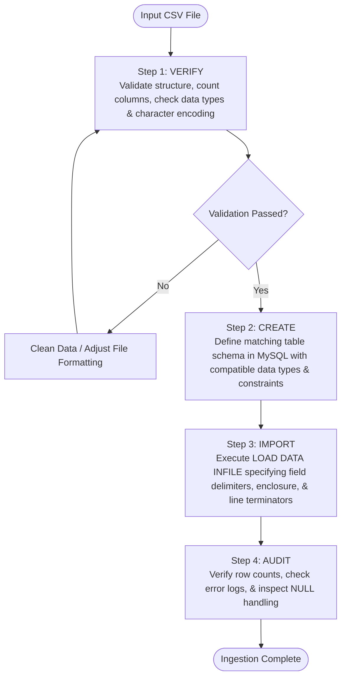
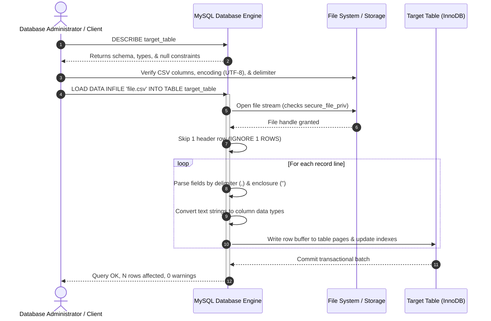

# 📥 Inserting Data into SQL Tables & Working with CSV Files

> **Course**: AWS re/Start  
> **Module**: Database Fundamentals  
> **Source Document**: `T10-0004-RSDB_EN-US_SG_M06_INSERTINGDATA.pdf`  
> **Target Audience**: AWS re/Start Learners / Cloud Practitioners / Junior Database Administrators  

---

## 🎯 Module Overview

Data ingestion is a core operational discipline in relational database administration and application engineering. While database schemas define structural blueprints, the business value of any database relies on reliably populating, updating, and transforming the underlying records. Whether ingesting high-velocity transactional events, batch-loading legacy enterprise records, or seeding lookup tables, database professionals must understand both manual Data Manipulation Language (DML) statements and automated high-throughput bulk import workflows.

This study guide explores the syntax, mechanics, and best practices for inserting data into relational databases (such as MySQL), covering schema inspection with `DESCRIBE`, foundational and multi-row `INSERT INTO` statements, copying tables with `INSERT INTO ... SELECT`, handling auto-increment sequences and default values, parsing and importing Comma-Separated Values (CSV) datasets using `LOAD DATA INFILE`, exporting database tables to disk via `SELECT ... INTO OUTFILE`, performing pre-ingestion data cleansing, and navigating three-valued SQL logic with `NULL`.

---

### 📌 Learning Objectives

- [ ] **Inspect Table Architectures**: Use the `DESCRIBE` statement to examine column definitions, constraints, nullability, default values, and data types prior to executing insertion queries.
- [ ] **Master DML Insertion Operations**: Construct syntactically correct `INSERT INTO` statements for single-row, explicit-column, and implicit full-column operations.
- [ ] **Execute High-Throughput Batch Inserts**: Implement multi-row batch inserts and explain their performance advantages over repeated single-row queries in terms of network latency and transaction log overhead.
- [ ] **Copy & Migrate Data with Subqueries**: Utilize `INSERT INTO ... SELECT ...` statements to duplicate, filter, and transform data between tables.
- [ ] **Manage Auto-Increment & Default Values**: Properly handle primary key columns generated automatically via `AUTO_INCREMENT` alongside explicit column defaults.
- [ ] **Deconstruct CSV Structures**: Analyze the structural layout of Comma-Separated Values (CSV) files and map flat-file representations to relational table schemas.
- [ ] **Implement Bulk Ingestion with `LOAD DATA INFILE`**: Ingest large datasets using `LOAD DATA INFILE` and `LOAD DATA LOCAL INFILE`, configuring field delimiters, enclosure qualifiers, line terminators, and header skipping.
- [ ] **Export Relational Datasets to Delimited Files**: Generate flat files from database queries using `SELECT ... INTO OUTFILE` with appropriate file permissions and security considerations.
- [ ] **Identify & Remediate Data Quality Flaws**: Apply SQL string-cleansing functions (`TRIM`, `CONCAT`, `LEFT`, `RIGHT`, `LOWER`, `UPPER`, `REPLACE`) to resolve data entry inconsistencies, formatting anomalies, and unescaped characters.
- [ ] **Navigate Three-Valued Logic & NULL**: Differentiate `NULL` from zero or empty strings, evaluate SQL three-valued logic expressions, and enforce database integrity using `NOT NULL` column constraints.

---

## 📚 Key Terminology

| Term | Definition |
| :--- | :--- |
| **DML (Data Manipulation Language)** | The subset of SQL commands responsible for querying, inserting, updating, and deleting records stored within database structures (e.g., `SELECT`, `INSERT`, `UPDATE`, `DELETE`). |
| **`INSERT INTO`** | The fundamental SQL statement used to add new rows of data into a target database table. |
| **`DESCRIBE` / `EXPLAIN`** | A metadata inspection command that outputs the structural definition of a table, including column names, data types, nullability, key indexes, and default values. |
| **CSV (Comma-Separated Values)** | A plain-text, delimiter-separated file format where each line represents a data record and fields are separated by commas (or alternate delimiters). |
| **`LOAD DATA INFILE`** | A high-speed MySQL engine command used to bulk-read rows from a text/CSV file directly into a table at substantially higher throughput than sequential `INSERT` statements. |
| **`SELECT ... INTO OUTFILE`** | A SQL statement used to export query result sets directly from the database server into an external flat file. |
| **`AUTO_INCREMENT`** | A table column attribute that automatically generates a unique numeric identifier whenever a new row is inserted without specifying a primary key value. |
| **`DEFAULT` Constraint** | A schema setting that automatically populates a column with a predefined fallback value when no value is supplied in an `INSERT` statement. |
| **`NULL`** | A special SQL marker indicating the absence of any data value; represents "unknown", "unassigned", or "not applicable". |
| **Three-Valued Logic (3VL)** | The truth valuation system used in SQL comparisons, which produces three outcomes: `TRUE`, `FALSE`, or `UNKNOWN` (evaluating comparisons with `NULL`). |
| **Data Hygiene / Cleansing** | The process of detecting, transforming, or removing corrupted, inaccurate, or incorrectly formatted records before or after storing them in a database. |

---

## 🔍 1. Inspecting Schemas Before Insertion: The `DESCRIBE` Statement

Before adding records to a table, a database administrator or developer must know the schema constraints, data types, required fields, and column ordering. Attempting to insert mismatched data types or violating `NOT NULL` constraints without default values results in execution errors.

### Schema Discovery Syntax
In MySQL and compatible relational database engines, the `DESCRIBE` (or abbreviated `DESC`) command provides a summary of table metadata:

```sql
-- Syntax:
DESCRIBE <table_name>;

-- Alternative shorthand syntax:
DESC <table_name>;
```

### Example: Inspecting the `country` Table

```sql
DESCRIBE country;
```

#### Sample Command Output:
```text
+-------------+---------------+------+-----+---------+-------+
| Field       | Type          | Null | Key | Default | Extra |
+-------------+---------------+------+-----+---------+-------+
| Code        | char(3)       | NO   | PRI | NULL    |       |
| Name        | char(52)      | NO   |     |         |       |
| Continent   | varchar(20)   | NO   |     | Asia    |       |
| Region      | char(26)      | NO   |     |         |       |
| SurfaceArea | decimal(10,2) | NO   |     | 0.00    |       |
| Population  | int           | YES  |     | 0       |       |
+-------------+---------------+------+-----+---------+-------+
```

### Analyzing the Output Fields:
1. **`Field`**: The exact identifier name of the column.
2. **`Type`**: The data type and storage width (e.g., `CHAR(3)`, `DECIMAL(10,2)`, `INT`).
3. **`Null`**: Displays `NO` if the column enforces a `NOT NULL` constraint, or `YES` if `NULL` is allowed.
4. **`Key`**: Displays `PRI` for Primary Key, `UNI` for Unique Key, or `MUL` for non-unique secondary indexes.
5. **`Default`**: The predefined value assigned automatically if the column is omitted during insertion.
6. **`Extra`**: Additional metadata flags such as `auto_increment` or `on update CURRENT_TIMESTAMP`.

> [!TIP]
> Always run `DESCRIBE` or query `INFORMATION_SCHEMA.COLUMNS` before designing ETL (Extract, Transform, Load) pipelines or writing batch ingestion scripts. This prevents type casting failures and truncation errors.

---

## ✍️ 2. Inserting Data into SQL Tables

The `INSERT INTO` statement is the foundation of Data Manipulation Language (DML). It writes new records into persistent storage within a target table.

### 2.1 Basic Syntax & Column Matching

SQL allows insertions using either an explicit column list or an implicit column list.

```
┌────────────────────────────────────────────────────────────────────────┐
│                        SQL INSERT Execution Types                      │
├────────────────────────────────────────────────────────────────────────┤
│  1. Explicit Column Insertion (Best Practice):                         │
│     INSERT INTO table (col1, col2) VALUES ('val1', 'val2');            │
│                                                                        │
│  2. Implicit Full-Column Insertion:                                    │
│     INSERT INTO table VALUES ('val1', 'val2', 'val3', 'val4');         │
│                                                                        │
│  3. Multi-Row Batch Insertion:                                         │
│     INSERT INTO table (col1, col2) VALUES (v1, v2), (v3, v4), ...;     │
│                                                                        │
│  4. Subquery Insertion:                                                │
│     INSERT INTO table_target SELECT col1, col2 FROM table_source;      │
└────────────────────────────────────────────────────────────────────────┘
```

#### Approach A: Explicit Column Specification (Recommended Best Practice)
Specifying the target columns explicitly ensures that each supplied value maps to the intended field, regardless of table schema column order or future schema additions:

```sql
INSERT INTO country (Code, Name, Continent, Region, SurfaceArea)
VALUES ('ANT', 'Netherlands Antilles', 'North America', 'Caribbean', 800.00);
```

#### Approach B: Implicit Full-Column Insertion
When omitting column names, values must be provided for **every column** in the exact physical order defined in the table schema:

```sql
INSERT INTO country
VALUES ('ANT', 'Netherlands Antilles', 'North America', 'Caribbean', 800.00, 217000);
```

> [!WARNING]
> Relying on implicit full-column insertion in production application code creates brittle systems. If a database administrator adds, removes, or reorders a column using `ALTER TABLE`, any query lacking explicit column definitions will immediately fail with a column count mismatch error: `ERROR 1136 (21S01): Column count doesn't match value count at row 1`.

---

### 2.2 Explicit vs. Implicit Column Insertion: Architectural Comparison

| Dimension | Explicit Column Specification | Implicit Full-Column Insertion |
| :--- | :--- | :--- |
| **Syntax** | `INSERT INTO tbl (c1, c2) VALUES (v1, v2);` | `INSERT INTO tbl VALUES (v1, v2, v3, ...);` |
| **Resilience to Schema Drift** | **High**: New columns with defaults or auto-increments do not break existing queries. | **Low**: Adding or altering column order causes runtime breakage. |
| **Flexibility** | Allows omitting columns that have default values or allow `NULL`. | Requires providing an exact value for every column. |
| **Code Readability** | Self-documenting; maps data clearly to target fields. | Obscure; requires manual reference to `DESCRIBE` output. |
| **Maintenance Cost** | Low maintenance overhead over the system lifecycle. | High refactoring debt when schema alterations occur. |

---

### 2.3 Multi-Row Batch Inserts

In real-world applications, ingesting thousands of rows individually by sending separate `INSERT` statements in a loop creates severe performance bottlenecks. SQL supports batch insertions by separating multiple value tuples with commas:

```sql
INSERT INTO country (Code, Name, Continent, Region, SurfaceArea)
VALUES 
  ('BRA', 'Brazil', 'South America', 'South America', 8547403.00),
  ('CHL', 'Chile', 'South America', 'South America', 756102.00),
  ('ARG', 'Argentina', 'South America', 'South America', 2780400.00),
  ('COL', 'Colombia', 'South America', 'South America', 1141748.00);
```

#### Performance Comparison: Batch Inserts vs. Single-Row Loops

```
┌────────────────────────────────────────────────────────────────────────┐
│             Single-Row Loop (1,000 Network Roundtrips)                 │
│  Client ─── INSERT (Row 1) ───► DB Server ─── Commit/Fsync ───► Client │
│  Client ─── INSERT (Row 2) ───► DB Server ─── Commit/Fsync ───► Client │
│  Client ─── INSERT (Row 3) ───► DB Server ─── Commit/Fsync ───► Client │
│  [Total Execution Time: High Latency (~10-30 seconds)]                 │
├────────────────────────────────────────────────────────────────────────┤
│             Multi-Row Batch Insert (1 Network Roundtrip)               │
│  Client ─── INSERT VALUES (Row 1), (Row 2), (Row 3)... ──► DB Server   │
│  DB Server ─── Single Parse, Lock & Atomic Redo Flush ───► Client      │
│  [Total Execution Time: Sub-second (~0.05-0.2 seconds)]                │
└────────────────────────────────────────────────────────────────────────┘
```

1. **Network Overhead**: A multi-row statement sends all records in a single TCP socket packet or buffer, eliminating the round-trip latency of individual network calls.
2. **Query Parsing & Optimization**: The database parser and query optimizer compile the SQL statement once, rather than parsing 1,000 separate queries.
3. **Transaction Logging & Disk I/O (WAL / Redo Log)**: Every standalone `INSERT` under auto-commit mode forces a separate transaction log write, storage flush, and metadata lock release. Batching combines writes into a single atomic transaction block.
4. **Index Maintenance**: The storage engine updates index B-trees (such as B+trees in InnoDB) in batched memory operations, minimizing page splits and fragmentation.

---

### 2.4 Copying Data Between Tables: `INSERT INTO ... SELECT`

When migrating data, archiving old records, or generating analytics summaries, data from an existing table can be copied into a target table using subqueries without writing application code:

```sql
-- Syntax:
INSERT INTO target_table (col1, col2, col3)
SELECT source_col1, source_col2, source_col3
FROM source_table
WHERE condition;
```

#### Real-World Example: Archiving South American Nations

```sql
-- 1. Create historical archive table matching required schema
CREATE TABLE country_south_america (
    Code CHAR(3) PRIMARY KEY,
    Name CHAR(52) NOT NULL,
    SurfaceArea DECIMAL(10,2) NOT NULL
);

-- 2. Populate archive table directly from production country table
INSERT INTO country_south_america (Code, Name, SurfaceArea)
SELECT Code, Name, SurfaceArea
FROM country
WHERE Continent = 'South America';
```

> [!NOTE]
> The data types of columns selected in the subquery must be compatible with the destination columns. Column names in the source table do not need to match destination column names, as assignment occurs strictly by column position in the select list.

---

### 2.5 Handling Default Values and Auto-Increment Primary Keys

Relational database schemas frequently include auto-incrementing integers (surrogate primary keys) and columns with automated defaults (such as creation timestamps or status flags).

```sql
CREATE TABLE user_account (
    user_id INT AUTO_INCREMENT PRIMARY KEY,
    username VARCHAR(50) NOT NULL,
    email VARCHAR(100) NOT NULL,
    status VARCHAR(20) DEFAULT 'ACTIVE',
    created_at TIMESTAMP DEFAULT CURRENT_TIMESTAMP
);
```

#### Inserting Records with Auto-Increment Columns:
To allow the database to generate the sequence number automatically:
1. **Omit the auto-increment column** from the explicit column list:
   ```sql
   INSERT INTO user_account (username, email)
   VALUES ('jdoe', 'jdoe@example.com');
   ```
2. **Pass `NULL` or `DEFAULT`** into the auto-increment column:
   ```sql
   INSERT INTO user_account (user_id, username, email, status)
   VALUES (NULL, 'asmith', 'asmith@example.com', DEFAULT);
   ```

Both methods instruct the storage engine to fetch the next sequential primary key identifier while applying the configured column defaults.

---

## 📄 3. Working with CSV (Comma-Separated Values) Files

Data used in cloud applications and data lakes often originates from external systems (such as spreadsheets, IoT devices, or third-party APIs) packaged in Comma-Separated Values (`.csv`) format.

```
┌────────────────────────────────────────────────────────────────────────┐
│                        Structure of a CSV File                         │
├────────────────────────────────────────────────────────────────────────┤
│  Line 1 (Header):   Code,Name,Continent,SurfaceArea                    │
│  Line 2 (Record 1): "ABW","Aruba","North America",193.00               │
│  Line 3 (Record 2): "AFG","Afghanistan","Asia",652090.00               │
│  Line 4 (Record 3): "AGO","Angola","Africa",1246700.00                 │
│  Line 5 (Record 4): "AIA","Anguilla","North America",96.00             │
└────────────────────────────────────────────────────────────────────────┘
```

### Key Structural Properties of CSV Files:
- **Plain Text Portability**: Accessible and editable by any text editor, command-line utility (`awk`, `sed`, `cut`), spreadsheet software, or scripting language (Python, Node.js, Bash).
- **Consistent Record Schema**: Each row corresponds to a single database record and must terminate with a consistent newline delimiter (`\n` on Linux/macOS, `\r\n` on Windows).
- **Field Delimiters**: Commas (`,`) separate individual field attributes. (Variants can use tabs `\t`, pipes `|`, or semicolons `;`).
- **Enclosure Qualifiers**: Text values containing commas, quotes, or newlines must be enclosed within quotation marks (e.g., `"North America"`).

---

### 3.1 The 3-Step CSV Data Ingestion Workflow

To import external CSV files into a relational database without errors, adhere to this three-step workflow:



1. **Verify**: Check that the file has a consistent number of columns per row, valid date formats (`YYYY-MM-DD`), numbers without stray currency symbols, and valid UTF-8 character encoding.
2. **Create**: Define a target table in the database whose data types and column order match the CSV layout.
3. **Import**: Execute an optimized bulk loading command (`LOAD DATA INFILE`).

---

### 3.2 Importing CSV into MySQL Using `LOAD DATA INFILE`

The `LOAD DATA INFILE` statement reads rows directly from a text file into an existing database table with minimal parsing overhead:

```sql
LOAD DATA INFILE '/var/lib/mysql-files/city.csv'
INTO TABLE city
FIELDS TERMINATED BY ','
ENCLOSED BY '"'
LINES TERMINATED BY '\n'
IGNORE 1 ROWS;
```

#### Breakdown of Ingestion Parameters:
- **`LOAD DATA INFILE '/path/to/file.csv'`**: Instructs the server to locate and read the specified file from its local filesystem.
- **`INTO TABLE <table_name>`**: Specifies the destination database table.
- **`FIELDS TERMINATED BY ','`**: Identifies the delimiter separating individual column values.
- **`ENCLOSED BY '"'`**: Specifies the quotation character used to wrap string values (protects commas embedded within string data from splitting columns).
- **`LINES TERMINATED BY '\n'`**: Specifies the newline character indicating the end of a record.
- **`IGNORE 1 ROWS`** (or `IGNORE 1 LINES`): Skips the first row containing column header labels.

#### Server vs. Client File Ingestion (`LOCAL` Infile)

```sql
-- Reading file stored on the database server host:
LOAD DATA INFILE '/var/lib/mysql-files/data.csv' INTO TABLE my_table ...;

-- Reading file stored on the remote client machine:
LOAD DATA LOCAL INFILE '/home/user/data.csv' INTO TABLE my_table ...;
```

> [!IMPORTANT]
> - `LOAD DATA INFILE` requires the file to reside on the database server host filesystem and requires the server's `secure_file_priv` system directory access.
> - `LOAD DATA LOCAL INFILE` reads the file from the client workstation and transmits it over the network to the server. For security, `local_infile` is often disabled by default in production databases to protect against arbitrary client file exfiltration.

---

### 3.3 CSV Ingestion Sequence Diagram



---

### 3.4 Exporting Database Data to CSV: `SELECT ... INTO OUTFILE`

Databases also support exporting query results into delimited files for data sharing, reporting, or cold storage backup:

```sql
SELECT id, name, countrycode 
FROM city
INTO OUTFILE '/var/lib/mysql-files/city.csv'
FIELDS TERMINATED BY ','
ENCLOSED BY '"'
LINES TERMINATED BY '\n';
```

#### Export Considerations:
1. **Target File Existence**: MySQL will **never** overwrite an existing destination file. If `/var/lib/mysql-files/city.csv` exists, the query aborts with `ERROR 1086 (HY000): File '...' already exists`.
2. **Directory Permissions**: The directory path must match the server configuration variable `secure_file_priv` and the MySQL operating system user (`mysql:mysql`) must have write permissions on that directory.

---

### 3.5 Common CSV Import Pitfalls & Remediation Strategies

| Ingestion Pitfall | Root Cause | Impact | Recommended Solution |
| :--- | :--- | :--- | :--- |
| **Character Encoding Mismatch** | Source file encoded in `ISO-8859-1` or `Windows-1252` while DB expects `UTF-8`. | Accented letters and special characters appear corrupted (mojibake) or fail insertion. | Specify `CHARACTER SET utf8mb4` in `LOAD DATA`: `CHARACTER SET utf8mb4 FIELDS TERMINATED BY ','`. |
| **Line Terminator Mismatch** | File generated on Windows uses CRLF (`\r\n`), but import specifies LF (`\n`). | Trailing `\r` carriage returns get appended to strings in the final column. | Explicitly define `LINES TERMINATED BY '\r\n'` when loading Windows files. |
| **Delimiter Collision** | Unquoted text contains commas (e.g., `"Springfield, Illinois"`). | Row splits into excess columns, causing `Column count doesn't match` errors. | Ensure fields are wrapped in quotation marks and use `ENCLOSED BY '"'`, or use tab (`\t`) or pipe (`\|`) delimiters. |
| **Date Format Discrepancies** | CSV uses US formatting (`MM/DD/YYYY`), but MySQL requires ISO (`YYYY-MM-DD`). | Dates inserted as `0000-00-00` or trigger invalid date format errors. | Ingest into temporary variables and use `STR_TO_DATE()`: `(@raw_date) SET date_col = STR_TO_DATE(@raw_date, '%m/%d/%Y')`. |
| **Empty Strings vs. NULL** | Missing numbers in CSV represented as blank commas (`,,`). | Numbers inserted as `0` instead of `NULL`, distorting statistical averages. | Use variables: `(@num_val) SET num_col = NULLIF(@num_val, '')`. |

---

## 🧹 4. Data Hygiene, Cleansing, and String Manipulation

Real-world datasets frequently contain noise, inconsistent formatting, or entry mistakes. Ingesting uncleaned data pollutes reporting dashboards, degrades search indexes, and introduces application errors.

### Why Clean Data?
- **Increased Operational Productivity**: Eliminates manual troubleshooting and repetitive support tickets.
- **Improved Data Integrity**: Guarantees that analytical queries and forecasting models reflect reality.
- **Fewer Downstream Errors**: Prevents software exceptions caused by invalid nulls, whitespace padding, or bad types.

---

### 4.1 Common Database Errors & Solutions

| Error Category | Example Phenomenon | Solution / SQL Technique |
| :--- | :--- | :--- |
| **Data-entry whitespace errors** | Customer entered `' John Doe '` with leading/trailing spaces. | Apply `TRIM(column)` to strip unwanted padding. |
| **Inconsistent case representation** | Email addresses stored as `'JDOE@EXAMPLE.COM'` and `'jdoe@example.com'`. | Standardize casing using `LOWER(email)` or `UPPER(code)`. |
| **Wrong data type** | Numeric strings with currency signs (`'$1,250.00'`) in text fields. | Use `REPLACE()` to strip `$` and commas, then `CAST(... AS DECIMAL)`. |
| **Non-atomic data** | Full address stored in a single field (`'123 Elm St, Austin, TX, 78701'`). | Normalize data into atomic fields: `street`, `city`, `state`, `zip`. |
| **Unacceptable characters** | Hidden control characters, tabs, or invalid ASCII in name fields. | Clean data using regular expression replacements (`REGEXP_REPLACE`). |
| **Censored or truncated data** | Phone numbers truncated from 10 digits down to 7 digits. | Validate lengths using `CHAR_LENGTH()` before insertion. |
| **Broken references** | Ingested foreign keys referencing parent IDs that do not exist. | Enforce foreign key constraints (`FOREIGN KEY REFERENCES`) and clean orphans. |
| **Duplicate records** | Same customer identity uploaded multiple times in bulk files. | Deduplicate using `GROUP BY`, temporary tables, or `INSERT IGNORE` / `ON DUPLICATE KEY UPDATE`. |

---

### 4.2 Core SQL String Manipulation Functions

```sql
-- 1. TRIM: Remove leading and trailing whitespace
SELECT TRIM('   Cloud Foundations   ') AS cleaned_text;
-- Result: 'Cloud Foundations'

-- 2. LEFT & RIGHT: Extract leading or trailing substrings
SELECT LEFT('AWS-RESTART-2024', 3) AS prefix;
-- Result: 'AWS'
SELECT RIGHT('AWS-RESTART-2024', 4) AS year_suffix;
-- Result: '2024'

-- 3. CONCAT: Combine separate string values into a single string
SELECT CONCAT(first_name, ' ', last_name) AS full_name FROM student;

-- 4. LOWER & UPPER: Normalize character casing
SELECT LOWER('Amazon Web Services') AS lower_str;
-- Result: 'amazon web services'
SELECT UPPER('devops') AS upper_str;
-- Result: 'DEVOPS'

-- 5. REPLACE: Substitute specific substrings
SELECT REPLACE('$45,000.00', '$', '') AS no_currency;
-- Result: '45,000.00'
```

#### Cleaning Data In-Flight During Ingestion

MySQL's `LOAD DATA INFILE` allows transforming fields prior to writing rows using user variables:

```sql
LOAD DATA INFILE '/var/lib/mysql-files/raw_customers.csv'
INTO TABLE customer
FIELDS TERMINATED BY ',' ENCLOSED BY '"'
LINES TERMINATED BY '\n'
IGNORE 1 ROWS
(@raw_first_name, @raw_last_name, @raw_email)
SET 
    first_name = TRIM(@raw_first_name),
    last_name = TRIM(@raw_last_name),
    email = LOWER(TRIM(@raw_email));
```

---

## ❓ 5. Understanding and Handling NULL in SQL

In relational database systems, `NULL` is one of the most frequently misunderstood concepts. A firm grasp of its behavior is essential to write correct queries and avoid silent data corruption.

```
┌────────────────────────────────────────────────────────────────────────┐
│                        Distinguishing NULL                             │
├────────────────────────────────────────────────────────────────────────┤
│  Value            Category       Meaning                               │
│  ────────────────────────────────────────────────────────────────────  │
│  0                Integer        Known numerical value of zero         │
│  "" (Empty Str)   String         Known string value of length 0        │
│  NULL             Special Marker Unknown, missing, or not applicable   │
└────────────────────────────────────────────────────────────────────────┘
```

> [!CAUTION]
> `NULL` is **never** equal to zero (`0`) and is **never** equal to an empty string (`""`). `NULL` represents the absolute absence of a value.

---

### 5.1 Three-Valued Logic (3VL) & Arithmetic Operations

SQL uses Three-Valued Logic (3VL): a Boolean comparison can evaluate to `TRUE`, `FALSE`, or `UNKNOWN`.

1. **Arithmetic with NULL**: Adding, subtracting, or multiplying any number with `NULL` yields `NULL`:
   $$\text{5} + \text{NULL} = \text{NULL}$$
   $$\text{100} \times \text{NULL} = \text{NULL}$$
2. **Equality with NULL**: A missing value cannot be evaluated as equal to another missing value. Therefore, comparing `NULL` using the equality operator (`=`) evaluates to `UNKNOWN` (which evaluates as `FALSE` in `WHERE` filtering):
   $$\text{NULL} = \text{NULL} \implies \text{UNKNOWN (Fails WHERE filter)}$$
3. **Correct Comparison Syntax**: To test whether a column holds a missing value, always use `IS NULL` or `IS NOT NULL`:
   ```sql
   -- INCORRECT (Always returns 0 rows!):
   SELECT * FROM country WHERE Population = NULL;

   -- CORRECT:
   SELECT * FROM country WHERE Population IS NULL;
   ```

---

### 5.2 Inserting NULL Values

If a column allows null values (defined without `NOT NULL`), you can explicitly insert `NULL`:

```sql
INSERT INTO country (Code, Name, Continent, Region, SurfaceArea, Population)
VALUES ('VAT', 'Holy See (Vatican City State)', 'Europe', 'Southern Europe', 0.44, NULL);
```

#### The `NOT NULL` Constraint
If a column schema specifies `NOT NULL`, attempting to insert `NULL` or omitting the column without an established default value triggers an error:

```sql
-- Attempting to insert NULL into a NOT NULL column:
INSERT INTO country (Code, Name, Continent, Region, SurfaceArea)
VALUES ('XXX', NULL, 'Europe', 'Southern Europe', 10.00);

-- MySQL Error Output:
-- ERROR 1048 (23000): Column 'Name' cannot be null
```

---

### 5.3 Handling NULLs in Reporting: `COALESCE` and `IFNULL`

To display user-friendly output instead of blank values in reports:

```sql
-- Using IFNULL (MySQL-specific):
SELECT Name, IFNULL(Population, 0) AS PopulationDisplay
FROM country;

-- Using COALESCE (ANSI SQL standard - returns first non-null argument):
SELECT Name, COALESCE(Population, 0) AS PopulationDisplay
FROM country;
```

---

## 👥 6. Interactive Learning Activities & Practice Scenarios

### Activity 1: Why Do Tables Need Rows? (Country Table Insertion)

**Scenario**: You have an existing `country` table containing historical world demographic records:

| Code | Name | Continent | Region | SurfaceArea |
| :--- | :--- | :--- | :--- | :--- |
| `ABW` | Aruba | North America | Caribbean | 193.00 |
| `AFG` | Afghanistan | Asia | Southern and Central Asia | 652090.00 |

#### Guided Exercise:
Add the nation of **Brazil** using the following parameters:
- **Code**: `'BRA'`
- **Name**: `'Brazil'`
- **Continent**: `'South America'`
- **Region**: `'South America'`
- **Surface Area**: `8547403.00`

```sql
-- Proposed Solution:
INSERT INTO country (Code, Name, Continent, Region, SurfaceArea)
VALUES ('BRA', 'Brazil', 'South America', 'South America', 8547403.00);
```

#### Discussion Questions:
1. *Why might you need to insert rows into an existing table?*
   - As real-world organizations, nations, transactions, and events occur, new records must be added to keep data up to date without modifying the underlying schema structure.
2. *What happens if you supply the values in a different order without declaring explicit column names?*
   - Data will be written into the wrong columns (causing logical data corruption) or the query will abort with a data type mismatch error.

---

### Activity 2: Database Error Identification & Remediation

Review the table below and write the corrective SQL statement or administrative action for each scenario:

```
┌────────────────────────────────────────────────────────────────────────┐
│                      Database Error Scenarios                          │
├────────────────────────────────────────────────────────────────────────┤
│  Scenario A: A customer's phone number was entered as '(555) 019-2831' │
│              into an INT column.                                       │
│                                                                        │
│  Scenario B: Product descriptions contain unescaped double quotes      │
│              inside a comma-separated file, breaking CSV ingestion.    │
│                                                                        │
│  Scenario C: User email addresses contain varying casing and trailing  │
│              tabs: '  ADMIN@CloudCorp.com\t'.                          │
└────────────────────────────────────────────────────────────────────────┘
```

#### Solutions:
- **Scenario A**: An integer column (`INT`) cannot store parentheses, spaces, or hyphens. Strip non-numeric characters using string operations or store telephone numbers as `VARCHAR(20)`.
- **Scenario B**: Use the `ENCLOSED BY '"'` and `ESCAPED BY '\\'` clauses in `LOAD DATA INFILE`, or ensure exporting software escapes quotes as `""`.
- **Scenario C**: Run `UPDATE user SET email = LOWER(TRIM(email));` to normalize the values.

---

## 📝 7. Knowledge Check & Review Questions

### Question 1
**What are the three fundamental steps for importing an external CSV file into a relational database?**
> **Answer**:
> 1. **Verify**: Validate that the CSV file's column count, data types, encoding, and line terminators match expectations.
> 2. **Create**: Define a destination table in the database with matching column specifications and constraints.
> 3. **Import**: Execute the `LOAD DATA INFILE` command with proper field and line delimiter options.

---

### Question 2
**What are the two syntactical methods to use the `INSERT INTO` statement, and which is considered best practice?**
> **Answer**:
> - **Method 1**: Specifying explicit target columns: `INSERT INTO table (col1, col2) VALUES (v1, v2);`.
> - **Method 2**: Supplying values for all columns implicitly: `INSERT INTO table VALUES (v1, v2, v3);`.
> 
> Specifying **explicit columns** is the industry best practice because it protects code against schema changes (such as added or reordered columns) and documents field mappings clearly.

---

### Question 3
**What is the architectural purpose of `NULL`, and how does it differ from zero or an empty string?**
> **Answer**:
> `NULL` represents the absence of data—meaning "unknown", "unrecorded", or "not applicable". In contrast, zero (`0`) is a known integer value, and an empty string (`""`) is a known character string of length zero. Comparisons with `NULL` evaluate to `UNKNOWN` in SQL's three-valued logic system.

---

### Question 4
**Why does a single multi-row `INSERT` statement run significantly faster than multiple single-row `INSERT` statements executed in a loop?**
> **Answer**:
> A multi-row batch insert minimizes network round-trip overhead, requires only a single parsing and compilation pass by the query optimizer, and executes within a single database transaction. This reduces disk write-ahead log (WAL/redo log) flush operations and locking overhead.

---

### Question 5
**What error occurs if an external CSV file generated on Windows is imported into a Linux MySQL server using `LINES TERMINATED BY '\n'`?**
> **Answer**:
> Windows text files terminate lines with Carriage Return + Line Feed (`\r\n`). If the import specification looks only for `\n`, the invisible `\r` (ASCII 13) character will not be stripped and will be appended to the data in the final column of every row, causing string comparison failures and formatting bugs.

---

## 🚀 8. Key Takeaways & Summary

- **Inspect Before Modifying**: Use `DESCRIBE <table_name>` before executing insert operations to confirm column names, data types, nullability constraints, and default values.
- **Explicit Column Naming**: Always declare explicit target columns in production `INSERT INTO` statements to maintain code stability during future schema migrations.
- **Batch Insertion Performance**: Use multi-row `INSERT INTO ... VALUES (...), (...);` or `LOAD DATA INFILE` to minimize network round trips and transaction log I/O overhead.
- **Subquery Ingestion**: Use `INSERT INTO ... SELECT ...` to copy, filter, and archive records directly across tables within the database engine.
- **Bulk CSV Ingestion**: Follow the **Verify $\rightarrow$ Create $\rightarrow$ Import** workflow. Ensure that delimiters (`FIELDS TERMINATED BY`), qualifiers (`ENCLOSED BY`), and line breaks (`LINES TERMINATED BY`) align with the source file formatting.
- **Active Data Hygiene**: Strip whitespace using `TRIM()`, standardize casing with `LOWER()`/`UPPER()`, and normalize strings using `CONCAT()` and `REPLACE()`.
- **Handling NULL and 3VL**: Remember that arithmetic with `NULL` yields `NULL` ($5 + \text{NULL} = \text{NULL}$), comparisons using `= NULL` always fail, and nullability must be checked using `IS NULL` or `IS NOT NULL`.
